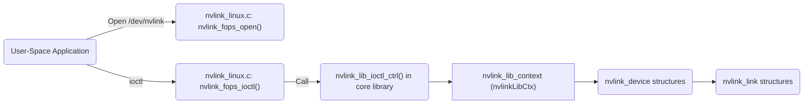

<!-- source: DeepWiki mcp.deepwiki.com · repo NVIDIA/open-gpu-kernel-modules · page 5.4 NVLink and NVSwitch · fetched 2026-10-26 -->

# 5.4 NVLink and NVSwitch

<details>
<summary>Relevant source files</summary>

The following files were used as context for generating this wiki page:

- [kernel-open/nvidia/nvlink_export.h](kernel-open/nvidia/nvlink_export.h)
- [kernel-open/nvidia/nvlink_linux.c](kernel-open/nvidia/nvlink_linux.c)
- [src/common/nvlink/interface/nvlink.h](src/common/nvlink/interface/nvlink.h)
- [src/common/nvlink/interface/nvlink_export.h](src/common/nvlink/interface/nvlink_export.h)
- [src/common/nvlink/kernel/nvlink/nvlink_lib_mgmt.c](src/common/nvlink/kernel/nvlink/nvlink_lib_mgmt.c)
- [src/common/nvswitch/kernel/inc/lr10/lr10.h](src/common/nvswitch/kernel/inc/lr10/lr10.h)
- [src/common/nvswitch/kernel/inc/ls10/ls10.h](src/common/nvswitch/kernel/inc/ls10/ls10.h)
- [src/common/nvswitch/kernel/lr10/link_lr10.c](src/common/nvswitch/kernel/lr10/link_lr10.c)
- [src/common/nvswitch/kernel/ls10/intr_ls10.c](src/common/nvswitch/kernel/ls10/intr_ls10.c)
- [src/common/nvswitch/kernel/ls10/link_ls10.c](src/common/nvswitch/kernel/ls10/link_ls10.c)
- [src/common/sdk/nvidia/inc/ctrl/ctrla080.h](src/common/sdk/nvidia/inc/ctrl/ctrla080.h)

</details>


## Purpose and Scope

This section documents the NVLink core library, its Linux integration shim, and the NVSwitch (LR10/LS10) driver code responsible for managing NVIDIA GPU interconnect topologies. NVLink and NVSwitch are key technologies enabling high-bandwidth, low-latency connections between GPUs and other devices, forming complex fabric topologies for optimal data movement.

We delve into the internal implementation details of the NVLink core library, the Linux driver layer that exposes NVLink functionality to user-space via ioctl interfaces, and the NVSwitch driver code designed for LR10 (first-generation) and LS10 (latest generation) NVSwitch silicon. The discussion covers their data flow, key components, and critical functions involved in device and link management, interrupt handling, and link training.

---

## 1. NVLink Core Library

### Overview

The NVLink core library provides the core data structures, synchronization, and device management capabilities required to interact with NVLink-enabled devices. It maintains global state, device and link lists, and encapsulates NVLink-specific control logic.

### Implementation Details

- The central global context is the `nvlink_lib_context` (instance: `nvlinkLibCtx`), implemented in [`src/common/nvlink/kernel/nvlink/nvlink_lib_mgmt.c:32-96`]().

- Initialization (`nvlink_lib_initialize`) allocates and acquires a top-level lock, initializes linked lists for device, intra-node, and inter-node connections, and sets initial context values such as `registeredEndpoints` and `connectedEndpoints`.

- The device list head is maintained in `nvlinkLibCtx.nv_devicelist_head`, which tracks registered NVLink devices in the system.

- The library provides status-check functions such as `nvlink_lib_is_initialized()` and `nvlink_lib_is_device_list_empty()` for tracking the core library state.

- It also offers helper queries like `nvlink_lib_return_device_count_by_type()` to count devices by their NVLink device type (e.g., GPU, NVSwitch).

### Key Data Structures

```c
typedef struct nvlink_device {
    NVListRec node;                     // Linking node
    NVListRec link_list;                // List of associated NVLink links
    NvU64 deviceId;                    // Unique device identifier
    char *driverName;                  // Driver name string
    char *deviceName;                  // Device name string
    NvU8 *uuid;                       // Unique identifier
    struct nvlink_pci_info pciInfo;   // PCIe info
    NvU64 type;                       // Device type, e.g. GPU, NVSwitch
    NvBool initialized;               // Initialization indicator
    NvBool enableALI;                 // Training type
    NvU16 nodeId;                     // Fabric node ID
    NvBool bReducedNvlinkConfig;      // Reduced config device flag
    void *pDevInfo;                   // Pointer to private device info (e.g. LR10 or LS10 state)
    NvU32 linkStateSupportedMask;     // Supported link states mask
    NvBool bLinkStatesSymmetric;      // Symmetry of link state transitions
} nvlink_device;
```

### Data Flow

- User-space interacts with NVLink devices via ioctl calls routed to the Linux integration shim, which then calls into the core library functions declared in headers such as `nvlink_export.h`.

- Operations such as device enumeration, link training, error reporting, and configuration changes pass through the core library interfaces to the underlying device drivers.

---

## 2. Linux Integration Shim (`nvlink_linux.c`)

### Overview

This shim exposes the NVLink core library to Linux user-space through a character device driver interface. It handles device file creation, ioctl call dispatching, procfs entry management for debug and permission reporting, and capability handling.

### Key Implementation Details

- Character device context `_nvlink_drvctx` maintains the state including a mutex for concurrency, device number, and an opened flag ([`kernel-open/nvidia/nvlink_linux.c:57-65`]).

- File operations:

  - `nvlink_fops_open()`: Opens the driver, ensuring exclusive access, allocates private data maintaining open capabilities ([lines 171-203]).

  - `nvlink_fops_release()`: Cleans up on file close, releasing capability file descriptors ([lines 204-231]).

  - `nvlink_fops_ioctl()`: Handles IOCTLs passed from user-space, forwarding to `nvlink_lib_ioctl_ctrl()` in the NVLink core library with allocated parameter buffers ([lines 233-251] and beyond).

- Filesystem interface (`procfs`):

  - Creates a procfs directory `/proc/driver/nvidia-nvlink` with a `permissions` entry to specify device file permissions ([lines 71-169]).

- Driver initialization registers the character device major number and procfs entries; cleanup removes them.

### Data Flow

_User-space application_ → `/dev/nvlink` (character device) → `nvlink_fops_ioctl()` → NVLink core library ioctl handler → device/link management.

---

## 3. NVSwitch Driver Code for LR10 and LS10

### Overview

NVSwitch is the network switch component providing interconnect topology between multiple NVLink links typically in multi-GPU systems. Two generations are primarily supported: LR10 (older) and LS10 (latest). The driver abstracts NVSwitch hardware engines, registers, link training, interrupt handling, and error management.

### Architecture

- **Device model:** The NVSwitch device is represented by an `nvswitch_device` structure containing arrays of links (`nvlink_link`), representing NVLink ports connected to the switch.

- **Links and Engines:** Each link corresponds to a physical NVLink port with states for training and error reporting. The switch consists of multiple engines (e.g. NVLTLC, NVLDL, NVLIPT) representing hardware IP blocks implementing link-level and switch-level functionality ([`src/common/nvswitch/kernel/inc/lr10/lr10.h`](#), [`ls10.h`](#)).

- **Interrupt Handling:** Interrupts from various NVSwitch units (MINION, NVLIPT, etc.) are handled in dedicated interrupt source files, such as `intr_ls10.c`.

### LR10 Link Management

- Managed in `link_lr10.c`, this code handles link loopback mode setup, PLL initialization, and applying board-specific workarounds including masks for disconnected remote links.

- Functions like `nvswitch_setup_link_loopback_mode_lr10()` apply necessary commands to link minion microcontrollers to set loopback parameters ([`src/common/nvswitch/kernel/lr10/link_lr10.c:113-181`]).

- Link PLL setup involves polling status registers with timeouts to ensure stable link clocking and stable link training [lines 183-207].

### LS10 Link Management

- The LS10 driver code (`link_ls10.c`) programs throughput counters, initializes low-power registers, trains links, and notifies clients upon port up events.

- The function `_nvswitch_configure_reserved_throughput_counters()` configures hardware counters for monitoring link throughput dedicated to telemetry and debugging ([`src/common/nvswitch/kernel/ls10/link_ls10.c:50-105`]).

- Low power register initialization ensures link energy efficiency with VBIOS thresholds ([lines 132-153]).

- Upon training completion (`nvswitch_corelib_training_complete_ls10`), interrupts are enabled and throughput counters configured to signal link readiness ([lines 156-175]).

### Interrupt Handling

- Interrupts for LS10 switches are managed in `intr_ls10.c`, which initializes MINION and NVLIPT interrupt enablers per link, ensuring proper routing and handling of fatal and non-fatal errors ([`src/common/nvswitch/kernel/ls10/intr_ls10.c:88-129`]).

---

## 4. Key Classes/Functions and Their Roles

| Name                                 | Location                                  | Role/Description                                                |
|------------------------------------ |-----------------------------------------|----------------------------------------------------------------|
| `nvlink_lib_initialize()`           | `nvlink_lib_mgmt.c:40-97`                | Initialize NVLink core library context and data structures     |
| `nvlink_lib_unload()`               | `nvlink_lib_mgmt.c:104-136`              | Unload NVLink core library and cleanup resources               |
| `nvlink_lib_is_initialized()`       | `nvlink_lib_mgmt.c:143-147`              | Check if NVLink library is initialized                         |
| `nvlink_lib_return_device_count_by_type()` | `nvlink_lib_mgmt.c:210-224`        | Query NVLink devices by device type                            |
| `nvlink_fops_open()`                 | `nvlink_linux.c:171-203`                  | Opens NVLink char device, initializes file-related data        |
| `nvlink_fops_release()`              | `nvlink_linux.c:204-231`                  | Releases NVLink file descriptor and state                      |
| `nvlink_fops_ioctl()`                | `nvlink_linux.c:233-251+` (truncated)    | Handle IOCTL commands forwarded to NVLink core library          |
| `nvswitch_setup_link_loopback_mode_lr10()` | `link_lr10.c:113-181`                  | Setup loopback mode and NEA/NEDR/NEDW flags on a LR10 NVSwitch link |
| `_nvswitch_ioctrl_setup_link_plls_lr10()` | `link_lr10.c:183-207`                  | Initialize PLLs on NVLink link for LR10                        |
| `_nvswitch_configure_reserved_throughput_counters()` | `link_ls10.c:50-105`             | Configure hardware throughput counters for Ls10 links         |
| `nvswitch_corelib_training_complete_ls10()` | `link_ls10.c:156-175`             | Called after link training complete, enabling interrupts       |
| `_nvswitch_initialize_minion_interrupts()` | `intr_ls10.c:88-129`                  | Initialize MINION interrupt routing for links on LS10 switches |
| `_nvswitch_initialize_nvlipt_interrupts_ls10()` | `intr_ls10.c:131-175`             | Enable various NVLIPT interrupts at multiple engine levels     |

---

## 5. Data Flow and Relationships

### NVLink Core Library and Linux Shim Interaction



This diagram shows user-space interaction via character device open and ioctl calls, routed through the Linux shim to the core NVLink library, managing devices and links.

### NVSwitch Device and Links (LS10/LR10) Interactions

```mermaid
graph TD
  subgraph LR10_NVSwitch
    LRL[NVLink Link (lr10)] -->|Loopback setup, PLL init| LR10_FUNC["link_lr10.c functions"]
    LR10_FUNC -->|Send commands| MIN_LR10_MINION["Minion LR10 controller"]
  end

  subgraph LS10_NVSwitch
    LSL[NVLink Link (ls10)] -->|Throughput counters config| LS10_LINK_CFG["link_ls10.c functions"]
    LS10_LINK_CFG -->|Enable interrupts| LS10_INTR["intr_ls10.c handlers"]
  end

  NVS_SWITCH("nvswitch_device struct") --> LRL
  NVS_SWITCH --> LSL
```

This diagram details how LR10 and LS10 NVSwitch driver code manages their links with specialized functions for link setup, PLL initialization, counters, and interrupt handling, interacting with hardware IP blocks.

---

## 6. Summary

This section covered the following technical details for NVLink and NVSwitch in the NVIDIA Open GPU Kernel Modules:

- The NVLink core library manages the registration, device and link lists, synchronization, and core NVLink logic.

- The Linux integration shim (`nvlink_linux.c`) provides a character device interface exposing NVLink ioctl commands to user-space with proper file management and procfs debug interfaces.

- NVSwitch devices of types LR10 and LS10 are managed in separate driver codebases (`link_lr10.c` and `link_ls10.c`), with logic for link training, loopback modes, PLL initialization, throughput counters, and error/interrupt handling.

- Interrupt routines in `intr_ls10.c` enable fine-grained handling of various NVSwitch engine interrupts to ensure proper error reporting and device operation.

These components work in harmony to present stable and configurable NVLink interconnect topologies, allowing GPUs and related NVLink-capable devices to form complex high-speed fabrics.

---

## References

- Linux Integration Shim: `kernel-open/nvidia/nvlink_linux.c:1-251+`
- NVLink Core Library Management: `src/common/nvlink/kernel/nvlink/nvlink_lib_mgmt.c:32-224`
- NVSwitch LS10 Interrupt Handling: `src/common/nvswitch/kernel/ls10/intr_ls10.c:88-175`
- NVSwitch LS10 Link Management: `src/common/nvswitch/kernel/ls10/link_ls10.c:50-175`
- NVSwitch LR10 Link Management: `src/common/nvswitch/kernel/lr10/link_lr10.c:113-207`
- NVLink Core Interface and Types: `src/common/nvlink/interface/nvlink.h:28-236`
- NVSwitch LR10 Common Defines: `src/common/nvswitch/kernel/inc/lr10/lr10.h:24-166`
- NVSwitch LS10 Common Defines: `src/common/nvswitch/kernel/inc/ls10/ls10.h:24-134`

Sources:  
`kernel-open/nvidia/nvlink_linux.c`,  
`src/common/nvlink/kernel/nvlink/nvlink_lib_mgmt.c`,  
`src/common/nvswitch/kernel/ls10/intr_ls10.c`,  
`src/common/nvswitch/kernel/ls10/link_ls10.c`,  
`src/common/nvswitch/kernel/lr10/link_lr10.c`,  
`src/common/nvlink/interface/nvlink.h`,  
`src/common/nvswitch/kernel/inc/lr10/lr10.h`,  
`src/common/nvswitch/kernel/inc/ls10/ls10.h`

---

