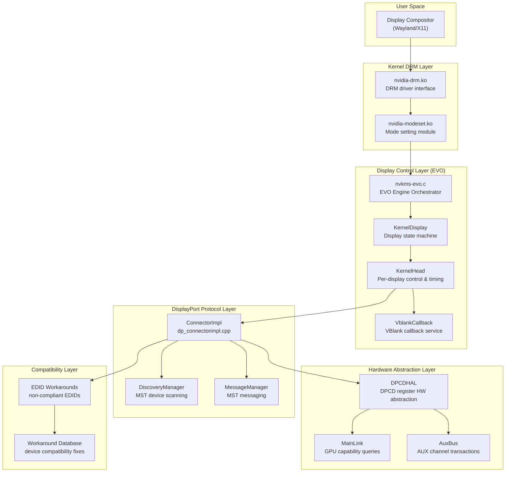
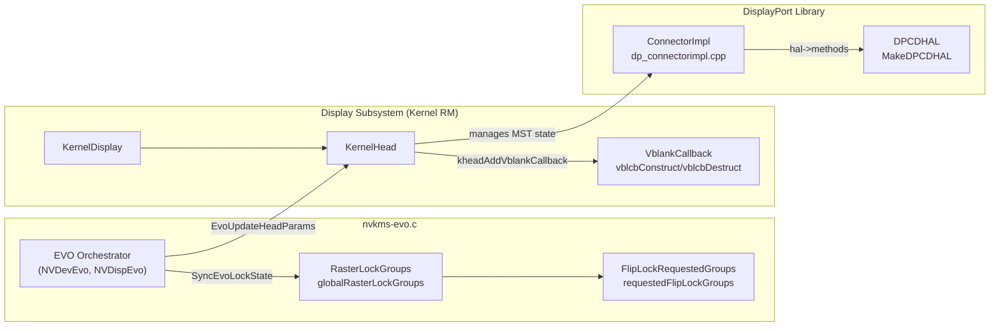
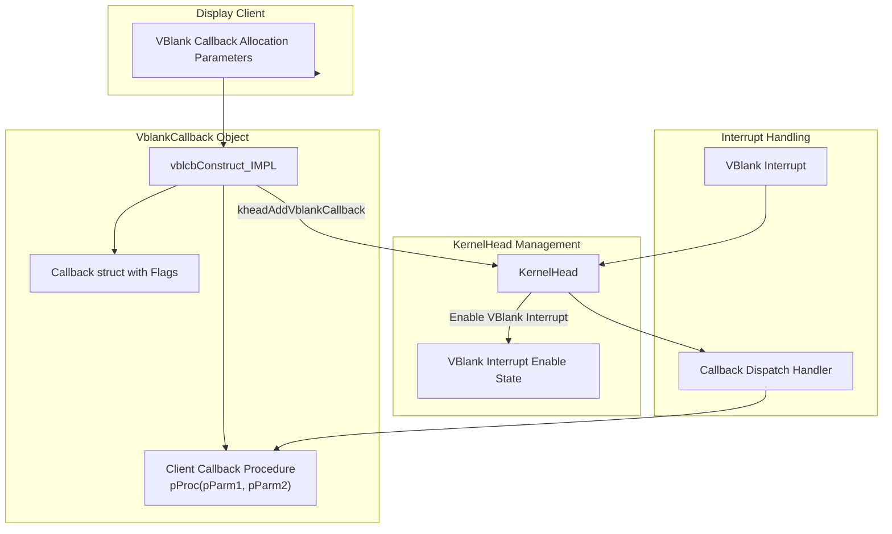

<!-- source: DeepWiki mcp.deepwiki.com · repo NVIDIA/open-gpu-kernel-modules · page 6 Display Subsystem · fetched 2026-10-26 -->

# Display Subsystem

Relevant source files

The following files were used as context for generating this wiki page:

- [src/common/sdk/nvidia/inc/ctrl/ctrl0073/ctrl0073system.h](src/common/sdk/nvidia/inc/ctrl/ctrl0073/ctrl0073system.h)
- [src/nvidia/src/kernel/gpu/disp/disp_common_kern_ctrl_minimal.c](src/nvidia/src/kernel/gpu/disp/disp_common_kern_ctrl_minimal.c)

## Purpose and Scope

The Display Subsystem manages the complete lifecycle of video output operations within the NVIDIA Open GPU Kernel Modules. It handles everything from display engine control and vertical blank (VBlank) callback synchronization, through DisplayPort connectivity, link training, and downstream MST/SST stream management. This subsystem acts as the bridge between user space mode setting and compositor components and the low-level hardware registers, GPU System Processor (GSP) firmware interfaces, and DisplayPort protocol handling.

It coordinates multiple layers including the kernel heads representing physical display pipelines, the VBlank callback system for frame synchronization, and the DisplayPort connector state machines governing downstream device discovery and link management.

For detailed technical depth on each component, refer to the specialized child pages:

- See [Display Control Interface](#6.1) for display engine control, kernel head management, and VBlank synchronization details.
- See [DisplayPort Core](#6.2) for the ConnectorImpl design, device discovery, EDID processing, and hardware abstraction layer.
- See [DisplayPort Link Training and Streams](#6.3) for procedures around link training, compound queries, MST & SST stream handling, and Display Stream Compression (DSC).
- See [DisplayPort Device Compatibility](#6.4) for the database and logic implementing device-specific EDID and OUI workarounds for non-compliant hardware.
- See [EDID and Mode Timing Library](#6.5) for shared EDID parsing, CEA-861 extensions, and timing calculations used by both NVKMS and DisplayPort components.

**Sources:**  
[src/common/displayport/src/dp_connectorimpl.cpp:1-173](),  
[src/nvidia/src/kernel/gpu/disp/vblank_callback/vblank_callback.c:1-162](),  
[src/nvidia-modeset/src/nvkms-evo.c:87-130]()

---

## Architecture Overview

The Display Subsystem is organized into modular layers separating concerns among hardware abstraction, protocol handling, display timing, and synchronization. This layered approach allows independent development and maintenance of complex features like MST device topology management, VBlank synchronization, and GPU display engine control.

This architecture consolidates GPU display control (KernelHead, EVO orchestrator), VBlank callback synchronization, and DisplayPort protocol state machines into a cohesive system enabling multi-display and multi-stream operations.

**Sources:**  
[src/common/displayport/src/dp_connectorimpl.cpp:67-169](),  
[src/nvidia/src/kernel/gpu/disp/vblank_callback/vblank_callback.c:35-51](),  
[src/nvidia-modeset/src/nvkms-evo.c:100-130]()

---

## Core Abstractions

### Display Control Objects

The NVKMS API defines key objects for managing display resources:

| Object / Handle | Description                                                                                  | Location/Reference                                |
|-----------------|----------------------------------------------------------------------------------------------|--------------------------------------------------|
| `NVDevEvo`      | Represents a GPU device or SLI group; manages device-level display engine orchestration.     | [src/nvidia-modeset/src/nvkms-evo.c:190-195]()  |
| `NVDispEvo`     | Represents an individual programmable display engine instance for each display head.         | [src/nvidia-modeset/src/nvkms-evo.c:87-99]()    |
| `KernelHead`    | Per-display pipeline object handling display timing, VBlank interrupts, and hardware control.| Kernel Resource Manager core                      |
| `VblankCallback`| Object representing registered callbacks that trigger on vertical blank interrupts.          | [src/nvidia/src/kernel/gpu/disp/vblank_callback/vblank_callback.c:35-108]() |
| `NVDpyId`       | Unique identifier for each logical display connection (persists for MST topologies).         | [src/nvidia-modeset/interface/nvkms-api.h:121-140]() |

These abstractions enable flexible management of physical and virtual display paths, coordinating GPU display heads, timing, and synchronization mechanisms.

### DisplayPort Objects

DisplayPort protocol-related state and hardware management is encapsulated in these classes:

| Class           | Role                                                                | Location/Reference                             |
|-----------------|---------------------------------------------------------------------|------------------------------------------------|
| `ConnectorImpl` | Manages DisplayPort connector state, link training, and MST device trees. | [src/common/displayport/src/dp_connectorimpl.cpp:69-173]() |
| `DiscoveryManager` | Handles MST topology scanning and downstream device enumeration. | DP library component (kernel external)          |
| `MessageManager` | Manages MST downstream message queue and AUX transactions.        | DP library component                             |
| `DPCDHAL`       | Hardware Abstraction Layer for DPCD register access and GPU capability queries. | [src/common/displayport/src/dp_connectorimpl.cpp:145-168]() |

**Sources:**  
[src/common/displayport/src/dp_connectorimpl.cpp:69-173](),  
[src/nvidia/src/kernel/gpu/disp/vblank_callback/vblank_callback.c:35-108](),  
[src/nvidia-modeset/interface/nvkms-api.h:39-89]()

---

## Component Integration

The integration between display control in kernel mode and the DisplayPort protocol stack involves synchronization of global state and timing:

This interaction supports multi-GPU raster lock synchronization, flip locking for tearing prevention, and dynamic MST device management via ConnectorImpl.

**Sources:**  
[src/nvidia-modeset/src/nvkms-evo.c:85-130](),  
[src/nvidia/src/kernel/gpu/disp/vblank_callback/vblank_callback.c:99-107]()

---

## VBlank Synchronization System

Frame synchronization is provided by the VBlank callback mechanism, allowing registered client callbacks to run during vertical blank intervals for timely LUT updates and other display-relevant operations.

The system ensures low-latency, persistent notifications by registering callbacks with KernelHead objects, triggered on each VBlank interrupt for precise timing.

**Sources:**  
[src/nvidia/src/kernel/gpu/disp/vblank_callback/vblank_callback.c:35-108](),  
[src/nvidia/src/kernel/gpu/disp/vblank_callback/vblank_callback.c:125-161]()

---

## DisplayPort Connector State Machine

The `ConnectorImpl` class embodies the DisplayPort connector management and link training logic:

- Initializes the HAL to abstract DPCD register access and queries device capabilities such as Forward Error Correction (FEC) support and LTTPR presence.
- Tracks link state progression through states like `DP_TRANSPORT_MODE_INIT`.
- Manages MST and SST modes, link bandwidth allocation, and dynamic update of downstream displays.
- Raises events (`NVKMS_EVENT_TYPE_DYNAMIC_DPY_CONNECTED`) when MST devices connect or disconnect.
- Maintains hotplug state, AUX activity, and link reset logic.

ConnectorImpl thus forms the core logic for DisplayPort management, working closely with hardware abstraction and kernel display control.

For a deeper examination, see [DisplayPort Core](#6.2) and [DisplayPort Link Training and Streams](#6.3).

**Sources:**  
[src/common/displayport/src/dp_connectorimpl.cpp:69-173](),  
[src/nvidia-modeset/interface/nvkms-api.h:119-141]()

---

## Display Error Handling and Recovery

The display subsystem integrates with the kernel Robust Channel (`KernelRc`) infrastructure for error detection and recovery:

- Detects and recovers from link training failures, VBlank timeouts, protocol violations, and corrupted auxiliary transactions.
- Provides configurable recovery policies via registry controls, enabling robust error handling in production and debug modes.
- Supports watchdog timers with adjustable timeouts and intervals for automatic recovery actions.

| Feature                  | Description                                                       | Registry/Code Reference                          |
|--------------------------|-----------------------------------------------------------------|-------------------------------------------------|
| Robust Channel Enable    | Controlled by `NV_REG_STR_RM_ROBUST_CHANNELS` registry key       | [src/nvidia/src/kernel/gpu/rc/kernel_rc.c:72-84]() |
| Watchdog Timeout         | Configurable watchdog timeout and intervals                      | [src/nvidia/src/kernel/gpu/rc/kernel_rc.c:147-194]() |

This subsystem improves display pipeline stability and enables graceful recovery during hardware faults.

**Sources:**  
[src/nvidia/src/kernel/gpu/rc/kernel_rc.c:72-211]()

---

## Configuration and Policy

Various runtime flags configure DisplayPort and display behavior during operation:

| Configuration Key          | Effect Description                                                              | Source Reference                                 |
|----------------------------|---------------------------------------------------------------------------------|--------------------------------------------------|
| `bHdcpAuthOnlyOnDemand`    | Defers HDCP authentication until explicitly requested to reduce overhead.        | [src/common/displayport/src/dp_connectorimpl.cpp:180-187]() |
| `bKeepLinkAliveMST`        | Keeps DP link active in MST mode without streams to avoid flicker on reconnect.  | [src/common/displayport/src/dp_connectorimpl.cpp:190-195]() |
| `bSkipAssessLinkForEDP`    | Skips costly link assessments on embedded DisplayPort to accelerate resume.      | [src/common/displayport/src/dp_connectorimpl.cpp:175-182]() |
| `bDisableSSC`              | Disables Spread Spectrum Clocking, typically for debug purposes.                 | [src/common/displayport/src/dp_connectorimpl.cpp:195-201]() |

These options are mainly configurable via registry values or driver properties, affecting link training policy and power management.

**Sources:**  
[src/common/displayport/src/dp_connectorimpl.cpp:175-201]()

---

## Child Pages

For in-depth information, see these child pages detailing individual components:

- [Display Control Interface](#6.1): Display engine control, kernel heads, and VBlank synchronization mechanisms.
- [DisplayPort Core](#6.2): ConnectorImpl architecture, device discovery, EDID parsing, and HAL.
- [DisplayPort Link Training and Streams](#6.3): Link training procedures, compound queries, MST/SST stream handling, DSC.
- [DisplayPort Device Compatibility](#6.4): Workaround database for EDID and OUI-based compatibility fixes for non-compliant devices.
- [EDID and Mode Timing Library](#6.5): Shared modeset timing library with EDID parsing, CEA-861 extensions, and timing calculations.

---

# End of 6. Display Subsystem

---

