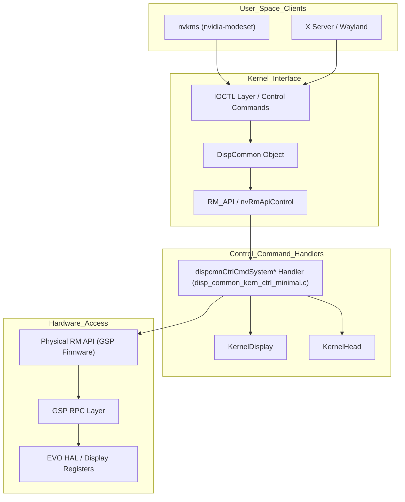
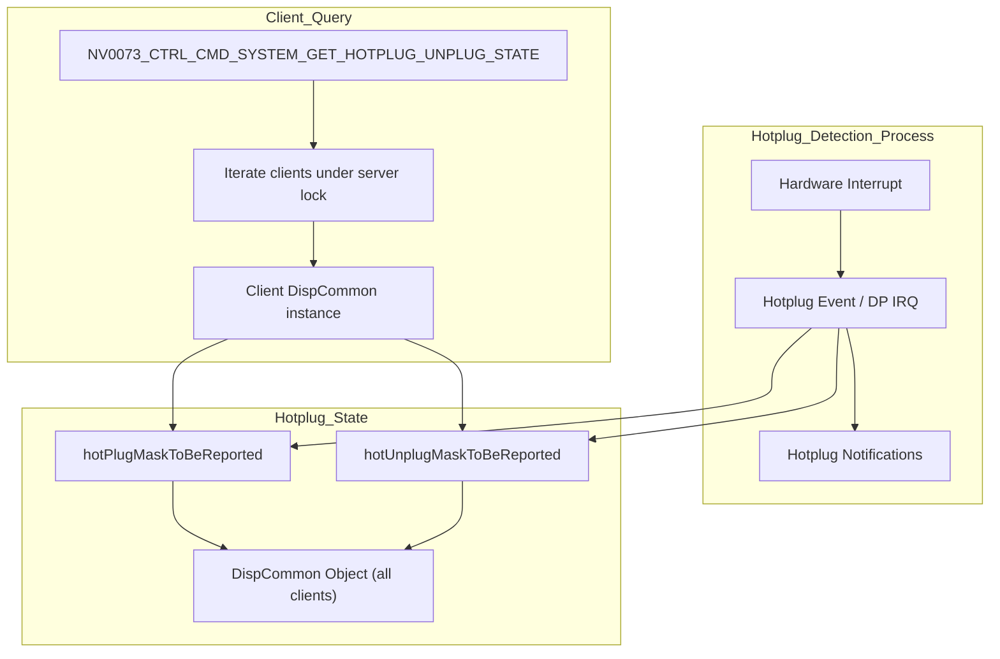
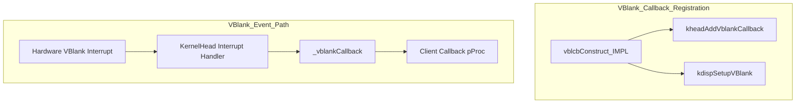
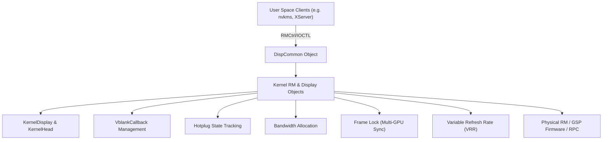

<!-- source: DeepWiki mcp.deepwiki.com · repo NVIDIA/open-gpu-kernel-modules · page 6.1 Display Control Interface · fetched 2026-10-26 -->

# Display Control Interface

Relevant source files

The following files were used as context for generating this wiki page:

- [src/common/sdk/nvidia/inc/ctrl/ctrl0073/ctrl0073system.h](src/common/sdk/nvidia/inc/ctrl/ctrl0073/ctrl0073system.h)
- [src/nvidia/generated/g_chipset_nvoc.h](src/nvidia/generated/g_chipset_nvoc.h)
- [src/nvidia/generated/g_disp_objs_nvoc.c](src/nvidia/generated/g_disp_objs_nvoc.c)
- [src/nvidia/generated/g_disp_objs_nvoc.h](src/nvidia/generated/g_disp_objs_nvoc.h)
- [src/nvidia/src/kernel/gpu/disp/disp_common_kern_ctrl_minimal.c](src/nvidia/src/kernel/gpu/disp/disp_common_kern_ctrl_minimal.c)
- [src/nvidia/src/kernel/gpu/disp/vblank_callback/vblank_callback.c](src/nvidia/src/kernel/gpu/disp/vblank_callback/vblank_callback.c)
- [src/nvidia/src/kernel/gpu/rc/kernel_rc.c](src/nvidia/src/kernel/gpu/rc/kernel_rc.c)

The Display Control Interface provides detailed control over the display engine hardware, kernel display heads, display objects, and vertical blank (VBlank) synchronization mechanisms within NVIDIA's Open GPU Kernel Modules. It defines the architecture for managing mode setting, hotplug detection, bandwidth allocation, VBlank callbacks, multi-GPU synchronization (frame lock), and variable refresh rate (VRR).

This interface primarily functions underneath the NVIDIA mode setting and DRM kernel modules (`nvidia-modeset.ko` and `nvidia-drm.ko`), interfacing directly with the kernel display objects and physical resource management layers such as the GSP firmware.

---

## Control Command Architecture

Display control commands are issued as Resource Manager Control (RMCtrl) commands, identified by command IDs prefixed with `NV0073_CTRL_CMD_SYSTEM_*`. These commands are dispatched through the root `DispCommon` object and handled either by kernel RM or physical RM, depending on the command semantics. The kernel RM layer implements core command handlers located in `disp_common_kern_ctrl_minimal.c`.

Key kernel-level objects involved include:

- **DispCommon**: The generic display resource object that routes control commands.
- **KernelDisplay**: The kernel representation of a display controller instance.
- **KernelHead**: Logical display heads (scanout engines) under KernelDisplay.
- **Physical RM API / GSP RPC Layer / EVO HAL**: The lower firmware or hardware command layers accessed indirectly through kernel RM.

_Sources: [ctrl0073system.h:36-93](), [disp_common_kern_ctrl_minimal.c:24-46](), [nvkms-evo.c:45-52]()_

---

## Hotplug Management

Hotplug detection handles dynamic connection and disconnection of display devices. The interface aggregates hotplug event states across multiple clients via the `DispCommon` objects to avoid redundant notifications and coordinate consistent hardware state.

### Hotplug State Tracking

The kernel tracks two masks per `DispCommon` resource:

- `hotPlugMaskToBeReported`: Pending mask for new display connections.
- `hotUnplugMaskToBeReported`: Pending mask for disconnections.

When clients query the hotplug state using `NV0073_CTRL_CMD_SYSTEM_GET_HOTPLUG_UNPLUG_STATE`, these masks are aggregated, cleared, and relevant clients are notified.

**Key related control commands:**

| Command                                         | Description                          | Parameters                       |
|------------------------------------------------|------------------------------------|---------------------------------|
| `NV0073_CTRL_CMD_SYSTEM_GET_HOTPLUG_UNPLUG_STATE` | Query aggregated hotplug/unplug state | `hotPlugMask`, `hotUnplugMask`    |
| `NV0073_CTRL_CMD_SYSTEM_GET_HOTPLUG_CONFIG`       | Query hotplug interrupt configuration | `hotplugEventMask`, `hotplugInterruptible` |

_Sources: [disp_common_kern_ctrl_minimal.c:50-106](), [ctrl0073system.h:132-140]()_

---

## Bandwidth Allocation

Memory bandwidth allocation is critical for display performance, especially with multi-head or high resolution setups. The interface supports display bandwidth arbitration and allocation via the command `NV0073_CTRL_CMD_SYSTEM_ALLOCATE_DISPLAY_BANDWIDTH`.

The implementation in `dispcmnCtrlCmdSystemAllocateDisplayBandwidth_IMPL` decides whether the kernel RM or physical RM handles the allocation based on a property (`PDB_PROP_KDISP_IMP_ALLOC_BW_IN_KERNEL_RM_DEF`) exposed by `KernelDisplay`. When handled by kernel RM, it uses `kdispArbAndAllocDisplayBandwidth_HAL`; otherwise, it forwards the request to physical RM.

Parameters include bandwidth in KB/s (`averageBandwidthKBPS` and `floorBandwidthKBPS`).

_Sources: [disp_common_kern_ctrl_minimal.c:112-174](), [ctrl0073system.h:58-59]()_

---

## VBlank Management and Synchronization

Vertical Blank (VBlank) represents the start of a display refresh cycle and is essential for synchronization purposes (e.g., preventing screen tearing).

### VBlank Callback Registration and Invocation

Clients can register a `VblankCallback` object to receive notifications when a VBlank event occurs on a specific logical head.

- The constructor `vblcbConstruct_IMPL` initializes the callback and associates it with a `KernelHead`.
- `_vblankCallback` is the internal handler invoked by kernel head interrupts; it calls the client-registered procedure (`pProc`) if enabled.
- Clients may dynamically enable or disable VBlank notifications via `vblcbCtrlSetVBlankNotification_IMPL`.
- When enabled, hardware VBlank interrupts are configured and routed through kernel heads.

### VBlank Counter Query

- Commands allow querying the current VBlank count per head, with optional low latency hint optimization.
- On GSP-enabled platforms, `kheadGetVblankLowLatencyCounter_HAL` is used for timely accurate VBlank counts.
- Otherwise, counters are read from shared data stored in `KernelDisplay`.

**Relevant commands:**

| Command                                   | Purpose                                   | Parameters           |
|------------------------------------------|-------------------------------------------|----------------------|
| `NV0073_CTRL_CMD_SYSTEM_GET_VBLANK_COUNTER` | Retrieve current VBlank count for a head | `head`, `lowLatencyHint` |
| `NV9010_CTRL_CMD_SET_VBLANK_NOTIFICATION`    | Enable/disable VBlank callback triggering | `bSetVBlankNotifyEnable` |

_Sources: [vblank_callback.c:35-108,126-161](), [disp_common_kern_ctrl_minimal.c:35-42]()_

---

## Variable Refresh Rate (VRR)

The display driver supports Variable Refresh Rate, providing dynamic refresh timing adaptation.

- Control commands such as `dispcmnCtrlCmdVRRSetRgLineActive_IMPL` enable VRR functionality.
- On GSP platforms, the driver registers shared memory (`NV0073_CTRL_RM_VRR_SHARED_DATA`) allowing the GSP firmware to write low latency frame timing and flip delay data.
- This shared buffer facilitates fast, accurate VRR synchronization between host and firmware.

_Sources: [disp_common_kern_ctrl_minimal.c:28-33](), [ctrl0073system.h:62-67]()_

---

## Multi-GPU Synchronization (Frame Lock)

To enable synchronized output across multiple GPUs and displays (such as in multi-GPU professional setups), the driver implements frame lock / GSync support.

### Raster Lock Group and GSync Event Processing

- Multiple `NVDispEvo` pointers representing display objects participate in frame lock as members of a `RasterLockGroup`.
- Frame Lock events, indicating sync state changes (sync lost or ready), are reported by the RM via a notifier to the function `FrameLockEvent` (in `nvkms-framelock.c`).
- Events are queued and handled via deferred timers to avoid race conditions.
- Upon receiving an event, the driver issues `NV30F1_CTRL_CMD_GSYNC_GET_STATUS_SYNC` to query the GPU's current sync readiness and updates `syncReadyLast`.
- Changes in sync state are then signaled to clients.

```mermaid
graph LR
    subgraph Lock_Grouping
        RasterLockGroup["RasterLockGroup"]
        DispList["DispEvoList (NVDispEvo pointers)"]
    end
    
    subgraph GSync_Control
        FrameLockEvent["FrameLockEvent Notifier (nvkms-framelock.c)"]
        SyncStatusQuery["NV30F1_CTRL_CMD_GSYNC_GET_STATUS_SYNC"]
        SyncReadyState["syncReadyLast (cached)"]
    end
    
    RasterLockGroup --> DispList
    FrameLockEvent --> SyncStatusQuery
    SyncStatusQuery --> SyncReadyState
```

_Sources: [nvkms-evo.c:85-112](), [nvkms-framelock.c:59-149]()_

---

# Summary

The Display Control Interface in NVIDIA's Open GPU Kernel Modules provides comprehensive kernel-level management of display hardware resources. It implements a layered control design allowing user-space mode setting and DRM modules to interact with low-level kernel display objects and physical resource management layers.

Key features include:

- Command dispatch and handling framework via `DispCommon` and RM API.
- Hotplug event aggregation to support dynamic display connections.
- Bandwidth allocation management critical for modern high-resolution displays.
- Fine-grained VBlank synchronization with callback registrations.
- Support for variable refresh rate with low latency timing data sharing.
- Multi-GPU frame locking mechanisms ensuring synchronized multi-display output.

These capabilities are essential in enabling robust, flexible, and high-performance display functionality across NVIDIA GPUs.

---

# Summary Diagram: Overall Display Control Interface Architecture

---

# Summary Table: Key Code Entities and Responsibilities

| Component / Object            | Responsibility / Role                                | Key Source Files & Lines             |
|------------------------------|-----------------------------------------------------|-------------------------------------|
| `DispCommon`                 | Central object routing display control commands     | `disp_common_kern_ctrl_minimal.c` [48-174]()  |
| `KernelDisplay` & `KernelHead`| Kernel representation of display and logical heads | Used extensively across display code, e.g. `vblank_callback.c` [31-123]() |
| `VblankCallback`             | Client-registered callbacks for VBlank events       | `vblank_callback.c` [35-161]()       |
| Hotplug State Masks          | Aggregate hotplug/unplug event tracking             | `disp_common_kern_ctrl_minimal.c` [50-106]() |
| Bandwidth Allocation Handler | Arbitration and bandwidth resource management        | `disp_common_kern_ctrl_minimal.c` [112-174]() |
| Frame Lock Groups & Notifier | Multi-GPU synchronization and frame lock events     | `nvkms-evo.c` [85-112](), `nvkms-framelock.c` [59-149]() |
| VRR Shared Data Buffer       | Low latency VRR timing sharing with GSP firmware    | `disp_common_kern_ctrl_minimal.c` [28-33]()  |

---

_Sources:_

- `disp_common_kern_ctrl_minimal.c`: 24-174
- `vblank_callback.c`: 35-161
- `nvkms-evo.c`: 45-52, 85-112
- `nvkms-framelock.c`: 59-149
- `ctrl0073system.h`: 36-93, 132-140, 58-59, 62-67

---

