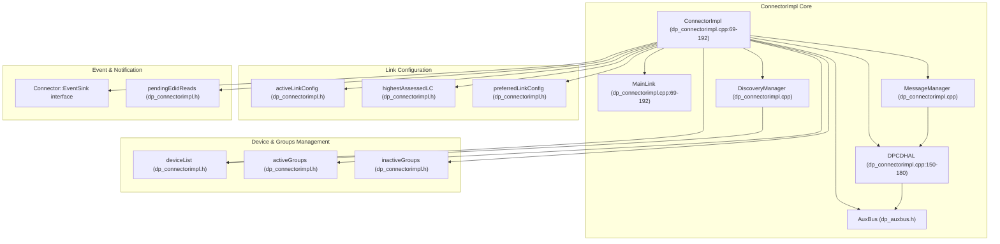
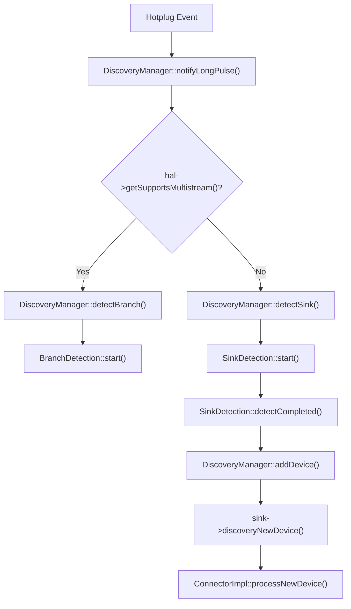
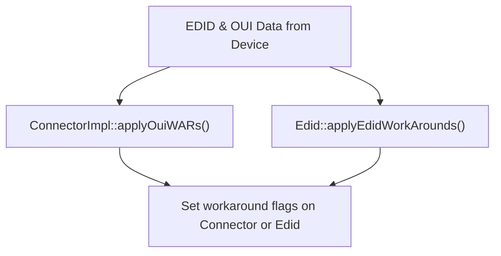
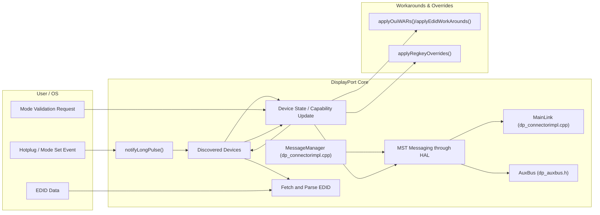

<!-- source: DeepWiki mcp.deepwiki.com · repo NVIDIA/open-gpu-kernel-modules · page 6.2 DisplayPort Core · fetched 2026-10-26 -->

# DisplayPort Core

<details>
<summary>Relevant source files</summary>

The following files were used as context for generating this wiki page:

- [kernel-open/nvidia-drm/nvidia-drm-connector.c](kernel-open/nvidia-drm/nvidia-drm-connector.c)
- [src/common/displayport/inc/dp_auxbus.h](src/common/displayport/inc/dp_auxbus.h)
- [src/common/displayport/inc/dp_deviceimpl.h](src/common/displayport/inc/dp_deviceimpl.h)
- [src/common/displayport/inc/dp_edid.h](src/common/displayport/inc/dp_edid.h)
- [src/common/displayport/inc/dp_evoadapter.h](src/common/displayport/inc/dp_evoadapter.h)
- [src/common/displayport/inc/dp_regkeydatabase.h](src/common/displayport/inc/dp_regkeydatabase.h)
- [src/common/displayport/src/dp_connectorimpl.cpp](src/common/displayport/src/dp_connectorimpl.cpp)
- [src/common/displayport/src/dp_deviceimpl.cpp](src/common/displayport/src/dp_deviceimpl.cpp)
- [src/common/displayport/src/dp_evoadapter.cpp](src/common/displayport/src/dp_evoadapter.cpp)

</details>


## Purpose and Scope

The DisplayPort Core subsystem implements the central connector management logic for DisplayPort interfaces. This page documents the `ConnectorImpl` class and its responsibilities including device discovery, link training, capability detection (such as DSC, FEC, HDCP), EDID processing, and the compound query system for mode validation.

For details on link training, streams, and MST/SST management, see [DisplayPort Link Training and Streams](#6.3). For device compatibility workarounds, see [DisplayPort Device Compatibility](#6.4). For display control interfaces, see [Display Control Interface](#6.1).

---

## Architecture Overview

The DisplayPort Core is centered around the `ConnectorImpl` class, which manages all aspects of a DisplayPort connector including device topology, link configuration, and mode validation.

### Core Components



#### Key Class Members of `ConnectorImpl`

| Member            | Type                        | Purpose                                                 |
|-------------------|-----------------------------|---------------------------------------------------------|
| `main`            | `MainLink*`                 | Controls physical link and training                      |
| `auxBus`          | `AuxBus*`                   | Handles AUX channel transactions                          |
| `hal`             | `DPCDHAL*`                  | Hardware access abstraction for DPCD registers           |
| `messageManager`  | `MessageManager*`            | Manages MST sideband messaging                            |
| `discoveryManager`| `DiscoveryManager*`          | Manages device discovery                                  |
| `deviceList`       | List of `DeviceImpl`         | Devices attached under this connector                     |
| `activeLinkConfig` | `LinkConfiguration`          | Active link training config                               |
| `highestAssessedLC`| `LinkConfiguration`          | Highest link capability found                             |
| `linkState`        | `DP_TRANSPORT_MODE` enum     | Current DP transport state (e.g., INIT, SST, MST)        |
| `sink`             | `Connector::EventSink*`      | Callback interface for events                             |

**Sources:** [src/common/displayport/src/dp_connectorimpl.cpp:69-192](), [src/common/displayport/inc/dp_connectorimpl.h:95-919]()

---

## ConnectorImpl Architecture

`ConnectorImpl` encapsulates all logic to manage a DisplayPort connector and attached devices:

- **Hardware Layers:** Uses `MainLink` to control PHY and link training, `AuxBus` for AUX channel transactions, and `DPCDHAL` for direct DPCD register abstraction.
- **Topology Management:** Maintains device topology as a tree of `DeviceImpl` nodes representing endpoints, MST branches, and logical ports.
- **Capability Detection:** Detects features like HDCP, DSC, FEC, and LTTPR support by querying the link and devices.
- **EDID Handling:** Coordinates asynchronous EDID reads, parsing, and validation through `EdidAssembler` and `Edid` classes.
- **Event Propagation:** Uses `Connector::EventSink` to notify client layers of state changes.
- **Compound Queries:** Manages MST/SST compound queries to check mode compatibility against device topology and link bandwidth.
- **Workarounds & Regkeys:** Applies device-specific hacks and user overrides via registry keys.

Upon creation, `ConnectorImpl` queries GPU capabilities and initializes hardware abstraction:

```c++
ConnectorImpl::ConnectorImpl(MainLink * main, AuxBus * auxBus, Timer * timer, Connector::EventSink * sink)
    : main(main), auxBus(auxBus), timer(timer), sink(sink),
      cachedSourceOUI(0), bOuiCached(false),
      // many other flags and state variables initialized...
{
    firmwareGroup = createFirmwareGroup();
    if (firmwareGroup == NULL)
    {
        constructorFailed = true;
        return;
    }
    main->queryGPUCapability();
    main->queryAndUpdateDfpParams();
    hal = MakeDPCDHAL(auxBus, timer, main);
    if (hal == NULL)
    {
        constructorFailed = true;
        return;
    }
    hal->setPC2Disabled(main->isPC2Disabled());
    hal->setGpuDPSupportedVersions(main->getGpuDpSupportedVersions());
    auxBus->setGpuDPSupportedVersions(main->getGpuDpSupportedVersions());
    hal->setGpuFECSupported(main->isFECSupported());
    hal->setLttprSupported(main->isLttprSupported());
    hal->setPollingEnabledForDpMstDetection(main->isPollingEnabledForDpMstDetection());

    const DP_REGKEY_DATABASE& dpRegkeyDatabase = main->getRegkeyDatabase();
    this->applyRegkeyOverrides(dpRegkeyDatabase);
    hal->applyRegkeyOverrides(dpRegkeyDatabase);

    if (main->isDpTunnelingHwBugWarEnabled())
    {
        hal->setIgnoreDiaLttprInterlaneAlignStatus();
        hal->setIgnoreDiaNonLttprCrDoneStatus();
        hal->setOverrideExtendedWakeCapsForDpTunneling();

        if (!dpRegkeyDatabase.bDisableDpTunLttprCapsChunkRead)
        {
            hal->setChunkedLttprCapsReadForDpTunneling();
        }
    }
    // ...
}
```

This foundational setup configures all hardware capabilities, registers device overrides, and prepares the connector for device discovery and link management.

**Sources:** [src/common/displayport/src/dp_connectorimpl.cpp:69-192]()

---

## Device Discovery and Management

### Discovery Workflow

Device discovery handles identifying connected DisplayPort single-stream and multi-stream devices, including MST branching devices.



- A hotplug event triggers `notifyLongPulse()` in `DiscoveryManager` which checks MST support.
- MST-capable hardware performs branch detection to enumerate downstream devices recursively.
- SST devices directly trigger sink detection for capability queries.
- Discovered devices are added to the connector's device list (`deviceList`) and client layers are notified.
- `ConnectorImpl` process updates topology, policies, and link management accordingly.

**Sources:** [src/common/displayport/src/dp_discovery.cpp:38-166](), [src/common/displayport/src/dp_connectorimpl.cpp:320-760]()

### DeviceImpl: Physical and Logical Devices

`DeviceImpl` represents a physical or logical device in the DP topology. This includes:

- Downstream sinks (monitors, panels)
- MST branch devices distributing streams further
- Logical peer devices within MST topologies

Key data includes:

- Addressing in MST topology (`address`)
- EDID data blocks (`rawEDID`, `processedEdid`, `ddcEdid`)
- Capability flags: HDCP, VRR, DSC, FEC, and multicast stream state
- Parent and child device pointers
- Payload allocation state for MST streams

Device state such as plugged/not, zombie, cable health, and HDCP status is tracked and updated on detection and link changes.

**Sources:** [src/common/displayport/inc/dp_deviceimpl.h](), [src/common/displayport/src/dp_deviceimpl.cpp:39-235]()

### EDID Handling

EDID reading is performed asynchronously over the AUX channel with retry and CRC checks handled by the `EdidAssembler`:

- `readNextRequest()` determines the next segment and offset to read
- `postReply()` processes returned EDID block data, checking validity
- `readIsComplete()` indicates the end of the EDID reading

The `Edid` class holds and verifies the EDID buffer. It supports:

- CRC verification
- Detecting fallback EDID usage
- Applying fixes via `applyEdidWorkArounds()` for known device quirks

This asynchronous state machine model supports reading EDID on both SST and MST devices.

**Sources:** [src/common/displayport/inc/dp_edid.h:53-82](), [src/common/displayport/inc/dp_edid.h:86-210]()

---

## EDID and Device Workarounds

To support interoperability and non-compliant device behaviors, the codebase applies runtime workarounds based on:

- **Source OUI (Organizationally Unique Identifier)** derived from DPCD registers
- **EDID metadata** including manufacturer and product IDs

### OUI-Based Workarounds

The method `ConnectorImpl::applyOuiWARs()` compares the source OUI against known entries and sets flags:

- **Megachips Mystique (OUI 0xE18000):** Keeps link power always on to prevent unwanted retrains
- **Synaptics (OUI 0x24CC90):** Applies latency workaround for enabling B/FEC features
- **Novatek (OUI 0x11EC38):** Fixes MST timeslot leaks

These WAR flags influence link training, power management, and downstream communication.

### EDID-Based Workarounds

The `Edid` class applies fixes via `applyEdidWorkArounds()`:

- Patching wrong extension count reported by some displays (e.g., Acer AL1512)
- Power-on-before-link-training requirements for certain Apple Thunderbolt devices
- Disabling HDMI audio on known failing Westinghouse TVs



These mechanism ensure robust handling of various hardware quirks encountered in the field.

**Sources:** [src/common/displayport/src/dp_wardatabase.cpp](), [src/common/displayport/inc/dp_edid.h](), [src/common/displayport/src/dp_connectorimpl.cpp:1000-1500]() (implied)

---

## Hardware Abstraction Layer (HAL)

To simplify hardware access, `ConnectorImpl` delegates low-level DPCD register operations to a hardware abstraction layer (`DPCDHAL`):

- The HAL abstracts reads/writes to DPCD registers essential for link training and device queries.
- It exposes uniform APIs to confirm GPU-supported DP versions, FEC, LTTPR, and MST features.
- Created in `ConnectorImpl` constructor by `MakeDPCDHAL(auxBus, timer, main)`.
- HAL applies hardware-/firmware-specific overrides and workarounds.

This separation isolates changes in hardware or firmware register semantics, providing a consistent interface for connector logic.

**Sources:** [src/common/displayport/src/dp_connectorimpl.cpp:145-190](), [src/common/displayport/inc/dp_connectorimpl.h]()

---

## Summary Diagram: Mapping Natural Language Concepts to Code Entities



This diagram highlights key code entities involved in:

- Device detection and discovery
- Link training and hardware access
- EDID reading and workarounds
- Client queries and event notifications

**Sources:**  
[src/common/displayport/src/dp_connectorimpl.cpp:69-180, 320-760, 1080-2390](),  
[src/common/displayport/inc/dp_connectorimpl.h](),  
[src/common/displayport/src/dp_discovery.cpp](),  
[src/common/displayport/src/dp_deviceimpl.cpp](),  
[src/common/displayport/src/dp_wardatabase.cpp](),  
[src/common/displayport/inc/dp_regkeydatabase.h](),  
[src/common/displayport/src/dp_evoadapter.cpp:30-130]()

---

## References

- `dp_connectorimpl.cpp` (lines 69-192) — Implementation of `ConnectorImpl` constructor, initialization, and core methods  
- `dp_connectorimpl.h` — Connector class declarations, members, and data structures  
- `dp_discovery.cpp` (lines 38-166) — Device discovery manager and MST branch detection  
- `dp_deviceimpl.cpp` (lines 39-235) — Device representation and state management implementations  
- `dp_edid.h` — EDID reading, parsing, and assembler state machine declarations  
- `dp_wardatabase.cpp` — Device-specific workarounds based on EDID and OUI  
- `dp_regkeydatabase.h`, `dp_evoadapter.cpp` — Registry override handling for hardware and behavior configuration  
- `dp_auxbus.h` — AUX channel interface abstraction  

---

This completes the detailed coverage of the DisplayPort Core architecture focused on `ConnectorImpl`, device discovery, EDID processing, hardware abstraction, and device workaround mechanisms.

---

