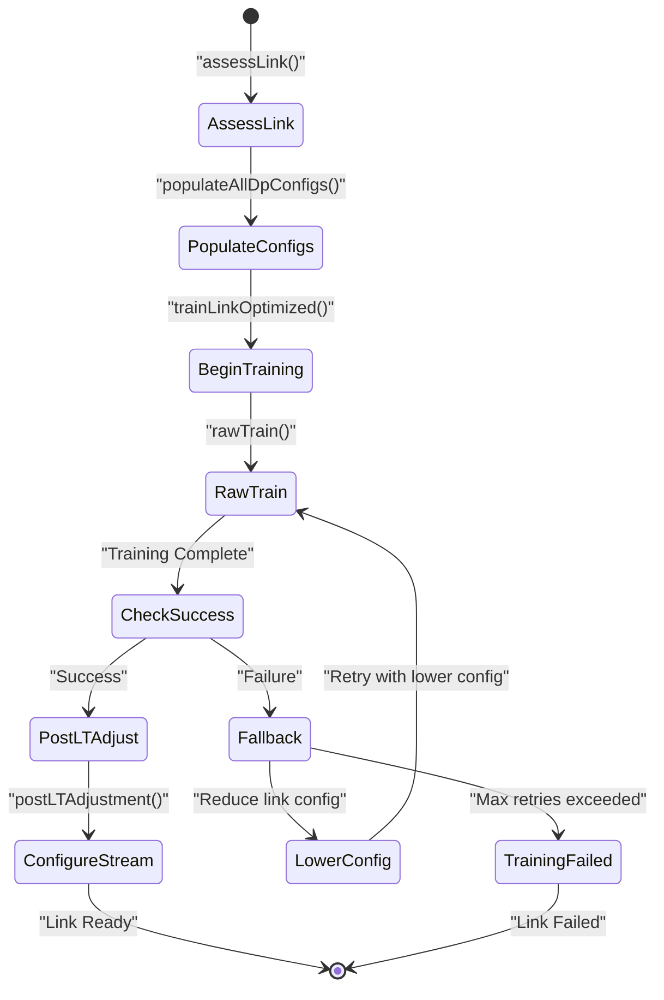
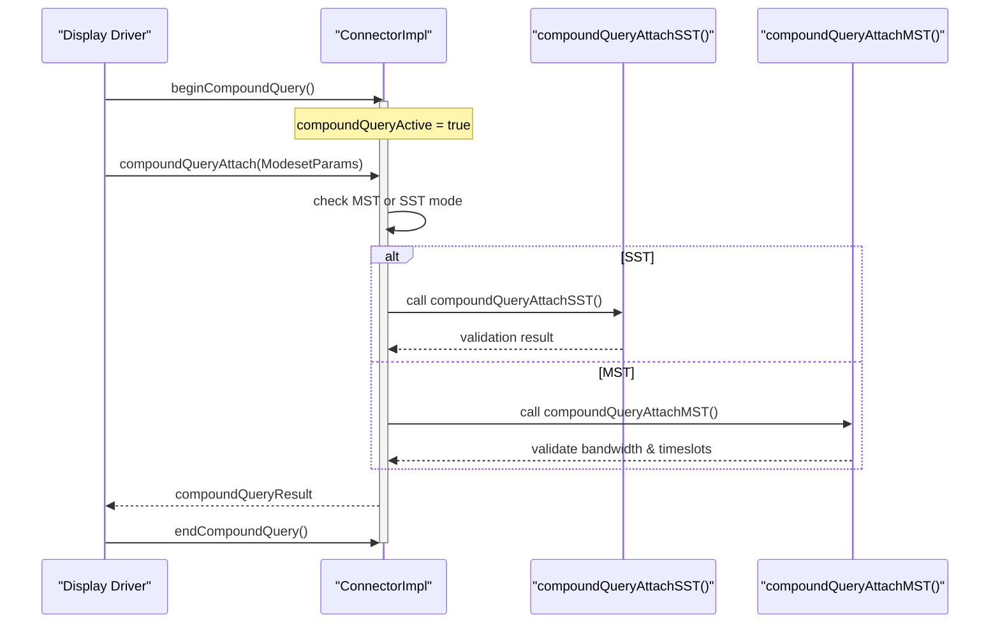
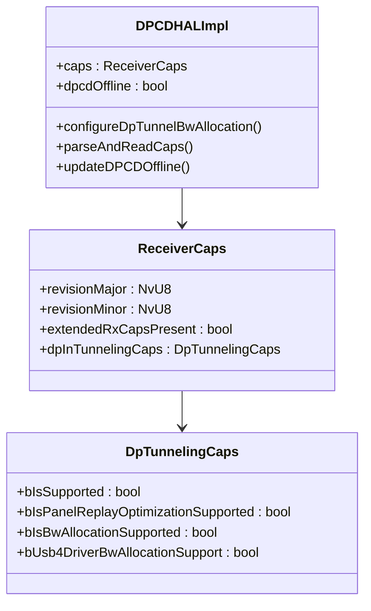
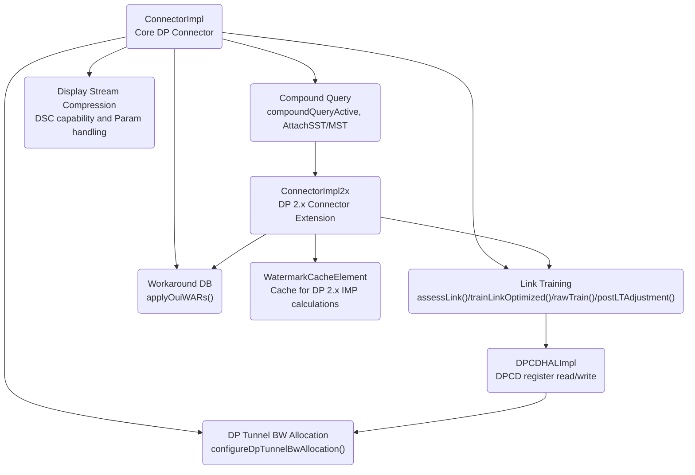

<!-- source: DeepWiki mcp.deepwiki.com · repo NVIDIA/open-gpu-kernel-modules · page 6.3 DisplayPort Link Training and Streams · fetched 2026-10-26 -->

# DisplayPort Link Training and Streams

Relevant source files

The following files were used as context for generating this wiki page:

- [src/common/displayport/inc/dp_configcaps.h](src/common/displayport/inc/dp_configcaps.h)
- [src/common/displayport/inc/dp_connectorimpl2x.h](src/common/displayport/inc/dp_connectorimpl2x.h)
- [src/common/displayport/src/dp_configcaps.cpp](src/common/displayport/src/dp_configcaps.cpp)
- [src/common/displayport/src/dp_connectorimpl2x.cpp](src/common/displayport/src/dp_connectorimpl2x.cpp)
- [src/common/displayport/src/dp_groupimpl.cpp](src/common/displayport/src/dp_groupimpl.cpp)
- [src/common/modeset/timing/nvt_dsc_pps.c](src/common/modeset/timing/nvt_dsc_pps.c)
- [src/common/modeset/timing/nvt_dsc_pps.h](src/common/modeset/timing/nvt_dsc_pps.h)
- [src/common/sdk/nvidia/inc/ctrl/ctrl0073/ctrl0073dp.h](src/common/sdk/nvidia/inc/ctrl/ctrl0073/ctrl0073dp.h)
- [src/nvidia/src/kernel/gpu/gpu_suspend.c](src/nvidia/src/kernel/gpu/gpu_suspend.c)

## Purpose and Scope

This page documents the DisplayPort (DP) link training mechanisms and stream management in the NVIDIA Open GPU Kernel Modules. It covers the detailed procedures and main classes responsible for:

- Performing DP link training and fallback procedures, including DP 2.x with Ultra High Bit Rate (UHBR) support.
- Executing compound queries for mode validation and bandwidth negotiation.
- Managing display streams for Single-Stream Transport (SST) and Multi-Stream Transport (MST).
- Negotiating and handling Display Stream Compression (DSC) capabilities and configuration.
- DP Tunneling bandwidth allocation and MST timeslot management.
- Applying device-specific workarounds based on Sink Organizationally Unique Identifier (OUI) and EDID data.

Related topics include [DisplayPort Core (6.2)](6.2) for device discovery and EDID parsing, and [DisplayPort Device Compatibility (6.4)](6.4) for device-specific workaround databases.

---

## Overview

At the core of DP link training and stream management lies the `ConnectorImpl` class, which supports legacy DP 1.x and 1.4 operation. For DP 2.x, the subclass `ConnectorImpl2x` extends this functionality to support the new link protocols including 128b/132b channel coding and UHBR modes.

`ConnectorImpl` orchestrates link training by:

- Using HAL abstractions such as `DPCDHAL` to read/write DPCD registers over the AUX channel.
- Running multi-stage training state machine routines.
- Managing compound queries and MST stream allocations.
- Maintaining flags for HDCP and FEC support.
- Applying device and revision-specific workarounds.

`ConnectorImpl2x` builds on this foundation with enhancements for DP 2.x, including:

- New channel coding mechanisms.
- Watermark caching for performance improvements.
- Additional regkey overrides for internal testing and debugging.

This class hierarchy tightly integrates with the DP AUX bus protocol, sink capabilities detection, and GPU hardware features.

**Sources:**  
[src/common/displayport/inc/dp_connectorimpl.h:40-94](),  
[src/common/displayport/src/dp_connectorimpl2x.cpp:40-52](),  
[src/common/displayport/src/dp_connectorimpl.cpp:69-183]()

---

## Link Training Architecture

### Link Training State Machine

DP link training involves a multi-step state machine to determine the highest stable link configuration, starting from link capability enumeration to finalized training:

- **Populate Candidate Configurations:** The method `populateAllDpConfigs()` enumerates all link configurations compliant with both GPU and sink capabilities.
- **Optimized Training Loop:** `trainLinkOptimized()` iterates over candidate configurations from highest to lowest bandwidth, attempting training.
- **Raw Training:** `rawTrain()` conducts the low-level training, configuring voltage swings, pre-emphasis, and performing hardware and sink validation via DPCD/AUX communication.
- **Post Training Adjustment:** `postLTAdjustment()` applies further tweaks after successful training, such as adjusting operational parameters.
- **Fallback on Failure:** If a configuration fails, the training backtracks to a lower bandwidth candidate until success or exhaustion.

This state machine logic is implemented mainly within `ConnectorImpl`, interacting with the `DPCDHAL` layer for DPCD register handling and AUX retries. It also respects multiple retry counters and trigger policies for enabling Forward Error Correction (FEC) and LTTPR (Link Training Tunable Physical Repeater) capabilities.

**Sources:**  
[src/common/displayport/src/dp_connectorimpl.cpp:104-181](),  
[src/common/displayport/inc/dp_connectorimpl.h:135-140](),  
[src/common/displayport/src/dp_connectorimpl.cpp:172-173]()

---

### DP 2.x Training Extensions

The `ConnectorImpl2x` class extends training to DP 2.x specifics:

- DP 2.x employs a new channel coding scheme with 128b/132b encoding where each symbol is 32 bits instead of 8 bits [src/common/displayport/src/dp_connectorimpl2x.cpp:47-50]().

- It supports Ultra High Bit Rate (UHBR) modes (UHBR10, UHBR13.5, UHBR20) and additional internal regkey overrides to enable experimental UHBR2.5, UHBR2.7, and UHBR5.0 rates for FPGA or internal testing [src/common/displayport/src/dp_connectorimpl2x.cpp:111-115]().

- The method `getValidLowestLinkConfig()` includes logic to avoid unstable HBR3 link rates when a platform workaround is enabled, selecting an alternative valid link configuration [src/common/displayport/src/dp_connectorimpl2x.cpp:127-160]().

- Watermark caching is introduced in `ConnectorImpl2x` to accelerate repeated IMP (Interrupt Management Parameter) calculations during modesetting [src/common/displayport/src/dp_connectorimpl2x.cpp:59-98]().

Combined, these adaptions enable stable training and efficient modesetting on DP 2.x physical links.

**Sources:**  
[src/common/displayport/src/dp_connectorimpl2x.cpp:40-50](),  
[src/common/displayport/src/dp_connectorimpl2x.cpp:111-160](),  
[src/common/displayport/src/dp_connectorimpl2x.cpp:59-98]()

---

## Compound Query Architecture

Compound queries provide a mechanism for multi-phase mode validation before actual streaming starts. This prevents modesets that would otherwise fail link training or violate MST timing constraints.

### Compound Query Flow

`ConnectorImpl` manages compound queries with the state variables `compoundQueryActive` and `compoundQueryResult`.

- `beginCompoundQuery()` starts the process, setting `compoundQueryActive = true`.
- During the compound query, attaching a stream invokes either:
  - `compoundQueryAttachSST()` for SST mode.
  - `compoundQueryAttachMST()` for MST mode, ensuring bandwidth and timeslot validation.
- Ending the query returns the result indicating whether the mode/configuration is supported.

These methods ensure mode validation integrates with link bandwidth, timeslot assignment, and stream payload management.

### DP Tunneling Bandwidth Allocation

The driver supports DP Tunneling bandwidth allocation, essential in USB4 composite protocol environments:

- Capability info is read from sink DPCD address `NV_DPCD20_DP_TUNNEL_CAPABILITIES` (0xE000D).
- Relevant capability bits parsed by `DPCDHALImpl::configureDpTunnelBwAllocation()` include:
  - `DPTUNNELING_SUPPORT`
  - `PANEL_REPLAY_TUNNELING_OPTIMIZATION_SUPPORT`
  - `DPIN_BW_ALLOCATION_MODE_SUPPORT`
- Lookup of USB4 driver bandwidth capability is done at DPCD 0xE014.
- The driver enables bandwidth allocation if supported and requested by client/regkey.

This infrastructure allows dynamic negotiation of tunneling bandwidth between GPU and sink to optimize shared USB4 links.

**Sources:**  
[src/common/displayport/inc/dp_connectorimpl.h:53-58](),  
[src/common/displayport/src/dp_configcaps.cpp:75-137](),  
[src/common/displayport/src/dp_connectorimpl.cpp:104-119]()

---

## Stream Management

### SST vs MST Stream Setup

The driver has distinct handling paths for Single-Stream Transport (SST) and Multi-Stream Transport (MST):

| Feature                  | Single-Stream Transport (SST)                       | Multi-Stream Transport (MST)                          |
|--------------------------|----------------------------------------------------|-----------------------------------------------------|
| Topology                 | One stream directly associated with single physical link | Multiple streams multiplexed sharing link bandwidth  |
| Bandwidth Allocation     | Exclusive full link bandwidth allocation           | Timeslot-based bandwidth division among streams     |
| Setup Method             | `beforeAddStream()` sets up and registers SST stream | `allocateTimeslice()` reserves timeslots for MST streams |
| DP 2.x Specifics         | Utilizes watermark caching for performance         | Applies MST timeslot bug workarounds (`bMstTimeslotBug4968411`) |

MST bandwidth is allocated via timeslots with coordination on the DP AUX channel, requiring group management to synchronize streams' payload allocations.

**MST Timeslot Workaround:**

- `bMstTimeslotBug4968411` enables a workaround for certain Novatek sinks exhibiting timing bugs affecting MST timeslot allocations.
- It forces conservative adjustments to bandwidth and timeslot parameters to prevent stream dropouts.

**Sources:**  
[src/common/displayport/inc/dp_connectorimpl.h:81-85](),  
[src/common/displayport/src/dp_wardatabase.cpp:101-114](),  
[src/common/displayport/src/dp_connectorimpl2x.cpp:168-173]()

---

### Watermark Caching for DP 2.x

`ConnectorImpl2x` introduces a watermark cache mechanism to optimize repeated IMP calculations:

- `WatermarkCacheElement` class computes a hash that includes:
  - Link configuration: lanes, peakRate, coding scheme, FEC enabled.
  - Modeset information: pixel clock, resolution, number of audio channels, color format.
  - DSC parameters if DSC is enabled: slice count, slice dimensions, DSC algorithm revision.
- This caching avoids expensive recalculations on repeated modesets or fallback training.

This caching mechanism accelerates DP 2.x mode sets and stream switching.

**Sources:**  
[src/common/displayport/src/dp_connectorimpl2x.cpp:59-98]()

---

## Display Stream Compression (DSC)

DSC reduces link bandwidth requirements by compressing display streams. The driver supports DSC as follows:

- It queries GPU DSC and FEC support via `main->isFECSupported()` and `main->isDscSupported()` flags during connector initialization [src/common/displayport/src/dp_connectorimpl.cpp:158-161]().

- DSC enables higher resolution or higher refresh rates over given link capabilities and is integrated into link training decisions.

- Certain devices require workaround handling for DSC, such as querying parent device capabilities (`bDscCapBasedOnParent`) for Synaptics panels to avoid black screen issues during training [src/common/displayport/src/dp_wardatabase.cpp:69-81]().

- DSC parameters influence link training configurations, bandwidth calculations, and M/N timing computations.

**Sources:**  
[src/common/displayport/src/dp_connectorimpl.cpp:62-65](),  
[src/common/displayport/src/dp_connectorimpl.cpp:155-162](),  
[src/common/displayport/src/dp_wardatabase.cpp:69-81]()

---

## Configuration and Overrides

The driver loads configuration overrides from the `DP_REGKEY_DATABASE`, enabling flexible adaptation to hardware/platform quirks:

| Override Flag             | Code Entity                  | Purpose and Effect                                                   |
|--------------------------|-----------------------------|--------------------------------------------------------------------|
| `bAssesslinkForEdpSkipped` | `bSkipAssessLinkForEDP`      | Skips link assessment for eDP displays, assuming max link capability |
| `bOptLinkKeptAlive`       | `bKeepOptLinkAlive`          | Keeps link powered with no active streams to avoid retraining     |
| `bMstAutoHdcpAuthAtAttach`| `bHdcpAuthOnlyOnDemand`      | Controls whether HDCP is only authenticated on-demand for MST      |
| `supportInternalUhbrOnFpga`| `bSupportUHBR2_50`, etc.    | Enables UHBR2.5 / 2.7 / 5.0 internal/FPGA testing modes in DP2.x    |
| `bDisableWatermarkCaching`| `bDisableWatermarkCaching`   | Disables watermark caching in DP 2.x                               |
| `bIgnoreCableIdCaps`      | Passed to HAL to ignore cable ID caps                            |
| `bCableVconnSourceUnknownWar` | Enables workaround for cable VCONN unknown source           |

The overrides are applied in `ConnectorImpl` and `ConnectorImpl2x` during connector initialization and mode validation.

**Sources:**  
[src/common/displayport/src/dp_connectorimpl.cpp:180-201](),  
[src/common/displayport/src/dp_connectorimpl2x.cpp:109-126]()

---

## Workaround Database for Device Compatibility

The driver applies sink OUI and EDID-based workarounds at runtime to mitigate known sink compatibility issues and bugs:

- The `applyOuiWARs()` method in `ConnectorImpl` and `ConnectorImpl2x` sets internal flags per sink source OUI.
- Workarounds include:
  - **Megachips (OUI 0xE18000):** Prevents link shutdown or fallback on certain models, enabling link stability on DP training [src/common/displayport/src/dp_wardatabase.cpp:43-66]()  
  - **Synaptics (OUI 0x24CC90):** Adds extended latency in training and delays modeset to avoid black screen issues [src/common/displayport/src/dp_wardatabase.cpp:69-81]()  
  - **Novatek (OUI 0x11EC38):** Enforces 128b/132b coding on older firmware and enables MST timeslot workaround [src/common/displayport/src/dp_wardatabase.cpp:101-114]()  
- These workarounds adjust flags like `bKeepOptLinkAlive`, `LT2FecLatencyMs`, `bMstTimeslotBug4968411`, and downgrade link rates or capabilities as needed.

Applying such device-specific fixes ensures stable link training and stream operation across diverse sink vendors and firmware versions.

---

# Summary Diagram: Natural Language to Key Code Entities

---

# Summary Table: Major Code Components

| Component                          | Description                                            | Key Files / Lines                           |
|----------------------------------|--------------------------------------------------------|--------------------------------------------|
| `ConnectorImpl`                   | Core DP connector handling link training & streams     | dp_connectorimpl.cpp:69-183, dp_connectorimpl.h:40-94  |
| `ConnectorImpl2x`                 | DP 2.x extension managing link training and streams    | dp_connectorimpl2x.cpp:40-160               |
| `DPCDHALImpl`                    | Low-level DPCD abstraction for DP caps and AUX channel | dp_configcaps.cpp:44-142                    |
| Compound Queries                  | Multi-step mode validation flow                         | dp_connectorimpl.cpp:104-119                |
| DP Tunnel Bandwidth Allocation   | DP tunneling BW management, USB4 support                | dp_configcaps.cpp:75-137                    |
| Workaround Database              | Sink OUI/EDID device fixups                              | dp_wardatabase.cpp:38-130                   |
| Watermark Cache                  | DP 2.x watermark cache with hash-based lookup          | dp_connectorimpl2x.cpp:59-98                |
| DSC Handling                    | DSC capability negotiation and PPS parameter management | dp_connectorimpl.cpp:155-162, dp_wardatabase.cpp:69-81 |

---

**Sources:**  
[src/common/displayport/src/dp_connectorimpl.cpp:69-183](),  
[src/common/displayport/inc/dp_connectorimpl.h:40-94](),  
[src/common/displayport/src/dp_connectorimpl2x.cpp:40-160](),  
[src/common/displayport/src/dp_configcaps.cpp:44-142](),  
[src/common/displayport/src/dp_wardatabase.cpp:38-130](),  
[src/common/displayport/src/dp_configcaps.cpp:75-137]()

---

