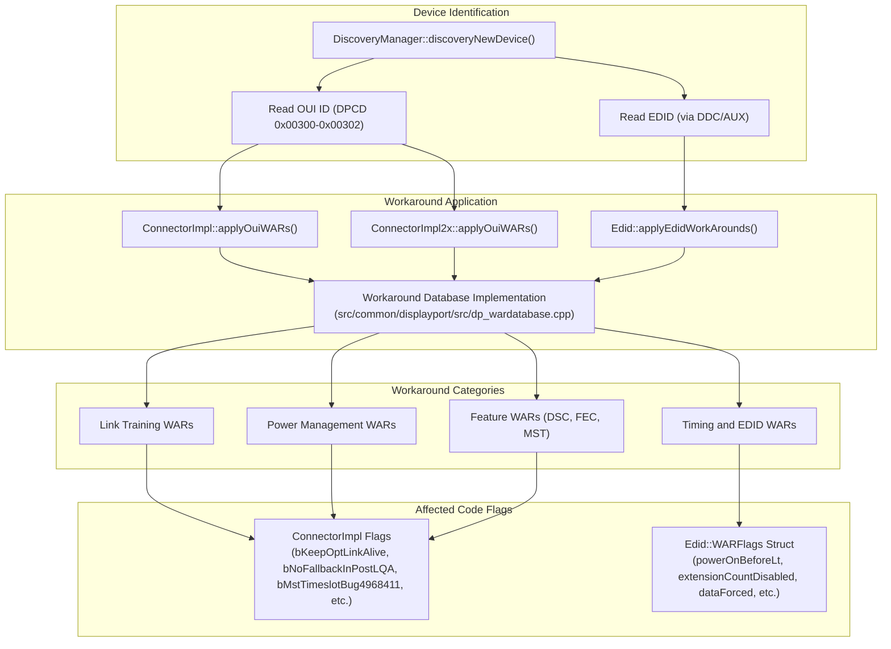
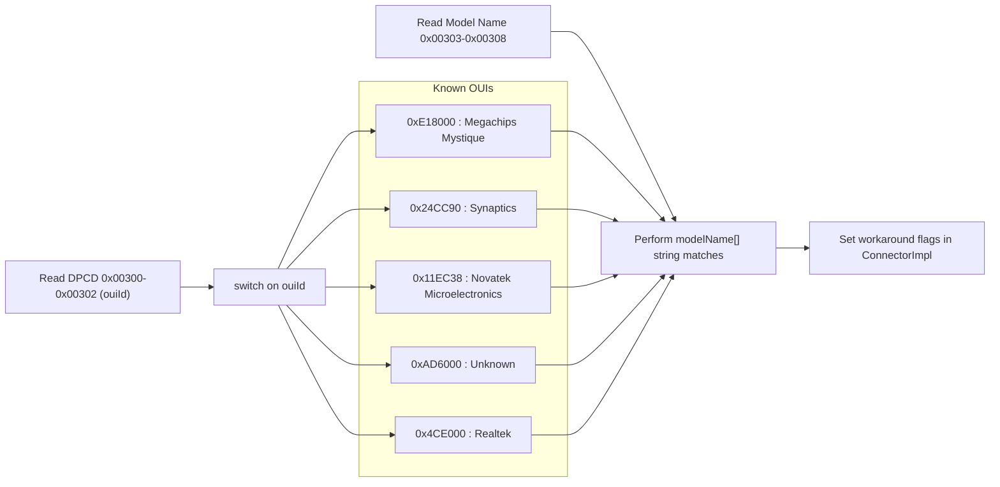
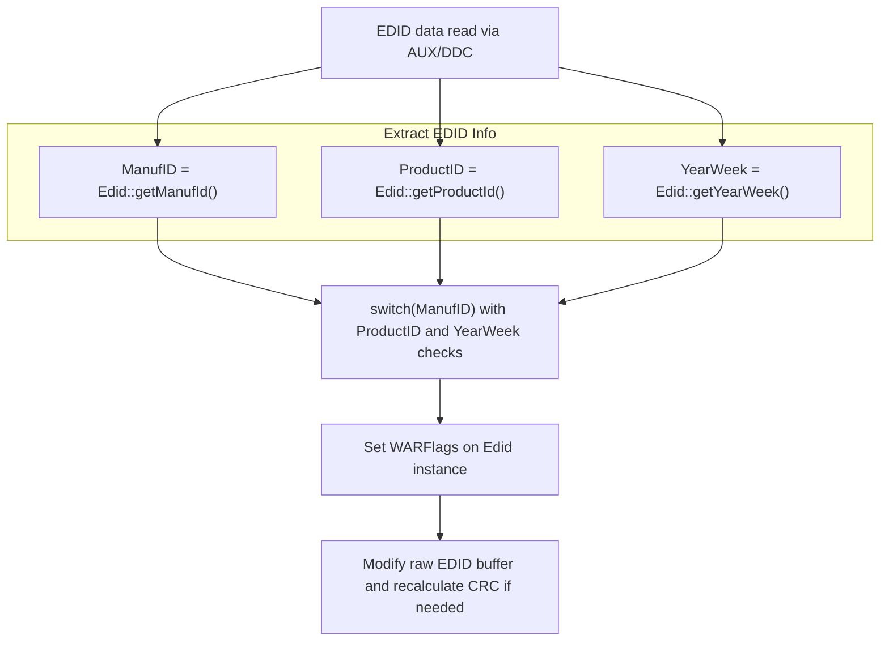
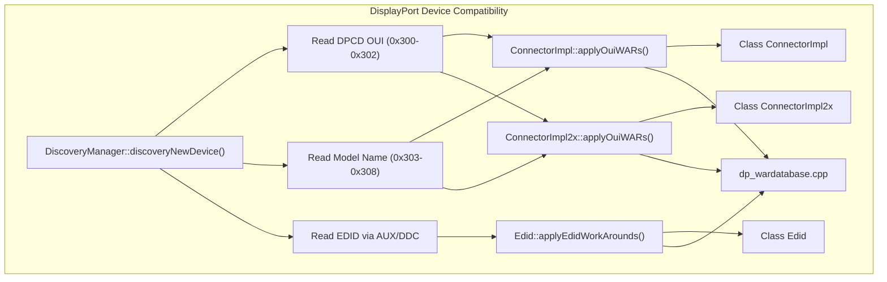

<!-- source: DeepWiki mcp.deepwiki.com · repo NVIDIA/open-gpu-kernel-modules · page 6.4 DisplayPort Device Compatibility · fetched 2026-10-26 -->

# DisplayPort Device Compatibility

<details>
<summary>Relevant source files</summary>

The following files were used as context for generating this wiki page:

- [src/common/displayport/inc/dp_connectorimpl.h](src/common/displayport/inc/dp_connectorimpl.h)
- [src/common/displayport/src/dp_wardatabase.cpp](src/common/displayport/src/dp_wardatabase.cpp)

</details>


## Purpose and Scope

This page documents the NVIDIA open GPU kernel modules' workaround (WAR) system designed to address compatibility and interoperability issues with DisplayPort sink devices, including panels and timing controllers (TCONs). The WAR system operates based on device-specific identifiers, notably the Organizationally Unique Identifier (OUI) and the Extended Display Identification Data (EDID). It provides fixes for non-compliant devices, hardware bugs, and interoperability issues that could affect link training, power management, feature support, and timing.

This document describes the architecture, data flow, and implementation details of the WAR system, focusing on code entities responsible for applying these device-specific compatibility adjustments within the DisplayPort subsystem.

For broader context on DisplayPort management, see:
- DisplayPort Link Training and Streams [6.3]()
- DisplayPort Connector Implementation [6.2]()

---

## System Architecture

The DisplayPort device compatibility system operates primarily during display device discovery and initialization. It maintains two distinct but complementary mechanisms for applying workarounds:

- **OUI-Based Workarounds:** These use the 24-bit Organizationally Unique Identifier (OUI) read from DPCD registers (commonly at 0x300-0x302) plus the device's model name string (typically from 0x303-0x308). Based on these identifiers, device- or vendor-specific behavioral adjustments are applied.

- **EDID-Based Workarounds:** These rely on parsing the EDID, extracting the Manufacturer ID, Product ID, and manufacture date (year/week), allowing granular fixes for known problematic devices by patching EDID fields or setting flags that influence how the driver configures the display.

Both approaches set various flags inside key classes—primarily `ConnectorImpl` and `Edid`—which are then used to steer link training, power management, feature enablement (such as DSC, FEC, MST), and timing operations, ensuring stable and correct functioning despite sink quirks.

### Workaround Data Flow Diagram



**Sources:** [src/common/displayport/src/dp_wardatabase.cpp:38-150](), [src/common/displayport/inc/dp_connectorimpl.h:113-132]()

---

## OUI-Based Workarounds

OUI-based workarounds leverage the sink device's IEEE OUI and model name string to detect known device versions with behavioral quirks or bugs. These quirks typically affect link training stability, power management behaviors, or feature support. The `ConnectorImpl` and its subclass `ConnectorImpl2x` contain methods implementing these workarounds.

### OUI Detection and Application Flow

The OUI and model name are read from DPCD registers early during device discovery, then `applyOuiWARs()` is invoked on the connector instance. This uses a `switch` on the OUI to identify the manufacturer and applies string matching to the model name before setting various internal flags.



### Key OUI Workarounds and Their Effects

| OUI ID   | Manufacturer           | Model Pattern          | Flags/Parameters Affected                                              | Purpose / Description                                                  |
|----------|------------------------|-----------------------|------------------------------------------------------------------------|------------------------------------------------------------------------|
| `0xE18000` | Megachips Mystique     | `"Dp1.1"`             | `bKeepOptLinkAlive = true`                                              | Prevent link retraining pulse when no active stream (Bug #1793084)    |
| `0xE18000` | Megachips Mystique     | `"Dp1.2"`             | `bNoFallbackInPostLQA = true`                                           | Avoid fallback link config on retraining, retry with same config first (Bug #1846925) |
| `0x24CC90` | Synaptics              | Model name starting with `"SYNAS"` | `LT2FecLatencyMs = 57` <br> `bDscCapBasedOnParent = true`               | Increase latency between link training and FEC enable to avoid blank screen; DSC capability inference (Bug #3143315) |
| `0x11EC38` | Novatek Microelectronics | Model name starting with `"NT6"`   | `bMstTimeslotBug4968411 = true`; <br> sets channel coding to 128b132b  | Fix MST slot allocation timing bug (Bug #4968411)                     |
| `0xAD6000` | Unknown                | `"MC290"`              | `bForceHeadShutdownPerMonitor = true` <br> `bApplyStuffDummySymbolsWAR = true` | Enforce head shutdown per monitor and dummy symbol stuffing mode      |
| `0x4CE000` | Realtek                | Any                    | `bSwAutoReadWarNeeded = true`                                           | Software auto-read workaround to fix compatibility                    |

These flags are consumed and queried in other modules that handle link training, power management, and feature negotiation to conditionally adjust behavior for these devices.

---

## EDID-Based Workarounds

The EDID workaround mechanism addresses subtle or non-compliant device behavior based on standard EDID fields:

- Manufacturer ID (16-bit)
- Product ID (16-bit)
- Year/Week of manufacture (8-bit each)

The `Edid` class contains a WAR flags structure to store granular workaround states and performs patching of the raw EDID binary when modifications are necessary.

### EDID Workaround Flow



### Examples of EDID Workarounds

| Manufacturer (Hex) | Product ID (Hex) | YearWeek Condition | Issue / Bug Description                                | Workaround Details                          |
|--------------------|------------------|--------------------|-------------------------------------------------------|---------------------------------------------|
| `0x1006` (Apple)   | `0x9227`         | Any                | Apple Thunderbolt J29 panel requires power-on before link training (Bug #933051) | `powerOnBeforeLt = true`                     |
| `0x7204` (Acer)    | `0xad15`         | ≤ `0x0d01`         | EDID Extension block count corrupted causing parsing issues (Bug #451868) | EDID byte at 0x7E is cleared to 0, `extensionCountDisabled = true` and `dataForced = true` to enable patching |
| `0x855C` (Westinghouse) | `0x3703` or `0x4202` | Any       | HDMI Audio presence causes picture loss on some LCD TVs (Bug #403204) | Disable HDMI/Audio flags in extension block |
| `0x1E6D` (Android) | `0x1234` (example) | N/A                | Hypothetical example: fix timing or feature flags     | Custom WARFlags set correspondingly          |

When the EDID is patched (`dataForced = true`), the checksum byte is recalculated to maintain EDID validity. This ensures the patched EDID is accepted by the driver and OS EDID parsers.

---

## Registry Key Overrides

The DisplayPort connector reads registry keys encapsulated in the `DP_REGKEY_DATABASE` structure. These keys provide system-level overrides to enable or disable WARs globally or for specific conditions, allowing OEMs or system integrators to fine-tune compatibility behavior.

### Example Regkey Overrides and Their Effects

| Registry Key Field                         | Associated Internal Flag              | Effect / Usage                                         |
|-------------------------------------------|-------------------------------------|--------------------------------------------------------|
| `bAssesslinkForEdpSkipped`                 | `bSkipAssessLinkForEDP`              | Skip link assessment on embedded DisplayPort (eDP) devices |
| `bOptLinkKeptAlive`                        | `bKeepLinkAliveMST`, `bKeepLinkAliveSST` | Keep link alive to prevent faulty link retrain pulses    |
| `bSscDisabled`                             | `bDisableSSC`                       | Disable Spread Spectrum Clocking (SSC)                  |
| `bMstAutoHdcpAuthAtAttach`                  | `bHdcpAuthOnlyOnDemand`              | Control HDCP authentication behavior during MST          |

These flags are set in the connector constructor and influence the subsequent application of WARs.

---

## Denylist-Based Workarounds

Additionally, the EDID WAR system can process external monitor denylist entries, passed as `DpMonitorDenylistData`, which assert known compatibility restrictions such as skipping redundant link training or disabling cable bandwidth checks.

### Denylist to WARFlags Mapping Examples

| Denylist Capability Flag                      | Effect on `Edid::WARFlags`           |
|-----------------------------------------------|-------------------------------------|
| `DP_MONITOR_CAPABILITY_DP_SKIP_REDUNDANT_LT`  | `skipRedundantLt = true`             |
| `DP_MONITOR_CAPABILITY_DP_SKIP_CABLE_BW_CHECK` | `skipCableBWCheck = true`             |
| `DP_MONITOR_CAPABILITY_DP_WRITE_0x600_BEFORE_LT` | `powerOnBeforeLt = true`              |
| `DP_MONITOR_CAPABILITY_DP_OVERRIDE_OPTIMAL_LINK_CONFIG` | `overrideOptimalLinkCfg = true`     |

This mechanism allows runtime enforcement of known compatibility fixes based on centrally curated monitor databases.

---

## Implementation Details

### ConnectorImpl::applyOuiWARs()

Located in `dp_wardatabase.cpp`, this method is attached to the `ConnectorImpl` and `ConnectorImpl2x` classes. It applies workarounds by:

- Inspecting the `ouiId` read from the sink device.
- Matching known device model strings.
- Modifying internal booleans or parameters such as:
  - `bKeepOptLinkAlive`
  - `bNoFallbackInPostLQA`
  - `LT2FecLatencyMs`
  - `bDscCapBasedOnParent`
  - `bMstTimeslotBug4968411`
  - and others.

This logic directly impacts how link training is conducted and DSP features are enabled.

Example snippet:

```cpp
void ConnectorImpl::applyOuiWARs()
{
    switch (ouiId)
    {
        case 0xE18000: // Megachips Mystique
            if (((modelName[0] == 'D') && (modelName[1] == 'p') && (modelName[2] == '1') &&
                 (modelName[3] == '.') && (modelName[4] == '1')))
            {
                bKeepOptLinkAlive = true;
            }
            else if (((modelName[0] == 'D') && (modelName[1] == 'p') && (modelName[2] == '1') &&
                      (modelName[3] == '.') && (modelName[4] == '2')))
            {
                bNoFallbackInPostLQA = true;
            }
            break;
        // Other OUI cases follow...
    }
}
```

**Sources:** [src/common/displayport/src/dp_wardatabase.cpp:38-132](), [src/common/displayport/inc/dp_connectorimpl.h:113-115]()

---

### Edid::applyEdidWorkArounds()

This method evaluates the EDID Manufacturer ID, Product ID, and YearWeek to apply device-specific patches or flags. It sets members of the `WARFlags` struct on the `Edid` instance and can patch the raw EDID data if necessary.

Example entries:

```cpp
switch (ManufacturerID)
{
    case 0x1006: // Apple
        if (ProductID == 0x9227)
        {
            this->WARFlags.powerOnBeforeLt = true;
        }
        break;

    case 0x7204: // Acer
        if (ProductID == 0xad15 && YearWeek <= 0x0d01)
        {
            buffer.data[0x7E] = 0;
            this->WARFlags.extensionCountDisabled = true;
            this->WARFlags.dataForced = true;
        }
        break;

    // Additional cases...
}
```

If `dataForced` is set, the EDID CRC at byte 127 is recalculated to maintain validity:

```cpp
void patchCrc(IN OUT NvU8* buffer)
{
    buffer[0x7F] = 0;
    NvU8 crc = calculateCRC32(buffer, 0x7F);
    buffer[0x7F] = crc;
}
```

This ensures patched EDIDs comply with the EDID specification and are accepted by the operating system.

**Sources:** [src/common/displayport/src/dp_wardatabase.cpp:132-165](), [src/common/displayport/src/dp_wardatabase.cpp:757-761]()

---

## Summary Diagram: System Overview to Code Entities



---

## References to Key Source Files

| File                                    | Description                                               |
|----------------------------------------|-----------------------------------------------------------|
| `src/common/displayport/src/dp_wardatabase.cpp` | Core implementation of OUI and EDID workaround logic           |
| `src/common/displayport/inc/dp_connectorimpl.h` | Definition of `ConnectorImpl` and related flags and methods|
| `src/common/displayport/src/dp_connectorimpl.cpp` | ConnectorImpl implementation and regkey override application |
| `src/common/modeset/timing/nvt_util.c` | Utilities for timing arithmetic and CRC calculations      |

---

This documentation covers the foundational system enabling broad DisplayPort sink device compatibility in NVIDIA’s open GPU kernel modules. By integrating OUI and EDID data-driven fixes, the driver achieves robust link training, controlled power management, and accurate mode timing across heterogeneous and legacy hardware.

**Sources:**
- [src/common/displayport/src/dp_wardatabase.cpp:1-150, 700-761]()
- [src/common/displayport/inc/dp_connectorimpl.h:113-132, 58-73]()
- [src/common/displayport/src/dp_connectorimpl.cpp:175-210]()
- [src/common/modeset/timing/nvt_util.c:146-180]()

---

