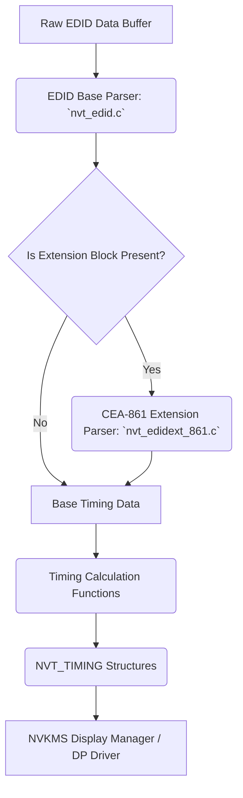

<!-- source: DeepWiki mcp.deepwiki.com · repo NVIDIA/open-gpu-kernel-modules · page 6.5 EDID and Mode Timing Library · fetched 2026-10-26 -->

# EDID and Mode Timing Library

<details>
<summary>Relevant source files</summary>

The following files were used as context for generating this wiki page:

- [kernel-open/header-presence-tests.mk](kernel-open/header-presence-tests.mk)
- [src/common/modeset/timing/nvt_edid.c](src/common/modeset/timing/nvt_edid.c)
- [src/common/modeset/timing/nvt_edidext_861.c](src/common/modeset/timing/nvt_edidext_861.c)
- [src/common/modeset/timing/nvtiming.h](src/common/modeset/timing/nvtiming.h)

</details>


This section describes the **shared modeset timing library** used within the NVIDIA Open GPU Kernel Modules project. It focuses on **EDID parsing**, **CEA-861 extension handling**, and **timing calculations** common to NVKMS (NVIDIA Kernel Mode Setting) and the DisplayPort (DP) implementation. This library provides a unified foundation for reading display capabilities and configuring display modes accurately across different NVIDIA kernel components.

---

## Purpose and Scope

The EDID and Mode Timing Library is designed to:

- Parse raw EDID data blocks obtained from connected displays.
- Decode and interpret the CEA-861 (Consumer Electronics Association) extensions to EDID, which provide additional audio/video formats, HDR metadata, and 3D capabilities on HDMI.
- Implement timing calculation algorithms that produce detailed timing parameters for various video modes (resolution, refresh rates, sync timings, pixel clock).
- Provide a consistent interface and data structures for use by NVKMS and the DisplayPort driver, enabling reliable modesetting and display timing configuration.

This library encapsulates the core logic required to translate raw EDID information into meaningful display modes and properties that the rest of the display stack can consume.

---

## Implementation Architecture

The library implements distinct but interrelated components for EDID parsing, extension handling, and timing management:

### Core Components

- **EDID Timing Data Structures (`nvtiming.h`)**  
  Defines the primary timing data structures (`NVT_TIMING` and associated extensions) along with utility macros for managing pixel clock, timing flags, color depth, 3D metadata, and other video mode properties.

- **EDID Parsing (`nvt_edid.c`)**  
  Contains functions for decoding the base EDID block, including interpreting the VESA established timings, standard timings, and detailed timing descriptors. It maintains tables of default established timings and helper routines for sanitizing and matching reported display timings.

- **CEA-861 Extension Parsing (`nvt_edidext_861.c`)**  
  Implements parsing of the CEA-861 extensions to decode additional timing blocks, video formats, audio capabilities, HDR metadata, and HDMI-specific extensions, including 3D format flags and pixel repetition info.

- **Timing Calculation**  
  Includes utilities to convert parsed EDID timing data into internally usable timing parameters, such as horizontal and vertical sync timings, flags for interlacing or progressive scan, aspect ratios, pixel clock frequencies, and compatibility flags.

---

## Data Flow Overview



- The **raw EDID** buffer read from the display is first passed to the base EDID parser, extracting fundamental display parameters and standard timing descriptors.
- If present, the **CEA-861 extension blocks** are parsed next to extract enhanced capabilities such as HDMI audio/video support and 3D formats.
- The resulting data is processed to compute precise timing values and populate detailed timing structures (`NVT_TIMING`).
- These timing structures are then consumed by higher-level components like NVKMS and the DisplayPort driver to configure output modes.

Sources: `src/common/modeset/timing/nvt_edid.c:24-112`(), `src/common/modeset/timing/nvt_edidext_861.c:24-92`(), `src/common/modeset/timing/nvtiming.h:23-130`()

---

## Key Data Structures and Concepts

### `NVT_TIMING` (Defined in `nvtiming.h`)

- Central structure representing all timing parameters for a video mode.
- Holds horizontal timing details: active pixels, front/back porch, sync width, total pixels.
- Vertical timing counterparts with similar fields.
- Sync polarity flags (positive/negative), interlaced or progressive mode flag.
- Pixel clock in kHz and derived clock values.
- Aspect ratio, refresh rates (logical and physical), and repetition flags.
- Extended fields for HDMI and 3D stereo metadata embedded within sub-structures.

### Color Depth Bitfield (`NVT_COLORDEPTH`)

- Encodes supported bits per color (6, 8, 10, 12, 14, 16 bits) using bitfields.
- Macros defined for querying and updating bit depth flags support nuanced color format handling.

### Timing Macros

- Wide variety of macros for initializing `NVT_TIMING` instances for established VESA modes, CEA-861 formats, and HDMI extension timings.
- Example starter macros include `EST_TIMING`, `EIA_TIMING`, and `HDMI_EXT_TIMING`, each ensuring consistent encoding of mode parameters.

Sources: `src/common/modeset/timing/nvtiming.h:41-130`(), `src/common/modeset/timing/nvt_edid.c:38-75`(), `src/common/modeset/timing/nvt_edidext_861.c:37-55`()

---

## EDID Parsing Implementation (`nvt_edid.c`)

- Implements the baseline parsing and lookup of commonly supported video timings.
- Includes an array `EDID_EST` listing VESA established timings with hardcoded mode parameters.
- Defines sentinel entries to mark the end of timing lists.
- Parses standard EDID data sections to populate timing structures.
- Uses detailed timing descriptor format and applies sanity checks on timing values.
- Provides helper functions to map PNP vendor IDs from EDID to friendly names.

The file also supports handling various timing standards and recognized modes to ensure compatibility.

Sources: `src/common/modeset/timing/nvt_edid.c:24-112`()

---

## CEA-861 Extension Parsing (`nvt_edidext_861.c`)

- Dedicated module parsing the extension blocks described in the CEA-861 standard, enhancing HDMI and modern display support.
- Maintains a large table of `EIA861B` timing descriptors with precise timing for formats such as 480p/60Hz, 720p/60Hz, 1080i/60Hz, and many others.
- Parses auxiliary data including audio formats, pixel repetition, and aspect ratios.
- Supports flags indicating interlaced vs progressive modes and colorimetry info.
- Handles HDMI vendor-specific extensions, including 3D stereo signaling and HDR-related metadata.

This module extends base EDID parsing to full modern capabilities demanded by multimedia-connected displays.

Sources: `src/common/modeset/timing/nvt_edidext_861.c:24-92`()

---

## Timing Calculation and Usage

- The parsed data is transformed into `NVT_TIMING` instances that standardize the horizontal and vertical timing parameters.
- Timing parameters include pixel clock, horizontal front porch, sync width, blanking interval, total pixels per line, and corresponding vertical equivalents.
- Calculation gives refresh rates in milliHz and set flags to control hardware scanning (interlaced/progressive).
- Additional metadata flags enable stereo 3D modes and color depth negotiation.
- These structures serve as a single source of truth for the mode-setting logic in NVIDIA kernel display components.

---

## Interaction with NVKMS and DisplayPort Drivers

The EDID and Mode Timing Library serves as a **foundational shared service** in the NVIDIA display stack:

```mermaid
flowchart LR
  subgraph "Display Subsystem"
    NV_EDID[EDID and Mode Timing Library\n(`nvt_edid.c` & `nvt_edidext_861.c`)]
    NVKMS[NVKMS Module\n(nvidia-modeset.ko)]
    DP_DRV[DisplayPort Driver\n(e.g., `dp_core`)]
  end

  RAW_EDID_RAW[Raw EDID Data]

  RAW_EDID_RAW --> NV_EDID
  NV_EDID --> NVKMS
  NV_EDID --> DP_DRV

  NVKMS -->|Configured timing modes| DISPLAY_HW[Display Hardware]
  DP_DRV -->|Link training & mode config| DISPLAY_HW
```

- Both NVKMS and DisplayPort drivers consume the standardized timing data generated by the EDID library for mode validation and hardware programming.
- The use of a common timing library ensures synchronization of display capabilities and modesetting behavior across different graphics pipeline components.
- This enables robust handling of a wide variety of monitors, TVs, and AV receivers.

Sources: `src/common/modeset/timing/nvt_edid.c`(), `src/common/modeset/timing/nvt_edidext_861.c`(), `src/common/modeset/timing/nvtiming.h`()

---

## Summary Table of Key Files

| File                       | Description                                      | Main Functions/Components                |
|----------------------------|------------------------------------------------|-----------------------------------------|
| `nvtiming.h`               | Common timing data structures and macros       | `NVT_TIMING`, `NVT_COLORDEPTH`, macros |
| `nvt_edid.c`               | Base EDID parser and VESA established timings  | EDID block parser, timing lookup tables|
| `nvt_edidext_861.c`        | CEA-861 extension parsing and HDMI timing data | Extended timing definitions, parsing   |

---

By centralizing EDID and timing handling in this library, NVIDIA’s kernel modules can maintain consistent modesetting functionality, supporting both legacy and modern display interfaces efficiently and accurately.

---

## References

- `src/common/modeset/timing/nvtiming.h:1-130`  
- `src/common/modeset/timing/nvt_edid.c:24-112`  
- `src/common/modeset/timing/nvt_edidext_861.c:24-92`

---

