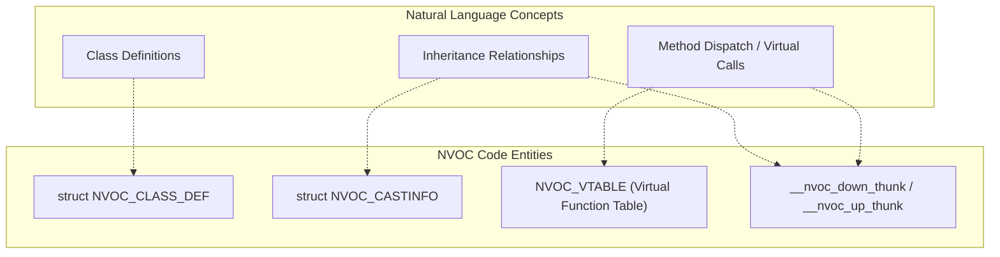
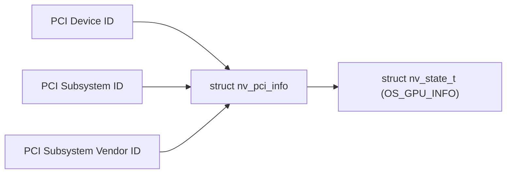
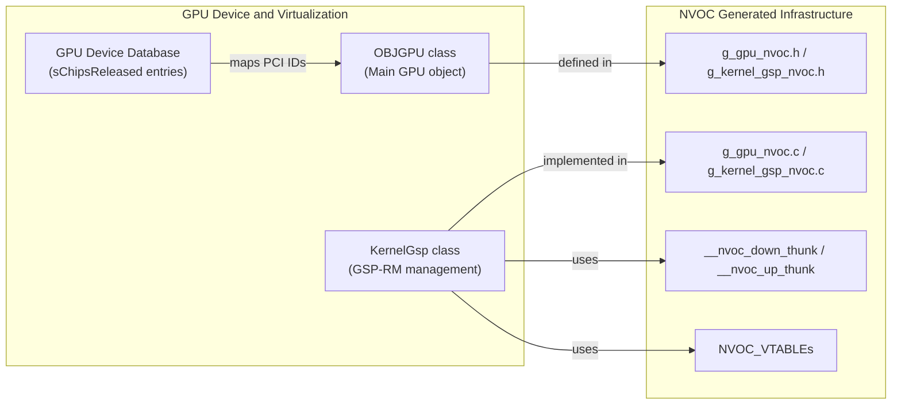

<!-- source: DeepWiki mcp.deepwiki.com · repo NVIDIA/open-gpu-kernel-modules · page 7 Generated Code and Device Database · fetched 2026-10-26 -->

# Generated Code and Device Database

<details>
<summary>Relevant source files</summary>

The following files were used as context for generating this wiki page:

- [kernel-open/nvidia/os-interface.c](kernel-open/nvidia/os-interface.c)
- [src/nvidia/generated/g_gpu_nvoc.c](src/nvidia/generated/g_gpu_nvoc.c)
- [src/nvidia/generated/g_gpu_nvoc.h](src/nvidia/generated/g_gpu_nvoc.h)

</details>


This section provides a high-level overview of the core generated code infrastructure and device-related databases within the NVIDIA open-gpu-kernel-modules repository. It focuses on three critical pillars:

- The **NVOC framework**, which generates object-oriented C code for GPU device and subsystem management.
- The **GPU Device Database** that maps PCI IDs to supported GPU models and device names.
- The **vGPU Configuration** system, defining virtual GPU type mappings and partitioning for virtualization.

Each area plays a crucial role in ensuring the driver supports a broad range of hardware while maintaining modular, object-oriented design through code generation.

For in-depth technical coverage, please refer to the child pages:

- [GPU Device Database](#7.1)  
- [vGPU Configuration](#7.2)  
- [NVOC Framework](#7.3)

---

## NVOC Framework

The NVIDIA Object-Oriented C (NVOC) framework is the foundation for implementing complex, class-based design patterns in plain C within the driver. NVOC automates the generation of code that supports inheritance, polymorphism, and runtime type information—key features to manage sophisticated GPU objects and subsystems consistently.

### High-Level NVOC Generated Code Structure

NVOC outputs generated source and header files with names like `g_gpu_nvoc.c` / `g_gpu_nvoc.h` or `g_kernel_gsp_nvoc.c` / `g_kernel_gsp_nvoc.h`. Each major GPU-related class in the driver has a corresponding generated header that lays out structs, class IDs, and virtual tables (vtables) to dispatch methods polymorphically.

**Mapping Natural Language Concepts to NVOC Code Entities:**



This diagram connects natural-language concepts (like inheritance and class definitions) with the underlying generated C structures and thunk functions that enable polymorphism.

### Principal NVOC Classes in the Driver

The framework covers many core GPU driver classes. Illustrative examples include:

| Generated Files           | Class Name   | Ancestors / Interfaces        | Description                                         |
|--------------------------|--------------|------------------------------|-----------------------------------------------------|
| `g_kernel_gsp_nvoc.*`    | `KernelGsp`  | `OBJENGSTATE`, `IntrService`, `KernelFalcon` | Manages GSP-RM firmware boot and RPC communication  |
| `g_gpu_nvoc.*`           | `OBJGPU`     | `Object`, `GpuHalspecOwner`  | Main GPU device object abstraction                  |

### NVOC Thunking Mechanism

Polymorphic method calls in C are realized via generated thunk functions:

- **Down-thunks** convert calls from base/ancestor classes down to the derived class implementation.  
- **Up-thunks** allow derived classes to invoke ancestor implementations.

For example, `__nvoc_down_thunk_KernelGsp_kflcnResetHw` bridges a hardware-reset call from `KernelFalcon` base class to the `KernelGsp` derived class method. Similarly, `__nvoc_up_thunk_OBJENGSTATE_kgspStateInitUnlocked` lets `KernelGsp` call the standard engine initialization logic in `OBJENGSTATE`.

This approach provides clean virtual method dispatch without native C++ support.

For a detailed exploration, see [NVOC Framework](#7.3).

Sources:  
[src/nvidia/generated/g_gpu_nvoc.h:1-222](), [src/nvidia/generated/g_gpu_nvoc.c:1-169](), [src/nvidia/generated/g_kernel_gsp_nvoc.h:1-60](), [src/nvidia/generated/g_kernel_gsp_nvoc.c:1-90]()

---

## GPU Device Database

Identification and support for a wide range of NVIDIA GPUs is grounded on a comprehensive device database that maps PCI device IDs and subsystem/vendor IDs to model names.

### Device Identification Model

The device database uses standard PCI identifiers to uniquely recognize GPU models:

| Field               | Description                       |
|---------------------|---------------------------------|
| `devID`             | PCI Device ID                   |
| `subSystemID`       | PCI Subsystem ID                |
| `subSystemVendorID` | PCI Subsystem Vendor ID          |
| `name`              | Human-readable GPU model name   |

A typical snippet of these mappings is as follows:

```c
typedef struct _CHIPS_RELEASED {
    unsigned short devID;
    unsigned short subSystemID;
    unsigned short subSystemVendorID;
    const char *name;
} CHIPS_RELEASED;

static const CHIPS_RELEASED sChipsReleased[] = {
    { 0x1E02, 0x0000, 0x0000, "NVIDIA TITAN RTX" },
    { 0x1E04, 0x0000, 0x0000, "NVIDIA GeForce RTX 2080 Ti" },
    { 0x1E30, 0x0000, 0x0000, "Quadro RTX 6000" },
    // ... additional entries ...
};
```

### PCI ID to Driver Structures Mapping Flow



This flow illustrates how PCI ID fields provide information that populate the GPU device driver structures, ultimately representing GPU hardware within the driver stack.

### GPU UUIDs and Logging Formats

Each GPU device has a unique 16-byte UUID to help uniquely identify hardware instances. The driver uses macros for PCI device address formatting, commonly:

- `GPU_UUID_LEN` as 16 bytes  
- `GPU_UUID_ASCII_LEN` including dashes as 37 characters  
- `NV_PCI_DEV_FMT` string `"%04x:%02x:%02x.%x"` representing domain:bus:slot.function

These identifiers facilitate unique device recognition, logging, and diagnostic purposes.

For a comprehensive list of supported GPUs and PCI IDs, see the [GPU Device Database](#7.1).

Sources:  
[src/nvidia/generated/g_nv_name_released.h:20-100](), [src/nvidia/generated/g_gpu_nvoc.h:64-123](), [kernel-open/common/inc/nv.h:64-92]()

---

## vGPU Configuration

Virtual GPU (vGPU) support allows physical GPUs to be partitioned into virtual instances shared among multiple virtual machines or containers. This requires device validation, virtual GPU (vGPU) type mappings, and partition management orchestrated by the GPU System Processor (GSP) firmware.

### GSP-RM and vGPU Virtualization

The `KernelGsp` NVOC class plays a central role in managing the GSP Resource Manager (RM) firmware responsible for GPU virtualization features. This includes handling:

- Multi-mode booting and suspending of the GSP firmware  
- RPC-based virtualization messaging between host and firmware  
- Validation of GPU partitions and vGPU configurations

Boot modes include:

| Mode                     | Description                 |
|--------------------------|-----------------------------|
| `KGSP_BOOT_MODE_NORMAL`  | Normal driver startup       |
| `KGSP_BOOT_MODE_SR_RESUME`| Resume from suspend        |
| `KGSP_BOOT_MODE_SR_SUSPEND`| Suspend for reset         |

### RPC Event Handling Contexts

vGPU interactions depend on RPC calls handled in different execution contexts within the kernel driver:

| Event Context      | Description                                           |
|--------------------|-----------------------------------------------------|
| `RPC_ISSUE_FAILED` | Trigger polling after RPC issue failure              |
| `INTERRUPT_BH`     | Handle RPC in interrupt bottom half context          |
| `POLLING`          | Active user-space polling mode processing             |
| `INTERRUPT`        | Handle RPC in interrupt trailer context               |

These event handler contexts allow reliable handling of virtualization RPC requests across different kernel execution paths.

For an in-depth explanation of vGPU type mappings, partitioning, and device validation, see the [vGPU Configuration](#7.2).

Sources:  
[src/nvidia/generated/g_kernel_gsp_nvoc.h:45-100](), [src/nvidia/generated/g_kernel_gsp_nvoc.h:182-246]()

---

# Summary Diagram: Linking Key Concepts to Code Entities



This diagram visualizes the interplay between GPU device identification, the key NVOC-generated classes managing GPU and GSP, and the underlying generated code artifacts supporting modular, polymorphic design.

---

For full technical details on these topics, please see the respective child pages:

- [GPU Device Database](#7.1)  
- [vGPU Configuration](#7.2)  
- [NVOC Framework](#7.3)

---

