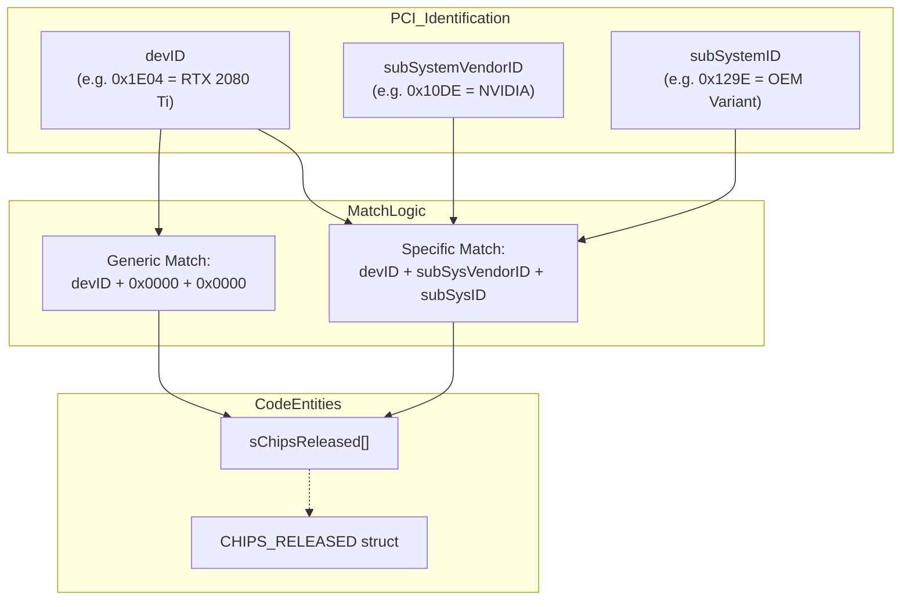
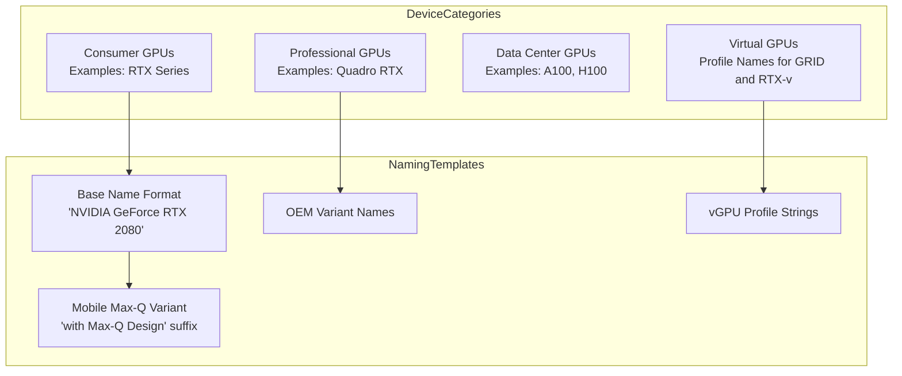
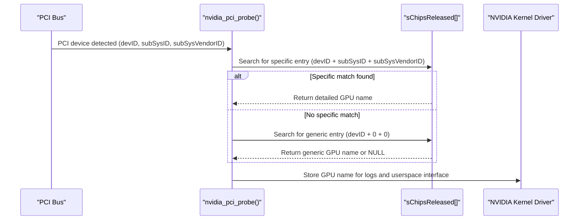
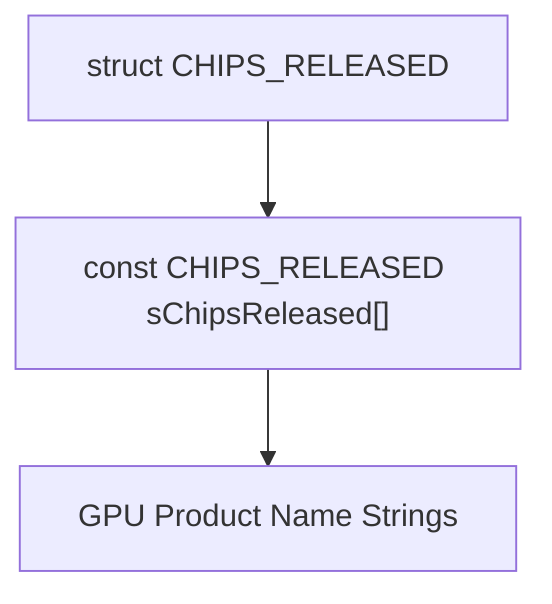
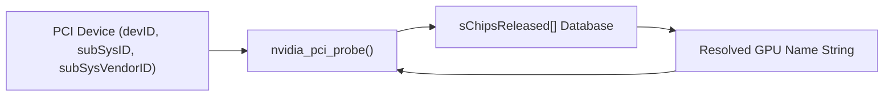

<!-- source: DeepWiki mcp.deepwiki.com · repo NVIDIA/open-gpu-kernel-modules · page 7.1 GPU Device Database · fetched 2026-10-26 -->

# GPU Device Database

<details>
<summary>Relevant source files</summary>

The following files were used as context for generating this wiki page:

- [src/nvidia/generated/g_nv_name_released.h](src/nvidia/generated/g_nv_name_released.h)

</details>


## Purpose and Scope

The GPU Device Database within the NVIDIA Open GPU Kernel Modules repository constitutes a definitive mapping from PCI device IDs and subsystem IDs to descriptive GPU model names. This database spans consumer GeForce GPUs, professional RTX/Quadro devices, data center accelerator cards (e.g., A100, H100), and virtual GPU (vGPU) types, enabling the kernel driver to identify the GPU model accurately during PCI device enumeration.

Implemented as a static, auto-generated constant array of structs, this device database facilitates differentiation between generic devices, OEM variants, laptop-specific Max-Q designs, and data center accelerators. This allows the driver and related tools to display appropriate product names reliably and perform hardware-specific initialization accordingly. The primary data file hosting this database is:

- `src/nvidia/generated/g_nv_name_released.h`

This file is autogenerated and must not be edited manually. For details on vGPU configurations, see section [7.2 vGPU Configuration](). For driver integration points, see section [3.1 nvidia.ko - Core Driver]().

---

## Data Structure Definition

The core data structure representing each entry in the GPU Device Database is the `CHIPS_RELEASED` struct:

```c
typedef struct _CHIPS_RELEASED {
    unsigned short devID;              // PCI Device ID
    unsigned short subSystemID;        // PCI Subsystem Device ID  
    unsigned short subSystemVendorID;  // PCI Subsystem Vendor ID
    const char *name;                  // Human-readable product name string
} CHIPS_RELEASED;
```

The database is exposed as a static constant array:

```c
static const CHIPS_RELEASED sChipsReleased[] = {
    // Example entries:
    { 0x1E02, 0x0000, 0x0000, "NVIDIA TITAN RTX" },
    { 0x1E04, 0x0000, 0x0000, "NVIDIA GeForce RTX 2080 Ti" },
    { 0x1E30, 0x129e, 0x1028, "Quadro RTX 8000" },
    // Thousands of other mappings...
};
```

Each entry matches on the PCI device ID and subsystem vendor/device ID pair to pinpoint exact GPU variants and their marketed names. The existence of subsystem IDs enables distinction of OEM versions, specialized laptop variants (Max-Q), or professional cards with exclusive BIOS/firmware variants.

Sources: [src/nvidia/generated/g_nv_name_released.h:25-34](), [src/nvidia/generated/g_nv_name_released.h:35-115]()

---

## PCI Identification System

The database leverages the PCI ID scheme to identify devices:

- **devID**: The PCI device ID representing the base GPU model.
- **subSystemVendorID**: The PCI subsystem vendor ID specifying OEM vendor.
- **subSystemID**: The PCI subsystem device ID representing specific card variants, design revisions, or Max-Q laptop designations.



The driver first attempts to find an exact specific match for all three PCI fields. Failing that, it falls back to a generic match where subsystem IDs are zero. This hierarchy allows both broad and granular device identification.

Sources: [src/nvidia/generated/g_nv_name_released.h:25-115]()

---

### Generic vs. Specific Entries

- **Generic Entries**: Use zero for both subsystem vendor and device IDs. These catch-all entries are for GPU models without regard to OEM or OEM SKU variants.  
  Example:  
  `{0x1E04, 0x0000, 0x0000, "NVIDIA GeForce RTX 2080 Ti"}` applies to all RTX 2080 Ti cards.

- **Specific Entries**: Include subsystem vendor and device IDs to capture OEM customizations, laptop Max-Q variants, professional model firmware, or data center hardware variants.  
  Examples:  
  - Dell Quadro RTX 8000 variant: `{0x1E30, 0x129e, 0x1028, "Quadro RTX 8000"}`  
  - ASUS RTX 2080 Max-Q laptop variant: multiple subsystem IDs under `{0x1E90, subSysID, subSysVendorID, "NVIDIA GeForce RTX 2080 with Max-Q Design"}` entries.

Sources: [src/nvidia/generated/g_nv_name_released.h:35-92]()

---

## Product Line Coverage

The GPU Device Database primarily covers GPUs from Turing architecture onward, across multiple product categories:

| Product Category           | Example Device IDs          | Sample Models                          |
|----------------------------|----------------------------|--------------------------------------|
| Consumer GeForce GPUs       | 0x1E02, 0x1E04, 0x1E81     | TITAN RTX, RTX 2080 Ti, RTX 2080 SUPER |
| Professional RTX / Quadro  | 0x1E30, 0x1E36, 0x1E78     | Quadro RTX 6000, RTX 8000            |
| Data Center Accelerators   | 0x20B0, 0x20F1, 0x2330     | A100, H100, GB-series accelerators   |
| Cryptocurrency Mining (CMP) | 0x1E09                     | CMP 50HX                             |
| Virtual GPUs (vGPU)        | Various (not shown here)    | GRID, NVIDIA RTX virtual GPUs        |

This broad coverage supports multiple usage scenarios including desktop gaming, workstation graphics, compute clusters, and GPU virtualization.

Sources: [src/nvidia/generated/g_nv_name_released.h:35-115]()

---

## Database Organization

The device entries in `sChipsReleased[]` are organized conceptually by market segment and purpose:



Naming patterns distinguish standard desktop cards from power-optimized mobile (Max-Q) cards, OEM-customized variants, and virtual GPU profiles.

Sources: [src/nvidia/generated/g_nv_name_released.h:35-115]()

---

## Representative Examples

Below are sample mappings showing the database format and content:

| devID  | subSystemID | subSystemVendorID | GPU Name                           |
|--------|-------------|-------------------|----------------------------------|
| 0x1E02 | 0x0000      | 0x0000            | NVIDIA TITAN RTX                 |
| 0x1E04 | 0x0000      | 0x0000            | NVIDIA GeForce RTX 2080 Ti       |
| 0x1E30 | 0x129e      | 0x1028            | Quadro RTX 8000 (Dell OEM)       |
| 0x1E90 | 0x131f      | 0x1043            | NVIDIA GeForce RTX 2080 Max-Q (ASUS OEM) |

These examples illustrate generic and specific matching based on PCI subsystem IDs.

Sources: [src/nvidia/generated/g_nv_name_released.h:35-115]()

---

## Firmware Binary Archives for New Architectures

In addition to the device database, the driver relies on embedded binary firmware blobs for GPU System Processor (GSP) functionality for recent GPU architectures like Blackwell (GB10B). These firmware images are referenced in specific generated source files:

- GSP Boot Firmware Archive for GB10B:  
  `kgspBinArchiveGspRmBoot_GB10B_BINDATA_LABEL_UCODE_IMAGE_DBG_data`  
  defined and stored in [src/nvidia/generated/g_bindata_kgspGetBinArchiveGspRmBoot_GB10B.c:31-40]()

- Signed FMC GSP RM Firmware for GB10B:  
  External keys and signed blobs stored similarly in  
  [src/nvidia/generated/g_bindata_kgspGetBinArchiveGspRmFmcGfwProdSigned_GB10B.c:31-40]()

These binary archives accompany the device database for runtime GPU initialization and GSP firmware loading.

Sources: [src/nvidia/generated/g_bindata_kgspGetBinArchiveGspRmBoot_GB10B.c:31-40](), [src/nvidia/generated/g_bindata_kgspGetBinArchiveGspRmFmcGfwProdSigned_GB10B.c:31-40]()

---

## Usage in Device Detection and Initialization

During kernel probe events, the PCI subsystem reads the device ID, subsystem vendor ID, and subsystem device ID. The NVIDIA kernel module's probe function searches the `sChipsReleased[]` database for a matching entry.

The lookup proceeds as follows:



This resolved name is used for system logs, `nvidia-smi` tool output, and user-facing diagnostics, allowing accurate identification of the hardware platform.

Sources: [src/nvidia/generated/g_nv_name_released.h:35-115]()

---

## Database Maintenance and Generation

The GPU Device Database file `g_nv_name_released.h` is automatically generated as part of the build system. It aggregates ever-expanding PCI ID mappings reflecting new GPU releases, revisions, OEM-specific cards, and virtual GPU profiles.

Key points:

- **Autogenerated**: Avoid manual edits to guarantee consistency.
- **Dynamic updates**: Handled by NVIDIA build tools synchronizing internal device data with source control.
- **Wide scope**: Covers thousands of device variants ensuring the driver supports the full ecosystem of NVIDIA GPUs.

This approach guarantees timely support for new GPUs and subsystem variants without manual intervention.

Sources: [src/nvidia/generated/g_nv_name_released.h:1-25]()

---

# Appendix: Code Entities and Relationships

## GPU Device Database Data Structures



This encapsulates the core database data and structure.

## Device Detection Flow with PCI Probe



The key runtime interaction mapping hardware IDs to human-readable GPU names.

---

# References & Sources

- [src/nvidia/generated/g_nv_name_released.h:1-115]()
- [src/nvidia/generated/g_bindata_kgspGetBinArchiveGspRmBoot_GB10B.c:31-40]()
- [src/nvidia/generated/g_bindata_kgspGetBinArchiveGspRmFmcGfwProdSigned_GB10B.c:31-40]()

---

This concludes the detailed documentation for the GPU Device Database in the NVIDIA Open GPU Kernel Modules project.

---

