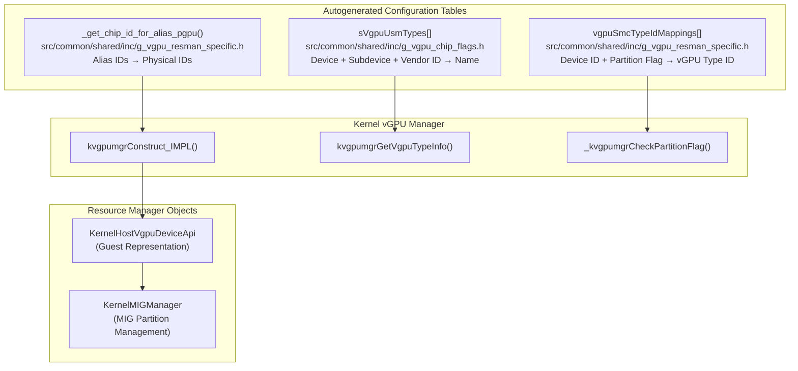
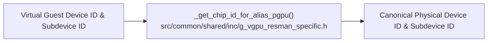
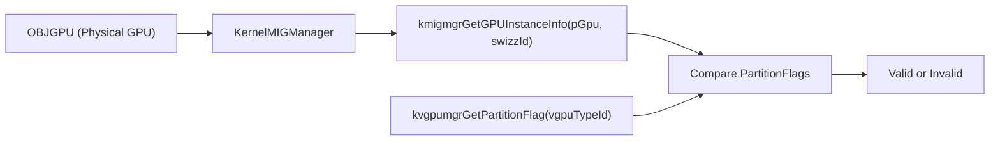
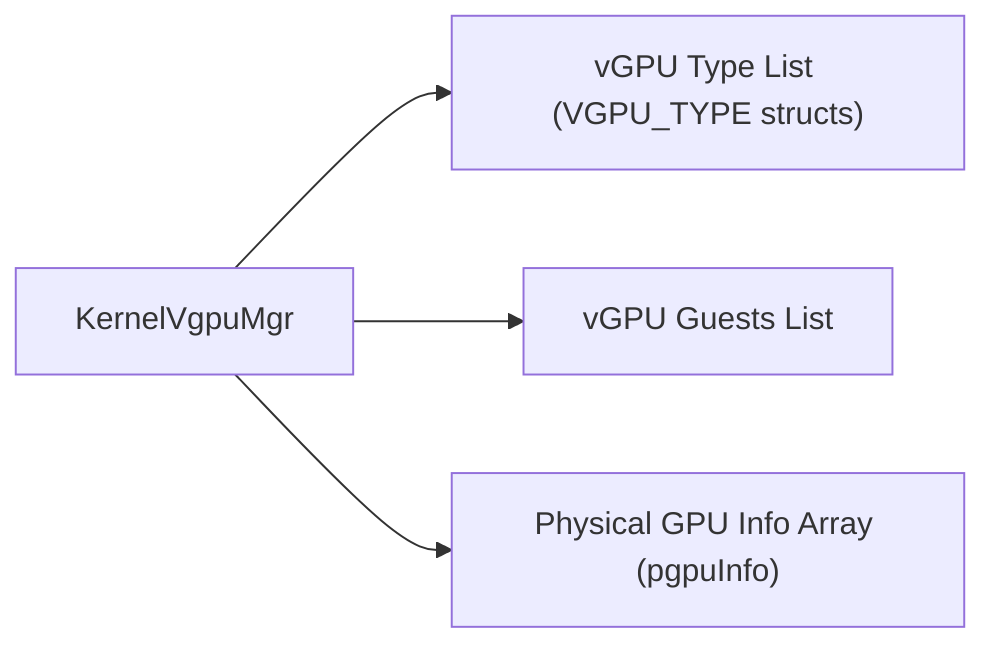

<!-- source: DeepWiki mcp.deepwiki.com · repo NVIDIA/open-gpu-kernel-modules · page 7.2 vGPU Configuration · fetched 2026-10-26 -->

# vGPU Configuration

<details>
<summary>Relevant source files</summary>

The following files were used as context for generating this wiki page:

- [kernel-open/nvidia-drm/nvidia-drm-sources.mk](kernel-open/nvidia-drm/nvidia-drm-sources.mk)
- [src/common/shared/inc/g_vgpu_chip_flags.h](src/common/shared/inc/g_vgpu_chip_flags.h)
- [src/common/shared/inc/g_vgpu_resman_specific.h](src/common/shared/inc/g_vgpu_resman_specific.h)
- [src/nvidia/arch/nvalloc/unix/src/osapi.c](src/nvidia/arch/nvalloc/unix/src/osapi.c)
- [src/nvidia/src/kernel/vgpu/rpc.c](src/nvidia/src/kernel/vgpu/rpc.c)

</details>


## Purpose and Scope

This page documents the vGPU (Virtual GPU) configuration system in the NVIDIA Open GPU Kernel Modules. The configuration system defines and manages virtual GPU instances by supporting the following:

- **vGPU Type Mappings:** Mapping physical GPU device IDs and partition flags to vGPU type identifiers.
- **Partition Configuration:** Handling GPU partitioning for multi-tenant virtualization via MIG partitions (Multi-Instance GPU) and related partition flags.
- **Device ID Aliasing:** Translation between vGPU alias device IDs and canonical physical GPU device IDs to enable correct identification of vGPU devices.
- **USM Type Mappings:** Associating device/subdevice/vendor IDs with human-readable vGPU type/product names.
- **Lifecycle Management:** Management of vGPU types and guests by the kernel-level `KernelVgpuMgr` class, including allocation, validation, and resource tracking.

This page complements the GPU device database in Section [7.1 GPU Device Database] and the memory management facilities in [4.4 GPU Memory Management].

---

## Architecture Overview

The vGPU configuration subsystem integrates autogenerated static mappings with dynamic runtime management, enabling flexible and validated GPU virtualization. The key components involved are:

- **Autogenerated Configuration Tables:**
  - **Alias Mapping Table:** Used to translate vGPU alias device/subdevice IDs reported by virtualized guests into canonical physical GPU device/subdevice IDs.
  - **SMC Type ID Mapping Table:** Connects physical GPU device IDs and GPU partition flags to specific vGPU type IDs, representing available virtual GPU configurations.
  - **USM Type Table:** Maps device, subdevice, and vendor IDs to human-readable vGPU product names, aiding identification and user interface purposes.

- **Kernel Runtime Manager:**
  - The `KernelVgpuMgr` class manages the runtime lifecycle of vGPU types and guest instances, including lookup, validation, and resource management.

- **Resource Manager Integration:**
  - Interfaces with `KernelHostVgpuDeviceApi` for guest representation and interaction.
  - Works with `KernelMIGManager` to validate physical GPU partitions and ensure vGPU configuration compatibility with underlying MIG partitions.

The architecture ensures consistent mapping from virtual GPU instances as exposed to guests, through validated partitioning on physical hardware, to resource management and scheduling.

### System Architecture Diagram



**Sources:**  
[src/common/shared/inc/g_vgpu_resman_specific.h:6-52](), [src/common/shared/inc/g_vgpu_chip_flags.h:5-67](), [src/nvidia/src/kernel/virtualization/kernel_vgpu_mgr.c:73-164]()

---

## Device ID Alias Mapping

Virtual GPU devices presented to guests often use alias device and subdevice IDs. To correctly identify and manage these devices, the system translates alias IDs back to canonical physical GPU device IDs through a dedicated alias mapping table.

### Alias Mapping Structure

The alias mapping table is a static array of entries, each specifying:

| Field          | Type   | Description                          |
|----------------|--------|------------------------------------|
| `alias_devid`  | `NvU32` | Virtual alias device ID             |
| `alias_subdevid`| `NvU32` | Virtual alias subdevice ID          |
| `devid`        | `NvU32` | Canonical physical device ID        |
| `subdevid`     | `NvU32` | Canonical physical subdevice ID     |

When a virtual device reports an alias device/subdevice ID, the kernel calls `_get_chip_id_for_alias_pgpu()` to perform the translation.

### Key Function: `_get_chip_id_for_alias_pgpu()`

This function iterates over the alias table entries and, upon finding a match for the guest's `dev_id` and `subdev_id`, replaces them with the corresponding canonical physical IDs.



### Example Alias Entries

| Virtual Device ID | Virtual Subdevice ID | Physical Device ID | Physical Subdevice ID | Description       |
|-------------------|---------------------|--------------------|----------------------|-------------------|
| 0x20B5            | 0x1642              | 0x20B5             | 0x1533               | Alias for A100D   |
| 0x20FD            | 0x17F8              | 0x20F5             | 0x0                  | Alias for A800D   |
| 0x2BB5            | 0x220B              | 0x2BB5             | 0x204E               | Alias for Blackwell GPUs |

This translation ensures that the resource manager and drivers operate with canonical physical device identifiers.

**Sources:**  
[src/common/shared/inc/g_vgpu_resman_specific.h:6-44]()

---

## SMC Partition Type Mappings

Shared Multi-Instance GPU (SMC) partition flags represent partition configurations of the physical GPU hardware, exposed through MIG. The system uses these partition flags, combined with physical device IDs, to map to vGPU type IDs supported by the resource manager.

### Partition Mapping Structure

The static array `vgpuSmcTypeIdMappings` contains entries structured as:

| Field           | Description                                    |
|-----------------|------------------------------------------------|
| `devId`         | Physical PCI Device ID                          |
| `partitionFlag` | Bitmask representing the MIG or SMC partition |
| `vgpuTypeId`    | vGPU type identifier used internally           |

### Common Partition Flags

- `NV2080_CTRL_GPU_PARTITION_FLAG_ONE_EIGHTHED_GPU`: One-eighth GPU partition  
- `NV2080_CTRL_GPU_PARTITION_FLAG_ONE_QUARTER_GPU`: One-quarter GPU partition  
- `NV2080_CTRL_GPU_PARTITION_FLAG_ONE_MINI_HALF_GPU`: Mini half GPU partition  
- `NV2080_CTRL_GPU_PARTITION_FLAG_FULL_GPU`: Full GPU partition

Flags can be combined with additional feature flags, e.g., decoder and JPEG accelerator enable bits.

### Sample Partition Mapping Entries

| Device ID  | Partition Flag                                                 | vGPU Type ID | Description           |
|------------|----------------------------------------------------------------|--------------|-----------------------|
| 0x20B0     | `ONE_EIGHTHED_GPU`                                             | 463          | GRID A100X-1-5C       |
| 0x20B0     | `ONE_QUARTER_GPU`                                              | 464          | GRID A100X-2-10C      |
| 0x20B0     | `ONE_EIGHTHED_GPU` + Decoder & JPEG Enable                     | 704          | GRID A100X-1-5CME     |
| 0x20B2     | `ONE_HALF_GPU`                                                 | 625          | GRID A100DX-4-40C     |

### Partition Flag Validation

The runtime function `_kvgpumgrCheckPartitionFlag()` validates if a given vGPU type is compatible with the MIG partition configuration on the physical GPU:

1. Using the physical GPU handle (`OBJGPU`), retrieve MIG instance information for the corresponding `swizzId` via `KernelMIGManager` (`kmigmgrGetGPUInstanceInfo()`).
2. Acquire the partition flag for the specified vGPU type via `kvgpumgrGetPartitionFlag()`.
3. Compare the MIG partition flags against the vGPU partition flags for compatibility.
4. Return a boolean indicating match or mismatch.

This check prevents invalid assignment of vGPU types to incompatible GPU partitions.



**Sources:**  
[src/common/shared/inc/g_vgpu_resman_specific.h:47-88](),  
[src/nvidia/src/kernel/virtualization/kernel_vgpu_mgr.c:175-195]()

---

## USM Type Definitions

The Unified Shared Memory (USM) type table maps PCI device, subdevice, and vendor IDs to human-readable vGPU product names. This mapping supports debugging and diagnostics by identifying vGPU types by name.

### USM Type Entry Structure

Each entry is a `VGPU_USM_TYPES` struct with fields:

| Field                | Type               | Description                                  |
|----------------------|--------------------|----------------------------------------------|
| `ulDevID`            | `unsigned short`   | PCI device ID                                |
| `ulSubID`            | `unsigned short`   | PCI subdevice ID                             |
| `ulSubSystemVendorID`| `unsigned short`   | PCI subsystem vendor ID (e.g., `0x10de`)   |
| `sDevName`           | `const char*`      | Human-readable device name                   |

### Example Entries

```c
ENTRY(0x20B0, 0x146F, 0x10de, "GRID A100X-1-5C")
ENTRY(0x20B7, 0x1589, 0x10de, "NVIDIA A30-1-6C")
ENTRY(0x1EB8, 0x1309, 0x10de, "GRID T4-1B")
```

Names indicate architecture, vGPU slice configuration, and generational identifiers.

### Usage

This table is queried during vGPU guest initialization to resolve PCI device identifiers to friendly names presented to users or logs.

**Sources:**  
[src/common/shared/inc/g_vgpu_chip_flags.h:8-67]()

---

## vGPU Manager Implementation (`KernelVgpuMgr`)

`KernelVgpuMgr` is the primary kernel-space manager for vGPU types, guests, and configuration state. It manages lookup, validation, lifecycle, and resource allocation of vGPU instances.

### Initialization and Lifecycle

- **Constructor (`kvgpumgrConstruct_IMPL()`):**  
  Initializes internal tracks:  
  - Creates non-paged kernel heap for vGPU objects.  
  - Initializes several doubly linked lists for vGPU types, guests, and requests.  
  - Sets the supported vGPU software version bounds from constants (e.g., `NV_VGPU_MIN_SUPPORTED_GRIDSW_VERSION_EXTERNAL_MAJOR`).  
- **Destructor (`kvgpumgrDestruct_IMPL()`):**  
  Cleans up lists and frees the kernel heap.

### Key Functionalities

- **vGPU Type Lookup:**  
  The routine `kvgpumgrGetVgpuTypeInfo()` retrieves vGPU type info by type ID from the internal type list.

- **Maximum Instance Count:**  
  `kvgpumgrGetMaxInstanceOfVgpu()` provides the maximum number of instances supported for a given vGPU type, used for resource accounting.

- **Physical GPU Index Retrieval:**  
  `kvgpumgrGetPgpuIndex()` returns the index of a physical GPU in the manager’s internal `pgpuInfo` array given a PCI device ID.

- **vGPU Placement Modes:**  
  The manager handles heterogeneous and homogeneous vGPU placement modes:  
  - Heterogeneous placement is supported if hypervisor functionality such as VFIO, Device VM, or KVM is active (`kvgpumgrIsHeterogeneousVgpuTypeSupported()`).  
  - Homogeneous placement requires Ada+ architecture GPUs and disables heterogeneous support (`kvgpumgrCheckHomogeneousPlacementSupported()`).

- **Partition Updates:**  
  Functions `_kvgpumgrUpdateHeterogeneousCreatablePlacementIds()` and `_kvgpumgrUpdateHomogeneousCreatablePlacementIds()` update internal records of permissible vGPU partitions for scheduling and resource management.

### Class Data Flow Diagram



**Sources:**  
[src/nvidia/src/kernel/virtualization/kernel_vgpu_mgr.c:73-164](),  
[src/nvidia/src/kernel/virtualization/kernel_vgpu_mgr.c:166-204]()

---

## Summary

The NVIDIA vGPU Configuration subsystem harmonizes static, autogenerated tables and dynamic runtime management to enable robust GPU virtualization:

- Alias mappings guarantee accurate physical device identification behind virtualized device IDs.
- SMC type ID and partition flag mappings associate physical GPU partitions with vGPU types exposed to guests.
- USM mappings provide user-facing identification of vGPU types by name.
- `KernelVgpuMgr` orchestrates runtime queries, validation, and management of vGPU types and guests, supporting different placement modes and MIG partition constraints.

This combined static and dynamic approach ensures that vGPU instances are provisioned, validated, and managed consistent with physical GPU capabilities and partitioning.

---

## References

- `src/common/shared/inc/g_vgpu_resman_specific.h`  
- `src/common/shared/inc/g_vgpu_chip_flags.h`  
- `src/nvidia/src/kernel/virtualization/kernel_vgpu_mgr.c`

---

