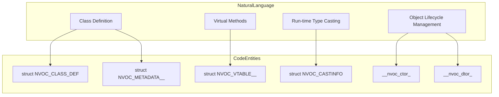
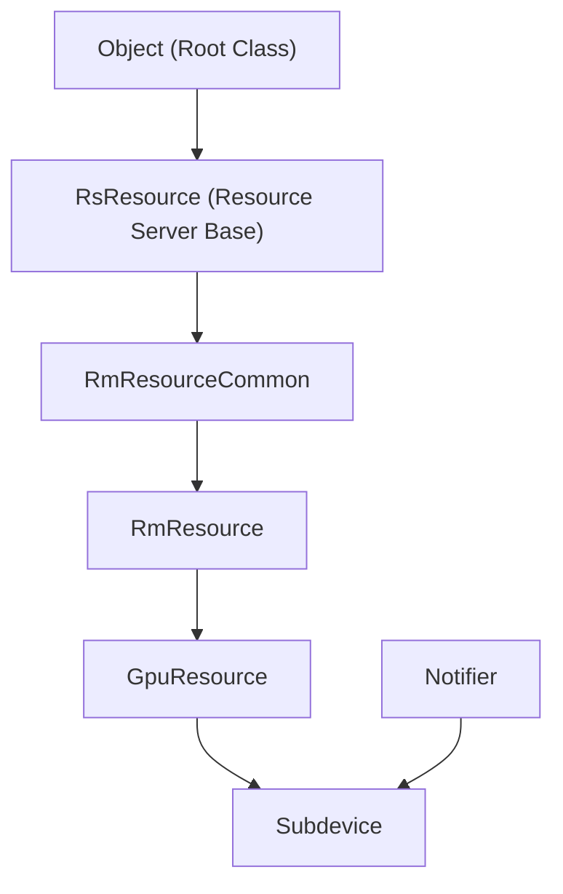
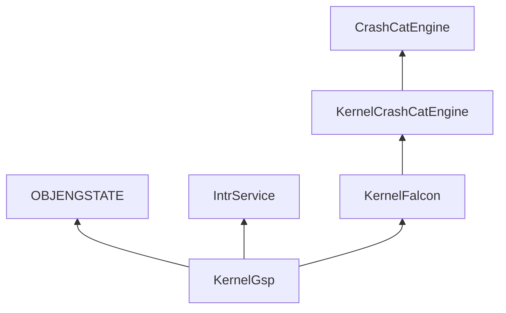
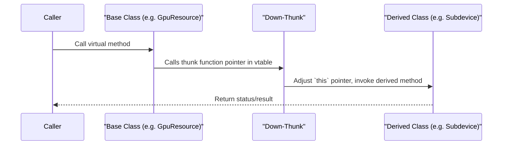

<!-- source: DeepWiki mcp.deepwiki.com · repo NVIDIA/open-gpu-kernel-modules · page 7.3 NVOC Framework · fetched 2026-10-26 -->

# NVOC Framework

<details>
<summary>Relevant source files</summary>

The following files were used as context for generating this wiki page:

- [kernel-open/nvidia/os-interface.c](kernel-open/nvidia/os-interface.c)
- [src/nvidia/generated/g_device_nvoc.c](src/nvidia/generated/g_device_nvoc.c)
- [src/nvidia/generated/g_device_nvoc.h](src/nvidia/generated/g_device_nvoc.h)
- [src/nvidia/generated/g_gpu_nvoc.c](src/nvidia/generated/g_gpu_nvoc.c)
- [src/nvidia/generated/g_gpu_nvoc.h](src/nvidia/generated/g_gpu_nvoc.h)
- [src/nvidia/generated/g_subdevice_nvoc.c](src/nvidia/generated/g_subdevice_nvoc.c)
- [src/nvidia/generated/g_subdevice_nvoc.h](src/nvidia/generated/g_subdevice_nvoc.h)

</details>


## Purpose and Scope

The NVOC (NVIDIA Object-Oriented C) Framework is an internal code generation and runtime system designed to implement object-oriented programming constructs in standard C, tailored for the NVIDIA Open GPU kernel modules. It enables:

- Definition of structured class hierarchies with inheritance.
- Virtual method tables (vtables) supporting polymorphism.
- Run-time type information (RTTI) allowing dynamic type checks and safe casts.
- Automated thunking between base and derived class methods for correct dispatch.
- Standardized object lifecycle management with constructor and destructor patterns.

NVOC eliminates the need for C++ in kernel code by generating boilerplate C code that simulates OOP paradigms, while maintaining the compatibility and efficiency required in kernel modules.

This page details the architecture, data flow, and key technical patterns of the NVOC framework, referencing core generated files and their roles.

Sources: [src/nvidia/generated/g_subdevice_nvoc.h:109-115](), [src/nvidia/generated/g_subdevice_nvoc.c:9-15]()

---

## Architecture Overview

NVOC operates as a pre-compilation code generator that reads specialized class declarations and emits C source and header files implementing OOP-like behavior in plain C. It provides the following major components:

- **Class Definitions**: Structures representing NVOC classes combine instance data and embedded base class sub-objects, simulating inheritance.
- **Class Metadata**: Per-class metadata structures describe runtime type information (RTTI), including class IDs, sizes, and inheritance relations.
- **Virtual Tables (VTables)**: Structs of function pointers implementing virtual method dispatch for polymorphism.
- **Thunking Layer**: Automatically generated thin adapter functions to bridge method calls between base and derived classes, adjusting `this` pointers as necessary.
- **Lifecycle Functions**: Constructors and destructors to initialize, finalize, and manage object lifetimes.
- **Safe Casting**: Runtime casting support to dynamically cast between classes in the inheritance hierarchy.

### Mapping Natural Language Framework Concepts to Generated Code Entities



This mapping illustrates how OOP concepts (classes, virtual methods, casting, and lifecycle control) correspond to actual generated C structures and functions.

Sources: [src/nvidia/generated/g_subdevice_nvoc.c:22-30](), [src/nvidia/generated/g_subdevice_nvoc.h:110-115]()

---

## Class System and Inheritance

### Class Definition Structure

Each NVOC class is represented by a C `struct` with the following features:

- A pointer to class metadata (`__nvoc_metadata_ptr`) which includes RTTI and vtable info.
- Embedded "base" class objects as struct members to represent inheritance by composition.
- Ancestor pointers, allowing fast upward casting (`staticCast`) into base classes within complex hierarchies.
- A virtual method table implemented as a sequence of function pointers embedded in the struct, supporting dynamic dispatch.

This explicit struct composition and pointer design simulate multi-level and multiple inheritance in a single C struct.

#### Example: The `Subdevice` Class Hierarchy



The `Subdevice` struct declares embedded base sub-objects such as:

```c
struct Subdevice {
    union {
        const struct NVOC_METADATA__Subdevice *__nvoc_metadata_ptr;
        const struct NVOC_RTTI *__nvoc_rtti;
    };
    struct GpuResource __nvoc_base_GpuResource;
    struct Notifier __nvoc_base_Notifier;
    // Ancestor pointers for staticCast
    struct Object *__nvoc_pbase_Object;
    struct RsResource *__nvoc_pbase_RsResource;
    struct RmResourceCommon *__nvoc_pbase_RmResourceCommon;
    struct RmResource *__nvoc_pbase_RmResource;
    struct GpuResource *__nvoc_pbase_GpuResource;
    struct INotifier *__nvoc_pbase_INotifier;
    struct Notifier *__nvoc_pbase_Notifier;
    struct Subdevice *__nvoc_pbase_Subdevice;
    // Virtual method pointers follow...
};
```

The ancestor pointers enable safe, efficient casting between various ancestor types at runtime.

Sources: [src/nvidia/generated/g_subdevice_nvoc.h:117-138]()

### Specialized Hierarchies: The KernelGsp Class

`KernelGsp` showcases advanced multiple inheritance:

- It inherits from `OBJENGSTATE` (GPU engine state tracking),
- `IntrService` (interrupt handling services),
- and `KernelFalcon` (interface for firmware microcontroller engines).

`KernelFalcon` further inherits from `KernelCrashCatEngine`, which derives from `CrashCatEngine`.



This complex hierarchy is encoded entirely via nested structs and pointer-based dispatch, fully implemented in C.

Sources: [src/nvidia/generated/g_kernel_gsp_nvoc.c:22-28](), [src/nvidia/generated/g_kernel_gsp_nvoc.h:473-485]()

---

## Class Metadata and Run-Time Type Information (RTTI)

NVOC-generated classes include metadata structures that provide:

- **Class Definition**: Size, class ID (unique identifier), visibility, provider identifiers.
- **Inheritance Mapping**: Links to metadata of base classes with offsets and destructors.
- **Dynamic Casting Info**: Structures describing all relatives in the inheritance graph for safe down/up casting.

Example structure pointer in `Subdevice`:

```c
union {
    const struct NVOC_METADATA__Subdevice *__nvoc_metadata_ptr;
    const struct NVOC_RTTI *__nvoc_rtti;
};
```

The RTTI allows functions like `dynamicCast()` to verify and safely cast object pointers between related types.

Sources: [src/nvidia/generated/g_subdevice_nvoc.h:111-122](), [src/nvidia/generated/g_subdevice_nvoc.c:40-43]()

---

## Virtual Tables (VTables)

NVOC implements polymorphism using vtables defined as structs of function pointers corresponding to the class's virtual methods.

For example, the `Subdevice` struct contains a section of vtable function pointers (only partially shown here):

```c
struct Subdevice {
    ...
    NV_STATUS (*__subdeviceCtrlCmdBiosGetInfoV2__)(struct Subdevice *, NV2080_CTRL_BIOS_GET_INFO_V2_PARAMS *);
    NV_STATUS (*__subdeviceCtrlCmdBiosGetSKUInfo__)(struct Subdevice *, NV2080_CTRL_BIOS_GET_SKU_INFO_PARAMS *);
    NV_STATUS (*__subdeviceCtrlCmdBiosGetPostTime__)(struct Subdevice *, NV2080_CTRL_CMD_BIOS_GET_POST_TIME_PARAMS *);
    ...
};
```

These function pointers represent the class's virtual method implementations allowing calls through base class pointers to dispatch properly to derived overrides.

Sources: [src/nvidia/generated/g_subdevice_nvoc.h:139-152]()

---

## Thunking Mechanism

NVOC generates thunk functions to correctly glue virtual method calls among classes with complex inheritance, ensuring proper object pointer adjustment and dispatch.

- **Down-Thunks:** Adapt calls from base class to derived implementation adjusting the `this` pointer.
- **Up-Thunks:** Adapt calls from derived class back to base class implementations when explicitly invoked.

### Typical Thunk Dispatch Flow



For example, the down-thunk for `Subdevice`'s `resPreDestruct` is:

```c
void __nvoc_down_thunk_Subdevice_resPreDestruct(struct RsResource *pResource);
```

which shifts the `this` pointer from the base class offset to the `Subdevice`'s actual `this`.

Sources: [src/nvidia/generated/g_subdevice_nvoc.c:44-61](), [src/nvidia/generated/g_kernel_gsp_nvoc.c:44-64]()

---

## Object Lifecycle

### Construction Flow

Object creation follows steps:

1. **Allocation:** Objects are dynamically allocated and zero-initialized using NVOC's allocators like `__nvoc_objCreateDynamic_<ClassName>()`.
2. **Base Initialization:** Initialization functions for base classes are called in inheritance order. Example:

```c
__nvoc_init__GpuResource(&obj->__nvoc_base_GpuResource);
__nvoc_init__Notifier(&obj->__nvoc_base_Notifier);
```

3. **VTable Setup:** Virtual function tables are set per-instance with `__nvoc_init_funcTable_<ClassName>`, installing proper method pointers for the instance.
4. **Class Constructor:** Class-specific constructor (`__nvoc_ctor_<ClassName>`) is run to initialize fields and set up the object.

### Destruction Flow

Destructors follow the reverse order of construction:

- First, class-specific destructor (`__nvoc_dtor_<ClassName>`) runs to clean up resources.
- Then destructors for embedded base classes are called, cascading down through the hierarchy.
- Event subscriptions and other allocations are cleaned.

Example destructor outline for `OBJGPU`:

```c
void __nvoc_dtor_OBJGPU(Dynamic *pThis) {
    OBJGPU *__nvoc_this = (OBJGPU *) pThis;

    __nvoc_events_unsubscribe__OBJGPU(__nvoc_this);
    __nvoc_gpuDestruct(__nvoc_this);

    __nvoc_dtor_Object((Dynamic *)&__nvoc_this->__nvoc_base_Object);
    __nvoc_dtor_GpuHalspecOwner((Dynamic *)&__nvoc_this->__nvoc_base_GpuHalspecOwner);
    __nvoc_dtor_RmHalspecOwner((Dynamic *)&__nvoc_this->__nvoc_base_RmHalspecOwner);
    __nvoc_dtor_OBJTRACEABLE((Dynamic *)&__nvoc_this->__nvoc_base_OBJTRACEABLE);
}
```

Sources: [src/nvidia/generated/g_subdevice_nvoc.c:32-38](), [src/nvidia/generated/g_gpu_nvoc.c:146-169]()

---

## Framework Utilities and Features

### Metadata Versioning

NVOC-generated headers define a metadata version macro to ensure compatibility between generated code and runtime:

```c
#define NVOC_METADATA_VERSION 2
```

This macro appears in all generated headers to control versioned metadata parsing and usage.

Sources: [src/nvidia/generated/g_subdevice_nvoc.h:6-9](), [src/nvidia/generated/g_gpu_nvoc.h:6-9]()

### Debug Uniqueness Checks

In debug builds, NVOC generates static variables to validate uniqueness of class IDs, preventing runtime conflicts:

```c
char __nvoc_class_id_uniqueness_check__4b01b3 = 1;  // Subdevice
char __nvoc_class_id_uniqueness_check__7ef3cb = 1;  // OBJGPU
```

These act as compile-time guards against duplicate class identifiers.

Sources: [src/nvidia/generated/g_subdevice_nvoc.c:19-20](), [src/nvidia/generated/g_gpu_nvoc.c:18-20]()

### Private Field Protection

Private fields in class structs are wrapped using macros such as `PRIVATE_FIELD` that cause compiler diagnostics if accessed externally, reinforcing encapsulation in pure C despite lack of language support.

```c
#ifdef NVOC_SUBDEVICE_H_PRIVATE_ACCESS_ALLOWED
#define PRIVATE_FIELD(x) x
#else
#define PRIVATE_FIELD(x) NVOC_PRIVATE_FIELD(x)
#endif
```

This mechanism is standard in NVOC-generated headers to guard field visibility [src/nvidia/generated/g_subdevice_nvoc.h:99-107]().

---

## Summary Diagram: NVOC Framework in the Open GPU Kernel Modules

This diagram depicts the primary NVOC-generated classes within the GPU Kernel Modules, their inheritance relations, core file locations, and key roles.

```mermaid
graph TD
    DeviceObj["Device (g_device_nvoc.h/c)"]
    SubdeviceObj["Subdevice (g_subdevice_nvoc.h/c)"]
    KernelGspObj["KernelGsp (g_kernel_gsp_nvoc.h/c)"]

    DeviceObj -->|inherits| GpuResource["GpuResource"]
    SubdeviceObj -->|inherits| GpuResource
    KernelGspObj -->|inherits from| OBJENGSTATE["OBJENGSTATE"]
    KernelGspObj -->|inherits from| IntrService["IntrService"]
    KernelGspObj -->|inherits from| KernelFalcon["KernelFalcon"]

    DeviceObj -.->|vtable| DeviceVtable["NVOC_VTABLE__Device"]
    SubdeviceObj -.->|vtable| SubdeviceVtable["NVOC_VTABLE__Subdevice"]
    KernelGspObj -.->|vtable| KernelGspVtable["NVOC_VTABLE__KernelGsp"]

    DeviceObj -.->|ctor/dtor| DeviceCtor["__nvoc_ctor_Device / __nvoc_dtor_Device"]
    SubdeviceObj -.->|ctor/dtor| SubdeviceCtor["__nvoc_ctor_Subdevice / __nvoc_dtor_Subdevice"]
    KernelGspObj -.->|ctor/dtor| KernelGspCtor["__nvoc_ctor_KernelGsp / __nvoc_dtor_KernelGsp"]

    classDef["NVOC Class Definitions"] --> DeviceObj
    classDef --> SubdeviceObj
    classDef --> KernelGspObj
```

This structure reveals the hierarchical and polymorphic design provided by NVOC in the NVIDIA kernel modules.

Sources: [src/nvidia/generated/g_device_nvoc.h:43-143](), [src/nvidia/generated/g_subdevice_nvoc.h:43-138](), [src/nvidia/generated/g_kernel_gsp_nvoc.h:10-229]()

---

## References

- `g_subdevice_nvoc.h` and `g_subdevice_nvoc.c` — Implementation of the Subdevice class, inheritance, vtables, and thunking [src/nvidia/generated/g_subdevice_nvoc.h:109-160](), [src/nvidia/generated/g_subdevice_nvoc.c:9-82]()
- `g_kernel_gsp_nvoc.h` and `g_kernel_gsp_nvoc.c` — KernelGsp class, complex multiple inheritance, vtables, and dispatch logic [src/nvidia/generated/g_kernel_gsp_nvoc.h:10-229](), [src/nvidia/generated/g_kernel_gsp_nvoc.c:9-64]()
- `g_device_nvoc.h` and `g_device_nvoc.c` — Device class, supporting GPU resource hierarchy [src/nvidia/generated/g_device_nvoc.h:43-143](), [src/nvidia/generated/g_device_nvoc.c:9-80]()
- `g_gpu_nvoc.h` and `g_gpu_nvoc.c` — Core GPU object class `OBJGPU` metadata, events, and lifecycle [src/nvidia/generated/g_gpu_nvoc.h:1-222](), [src/nvidia/generated/g_gpu_nvoc.c:1-169]()

---

The NVOC framework enables the NVIDIA kernel modules to maintain a robust, verifiable object-oriented design purely in standard C. It provides clean interface abstractions, extensibility through inheritance, and safe polymorphic operations, all required for the complex and performance-critical GPU kernel environment.

---

