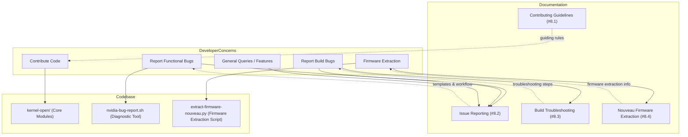

<!-- source: DeepWiki mcp.deepwiki.com · repo NVIDIA/open-gpu-kernel-modules · page 8 Developer Guide · fetched 2026-10-26 -->

# Developer Guide

<details>
<summary>Relevant source files</summary>

The following files were used as context for generating this wiki page:

- [CONTRIBUTING.md](CONTRIBUTING.md)

</details>


## Purpose and Scope

This guide provides a high-level orientation for developers engaging with the NVIDIA Open GPU Kernel Modules project. It summarizes the key development processes, essential contributor policies, issue handling protocols, and troubleshooting points at a broad level. The goal is to streamline onboarding and maintenance by clarifying where to find detailed instructions and the relation between core code, reporting templates, and support tools.

This page functions as a parent hub linking to focused child pages offering in-depth coverage of:

- **[Contributing Guidelines](#8.1)** — How to contribute code, project coding standards, and the pull request workflow.  
- **[Issue Reporting](#8.2)** — User guidance on submitting issues using templates and supplying reproducible diagnostic data.  
- **[Build Troubleshooting](#8.3)** — Troubleshooting common build and compatibility errors encountered during compilation and module integration.  
- **[Nouveau Firmware Extraction](#8.4)** — How to use the `extract-firmware-nouveau.py` script to extract GSP-RM firmware binaries for the Nouveau driver, including multiple modes of operation and related linux-firmware contribution processes.

---

## Development Workflow Overview

The project integrates open-source kernel interface layers with pre-compiled OS-agnostic binary components, primarily for GPU resource and display management. Developers primarily work within the kernel modules residing under `kernel-open/`, enhancing functionality, fixing bugs, and ensuring compatibility.

### Developer Concerns Mapped to Code and Issue Reporting

Developers commonly encounter various issue types requiring different reporting templates or areas of the codebase. The mapping below illustrates these natural language concerns to the respective diagnostic workflows and code resources:

```mermaid
graph TD
    subgraph "Natural Language Space"
        "B[Build Bug]" 
        "F[Functional Bug]"
        "C[Cosmetic Change]"
        "Q[General Question]"
    end

    subgraph "Code Entity Space"
        "B" --> "BT[20_build_bug.yml]"
        "F" --> "FT[10_functional_bug.yml]"
        "C" --> "D[Discussions/General]"
        "Q" --> "QA[Discussions/Q-A]"
        
        "BT" --> "KO[kernel-open/]"
        "FT" --> "KO"
        "FT" --> "NSR[nvidia-bug-report.sh]"
    end

    subgraph "Requirements"
        "BT" -.-> "V1[Driver Version]"
        "BT" -.-> "K1[uname -a]"
        "FT" -.-> "G1[nvidia-smi -L]"
        "FT" -.-> "L1[nvidia-bug-report.log.gz]"
    end
```

This diagram helps developers identify which parts of the codebase to interact with and what supplemental information is needed for issue resolution.

---

### Kernel Interface Layer Code Structure

The kernel modules are organized modularly for clear separation of concerns:

| Component            | Source Path                | Purpose                                                |
|----------------------|----------------------------|--------------------------------------------------------|
| Core Driver          | `kernel-open/nvidia/`       | PCI device init, lifecycle, Resource Manager API       |
| Unified Virtual Memory (UVM) | `kernel-open/nvidia-uvm/`  | Unified CPU/GPU memory management and tracking          |
| DRM Integration      | `kernel-open/nvidia-drm/`    | Linux DRM subsystem interface                           |
| Mode Setting         | `kernel-open/nvidia-modeset/`| Display engine modesetting and head management         |

Developers typically contribute within one or more of these functional areas depending on the subsystem involved.

---

## Contributing and Code Style

The project embraces contributions that improve executable code functionality but applies a strict policy to minimize maintenance overhead.

### Key Policies:

- **Non-Functional Changes Not Accepted**  
  Changes involving only cosmetic fixes—such as typo corrections, whitespace adjustments, or comment rewording—are not accepted primarily because they increase review burden without functional benefit.

- **Implicit Code Style Guidance**  
  No formal global style guide exists due to diverse component origins. Contributors should grasp the style by reading surrounding source files in the targeted area. The maintainers provide guidance during code reviews to ensure consistency.

- **Feature Requests and Discussions**  
  Requests for new features or broad discussions should be directed to the GitHub Discussions boards rather than submitting pull requests or issues directly.

For comprehensive details, see the **[Contributing Guidelines](#8.1)** page.

---

## Issue Reporting and Support

To achieve efficient and reproducible bug resolution, users must file issues via the appropriate GitHub templates while providing required diagnostic data.

### Common Issue Categories and Reporting Paths

| Issue Type       | GitHub Template            | Required Logs / Info                       | Notes                                      |
|------------------|----------------------------|-------------------------------------------|--------------------------------------------|
| Functional Bugs  | `10_functional_bug.yml`     | `nvidia-bug-report.log.gz`, confirmation proprietary driver unaffected | Proprietary driver bugs are handled separately. |
| Build Bugs       | `20_build_bug.yml`          | Kernel version (`uname -a`), build logs, commands  | Supported only for stable kernel releases.  |
| Cosmetic Issues  | GitHub Discussions          | N/A                                       | Not accepted as pull requests currently.  |
| General Queries  | GitHub Q&A Discussions      | N/A                                       | Broad support or inquiries go here.         |

### Functional Bug Reporting Flow

Below is the workflow for capturing and attaching complete environment and diagnostic data when reporting functional bugs:

```mermaid
graph LR
    subgraph "Environment Data"
        "DRV[Driver Version]"
        "KRN[uname -a]"
        "GPU[nvidia-smi -L]"
    end

    subgraph "Diagnostic Tools"
        "NSR[nvidia-bug-report.sh]"
    end

    subgraph "GitHub Issue"
        "FT[10_functional_bug.yml]"
    end

    "DRV" --> "FT"
    "KRN" --> "FT"
    "GPU" --> "FT"
    "NSR" -- "generates" --> "LOG[nvidia-bug-report.log.gz]"
    "LOG" -- "attached to" --> "FT"
```

Running `nvidia-bug-report.sh` gathers runtime logs, GPU info, and system state needed to triage complex issues effectively.

See **[Issue Reporting](#8.2)** for detailed templates and processes.

---

## Troubleshooting High-Level

Most developer difficulties occur during build or module loading phases, often related to kernel compatibility or environment setup.

### Frequent Failure Causes:

- **Unsupported Kernel Versions**  
  Build issues reported against unstable kernel versions marked with "-rc" are rejected. Only stable kernel releases are supported officially.

- **Proprietary Driver Cross-Check**  
  To isolate open-source driver bugs, reporters must confirm proprietary NVIDIA drivers of the same version do not exhibit the issue.

- **Build Environment Completeness**  
  Reports should include exact kernel version info (`uname -a`), OS distribution details, compiler versions, and complete build logs.

For more detailed strategies and common error diagnoses refer to the **[Build Troubleshooting](#8.3)** page.

---

## Nouveau Firmware Extraction

The `extract-firmware-nouveau.py` script is a critical tool helping developers extract the GSP-RM firmware binaries needed by the Nouveau open-source GPU driver. This script supports various extraction modes and sources such as recovery images or system firmware blobs.

It facilitates proper packaging of firmware for linux-firmware repository submission, enabling community distribution.

The **[Nouveau Firmware Extraction](#8.4)** page provides comprehensive documentation of usage options, supported firmware sources, and contribution guidelines for linux-firmware.

---

## Summary Diagram: Developer Roles, Code, and Documentation



This diagram links developer activities to core code modules, diagnostic tools, and documentation, clarifying key relationships for efficient developer engagement.

---

For detailed instructions, step-by-step workflows, and up-to-date policies, always consult the respective child pages linked above.

---

**Sources:**  
`.github/ISSUE_TEMPLATE/10_functional_bug.yml:1-105`  
`.github/ISSUE_TEMPLATE/20_build_bug.yml:1-64`  
`CONTRIBUTING.md:1-22`

---

