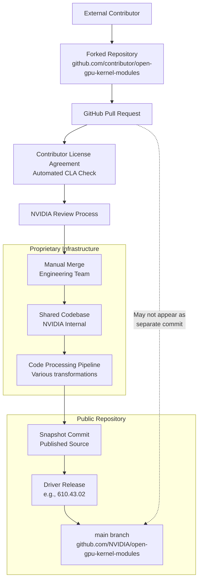
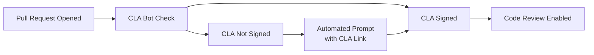
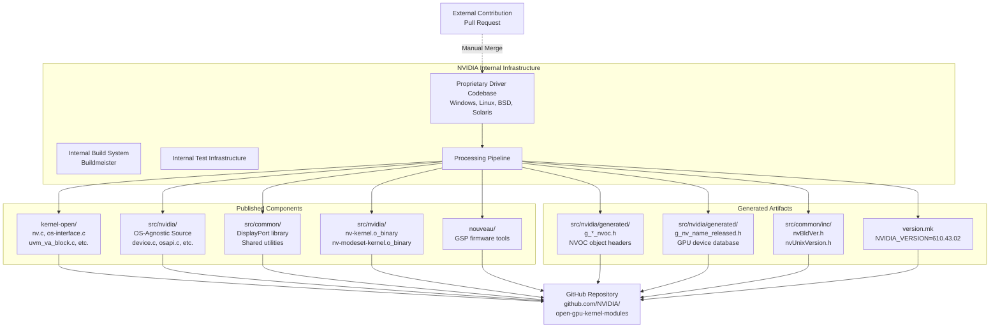
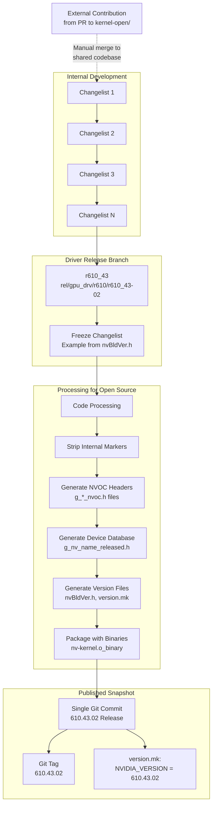
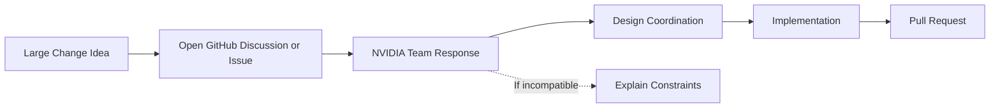
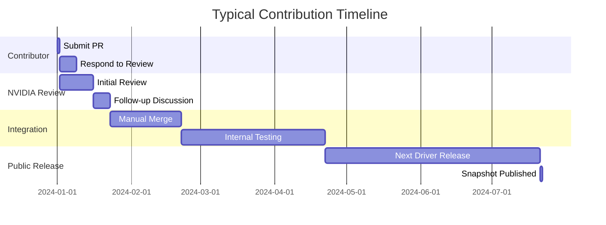

<!-- source: DeepWiki mcp.deepwiki.com · repo NVIDIA/open-gpu-kernel-modules · page 8.1 Contributing Guidelines · fetched 2026-10-26 -->

# Contributing Guidelines

Relevant source files

The following files were used as context for generating this wiki page:

- [CONTRIBUTING.md](CONTRIBUTING.md)

This page explains how to contribute to the NVIDIA open GPU kernel modules repository, including the pull request workflow, licensing requirements, and architectural constraints. For information about reporting issues and bugs, see [Issue Reporting](#8.2). For help with build problems, see [Build Troubleshooting](#8.3).

## Purpose and Scope

The NVIDIA open kernel modules codebase is shared with NVIDIA's proprietary drivers. This architectural decision has significant implications for the contribution process. Contributions undergo manual processing and merging into the proprietary codebase before being reflected in future open-source releases. This page documents the contribution workflow, licensing requirements, technical constraints, and best practices for submitting changes to this repository.

## Contribution Workflow Overview

Contributions to the open GPU kernel modules follow a GitHub-based pull request workflow but with specific constraints due to the shared codebase architecture.

The contribution flow begins with an external contributor forking the repository and making changes on a feature branch. Upon opening a pull request (PR) against the `main` branch, the contributor is prompted to accept a Contributor License Agreement (CLA). NVIDIA’s internal review team then reviews the submission. After approval, the change is manually merged into the shared internal proprietary codebase, which undergoes a processing pipeline to generate the open-source snapshot that is eventually released as a new driver version.

**Sources:** [README.md:80-108]()

### GitHub Pull Request Process

The basic pull request workflow is summarized as follows:

| Step | Action           | Details                          |
|-------|------------------|--------------------------------|
| 1     | Fork             | Create personal fork of repository. |
| 2     | Branch           | Create feature branch for changes.   |
| 3     | Commit           | Make changes with descriptive commit messages. |
| 4     | Push             | Push branch to forked repository.    |
| 5     | Pull Request     | Open PR against NVIDIA/open-gpu-kernel-modules. |
| 6     | CLA              | Accept Contributor License Agreement (automated prompt). |
| 7     | Review           | NVIDIA team reviews via GitHub.     |
| 8     | Integration      | Manual merge into proprietary codebase. |

**Sources:** [README.md:82-84]()

### Contributor License Agreement

When submitting a pull request, contributors are automatically prompted to accept a Contributor License Agreement (CLA). This legal agreement is required before any contribution can be reviewed or merged.

The CLA requirement ensures proper licensing and intellectual property rights for code integrated into NVIDIA's proprietary driver codebase.

**Sources:** [README.md:86-87]()

## Shared Codebase Architecture

A key constraint is that the open source kernel modules share a codebase with NVIDIA's proprietary drivers. This has several consequences for contributions and repository management.

The shared codebase means that contributions are merged internally into a single code repository supporting multiple operating systems and linking with proprietary components. The open source repository consists of processed snapshots from this internal codebase.

**Sources:** [README.md:89-108](), [README.md:130-164]()

### Processing Pipeline Implications

The NVIDIA proprietary drivers pipeline the shared code through stripping, generating NVOC headers, device databases, and binary blobs. Key implications:

- The open repo does **not** preserve individual commit history from internal development.
- Releases are snapshot commits representing a frozen state of the shared codebase for a driver version.
- Contributions may not appear as individual commits in the open source repository.
- Manual merges involve complex validations and compatibility checks before public release.

**Sources:** [README.md:89-108]()

## Repository Structure and Contribution Targets

Target the following subdirectories for contributions:

```mermaid
graph TB
    subgraph "Contribution Targets"
        direction TB
        KernelNvidia["kernel-open/nvidia/<br/>nv.c, os-interface.c<br/>nv-vm.c, nv-dmabuf.c<br/>kernel_gsp.c, etc."]
        KernelModeset["kernel-open/nvidia-modeset/<br/>nvidia-modeset.ko interface"]
        KernelDRM["kernel-open/nvidia-drm/<br/>nvidia-drm-drv.c<br/>nvidia-drm-gem.c, etc."]
        KernelUVM["kernel-open/nvidia-uvm/<br/>uvm8.c, uvm_va_block.c<br/>uvm_gpu.c, etc."]
        
        Conftest["kernel-open/conftest.sh<br/>Kernel feature detection"]
        Kbuild["kernel-open/Kbuild<br/>kernel-open/nvidia/nvidia.Kbuild<br/>kernel-open/nvidia-uvm/nvidia-uvm.Kbuild"]
        VersionMk["version.mk<br/>NVIDIA_VERSION definition"]
        Nouveau["nouveau/<br/>GSP firmware extraction tools"]
    end
    
    subgraph "Reference Only - Not Contribution Targets"
        direction TB
        SrcNvidia["src/nvidia/<br/>OS-agnostic source<br/>(Shared with proprietary)"]
        SrcModeset["src/nvidia-modeset/<br/>OS-agnostic modeset code"]
        SrcCommon["src/common/<br/>Shared utility code"]
        BinaryObj["src/nvidia/nv-kernel.o_binary<br/>src/nvidia/nv-modeset-kernel.o_binary"]
        GeneratedNVOC["src/nvidia/generated/<br/>g_*_nvoc.h<br/>g_nv_name_released.h"]
    end
    
    PR["Pull Request"]
    
    PR -.->|"Can contribute to"| KernelNvidia
    PR -.->|"Can contribute to"| KernelModeset
    PR -.->|"Can contribute to"| KernelDRM
    PR -.->|"Can contribute to"| KernelUVM
    PR -.->|"Can contribute to"| Conftest
    PR -.->|"Can contribute to"| Kbuild
    PR -.->|"Can contribute to"| VersionMk
    PR -.->|"Can contribute to"| Nouveau
    
    PR -.->|"Cannot modify<br/>(Reference only)"| SrcNvidia
    PR -.->|"Cannot modify<br/>(Reference only)"| SrcModeset
    PR -.->|"Cannot modify<br/>(Reference only)"| SrcCommon
    PR -.->|"Cannot modify<br/>(Binary blob)"| BinaryObj
    PR -.->|"Cannot modify<br/>(Generated)"| GeneratedNVOC
```

- Primary development occurs in `kernel-open/` where the kernel interface layers for each component reside:
  - `kernel-open/nvidia/`: Core driver interface ([kernel-open/nvidia/nv.c](), [kernel-open/nvidia/os-interface.c]())
  - `kernel-open/nvidia-modeset/`: Mode setting
  - `kernel-open/nvidia-drm/`: DRM integration
  - `kernel-open/nvidia-uvm/`: Unified Virtual Memory ([kernel-open/nvidia-uvm/uvm_va_block.c]())
- Other important scripts/configs include kernel compatibility detection (`conftest.sh`), Kbuild configuration, version management (`version.mk`), and Nouveau GSP firmware tools.
- Direct changes are **NOT** accepted in OS-agnostic sources under `src/nvidia/`, `src/nvidia-modeset/`, `src/common/`, binary blobs, or auto-generated NVOC header files.

**Sources:** [README.md:153-165](), [README.md:130-151](), [README.md:168-177]()

## Snapshot-Based Release Model

The repository follows a snapshot model where each driver version corresponds to a snapshot commit reflecting the entire shared codebase state.

Key aspects include:

- Version is defined as `NVIDIA_VERSION` in `version.mk`.
- Build metadata and changelist numbers are stored in `nvBldVer.h`.
- Often the open repo git history for releases is a single commit encapsulating all changes.
- Contributions require manual merge into internal changelists before they appear in a public snapshot release.
- Binary compatibility between kernel modules, GSP firmware, and userspace drivers is strictly enforced.

**Sources:** [README.md:1-4](), [README.md:18-24](), [README.md:93-98]()

## Coding Standards and Requirements

### Non-functional Changes

To reduce overhead on the manual merging process, non-executable cosmetic changes such as comment fixes, typos, whitespace adjustments, or language clarifications are **not** accepted.

| Reason for Restriction            | Explanation                                                         |
|---------------------------------|----------------------------------------------------------------------|
| High merge overhead              | Manual integration effort makes trivial changes costly              |
| Code processing pipeline impact | Various processing steps require tracking executable impact         |

This policy is stated clearly in `CONTRIBUTING.md`:

> While we appreciate your enthusiasm, we have decided not to accept non-functional changes such as non-code typo fixes, comment and language adjustments, whitespace changes, and similar. Changes going into this codebase incur significant overhead. As such, we want to focus our resources on executable code improvements for now.

**Sources:** [CONTRIBUTING.md:3-9]()

### Code Style

A single published coding style guide is not currently maintained due to the diverse set of components and ongoing development.

Contributors should:

- Review existing code around their intended modification to capture local style conventions.
- Use consistent formatting and naming as observed in nearby code.
- Not overly worry about style on initial submission as NVIDIA reviewers will provide guidance and required changes during PR review.

> "Please read the existing code in the repository, especially the one surrounding your proposed change, to get a feel for what you should aim for. Don't worry too much about it! We are happy to guide you through any necessary style changes through code review of your PR."

**Sources:** [CONTRIBUTING.md:14-21]()

### Coordinating Large Changes

Large refactors or architectural changes must be coordinated in advance with NVIDIA to ensure they can be integrated successfully.

This prevents wasted effort on proposals that conflict with the shared codebase or existing architecture.

**Sources:** [README.md:103-107](), [CONTRIBUTING.md:11-12]()

## Response and Integration Timeline

Expect an extended timeline due to manual merges, internal testing, and snapshot releases.

- Review and feedback can take several weeks or months.
- Manual merges into the proprietary codebase add additional time before the contribution appears in public source.
- Contributions become publicly available only after the next official driver release snapshot.

**Sources:** [README.md:89-108]()

## Communication Channels

The primary communication channel is the GitHub Pull Request system. Contributors may also use:

- **GitHub Discussions**: For general questions, clarifications, or to propose large changes.
- **GitHub Issues**: For bug reporting and troubleshooting (see [Issue Reporting](#8.2)).
- **Advance Coordination**: Coordinate large or architecture-impacting changes as described above.

**Sources:** [README.md:82-84](), [CONTRIBUTING.md:11-12]()

---

