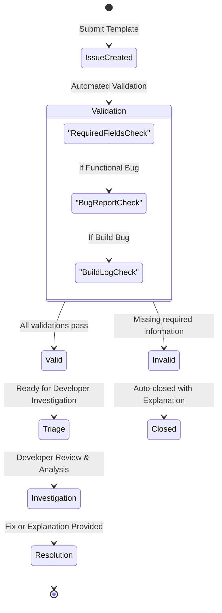

<!-- source: DeepWiki mcp.deepwiki.com · repo NVIDIA/open-gpu-kernel-modules · page 8.2 Issue Reporting · fetched 2026-10-26 -->

# Issue Reporting

<details>
<summary>Relevant source files</summary>

The following files were used as context for generating this wiki page:

- [.github/ISSUE_TEMPLATE/10_functional_bug.yml](.github/ISSUE_TEMPLATE/10_functional_bug.yml)
- [.github/ISSUE_TEMPLATE/20_build_bug.yml](.github/ISSUE_TEMPLATE/20_build_bug.yml)
- [.github/ISSUE_TEMPLATE/config.yml](.github/ISSUE_TEMPLATE/config.yml)

</details>


This document describes the issue reporting process for the NVIDIA open-gpu-kernel-modules repository. It covers the structured bug reporting templates, required diagnostic information, reporting channels, and the GitHub issue workflow for functional bugs specific to the open-source kernel modules.

For build-related issues and troubleshooting, see [Build Troubleshooting](#8.3). For general development guidelines, see [Contributing Guidelines](#8.1).

## Reporting Channels Overview

NVIDIA provides multiple channels and methods for reporting issues depending on the type and severity of the problem:

| Channel                 | Purpose                                                      | URL / Contact                                         |
|-------------------------|--------------------------------------------------------------|------------------------------------------------------|
| GitHub Issues           | Functional bugs *specific* to open-source kernel modules      | https://github.com/NVIDIA/open-gpu-kernel-modules/issues |
| GitHub Issues           | Build system, compiler, or OS support bugs                   | https://github.com/NVIDIA/open-gpu-kernel-modules/issues |
| NVIDIA Developer Forums | Proprietary driver bugs, general Linux GPU issues             | https://forums.developer.nvidia.com/c/gpu-graphics/linux/148 |
| Email Support           | Alternative reporting channel                                 | linux-bugs@nvidia.com                                |
| Security Vulnerabilities| Security-sensitive issues requiring confidential reporting    | See [SECURITY.md](SECURITY.md) document              |
| GitHub Discussions      | Questions, cosmetic issues, feature requests                  | Repository discussions section                        |

This multi-channel approach ensures issues are directed suitably for timely and effective responses.

Sources:  
[.github/ISSUE_TEMPLATE/config.yml:1-14](),  
[.github/ISSUE_TEMPLATE/10_functional_bug.yml:1-5](),  
[.github/ISSUE_TEMPLATE/20_build_bug.yml:1-2]()

---

## Bug Report Classification

The repository enforces a structured issue reporting system through GitHub issue templates to ensure that issues are categorized properly and contain the required diagnostic information. Notably, blank issues are disabled to enforce discipline and reduce unstructured reports.

### Issue Type Routing Flow

The decision flow for new issues is illustrated below. It guides the reporter through security screening, issue type selection, and template assignment:

```mermaid
graph TD
    "NewIssue"["New Issue or Problem"] --> "SecurityCheck"{"Security<br/>Vulnerability?"}
    
    "SecurityCheck" -->|Yes| "SecurityMD"["SECURITY.md<br/>Confidential Reporting"]
    "SecurityCheck" -->|No| "IssueType"{"Issue Type?"}
    
    "IssueType" --> "FunctionalBug"["Functional Bug<br/>open-source specific"]
    "IssueType" --> "BuildBug"["Build/Compiler Bug"]
    "IssueType" --> "ProprietaryBug"["Proprietary Driver Bug"]
    "IssueType" --> "CosmeticIssue"["Cosmetic Issue<br/>whitespace, typos"]
    "IssueType" --> "Question"["General Question"]
    "IssueType" --> "Feature"["Feature Request"]
    
    "FunctionalBug" --> "FuncTemplate"["GitHub Issues<br/>10_functional_bug.yml"]
    "BuildBug" --> "BuildTemplate"["GitHub Issues<br/>20_build_bug.yml"]
    "ProprietaryBug" --> "Forums"["NVIDIA Forums<br/>forums.developer.nvidia.com"]
    "CosmeticIssue" --> "Discussions"["GitHub Discussions<br/>General Category"]
    "Question" --> "QABoard"["GitHub Discussions<br/>Q-A Category"]
    "Feature" --> "IdeasBoard"["GitHub Discussions<br/>Ideas Category"]
    
    "FuncTemplate" --> "Validation"["Template Validation"]
    "BuildTemplate" --> "Validation"
    "Validation" --> "BugReport"["Issue Created"]
```

This decision flow prevents misuse of the open-source driver issue tracker for proprietary driver problems, cosmetic-only issues (such as whitespace or typos), or features better suited for discussion forums.

Sources:  
[.github/ISSUE_TEMPLATE/config.yml:1-14](),  
[.github/ISSUE_TEMPLATE/10_functional_bug.yml:1-8](),  
[.github/ISSUE_TEMPLATE/20_build_bug.yml:1-5]()

---

## Functional Bug Reporting

Functional bugs are problems affecting the operation or stability of the open-source kernel modules or the hardware managed by these modules. Only issues truly specific to this open GPU kernel module code should be reported here. Bugs related to the proprietary NVIDIA driver are redirected to NVIDIA Forums.

### Functional Bug Template Details

Reporting functional bugs requires submission through the `10_functional_bug.yml` GitHub issue template, which enforces the inclusion of several mandatory fields:

| Field                  | Description                                                                                |
|------------------------|--------------------------------------------------------------------------------------------|
| `sw_driver_version`    | The exact version or commit SHA of the open-gpu-kernel-modules being used.                 |
| `sw_driver_proprietary`| Confirmation the issue does *not* occur with the proprietary NVIDIA driver of the same version. Prevents misdirected reports. |
| `sw_host_os`           | Operating system distribution details (e.g., output of `lsb_release -d`).                  |
| `sw_host_kernel`       | Kernel version details (e.g., output of `uname -a`).                                      |
| `sw_host_kernel_stable`| Confirmation that the kernel in use is a stable release, not a release candidate (`-rc`). |
| `hw_gpu_type`          | GPU hardware type information from `nvidia-smi -L` or equivalent.                          |
| `bug_description`      | Clear, concise textual description of the bug.                                            |
| `bug_repro`            | Bullet-pointed reproduction steps enabling developers to reproduce the issue.             |
| `bug_incidence`        | Frequency of bug occurrence: Once, Sometimes, or Always.                                 |
| `bug_report_gz`        | Mandatory compressed diagnostic report file generated by `nvidia-bug-report.sh`. Issues lacking this file are auto-closed. |
| `bug_more_info`        | Optional additional information, expectations, or clarifications about the bug.           |

This structured information is critical for triage and debugging.

Sources:  
[.github/ISSUE_TEMPLATE/10_functional_bug.yml:18-96]()

### Diagnostic File Generation Workflow

The `nvidia-bug-report.sh` script is used to generate a comprehensive diagnostic archive capturing runtime state, kernel logs, and configuration information necessary to analyze the reported issue.

```mermaid
graph LR
    "ReproduceBug"["1. Reproduce the Problem"] --> "RunScript"["2. Run nvidia-bug-report.sh"]
    "RunScript" --> "GenerateFile"["3. Generate nvidia-bug-report.log.gz"]
    "GenerateFile" --> "AttachFile"["4. Attach nvidia-bug-report.log.gz<br/>to GitHub Issue"]
    
    "AttachFile" --> "Validation"["Template Validation"]
    "Validation" --> "Accept"["Issue Accepted"]
    "Validation" --> "Reject"["Issue Closed<br/>(Missing Bug Report)"]
```

The mandatory presence of the bug report archive ensures developers receive comprehensive runtime and kernel state diagnostics to analyze issues effectively.

Sources:  
[.github/ISSUE_TEMPLATE/10_functional_bug.yml:87-96]()

---

## Build Bug Reporting

Build system related issues, including failures during compilation, cross-compilation, kernel configuration incompatibilities, or OS support problems, are reported through the `20_build_bug.yml` template.

### Build Bug Template Details

The build bug report template collects the following information:

| Field                | Description                                                                                     |
|----------------------|-------------------------------------------------------------------------------------------------|
| `sw_driver_version`  | The specific version or git commit SHA of the open-gpu-kernel-modules attempted to build.       |
| `sw_host_os`         | Operating system and version where the build was attempted (e.g. `lsb_release -d`).             |
| `sw_host_kernel`     | Kernel version details (e.g. `uname -a`)                                                       |
| `sw_host_kernel_stable`| Confirmation you are using a stable kernel release (no `-rc`).                                |
| `bug_description`    | Exact build command(s) executed that produced the failure.                                      |
| `bug_build_log`      | Complete build output logs showing errors or warnings.                                         |
| `bug_more_info`      | Optional additional context or clarifications regarding the failure.                            |

These details facilitate reproduction and diagnosis of build environments, compiler compatibility, and kernel feature mismatches.

### Build Issue Data Flow

```mermaid
graph LR
    "UserCommand"["Build Command<br/>id: bug_description"] --> "CompilerOutput"["Terminal Output/Log<br/>id: bug_build_log"]
    "SystemEnv"["OS / Kernel Version<br/>id: sw_host_os / sw_host_kernel"] --> "Context"["Issue Context"]
    "DriverVer"["Driver Version/SHA<br/>id: sw_driver_version"] --> "Context"
    
    "CompilerOutput" --> "BuildIssue"["Build Bug Report"]
    "Context" --> "BuildIssue"
```

Sources:  
[.github/ISSUE_TEMPLATE/20_build_bug.yml:14-64]()

---

## Issue Workflow and Processing

When an issue is submitted using the proper template, automated validation runs to ensure all mandatory fields have been provided and required attachments exist. Incomplete or invalid reports are automatically closed with appropriate feedback, conserving triage resources.



This pipeline ensures consistent intake and processing of issues, accelerating resolution of actionable and well-documented bug reports.

Sources:  
[.github/ISSUE_TEMPLATE/10_functional_bug.yml:1-104](),  
[.github/ISSUE_TEMPLATE/20_build_bug.yml:1-64]()

---

This concludes the documentation of the issue reporting process for the NVIDIA open GPU kernel modules. Proper use of the provided templates along with the inclusion of all requested diagnostic information ensures rapid and effective developer response and issue resolution.

---

