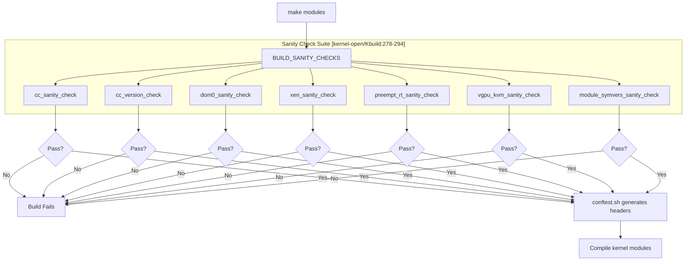
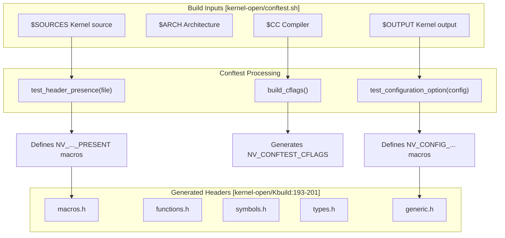
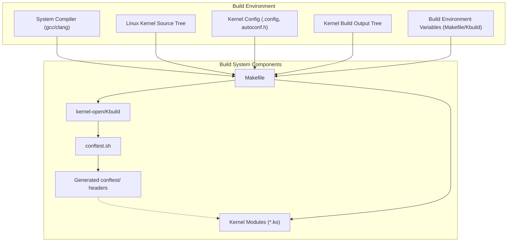

<!-- source: DeepWiki mcp.deepwiki.com · repo NVIDIA/open-gpu-kernel-modules · page 8.3 Build Troubleshooting · fetched 2026-10-26 -->

# Build Troubleshooting

<details>
<summary>Relevant source files</summary>

The following files were used as context for generating this wiki page:

- [.github/ISSUE_TEMPLATE/10_functional_bug.yml](.github/ISSUE_TEMPLATE/10_functional_bug.yml)
- [.github/ISSUE_TEMPLATE/20_build_bug.yml](.github/ISSUE_TEMPLATE/20_build_bug.yml)
- [.github/ISSUE_TEMPLATE/config.yml](.github/ISSUE_TEMPLATE/config.yml)
- [kernel-open/Kbuild](kernel-open/Kbuild)
- [kernel-open/conftest.sh](kernel-open/conftest.sh)

</details>


This document provides detailed guidance to troubleshoot common build issues encountered when compiling the NVIDIA open-gpu-kernel-modules repository. It covers compiler errors, kernel compatibility detection failures, configuration problems, and the role of key build system components. The goal is to help developers and integrators resolve build failures efficiently by understanding the underlying mechanisms and how the build system verifies environment correctness.

For an overview of the build system architecture and kernel compatibility mechanisms, see [2. Build System]() and [2.2 Kernel Compatibility Layer](). For reporting build bugs with detailed logs, see [8.2 Issue Reporting]().

---

## Build System Sanity Checks

Before compiling kernel modules, the build system performs a suite of sanity checks to ensure the build environment is consistent and compatible. These checks detect misconfigurations, incompatible kernel setups, missing files, and compiler/toolchain inconsistencies.

### Key Sanity Checks Include:

- **`cc_sanity_check`**: Confirms basic compiler functionality to catch fundamentally broken or missing compilers.
- **`cc_version_check`**: Verifies that the compiler version used matches the one used for the target kernel build, preventing kernel ABI mismatches.
- **`dom0_sanity_check`**: Fails build if targeting an unsupported Xen dom0 environment.
- **`xen_sanity_check`**: Detects Xen kernel presence and incompatible paravirtualization configurations.
- **`preempt_rt_sanity_check`**: Detects real-time PREEMPT_RT kernel builds incompatible with driver locking mechanisms.
- **`vgpu_kvm_sanity_check`**: Validates vGPU KVM build flags for virtualized GPU environments.
- **`module_symvers_sanity_check`**: Ensures `Module.symvers` file is available for kernel module symbol resolution.

### Sanity Check Execution Flow



Sources: [kernel-open/Kbuild:278-294](), [kernel-open/conftest.sh:1-30]()

---

## Compiler Version Mismatch (`cc_version_check`)

### Problem Description

Kernel modules must be compiled with the exact same compiler version used to build the kernel to ensure ABI compatibility. The `cc_version_check` validates this by comparing the compiler version string with the kernel build configuration.

### Failure Symptoms

- Error messages referencing compiler version mismatch.
- Early build termination with no linking.
- Warnings about GCC/Clang version discrepancies.

### Root Cause

Mismatch happens if your environment's default compiler (`CC`) differs from the one used for the kernel. This is common when multiple compiler versions are installed or when the kernel was built with a non-default compiler.

### Resolution Steps

1. **Check kernel compiler version:**
   ```bash
   uname -r
   grep CONFIG_CC_VERSION_TEXT /boot/config-$(uname -r)
   ```
   or inspect `/proc/version`.

2. **Explicitly specify compiler and linker in the build command:**
   ```bash
   make modules CC=gcc-12 LD=ld.bfd
   ```
   Replace with the exact versions matching your kernel build.

3. **Verify compiler symlinks and environment PATH settings** to ensure the specified compiler is invoked.

The Makefile otherwise attempts automatic detection from `CONFIG_CC_VERSION_TEXT` but manual override is generally safer [kernel-open/Makefile:57-72](), [kernel-open/Kbuild:174-175]().

Sources: [kernel-open/Makefile:57-72](), [kernel-open/Kbuild:174-175]()

---

## Missing `Module.symvers` File (`module_symvers_sanity_check`)

### Overview

`Module.symvers` contains kernel symbol versioning information required when linking out-of-tree kernel modules to ensure symbol compatibility.

### Symptoms

- Build errors citing unresolved kernel symbols.
- Explicit errors about missing or unreadable `Module.symvers` file.

### Detection and Search Path

The build system looks for `Module.symvers`:

- In `${NV_KERNEL_OUTPUT}/Module.symvers`
- For Tegra platforms, also `/usr/src/nvidia/nvidia-public/Module.symvers`

```bash
MODULE_SYMVERS_PATHS="$OUTPUT/Module.symvers"
if [ -d ${NVIDIA_OOT_PATH} ]; then
    MODULE_SYMVERS_PATHS="${MODULE_SYMVERS_PATHS} ${NVIDIA_OOT_PATH}/Module.symvers"
fi
```

### Recommended Fixes

- Install the kernel headers and development packages matching your kernel version.
- Make sure that `NV_KERNEL_OUTPUT` points to a valid kernel build directory containing `Module.symvers`.
- On Tegra or custom platforms, ensure the Tegra source tree path is correctly set (`SYSSRCNVOOT`) so the build system can find the symbols file [kernel-open/Kbuild:85-96]().

Sources: [kernel-open/Kbuild:9-10](), [kernel-open/Kbuild:85-96](), [kernel-open/conftest.sh:17-23]()

---

## Xen and Real-Time Kernel (PREEMPT_RT) Incompatibility Detection

### Xen Kernel Detection (`xen_sanity_check`)

NVIDIA open-gpu-kernel-modules does not support Xen dom0 or complex paravirtualization configurations that break kernel locking assumptions. The build system inspects kernel config options to detect Xen presence:

```sh
test_xen() {
    if ! test_configuration_option CONFIG_XEN ||
         test_configuration_option CONFIG_PARAVIRT; then
        XEN_PRESENT=0
    fi
}
```

If incompatible Xen features are found, building is aborted to prevent runtime instability.

### Real-Time PREEMPT_RT Kernel Detection (`preempt_rt_sanity_check`)

The driver internally uses hardware locking not compatible with PREEMPT_RT patches. The build system fails builds targeting PREEMPT_RT kernels due to potential deadlocks.

Sources: [kernel-open/conftest.sh:38-52](), [kernel-open/Kbuild:278-285]()

---

## vGPU KVM Build Configuration Sanity (`vgpu_kvm_sanity_check`)

When building for vGPU deployments, especially on KVM hypervisors, correct build flags must be specified to ensure module compatibility:

| Flag                      | Description                                  |
|---------------------------|----------------------------------------------|
| `VGX_BUILD`               | Enables vGPU Host driver build               |
| `VGX_KVM_BUILD`           | Enables vGPU Host driver operation on KVM   |
| `GRID_BUILD`              | Builds GRID guest driver                      |
| `VGX_FORCE_VFIO_PCI_CORE` | Forces usage of `vfio-pci-core` kernel module|

Mismatches or missing flags here often cause build failures or runtime crashes. Validate that your environment and build invocation set these consistently [kernel-open/conftest.sh:32-37](), [kernel-open/Kbuild:150-152]().

Sources: [kernel-open/conftest.sh:32-37](), [kernel-open/Kbuild:150-152]()

---

## Kernel Feature Detection and Conftest Failures

A critical component of the build system is `conftest.sh`, a shell-based compatibility test system that compiles small code snippets against the target kernel sources and headers. It detects:

- Kernel header file availability,
- Kernel configuration macro values,
- Kernel API symbol presence,
- Supported types and structures.

The output defines macros used to conditionally compile code, enabling the driver to adapt cleanly across kernel versions and distributions.

### Conftest Architecture and Data Flow



### Key Functions

- `test_header_presence(file)`: Preprocesses inclusion of kernel header files, defining `NV_<HEADER>_PRESENT` if found.
- `build_cflags()`: Constructs compiler flags including kernel include paths, architecture specifics, kernel config headers (`autoconf.h`), and GCC feature testing.
- `test_configuration_option(config)`: Checks kernel config macros for enabling or disabling features.

### Typical Failure Causes

- Mismatch between kernel source and output paths.
- Missing or outdated kernel config headers (`autoconf.h` not found).
- Incompatible or broken compiler toolchain causing conftest compile failures.
- Incorrect `ARCH` or cross-compilation settings.

### Troubleshooting Tips

- Verify correctness of kernel source tree and kernel build output directory passed to the build system.
- Confirm presence of correct kernel configuration headers: `include/generated/autoconf.h`.
- Match the compiler (`CC`) and architecture flags to your kernel build environment precisely.

Sources: [kernel-open/Kbuild:193-201](), [kernel-open/conftest.sh:66-101](), [kernel-open/conftest.sh:103-175]()

---

## Build Verbosity and Debugging Flags

To diagnose complex build errors, control build verbosity and debug information with the following variables:

| Variable                        | Effect                                                                                       |
|--------------------------------|----------------------------------------------------------------------------------------------|
| `NV_VERBOSE=1`                  | Enables verbose make output (`V=1`), printing detailed compile and link commands [Makefile:86]() |
| `NV_BUILD_TYPE=debug`           | Enables debug symbols (`-g` flag) and disables optimizations for easier debugging [kernel-open/Kbuild:149-151]() |
| `WARNINGS_AS_ERRORS=1`          | Treat compiler warnings as errors, which stops builds on warnings to enforce code quality [kernel-open/Kbuild:181-186]() |
| `NV_UNDEF_BEHAVIOR_SANITIZER=1`| Enables Undefined Behavior Sanitizer (UBSAN) support, adding sanitization flags [kernel-open/Kbuild:82-85]() |

### Example Invocation with Debug Flags

```bash
make modules -j$(nproc) NV_VERBOSE=1 NV_BUILD_TYPE=debug WARNINGS_AS_ERRORS=1
```

This prints all compile commands and ensures no warnings are missed, helping pinpoint issues rapidly.

Sources: [kernel-open/Kbuild:82-85, 149-151, 181-186](), [kernel-open/Makefile:100-102]()

---

## Summary Diagram: Build Environment to Code Entities



This diagram associates the user’s build environment with the core build system artifacts and flow, illustrating how kernel sources, compiler, and configuration influence the conftest compatibility layer and final kernel module compilation.

Sources: [kernel-open/Makefile:1-161](), [kernel-open/Kbuild:1-160,278-294](), [kernel-open/conftest.sh:1-200]()

---

## Frequently Encountered Build Issues Checklist

| Issue Description                          | Where to Check                   | Common Solutions                                      |
|--------------------------------------------|---------------------------------|-------------------------------------------------------|
| Compiler version mismatch                   | Build log, `cc_version_check`   | Specify exact kernel build compiler with `CC=...`    |
| Missing `Module.symvers`                    | `module_symvers_sanity_check`   | Install matching kernel headers; verify symbol file path |
| Incompatible Xen or PREEMPT_RT kernels     | `xen_sanity_check` / `preempt_rt_sanity_check` | Build on supported kernel configuration                |
| Conftest compile failures                    | conftest output                 | Check kernel source/output paths and include headers  |
| vGPU build flag misconfiguration             | Build flags in Makefile/log     | Verify `VGX_BUILD`, `VGX_KVM_BUILD` flags             |
| Lack of build verbosity for debugging     | Build command                   | Use `NV_VERBOSE=1 NV_BUILD_TYPE=debug`                |

---

This guide should empower developers and maintainers to systematically analyze and resolve build failures in the NVIDIA open-gpu-kernel-modules, by delineating the responsibilities of key build scripts and configurations, and illustrating the data flow from environment to final module binaries.

For further assistance, please see [8.2 Issue Reporting]() or post an issue on the project GitHub with detailed build logs and environment description.

# End of Build Troubleshooting

---

Sources:  
- kernel-open/Kbuild:1-160, 278-294  
- kernel-open/conftest.sh:1-200  
- kernel-open/Makefile:1-161

---

