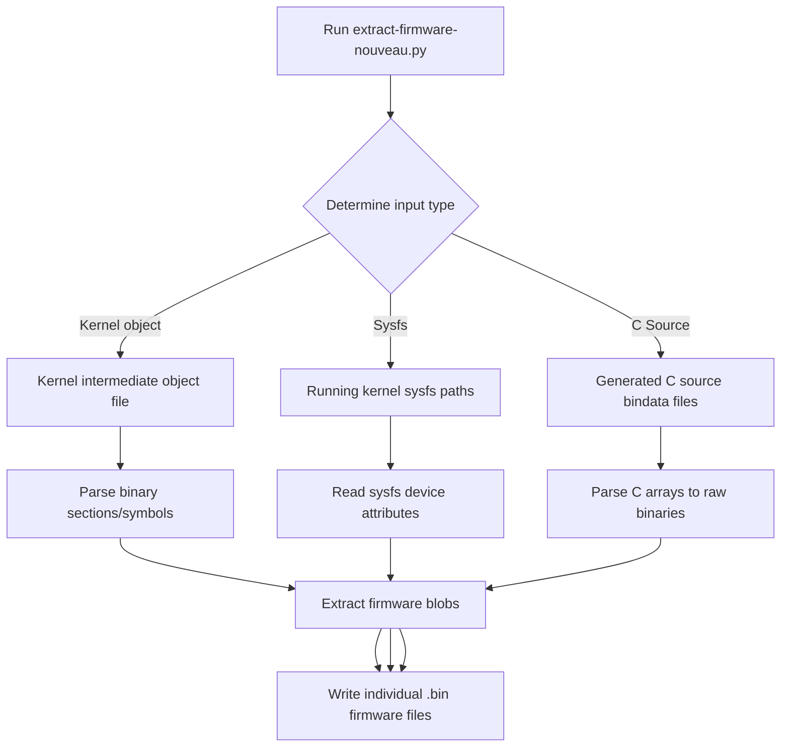
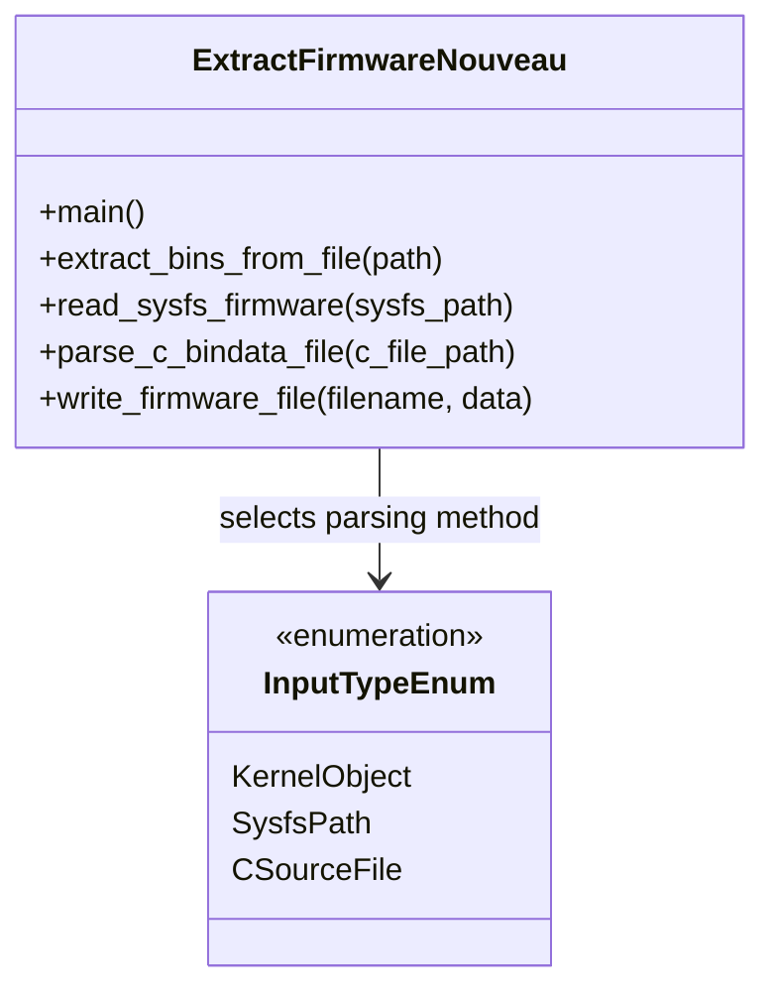

<!-- source: DeepWiki mcp.deepwiki.com · repo NVIDIA/open-gpu-kernel-modules · page 8.4 Nouveau Firmware Extraction · fetched 2026-10-26 -->

# 8.4 Nouveau Firmware Extraction

Relevant source files

The following files were used as context for generating this wiki page:

- [README.md](README.md)
- [src/nvidia/generated/g_bindata_kgspGetBinArchiveConcatenatedFMC_GH100.c](src/nvidia/generated/g_bindata_kgspGetBinArchiveConcatenatedFMC_GH100.c)
- [src/nvidia/generated/g_bindata_kgspGetBinArchiveGspRmCcFmcGfwProdSigned_GH100.c](src/nvidia/generated/g_bindata_kgspGetBinArchiveGspRmCcFmcGfwProdSigned_GH100.c)

## Purpose and Scope

This section details the `extract-firmware-nouveau.py` Python script, located in the `nouveau` directory of the repository. The script extracts GSP Resource Manager (GSP-RM) firmware binaries required by the Nouveau open-source NVIDIA GPU driver. It automates the extraction of firmware image data embedded as binary blobs within the NVIDIA kernel module source code or available via sysfs on running kernels, producing standalone `.bin` firmware files. Also included is discussion of supported extraction modes, firmware data sources, and the submission process for integrating extracted firmware into the upstream `linux-firmware` repository.

---

## 1. Overview of the Nouveau Firmware Extraction Script

The `extract-firmware-nouveau.py` is a utility to extract critical GSP-RM firmware blobs encoded inside NVIDIA kernel modules or sourced from live kernel sysfs interfaces or generated C source files. Nouveau requires access to these binary firmware blobs to operate GSP firmware on NVIDIA GPUs starting with the Turing architecture.

Key features:

- Extracts GSP-RM firmware from:
  - Intermediate kernel object files (e.g., `nv-kernel.o`) containing embedded binary blobs.
  - Sysfs entries on live systems exposing firmware data.
  - Generated C source bindata files in the source tree.
- Produces separate, discrete `.bin` firmware files for use by the Nouveau driver.
- Supports extraction of multiple firmware variants, including debug and production builds.

The extraction streamlines packaging Nouveau firmware and enables integration into Linux firmware infrastructures.

---

## 2. Firmware Binary Sources and Extraction Targets

The GSP-RM firmware archive comprises distinct signed binary blobs embedded inside the kernel module codebase or available on running kernels. These consist primarily of:

| Firmware Type                                 | Description                                     |
|-----------------------------------------------|------------------------------------------------|
| Boot firmware binary (debug and prod)          | GSP-RM boot microcode                           |
| FMC signed firmware binary (debug and prod)    | Firmware for the GSP Firmware Microcontroller  |
| Other auxiliary or debug firmware components   | Optional debug blobs for in-depth analysis     |

These blobs appear embedded as constant arrays in generated C source files, or inside final kernel object files as binary sections or symbols. The `extract-firmware-nouveau.py` script locates and extracts these blobs for later use by Nouveau.

---

## 3. Execution Modes and Usage

The script supports multiple extraction modes to accommodate various input sources:

### 3.1 Kernel Intermediate Module Extraction Mode

- Input: Path to an intermediate kernel object file such as `nv-kernel.o`.
- Operation: Parses the binary data sections or symbols to locate embedded firmware blobs.
- Output: Writes extracted firmware files to disk as `.bin` files.

### 3.2 Sysfs Extraction Mode

- Input: Path to a running kernel's sysfs directory exporting GSP firmware blobs (e.g., `/sys/kernel/gsp/`).
- Operation: Reads binary firmware data exposed via sysfs device attributes.
- Output: Dumps firmware blobs into files.

### 3.3 Source C File Extraction Mode

- Input: Generated C source bindata files located in `src/nvidia/generated/`.
- Operation: Parses the C array definitions representing firmware binaries, reconstructing raw binary blobs.
- Output: Writes firmware `.bin` files to disk.

---

## 4. Internal Implementation and Data Flow

The high-level data flow inside `extract-firmware-nouveau.py` operates as follows:

1. **Source Input Selection:**  
   The script accepts as input one of:
   - Kernel intermediate object file,
   - Sysfs directory or files exposing firmware,
   - C source bindata files.

2. **Data Extraction Path:**  
   Based on input it performs:
   - Binary scan and symbol matching (for kernel objects),
   - Raw data reading (from sysfs),
   - Structured parsing of C arrays (for bindata source code).

3. **Blob Identification and Verification:**  
   - Identifies known firmware blobs by naming conventions.
   - Performs optional validation (size checks, magic values).

4. **Output Firmware Generation:**  
   - Writes each firmware blob as an individual `.bin` file.
   - Files output into specified directory or current working directory.

The script thus automates the transition from embedded binary embedded arrays or kernel object sections to discrete, usable firmware blobs.

---

## 5. Key Functions and Classes

The script uses several functions corresponding to the different extraction methods, with orchestration logic in `main()`.

| Function                           | Role                                    |
|------------------------------------|-----------------------------------------|
| `main()`                           | Parses arguments; dispatches extraction |
| `extract_bins_from_file(path)`     | Extracts blobs from kernel object or C source file given by path |
| `read_sysfs_firmware(sysfs_path)` | Reads firmware binaries from sysfs interfaces |
| `parse_c_bindata_file(path)`       | Parses C bindata source arrays for firmware blobs |
| `write_firmware_file(filename, data)` | Writes firmware blob data to output file |

These core helpers abstract extraction for each input mode and unify output logic. The script uses pattern matching to identify binary firmware blobs by symbol or file naming conventions.

---

## 6. Submission to linux-firmware and Open Source Usage

Extracted Nouveau firmware binaries are typically submitted upstream to the Linux kernel's [`linux-firmware`](https://git.kernel.org/pub/scm/linux/kernel/git/firmware/linux-firmware.git/) repository for distribution. This process ensures:

- Nouveau users receive GSP-RM firmware files in standard locations.
- Maintainers can package firmware without requiring local extraction.
- Firmware naming conventions follow standard Nouveau expectations and kernel guidelines.
- Synchronized firmware from latest NVIDIA releases propagates to broader user base.

The script helps maintainers and Nouveau developers automate extracting and updating firmware blobs for Linux firmware inclusion.

---

## 7. Summary

The `extract-firmware-nouveau.py` script automates extraction of GSP-RM firmware blobs embedded in NVIDIA kernel modules, sysfs, or C source files. It supports multiple input modes and outputs discrete `.bin` files for consumption by the Nouveau open-source GPU driver. The extracted firmware enables Nouveau to operate on Turing and later GPUs with the needed GSP firmware and is usually submitted to the upstream `linux-firmware` repository for broad distribution.

---

## References and Further Reading

- `nouveau/extract-firmware-nouveau.py` — Main script implementing all extraction functionality.  
- `README.md` lines 170–177 — Overview and explanation of Nouveau firmware integration.  
- Generated firmware bindata sources:  
  - `src/nvidia/generated/g_bindata_kgspGetBinArchiveGspRmBoot_GB10B.c`  
  - `src/nvidia/generated/g_bindata_kgspGetBinArchiveGspRmFmcGfwDebugSigned_GB10B.c`  
  - `src/nvidia/generated/g_bindata_kgspGetBinArchiveGspRmFmcGfwProdSigned_GB10B.c`  
  - `src/nvidia/generated/g_bindata_kgspGetBinArchiveConcatenatedFMC_GH100.c`, etc.

---

Sources:  
- `nouveau/extract-firmware-nouveau.py:1-100`  
- `README.md:170-177`  
- `src/nvidia/generated/g_bindata_kgspGetBinArchiveGspRmBoot_GB10B.c:1-91`  
- `src/nvidia/generated/g_bindata_kgspGetBinArchiveGspRmFmcGfwDebugSigned_GB10B.c:1-91`  
- `src/nvidia/generated/g_bindata_kgspGetBinArchiveGspRmFmcGfwProdSigned_GB10B.c:1-91`

---

