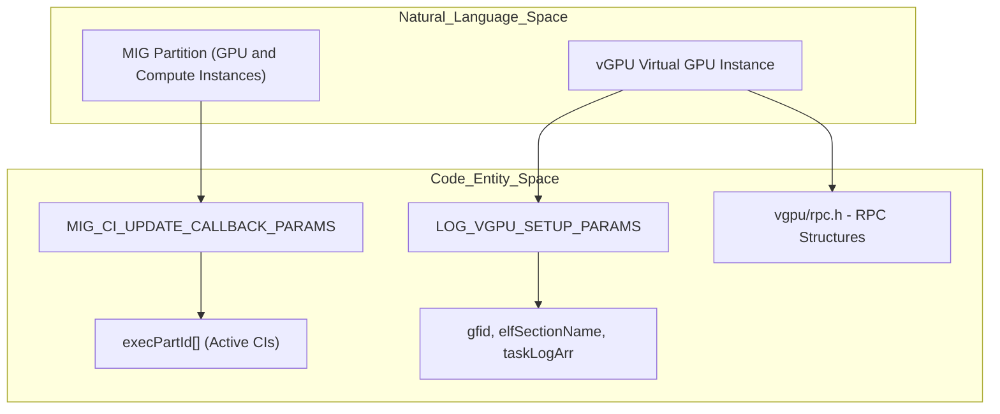
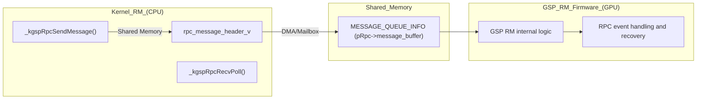
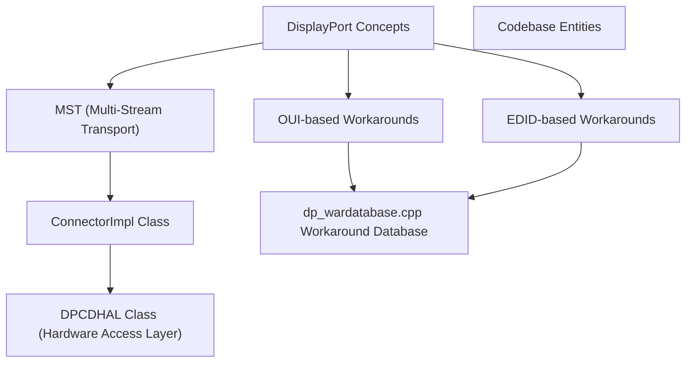

<!-- source: DeepWiki mcp.deepwiki.com · repo NVIDIA/open-gpu-kernel-modules · page 9 Glossary · fetched 2026-10-26 -->

# Glossary

Relevant source files

The following files were used as context for generating this wiki page:

- [README.md](README.md)
- [kernel-open/common/inc/nv-linux.h](kernel-open/common/inc/nv-linux.h)
- [kernel-open/common/inc/nv.h](kernel-open/common/inc/nv.h)
- [kernel-open/nvidia-uvm/uvm_va_block.c](kernel-open/nvidia-uvm/uvm_va_block.c)
- [kernel-open/nvidia/nv.c](kernel-open/nvidia/nv.c)
- [src/nvidia/arch/nvalloc/unix/include/nv.h](src/nvidia/arch/nvalloc/unix/include/nv.h)
- [src/nvidia/src/kernel/gpu/device.c](src/nvidia/src/kernel/gpu/device.c)
- [src/nvidia/src/kernel/gpu/gsp/kernel_gsp.c](src/nvidia/src/kernel/gpu/gsp/kernel_gsp.c)

This page defines codebase-specific terms, jargon, abbreviations, and domain concepts used throughout the NVIDIA Open GPU Kernel Modules. It provides technical definitions, detailed explanations of implementation components, and pointers to the relevant code entities and files useful for onboarding engineers.

---

## Core Driver Components

| Term                        | Definition                                                                                                                                                               | Key Code Entities                                                                                   |
|-----------------------------|--------------------------------------------------------------------------------------------------------------------------------------------------------------------------|--------------------------------------------------------------------------------------------------|
| **RM (Resource Manager)**        | The core driver logic responsible for managing GPU hardware resources, enforcing device security, handling the device lifecycle, and coordinating memory and compute resources. It acts as the central state manager for the GPU.        | `OBJGPU` [src/nvidia/src/kernel/gpu/gsp/kernel_gsp.c:49](), main kernel module sources under `kernel-open/nvidia/`             |
| **GSP (GPU System Processor)**   | An on-device RISC-V microcontroller embedded on modern NVIDIA GPUs that offloads resource management tasks from the CPU. The Kernel RM communicates with the GSP RM firmware via an RPC mechanism and message queues.    | `KernelGsp` struct and related functions [src/nvidia/src/kernel/gpu/gsp/kernel_gsp.c:26-210]()          |
| **OS-Agnostic Layer**            | Driver code independent of the operating system, implementing core RM logic, memory management, and resource tracking. This layer is shared between platforms and compiled as a binary blob for end users.     | Code under `src/nvidia/` and `src/common/` [README.md:156-165]()                                               |
| **Kernel Interface Layer**       | OS-specific interface code integrating the OS-agnostic RM with the Linux kernel's APIs, handling device registration, kernel callbacks, and module interface.                                   | Code under `kernel-open/` subdirectories like `kernel-open/nvidia/` [README.md:156-160]()                |
| **UVM (Unified Virtual Memory)** | A kernel module managing a unified virtual address space accessible to both CPU and GPU. It manages VA blocks, page residency, accelerates memory migration, tracks GPU page access, and handles NUMA-aware memory allocation.                                         | UVM module source files, especially `uvm_va_block.c` [kernel-open/nvidia-uvm/uvm_va_block.c:1-174]()                  |

**Sources:** [README.md:131-165](), [src/nvidia/src/kernel/gpu/gsp/kernel_gsp.c:20-210]()

---

## Hardware & Virtualization Concepts

### MIG (Multi-Instance GPU)

Multi-Instance GPU (MIG) technology partitions a physical GPU into multiple isolated instances. Each instance has dedicated memory, cache, and compute cores, enabling secure and efficient sharing of GPU resources among multiple tenants or workloads.

- **GI (GPU Instance):** The top-level GPU partition representing a slice of the physical GPU.
- **CI (Compute Instance):** A sub-partition inside a GI, representing compute resources dedicated to that instance.

MIG compute instance updates and configuration are handled programmatically via structures like `MIG_CI_UPDATE_CALLBACK_PARAMS` which includes execution partition counts and IDs.

### vGPU (Virtual GPU)

vGPU refers to the virtualization of physical GPUs so multiple virtual machines can share GPU hardware transparently. vGPU types specify configuration parameters like framebuffer size, logical head count, resolution, and resource limits.

- vGPU setup involves kernel-side state initialization, including logging and ELF section validation, using structures such as `LOG_VGPU_SETUP_PARAMS`.
- RPC calls and communication structures for vGPU are found in virtualization-related code [src/nvidia/src/kernel/gpu/gsp/kernel_gsp.c].

### Diagram: MIG and vGPU Resource Entities Mapping

**Sources:** [src/nvidia/src/kernel/gpu/gsp/kernel_gsp.c:134-140](), [src/nvidia/src/kernel/gpu/gsp/kernel_gsp.c:158-170]()

---

## Memory Management Terms

| Term                 | Definition                                                                                                                                                              | Code References                                                                                     |
|----------------------|-------------------------------------------------------------------------------------------------------------------------------------------------------------------------|---------------------------------------------------------------------------------------------------|
| **VA Block (Virtual Address Block)**  | The fundamental unit of UVM virtual memory tracking, typically a 2MB chunk of the VA space for efficient management of GPU/CPU page residency, mappings, and access permissions.              | `uvm_va_block_t` type and management functions [kernel-open/nvidia-uvm/uvm_va_block.c:30-140]()           |
| **Aperture**         | Represents the source or accessibility domain of memory, such as `VIDMEM` (GPU memory), `SYSMEM` (host system RAM), or special GMMU apertures related to hardware memory management.                             | Kernel GPU memory manager and GMMU components [src/nvidia/src/kernel/gpu/mmu/kern_gmmu.c]           |
| **DMA-BUF**          | Linux kernel's framework for sharing memory buffers across different device drivers securely; this driver supports DMA-BUF export/import via private structures and attachments.                                | `nv_dma_buf_file_private_t` and related functions [kernel-open/nvidia/nv-dmabuf.c:40-145]()          |
| **PTE (Page Table Entry)** | Hardware descriptor mapping virtual addresses to physical memory. The driver manages PTE arrays internally for GPU MMU page table tracking through structures like `RmPhysAddr *pteArray`.                          | Memory management code interfacing with OS page structures [src/nvidia/arch/nvalloc/unix/src/osapi.c:90-110]() |
| **Page Array Conversion** | Conversion utilities between OS-native page arrays and RM-compatible page arrays used by GPU MM for memory mapping and fault handling.                                                   | Conversion functions in OS abstraction [src/nvidia/arch/nvalloc/unix/src/osapi.c:150-188]()           |

**Sources:** [kernel-open/nvidia/nv-dmabuf.c:30-140](), [src/nvidia/arch/nvalloc/unix/src/osapi.c:90-188]()

---

## Software Frameworks and Infrastructure

### NVOC (NVIDIA Object-Oriented C)

A custom C framework that implements object-oriented programming concepts for the driver, including classes, inheritance, virtual functions (vtables), and runtime type information (RTTI). This framework is extensively used to structure RM and other driver objects for modularity and extensibility.

- Classes such as Subdevice (`NV20_SUBDEVICE_0`) demonstrate NVOC usage.
- Generated code includes class vtables, constructors, and RTTI enabling polymorphism in otherwise procedural C code.

### RPC (Remote Procedure Call) Infrastructure

The RPC subsystem enables communication between the CPU-resident Kernel RM and the GPU-resident GSP RM firmware. It uses a shared memory message buffer and queues commands/events bidirectionally to synchronize GPU resource management.

- The core RPC object is created by `_kgspConstructRpcObject()`.
- Initialization and teardown are handled through `_kgspInitRpcInfrastructure()` and `_kgspFreeRpcInfrastructure()`.
- Versioned RPC command parameters are accessed using the `RPC_PARAMS(r, v)` macro to ensure type safety.
- Kernel RM sends messages via `_kgspRpcSendMessage()` and receives/polls with `_kgspRpcRecvPoll()`.

### Diagram: RPC Communication Layer

**Sources:** [src/nvidia/src/kernel/gpu/gsp/kernel_gsp.c:180-210]()

---

## Build and Versioning Related Terms

- **Conftest:** A shell script-based kernel feature detection system executed during the build process. It probes kernel headers, available structures, and kernel API behaviors to generate compatibility headers. It is invoked by Kbuild to ensure correct build configuration.

- **Buildmeister:** NVIDIA's internal build/versioning system that injects detailed build metadata such as branch numbers, changelist numbers, and platform-specific versioning into the built kernel modules.

- **Changelist (CL):** Numeric identifier of a source code revision, used to track changes relevant to kernel module compatibility and feature support.

**Sources:** [README.md:154-165](), [kernel-open/conftest.sh:1-180]() (inferred)

---

## DisplayPort and Display Subsystem Terms

| Term                          | Definition                                                                                                                                                                                       | References                                           |
|-------------------------------|--------------------------------------------------------------------------------------------------------------------------------------------------------------------------------------------------|-----------------------------------------------------|
| **DPCD (DisplayPort Configuration Data)** | A set of registers located in the DisplayPort sink device that control link training, status, feature support, and error handling.                                                              | Implemented via `DPCDHAL` class [src/common/displayport/src/dp_connectorimpl.cpp:90-180]()  |
| **ConnectorImpl**              | The C++ class implementing the DisplayPort connector, managing link training, HDCP, power management, and the application of device-specific workarounds.                                        | `ConnectorImpl` class [src/common/displayport/src/dp_connectorimpl.cpp:69-181]()          |
| **OUI (Organizationally Unique Identifier)** | Vendor identifier string used in DisplayPort source device identification. Used in the workaround database to identify devices requiring special treatments.                                    | Used in `dp_wardatabase.cpp` in `ConnectorImpl::applyOuiWARs()` [src/common/displayport/src/dp_wardatabase.cpp:38-130]() |
| **EDID (Extended Display Identification Data)** | Data structures from displays describing manufacturer, model, timing capabilities, and additional display features. Used to apply display-specific fixes or configure modes.                    | EDID workarounds implemented in [src/common/displayport/src/dp_wardatabase.cpp:130-170]() |
| **MST (Multi-Stream Transport)** | DisplayPort feature enabling multiple independent display streams over a single physical DP link, handled in driver mode-setting and link training code via MST-specific logic and flags.         | MST handling in DisplayPort subsystem [src/common/displayport/]                           |

### Diagram: DisplayPort Workaround & Connector Mapping

**Sources:** [src/common/displayport/src/dp_connectorimpl.cpp:30-180](), [src/common/displayport/src/dp_wardatabase.cpp:38-170]()

---

## Abbreviations Reference

| Abbreviation | Full Name                           | Description / Usage Context                                                             |
|--------------|-----------------------------------|----------------------------------------------------------------------------------------|
| **BIF**      | Bus Interface                     | PCIe bus interface for communication and control between host and GPU hardware.        |
| **DPCD**     | DisplayPort Configuration Data   | Set of registers in DP sink devices controlling link training and status.              |
| **EDID**     | Extended Display Identification Data | Standard display metadata including manufacturer and timing capabilities.            |
| **MST**      | Multi-Stream Transport            | DP feature for transmitting multiple independent display streams over one physical link.|
| **OUI**      | Organizationally Unique Identifier| Vendor identifier string, used for DP device identification and workaround application.|
| **WAR**      | Workaround                       | Software or firmware fix applied for known hardware issues or errata.                   |
| **UVM**      | Unified Virtual Memory            | Driver module managing a unified CPU/GPU virtual memory address space.                  |
| **RPC**      | Remote Procedure Call             | Communication protocol between Kernel RM and GPU GSP firmware.                         |
| **GSP**      | GPU System Processor             | GPU-embedded RISC-V processor offloading GPU resource management and firmware tasks.    |
| **RM**       | Resource Manager                 | The main GPU driver logic managing GPU hardware resources and state.                   |

**Sources:** [src/nvidia/src/kernel/gpu/gsp/kernel_gsp.c:26-50](), [src/common/displayport/src/dp_connectorimpl.cpp:140-150](), [src/common/displayport/src/dp_wardatabase.cpp:38-135]()

---

This glossary provides a foundation for understanding key concepts, terms, and code entities within the NVIDIA Open GPU Kernel Modules, enabling new developers to navigate the code base more efficiently.

# End of Glossary