# Page: Overview

# Overview

<details>
<summary>Relevant source files</summary>

The following files were used as context for generating this wiki page:

- [README.md](README.md)

</details>


## Purpose and Scope

This document presents a high-level overview of the NVIDIA Open GPU Kernel Modules repository, which provides the Linux kernel driver source code supporting NVIDIA GPUs starting from the Turing architecture onward. These kernel modules implement key GPU management features such as device initialization, memory management, display configuration, and communication with GPU firmware.

The kernel modules in this repository must be used alongside matching GSP (GPU System Processor) firmware and corresponding user-space NVIDIA GPU driver components from the same driver release series — currently version **615.78.08**. The repository focuses exclusively on kernel-space components; user-space libraries and utilities like CUDA, OpenGL, and Vulkan are delivered separately as part of NVIDIA’s proprietary driver packages.

For detailed technical descriptions on architecture, hardware requirements, and subsystems, consult the respective child pages:
- System Architecture and layering: [Architecture Overview](#1.1)
- Hardware Compatibility and prerequisites: [Supported Hardware and Requirements](#1.2)
- Core kernel module design: [Core Kernel Modules](#3)
- GPU resource management and firmware communication: [GPU Resource Management](#4)
- Display subsystem internals: [Display Subsystem](#6)

**Sources:** [README.md:1-25,131-152,180-184]()

---

## Repository Structure

The repository is architected to separate Linux kernel-specific interface code from OS-agnostic core components. This separation permits the bulk of the driver logic to be developed independently of the operating system, while the Linux kernel interface layers handle kernel version specifics, module loading, device probing, and system call interfaces.

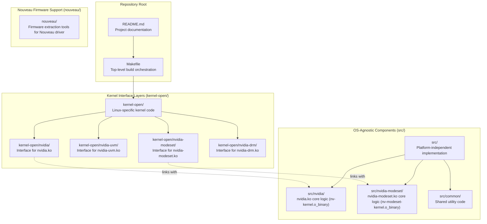

### Directory Highlights

| Directory                      | Role                                         | Description                                    |
|-------------------------------|----------------------------------------------|------------------------------------------------|
| `kernel-open/nvidia/`          | Linux kernel interface for `nvidia.ko`       | Kernel module entry points, device lifecycle, and ioctl implementations |
| `kernel-open/nvidia-uvm/`      | Linux interface for `nvidia-uvm.ko`           | Unified Virtual Memory kernel interface          |
| `kernel-open/nvidia-modeset/`  | Linux interface for `nvidia-modeset.ko`       | Display mode-setting kernel layer                |
| `kernel-open/nvidia-drm/`      | Linux DRM integration for `nvidia-drm.ko`     | DRM/KMS subsystem integration                    |
| `src/nvidia/`                  | OS-agnostic core for `nvidia.ko`               | Pre-built binary blob (`nv-kernel.o_binary`) containing core driver logic |
| `src/nvidia-modeset/`          | OS-agnostic core for `nvidia-modeset.ko`       | Pre-built binary blob (`nv-modeset-kernel.o_binary`) with display engine logic |
| `src/common/`                  | Shared utility code                            | Code shared across multiple components           |
| `nouveau/`                    | Firmware extraction tools for Nouveau driver  | Python scripts and firmware layout for GSP firmware extraction |

**Sources:** [README.md:153-177]()

---

## Architecture Overview

The NVIDIA Open GPU driver architecture is composed of layered components that separate Linux kernel-specific code from cross-platform driver core logic. This promotes reusability, portability, and easier maintenance across multiple Linux kernel versions.

In modern NVIDIA GPUs, the GPU System Processor (GSP) firmware acts as an embedded microcontroller that offloads and manages GPU resource management tasks. The kernel driver communicates with the GSP firmware using an RPC-style interface to perform operations efficiently.

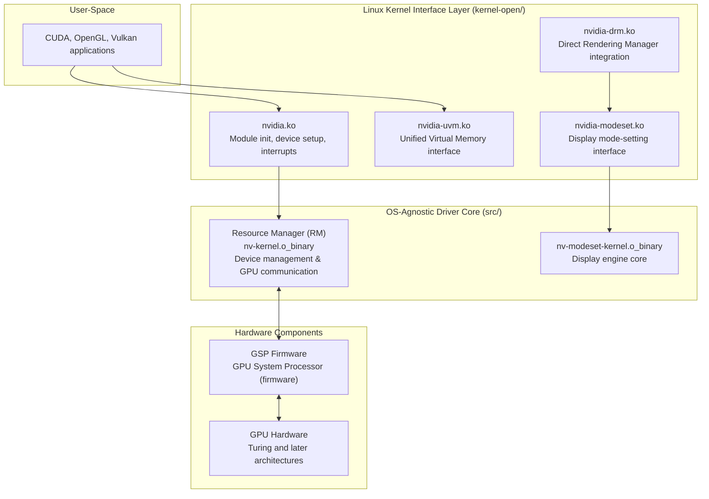

### Layered Responsibilities

- **Linux Kernel Interface Layer (`kernel-open/`)**  
  This layer contains Linux kernel version-dependent code handling kernel module initialization, device probing, interrupt management, and system call interfaces such as `ioctl` and `mmap`. It is built specifically for each target Linux kernel version and configuration.

- **OS-Agnostic Driver Core (`src/`)**  
  Provides GPU management, resource tracking, and other core driver functions independent of the OS. To reduce installation compile times, this core code is distributed as pre-compiled binaries embedded within kernel modules (`nv-kernel.o_binary` for `nvidia.ko` and `nv-modeset-kernel.o_binary` for `nvidia-modeset.ko`).

- **GPU System Processor (GSP) Firmware**  
  An embedded microprocessor on the GPU that offloads resource management from the host CPU. The driver communicates with the GSP via a Remote Procedure Call (RPC) interface to manage GPU resources efficiently.

This architectural design promotes modularity, code reuse, and compatibility with a wide range of Linux kernel versions without recompilation of the entire driver core.

**Sources:** [README.md:130-152,170-177]()

---

## Module Architecture

The NVIDIA GPU Linux kernel driver is divided into four primary kernel modules, each handling a distinct area of functionality:

| Module Name          | Role                                | Description                                  |
|----------------------|-----------------------------------|----------------------------------------------|
| `nvidia.ko`          | Core GPU driver                   | Handles GPU device lifecycle, resource management (via RM core), interrupts, power management, and user-space APIs through `ioctl` [kernel-open/nvidia/]() |
| `nvidia-modeset.ko`  | Display mode setting              | Manages display heads, modesetting, and integrates with OS-agnostic display engine logic [kernel-open/nvidia-modeset/]() |
| `nvidia-drm.ko`      | DRM/KMS integration               | Bridges NVIDIA drivers with the Linux Direct Rendering Manager subsystem to enable atomic modesetting and seamless OS integration [kernel-open/nvidia-drm/]() |
| `nvidia-uvm.ko`      | Unified Virtual Memory (UVM)      | Implements virtual memory sharing between CPU and GPU, with tracking of page residency and NUMA-aware allocation strategies [kernel-open/nvidia-uvm/]() |

Each module can be built and loaded independently but operates cohesively to provide a full NVIDIA GPU driver stack on Linux systems.

For a detailed explanation of each kernel module and their interaction, see the child page [Architecture Overview](#1.1).

**Sources:** [README.md:153-159]()

---

## Hardware Support and Requirements

The repository supports all NVIDIA GPUs from the Turing generation onward, encompassing Ampere, Ada Lovelace, Hopper, and the newest Blackwell architectures [README.md:182-184](). This broad support ensures compatibility with most current NVIDIA GPU product lines — including consumer, professional, and datacenter GPUs.

### Supported GPU Architectures and Example Products

| Architecture | Examples                                |
|--------------|---------------------------------------|
| Turing       | GeForce RTX 20 Series, Tesla T4       |
| Ampere       | GeForce RTX 30 Series, A100            |
| Ada Lovelace | GeForce RTX 40 Series, L40 Workstation |
| Hopper       | H100 Data Center GPU                   |
| Blackwell    | B200 Data Center GPU                   |

### Platform and Toolchain Requirements

- **CPU Architectures**: The kernel modules can be built for 64-bit x86_64 and ARM64 (aarch64) CPU architectures [README.md:27-49]().
- **Linux Kernel Versions**: Compatible with Linux kernel 4.15 and newer [README.md:75-78]().
- **Compiler Toolchains**: Compatible with modern versions of GCC and Clang. The kernel interface layer must be compiled with the same toolchain version used to build the host Linux kernel to maintain ABI stability [README.md:67-71]().
- **GSP Firmware**: The kernel modules require matching GSP firmware binaries extracted from the official NVIDIA driver packages. Installation instructions emphasize installing user-space NVIDIA drivers separately with the `--no-kernel-modules` option to avoid version conflicts [README.md:18-25]().
  
For complete hardware details, feature limitations, and platform specifics, refer to the child page [Supported Hardware and Requirements](#1.2).

**Sources:** [README.md:27-49,65-79,180-184]()

---

This overview introduces the NVIDIA Open GPU Kernel Modules project, its modular architecture, repository structure, and supported hardware. Detailed technical design, build procedures, and subsystem documentation are available in the linked child pages.

# End of Overview

---

# Page: Architecture Overview

# Architecture Overview

<details>
<summary>Relevant source files</summary>

The following files were used as context for generating this wiki page:

- [README.md](README.md)
- [kernel-open/common/inc/nv-linux.h](kernel-open/common/inc/nv-linux.h)
- [kernel-open/nvidia-uvm/uvm_va_block.c](kernel-open/nvidia-uvm/uvm_va_block.c)
- [kernel-open/nvidia/nv.c](kernel-open/nvidia/nv.c)
- [src/nvidia/src/kernel/gpu/device.c](src/nvidia/src/kernel/gpu/device.c)
- [src/nvidia/src/kernel/gpu/gsp/kernel_gsp.c](src/nvidia/src/kernel/gpu/gsp/kernel_gsp.c)

</details>


## Purpose and Scope

This document explains the fundamental architecture of the NVIDIA open GPU kernel modules, focusing on the dual-layer design that separates kernel interface code from OS-agnostic components. It covers the four kernel modules that comprise the driver stack, their dependencies, and how they integrate with user-space applications, the GSP (GPU System Processor) firmware, and the Linux kernel.

For additional details regarding the build process and kernel compatibility, please refer to [Kbuild Configuration]() and [Kernel Compatibility Layer]().

## Dual-Layer Architecture Model

The NVIDIA kernel modules are architected with a dual-layer approach that distinctly separates platform-specific kernel interface layers from OS-agnostic core logic. This design allows sharing substantial code components across different operating systems while preserving kernel integration specificity for Linux.

### Kernel Interface Layer

This layer provides the Linux-specific integration and low-level kernel APIs and resides primarily in the `kernel-open/` directory [README.md:130-160]().

#### Key Responsibilities:

- **Module Initialization and Registration**: Handles initialization routines such as resource allocation (`nv_module_resources_init()`), registration of the PCI driver (`nv_pci_register_driver()`), and character device creation exposing `/dev/nvidia*` interfaces [kernel-open/nvidia/nv.c:164-180]().

- **OS Abstraction and Primitives**: Supplies abstractions over Linux kernel primitives, including:
  - Memory allocation and deallocation (e.g., `os_alloc_mem()`, `os_free_mem()`).
  - Synchronization primitives (mutexes, semaphores, read-write locks).
  - System time and delay functions.
  - Hardware I/O operations (reads/writes to MMIO regions).

  These allow OS-agnostic code to perform platform operations transparently [kernel-open/nvidia/nv.c:33]().

- **Device Tracking and State Management**: Maintains detailed per-GPU device state via the `nv_linux_state_t` data structure. This includes global lists (`nv_linux_devices`) and synchronization primitives (mutexes) to protect device state [kernel-open/nvidia/nv.c:164-180]().

### OS-Agnostic Component (Resource Manager)

The bulk of GPU resource management, hardware engine control, and driver logic is implemented in OS-agnostic code usually located in the `src/` directory. This includes major subsystems compiled into binary blobs embedded within certain kernel modules, minimizing Linux-kernel-specific rebuild costs.

#### Characteristics:

- Available for `nvidia.ko` and `nvidia-modeset.ko` as large precompiled binaries:
  - **`nv-kernel.o_binary`**: The core Resource Manager (RM) within `nvidia.ko` that handles GPU device lifecycle, memory management, scheduling, and GSP communication.
  - **`nv-modeset-kernel.o_binary`**: Encapsulates display engine mode setting logic used by `nvidia-modeset.ko`.
  
- Modules `nvidia-drm.ko` and `nvidia-uvm.ko` are fully Linux kernel interface layers without separate OS-agnostic binaries.

- Key functional components in this layer include:
  - Object-oriented GPU device and engine management with `OBJGPU` class abstractions.
  - Client resource tracking and sharing models.
  - GPU virtual memory and page table management.
  - GPU System Processor (GSP) firmware communication via RPC [src/nvidia/src/kernel/gpu/gpu.c:70-100]().

#### Dual-layer Architecture Overview Diagram

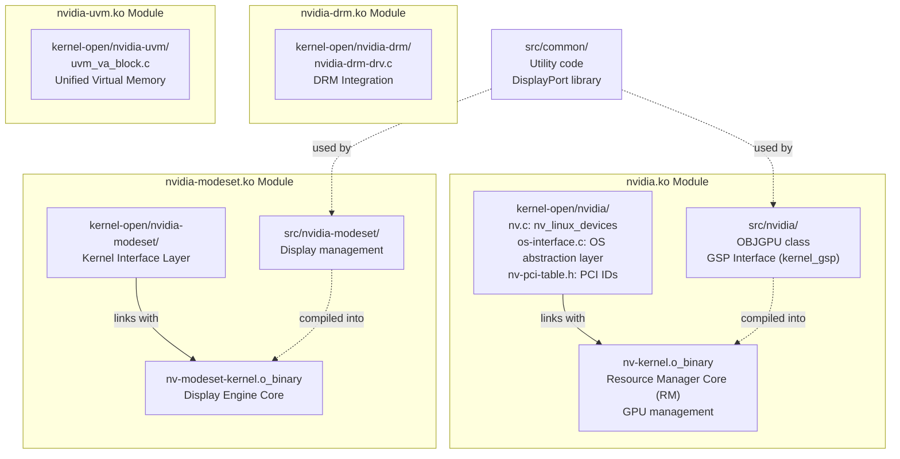

**Sources:** [README.md:130-164](), [kernel-open/nvidia/nv.c:164-180](), [src/nvidia/src/kernel/gpu/gpu.c:31-130](), [src/nvidia/src/kernel/rmapi/client_resource.c:28-131]()

## Kernel Module Stack

The NVIDIA driver stack is composed of four kernel modules, layered in order of dependencies as follows [README.md:153-160]():

### 1. `nvidia.ko` — Core Driver

- The foundational kernel module providing PCI/E/S device detection, device initialization, interrupt handling, and power management.
- Manages GPU device lifecycle through the `nv_linux_state_t` structures.
- Implements OS abstraction and exposes user-space device nodes like `/dev/nvidiactl` and `/dev/nvidiaX` [kernel-open/nvidia/nv.c:164-180]().

### 2. `nvidia-modeset.ko` — Mode Setting Module

- Depends on `nvidia.ko`.
- Handles display engine setup and mode setting.
- Uses the OS-agnostic display logic contained in `nv-modeset-kernel.o_binary`.

### 3. `nvidia-drm.ko` — DRM Integration

- Depends on both `nvidia.ko` and `nvidia-modeset.ko`.
- Provides standard Linux DRM subsystem integration including connectors, encoders, planes for modesetting.
- Enables atomic modesetting compatibility.

### 4. `nvidia-uvm.ko` — Unified Virtual Memory Module

- Depends on `nvidia.ko`.
- Implements CUDA Unified Virtual Memory management, including VA blocks and CPU/GPU page residency.
- Provides NUMA-aware allocation and integration with unified memory abstractions [kernel-open/nvidia-uvm/uvm_va_block.c:1-174]().

### Kernel Module Stack and Dependencies Diagram

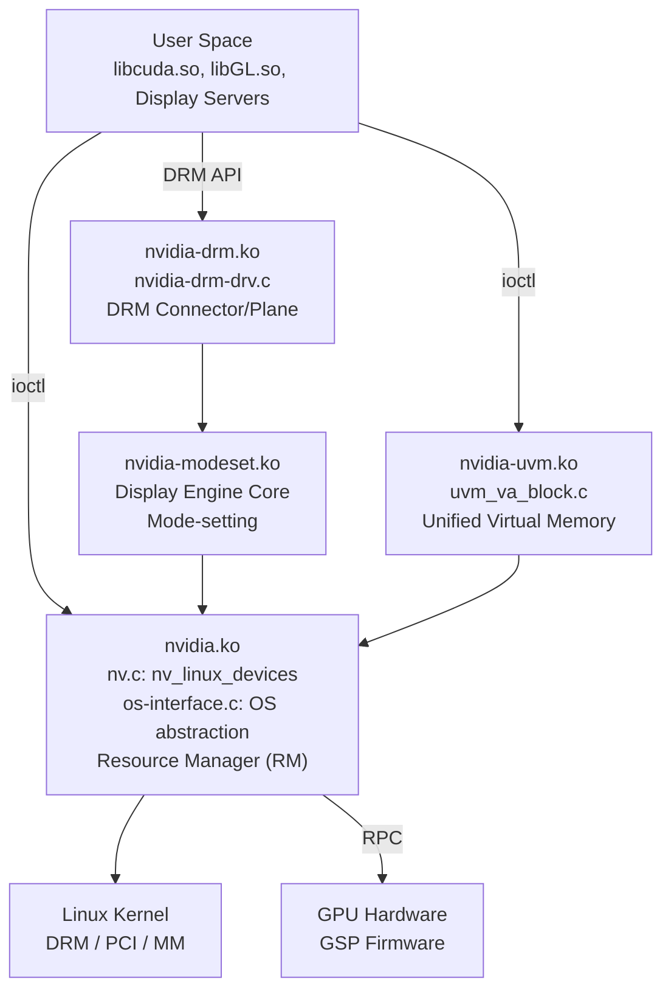

**Sources:** [README.md:153-160](), [kernel-open/nvidia/nv.c:164-180](), [src/nvidia/src/kernel/gpu/gpu.c:70-100]()

## GSP Firmware and RPC Infrastructure

Modern NVIDIA GPUs (Turing and later) incorporate a **GPU System Processor (GSP)** firmware running on a dedicated on-die RISC-V processor to offload resource management, initialization, and scheduling from the host CPU [README.md:18-20](), [kernel-open/nvidia/nv.c:27-30]().

### Role of GSP Firmware

- **GPU Hardware Initialization**: Manages low-level hardware bring-up, clock gating, and power states autonomously.
  
- **Resource Management Offload**: Assumes responsibility for scheduling GPU hardware engines and resource arbitration.
  
- **Firmware Loading**: Kernel modules declare required GSP firmware binary resources (e.g., `nvidia/version/xxxxx.bin`) that are loaded at module insertion [kernel-open/nvidia/nv.c:27-30]().

- **RPC Endpoint**: Acts as a remote server for RPC commands sent from the CPU driver to configure and control GPU subsystems.

### RPC Communication Flow

CPU-side Resource Manager code encapsulated in the `KernelGsp` abstraction manages RPC message queues to communicate asynchronously with the GSP firmware:

- The CPU GPU driver initializes RPC infrastructure (`_kgspInitRpcInfrastructure()`).
- Firmware binaries are loaded and booted on the GSP processor.
- RPC commands are sent over shared queues to the GSP firmware and results or events are received asynchronously.

Sequence of RPC-interactions:

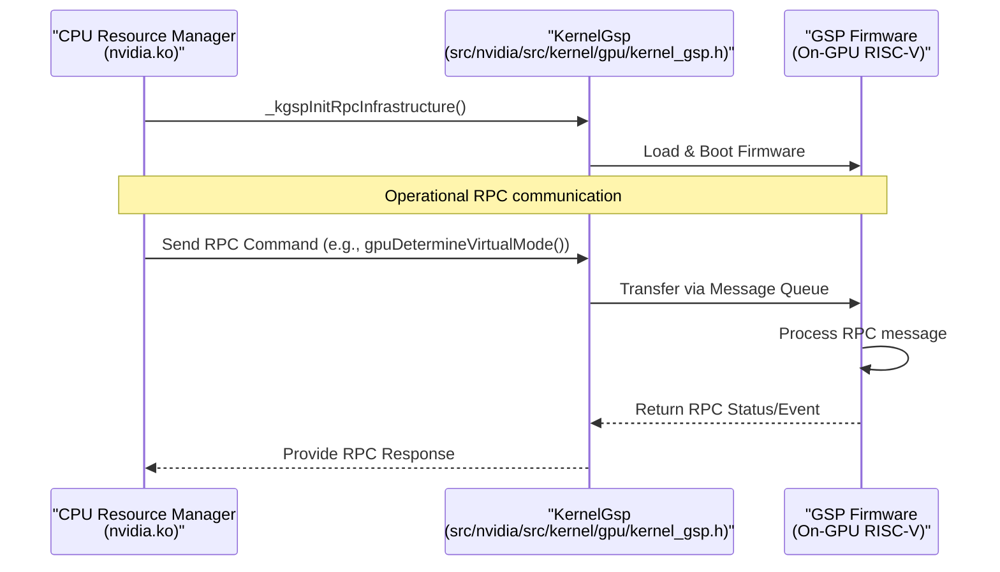

**Sources:** [README.md:18-20](), [src/nvidia/src/kernel/gpu/gpu.c:74-100](), [kernel-open/nvidia/nv.c:27-30]()

## Object-Oriented C (NVOC)

The Resource Manager and many internal driver components are implemented using NVIDIA's Object-Oriented C (NVOC) framework, which enables class-like constructs and dynamic casting in C. This approach offers modularity and safety without C++ overhead.

### Key NVOC Entities

- **`OBJGPU`**: Core class representing a physical GPU device. Manages the lifecycle of GPU subdevices, engines, and hardware states [src/nvidia/src/kernel/gpu/gpu.c:31-130]().

- **`KernelGsp`**: Encapsulates GSP firmware lifecycle, RPC communications, and error management.

- **`RmClientResource`**: Abstraction representing GPU resources owned by a client, enabling access control and lifetime tracking [src/nvidia/src/kernel/rmapi/client_resource.c:28-131]().

- **Dynamic Casting Mechanism**: The framework supports safe downcasting using macros such as `dynamicCast` to ensure type safety amongst NVOC objects [src/nvidia/src/kernel/rmapi/client_resource.c:174-175]().

This object abstraction layer facilitates maintainable, extensible driver design.

**Sources:** [src/nvidia/src/kernel/gpu/gpu.c:31-130](), [src/nvidia/src/kernel/rmapi/client_resource.c:28-175]()

## User-Space and Kernel Integration

The NVIDIA kernel modules expose functional interfaces to user-space libraries and applications primarily through:

1. **Ioctl Interface**: The `nvidia.ko` module exposes a wide range of ioctl commands enabling clients to manage GPU memory, submit work, query status, and control GPU state [kernel-open/nvidia/nv.c:124-180]().

2. **Memory Mapping (mmap) Interface**: Allows direct user-space mapping of GPU registers and buffers into the application address space.

3. **Unified Virtual Memory (via `nvidia-uvm.ko`)**: Supports CPU-GPU shared address space semantics and coherent page migration capabilities.

4. **DRM/KMS Integration (via `nvidia-drm.ko`)**: Integrates within the Linux graphics kernel subsystem for display server compatibility (Wayland, X11).

These interfaces collectively enable CUDA, OpenGL, Vulkan, and display server functionality.

**Sources:** [README.md:130-164](), [kernel-open/nvidia/nv.c:124-180]()

---

This architecture ensures a clean separation between Linux kernel interface logic and OS-agnostic GPU resource management. It leverages the GSP firmware to offload GPU hardware control and uses a modular layered kernel module stack supporting a wide range of features for Turing and later GPUs.

---

# Page: Supported Hardware and Requirements

# Supported Hardware and Requirements

<details>
<summary>Relevant source files</summary>

The following files were used as context for generating this wiki page:

- [README.md](README.md)
- [src/nvidia/generated/g_nv_name_released.h](src/nvidia/generated/g_nv_name_released.h)

</details>


This document specifies the hardware and software requirements for building and running the NVIDIA open GPU kernel modules. It covers supported GPU generations starting from Turing, platform CPU architecture support, Linux kernel compatibility, GSP firmware dependencies, and the comprehensive device compatibility database used by the driver.

For details about the build system, see the [Build System](#2) page. For kernel compatibility mechanisms, see [Kernel Compatibility Layer](#2.2). For architecture principles and module structure, refer to [Architecture Overview](#1.1).

---

## Overview

The NVIDIA open GPU kernel modules target GPUs of **Turing architecture (TU10x/TU11x) and later**. These modules require **Linux kernel 4.15 or newer** and must operate in conjunction with matching versions of the GSP firmware and NVIDIA user-space driver components.

The primary kernel modules forming the driver stack include:

- `nvidia.ko` — Core kernel module for GPU resource management and communication with GSP firmware.
- `nvidia-modeset.ko` — Handles mode setting and display configuration.
- `nvidia-drm.ko` — Integrates with the Linux Direct Rendering Manager (DRM) subsystem.
- `nvidia-uvm.ko` — Implements the Unified Virtual Memory (UVM) features.

Together these modules enable GPU initialization, resource management, display output, virtualization, and unified memory features.

---

## Supported GPU Architectures

### Hardware Generation Requirements

The kernel modules support any NVIDIA GPU based on **Turing or newer architectures**, encompassing multiple generations with details summarized below:

| Architecture   | GPU Series / Code Names       | Initial Release | Status    |
|----------------|------------------------------|-----------------|-----------|
| Turing         | TU10x, TU11x                 | 2018            | Supported |
| Ampere         | GA10x, GA20x                 | 2020            | Supported |
| Ada Lovelace   | AD10x, AD20x                 | 2022            | Supported |
| Hopper         | GH100, GH200                 | 2022            | Supported |
| Blackwell      | GB100, GB200, GB300          | 2024            | Supported |

These cover a broad product range from consumer GeForce cards, professional Quadro/RTX devices, to data center GPUs utilized in HPC and virtualization.

---

### GPU Feature Support Matrix

The following mermaid diagram depicts the relationship of supported GPU architectures with key driver components, firmware, and features enabled through the NVIDIA open kernel modules:

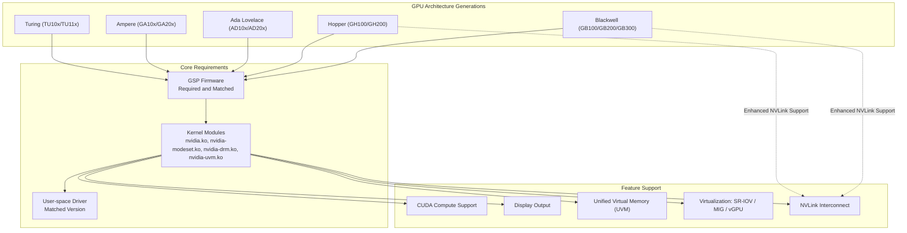

---

## Device Compatibility Database

### Physical GPU Identification

During device initialization, the `nvidia.ko` kernel module consults a **device compatibility database** that matches PCI device and subsystem IDs to GPU model names and supported configurations.

This database is implemented as a statically defined array `sChipsReleased` declared in the header:

```c
typedef struct _CHIPS_RELEASED {
    unsigned short devID;               // PCI Device ID
    unsigned short subSystemID;         // PCI Subsystem Device ID (OEM-specific)
    unsigned short subSystemVendorID;   // PCI Subsystem Vendor ID (OEM-specific)
    const char *name;                   // Marketing name string
} CHIPS_RELEASED;

static const CHIPS_RELEASED sChipsReleased[] = {
    { 0x1E02, 0x0000, 0x0000, "NVIDIA TITAN RTX" },
    { 0x1E30, 0x129e, 0x1028, "Quadro RTX 8000" },
    { 0x1E90, 0x131f, 0x1043, "NVIDIA GeForce RTX 2080 with Max-Q Design" },
    ...
};
```

This array contains hundreds of entries mapping PCI vendor/device and OEM subsystem identifiers to user-friendly GPU model strings for runtime support verification.

Class diagram illustrating this mapping:

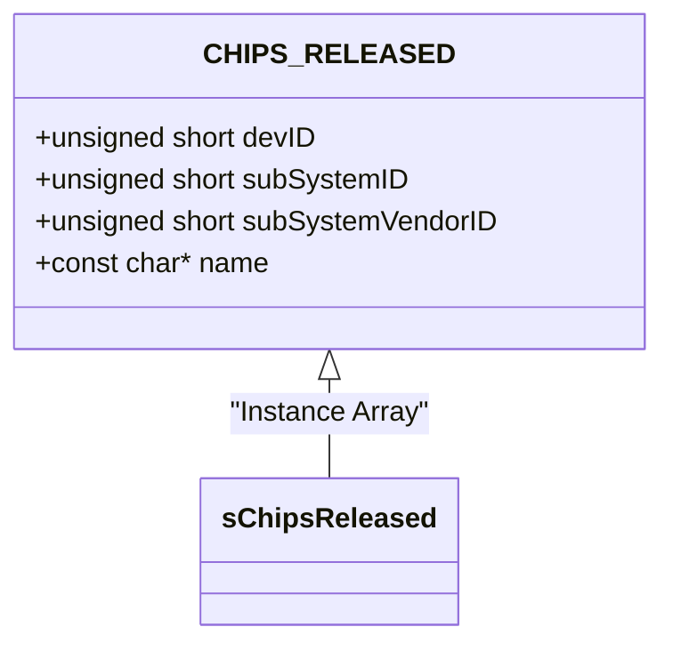

The driver code queries `sChipsReleased` during device probing to confirm hardware support and apply any model-specific behaviors or workarounds.

---

### Virtual GPU (vGPU) Compatibility

The kernel modules support NVIDIA vGPU virtualization features by maintaining mappings between physical GPUs and virtualized GPU types. This includes aliasing physical device IDs to virtual device IDs expected by RM (Resource Manager) and virtualization subsystems.

Key components in vGPU compatibility include:

- **Alias Resolution**: The function `_get_chip_id_for_alias_pgpu` searches through the `vgpu_aliases` array to remap physical GPU IDs to their aliases used by RM for vGPU [src/common/shared/inc/g_vgpu_resman_specific.h:7-43]().

- **SMC Type Mapping**: The `vgpuSmcTypeIdMappings` array relates device IDs and partition flags (which indicate fractional GPU sizes such as 1/2 or 1/4 GPU) to SMC vGPU Type IDs used internally by RM [src/common/shared/inc/g_vgpu_resman_specific.h:52-88]().

- **vGPU USM Type Table (PCI Device Mappings)**: The `sVgpuUsmTypes` array enumerates PCI device/vendor/subsystem ID combinations used to identify specific vGPU models (e.g., "GRID T4-8Q", "NVIDIA A30-1-6C") [src/common/shared/inc/g_vgpu_chip_flags.h:8-115]().

These components collaboratively allow accurate identification and validation of physical and virtual GPU configurations at runtime.

Visualization of key vGPU compatibility structures:

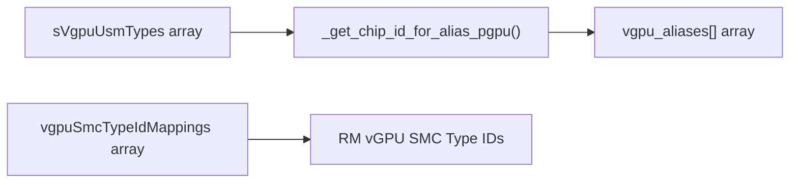

---

## Platform Requirements

### Supported CPU Architectures

The open GPU kernel modules support these CPU architectures:

- **x86_64**: The standard 64-bit Intel/AMD architecture used in most PCs and servers.
- **aarch64**: The 64-bit ARM architecture, commonly used in embedded platforms and emerging in high-performance computing (e.g., NVIDIA Grace).

Cross-compilation to these targets is supported by setting environment variables such as `TARGET_ARCH`, `CC`, `LD`, `AR`, and others during the module build process [README.md:27-48]().

Example to cross-compile on an x86_64 host for aarch64 target:

```bash
make modules TARGET_ARCH=aarch64 ARCH=arm64 CC=aarch64-linux-gnu-gcc LD=aarch64-linux-gnu-ld AR=aarch64-linux-gnu-ar CXX=aarch64-linux-gnu-g++ OBJCOPY=aarch64-linux-gnu-objcopy
```

---

### Linux Kernel Requirements

- **Minimum Kernel Version**: Linux kernel version 4.15 or higher is required. This ensures availability of modern kernel APIs needed by the driver.

- **Kernel Configuration Dependencies**:
  - `CONFIG_MODULES` (modules support)
  - `CONFIG_PCI` (PCI subsystem support)
  - `CONFIG_MMU` (Memory management unit support)
  - For Unified Virtual Memory (`nvidia-uvm.ko`), `CONFIG_HMM_MIRROR` enabling heterogeneous memory management mirroring is needed.

- **Compiler Toolchain**:  
  The kernel modules must be built with the C compiler toolchain used to build the running Linux kernel (e.g. matching GCC/Clang version) to avoid ABI compatibility issues.

---

## GSP Firmware Requirements

### GSP Firmware and Driver Version Synchronization

The NVIDIA GPU System Processor (GSP) firmware is a crucial component required for internal GPU functionalities such as security, power management, and resource orchestration.

- The open GPU kernel modules mandate the **presence and activation of the GSP firmware**. Unlike some proprietary drivers which may operate with GSP turned off on legacy GPUs, this open source stack requires GSP.

- The **driver kernel modules, GSP firmware, and NVIDIA user-space components must be version-matched** precisely, typically aligned to the release version (e.g., 615.78.08), ensuring functionality and stability.

- Firmware binaries are typically loaded from the system location `/lib/firmware/nvidia/`.

---

### Communication with GSP Firmware

Interaction with the GSP firmware occurs via an RPC (Remote Procedure Call) client implemented in `nvidia.ko`. This subsystem manages command submission and response processing for GPU control and coordination.

The following diagram models the runtime communication flow between host kernel, driver modules, and GPU hardware:

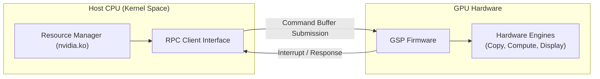

Key RPC client and firmware interfacing functions are implemented within the `nvidia.ko` kernel module source, coordinating asynchronous GPU operations.

---

## Summary Table of Requirements

| Category          | Details                                                         |
|-------------------|-----------------------------------------------------------------|
| **GPU**           | NVIDIA Turing (TU10x) or later                                  |
| **CPU Architecture**      | x86_64, aarch64                                                |
| **Linux Kernel**  | 4.15 or newer; required configs: MODULES, PCI, MMU, HMM_MIRROR (for UVM) |
| **Firmware**      | GSP Firmware required and must match kernel module/user-space versions |
| **Compiler**      | Toolchain must match the compiler used for the running kernel   |

---

**Sources:**  
[README.md:1-198](),  
[src/nvidia/generated/g_nv_name_released.h:23-115](),  
[src/common/shared/inc/g_vgpu_resman_specific.h:7-88](),  
[src/common/shared/inc/g_vgpu_chip_flags.h:8-115]()

---

# Page: Build System

# Build System

<details>
<summary>Relevant source files</summary>

The following files were used as context for generating this wiki page:

- [kernel-open/Kbuild](kernel-open/Kbuild)

</details>


## Purpose and Scope

This document provides a high-level overview of the NVIDIA open GPU kernel modules build system. It covers the multi-stage build system architecture that integrates Linux kernel Kbuild infrastructure, kernel feature detection through a conftest system, and version management. The system ensures robust compilation of multiple kernel modules across supported CPU architectures (`x86_64` and `arm64`), adapting dynamically to kernel interface changes and platform specifics.

This page serves as a parent overview. For detailed technical explanations, refer to the child pages:
- [Kbuild Configuration](#2.1) — Kbuild orchestration, compiler flags, architecture-specific settings.
- [Kernel Compatibility Layer](#2.2) — Kernel feature detection, sanity checks, generated headers.
- [Version Management](#2.3) — Version strings, build metadata, platform-specific versioning.

## Build System Architecture

The build system centers around the Linux kernel's Kbuild infrastructure, where `kernel-open/Kbuild` is the principal driver file orchestrating build behavior. It includes individual kernel module definitions, manages compiler flags, runs kernel compatibility checks, and constructs the final kernel modules [kernel-open/Kbuild:1-203]().

The `kernel-open/Makefile` acts as the entry point called by users or installers. It detects kernel source and output trees, determines architecture, and invokes Kbuild with appropriate environment variables and settings, supporting multi-architecture builds and out-of-tree module compilation [kernel-open/Makefile:17-116]().

### Mapping Natural Language Concepts to Code Entities in the Build System

The diagram below connects user-facing build concepts and stages to concrete variables and scripts in the codebase to aid navigation:

**Build System Entity Mapping**

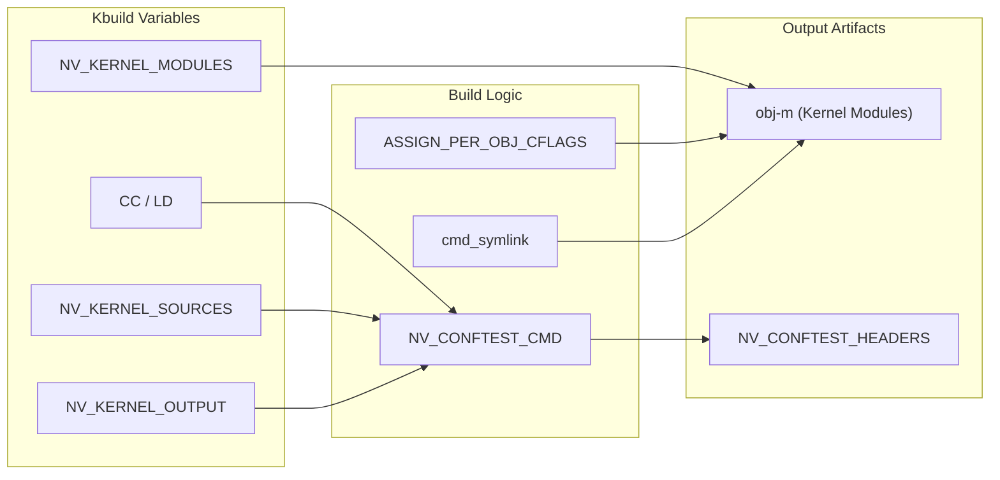

**Sources:** [kernel-open/Kbuild:1-203](), [kernel-open/Makefile:17-116]()

## Build Process Flow

The build process is multi-staged and interconnected by dependencies:

1. **Initialization:** The Makefile scripts detect the build target architecture and locate kernel source/output trees, setting environment variables used later by Kbuild [kernel-open/Makefile:21-53]().

2. **Kbuild Setup:** The primary Kbuild file includes per-module Kbuild fragments, sets global and per-module compiler flags (including architecture-specific and platform flags), and defines which kernel modules to build [kernel-open/Kbuild:74-79,118-135]().

3. **Kernel Compatibility Testing (Conftest):** Before compilation, the `conftest.sh` script runs with specified compiler, architecture, and kernel directories to run a series of small compile tests. This detects kernel feature availability and generates header files with conditional defines for use during compilation [kernel-open/Kbuild:177-201,210-215]().

4. **Compilation:** Using flags from conftest and Kbuild, the module source files are compiled to object files. Link and post-processing steps follow.

5. **Linking and Postprocessing:** Kernel modules are linked into `.ko` files, and symbolic links may be created for precompiled binary objects used within modules [kernel-open/Kbuild:70-71,151-153]().

**Build Sequence and Stage Dependencies**

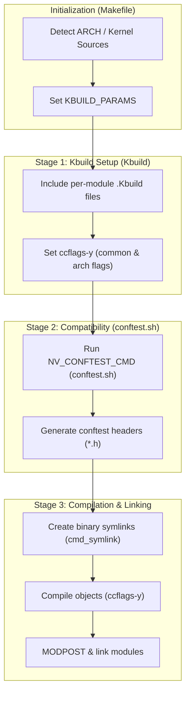

**Sources:** [kernel-open/Kbuild:11-19,177-215](), [kernel-open/Makefile:103-116]()

## Module Organization and Kbuild Integration

The build system supports multiple kernel modules. Each kernel module has an associated `.Kbuild` file included by the top level Kbuild, defining:

- The module's name and resulting target `.ko` file (added to `obj-m`)
- The source object files comprising the module
- Any module-specific compiler flags or conftest dependencies

The list of modules to build is specified by the `NV_KERNEL_MODULES` variable, making the build modular and extensible [kernel-open/Kbuild:74-79](), [kernel-open/Makefile:92-94]().

| Module               | Kbuild File                               | Role                                 | Binary Object Inclusion           |
|----------------------|------------------------------------------|------------------------------------|----------------------------------|
| `nvidia.ko`          | `nvidia/nvidia.Kbuild`                    | Core GPU driver                    | `nv-kernel.o_binary`              |
| `nvidia-modeset.ko`  | `nvidia-modeset/nvidia-modeset.Kbuild`  | Display mode setting               | `nv-modeset-kernel.o_binary`     |
| `nvidia-drm.ko`      | `nvidia-drm/nvidia-drm.Kbuild`            | DRM integration                   | None                             |
| `nvidia-uvm.ko`      | `nvidia-uvm/nvidia-uvm.Kbuild`            | Unified Virtual Memory support    | None                             |

The build system uses the helper macro `ASSIGN_PER_OBJ_CFLAGS` to assign compiler flags on a per-object basis, supporting the recent kernel build system change requiring both relative and basename object paths in `CFLAGS_` variables [kernel-open/Kbuild:40-43]().

**Sources:** [kernel-open/Kbuild:40-79](), [kernel-open/Makefile:92-94]()

## Compilation Flags Overview

Compiler flags (`ccflags-y`) accumulate from multiple sources to tailor builds precisely:

- **Common Flags:** Include standard include paths (`-I`), kernel module macros (`-D__KERNEL__`, `-DMODULE`, etc.), warning controls, and the version string `NV_VERSION_STRING` [kernel-open/Kbuild:102-109]().

- **Architecture-specific Flags:**
  - For `arm64`: `-mstrict-align`, `-mgeneral-regs-only`, `-march=armv8-a`, and disables outline atomics [kernel-open/Kbuild:145-158]().
  - For `x86_64`: `-mno-red-zone` and `-mcmodel=kernel` to suitable kernel code requirements [kernel-open/Kbuild:159-162]().
  
- **Feature and Platform Flags:**
  - Enables unified virtual memory support via `-DNV_UVM_ENABLE` [kernel-open/Kbuild:164]().
  - Define kernel interface layer compatibility with `-DNV_KERNEL_INTERFACE_LAYER` [kernel-open/Kbuild:167]().
  - On Android platforms disables filesystem kernel API access macros [kernel-open/Kbuild:129-135]().
  - Optionally enables undefined behavior sanitizer with `NV_UNDEF_BEHAVIOR_SANITIZER` [kernel-open/Kbuild:82-85]().
  
- **Warning Behavior:** Controlled by `WARNINGS_AS_ERRORS` variable; can elevate all warnings to errors [kernel-open/Kbuild:181-186]().

- **Sanitizer and Diagnostic Flags:** Add `-g` for debug builds, `-ffreestanding` for kernel compatibility, and restrict strict aliasing [kernel-open/Kbuild:139-154]().

### Important Compile-Time Defines

| Macro                         | Description                                      |
|-------------------------------|------------------------------------------------|
| `NV_VERSION_STRING`            | Driver version string for build identification ([example string](https://github.com/NVIDIA/open-gpu-kernel-modules/blob/main/kernel-open/Kbuild#L109)) |
| `NV_FILESYSTEM_ACCESS_AVAILABLE` | Enables/disables kernel filesystem API usage, disabled for Android builds |
| `NV_SPECTRE_V2`                | Defines spectre v2 mitigations level             |

**Sources:** [kernel-open/Kbuild:77-167]()

## Precompiled Binary Objects Integration

Some kernel modules incorporate precompiled binary object files containing OS-agnostic driver logic. To seamlessly integrate these binaries while adapting to kernel source tree layout differences, symbolic links are created by `cmd_symlink` commands.

This approach abstracts differences between Linux kernel versions prior to 6.13 (where the current working directory is the kernel source tree) and newer versions (where the CWD is the external module source tree). Thus, kernel modules build without manual path handling for included binaries [kernel-open/Kbuild:87-98]().

**Sources:** [kernel-open/Kbuild:87-98]()

## Kernel Compatibility Layer (Conftest) Integration

To maintain compatibility across kernel versions and variants, the build system uses a conftest framework that:

- Runs compile-time tests through `conftest.sh` (triggered via `NV_CONFTEST_CMD`) using the configured compiler, architecture, and kernel source/output [kernel-open/Kbuild:177-210]().

- Detects kernel API features, symbols, function availability, and type sizes.

- Generates multiple headers (e.g., `conftest/macros.h`, `conftest/functions.h`, `conftest/symbols.h`, `conftest/types.h`) with defines that enable conditional compilation depending on kernel capabilities.

- Allows kernel module source files to include these generated headers and enable/disable code paths or warn on missing features.

- Improves robustness by avoiding runtime kernel symbol differences and providing early compile-time compatibility feedback.

For full details, see the child page [Kernel Compatibility Layer](#2.2).

**Sources:** [kernel-open/Kbuild:177-201]()

---

This high-level overview bridges conceptual build stages with code components and workflow orchestration. Developers should consult the linked child pages for detailed guidance on customizing or troubleshooting specific build stages.

---

# Page: Kbuild Configuration

# Kbuild Configuration

<details>
<summary>Relevant source files</summary>

The following files were used as context for generating this wiki page:

- [kernel-open/Kbuild](kernel-open/Kbuild)
- [kernel-open/nvidia/nvidia.Kbuild](kernel-open/nvidia/nvidia.Kbuild)

</details>


This page describes the Kbuild build orchestration system, compiler flag configuration, module-specific build settings, and architecture-specific configurations used to compile the NVIDIA kernel modules. For information about kernel feature detection and compatibility testing, see [Kernel Compatibility Layer](2.2). For build version management, see [Version Management](2.3).

## Overview

The Kbuild system is the central orchestrator for building all NVIDIA kernel modules. The main Kbuild file located at `kernel-open/Kbuild` coordinates compilation by:

- Including module-specific Kbuild files dynamically for each kernel module specified.
- Setting global compiler flags and preprocessor macros.
- Managing architecture-specific build options.
- Applying platform-specific configurations such as for Android, Tegra, and vGPU.
- Integrating tightly with the kernel feature conftest system for compatibility detection.

The build process supports multiple kernel modules built from a single invocation: `nvidia.ko`, `nvidia-modeset.ko`, `nvidia-drm.ko`, and `nvidia-uvm.ko`.

---

**Diagram: Kbuild File Structure and Module Inclusion**

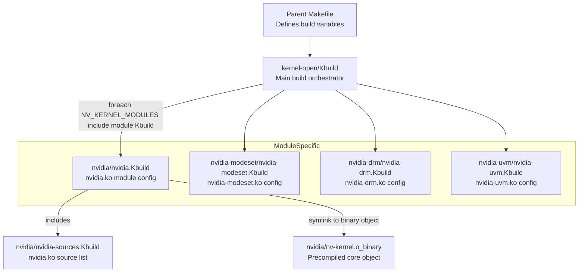

---

The main Kbuild file uses a GNU Make `foreach` loop to include each requested kernel module's Kbuild fragment dynamically:

```makefile
$(foreach _module, $(NV_KERNEL_MODULES), \
 $(eval include $(src)/$(_module)/$(_module).Kbuild))
```

Each module-specific Kbuild fragment is responsible for:

- Appending its module to `obj-m` for kernel module build targets.
- Defining the object files (.o) built for the module.
- Registering kernel conftest compile tests it depends on.

This modular design supports incremental builds and independent module management.

Sources: [kernel-open/Kbuild:101-103](), [kernel-open/nvidia/nvidia.Kbuild:9-13]()

## Build Variables and Structure

The build system expects the parent makefile to define several core variables:

| Variable           | Description                                         |
|--------------------|-----------------------------------------------------|
| `NV_KERNEL_SOURCES` | Root path to the kernel source tree                 |
| `NV_KERNEL_OUTPUT`  | Output directory for kernel build artifacts (out-of-tree) |
| `NV_KERNEL_MODULES` | List of kernel modules to build (e.g. `nvidia nvidia-modeset`) |
| `ARCH`             | Target CPU architecture, either `x86_64` or `arm64` |
| `NV_BUILD_TYPE`    | Build configuration: `release` (default), `debug`, or `develop` |

Kbuild internally provides:

- `$(src)`: Directory containing current Kbuild file.
- `$(obj)`: Output directory where objects are produced.

These variables coordinate the build path and compilation steps across modules.

Sources: [kernel-open/Kbuild:6-18]()

## Global Compiler Flags

Global compiler flags are set in the main `kernel-open/Kbuild`. These ensure consistent warnings, defines, and architecture flags across all kernel modules.

**Key compilation flags:**

```makefile
ccflags-y += -I$(src)/common/inc
ccflags-y += -I$(src)
ccflags-y += -Wall $(DEFINES) $(INCLUDES) -Wno-cast-qual -Wno-format-extra-args
ccflags-y += -D__KERNEL__ -DMODULE -DNVRM
ccflags-y += -DNV_VERSION_STRING=\"615.78.08\"
ccflags-y += -Wno-unused-function
ccflags-y += -fno-strict-aliasing
ccflags-y += -ffreestanding
```

These flags:

- Add include paths for common kernels and top-level source.
- Enable general warnings (`-Wall`) with selective disables.
- Define kernel build context (`__KERNEL__`, `MODULE`).
- Define NVIDIA-specific macros (version string, kernel layer marker).
- Enforce strict aliasing rules and freestanding assumptions per Linux kernel conventions.

Sources: [kernel-open/Kbuild:105-154]()

**Build-Type Specific Flags:**

| Build Type | CFLAGS Additions                        | Purpose                            |
|------------|---------------------------------------|----------------------------------|
| `release`  | `-UDEBUG -U_DEBUG -DNDEBUG` + `-Wuninitialized` | Optimized build, disable debugging, warn uninitialized vars |
| `develop`  | `-UDEBUG -U_DEBUG -DNDEBUG -DNV_MEM_LOGGER` | Like release but enable memory logger instrumentation |
| `debug`    | `-g -DDEBUG -D_DEBUG -UNDEBUG -DNV_MEM_LOGGER` | Include debug symbols and logging |

The build type defaults to `release` but can be altered via `NV_BUILD_TYPE`. Debug builds also enable debug info and memory logging.

Sources: [kernel-open/Kbuild:138-151](), [kernel-open/nvidia/nvidia.Kbuild:58-69]()

## Architecture-Specific Configuration

The driver adapts compiler flags depending on architecture to comply with kernel ABI conventions and optimize builds.

**Diagram: Architecture-Specific Compiler Flags**

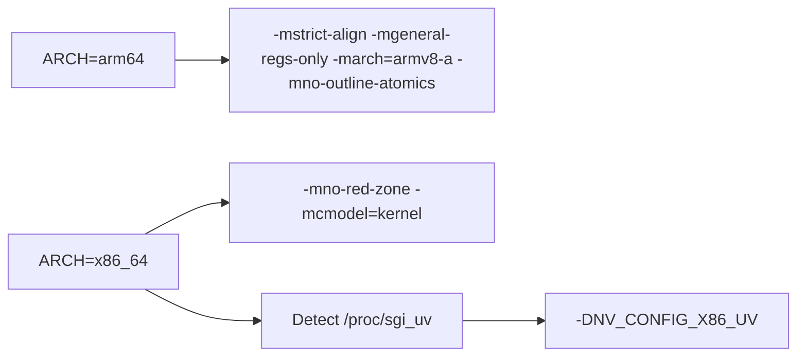

### ARM64 Flags

- `-mstrict-align`: Enforces strict memory alignment.
- `-mgeneral-regs-only`: Restricts to general-purpose registers, avoiding SIMD.
- `-march=armv8-a`: Targets ARMv8 architecture baseline.
- `-mno-outline-atomics`: Disables outlining of atomic operations.

These ensure the kernel driver compiles with correct semantics and performance on ARM64 systems.

Sources: [kernel-open/Kbuild:145-158]()

### x86_64 Flags

- `-mno-red-zone`: Disable red zone usage per kernel ABI requirements.
- `-mcmodel=kernel`: Use kernel-level code model suitable for large kernel addresses.

Additionally, detection of SGI UV large SMP systems via presence of `/proc/sgi_uv` triggers adding `-DNV_CONFIG_X86_UV` macro for specializations.

Sources: [kernel-open/Kbuild:159-175]()

## Per-Object CFLAGS and LDFLAGS Macros

The `ASSIGN_PER_OBJ_CFLAGS` macro facilitates assigning specific compiler flags on a per-object file basis. This is important especially due to changes in kernel build system that require specifying both path-qualified and plain object names for `CFLAGS_<object>` used by Kbuild.

```makefile
ASSIGN_PER_OBJ_CFLAGS = \
 $(foreach _obj, \
 $(sort $(notdir $(1)) $(1)), \
 $(eval $(addprefix CFLAGS_,$(_obj)) += $(2)))
```

This macro iterates through the given object files, appending the given flags to both `CFLAGS_object.o` and `CFLAGS_path/object.o`.

Equivalent macros exist for removing flags and setting per-object linker flags:

- `ASSIGN_PER_OBJ_CFLAGS_REMOVE`
- `ASSIGN_PER_OBJ_LDFLAGS`
- `ASSIGN_PER_OBJ_OBJCOPYFLAGS`

This mechanism allows granular control of compile/link flags per file without polluting global settings.

**Example usage:**

```makefile
NVIDIA_CFLAGS += -I$(src)/nvidia
NVIDIA_CFLAGS += -DNVIDIA_UNDEF_LEGACY_BIT_MACROS
$(call ASSIGN_PER_OBJ_CFLAGS, $(NVIDIA_OBJECTS), $(NVIDIA_CFLAGS))
```

Sources: [kernel-open/Kbuild:40-44](), [kernel-open/Kbuild:46-55](), [kernel-open/nvidia/nvidia.Kbuild:55-72]()

## Binary Object File Integration

Some kernel modules use large precompiled binary object files that contain platform-agnostic core functionality. The `nvidia.ko` module includes a precompiled core in `nvidia/nv-kernel.o_binary`.

Instead of copying this large binary, the build creates a symbolic link named `nv-kernel.o` pointing to `nv-kernel.o_binary`. This is done via a dedicated Kbuild rule for efficiency and compatibility across different kernel build systems.

```makefile
quiet_cmd_symlink = SYMLINK $@
cmd_symlink = ln -sf $(abspath $<) $@

$(obj)/nvidia/nv-kernel.o: $(src)/nvidia/nv-kernel.o_binary FORCE
	$(call if_changed,symlink)

nvidia-y += nvidia/nv-kernel.o
```

The symlink is relative to absolute path of the binary to account for Linux kernel version changes in external module directory handling.

**Diagram: Binary Object Symlink Flow**

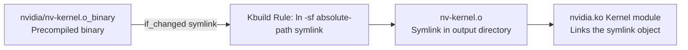

This approach reduces disk space overhead and rebuild times, preserving clean binary separation.

Sources: [kernel-open/Kbuild:87-98](), [kernel-open/nvidia/nvidia.Kbuild:19-48]()

## Platform-Specific Adjustments

The build accommodates different platforms by conditionally adding flags or includes:

### Android Platform

On Android kernels, filesystem operations like `filp_open` and `kernel_read` may be restricted. The build disables related filesystem access features when `PLATFORM_IS_ANDROID=1`:

```makefile
PLATFORM_IS_ANDROID ?= 0

ifeq ($(PLATFORM_IS_ANDROID),1)
 ccflags-y += -DNV_FILESYSTEM_ACCESS_AVAILABLE=0
else
 ccflags-y += -DNV_FILESYSTEM_ACCESS_AVAILABLE=1
endif
```

Thus, incompatible code is excluded on Android.

Sources: [kernel-open/Kbuild:129-135]()

### Tegra Support

Tegra out-of-tree modules can be integrated by specifying overlay include paths and symbol files:

```makefile
ifneq ($(wildcard /usr/src/nvidia/nvidia-public),)
 SYSSRCNVOOT ?= /usr/src/nvidia/nvidia-public
endif

ifneq ($(SYSSRCNVOOT),)
 ccflags-y += -I$(SYSSRCNVOOT)/include
 KBUILD_EXTRA_SYMBOLS = $(SYSSRCNVOOT)/Module.symvers
endif

ifneq ($(SYSSRCHOST1X),)
 ccflags-y += -I$(SYSSRCHOST1X)
endif
```

This supports collaborative development of Tegra kernel modules alongside NVIDIA GPU drivers.

Sources: [kernel-open/Kbuild:112-123](), [kernel-open/Kbuild:116-118]()

### vGPU Support

Virtual GPU builds can enable forced PCI core redirection with:

```makefile
ifdef VGX_FORCE_VFIO_PCI_CORE
 ccflags-y += -DNV_VGPU_FORCE_VFIO_PCI_CORE
endif
```

This alters PCI driver selection for virtualization environments.

Sources: [kernel-open/Kbuild:177-179]()

## Compiler Feature Flags and Sanitizer Support

Additional compiler flags are configured to improve robustness and developer experience:

- The build enables `-Werror=undef` if supported, for catching undefined macro usage.
- The variable `WARNINGS_AS_ERRORS` controls whether warnings are treated as errors.
- Undefined Behavior Sanitizer (UBSAN) support is optionally enabled when `NV_UNDEF_BEHAVIOR_SANITIZER=1`:

```makefile
NV_UNDEF_BEHAVIOR_SANITIZER ?=
ifeq ($(NV_UNDEF_BEHAVIOR_SANITIZER),1)
 UBSAN_SANITIZE := y
endif

WARNINGS_AS_ERRORS ?=
ifeq ($(WARNINGS_AS_ERRORS),1)
 ccflags-y += -Werror
else
 ccflags-y += -Wno-error
endif
```

This configurable approach suits different build policies.

Sources: [kernel-open/Kbuild:82-85](), [kernel-open/Kbuild:181-186]()

## Module-Specific Configuration: nvidia.ko Example

The `nvidia.ko` kernel module's Kbuild fragment (`nvidia/nvidia.Kbuild`) illustrates module-specific configuration:

- Sources are included via `nvidia-sources.Kbuild`.
- The precompiled binary object is symlinked and appended to module objects.
- Module-specific CFLAGS include additional include paths and defines.
- Build type variations add or remove debug and memory logger macros.
- A generated compiler version header is included for `nv-procfs.c`.
- A linker script produces a combined interface object `nv-interface.o`.

```makefile
include $(src)/nvidia/nvidia-sources.Kbuild
NVIDIA_OBJECTS = $(patsubst %.c,%.o,$(NVIDIA_SOURCES))

obj-m += nvidia.o
nvidia-y := $(NVIDIA_OBJECTS)
NVIDIA_BINARY_OBJECT := $(src)/nvidia/nv-kernel.o_binary
NVIDIA_BINARY_OBJECT_O := nvidia/nv-kernel.o

targets += $(NVIDIA_BINARY_OBJECT_O)

$(obj)/$(NVIDIA_BINARY_OBJECT_O): $(NVIDIA_BINARY_OBJECT) FORCE
	$(call if_changed,symlink)

nvidia-y += $(NVIDIA_BINARY_OBJECT_O)

NVIDIA_CFLAGS += -I$(src)/nvidia
NVIDIA_CFLAGS += -DNVIDIA_UNDEF_LEGACY_BIT_MACROS
NVIDIA_CFLAGS += -DLIBSPDM_CONFIG=\"nvspdm_rmconfig.h\"

ifeq ($(NV_BUILD_TYPE),release)
 NVIDIA_CFLAGS += -UDEBUG -U_DEBUG -DNDEBUG
endif
ifeq ($(NV_BUILD_TYPE),develop)
 NVIDIA_CFLAGS += -UDEBUG -U_DEBUG -DNDEBUG -DNV_MEM_LOGGER
endif
ifeq ($(NV_BUILD_TYPE),debug)
 NVIDIA_CFLAGS += -DDEBUG -D_DEBUG -UNDEBUG -DNV_MEM_LOGGER
endif

$(call ASSIGN_PER_OBJ_CFLAGS, $(NVIDIA_OBJECTS), $(NVIDIA_CFLAGS))

NV_COMPILER_VERSION_HEADER = nv_compiler.h

$(obj)/$(NV_COMPILER_VERSION_HEADER):
	@echo \#define NV_COMPILER \"`$(CC) -v 2>&1 | tail -n 1`\" > $@

$(obj)/nvidia/nv-procfs.o: $(obj)/$(NV_COMPILER_VERSION_HEADER)

NVIDIA_INTERFACE := nvidia/nv-interface.o
always += $(NVIDIA_INTERFACE)
always-y += $(NVIDIA_INTERFACE)

$(obj)/$(NVIDIA_INTERFACE): $(addprefix $(obj)/,$(NVIDIA_OBJECTS))
	$(LD) -r -o $@ $^
```

This Kbuild fragment demonstrates:

- Explicit source listings and object targets.
- Usage of the symlinked binary object.
- Conditional per-object CFLAGS assignment.
- Generated headers for compiler metadata.
- Creation of a unified interface object by linking all kernel interface objects.

Sources: [kernel-open/nvidia/nvidia.Kbuild:8-130]()

## Conftest Integration for Kernel Compatibility

The NVIDIA Kbuild system integrates with the `conftest` kernel feature detection subsystem to adapt the build to various kernel APIs.

Each module's Kbuild file appends to a set of conftest compile test lists:

- `NV_CONFTEST_FUNCTION_COMPILE_TESTS`
- `NV_CONFTEST_SYMBOL_COMPILE_TESTS`
- `NV_CONFTEST_TYPE_COMPILE_TESTS`
- `NV_CONFTEST_GENERIC_COMPILE_TESTS`

Objects relying on conftest results append to `NV_OBJECTS_DEPEND_ON_CONFTEST`.

The main Kbuild then invokes a script `conftest.sh` to compile these tests against the target kernel headers, generating header files under `conftest/headers.h` that define or undefine macros based on detected features.

---

**Diagram: Conftest Integration Flow**

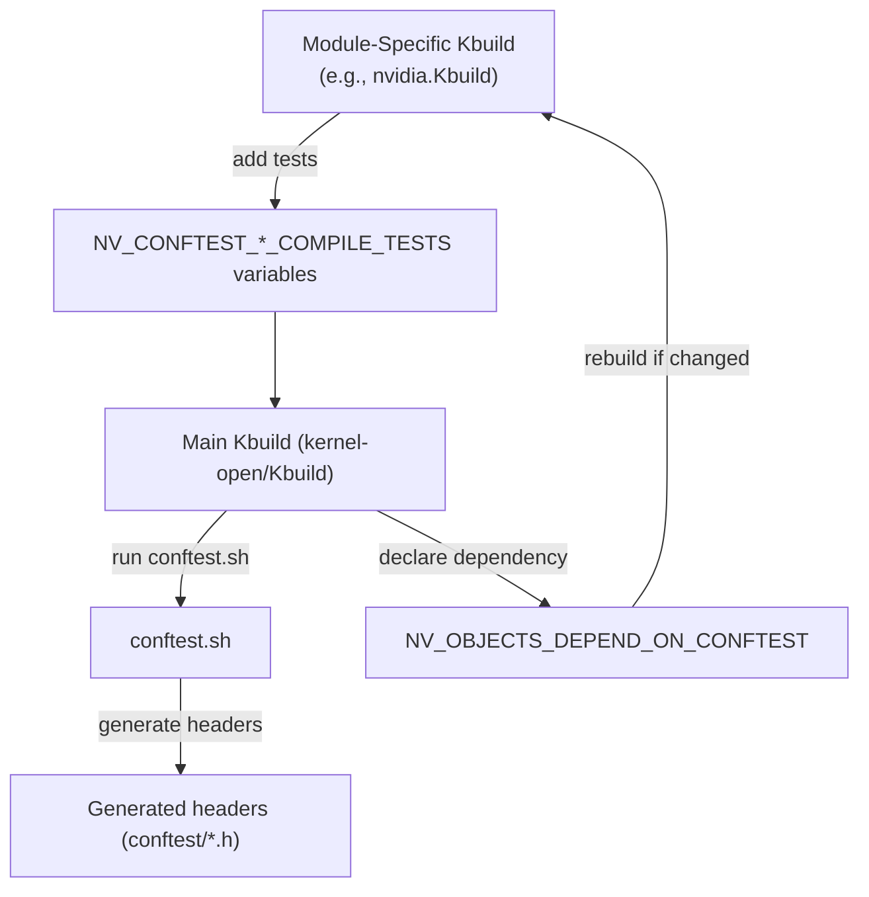

This integration ensures the modules compile conditionally depending on which kernel functions, symbols, and types are available, increasing compatibility with multiple kernel versions.

Example from `nvidia.Kbuild`:

```makefile
NV_CONFTEST_FUNCTION_COMPILE_TESTS += set_pages_uc
NV_CONFTEST_FUNCTION_COMPILE_TESTS += ioremap_cache
NV_CONFTEST_SYMBOL_COMPILE_TESTS += is_export_symbol_present_swiotlb_dma_ops
NV_CONFTEST_TYPE_COMPILE_TESTS += vmf_insert_pfn_prot

NV_OBJECTS_DEPEND_ON_CONFTEST += $(NVIDIA_OBJECTS)
```

Sources: [kernel-open/Kbuild:133-201](), [kernel-open/nvidia/nvidia.Kbuild:132-245]()

## Spectre v2 Mitigation Awareness

The build defines a macro reflecting whether kernel Spectre variant 2 mitigations are enabled:

```makefile
ccflags-y += -DNV_SPECTRE_V2=$(NV_SPECTRE_V2)
```

The value of `NV_SPECTRE_V2` is passed during build and used in runtime checks for performance or mitigation behavior.

Sources: [kernel-open/Kbuild:166-166]()

## Kernel Interface Layer Marker

All kernel interface source files are defined by a macro:

```makefile
ccflags-y += -DNV_KERNEL_INTERFACE_LAYER
```

This macro enables conditional compilation for source files intertwined with Linux kernel APIs as opposed to OS-agnostic code.

Sources: [kernel-open/Kbuild:167-167]()

## UVM and Additional Compiler Flags

Unified Virtual Memory (UVM) code paths are enabled unconditionally:

```makefile
ccflags-y += -DNV_UVM_ENABLE
```

Other compiler flags include disables for specific warnings like unused functions and format extra args.

Sources: [kernel-open/Kbuild:164-166]()

## Summary

The NVIDIA Open GPU Kernel Modules Kbuild configuration provides:

1. **Central build orchestration** with a master Kbuild file that dynamically includes module-specific fragments.
2. **Global and per-module compiler flag management** using explicit macros and per-object flag assignments.
3. **Architecture-specific compiler settings** for ARM64 and x86_64 supporting kernel ABI compliance.
4. **Platform adaptations** for Android restrictions, Tegra external modules, and vGPU configurations.
5. **Efficient integration of large precompiled binary objects** by generating symlinks instead of binary copies.
6. **Support for different build configurations**: release, debug, and develop, with tailored macro sets.
7. **Integration with conftest testing** for compile-time feature detection ensuring broad kernel compatibility.
8. **Runtime feature awareness macros** such as Spectre v2 mitigations and kernel interface layer marking.

This robust and flexible Kbuild setup allows seamless building of a unified driver source code against multiple kernel versions and architectures while supporting platform-specific requirements.

---

Sources:  
[kernel-open/Kbuild:1-214](),  
[kernel-open/nvidia/nvidia.Kbuild:1-178]()

---

# Page: Kernel Compatibility Layer

# Kernel Compatibility Layer

<details>
<summary>Relevant source files</summary>

The following files were used as context for generating this wiki page:

- [kernel-open/common/inc/nv-mm.h](kernel-open/common/inc/nv-mm.h)
- [kernel-open/conftest.sh](kernel-open/conftest.sh)
- [kernel-open/header-presence-tests.mk](kernel-open/header-presence-tests.mk)
- [src/common/modeset/timing/nvtiming.h](src/common/modeset/timing/nvtiming.h)

</details>


## Purpose and Scope

The Kernel Compatibility Layer is a build-time feature detection system implemented primarily in the shell script [kernel-open/conftest.sh](). It performs compile-time tests to detect the presence and characteristics of kernel APIs, functions, types, symbols, kernel configuration options, and headers within the target kernel’s source tree.

Based on the results of these tests, it generates C preprocessor header files containing macros. These macros enable conditional compilation to adapt the NVIDIA GPU kernel modules to the variability and evolution of Linux kernel internals.

This compatibility layer is essential for:

- Supporting a broad range of kernel versions and configurations with one unified codebase.
- Avoiding the complexity of multiple driver source branches per kernel version.
- Enabling the build to dynamically adapt to the target kernel’s feature set.
- Integrating with the multi-stage build system ([2.1 Kbuild Configuration]()) and version management ([2.3 Version Management]()).

Sources: [kernel-open/conftest.sh:1-13]()

---

## Architecture Overview

The Kernel Compatibility Layer activates early during the build process. The `conftest.sh` script orchestrates numerous minimal compile tests, each targeting a particular kernel feature or API variation.

### Test Types and Their Roles

- **Function Tests:** Verify existence of kernel functions.
- **Type & Signature Tests:** Confirm types and struct field presence or layout.
- **Symbol Export Tests:** Check whether kernel symbols are exported for module linkage using `Module.symvers`.
- **Kernel Config Tests:** Determine kernel config options, such as `CONFIG_XEN`.
- **Sanity Checks:** Validate compiler environment, basic assumptions, and `Module.symvers` availability.
- **Header Presence Tests:** Confirm presence of kernel header files important to the driver.

Each test is performed by dynamically creating a test source file and compiling it against the kernel headers and configuration files. Success or failure controls macro definitions in output headers.

### Data Flow and Components

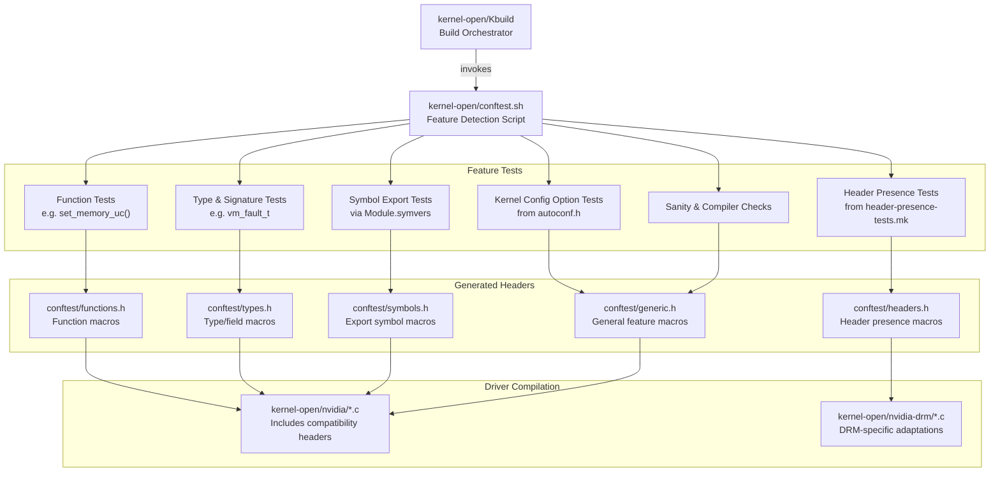

Sources: [kernel-open/conftest.sh:38-101](), [kernel-open/header-presence-tests.mk:1-47]()

---

## Build Integration

The `conftest.sh` script integrates tightly with the Kbuild system and is executed once per build, before driver compilation, to generate compatibility headers.

### Execution Flow

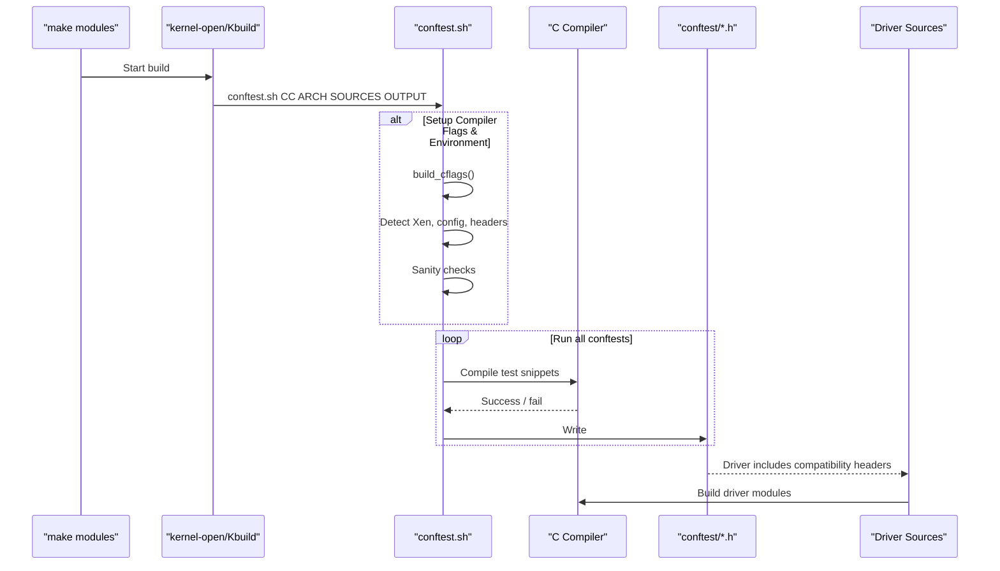

Sources: [kernel-open/conftest.sh:1-19](), [kernel-open/conftest.sh:103-218]()

---

### Command-Line Parameters

The script accepts four command-line parameters for flexibility:

| Parameter | Description                  |
|-----------|------------------------------|
| `$1`      | C compiler executable path   |
| `$2`      | Target architecture (ARCH)   |
| `$3`      | Kernel source directory path |
| `$4`      | Kernel build output directory|

Sources: [kernel-open/conftest.sh:9-13]()

---

### Compiler Flags Construction

The core function `build_cflags()` constructs robust compiler flags including:

- Optimization and kernel mode defines (`-D__KERNEL__`).
- Includes for kernel headers from source tree, generated headers, and architecture-specific directories.
- Detection and integration of Xen machine includes if the target kernel is Xen-based.
- Identification of the appropriate `autoconf.h` based on in-tree or out-of-tree build.
- Support for adding extra defines from `BUILD_PARAMS`.
- Detection of compiler support for features like `asm goto` via auxiliary scripts.

This ensures that feature detection compilation is environment-consistent and precise.

Sources: [kernel-open/conftest.sh:103-197]()

---

## Test Categories

The conftest script groups tests into the following categories:

### Function Presence Tests

Verify if kernel functions exist by compiling minimal invocation snippets. If compilation succeeds, the function is accessible.

Sources: [kernel-open/conftest.sh:290-329]()

---

### Type and Structure Tests

Check for presence of kernel types, typedefs, or structure fields by compiling code referencing those constructs, often using `offsetof()`. This detects kernel ABI differences.

Sources: [kernel-open/conftest.sh:2621-2629]()

---

### Symbol Export Tests

Referencing `Module.symvers` files in the kernel build output directory (and optionally out-of-tree locations on Tegra platforms), these tests verify if kernel symbols are exported and available for module use.

Example code snippet for checking a symbol is:

```sh
check_symbol_exists() {
    SYMBOL="$1"
    TAB='	'
    grep -e "${TAB}${SYMBOL}${TAB}.*${TAB}EXPORT_SYMBOL.*\$" ${MODULE_SYMVERS_PATHS}
}
```

Sources: [kernel-open/conftest.sh:17-23](), [kernel-open/conftest.sh:331-390]()

---

### Kernel Configuration Tests

By parsing the kernel's `autoconf.h`, these tests determine if kernel config options (e.g., `CONFIG_XEN`) are enabled, influencing compilation flags and behavior.

Sources: [kernel-open/conftest.sh:38-52]()

---

### Header Presence Tests

The system attempts to `#include` kernel headers listed in `header-presence-tests.mk` and sets macros like `NV_LINUX_FENCE_H_PRESENT` to indicate availability. This includes headers crucial for the driver's kernel interface.

Example headers tested include `drm/drm_hdcp.h`, `linux/nvhost.h`, `asm/set_memory.h`, etc.

Sources: [kernel-open/conftest.sh:66-101](), [kernel-open/header-presence-tests.mk]()

---

## Generated Headers Organization

The conftest script outputs multiple headers, each encapsulating feature macros based on test results.

### Header Outputs and Their Contents

| Output Header               | Macro Prefix / Content                          | Purpose                                   |
|----------------------------|------------------------------------------------|-------------------------------------------|
| `conftest/functions.h`     | `NV_*_PRESENT` macros for kernel functions     | Function presence detection                |
| `conftest/types.h`         | `NV_*_HAS_*` macros for types & struct members | Type and structure compatibility           |
| `conftest/symbols.h`       | `NV_IS_EXPORT_SYMBOL_*` for exported symbols   | Kernel export symbol availability          |
| `conftest/generic.h`       | General feature flags based on config & sanity  | Kernel config options and generic macros  |
| `conftest/headers.h`       | `NV_*_PRESENT` for header file presence         | Kernel header availability                  |

### Relationships Between Test Categories and Output Headers

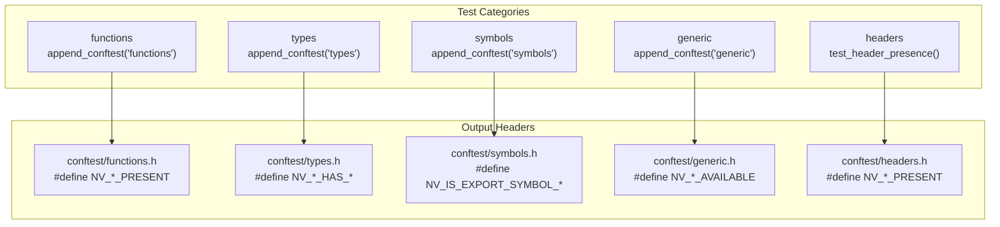

Sources: [kernel-open/conftest.sh:54-64](), [kernel-open/conftest.sh:66-101]()

---

## Sanity Checks

Before running any feature detection, `conftest.sh` performs sanity checks including:

- **Xen Kernel Detection:** Function `test_xen()` checks kernel config options `CONFIG_XEN` and `CONFIG_PARAVIRT`, setting `XEN_PRESENT` appropriately. If Xen is present, Xen-specific machine include paths are added.

- **Compiler Environment Verification:** Verifies the compiler accepts minimal C code snippets, detecting readiness for the test compilation.

- **Module Symvers Sanity:** Ensures `Module.symvers` file(s) exist and are readable for symbol export tests.

- **Compiler Feature Availability:** Detects support for GNU C extensions like `asm goto`.

### Sanity Check Flowchart

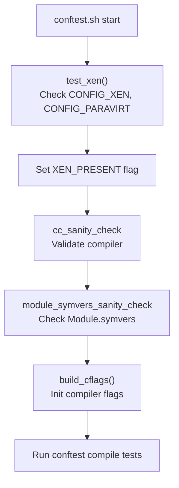

Sources: [kernel-open/conftest.sh:38-52](), [kernel-open/conftest.sh:103-218]()

---

## Compile Test Implementation

Each test in conftest follows these steps:

1. **Test Source Generation:** Creates a temporary C source file (`conftest$$.c`), embedding the relevant test snippet framed by the common header `CONFTEST_PREAMBLE`.

2. **Compilation Attempt:** Invokes the configured C compiler with tailored flags to compile the test. This compilation may target just preprocessing or full compilation depending on the test.

3. **Result Interpretation:** If compilation succeeds, the target feature is considered present; otherwise it is absent or with a different interface.

4. **Macro Generation:** Writes to the corresponding output header `#define` or `#undef` macros reflecting the test outcome.

5. **Cleanup:** Removes temporary test files before the next test.

### Single Compile Test Diagram

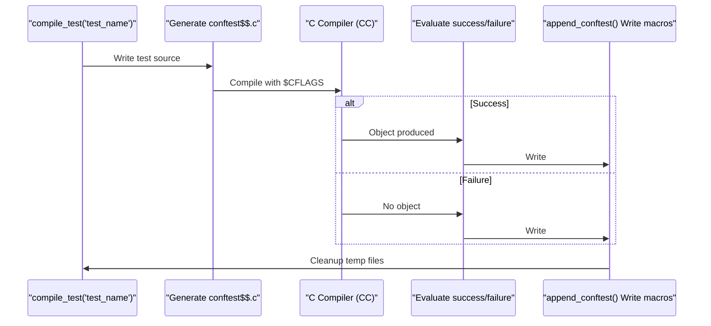

Sources: [kernel-open/conftest.sh:290-329]()

---

## Integration with Driver Code

The generated headers—`functions.h`, `types.h`, `symbols.h`, `generic.h`, and `headers.h`—are included by kernel source files in:

- `kernel-open/nvidia/` — Core driver files.
- `kernel-open/nvidia-drm/` — DRM subsystem driver variants.

These headers govern conditional compilation of kernel API usage, enabling adaptation to kernel differences like presence/absence or signature changes of functions, types, exported symbols, and headers.

For example, if the header `linux/fence.h` is detected as available, the macro `NV_LINUX_FENCE_H_PRESENT` is defined, allowing the use of kernel fence synchronization APIs guarded by:

```c
#ifdef NV_LINUX_FENCE_H_PRESENT
    // fence API usage here
#endif
```

This mechanism minimizes runtime conditional checks by resolving compatibility at compile-time.

Sources: [kernel-open/conftest.sh:83-88](), [kernel-open/header-presence-tests.mk:26]()

---

# Summary

The Kernel Compatibility Layer is a critical subsystem that automates detection of kernel features relevant to the NVIDIA GPU kernel modules. By executing a wide variety of compile-time tests during the build, it produces granular compatibility macros encapsulated in generated headers. These enable driver source code to conditionally compile against diverse Linux kernel versions and configurations with a single unified codebase.

The key benefits include support for evolving kernel APIs without driver source forks, robust build-time feature identification, and integration with the overall multi-stage build and versioning systems.

This system leverages:

- The shell script-based conftest framework.
- Detailed compile-time tests for kernel symbols, types, functions, headers, and config options.
- Symbol export verification from `Module.symvers`.
- Sanity and environment checks to ensure test validity.
- Generated headers that drive conditional compilation downstream.

Together, these capabilities underpin maintainable, portable, and future-proof NVIDIA open GPU kernel modules.

Sources:  
[kernel-open/conftest.sh:1-218](),  
[kernel-open/conftest.sh:290-390](),  
[kernel-open/conftest.sh:1567-1673](),  
[kernel-open/header-presence-tests.mk:1-47](),  
[kernel-open/pahole.sh:11-62]()

---

# Page: Version Management

# Version Management

<details>
<summary>Relevant source files</summary>

The following files were used as context for generating this wiki page:

- [src/common/inc/nvBldVer.h](src/common/inc/nvBldVer.h)
- [src/common/inc/nvUnixVersion.h](src/common/inc/nvUnixVersion.h)
- [version.mk](version.mk)

</details>


## Purpose and Scope

This document describes the version management system utilized in the NVIDIA Open GPU Kernel Modules repository. The system coordinates version numbers, build metadata, and changelist information consistently across multiple kernel modules and supported platforms. It supports both official buildmeister builds and local developer builds with distinct version identification mechanisms.

The version management system integrates deeply with the multi-stage build system (described in section 2) to propagate version info into the kernel modules, which report it on load and via driver APIs. This page focuses on how versioning data is defined, overridden, and consumed throughout the build and runtime environments.

For details on build orchestration consuming these version definitions, see [Kbuild Configuration](#2.1). For kernel feature detection that operates independently, see [Kernel Compatibility Layer](#2.2).

---

## Version Management Architecture

The version management system comprises three primary components that collectively establish version identity across the driver stack:

```mermaid
graph TB
    subgraph "Top-Level Version Definition"
        VERSION_MK["version.mk\nNVIDIA_VERSION=615.78.08\nNVIDIA_NVID_VERSION=615.78.08"]
    end
    
    subgraph "Generated Version Header"
        VERSION_H["$(OUTPUTDIR)/version.h\nGenerated by Makefile\n#define NVIDIA_VERSION"]
    end
    
    subgraph "Build Metadata Headers"
        NVBLDVER["nvBldVer.h\nBranch: NV_BUILD_BRANCH\nChangelist: NV_BUILD_CHANGELIST_NUM\nBuild Type: NV_BUILD_TYPE\nAuthor: NV_BUILD_AUTHOR"]
        NVUNIXVER["nvUnixVersion.h\nNV_VERSION_STRING=615.78.08\nPlatform-specific"]
    end
    
    subgraph "Build Process"
        KBUILD["Kbuild System\nCompiler flags\nModule builds"]
        MODULES["Kernel Modules\nnvidia.ko, nvidia-modeset.ko,\nnvidia-drm.ko, nvidia-uvm.ko"]
    end
    
    subgraph "Runtime Version Reporting"
        MODINFO["modinfo output\nModule version"]
        DMESG["dmesg logs\nNV_DISPLAY_DRIVER_TITLE"]
        IOCTL["IOCTL queries\nDriver version info"]
    end
    
    VERSION_MK -->|"Makefile rule generates" | VERSION_H
    VERSION_H --> KBUILD
    NVBLDVER --> KBUILD
    NVUNIXVER --> KBUILD
    
    KBUILD --> MODULES
    
    MODULES --> MODINFO
    MODULES --> DMESG
    MODULES --> IOCTL
```

**Diagram: Version Information Flow Through Build System**

Sources: [version.mk:1-11](), [src/common/inc/nvBldVer.h:1-73](), [src/common/inc/nvUnixVersion.h:1-16]()

---

## Version Number Definition

### Primary Version String

The authoritative user-facing version number is centrally defined in the file `version.mk` at the repository root. This file serves as the single source of truth for basic driver version identification across all build artifacts:

| Variable              | Purpose                              | Example Value |
|-----------------------|------------------------------------|--------------:|
| `NVIDIA_VERSION`       | Primary driver version as string   | `615.78.08`   |
| `NVIDIA_NVID_VERSION`  | NVID-specific version string (same as above) | `615.78.08`   |
| `NVIDIA_NVID_EXTRA`    | Optional extra suffix (empty if none) | *(empty)*    |

The Makefile rule in `version.mk` generates a header `$(OUTPUTDIR)/version.h` on each build:

```makefile
$(OUTPUTDIR)/version.h: $(VERSION_MK_FILE)
	@$(MKDIR) $(OUTPUTDIR)
	@$(ECHO) '#define NVIDIA_VERSION "$(NVIDIA_VERSION)"' > $@
```

This generated `version.h` header is then included in the headers available to all compilation units, ensuring a consistent `NVIDIA_VERSION` macro across the build [version.mk:6-11]().

---

### Unix Platform Version

The header `nvUnixVersion.h` provides a platform-specific version macro for Unix-like systems supported by the driver. It is only compiled on platforms such as Linux, BSD variants, Solaris, VMware ESXi, QNX, INTEGRITY RTOS, or when building components like GSP firmware or DCE core:

```c
#define NV_VERSION_STRING "615.78.08"
```

This string must be consistent with `version.mk`'s `NVIDIA_VERSION`. Attempts to compile this header on unsupported platforms cause a preprocessor error to prevent cross-platform misuse [src/common/inc/nvUnixVersion.h:4-16]().

---

## Build Metadata System

### Build Identification Components

The `nvBldVer.h` header maintains comprehensive build metadata identifying the exact source state and build configuration, distinguishing between official buildmeister builds and local developer builds.

This is implemented with environment variable overrides for developer builds and a buildmeister-managed section populated automatically by build scripts during official builds.

```mermaid
graph TB
    subgraph "Environment Variables"
        ENV_DVS_SW_CL["DVS_SW_CHANGELIST\nDefault: 0"]
        ENV_NV_BUILD_CL["NV_BUILD_CL\nDev changelist override"]
        ENV_NV_BUILD_TYPE_NON_BM["NV_BUILD_TYPE_NON_BM\nDefault: Private"]
        ENV_NV_BUILD_AUTHOR["NV_BUILD_AUTHOR\nDefault: unknown"]
    end

    subgraph "Buildmeister-Managed Section"
        BM_SECTION["Python script edits\nDefines NV_BUILD_BRANCH, NV_PUBLIC_BRANCH,\nNV_BUILD_BRANCH_VERSION,\nNV_BUILD_CHANGELIST_NUM, NV_BUILD_TYPE=Official,\nNV_BUILD_NAME, NV_LAST_OFFICIAL_CHANGELIST_NUM"]
    end

    subgraph "Build Type Determination"
        BM_CHECK{"Is NV_BUILDMEISTER_BLD defined?"}
        OFFICIAL["Official Build\nUses BM_SECTION values"]
        DEVELOPER["Developer Build\nOverrides NV_BUILD_TYPE and CHANGELIST"]
    end

    subgraph "Composite Output"
        DISPLAY_TITLE["NV_DISPLAY_DRIVER_TITLE\n\"BUILD_TYPE BRANCH NAME AUTHOR\""]
    end

    ENV_DVS_SW_CL --> ENV_NV_BUILD_CL
    ENV_NV_BUILD_CL --> BM_CHECK
    ENV_NV_BUILD_TYPE_NON_BM --> BM_CHECK
    ENV_NV_BUILD_AUTHOR --> DISPLAY_TITLE

    BM_SECTION --> BM_CHECK
    BM_CHECK -->|"Yes"| OFFICIAL
    BM_CHECK -->|"No"| DEVELOPER
    OFFICIAL --> DISPLAY_TITLE
    DEVELOPER --> DISPLAY_TITLE
```

**Diagram: Build Type and Metadata Resolution**

Sources: [src/common/inc/nvBldVer.h:11-73]()

---

### Environment Variable Overrides for Developer Builds

The metadata system supports environment variables allowing developers to customize version metadata locally:

| Environment Variable        | Default Value | Purpose                              |
|----------------------------|---------------|------------------------------------|
| `DVS_SW_CHANGELIST`         | `0`           | Perforce changelist number          |
| `NV_BUILD_CL`               | `DVS_SW_CHANGELIST` | Effective changelist number        |
| `NV_BUILD_TYPE_NON_BM`      | `Private`     | Build type string for developer builds  |
| `NV_BUILD_AUTHOR`           | `unknown`     | Username or author string           |

If `NV_BUILD_CL` is defined but evaluates to 0, it falls back to `DVS_SW_CHANGELIST`. This fallback logic enables flexible developer environment setups [src/common/inc/nvBldVer.h:11-32]().

---

### Buildmeister-Managed Metadata Section

A dedicated section of `nvBldVer.h` is edited exclusively by buildmeister Python scripts during official builds. This section is not intended for manual edits to prevent conflicts and is marked clearly in the file.

For Unix platforms (Linux, BSD, Solaris), the buildmeister section typically defines macros such as:

| Macro                     | Example Value                 | Purpose                            |
|---------------------------|------------------------------|----------------------------------|
| `NV_BUILD_BRANCH`         | `r617_07`                    | Internal branch identifier        |
| `NV_PUBLIC_BRANCH`        | `r617_07`                    | Public facing branch name         |
| `NV_BUILD_BRANCH_VERSION` | `"rel/gpu_drv/r615/r617_07-228"` | Full branch version string        |
| `NV_BUILD_CHANGELIST_NUM` | `39079891`                   | Official changelist number        |
| `NV_BUILD_TYPE`           | `"Official"`                 | Build classification string       |
| `NV_BUILD_NAME`           | `"rel/gpu_drv/r615/r617_07-228"` | Build name/identifier             |
| `NV_LAST_OFFICIAL_CHANGELIST_NUM` | `39079891`           | Last official changelist synced   |

Windows builds have a different set of values, including a numeric driver version string and `NV_BUILD_BRANCH_BASE_VERSION` [src/common/inc/nvBldVer.h:35-60]().

---

### Non-Buildmeister Build Overrides

When `NV_BUILDMEISTER_BLD` is **not** defined (indicating a developer or non-official build), some metadata macros are redefined:

- `NV_BUILD_TYPE` is set to the stringified `NV_BUILD_TYPE_NON_BM` (usually `"Private"`)
- `NV_BUILD_CHANGELIST_NUM` is set to `NV_BUILD_CL`, enabling the use of environment variable or fallbacks for changelist number

This preserves official branch metadata but allows developer customization of changelist number and build type [src/common/inc/nvBldVer.h:62-69]().

---

## Driver Title Construction

The macro `NV_DISPLAY_DRIVER_TITLE` constructs the driver version title string concatenating build type, branch, build name, and author:

```c
#define NV_DISPLAY_DRIVER_TITLE \
    NV_BUILD_TYPE " " STRINGIZE(NV_BUILD_BRANCH) " " NV_BUILD_NAME " " STRINGIZE(NV_BUILD_AUTHOR)
```

The resulting string appears in kernel logs during driver initialization and when queried via IOCTL interfaces, providing comprehensive build information.

Example runtime title strings:

- Official build: `Official r617_07 rel/gpu_drv/r615/r617_07-228 unknown`
- Developer build: `Private r617_07 rel/gpu_drv/r615/r617_07-228 jsmith`

This string aids in debugging and user support by clearly indicating source build metadata [src/common/inc/nvBldVer.h:71]().

---

## Version Propagation Workflow

The version information lifecycle involves multiple components coordinated during the build system invocation:

```mermaid
sequenceDiagram
    participant Dev as Developer / Buildmeister
    participant VersionMK as version.mk
    participant Make as Makefile system
    participant VersionH as $(OUTPUTDIR)/version.h
    participant NvBldVer as nvBldVer.h
    participant NvUnixVer as nvUnixVersion.h
    participant Kbuild as Kbuild system
    participant KernelModules as Kernel Modules

    Dev ->> VersionMK: Update `NVIDIA_VERSION`
    Dev ->> NvUnixVer: Update `NV_VERSION_STRING` (Unix platforms)
    Dev ->> NvBldVer: (Buildmeister Only) Update branch & changelist python script
    
    Dev ->> Make: Execute build (e.g. `make modules`)
    Make ->> VersionH: Generate from version.mk
    Make ->> Kbuild: Trigger compilation including version headers
    
    Kbuild ->> VersionH: Apply `NVIDIA_VERSION` macro
    Kbuild ->> NvBldVer: Apply build metadata (branch, changelist, build type)
    Kbuild ->> NvUnixVer: Apply Unix-specific version string
    
    Kbuild ->> KernelModules: Compile kernel modules with all version info
    
    KernelModules ->> Dev: Embed version in module metadata
    
    KernelModules ->> Dev: Runtime outputs:
    KernelModules ->> Dev: - `modinfo` shows module version
    KernelModules ->> Dev: - `dmesg` driver logs display title
    KernelModules ->> Dev: - IOCTL queries report driver version
```

**Diagram: Version Information Lifecycle**

Sources: [version.mk:7-11](), [src/common/inc/nvBldVer.h:35-60](), [src/common/inc/nvUnixVersion.h:8]()

---

## Version Macro Usage Details

### Stringification Macros

Within `nvBldVer.h`, stringification macros ensure macro parameters are converted to string literals properly:

```c
#ifndef NVBLDVER_STRINGIZE
#define NVBLDVER_STRINGIZE(t) #t
#endif

#ifndef STRINGIZE
#define STRINGIZE(t) NVBLDVER_STRINGIZE(t)
#endif
```

- `NVBLDVER_STRINGIZE(t)` directly stringifies `t`
- `STRINGIZE(t)` forces macro expansion before stringification

These utilities are used to convert build macros such as `NV_BUILD_BRANCH` and `NV_BUILD_AUTHOR` into strings for concatenation [src/common/inc/nvBldVer.h:4-9]().

---

### Platform-Specific Compilation Conditions

- `nvUnixVersion.h` enforces compilation only on Unix-like platforms by triggering a preprocessor error on unsupported systems [src/common/inc/nvUnixVersion.h:12]()
- `nvBldVer.h` conditionally defines platform-specific macros — Unix platforms have one set of definitions; Windows builds use alternate values and macros like `NV_BUILD_BRANCH_BASE_VERSION` [src/common/inc/nvBldVer.h:45-59]()

This separation ensures appropriate version metadata for each platform without cross-contamination.

---

## Summary

The NVIDIA Open GPU Kernel Modules use a disciplined, multi-layered version management system comprising:

| Layer               | Responsibility                                         |
|---------------------|-------------------------------------------------------|
| **User-facing version strings** (`version.mk`, `nvUnixVersion.h`) | Semantic driver version numbers visible to users and APIs; example: `615.78.08` |
| **Build metadata** (`nvBldVer.h`)  | Branch, changelist, build type, and author information used to uniquely identify builds during official and developer builds |
| **Generated headers** (`version.h`) | Propagates `NVIDIA_VERSION` macro during compilation dynamically for kernel modules |
| **Build system integration** (Kbuild) | Includes all version headers and applies macros during compilation of kernel modules |

This design supports both automated official buildmeister builds with python script-driven metadata and local developer builds with customizable environment overrides, maintaining consistent and clear version metadata throughout the driver stack.

---

**Sources:**

- [version.mk:1-11]()
- [src/common/inc/nvBldVer.h:1-73]()
- [src/common/inc/nvUnixVersion.h:1-16]()

---

# Page: Core Kernel Modules

# Core Kernel Modules

<details>
<summary>Relevant source files</summary>

The following files were used as context for generating this wiki page:

- [kernel-open/common/inc/nv-linux.h](kernel-open/common/inc/nv-linux.h)
- [kernel-open/nvidia-uvm/uvm_va_block.c](kernel-open/nvidia-uvm/uvm_va_block.c)
- [kernel-open/nvidia/nv.c](kernel-open/nvidia/nv.c)
- [src/nvidia/src/kernel/gpu/device.c](src/nvidia/src/kernel/gpu/device.c)
- [src/nvidia/src/kernel/gpu/gsp/kernel_gsp.c](src/nvidia/src/kernel/gpu/gsp/kernel_gsp.c)

</details>


## Purpose and Scope

This document provides a high-level overview of the four primary kernel modules in the NVIDIA GPU driver stack:

- `nvidia.ko` (core driver)
- `nvidia-modeset.ko` (mode setting)
- `nvidia-drm.ko` (DRM integration)
- `nvidia-uvm.ko` (Unified Virtual Memory)

These modules collectively expose the necessary kernel interfaces that interact with the OS-agnostic Resource Manager and other binary components. Together, they manage GPU hardware resources, system integration, and memory management features.

This page serves as a parent overview and links to detailed child pages covering each module’s internals, architectures, and interfaces.

## Module Architecture Overview

NVIDIA's Linux GPU driver is architected as four interrelated kernel modules. Each addresses specific responsibilities, balancing portability and OS integration by combining OS-agnostic binary components with Linux kernel interface layers where applicable.

| Module              | Responsibilities                                                             | OS-Agnostic Binary               | Kernel Interface Location             |
|---------------------|------------------------------------------------------------------------------|---------------------------------|-------------------------------------|
| `nvidia.ko`         | Core driver: device lifecycle, ioctl handling, interrupts, power management, RM integration | `nv-kernel.o_binary`              | `kernel-open/nvidia/`                 |
| `nvidia-modeset.ko` | Mode setting: display configuration, OS-agnostic mode setting core           | `nv-modeset-kernel.o_binary`     | `kernel-open/nvidia-modeset/`        |
| `nvidia-drm.ko`     | DRM subsystem integration: atomic modesetting, kernel graphics compatibility  | None                            | `kernel-open/nvidia-drm/`            |
| `nvidia-uvm.ko`     | Unified Virtual Memory management: shared CPU/GPU memory, page residency, NUMA-aware allocation | None                            | `kernel-open/nvidia-uvm/`            |

### System-Level Interaction Diagram

```mermaid
graph TB
    subgraph "User Space"
        CUDA["CUDA/User APIs"]
        DRM_CLIENT["DRM Clients (X11, Wayland)"]
    end

    subgraph "Kernel Modules"
        NVIDIA_KO["nvidia.ko<br/> Core Driver"]
        MODESET_KO["nvidia-modeset.ko<br/> Mode Setting"]
        DRM_KO["nvidia-drm.ko<br/> DRM Integration"]
        UVM_KO["nvidia-uvm.ko<br/> Unified Virtual Memory"]
    end
    
    subgraph "OS-Agnostic Binary Components"
        RM_BINARY["nv-kernel.o_binary<br/> Resource Manager"]
        MODESET_BINARY["nv-modeset-kernel.o_binary<br/> Display Core"]
    end
    
    subgraph "Hardware"
        GPU["GPU Hardware (via GSP firmware and registers)"]
    end

    CUDA --> NVIDIA_KO
    CUDA --> UVM_KO
    DRM_CLIENT --> DRM_KO

    DRM_KO --> MODESET_KO
    MODESET_KO --> NVIDIA_KO
    UVM_KO --> NVIDIA_KO

    NVIDIA_KO --> RM_BINARY
    MODESET_KO --> MODESET_BINARY

    RM_BINARY --> GPU
    MODESET_BINARY --> GPU
```

Sources: [README.md:130-165](), [kernel-open/nvidia/nv.c:31-43]()

---

## nvidia.ko - Core Driver Module

The `nvidia.ko` module is the foundational kernel driver that manages GPU device lifecycle, ioctl-based user control interfaces, interrupt handling, power management, and integration with the OS-agnostic Resource Manager (RM). It is responsible for establishing and maintaining communication with the GPU hardware and firmware.

### Key Responsibilities

- Detect and initialize NVIDIA GPU devices during PCI probe.
- Allocate and manage per-device kernel state structures (`nv_linux_state_t`).
- Provide character device file operations for user-space interaction (`open`, `release`, `unlocked_ioctl`, `poll`, `mmap`).
- Implement OS abstraction interfaces to expose kernel primitives (memory management, locks, timers) required by the RM.
- Manage GPU power state and runtime PM integration.
- Handle interrupt registration and dispatching to appropriate GPU subsystems.
- Coordinate with RM binary for GPU resource management, including Virtual Memory, channels, and GPU reset handling.

### Initialization Workflow

```mermaid
graph TB
    INIT["nvidia_init_module()<br/>Module initialization<br/>[kernel-open/nvidia/nv.c:841]()"]
    RESOURCES["nv_module_resources_init()<br/>Initialize global resources<br/>[kernel-open/nvidia/nv.c:456-481]()"]
    STATE_INIT["nv_module_state_init()<br/>Setup global driver state<br/>[kernel-open/nvidia/nv.c:549-610]()"]
    PCI_PROBE["nvidia_pci_probe()<br/>PCI GPU detection"]
    ALLOC_STATE["Allocate nv_linux_state_t<br/>[kernel-open/nvidia/nv.c:165]()"]
    DEVICE_START["nv_start_device()<br/>Device and RM initialization"]
    RM_ADAPTER["rm_init_adapter()<br/>Resource Manager adapter setup"]

    INIT --> RESOURCES
    RESOURCES --> STATE_INIT
    STATE_INIT --> PCI_PROBE
    PCI_PROBE --> ALLOC_STATE
    ALLOC_STATE --> DEVICE_START
    DEVICE_START --> RM_ADAPTER
```

### User-Space Interface via File Operations

User-space communicates with the GPU via character devices registered by `nvidia.ko`. The primary file operations interface is defined by the `nvidia_fops` structure, which includes:

| Operation       | Kernel Function           | Description                            |
|-----------------|--------------------------|------------------------------------|
| `open`          | `nvidia_open`            | Opens device and initializes file context |
| `release`       | `nvidia_close`           | Closes device and frees resources   |
| `unlocked_ioctl`| `nvidia_unlocked_ioctl`  | Main control ioctl handler           |
| `poll`          | `nvidia_poll`            | Wait for asynchronous GPU events     |
| `mmap`          | `nvidia_mmap`            | Map GPU memory to user space          |

This interface is the primary path for user-space components such as the CUDA runtime driver to submit GPU commands, manage memory, and query device status.

### OS Abstraction for the Resource Manager

To support operating system independence, the Resource Manager binary expects an OS abstraction layer. `nvidia.ko` implements this in `os-interface.c`, providing wrappers around Linux kernel primitives:

```mermaid
graph LR
    RM_ABSTRACTION["Resource Manager OS Abstraction Layer"]
    MEM_ALLOC["os_alloc_mem()"]
    MUTEX_ALLOC["os_alloc_mutex()"]
    SEM_ALLOC["os_alloc_semaphore()"]

    LINUX_KMALLOC["Linux kmalloc/vmalloc"]
    LINUX_SEMAPHORE["Linux struct semaphore and mutex"]

    MEM_ALLOC --> LINUX_KMALLOC
    MUTEX_ALLOC --> LINUX_SEMAPHORE
    SEM_ALLOC --> LINUX_SEMAPHORE
```

This design cleanly isolates OS-specific implementations while enabling a unified RM binary to operate across platforms.

For in-depth technical details on device management, interrupt handling, and RM integration, see the child page [nvidia.ko - Core Driver](#3.1).

Sources: [kernel-open/nvidia/nv.c:165-175](), [kernel-open/nvidia/nv.c:456-610](), [kernel-open/nvidia/nv.c:841-1009](), [kernel-open/nvidia/os-interface.c:85-110](), [kernel-open/nvidia/os-interface.c:180-201](), [kernel-open/nvidia/os-interface.c:605-668]()

---

## nvidia-modeset.ko - Mode Setting Module

The `nvidia-modeset.ko` module is responsible for GPU display mode setting functionality. It exposes display configuration interfaces to user-space, interacting with Linux DRM's plane and CRTC abstractions to control outputs, modes, and display pipelines.

This module includes an OS-agnostic binary component named `nv-modeset-kernel.o_binary` that encapsulates the core mode setting logic independent of the Linux kernel. The kernel interface layer found in `kernel-open/nvidia-modeset/` acts as a bridge between this binary and both the Linux DRM subsystem and the `nvidia.ko` core driver.

The modular split enables reuse of display mode setting logic across different operating systems while integrating cleanly with Linux DRM frameworks.

For a detailed explanation of module architecture, mode setting workflow, and binary interface, see [nvidia-modeset.ko - Mode Setting](#3.2).

Sources: [README.md:145-147]()

---

## nvidia-drm.ko - DRM Integration Module

The `nvidia-drm.ko` module integrates NVIDIA GPU driver capabilities with the Linux Direct Rendering Manager (DRM) subsystem. It supports atomic modesetting, buffer object management, and compatibility with the Linux kernel graphics stack, allowing standard DRM clients (e.g. X11, Wayland compositors) to leverage NVIDIA GPU features transparently.

Distinct from `nvidia.ko` and `nvidia-modeset.ko`, this module solely serves as a glue layer without an OS-agnostic binary backing. It exposes DRM entry points and hooks that connect the DRM subsystem to the underlying NVIDIA kernel modeset and device management logic.

For comprehensive integration details and DRM subsystem interactions, see [nvidia-drm.ko - DRM Integration](#3.3).

Sources: [README.md:146-147]()

---

## nvidia-uvm.ko - Unified Virtual Memory Module

The `nvidia-uvm.ko` module implements NVIDIA's Unified Virtual Memory (UVM) support, enabling seamless shared memory spaces between CPU and GPU, transparent page migration, on-demand paging, and fault handling.

Features include:

- Management of VA blocks that represent virtual memory ranges.
- Tracking page residency across CPU/system memory and GPU local memory.
- Integration with Linux HMM (Heterogeneous Memory Management) for efficient address space tracking and migration.
- Support for ATS (Address Translation Services), SVA (Shared Virtual Addressing), and NUMA-aware memory allocation strategies.

The UVM kernel module uses Linux VMA callback functions (`nvidia_vma_open`, `nvidia_vma_release`, `nvidia_vma_access`) to maintain usage counts and deferred GPU allocation freeing. These callbacks are defined in `nv-mmap.c` and ensure consistent tracking of memory mappings between user space and GPU drivers.

```mermaid
graph TB
    VMA_OPEN["nvidia_vma_open() Callback<br/>[kernel-open/nvidia/nv-mmap.c:67]()"]
    VMA_RELEASE["nvidia_vma_release() Callback<br/>[kernel-open/nvidia/nv-mmap.c:95]()"]
    VMA_ACCESS["nvidia_vma_access() Callback<br/>[kernel-open/nvidia/nv-mmap.c:116]()"]
    
    LINK_USAGE_COUNT["Increment/Decrement Usage Count<br/>[kernel-open/nvidia/nv-mmap.c:75]()"]
    DEFERRED_FREE["Manage Deferred Free List<br/>[kernel-open/nvidia/nv-mmap.c:86]()"]

    VMA_OPEN --> LINK_USAGE_COUNT
    VMA_RELEASE --> DEFERRED_FREE
```

Unlike `nvidia.ko` and `nvidia-modeset.ko`, `nvidia-uvm.ko` does not wrap an OS-agnostic binary but implements Linux-specific kernel memory management and page fault handling needed for unified memory operations.

For an in-depth exploration of UVM architecture and internals, see [nvidia-uvm.ko - Unified Virtual Memory](#3.4).

Sources: [kernel-open/nvidia/nv-mmap.c:66-113](), [kernel-open/common/inc/nv-mm.h:138-172]()

---

## Summary

The four core kernel modules provide a modular yet tightly integrated GPU driver stack:

| Module              | Role Summary                                                   |
|---------------------|----------------------------------------------------------------|
| `nvidia.ko`         | Core GPU device management, interrupt and power handling, user ioctl interface, and OS abstraction for Resource Manager. |
| `nvidia-modeset.ko` | Display mode setting with an OS-agnostic binary backend, interfacing with DRM and hardware.  |
| `nvidia-drm.ko`     | Linux DRM subsystem integration, enabling atomic modesetting and compatibility with graphics APIs.  |
| `nvidia-uvm.ko`     | Unified Virtual Memory kernel support, managing shared CPU/GPU memory and fault handling.  |

These modules form a layered architecture that separates OS-dependent kernel interfaces from portable binary GPU resource management components and firmware. Together, they provide a robust and maintainable driver architecture supporting advanced NVIDIA GPU features on Linux.

For detailed technical information on each module's design and implementation, please refer to their child pages:

- [nvidia.ko - Core Driver](#3.1)
- [nvidia-modeset.ko - Mode Setting](#3.2)
- [nvidia-drm.ko - DRM Integration](#3.3)
- [nvidia-uvm.ko - Unified Virtual Memory](#3.4)

---

Sources:  
[README.md:130-165](),  
[kernel-open/nvidia/nv.c:165-175](), [kernel-open/nvidia/nv.c:456-610](), [kernel-open/nvidia/nv.c:841-1009](),  
[kernel-open/nvidia/os-interface.c:85-110](), [kernel-open/nvidia/os-interface.c:180-201](), [kernel-open/nvidia/os-interface.c:605-668](),  
[kernel-open/nvidia/nv-mmap.c:66-113](), [kernel-open/common/inc/nv-mm.h:138-172]()

---

# Page: nvidia.ko - Core Driver

# nvidia.ko - Core Driver

<details>
<summary>Relevant source files</summary>

The following files were used as context for generating this wiki page:

- [kernel-open/common/inc/nv-linux.h](kernel-open/common/inc/nv-linux.h)
- [kernel-open/nvidia-drm/nvidia-drm-sources.mk](kernel-open/nvidia-drm/nvidia-drm-sources.mk)
- [kernel-open/nvidia-uvm/uvm_va_block.c](kernel-open/nvidia-uvm/uvm_va_block.c)
- [kernel-open/nvidia/nv-mmap.c](kernel-open/nvidia/nv-mmap.c)
- [kernel-open/nvidia/nv.c](kernel-open/nvidia/nv.c)
- [src/nvidia/arch/nvalloc/unix/src/escape.c](src/nvidia/arch/nvalloc/unix/src/escape.c)
- [src/nvidia/arch/nvalloc/unix/src/os.c](src/nvidia/arch/nvalloc/unix/src/os.c)
- [src/nvidia/arch/nvalloc/unix/src/osapi.c](src/nvidia/arch/nvalloc/unix/src/osapi.c)
- [src/nvidia/src/kernel/gpu/device.c](src/nvidia/src/kernel/gpu/device.c)
- [src/nvidia/src/kernel/gpu/gsp/kernel_gsp.c](src/nvidia/src/kernel/gpu/gsp/kernel_gsp.c)
- [src/nvidia/src/kernel/gpu/intr/intr.c](src/nvidia/src/kernel/gpu/intr/intr.c)
- [src/nvidia/src/kernel/gpu/mig_mgr/kernel_mig_manager.c](src/nvidia/src/kernel/gpu/mig_mgr/kernel_mig_manager.c)
- [src/nvidia/src/kernel/vgpu/rpc.c](src/nvidia/src/kernel/vgpu/rpc.c)

</details>


## Overview

The `nvidia.ko` kernel module is the principal kernel driver for managing NVIDIA GPUs within the NVIDIA Open GPU Kernel Modules framework. It functions as the Resource Manager (RM) kernel entity, responsible for managing GPU devices, hardware access, GPU memory, and communication with user-space components such as CUDA and OpenGL libraries.

Key responsibilities include:

- **Device Lifecycle Management**: Discover, initialize, and manage GPU devices via PCI and SoC platform mechanisms, organize device state structures, and maintain global lists.  
- **Operating System Abstraction Layer (OSAL)**: Provide Linux-specific implementations for memory allocation, synchronization, PCI config access, timing, and other OS operations required by RM core components.  
- **User-Space Interface**: Register character device nodes under `/dev/nvidia*`, handle ioctl and escape calls to enable user-space GPU control, memory management, and interactions.  
- **Interrupt Handling**: Support multiple interrupt modes including PCI MSI/MSI-X and SoC platform interrupts, implemented with top-half and threaded bottom-half handlers that forward events to RM interrupt processing.  
- **Power Management**: Integrate with Linux runtime and system suspend/resume PM frameworks, manage power state references, and provide GPU power transitions coordination.  
- **Integration with RM Core**: Serve as a bridge translating Linux kernel operations and device state into calls and objects within the RM core, managing RM API client handles and serialization.

`nvidia.ko` is the foundation module on which other NVIDIA kernel modules such as `nvidia-modeset.ko`, `nvidia-drm.ko`, and `nvidia-uvm.ko` build.

---

## Architecture and Integration

The module structure partitions responsibilities clearly to preserve RM core portability and Linux kernel customizations:

- **Linux Kernel Interface Layer (Open Source)**: Manages Linux kernel devices (`struct pci_dev`), character devices, interrupt registration, and OS integration primitives.  
- **RM OS Interface Layer**: Implements operating system primitives (memory, mutexes, locks, timing, PCI access) required by RM in Linux, along with escape IOCTL call handling.  
- **RM Core Layer (Binary or Open Source)**: Internal RM logic responsible for resource management, firmware communication, and GPU hardware programming.

### Component Interaction and Code Entity Mapping

```mermaid
graph TB
    subgraph "Linux Kernel Interface Layer"
        nv_c["nv.c\n(Module init, char devices)"]
        nv_pci_c["nv-pci.c\n(PCI probe/enumeration)"]
        os_interface_c["os-interface.c\n(OS primitives - mutex, memory)"]
        nv_usermap_c["nv-usermap.c\n(User buffer mapping)"]
    end

    subgraph "RM OS Interface Layer"
        escape_c["escape.c\n(IOCTL & Escape handling)"]
    end

    subgraph "RM Core"
        OBJGPU["OBJGPU\n(Main GPU object abstraction)"]
        MemoryManager["MemoryManager\n(Memory management subsystems)"]
    end

    nv_c --> nv_pci_c
    nv_pci_c --> os_interface_c
    os_interface_c --> escape_c
    escape_c --> OBJGPU
    OBJGPU --> MemoryManager
```

This architecture delineates the path from Linux kernel drivers through OS abstraction into RM core GPU and memory subsystems.

Sources:  
- [kernel-open/nvidia/nv.c:1-200]()  
- [kernel-open/nvidia/os-interface.c:1-300]()  
- [src/nvidia/arch/nvalloc/unix/src/escape.c:26-131]()  
- [src/nvidia/generated/g_gpu_nvoc.c:56-88]()  

---

## Device Lifecycle and Management

Each GPU is represented by an `nv_linux_state_t` object that encapsulates core device state (`nv_state_t`). Devices are enumerated either by PCI probing or SoC device tree mechanisms and maintained in a global list.

### Device Initialization Flow

```mermaid
flowchart LR
    ModuleInit["nvidia_init_module\n(Module load, character device registration)"]
    PCIProbe["nvidia_pci_probe\n(PCI GPU detection and resource assignment)"]
    SoCProbe["nv_platform_probe\n(Device tree probing on SoC)"]
    DeviceSetup["Character device setup\n(cdev_init, cdev_add for GPUs/control node)"]
    DeviceList["Add device to global nv_linux_devices list\n(Serialized by nv_linux_devices_lock)"]

    ModuleInit --> PCIProbe
    PCIProbe --> SoCProbe
    SoCProbe --> DeviceSetup
    DeviceSetup --> DeviceList
```

- At module load, the core sets up global data structures and registers major device numbers.  
- Each PCI GPU device detected invokes `nvidia_pci_probe`, which sets up GPU device structures and calls RM initialization.  
- On SoC platforms like Tegra, `nv_platform_probe` handles device enumeration through device tree and interrupt setup.  
- Each device is assigned a unique minor number and added to a global linked list guarded by `nv_linux_devices_lock`.

### Global Device Tracking

| Entity               | Purpose                                                | Reference                   |
|----------------------|--------------------------------------------------------|-----------------------------|
| `nv_linux_devices`    | Linked list head maintaining all registered devices    | [kernel-open/nvidia/nv.c:164-165]() |
| `nv_linux_minor_bitmap`| Bitmap tracking all allocated minor device numbers    | [kernel-open/nvidia/nv.c:167]()      |
| `nv_ctl_device`       | Singleton representing the control device `/dev/nvidiactl` | [kernel-open/nvidia/nv.c:168-170]() |

This infrastructure allows iteration, management, and lookup of active GPU devices within the driver.

Sources:  
- [kernel-open/nvidia/nv.c:823-998]()  
- [kernel-open/nvidia/nv-platform.c:139-182]()  

---

## OS Abstraction Layer (OSAL)

The RM core relies on a set of OS primitives for platform independence. These Linux-specific implementations reside mainly in `os-interface.c` and related files, providing:

### Synchronization Primitives

- **Mutexes** (`os_alloc_mutex`, `os_acquire_mutex`, `os_release_mutex`): Wrap Linux semaphores to provide mutual exclusion with timed and interruptible waits.  
- **Read/Write Locks** (`os_alloc_rwlock`, `os_acquire_rwlock_read`, `os_acquire_rwlock_write`): Implemented using Linux kernel `rw_semaphore` for concurrency control.  
- **Semaphores**: Basic kernel semaphores for counting resources or synchronization.

### Memory Management

- **Kernel Memory**: Allocation and freeing of memory (`os_alloc_mem`, `os_free_mem`) with considerations for size and context, using `kmalloc` or `vmalloc`.  
- **User Memory Mapping**: Controlled via `nv_usermap.c`, tracking pinning, access protection, and lifecycle per open file context. This supports user buffer export to GPU.

### PCI and Timing

- Abstractions for reading/writing PCI configuration space mapped to Linux PCI APIs.  
- Timing queried with high resolution, wrapping kernel timer functions.  
- Delays using `udelay` for sub-millisecond accuracy.

### IOCTL / Escape Handling

Escape calls in `escape.c` bridge user-space ioctl requests to RM API calls, performing safe parameter copies and dispatching commands into RM core methods.

Sources:  
- [kernel-open/nvidia/os-interface.c:92-300]()  
- [kernel-open/nvidia/nv-usermap.c:29-150]()  
- [src/nvidia/arch/nvalloc/unix/src/escape.c:75-131]()  

---

## Interrupt Handling

`nvidia.ko` supports interrupts from PCI (legacy, MSI, MSI-X) and SoC platforms, managing both top half (ISR) and bottom half (threaded kthread handlers).

### Interrupt Flow Diagram

```mermaid
graph TD
    HW_IRQ["Hardware IRQ Sources"]
    PCI_IRQ["PCI MSI/MSI-X IRQ"]
    SOC_IRQ["SoC IRQ"]

    TopHalfPCI["nvidia_isr (top-half PCI)"]
    TopHalfSOC["nvidia_soc_isr (top-half SoC)"]

    BottomHalfPCI["nvidia_isr_kthread_bh (threaded BH)"]
    BottomHalfSOC["nvidia_soc_isr_kthread_bh (threaded BH)"]

    RM_InterruptHandler["RM core IRQ processing"]

    HW_IRQ --> PCI_IRQ
    HW_IRQ --> SOC_IRQ

    PCI_IRQ --> TopHalfPCI
    SOC_IRQ --> TopHalfSOC

    TopHalfPCI -.wake_thread.-> BottomHalfPCI
    TopHalfSOC -.wake_thread.-> BottomHalfSOC

    BottomHalfPCI --> RM_InterruptHandler
    BottomHalfSOC --> RM_InterruptHandler
```

- **SoC interrupts** are registered via `nv_request_soc_irq`. ISR quickly checks GPU interrupt status, schedules a mutex-serialized bottom half handler (`nv_soc_isr_kthread_bh`) for processing.  
- **PCI/MSI interrupts** invoke `nvidia_isr` top half, scheduling `nvidia_isr_kthread_bh` as a threaded bottom half.  
- Bottom halves call into RM API interrupt dispatch routines to handle GPU events, command completions, and fault notifications.

Synchronization and concurrency are managed via locks such as `soc_bh_mutex` and RM API client serialization.

Sources:  
- [kernel-open/nvidia/nv-platform.c:34-137]()  
- [kernel-open/nvidia/nv-msi.c:28-118]()  

---

## Power Management

The core driver coordinates with Linux power management for system suspend/resume and runtime PM:

- Uses `nv_system_pm_lock` (rw semaphore) to synchronize system-wide PM operations.  
- Tracks power state via `nv_system_power_state` and nested action depth `nv_system_pm_action_depth`.  
- Registers `nv_pm_notifier` to receive PM events and perform GPU freeze and thaw operations accordingly.  
- Supports dynamic power management with functions that increment/decrement PM references and wake devices from suspend as needed.

This ensures consistent PM state transitions and GPU power stability across diverse platforms.

Sources:  
- [kernel-open/nvidia/nv.c:180-194]()  
- [kernel-open/nvidia/os-interface.c:900-950]()  

---

## Integration with RM Core

The RM core is accessed through RM API clients and objects encapsulating GPU state:

- Upon device probing, RM client handles are allocated with references to PCI or SoC device handles.  
- RM API concurrency is enforced through `rmapiLockAcquire` and `rmapiLockRelease`. Helper functions like `RmUnixRmApiPrologue()` initialize thread context, acquire locks, and handle dynamic power reference counting.  
- RM objects such as `OBJGPU` represent the physical GPU; these hold GPU resources, memory allocators, and hardware state. The RM core performs hardware programming, object creation, and event processing.  
- Memory management, hardware interrupts, and command submission ultimately invoke RM core routines for consistent resource tracking.

This clear boundary keeps the Linux kernel driver code minimal and focused on bridging OS integration.

Sources:  
- [src/nvidia/arch/nvalloc/unix/src/osapi.c:195-214]()  
- [src/nvidia/src/kernel/gpu/device.c:1-170]()  

---

# Summary Table of Key Code Files

| File Path                             | Description                                            | Example Line Ranges          |
|-------------------------------------|--------------------------------------------------------|-----------------------------|
| `kernel-open/nvidia/nv.c`           | Module initialization, character device registration, device list management | 800-1000                    |
| `kernel-open/nvidia/os-interface.c`| Linux OS abstraction for memory, sync, PCI, timing     | 1-300                       |
| `kernel-open/nvidia/nv-platform.c`  | SoC device probing, IRQ registration                    | 30-190                      |
| `kernel-open/nvidia/nv-msi.c`        | PCI MSI/MSI-X interrupt top and bottom half management | 28-118                      |
| `kernel-open/nvidia/nv-usermap.c`   | User buffer memory mapping and tracking                 | 29-150                      |
| `src/nvidia/arch/nvalloc/unix/src/escape.c` | Escape IOCTL handling bridging user space to RM core    | 26-131                      |
| `src/nvidia/generated/g_gpu_nvoc.c` | GPU and RM core object definitions and metadata        | 56-88                       |
| `src/nvidia/arch/nvalloc/unix/src/osapi.c` | RM API prologue/epilogue, OS integration for RM calls  | 195-214                     |
| `src/nvidia/src/kernel/gpu/device.c`| Device resource management and initialization           | 1-170                       |

---

This document details the internal implementation of the `nvidia.ko` core driver module, covering device initialization, OS abstraction, IRQ processing, power management, and integration with the RM core, representing the foundational Linux kernel component for NVIDIA GPU support.

Sources:  
- [kernel-open/nvidia/nv.c:1-200]()  
- [kernel-open/nvidia/os-interface.c:1-300]()  
- [kernel-open/nvidia/nv-platform.c:30-190]()  
- [kernel-open/nvidia/nv-msi.c:28-118]()  
- [kernel-open/nvidia/nv-usermap.c:29-150]()  
- [src/nvidia/arch/nvalloc/unix/src/escape.c:26-131]()  
- [src/nvidia/generated/g_gpu_nvoc.c:56-88]()  
- [src/nvidia/arch/nvalloc/unix/src/osapi.c:195-214]()  
- [src/nvidia/src/kernel/gpu/device.c:1-170]()

---

# Page: nvidia-modeset.ko - Mode Setting

# nvidia-modeset.ko - Mode Setting

<details>
<summary>Relevant source files</summary>

The following files were used as context for generating this wiki page:

- [kernel-open/nvidia-modeset/nvidia-modeset-linux.c](kernel-open/nvidia-modeset/nvidia-modeset-linux.c)
- [src/nvidia-modeset/src/nvkms-evo.c](src/nvidia-modeset/src/nvkms-evo.c)
- [src/nvidia-modeset/src/nvkms-framelock.c](src/nvidia-modeset/src/nvkms-framelock.c)
- [src/nvidia-modeset/src/nvkms-hdmi.c](src/nvidia-modeset/src/nvkms-hdmi.c)

</details>


## Purpose and Scope

The `nvidia-modeset.ko` kernel module functions as the dedicated display mode setting component within the NVIDIA GPU kernel driver stack. It is responsible for enumerating display hardware, validating and configuring display timings and modes, and programming the GPU’s display engine to present desktop framebuffer contents correctly on connected monitors.

Its core responsibilities include:

- Enumerating display GPUs, display engines (Disps), physical connectors, and logical display devices (dpys).
- Validating requested display modes against hardware capabilities and timing/bandwidth constraints.
- Managing display pipeline elements such as heads, windows, cursors, connectors, and multi-stream transport (MST) dynamic displays.
- Mapping framebuffer scanout surfaces to the display engine windows and layers.
- Coordinating closely with the core NVIDIA Resource Manager (`nvidia.ko`) for GPU channel/resource allocation.

Most of the display logic is implemented in an OS-agnostic binary component known as `nvkms`. The `nvidia-modeset.ko` module on Linux implements the OS-specific kernel interface, exposing the NVKMS API, IOCTL handlers, and integration layer functions.

---

## Architecture

The module is architected with a clear separation between OS-specific integration and core mode setting logic, enabling portability and reuse.

| Component                     | Role                                                                        | Code File(s)                                    |
|-------------------------------|-----------------------------------------------------------------------------|------------------------------------------------|
| **Linux Interface Layer**      | Kernel module implementation, Linux bindings, module parameters, IOCTLs    | `nvidia-modeset-linux.c`                        |
| **NVKMS Core (OS-agnostic)**   | Internal mode setting API, display engine abstractions, state machines     | `nvkms-evo.c`, `nvkms-modeset.c`, others       |
| **DisplayPort Library (common)** | DP link management, MST, device discovery                                   | DP subdirectory files                           |
| **Resource Manager (RM)**      | GPU resource control, channel allocation, hardware command submission       | `nvidia.ko` (separate kernel module)            |

### Display Abstractions and Code Entity Mapping

Mode setting revolves around several key display abstractions which map directly to internal code structures and external API handles. The following diagram illustrates this mapping:

```mermaid
graph TD
    subgraph "Natural Language Space"
        GPU["Physical GPU or SLI Group"]
        Engine["Display Engine (Disp)"]
        Port["Physical Connector (DVI, HDMI, DP)"]
        Monitor["Display Device (Monitor/Panel)"]
        Buffer["Framebuffer Surface"]
    end

    subgraph "Code Entity Space"
        NVDevEvoRec[NVDevEvoRec (Device Object)]
        NVDispEvoRec[NVDispEvoRec (Display Engine Object)]
        NVConnectorEvoRec[NVConnectorEvoRec (Connector Object)]
        NVDpyEvoRec[NVDpyEvoRec (Display Device Object)]
        NVSurfaceEvoRec[NVSurfaceEvoRec (Surface Object)]
    end

    subgraph "API Handle Space"
        DeviceHandle["NvKmsDeviceHandle (deviceHandle)"]
        DispHandle["NvKmsDispHandle (dispHandle)"]
        ConnectorHandle["NvKmsConnectorHandle (connectorHandle)"]
        DpyId["NVDpyId (dpyId)"]
        SurfaceHandle["NvKmsSurfaceHandle (surfaceHandle)"]
    end

    GPU --- NVDevEvoRec --- DeviceHandle
    Engine --- NVDispEvoRec --- DispHandle
    Port --- NVConnectorEvoRec --- ConnectorHandle
    Monitor --- NVDpyEvoRec --- DpyId
    Buffer --- NVSurfaceEvoRec --- SurfaceHandle

    NVDevEvoRec --> NVDispEvoRec
    NVDispEvoRec --> NVConnectorEvoRec
    NVConnectorEvoRec --> NVDpyEvoRec
```

This mapping is important for understanding how user-space clients interact with the kernel module through opaque handles corresponding to these internal objects.

Sources: [src/nvidia-modeset/interface/nvkms-api.h:39-89](), [src/nvidia-modeset/include/nvkms-types.h:133-156]()

---

### Internal Component Interaction

Within the `nvidia-modeset.ko` module, several internal components collaborate closely to implement mode setting functionality:

```mermaid
flowchart HI
    subgraph "nvidia-modeset.ko (Internal)"
        API["NVKMS API Layer (nvkms-api.h)"]
        EVO["EVO Logic (nvkms-evo.c)"]
        MODES["Modeset State Machine (nvkms-modeset.c)"]
        HS["HeadSurface Management (nvkms-headsurface.c)"]
    end

    subgraph "External Dependencies"
        RM["Resource Manager (nvidia.ko)"]
        DPLIB["DisplayPort Library (DP helper code)"]
    end

    API --> MODES
    MODES --> EVO
    EVO --> RM
    EVO <--> DPLIB
    MODES --> HS
```

- The NVKMS API layer exposes a device file and IOCTLs to user-space.
- The modeset state machine aggregates mode change requests and validates them.
- EVO logic manages the intricate hardware head, window, and sync configurations.
- HeadSurface subsystem manages internal warp/blend surfaces for advanced display transformations.
- The Resource Manager handles resource allocations and program submission at the hardware level.
- The DisplayPort library manages DP-specific link training and MST functionality.

Sources: [kernel-open/nvidia-modeset/nvidia-modeset-linux.c:45-51](), [src/nvidia-modeset/src/nvkms-headsurface-config.c:24-38]()

---

## Core Data Structures and Concepts

### NVDevEvoRec (Device Object)
Represents the logical device abstraction tied to a GPU or SLI group. It contains global state for display management and tracks all associated display engines (disps).

### NVDispEvoRec (Display Engine Object)
Represents an individual GPU subdevice's display engine capable of scanout and signal generation. Manages heads, overlays, and the window pipeline.

### NVConnectorEvoRec (Connector Object)
Represents physical connectors (e.g., HDMI, DP, DVI). Manages link status, hotplug detection, and associated EDID data.

### NVDpyEvoRec (Display Device Object)
Represents a logical display device endpoint attached to a connector or MST stream. Tracks display timings, EDID, and connection events.

### NVSurfaceEvoRec (Surface Object)
Represents a scanout-capable framebuffer surface registered with the modeset, usually backed by GPU memory allocated by RM.

### NVEvoModesetUpdateState
Encapsulates deferred hardware register writes and batching of modeset updates before committing atomically. This structure avoids inconsistent hardware state during in-progress mode changes.

Sources: [src/nvidia-modeset/include/nvkms-types.h:130-169]()

---

## Mode Setting Workflow

The processing of a display mode setting operation involves multiple coordinated stages to ensure correctness and hardware safety:

1. **Mode Set Request**: Originates from userspace via `NVKMS_IOCTL_SET_MODE` or analogous NVKMS API calls.

2. **Mode Validation**: Checks display timings against hardware limits, bandwidth limitations, and connector capabilities. Early rejection before programming hardware.

3. **State Preparation**: Uses the EVO logic to detach connectors no longer used and attach new connectors as defined by the requested mode.

4. **Update State Assembly**: Generates and accumulates hardware register writes and state changes in an `NVEvoModesetUpdateState` context.

5. **State Commit**: Atomically commits the update batch to hardware registers, effectively kicking off the mode change on the GPU's display engine.

6. **Result Propagation**: Returns success or failure status to the userspace caller.

### Mode Setting Sequence Diagram

```mermaid
sequenceDiagram
    participant Client as "NVKMS Client"
    participant Modeset as "nvkms-modeset.c"
    participant EVO as "nvkms-evo.c"
    participant RM as "Resource Manager"

    Client->>Modeset: NVKMS_IOCTL_SET_MODE (Request)
    note right of Modeset: Validate mode timings and bandwidth
    Modeset->>EVO: nvEvoLockStatePreModeset()
    EVO->>EVO: Detach unused connectors
    EVO->>EVO: Attach connectors for new mode
    EVO->>RM: Allocate/reconfigure resources
    EVO->>EVO: nvEvoUpdateAndKickOff() (commit update)
    Modeset->>EVO: nvEvoLockStatePostModeset()
    Modeset-->>Client: Return status (success/failure)
```

- The key locking functions `nvEvoLockStatePreModeset` and `nvEvoLockStatePostModeset` surround the actual state update allowing consistent state transitions.

Sources: [src/nvidia-modeset/interface/nvkms-api.h:102-104](), [src/nvidia-modeset/src/nvkms-headsurface-config.c:35-36]()

---

### Hardware Register Updates

- The hardware state updates are batched and deferred via the `NVEvoModesetUpdateState` to avoid partial or inconsistent register updates.
- Scanout surfaces must comply with alignment and pitch requirements (e.g., 4KB alignment).
- Display Look-Up Tables (LUT) and overlay layers are programmed as part of the modeset.
- Vertical blank and synchronization points are managed to ensure smooth and tear-free transition.

Sources: [src/nvidia-modeset/include/nvkms-types.h:90-120]()

---

## HeadSurface (HS) Configuration

`HeadSurface` is a subsystem that routes the desktop framebuffer through a special internal surface on the GPU before scanout. This enables advanced features such as:

- Warp and blend for projection mapping.
- Stereo 3D rendering with different views.
- Custom scaling, color transformation, and overlay mixing.

### HeadSurface Configuration Workflow

The HeadSurface mode is determined by analyzing the desired transformations and overlay layers:

- If the requested viewport transform is a 2D homogeneous identity transformation and no warping or blending is needed, no HeadSurface is installed.
- If a scaling transform is present or warp meshes/blend textures are active, the HeadSurface is partially or fully activated.
- Internal surfaces and warp meshes are created and managed dynamically.

```mermaid
flowchart TD
    Input["Requested Transform and Overlays"]
    CheckIdentity["Is 2D Homogeneous Identity?"]
    CheckScaling["Is Scaling Transform?"]
    CheckWarp["Is Warp Mesh or Blend Texture Present?"]
    DetermineHSMode["Set HeadSurface Mode: NONE, PARTIAL, FULL"]

    Input --> CheckIdentity
    Input --> CheckScaling
    Input --> CheckWarp

    CheckIdentity --> DetermineHSMode
    CheckScaling --> DetermineHSMode
    CheckWarp --> DetermineHSMode
```

This subsystem ensures that complex display configurations can be implemented cleanly.

Sources: [src/nvidia-modeset/src/nvkms-headsurface-config.c:44-100](), [src/nvidia-modeset/src/nvkms-headsurface-config.c:129-160]()

---

## DisplayPort and MST Support

`nvidia-modeset.ko` supports DisplayPort Multi-Stream Transport (MST), allowing multiple independent displays to be connected via one physical DP port.

- MST streams are represented as "dynamic dpys" with their own `NVDpyId`.
- The module handles dynamic connect/disconnect events for MST streams, sending notifications to clients.
- Clients can register interest on dynamic dpys to prevent their destruction and maintain stable identities.
- Link training and configuration utilize the DisplayPort common library interfaces.
- Support for DisplayPort 1.4 and DP 2.x features including link training and Display Stream Compression (DSC) is included.

Sources: [src/nvidia-modeset/interface/nvkms-api.h:119-140](), [src/nvidia-modeset/include/nvkms-types.h:170-180]()

---

## Linux Kernel Module Parameters

The `nvidia-modeset.ko` module exposes several module parameters that control its behavior and assist in debugging:

| Parameter                   | Type       | Description                                                        | Location (line range)                          |
|-----------------------------|------------|--------------------------------------------------------------------|-----------------------------------------------|
| `output_rounding_fix`       | bool       | Enables fix for output rounding issues.                            | kernel-open/nvidia-modeset/nvidia-modeset-linux.c:83-84 |
| `disable_hdmi_frl`          | bool       | Disable HDMI Fixed Rate Link (FRL) feature.                        | kernel-open/nvidia-modeset/nvidia-modeset-linux.c:86-87 |
| `disable_vrr_memclk_switch` | bool       | Disable dynamic memclk switching during Variable Refresh Rate.     | kernel-open/nvidia-modeset/nvidia-modeset-linux.c:89-90 |
| `hdmi_deepcolor`            | bool       | Enable HDMI deep color support.                                    | kernel-open/nvidia-modeset/nvidia-modeset-linux.c:92-93 |
| `max_output_color_depth`    | uint       | Max output color bit depth (default 10).                          | kernel-open/nvidia-modeset/nvidia-modeset-linux.c:94-96 |
| `opportunistic_display_sync`| bool       | Enable opportunistic VBlank synchronization.                      | kernel-open/nvidia-modeset/nvidia-modeset-linux.c:98-99 |
| `debug`                    | int        | Enable verbose debug logging.                                      | kernel-open/nvidia-modeset/nvidia-modeset-linux.c:138-140  |
| `fail_malloc`              | int        | Fail the Nth call to internal allocator for fault injection.       | kernel-open/nvidia-modeset/nvidia-modeset-linux.c:109-111 |
| `fail_alloc_core_channel`  | int        | Simulate failure allocating RM core channel for testing.           | kernel-open/nvidia-modeset/nvidia-modeset-linux.c:134-136 |

These parameters enable developers and integrators to tune system behavior, work around hardware quirks, or test robustness.

Sources: [kernel-open/nvidia-modeset/nvidia-modeset-linux.c:72-140]()

---

## Summary

The `nvidia-modeset.ko` kernel module provides the comprehensive mode setting and display configuration capabilities needed to enable desktop output on NVIDIA GPUs under Linux. It orchestrates GPU display resources, manages display connectors and devices, validates complex mode settings, including multi-GPU and display protocol extensions like MST, and commits these settings atomically to GPU hardware.

Central to its architecture is the OS-independent `nvkms` binary component that implements the core logic, with `nvidia-modeset.ko` providing Linux-specific kernel interfaces, module controls, and IOCTL dispatching.

Support for advanced features like HeadSurface warping and blending, HDMI audio, fixed rate link, and VRR parameters reflect the module's role in delivering modern display pipeline features.

---

## Sources

- kernel-open/nvidia-modeset/nvidia-modeset-linux.c:1-185
- src/nvidia-modeset/interface/nvkms-api.h:20-140
- src/nvidia-modeset/include/nvkms-types.h:130-180
- src/nvidia-modeset/src/nvkms-evo.c:1-178
- src/nvidia-modeset/src/nvkms-headsurface-config.c:30-160
- src/nvidia-modeset/src/nvkms-framelock.c:1-176
- src/nvidia-modeset/src/nvkms-hdmi.c:1-177

---

# Page: nvidia-drm.ko - DRM Integration

# nvidia-drm.ko - DRM Integration

<details>
<summary>Relevant source files</summary>

The following files were used as context for generating this wiki page:

- [kernel-open/nvidia-drm/nvidia-drm-connector.c](kernel-open/nvidia-drm/nvidia-drm-connector.c)
- [kernel-open/nvidia-drm/nvidia-drm-crtc.c](kernel-open/nvidia-drm/nvidia-drm-crtc.c)
- [kernel-open/nvidia-drm/nvidia-drm-modeset.c](kernel-open/nvidia-drm/nvidia-drm-modeset.c)
- [kernel-open/nvidia-uvm/uvm_migrate_pageable.c](kernel-open/nvidia-uvm/uvm_migrate_pageable.c)
- [src/common/displayport/inc/dp_auxbus.h](src/common/displayport/inc/dp_auxbus.h)
- [src/common/modeset/hdmipacket/nvhdmipkt_C671.c](src/common/modeset/hdmipacket/nvhdmipkt_C671.c)

</details>


## Purpose and Scope

The `nvidia-drm.ko` kernel module integrates the NVIDIA GPU driver with the Linux Direct Rendering Manager (DRM) subsystem. It provides a standard Linux kernel interface for display management, enabling atomic modesetting, buffer management, and synchronization compatible with modern Linux display stacks (including Wayland and X11 compositors). This module acts as the bridge between the Linux DRM core APIs and NVIDIA's internal, OS-agnostic display engine controls implemented in `nvidia-modeset.ko`.

---

## Architecture Overview

### Module Position in Driver Stack

```mermaid
graph TB
    subgraph "User_Space"
        COMPOSITOR["Display Compositor<br/>(Wayland / X11)"]
        LIBDRM["libdrm<br/>(DRM Client Library)"]
    end

    subgraph "Kernel_Space"
        DRM_CORE["Linux DRM Core (drm.ko)"]
        NV_DRM["nvidia-drm.ko<br/>DRM Driver Interface"]
        NV_MODESET["nvidia-modeset.ko<br/>Display Engine Control"]
        CORE_RM["nvidia.ko<br/>Core Driver / Resource Manager"]
    end

    COMPOSITOR --> LIBDRM
    LIBDRM --> DRM_CORE
    DRM_CORE --> NV_DRM
    NV_DRM --> NV_MODESET
    NV_MODESET --> CORE_RM
```

- `nvidia-drm.ko` registers itself as a DRM driver with Linux DRM core and implements DRM/KMS callbacks.
- Delegates OS-agnostic display configuration and modesetting commands to `nvidia-modeset.ko`.
- The underlying GPU device management and resource handling are performed by `nvidia.ko`.

**Sources:** [kernel-open/nvidia-drm/nvidia-drm-priv.h:35-50]()

---

### Data Structures and Code Entities Mapping

This diagram maps core Linux DRM structures to NVIDIA's internal data representations within `nvidia-drm.ko`:

```mermaid
classDiagram
    class drm_device {
        <<Linux Kernel Entity>>
    }
    class nv_drm_device {
        +NvKmsKapiDevice *pDevice
        +drm_device *dev
        +mutex lock
        +bool supportsSyncpts
        +bool hasVideoMemory
        +uint64 modifiers[]
        +wait_queue_head_t flip_event_wq
    }
    class nv_drm_gem_nvkms_memory {
        +nv_drm_gem_object base
        +NvKmsKapiMemory *pMemory
        +page **pages
        +bool physically_mapped
    }
    class nv_drm_framebuffer {
        +NvKmsKapiSurface *pSurface
        +drm_framebuffer base
    }
    class nv_drm_atomic_state {
        +NvKmsKapiRequestedModeSetConfig config
        +drm_atomic_state base
    }
    drm_device <.. nv_drm_device : "dev_private"
    nv_drm_device --> NvKmsKapiDevice : "pDevice (modeset layer)"
    nv_drm_gem_nvkms_memory --|> nv_drm_gem_object : extends
    nv_drm_framebuffer --> NvKmsKapiSurface : tracks surface
    nv_drm_atomic_state --|> drm_atomic_state : extended atomic state
```

- `nv_drm_device` manages the NVIDIA-specific device data and references the modeset device (`NvKmsKapiDevice`).
- GEM objects with Nvidia's KMS memory backend are represented by `nv_drm_gem_nvkms_memory`.
- Framebuffers maintain a reference to `NvKmsKapiSurface` objects, used by the modeset layer for display scanout.
- Atomic state extensions accommodate NVIDIA-specific requested mode set configurations.

**Sources:** 
- [kernel-open/nvidia-drm/nvidia-drm-priv.h:90-185]()
- [kernel-open/nvidia-drm/nvidia-drm-gem-nvkms-memory.c:40-110]()
- [kernel-open/nvidia-drm/nvidia-drm-modeset.c:50-60]()

---

## DRM Subsystem Integration

### Driver Structure and Per-Device State

- The DRM driver registers the `drm_driver` structure with callbacks for:
  - Device initialization and teardown.
  - Modesetting (atomic and legacy).
  - GEM buffer management and framebuffer operations.
- Per-device state is held in a `struct nv_drm_device` containing:
  - `pDevice`: Pointer to the `NvKmsKapiDevice` (modeset display device abstraction).
  - `lock`: A mutex protecting the device state.
  - `flip_event_wq`: Wait queue to signal pageflip events.
  - Feature flags like `supportsSyncpts` (syncpoints for fencing) and `hasVideoMemory` (indicates availability of dedicated local video memory).
- The `nvKms` symbol references the `NvKmsKapiFunctionsTable` of hardware-specific display control function pointers [kernel-open/nvidia-drm/nvidia-drm-priv.h:100-200]().

---

### Atomic Modesetting Implementation

- `nv_drm_atomic_state` extends DRM’s `drm_atomic_state` by embedding an `NvKmsKapiRequestedModeSetConfig` to track NVIDIA-specific requested display modes and configurations during atomic commits.
  
- Key functions managing the atomic state lifecycle:
  - `nv_drm_atomic_state_alloc()`: Allocates and initializes a new extended atomic state object [kernel-open/nvidia-drm/nvidia-drm-modeset.c:63-73]().
  - `nv_drm_atomic_state_clear()`: Resets atomic state content [kernel-open/nvidia-drm/nvidia-drm-modeset.c:75-81]().
  - `nv_drm_atomic_state_free()`: Frees allocated atomic state memory [kernel-open/nvidia-drm/nvidia-drm-modeset.c:82-89]().

- The function `__will_generate_flip_event()` analyzes the old and new DRM CRTC and plane states post atomic state swap to decide whether the hardware will generate a pageflip event notification. It counts active plane framebuffer changes that trigger hardware flip event generation and increments a counter in `nv_flip->pending_events` [kernel-open/nvidia-drm/nvidia-drm-modeset.c:97-138]().

These mechanisms ensure NVIDIA's display modesetting changes participate fully in DRM’s atomic transaction model, supporting features like atomic test, commit, and rollback.

---

## Buffer Object Management

### GEM and NvKms Memory Buffers

- `nvidia-drm.ko` leverages the Linux DRM GEM layer for buffer management and sharing.
- `nv_drm_gem_nvkms_memory` is a GEM buffer object wrapper that keeps a reference to the `NvKmsKapiMemory` handle representing GPU-accessible memory allocated via the modeset layer.
- These objects can be memory-mapped (`mmap`) into user-space to allow clients direct CPU access where applicable.
- Vidmem-type buffers maintain GPU active references by using a "GC6 blocker" refcount on the device power management to prevent GPU suspend during buffer usage.
- Page faults on mapped GEM objects invoke handlers that insert the appropriate physical pages into the process virtual memory area (VMA) mapping [kernel-open/nvidia-drm/nvidia-drm-gem-nvkms-memory.c:70-168]().

---

### Framebuffer Creation Workflow

The creation of framebuffers involves binding DRM framebuffers to underlying NvKms surfaces and GEM buffers as follows:

```mermaid
sequenceDiagram
    participant DRM as "DRM Core"
    participant NVFB as "nvidia-drm.ko Framebuffer"
    participant GEM as "GEM Buffer Object"
    participant KAPI as "NvKms KAPI (Modeset)"

    DRM->>NVFB: drm_framebuffer_create()
    NVFB->>GEM: nv_drm_gem_object_lookup(handle)
    GEM-->>NVFB: nv_drm_gem_nvkms_memory object
    NVFB->>KAPI: create / get NvKmsSurface from GEM buffer
    KAPI-->>NVFB: pointer to NvKmsSurface
    NVFB-->>DRM: framebuffer object with associated surface
```

This pathway connects DRM framebuffers with the modeset layer's surface abstraction, enabling scanout on GPUs.

---

## Synchronization and Fences

- To synchronize rendering completion with display scanout, `nvidia-drm.ko` translates Linux `dma_fence` objects (passed by user-space through atomic plane states) into NVIDIA display engine semaphores or syncpoints.
- The module installs DMA fence callbacks (`__nv_drm_plane_fence_cb()`) that signal the NVIDIA modeset display semaphore upon fence completion, ensuring the GPU signals are properly propagated to user-space fences and hardware semaphores [kernel-open/nvidia-drm/nvidia-drm-modeset.c:168-180]().
- Semaphores are allocated in a ring buffer fashion (`display_semaphores` array in `nv_drm_device`) to manage asynchronous signaling of page flips and overlays [kernel-open/nvidia-drm/nvidia-drm-priv.h:165-170]().
- This fence to semaphore translation provides accurate synchronization for atomic modeset changes, helping compositors detect when a frame is ready for present.

---

## Color Management Integration

- The driver supports DRM's color pipeline framework, including wide color gamut and HDR processing.
- PQ (Perceptual Quantizer) EOTF and related transfer functions are implemented using precomputed LUT tables embedded in `nvidia-drm-crtc.c`, compliant with BT.2100 PQ transfer curves [kernel-open/nvidia-drm/nvidia-drm-crtc.c:54-110]().
- The module exposes DRM color management properties such as CTMs (Color Transformation Matrices), degamma and regamma LUTs, dithering modes, HDR metadata, and supports kernel color pipeline operations for framebuffers and CRTCs.
- Integration with DRM color management also includes compatibility with vendor-specific and DRM atomic property blobs, handling 16-bit and 32-bit LUT formats transparently [kernel-open/nvidia-drm/nvidia-drm-crtc.c:55-85]().

---

## Module Parameters and Configuration

The module exports several parameters configurable at load time via `module_param_named` macros in `nvidia-drm-linux.c`:

| Parameter         | Description                                               | Default   |
|-------------------|-----------------------------------------------------------|-----------|
| `modeset`         | Enables atomic kernel modesetting (1=enable, 0=disable)  | 1 (enabled) |
| `fbdev`           | Enables framebuffer device support for console usage     | 1 (enabled) |
| `vblank`          | Enables vblank interrupt notifications                    | 0 (disabled) |
| `color_pipeline`  | Enables DRM color pipeline support                        | 1 (enabled) |

### Important Fields of `nv_drm_device`

- `pDevice`: Underlying modeset layer device `NvKmsKapiDevice` [kernel-open/nvidia-drm/nvidia-drm-priv.h:105-112]().
- `supportsSyncpts`: Whether syncpoints (hardware fences) are supported by GPU [kernel-open/nvidia-drm/nvidia-drm-priv.h:158-160]().
- `hasVideoMemory`: Set if GPU has dedicated video memory, affecting buffer management and power options [kernel-open/nvidia-drm/nvidia-drm-priv.h:143-146]().
- `flip_event_wq`: Wait queue used by user-space to wait for completion of pageflip or modeset events [kernel-open/nvidia-drm/nvidia-drm-priv.h:148-150]().

---

# Summary

The `nvidia-drm.ko` kernel module is the core integration point linking the NVIDIA GPU driver to the Linux DRM subsystem. It registers as a DRM driver providing atomic kernel modesetting, GEM buffer management, framebuffer scanout, synchronization via fences and semaphores, and color management support including HDR pipelines. Internally, it passes modesetting operations to the OS-agnostic `nvidia-modeset.ko` component via the `NvKmsKapiDevice` interface, combining Linux-native interfaces with NVIDIA's platform-specific display control layers.

This integration allows NVIDIA GPUs to work seamlessly with modern Linux display servers, compositors, and graphics clients while benefiting from advanced features like synchronized page flips, precise fence signaling, and wide color gamut display support.

---

**Sources:**

- [kernel-open/nvidia-drm/nvidia-drm-priv.h:35-200]()
- [kernel-open/nvidia-drm/nvidia-drm-modeset.c:50-230]()
- [kernel-open/nvidia-drm/nvidia-drm-gem-nvkms-memory.c:40-168]()
- [kernel-open/nvidia-drm/nvidia-drm-linux.c:30-75]()
- [kernel-open/nvidia-drm/nvidia-drm-crtc.c:54-110]()
- [kernel-open/nvidia-drm/nvidia-drm-connector.c:50-180]()

---

# Page: nvidia-uvm.ko - Unified Virtual Memory

# nvidia-uvm.ko - Unified Virtual Memory

<details>
<summary>Relevant source files</summary>

The following files were used as context for generating this wiki page:

- [kernel-open/common/inc/nv-linux.h](kernel-open/common/inc/nv-linux.h)
- [kernel-open/nvidia-uvm/uvm_ats_sva.c](kernel-open/nvidia-uvm/uvm_ats_sva.c)
- [kernel-open/nvidia-uvm/uvm_hmm.c](kernel-open/nvidia-uvm/uvm_hmm.c)
- [kernel-open/nvidia-uvm/uvm_linux.h](kernel-open/nvidia-uvm/uvm_linux.h)
- [kernel-open/nvidia-uvm/uvm_va_block.c](kernel-open/nvidia-uvm/uvm_va_block.c)
- [kernel-open/nvidia/nv-vm.c](kernel-open/nvidia/nv-vm.c)
- [kernel-open/nvidia/nv.c](kernel-open/nvidia/nv.c)
- [src/nvidia/generated/g_gpu_acct_nvoc.h](src/nvidia/generated/g_gpu_acct_nvoc.h)
- [src/nvidia/src/kernel/gpu/device.c](src/nvidia/src/kernel/gpu/device.c)
- [src/nvidia/src/kernel/gpu/gsp/kernel_gsp.c](src/nvidia/src/kernel/gpu/gsp/kernel_gsp.c)

</details>


## Purpose and Scope

The `nvidia-uvm.ko` kernel module implements NVIDIA's Unified Virtual Memory (UVM) subsystem, providing a shared virtual address space spanning CPU and GPUs within a process. It enables:

- **Unified Address Space:** A coherent virtual address space shared between CPUs and all GPUs registered with UVM.
- **Automatic Page Migration:** Pages migrate transparently to the processor accessing them, triggered by hardware faults or software migration calls.
- **Page Residency Tracking:** Tracks physical residency per page across multiple processors (CPU NUMA nodes and GPUs).
- **VA Block Management:** Virtual memory is divided into manageable blocks (commonly 2MB aligned) to efficiently track residency and manage mappings.
- **Linux Heterogeneous Memory Management (HMM) Integration:** Mirrors system pages for GPU access, allowing page migration and migration faults transparent to applications.
- **NUMA-Aware Allocation:** UVM optimizes page allocations and migrations based on NUMA node affinity to improve access locality.

This driver handles all the kernel-side UVM functionality including page fault handling, migration, residency management, and interaction with the NVIDIA Resource Manager (RM).

Sources: [kernel-open/nvidia-uvm/uvm_va_block.c:1-50](), [kernel-open/nvidia-uvm/uvm_hmm.c:26-47](), [kernel-open/nvidia-uvm/uvm_linux.h:24-35]()

---

## UVM Module Architecture

UVM driver forms a core kernel subsystem interacting with:

- **User-Space CUDA Applications:** Via CUDA APIs such as `cudaMallocManaged()`
- **Linux Kernel Memory Manager (MM):** Using mm_struct and VMAs with MMU notifiers
- **NVIDIA Core Driver (nvidia.ko):** Resource manager (RM) interface for GPU memory management
- **Linux HMM Subsystem:** To handle heterogeneous memory with the CPU page tables being mirrored to GPUs
- **IOMMU & ATS/SVA (Address Translation Services / Shared Virtual Addressing):** For GPU access to CPU page tables directly where supported

```mermaid
graph TB
    subgraph "User Space"
        CUDA_APP["CUDA Application<br/>cudaMallocManaged()"]
    end

    subgraph "nvidia-uvm.ko (UVM Driver)"
        API["uvm_api.c<br/>IOCTL Interface"]
        VA_SPACE["uvm_va_space.c<br/>Process VA Context"]
        VA_BLOCK["uvm_va_block.c<br/>Residency & Tracking"]
        HMM_CORE["uvm_hmm.c<br/>Linux HMM Integration"]
        ATS["uvm_ats_sva.c<br/>Address Translation Services"]
    end

    subgraph "Linux Kernel"
        MM["Linux MM (mm_struct)"]
        HMM_SUBSYS["HMM Subsystem"]
        IOMMU["IOMMU / SVA"]
    end

    subgraph "nvidia.ko (Core Driver)"
        RM_INTF["nv_uvm_interface.h<br/>RM-UVM Interface"]
        GPU_MEM["GPU Memory Management"]
    end

    CUDA_APP --> API
    API --> VA_SPACE
    VA_SPACE --> VA_BLOCK
    VA_BLOCK --> HMM_CORE
    HMM_CORE --> HMM_SUBSYS
    VA_SPACE --> MM
    ATS --> IOMMU
    VA_SPACE --> RM_INTF
    RM_INTF --> GPU_MEM
```

**Components:**

- **VA Space (`uvm_va_space_t`):** Represents the unified virtual memory space for a process. Holds context for registered GPUs, VA ranges, and memory management.
- **VA Block (`uvm_va_block_t`):** Manages a 2MB-aligned chunk of virtual memory, tracking which processors have resident copies of pages in that block.
- **HMM Integration (`uvm_hmm.c`):** Hooks into the Linux kernel HMM to intercept page faults and manage GPU page migration transparently for pageable memory.
- **ATS/SVA (`uvm_ats_sva.c`):** Supports platforms where GPUs can translate addresses using CPU page tables via IOMMU and PASIDs.
- **RM Interface:** Bridges with the Resource Manager for managing GPU page tables and memory.

Sources: [kernel-open/nvidia-uvm/uvm_va_block.c:24-46](), [kernel-open/nvidia-uvm/uvm_hmm.c:26-75](), [kernel-open/nvidia-uvm/uvm_ats_sva.c:26-52]()

---

## VA Block Management

The central abstraction for memory management in UVM is the **VA Block**, typically a 2MB aligned region of virtual address space. VA blocks simplify management by grouping contiguous pages for fault handling, residency, and migration.

### VA Block Structure & Residency Masks

```mermaid
classDiagram
    class uvm_va_block_t {
        +uvm_va_range_t* va_range
        +uvm_page_mask_t cpu_resident_mask
        +uvm_va_block_gpu_state_t* gpu_state
        +uvm_va_block_cpu_node_state_t* cpu_node_state
    }
    class uvm_va_block_gpu_state_t {
        +uvm_page_mask_t resident
        +uvm_page_mask_t allocated
        +uvm_gpu_t* gpu
    }
    class uvm_va_block_cpu_node_state_t {
        +uvm_page_mask_t resident
        +uvm_page_mask_t allocated
        +unsigned long chunks
    }
    uvm_va_block_t --> uvm_va_block_gpu_state_t : "per GPU state"
    uvm_va_block_t --> uvm_va_block_cpu_node_state_t : "per CPU NUMA node state"
```

- **`cpu_resident_mask`**: Bitmask indicating which pages in the block are resident in CPU memory.
- **`uvm_va_block_gpu_state_t`**: Per GPU state with bitmasks for pages resident or allocated in GPU memory.
- **`uvm_va_block_cpu_node_state_t`**: Per CPU NUMA node state tracking allocated and resident pages on that node; used for NUMA-aware allocation.

Residency is tracked at page granularity within a block, allowing UVM to precisely migrate and manage page states.

### CPU Chunk Storage Types and Encoding

The CPU system memory backing is stored in "chunks" which can be either one large chunk (e.g., 2MB) or a mixed set of smaller chunks (4KB or 64KB).

The storage type is encoded in the lower bits of the `chunks` pointer within `uvm_va_block_cpu_node_state_t`:

| Storage Type                   | Value | Description                                       |
|-------------------------------|-------|-------------------------------------------------|
| `UVM_CPU_CHUNK_STORAGE_CHUNK` | 0     | Single contiguous large chunk backing            |
| `UVM_CPU_CHUNK_STORAGE_MIXED` | 1     | Mixed 4KB and 64KB chunks backing different pages|

This encoding allows efficient access and migration handling for different page size backings.

Sources: [kernel-open/nvidia-uvm/uvm_va_block.c:98-126](), [kernel-open/nvidia-uvm/uvm_va_block.c:180-260]()

---

## HMM and SVA Integration

### Heterogeneous Memory Management (HMM)

HMM enables UVM to mirror CPU page mappings on the GPU, allowing pageable CPU memory to be accessed by GPUs without explicit registration for each page. The Linux kernel's HMM subsystem notifies UVM of page migrations or invalidations, enabling transparent GPU access and automatic page migration.

#### Key Implementation Points:

- Controlled by the module parameter `uvm_disable_hmm` allowing disabling if needed.
- Disabled if Confidential Computing is enabled to enforce GPU access restrictions.
- Disabled if ATS is enabled due to incompatibilities.
- Depends on Linux kernel config options: `CONFIG_HMM_MIRROR`, `CONFIG_DEVICE_PRIVATE`, and `NV_MIGRATE_DEVICE_RANGE_PRESENT`.
- Hooks into `uvm_va_block_t` via the `hmm` node member for tracking HMM-related operations.

```c
bool uvm_hmm_is_enabled_system_wide(void)
{
    if (uvm_disable_hmm)
        return false;
    if (g_uvm_global.ats.enabled)
        return false;
    if (g_uvm_global.conf_computing_enabled)
        return false;
    return uvm_va_space_mm_enabled_system();
}
```

Copies device-private pages back to CPU pages for handling faults and migration are implemented via `hmm_copy_devmem_page`, which uses GPU DMA engines to copy memory in a fault-safe manner.

### Shared Virtual Addressing (SVA) and ATS

ATS/SVA enables the GPU to directly use CPU page tables for address translation, eliminating some overhead of software page table management. This involves:

- Binding the GPU device to the process's mm via Linux's IOMMU SVA interface (`iommu_sva_bind_device`).
- Support primarily on ARM64 platforms with SMMUv3.
- Special attention for WARs (workarounds) on SMMU command queues to manage known hardware errata.

This is implemented mainly in the `uvm_ats_sva.c` file with functions to manage the device bindings and low-level command queue handling.

Sources: [kernel-open/nvidia-uvm/uvm_hmm.c:130-166](), [kernel-open/nvidia-uvm/uvm_ats_sva.c:26-165](), [kernel-open/nvidia-uvm/uvm_linux.h:90-104]()

---

## Data Flow: Page Fault Handling and Migration

The primary operation of UVM involves handling replayable page faults triggered when a GPU accesses a virtual address that is not resident on that GPU. The processing involves:

```mermaid
sequenceDiagram
    participant GPU as GPU Hardware
    participant UVM as nvidia-uvm.ko
    participant LINUX as Linux Kernel (MM)
    participant RM as nvidia.ko (RM)

    GPU->>UVM: Replayable Page Fault (fault_addr, access_type)
    UVM->>UVM: Find VA Block containing fault_addr via `uvm_va_block_find`
    UVM->>UVM: Determine current page residency (CPU NUMA nodes, GPUs)
    alt Page resident on CPU memory
        UVM->>LINUX: Pin system pages (via `pin_user_pages`)
        UVM->>RM: Use DMA copies (e.g. GPU Copy Engines) to migrate pages
        RM-->>GPU: Update GPU MMU page tables to reflect residency
    else Page resident on peer GPU
        UVM->>RM: Schedule peer-to-peer GPU copy
    end
    UVM->>GPU: Signal replay fault completion to resume execution
```

### Key Functions and Concepts:

- `uvm_va_block_find`: Searches for the `uvm_va_block_t` for a given virtual address [kernel-open/nvidia-uvm/uvm_va_block.c:603-613]() (not shown but conceptually).
- **Page Pinning:** UVM pins CPU pages in memory to prevent eviction during migration with functions wrapping `pin_user_pages` [kernel-open/common/inc/nv-mm.h:53-64]().
- **Device Private Page Copying:** Managed by `hmm_copy_devmem_page` that performs copies between GPU and CPU pages safely [kernel-open/nvidia-uvm/uvm_hmm.c:160-195]().

This fault handling loop ensures transparent migration, maintaining a unified virtual address abstraction across processors.

Sources: [kernel-open/nvidia-uvm/uvm_va_block.c:603-613](), [kernel-open/nvidia-uvm/uvm_hmm.c:160-195](), [kernel-open/common/inc/nv-mm.h:53-64]()

---

## Module Integration and Memory Pool Management

The UVM kernel module interfaces and depends on several core kernel driver utilities and Linux subsystems to implement its functionality efficiently and robustly:

| Feature                | Code Entity                 | Purpose / Description                                                      |
|------------------------|----------------------------|---------------------------------------------------------------------------|
| **Memory Locking**      | `nv_mmap_read_lock`          | Synchronizes access to mm_struct during memory operations to prevent races [kernel-open/common/inc/nv-mm.h:138-145]() |
| **Memory Type Control** | `nv_set_memory_type`          | Sets cache attributes of memory pages (Uncached, Writeback) for sysmem [kernel-open/nvidia/nv-vm.c:154-174]() |
| **Cgroup Accounting**  | `uvm_memcg_context_start`     | Tracks system memory usage accounting per process memory cgroup [kernel-open/nvidia-uvm/uvm_linux.h:140-180]() |
| **Kernel Compatibility Layer** | `nv-linux.h`, `uvm_linux.h` | Abstracts kernel version differences and defines kernel helper functions |

These components ensure that UVM's physical memory allocation, protection, and accounting behave correctly, integrating with Linux kernel policies and platform features.

Sources: [kernel-open/common/inc/nv-mm.h:130-145](), [kernel-open/nvidia/nv-vm.c:154-174](), [kernel-open/nvidia-uvm/uvm_linux.h:140-180]()

---

## Summary Diagram: System Names to Code Entities

```mermaid
graph LR
    CUDA_APP["CUDA Application"]
    UVM_API["uvm_api.c (IOCTL Interface)"]
    VA_SPACE["uvm_va_space.c (uvm_va_space_t)"]
    VA_BLOCK["uvm_va_block.c (uvm_va_block_t and residency)"]
    HMM["uvm_hmm.c (Heterogeneous Memory Management)"]
    ATS_SVA["uvm_ats_sva.c (IOMMU / SVA)"]
    RM_INTF["nv_uvm_interface.h (RM integration)"]
    NV_VM["nv-vm.c (Memory type control)"]
    MM["Linux MM (mm_struct, pin_user_pages)"]

    CUDA_APP --> UVM_API
    UVM_API --> VA_SPACE
    VA_SPACE --> VA_BLOCK
    VA_BLOCK --> HMM
    VA_SPACE --> ATS_SVA
    VA_SPACE --> RM_INTF
    VA_BLOCK --> NV_VM
    VA_SPACE --> MM
```

This diagram associates the natural language system components with the key source files and internal data structures for easier navigation and understanding.

Sources: [kernel-open/nvidia-uvm/uvm_va_block.c:1-260](), [kernel-open/nvidia-uvm/uvm_hmm.c:20-166](), [kernel-open/nvidia/nv-vm.c:100-180](), [kernel-open/nvidia-uvm/uvm_ats_sva.c:20-120]()

---

# References

- [kernel-open/nvidia-uvm/uvm_va_block.c:1-260]()
- [kernel-open/nvidia-uvm/uvm_hmm.c:26-166]()
- [kernel-open/nvidia-uvm/uvm_ats_sva.c:26-165]()
- [kernel-open/common/inc/nv-mm.h:50-75,130-145]()
- [kernel-open/nvidia/nv-vm.c:154-174]()
- [kernel-open/nvidia-uvm/uvm_linux.h:130-180]()

---

# Page: GPU Resource Management

# GPU Resource Management

<details>
<summary>Relevant source files</summary>

The following files were used as context for generating this wiki page:

- [src/nvidia/src/kernel/gpu/gpu.c](src/nvidia/src/kernel/gpu/gpu.c)
- [src/nvidia/src/kernel/rmapi/client_resource.c](src/nvidia/src/kernel/rmapi/client_resource.c)

</details>


## Overview

GPU Resource Management in the NVIDIA open GPU kernel modules provides the core infrastructure responsible for managing GPU devices, allocating GPU resources such as memory and compute channels, and enabling communication between the kernel driver and GPU System Processor (GSP) firmware. The design cleanly separates OS-specific kernel interfaces from platform-agnostic Resource Manager logic and encapsulates complex GPU hardware details behind well-defined object abstractions.

The system is organized into three primary layers:

1. **Device Management Layer**  
   Manages the full lifecycle of GPU devices including their discovery, initialization, active management, and teardown. The central representation of a GPU device is encapsulated in the `OBJGPU` structure, which maintains the device state and oversees its child engine and subdevice objects.

2. **Resource Allocation Layer**  
   Exposes the Resource Manager API (RMAPI), providing user-space and kernel clients with mechanisms to request, access, share, and release GPU resources. RMAPI enforces security policies and maintains client-owned resource objects tracked by `RsClient` and `RmClientResource` structures.

3. **Communication Layer**  
   Implements a robust Remote Procedure Call (RPC) interface to communicate with the GPU System Processor (GSP) firmware through asynchronous command/response queues. This interface supports firmware-driven management of critical hardware functions such as power management, video encoding, and security.

Kernel interface headers in [kernel-open/common/inc/nv.h] define OS-specific GPU state types (`OS_GPU_INFO` / `nv_state_t`) and utility macros, while core Resource Manager objects and logic reside mainly in platform-neutral source code at [src/nvidia/src/kernel/gpu/gpu.c] and generated object definitions at [src/nvidia/generated/g_gpu_nvoc.h].

For in-depth coverage of individual subsystems, please consult the detailed child pages:
- [Device and Client Management](#4.1)
- [Subdevice Control Interface](#4.2)
- [GSP Communication](#4.3)
- [GPU Memory Management](#4.4)
- [UVM Memory Management](#4.5)
- [Error Handling and Recovery](#4.6)
- [MIG and Performance Management](#4.7)

**Sources:**  
[src/nvidia/src/kernel/gpu/gpu.c:1-149](),  
[src/nvidia/generated/g_gpu_nvoc.h:1-241](),  
[kernel-open/common/inc/nv.h:1-93]()

---

## OBJGPU Structure and GPU Object Management

The `OBJGPU` object is the fundamental representation of a physical GPU device within the Resource Manager. It holds device-specific hardware state, configuration, and manages numerous child objects representing GPU subcomponents such as memory managers, compute engines, communication interfaces, and more. The `OBJGPU` persists throughout the GPU device's lifetime — from system probe through runtime operation to device removal.

The diagram below lays out the core relationships between the kernel interface layers, Resource Manager objects, and client resource abstractions:

```mermaid
graph TB
    subgraph "Kernel Interface Layer [kernel-open/common/inc/nv.h]"
        nvs["nv_state_t<br/>(OS-agnostic GPU state)"]
        osgpu["OS_GPU_INFO<br/>(typedef for nv_state_t)"]
    end
    
    subgraph "Resource Manager Layer [src/nvidia/src/kernel/gpu/gpu.c]"
        objGPU["OBJGPU<br/>Core GPU object"]
        memMgr["MemoryManager<br/>Framebuffer allocation"]
        kernFifo["KernelFifo<br/>Channel management"]
    end
    
    subgraph "Client and Resource Layer [src/nvidia/src/kernel/rmapi/client_resource.c]"
        rmClient["RmClient<br/>Per-process client"]
        rmCliRes["RmClientResource<br/>Client-owned resources"]
    end
    
    osgpu --- nvs
    nvs -->|"Refers to"| objGPU
    
    objGPU -->|"Owns Child Objects"| memMgr
    objGPU -->|"Owns Child Objects"| kernFifo
    
    rmClient -->|"Owns"| rmCliRes
    rmCliRes -->|"Accesses"| objGPU
```

This hierarchy demonstrates the separation between the OS-specific GPU kernel interface state (`nv_state_t`) and the Resource Manager's core GPU abstractions (`OBJGPU`). RMAPI client resources interface with those lower-level objects to realize GPU resource allocation and control.

**Sources:**  
[src/nvidia/generated/g_gpu_nvoc.h:121-241](),  
[src/nvidia/src/kernel/gpu/gpu.c:71-82](),  
[src/nvidia/src/kernel/rmapi/client_resource.c:123-139]()

---

## GPU Manager and Discovery

The GPU Manager subsystem (`OBJGPUMGR`) oversees all globally relevant GPU device state on the system, handling GPU detection, registration, and initialization. It sets up hardware abstraction layers and starts the Resource Manager cascade of GPU initialization workflows.

Important functions integral to GPU discovery and mode determination include:

| Function                     | Purpose                                                      | Source Location                        |
|------------------------------|--------------------------------------------------------------|-------------------------------------|
| `gpuXlateHalImplToArchImpl()` | Maps HAL implementations to GPU architecture-specific IDs    | [src/nvidia/src/kernel/gpu/gpu.c:133]() |
| `_gpuChildrenPresentInit()`    | Detects which hardware engines and subdevices are present on the GPU | [src/nvidia/src/kernel/gpu/gpu.c:126]() |
| `gpuDetermineVirtualMode()`    | Detects if the GPU is operating in virtualized or SR-IOV mode | [src/nvidia/src/kernel/gpu/gpu.c:100]() |

Child engine and subdevice objects (e.g., FIFO engine, memory manager, interrupts) are dynamically instantiated based on detected GPU capabilities, allowing flexible modular support tailored to device features.

**Sources:**  
[src/nvidia/src/kernel/gpu/gpu.c:98-149]()

---

## Resource Manager API (RMAPI)

The Resource Manager API (RMAPI) is the primary interface layer through which clients allocate, control, and release GPU resources. RMAPI supports strict access control, resource sharing policies, and lifecycle management to ensure secure and efficient resource usage.

### Client and Resource Model

- **Clients:** Managed by the `RsClient` structure, clients represent user processes, kernel threads, or other entities interacting with the GPU.
  
- **Resources:** Client resources (`RmClientResource`) represent the association of GPU resources (channels, memory, engines) with a client, encapsulating ownership and permissions.

### Access Control and Sharing

RMAPI invokes callbacks during resource allocation and sharing operations to enforce security policies:

- `cliresAccessCallback_IMPL` evaluates if the client has permission to access certain rights (e.g. performance monitoring, nice-level access) by delegating checks to OS security layers (`osCheckAccess`).

- `cliresShareCallback_IMPL` manages sharing semantics based on OS security tokens and client privilege levels, ensuring that kernel clients handling fruits of user-space dup operations are properly validated.

### RMAPI Call Flow Diagram

```mermaid
graph TD
    user["User Space / Kernel Client"]
    rmapi["RMAPI Interface<br/>(rmapi.h)"]
    rsClient["RsClient<br/>(rs_client.h)"]
    clires["RmClientResource<br/>(client_resource.c)"]
    gpu["OBJGPU<br/>(gpu.c)"]

    user -->|"Control/Allocate"| rmapi
    rmapi -->|"Lookup Client"| rsClient
    rsClient -->|"Construct Resource"| clires
    clires -->|"Check Access"| os["OS Access Check"]
    clires -->|"Invoke Hardware Access"| gpu
```

This flow highlights RMAPI's role in facilitating controlled, auditable access to GPU functionalities exposed via core GPU objects.

**Sources:**  
[src/nvidia/src/kernel/rmapi/client_resource.c:123-215](),  
[src/nvidia/generated/g_gpu_nvoc.h:236-241]()

---

## Device Lifecycle

The GPU device lifecycle consists of carefully coordinated steps managed by Resource Manager code to ensure hardware and software states remain consistent and recoverable.

### Initialization Sequence

1. **OBJGPU Creation**  
   The main GPU device object is instantiated via `gpuCreateObject`, creating the `OBJGPU` structure that drives all GPU interactions.

2. **Architectural Configuration**  
   The HAL implementation is mapped to architecture-specific behaviors using `gpuXlateHalImplToArchImpl`, ensuring the code handles chips correctly.

3. **Child Engine Instantiation**  
   Detected subdevices and hardware engines are enumerated and instantiated with `gpuCreateChildObjects`. This includes engines responsible for DMA, video processing, interrupts, and memory management.

4. **Pre-load and Post-load State Transitions**  
   GPU hardware is brought up through `gpuStatePreLoad` and `gpuStatePostLoad` to initialize the device and enable normal operation, with failure handling hooks.

### Teardown Sequence

A matching teardown sequence ensures all engines and resources are safely released, drivers flushed, and state cleaned during device removal or driver unload.

**Sources:**  
[src/nvidia/src/kernel/gpu/gpu.c:123-149]()

---

## GSP Communication Overview

Modern NVIDIA GPUs beginning with the Turing architecture integrate a dedicated GPU System Processor (GSP) to offload resource and hardware management tasks. Communication between the kernel driver and GSP firmware is implemented through a Remote Procedure Call (RPC) system managed by the `KernelGsp` object.

### GSP RPC Infrastructure

- **`KernelGsp` Object**  
  Responsible for managing the lifecycle of communication with GSP-RM firmware. It handles command and response queues and orchestrates asynchronous message exchanges and event delivery.

- **Message Queues**  
  Bidirectional command/request queues allow the kernel to issue requests and receive asynchronous responses from firmware.

- **Tracing and Event Reporting**  
  The communication layer supports fine-grained tracing and event log facilities, aiding in debugging and performance profiling.

This abstracted RPC interface allows other GPU kernel modules like memory managers and video engines to interact transparently with firmware-managed hardware functions without direct hardware register manipulation.

For an exhaustive discussion of this component, refer to the child page on [GSP Communication](#4.3).

**Sources:**  
[src/nvidia/src/kernel/gpu/gpu.c:71](),  
[src/nvidia/generated/g_gpu_nvoc.h:112-113]()

---

# Summary

GPU Resource Management in the NVIDIA open GPU kernel modules forms a layered system allowing:

- Representation of physical GPU devices as coordinated `OBJGPU` objects with hierarchical nested engines and subdevices.
- Fine-grained resource allocation, sharing, and access control through RMAPI's client and resource abstractions.
- Communication with GSP firmware via a robust RPC mechanism that abstracts firmware hardware control.
- Lifecycle management of GPU devices including discovery, initialization, and teardown.

Together, these subsystems enable secure, stable, and performant GPU functionality under Linux, integrating virtualization, memory management, error recovery, and advanced hardware features.

For expanded technical details on each subsystem, please see the respective child wiki pages:
- [Device and Client Management](#4.1)
- [Subdevice Control Interface](#4.2)
- [GSP Communication](#4.3)
- [GPU Memory Management](#4.4)
- [UVM Memory Management](#4.5)
- [Error Handling and Recovery](#4.6)
- [MIG and Performance Management](#4.7)

---

# Additional Diagram: Mapping System Concepts to Code Entities

```mermaid
flowchart TD
    GPU_Device["GPU Device"] -->|Represented by| OBJGPU["OBJGPU<br/>(src/nvidia/generated/g_gpu_nvoc.h)"]
    OBJGPU -->|Manages| ChildEngines["Child Engine Objects<br/>(MemoryManager, FIFO, etc.)<br/>(src/nvidia/src/kernel/gpu/gpu.c)"]
    GPU_Client["GPU Client"] -->|Tracked by| RsClient["RsClient<br/>(src/nvidia/generated/g_gpu_nvoc.h)"]
    RsClient -->|Owns| RmClientResource["RmClientResource<br/>(src/nvidia/src/kernel/rmapi/client_resource.c)"]
    RmClientResource -->|Accesses| OBJGPU
    Kernel_Interface["Kernel Interface Layer<br/>(OS-specific GPU state)"] -->|Defined as| nv_state_t["nv_state_t<br/>(kernel-open/common/inc/nv.h)"]
    nv_state_t -->|Refers to| OBJGPU
    OBJGPU -->|Communicates with| KernelGsp["KernelGsp RPC Object<br/>(src/nvidia/src/kernel/gpu/gpu.c)"]

    classDef codeEntity fill:#fff,stroke:#000,stroke-width:1px;
    class OBJGPU,RsClient,RmClientResource,nv_state_t,KernelGsp codeEntity;
```

---

# Additional Diagram: RMAPI Client-Resource Interaction Flow

```mermaid
sequenceDiagram
    participant Client as User-Space / Kernel Client
    participant RMAPI as RMAPI Layer
    participant RsClient as RsClient Object
    participant RmCliRes as RmClientResource
    participant GPU as OBJGPU Hardware Object

    Client->>RMAPI: Request Resource Allocation/Control
    RMAPI->>RsClient: Lookup or Create Client
    RsClient->>RmCliRes: Construct Client Resource Object
    RmCliRes->>RMAPI: Perform Access Check (cliresAccessCallback_IMPL)
    RmCliRes->>GPU: Forward Resource Operation to GPU Object
    GPU-->>RmCliRes: Return Status / Results
    RmCliRes-->>RMAPI: Respond to Client
```

---

**Sources:**  
[src/nvidia/generated/g_gpu_nvoc.h:43-241](),  
[src/nvidia/src/kernel/gpu/gpu.c:1-149](),  
[src/nvidia/src/kernel/rmapi/client_resource.c:120-215](),  
[kernel-open/common/inc/nv.h:25-93]()

# End of Section 4: GPU Resource Management

---

# Page: Device and Client Management

# Device and Client Management

<details>
<summary>Relevant source files</summary>

The following files were used as context for generating this wiki page:

- [kernel-open/nvidia/os-interface.c](kernel-open/nvidia/os-interface.c)
- [src/common/sdk/nvidia/inc/ctrl/ctrl2080/ctrl2080fb.h](src/common/sdk/nvidia/inc/ctrl/ctrl2080/ctrl2080fb.h)
- [src/nvidia/generated/g_device_nvoc.c](src/nvidia/generated/g_device_nvoc.c)
- [src/nvidia/generated/g_device_nvoc.h](src/nvidia/generated/g_device_nvoc.h)
- [src/nvidia/generated/g_gpu_nvoc.c](src/nvidia/generated/g_gpu_nvoc.c)
- [src/nvidia/generated/g_gpu_nvoc.h](src/nvidia/generated/g_gpu_nvoc.h)
- [src/nvidia/generated/g_mem_mgr_nvoc.h](src/nvidia/generated/g_mem_mgr_nvoc.h)
- [src/nvidia/src/kernel/diagnostics/gpu_acct.c](src/nvidia/src/kernel/diagnostics/gpu_acct.c)
- [src/nvidia/src/kernel/rmapi/event_api.c](src/nvidia/src/kernel/rmapi/event_api.c)
- [src/nvidia/src/libraries/resserv/src/rs_server.c](src/nvidia/src/libraries/resserv/src/rs_server.c)

</details>


## Purpose and Scope

Device and client management establishes and maintains the lifecycle and management of GPU device objects and clients in the NVIDIA kernel driver Resource Manager (RM) hierarchy. It controls the creation, registration, and teardown of device objects (`Device`), manages client sessions (`RsClient`), facilitates GPU accounting per client, and enables sharing of Virtual Address (VA) spaces between multiple clients or devices. This subsystem ensures resource isolation, proper usage accounting, and efficient sharing where appropriate, forming the foundation for higher-layer GPU resource management.

This page explains key implementation details, data flows, and critical functions involved. For hardware abstractions (`OBJGPU`) and firmware communication, see related pages.

---

## Client and Device Lifecycle

The lifecycle of GPU devices and clients is managed through layered kernel objects:

- **RsServer**: The global server managing client registrations.
- **RsClient**: Represents a user-space or kernel-space client with a valid session.
- **Device (OBJ0080)**: Represents a client's allocation of a GPU device instance.
- **Subdevice (OBJ2080)**: Child GPU objects for functional subunits.
- **OBJVASPACE**: An abstraction of the virtual address space owned or shared by the device.

### Object Hierarchy and Relations

```mermaid
graph TD
    subgraph "Resource Reservation Layer"
        RsServer["RsServer<br/>(rs_server.c)"]
    end

    subgraph "Client Layer"
        RsClient["RsClient / RmClient<br/>(rs_client.c)"]
    end

    subgraph "Device Layer"
        Device["Device Object (OBJ0080)<br/>(g_device_nvoc.h, device.c)"]
        Subdevice["Subdevice Object (OBJ2080)<br/>(subdevice.c)"]
        VASpace["OBJVASPACE<br/>(g_device_nvoc.h)"]
    end

    RsServer -->|"_serverInsertClientEntry / client registration"| RsClient
    RsClient -->|"deviceConstruct_IMPL / device allocation"| Device
    Device --> Subdevice
    Device -->|"pVASpace pointer"| VASpace
```

- `RsServer` is responsible for global client registrations and client handle management, supporting insertion and lookup of client entries.
- `RsClient` represents a runtime client session and owns `Device` instances allocated for GPU access.
- `Device` objects correspond to allocated GPU device instances for a client, representing GPU hardware abstraction.
- Each `Device` may contain multiple `Subdevice` child objects reflecting hardware subunits.
- The `Device` maintains a pointer to a Virtual Address Space object (`OBJVASPACE`) representing the GPU VA space assigned to that device.

This layered object hierarchy enforces ownership and isolation semantics essential for resource management within the NVIDIA kernel driver.

Sources:  
[src/nvidia/src/libraries/resserv/src/rs_server.c:54-91](),  
[src/nvidia/generated/g_device_nvoc.h:94-143](),  
[src/nvidia/src/kernel/gpu/device.c:30-50]()  

---

### Device Construction Flow

Device construction occurs during client requests to allocate GPU devices, typically via creating objects of class `NV01_DEVICE_0` or equivalent.

The primary constructor function is `deviceConstruct_IMPL` which performs the following:

1. **Validation & Security Checks**  
   - Checks if the specified GPU device instance (`deviceInst`) is valid via GPU manager (e.g., `gpumgrIsDeviceInstanceValid`).
   - Determines if the GPU is accessible to the client (`osIsGpuAccessible`).
   - Verifies requested client sharing handles and internal flags.

2. **Internal Initialization**  
   - Calls internal routine `_deviceInit` to initialize device internal state.
   - Allocates and configures `OBJVASPACE` for GPU virtual address management linked to the device.
   - Sets VA space bounds (`vaStartInternal`, `vaLimitInternal`) and allocation mode flags.
   - Initializes device data structures and vtables.

3. **Error Handling**  
   - If GPU accessibility check or other validations fail, the constructor tears down partial state and returns error status.

```mermaid
sequenceDiagram
    participant Client as "RsClient"
    participant DeviceObj as "Device Object (deviceConstruct_IMPL)"
    participant GPUMgr as "GPU Manager (gpumgrIsDeviceInstanceValid)"
    participant OS as "OS Layer (osIsGpuAccessible)"

    Client->>DeviceObj: Request device construct with NV0080_ALLOC_PARAMETERS
    DeviceObj->>GPUMgr: Validate deviceInst
    GPUMgr-->>DeviceObj: Return status (NV_OK/NV_ERR)
    DeviceObj->>OS: Check GPU accessibility
    OS-->>DeviceObj: Access allowed or denied
    alt Access allowed
      DeviceObj->>DeviceObj: _deviceInit (allocate VA space, initialize fields)
      DeviceObj-->>Client: Return NV_OK
    else Access denied
      DeviceObj->>DeviceObj: Tear down device state
      DeviceObj-->>Client: Return NV_ERR_NO_ACCESS
    end
```

Key aspects:

- VA space allocation respects flags like `NV_DEVICE_ALLOCATION_FLAGS_RESTRICT_RESERVED_VALIMITS`.
- Handles for sharing VA spaces or target clients/devices are resolved and validated during the construction.
- Internal device state tracks performance requests, CUDA limits, and client share handles.

Relevant functions:  
- `deviceConstruct_IMPL` for the constructor entry point [src/nvidia/src/kernel/gpu/device.c:64-133]()  
- `_deviceInit` for internal device initialization details [src/nvidia/src/kernel/gpu/device.c:57-61]()  

Sources:  
[src/nvidia/src/kernel/gpu/device.c:64-133](),  
[src/nvidia/generated/g_device_nvoc.h:94-143]()  

---

### Device Teardown & Reference Counting

Device objects employ reference counting to manage lifetime.

- `_deviceTeardownRef`: Decrements the device reference count and triggers teardown if it reaches zero.
- `_deviceTeardown`: Cleans up device resources, releases VA space, and detaches subdevice objects.
  
This design avoids premature destruction and ensures proper release synchronization.

Sources:  
[src/nvidia/src/kernel/gpu/device.c:55-56]()  

---

## Client Registration and Management

Clients are globally managed by `RsServer`, which maintains hash-bucketed lists of registered clients with proper synchronization.

Key functions involved include:

- `_serverGetAndLockClientEntryByHandle`: Retrieves and locks a client entry by client handle.
- `_serverInsertClientEntry`: Inserts a new client into the global registration list.
- `_serverMarkClientEntryPendingFree`: Marks a client as pending free to coordinate teardown.

Locking ensures safe concurrent access during lookups and registrations.

```mermaid
graph LR
    RsServer["RsServer<br/>(rs_server.c)"]
    ClientBuckets["Client Hash Buckets"]
    RsClient["RsClient Entries"]
    ClientLocks["Client List Locks"]

    RsServer --> ClientBuckets
    ClientBuckets --> RsClient
    RsServer -- "RW Locks" --> ClientLocks
```

Registration workflow involves:

1. `RsServer` creates or looks up `RsClient` structures by handle.
2. Locks are obtained to safely modify client lists.
3. Clients may correspond to different OS processes or kernel entities.
4. Each `RsClient` may own one or more `Device` objects.

Sources:  
[src/nvidia/src/libraries/resserv/src/rs_server.c:50-150]()  

---

## GPU Accounting

GPU accounting tracks GPU resource usage on a per-client or per-process basis, enabling usage statistics, profiling, and diagnostics.

### Data Structures and Initialization

- `GpuAccounting` maintains per-GPU instance accounting data.
- Each GPU instance has two `GPU_ACCT_PROC_DATA_STORE`s:  
  - `liveProcAcctInfo` for active processes,  
  - `deadProcAcctInfo` for terminated processes for retention.

Both use intrusive maps (`procMap`) and lists (`procList`) for efficient lookup and enumeration.

Initialization of these data stores and accounting state occurs in `gpuacctConstruct_IMPL`.

### Sampling Usage

GPU utilization sampling is performed periodically using timer callbacks:

- `gpuacctStartTimerCallbacks` activates periodic sampling timers (`OBJTMR`).
- `gpuacctSampleGpuUtil` reads hardware counters and updates per-process accounting entries.
- When a process exits, its accounting entry moves from live to dead data stores.

```mermaid
graph LR
    Timer["Timer Event (OBJTMR)"]
    Sample["gpuacctSampleGpuUtil"]
    HWCounters["GPU Hardware / GSP Counters"]
    LiveStore["liveProcAcctInfo\n (Data Store)"]
    DeadStore["deadProcAcctInfo\n (Data Store)"]

    Timer --> Sample
    Sample --> HWCounters
    HWCounters --> Sample
    Sample --> LiveStore
    LiveStore -- on process termination --> DeadStore
```

This mechanism keeps track of GPU resource consumption accurately over time.

Sources:  
[src/nvidia/src/kernel/diagnostics/gpu_acct.c:60-70](),  
[src/nvidia/src/kernel/diagnostics/gpu_acct.c:104-130](),  
[src/nvidia/src/kernel/diagnostics/gpu_acct.c:200-212]()  

---

## Virtual Address (VA) Space Sharing

Virtual Address spaces (`OBJVASPACE`) represent the GPU virtual memory context in which device memory allocations and accesses occur.

### VA Space in Device Object

The `Device` object contains the following VA space related members:

| Field Name          | Description                                                | Location                          |
|---------------------|------------------------------------------------------------|----------------------------------|
| `pVASpace`          | Pointer to the `OBJVASPACE` object representing VA space    | [g_device_nvoc.h:132]            |
| `vaStartInternal`   | Start address of an internally restricted VA segment       | [device.c:103-110]               |
| `vaLimitInternal`   | Limit (end) address of an internally restricted VA segment | [device.c:103-110]               |
| `vaSize`            | Size of the allocated VA space                              | [device.c:102-105]               |
| `vaMode`            | Flags specifying the VA space access mode                   | [device.c:103]                   |
| `hClientShare`      | Handle indicating client sharing for VA                      | [device.c:133-135]               |
| `hTargetClient`     | Handle for targeted client sharing                           | [device.c:133-135]               |
| `hTargetDevice`     | Handle for targeted device sharing                           | [device.c:133-135]               |

During device construction, sharing handles are resolved to objects by `RsServer` to verify validity and permissions.

### Sharing and Restrictions

- The flag `NV_DEVICE_ALLOCATION_FLAGS_RESTRICT_RESERVED_VALIMITS` restricts client's VA allocation to certain bounds.
- Devices may share VA space by referencing the same `OBJVASPACE` object, enabling features like CUDA IPC, unified memory, or cross-client memory sharing.
- Sharing targets are validated to avoid unauthorized access.

This infrastructure promotes efficient GPU memory usage and supports advanced sharing scenarios with isolation guarantees.

Sources:  
[src/nvidia/generated/g_device_nvoc.h:132-140](),  
[src/nvidia/src/kernel/gpu/device.c:97-125](),  
[src/nvidia/src/libraries/resserv/src/rs_server.c:80-90]()  

---

## Summary Mermaid Diagram: Client and Device Management Key Entities to Code

```mermaid
graph TD
    RsServer["RsServer<br/>(rs_server.c)"]
    RsClient["RsClient / RmClient<br/>(rs_client.c)"]
    Device["Device (OBJ0080)<br/>(g_device_nvoc.h, device.c)"]
    VASpace["OBJVASPACE<br/>(g_device_nvoc.h)"]
    GpuMgr["GPU Manager (gpumgr...)<br/>(gpu_mgr/...)"]
    Acct["GpuAccounting<br/>(gpu_acct.c)"]

    RsServer --> RsClient
    RsClient --> Device
    Device --> VASpace
    Device --> GpuMgr
    GpuMgr --> Acct
```

This diagram helps map the natural language terms "Client", "Device", and "GPU Accounting" to their corresponding implementation files and modules for developers navigating the codebase.

---

## Key Function References

| Function                         | Description                                     | File & Lines                     |
|---------------------------------|------------------------------------------------|---------------------------------|
| `deviceConstruct_IMPL`           | Constructs/initializes a device object and GPU context | src/nvidia/src/kernel/gpu/device.c:64-133 |
| `_deviceInit`                   | Internal helper to initialize device state and VA space | src/nvidia/src/kernel/gpu/device.c:57-61  |
| `_deviceTeardown`               | Frees device resources on release               | src/nvidia/src/kernel/gpu/device.c:55-56  |
| `_serverInsertClientEntry`      | Insert new client entry into RsServer database   | src/nvidia/src/libraries/resserv/src/rs_server.c:100-110 |
| `_serverGetAndLockClientEntryByHandle` | Safely fetch and lock client by handle   | src/nvidia/src/libraries/resserv/src/rs_server.c:80-90  |
| `gpuacctConstruct_IMPL`         | Initializes GPU accounting data structures       | src/nvidia/src/kernel/diagnostics/gpu_acct.c:61-70    |
| `gpuacctSampleGpuUtil`          | Timer callback sampling GPU usage counters       | src/nvidia/src/kernel/diagnostics/gpu_acct.c:46-49    |

---

This page provides detailed coverage of device and client management, focusing on the kernel data structures, lifecycle flows, GPU accounting integration, and VA space sharing essential to resource isolation and coordination in the NVIDIA GPU driver stack.

Sources summary:  
[src/nvidia/src/libraries/resserv/src/rs_server.c](),  
[src/nvidia/src/kernel/gpu/device.c](),  
[src/nvidia/generated/g_device_nvoc.h](),  
[src/nvidia/src/kernel/diagnostics/gpu_acct.c]()

---

# Page: Subdevice Control Interface

# Subdevice Control Interface

<details>
<summary>Relevant source files</summary>

The following files were used as context for generating this wiki page:

- [kernel-open/nvidia-uvm/uvm_va_range.c](kernel-open/nvidia-uvm/uvm_va_range.c)
- [src/common/sdk/nvidia/inc/ctrl/ctrlb0cc/ctrlb0ccprofiler.h](src/common/sdk/nvidia/inc/ctrl/ctrlb0cc/ctrlb0ccprofiler.h)
- [src/nvidia/generated/g_mem_mgr_nvoc.c](src/nvidia/generated/g_mem_mgr_nvoc.c)
- [src/nvidia/generated/g_subdevice_nvoc.c](src/nvidia/generated/g_subdevice_nvoc.c)
- [src/nvidia/generated/g_subdevice_nvoc.h](src/nvidia/generated/g_subdevice_nvoc.h)
- [src/nvidia/src/kernel/gpu/gpu_user_shared_data.c](src/nvidia/src/kernel/gpu/gpu_user_shared_data.c)
- [src/nvidia/src/kernel/gpu/mem_mgr/arch/maxwell/virt_mem_allocator_gm107.c](src/nvidia/src/kernel/gpu/mem_mgr/arch/maxwell/virt_mem_allocator_gm107.c)
- [src/nvidia/src/kernel/gpu/subdevice/subdevice_ctrl_gpu_kernel.c](src/nvidia/src/kernel/gpu/subdevice/subdevice_ctrl_gpu_kernel.c)

</details>


## Purpose and Scope

The Subdevice Control Interface provides a command-based architecture for querying GPU information, managing encoder resources, and controlling subdevice-level functionality within the NVIDIA Open GPU Kernel Modules. A subdevice represents a single GPU within a device and provides unicast semantics; i.e., all operations on a subdevice apply only to its associated GPU.

This page documents the control command architecture, command processing flow, key handlers, and major control command categories related to subdevice-level GPU control. It details how GPU information queries, encoder statistics, and resource controls are implemented and dispatched through the kernel driver.

For related topics, see [Device and Client Management](4.1) for device lifecycle and client registration, and [GSP Communication](4.3) for message queue and RPC infrastructure used in forwarding some control commands.

Sources: [src/nvidia/generated/g_subdevice_nvoc.h:93-97](), [src/nvidia/src/kernel/gpu/subdevice/subdevice_ctrl_gpu_kernel.c:24-30]()

---

## Control Command Architecture

The `Subdevice` class (NV20_SUBDEVICE_0) is the primary kernel object representing a GPU subdevice. It inherits from `GpuResource` and `Notifier` classes, encapsulating GPU management and notification behavior.

Control commands targeting a GPU subdevice are identified by unique command codes defined in `ctrl2080.h` and are dispatched via NVOC-generated vtables associated with `Subdevice`. The commands execute handler functions directly tied to the subdevice instance and operate unicast on the associated GPU.

The dispatch architecture can be summarized as follows:

```mermaid
graph TB
    Client["Client Application"]
    RmAPI["RM API Layer"]
    Subdev["Subdevice Object<br/>(struct Subdevice)"]
    VTable["NVOC Vtable<br/>(NVOC_VTABLE__Subdevice)"]
    
    subgraph "Control Command Handlers"
        GetInfo["subdeviceCtrlCmdGpuGetInfoV2_IMPL"]
        GetCache["subdeviceCtrlCmdGpuGetCachedInfo_IMPL"]
        GetEncoder["subdeviceCtrlCmdGpuGetEncoderCapacity_IMPL"]
        UnixPersist["subdeviceCtrlCmdOsUnixVidmemPersistenceStatus_IMPL"]
    end
    
    subgraph "GPU Access Layer"
        OBJGPU["OBJGPU<br/>GPU Object"]
        GSP["GSP RPC<br/>(vgpu/rpc.h)"]
        Hardware["GPU Hardware<br/>Registers"]
    end
    
    Client --> RmAPI
    RmAPI --> Subdev
    Subdev --> VTable
    
    VTable --> GetInfo
    VTable --> GetCache
    VTable --> GetEncoder
    VTable --> UnixPersist
    
    GetInfo --> OBJGPU
    GetCache --> OBJGPU
    GetEncoder --> GSP
    UnixPersist --> OBJGPU
    
    OBJGPU --> Hardware
    GSP --> Hardware
```

**Figure 1: Subdevice Control Command Architecture**

- Clients issue control commands through the RM API layer.
- Commands are routed to a `Subdevice` instance representing the target GPU.
- The `Subdevice` vtable dispatches each command to the appropriate implementation handler.
- GPU hardware interaction occurs via the `OBJGPU` object or, for virtualized GPUs, via GSP RPC mechanisms.

Sources: [src/nvidia/generated/g_subdevice_nvoc.h:116-137](), [src/nvidia/src/kernel/gpu/subdevice/subdevice_ctrl_gpu_kernel.c:24-30]()

---

## Control Command Categories

Control commands for subdevices are grouped by the interface ID `0x2080` and a 6-bit category field. Each command category targets distinct GPU subsystems or functionalities:

| Category          | Example Commands                                                   | Purpose                                                |
|-------------------|------------------------------------------------------------------|--------------------------------------------------------|
| GPU Information   | `NV2080_CTRL_CMD_GPU_GET_INFO_V2`, `NV2080_CTRL_CMD_GPU_GET_CACHED_INFO` | Query GPU properties, capabilities, and configuration |
| Framebuffer Info  | `NV2080_CTRL_FB_GET_INFO`                                         | Query framebuffer memory sizes, heap layouts, bus info |
| Encoder Management| `NV2080_CTRL_CMD_GPU_GET_ENCODER_CAPACITY`,<br>`NV2080_CTRL_CMD_GPU_GET_NVENC_SW_SESSION_STATS` | Query and manage hardware encoder capacities and stats |
| OS/Unix Specific  | `NV2080_CTRL_CMD_OS_UNIX_VIDMEM_PERSISTENCE_STATUS`               | Manage Linux-specific video memory persistence         |
| BIOS Information  | `NV2080_CTRL_CMD_BIOS_GET_INFO_V2`                               | Retrieve BIOS SKU and firmware version info             |

Each command code has a corresponding handler implemented as a method on `Subdevice`, enabling modular support for various control operations.

Sources: [src/nvidia/src/kernel/gpu/subdevice/subdevice_ctrl_gpu_kernel.c:24-30](), [src/common/sdk/nvidia/inc/ctrl/ctrl2080/ctrl2080base.h:34-103](), [src/common/sdk/nvidia/inc/ctrl/ctrl2080/ctrl2080fb.h:41-142]()

---

## GPU Information Query System

The GPU information interface supports retrieving a variety of GPU properties via an index-based query system:

- Clients send a list of `gpuInfoList` entries specifying indices for information fields.
- The handler `getGpuInfos()` iterates over each index and retrieves corresponding data.
- The system supports composite queries (multiple indices per call).
- Certain indices may be forwarded to physical RM for processing via GSP (see GSP Forwarding section).

### GPU Information Query Processing Flow

```mermaid
graph TB
    Client["Client Request<br/>NV2080_CTRL_GPU_GET_INFO_V2_PARAMS"]
    GetInfos["getGpuInfos()<br/>Main dispatcher"]
    
    subgraph "Info Index Processing"
        IndexLoop["Iterate gpuInfoList[]"]
        ExtractIndex["Extract INDEX and TYPE<br/>from info index field"]
        SwitchCase["Switch on index value"]
    end
    
    subgraph "Data Sources"
        GSPStatic["GspStaticConfigInfo<br/>(ECID, etc.)"]
        KernelBus["KernelBus<br/>(FLA capability)"]
        ChipInfo["Chip Info Retrieval"]
        Properties["GPU Property Flags"]
        PhysForward["Forward to Physical RM<br/>(for GSP Clients)"]
    end
    
    Result["Fill response gpuInfoList[i].data"]
    
    Client --> GetInfos
    GetInfos --> IndexLoop
    IndexLoop --> ExtractIndex
    ExtractIndex --> SwitchCase
    
    SwitchCase --> GSPStatic
    SwitchCase --> KernelBus
    SwitchCase --> ChipInfo
    SwitchCase --> Properties
    SwitchCase --> PhysForward
    
    GSPStatic --> Result
    KernelBus --> Result
    ChipInfo --> Result
    Properties --> Result
    PhysForward --> Result
    
    Result --> Client
```

**Figure 2: GPU Information Query Processing Flow**

---

### Key Information Indices

Some important information indices supported include:

| Index Constant                              | Description                         | Implementation Source                     |
|--------------------------------------------|-----------------------------------|-------------------------------------------|
| `NV2080_CTRL_GPU_INFO_INDEX_ECID_LO32`     | Lower 32 bits of Electronic Chip ID (ECID) | Retrieved from GSP static config (`GspStaticConfigInfo.ecidInfo.info[0]`) |
| `NV2080_CTRL_GPU_INFO_INDEX_GPU_FLA_CAPABILITY` | GPU Firmware Load Accelerator (FLA) support | Queried via `kbusIsFlaSupported()` in KernelBus |
| `NV2080_CTRL_GPU_INFO_INDEX_MINOR_REVISION_EXT` | Extended minor chip revision      | Obtained by `gpuGetChipMinExtRev()`       |
| `NV2080_CTRL_GPU_INFO_INDEX_GPU_SMC_MODE` | SMC mode indicative of MIG support | Query via `KernelMIGManager` interface   |
| `NV2080_CTRL_GPU_INFO_INDEX_GPU_SM_VERSION`| Streaming Multiprocessor (SM) version | Retrieved from `KernelGraphicsManager`    |

Indexes are retrieved conditionally based on whether the client is a GSP client or physical GPU client, with forwarding as needed.

Sources: [src/nvidia/src/kernel/gpu/subdevice/subdevice_ctrl_gpu_kernel.c:123-196](), [src/nvidia/src/kernel/gpu/subdevice/subdevice_ctrl_gpu_kernel.c:233-266]()

---

### Hardware Access Control

Control commands distinguish between queries that require direct hardware access and queries served from cached state to improve performance:

| Command Handler                            | Hardware Access | Description                                      |
|-------------------------------------------|-----------------|------------------------------------------------|
| `subdeviceCtrlCmdGpuGetInfoV2_IMPL`       | Yes (`bCanAccessHw=NV_TRUE`) | Queries GPU state requiring hardware interaction |
| `subdeviceCtrlCmdGpuGetCachedInfo_IMPL`   | No  (`bCanAccessHw=NV_FALSE`) | Returns only software cached information         |

This differentiation enables performance optimization by avoiding unnecessary hardware access when stale or cached info suffice.

Sources: [src/nvidia/src/kernel/gpu/subdevice/subdevice_ctrl_gpu_kernel.c:583-615]()

---

## Framebuffer and MIG Management

The subdevice interface supports querying memory partitioning and Multi-Instance GPU (MIG) information:

- Framebuffer (FB) info indices (e.g., `NV2080_CTRL_FB_INFO_INDEX_TOTAL_RAM_SIZE`) return SMC-aware memory sizes, showing only the partition memory if subscribed to a MIG instance.
- GPUInstanceSubscription objects manage per-client subscriptions to MIG partitions to ensure accounting and correct shared access across a VA space.

This subsystem guarantees that control commands reflect the correct memory scope according to the client's MIG context.

Sources: [src/common/sdk/nvidia/inc/ctrl/ctrl2080/ctrl2080fb.h:83-89](), [src/nvidia/src/kernel/gpu/mig_mgr/gpu_instance_subscription.c:54-119]()

---

## Encoder Capacity Management

The encoder capacity interface controls and reports the GPU's video encoder resource availability. It serves to throttle or inform clients about encoder load and capability.

```mermaid
graph TB
    Client["Client Query<br/>NV2080_CTRL_GPU_GET_ENCODER_CAPACITY_PARAMS"]
    CtrlCmd["subdeviceCtrlCmdGpuGetEncoderCapacity_IMPL"]
    
    ValidateQuery["Validate queryType:<br/>H264, HEVC, or AV1"]
    
    subgraph "Virtual GPU Path"
        IsVirtual["IS_VIRTUAL(pGpu)?"]
        VGPU_RPC["NV_RM_RPC_GET_ENCODER_CAPACITY<br/>Forward request to host RM"]
    end
    
    Return["Return encoder capacity (0-100 scale)"]
    
    Client --> CtrlCmd
    CtrlCmd --> ValidateQuery
    ValidateQuery --> IsVirtual
    IsVirtual -->|Yes| VGPU_RPC
    IsVirtual -->|No| Return
    
    VGPU_RPC --> Return
    Return --> Client
```

**Figure 3: Encoder Capacity Query Flow**

- Capacity values range from 0 (no capacity) to 100 (fully available).
- On virtual GPUs, capacity queries are forwarded to the host RM using RPC.
- Physical GPU queries retrieve the current encoder load directly.

This command requires holding both the RM API lock and GPU lock for thread safety.

Sources: [src/nvidia/src/kernel/gpu/subdevice/subdevice_ctrl_gpu_kernel.c:901-959]()

---

## GSP Client Forwarding Mechanism

In a GSP client setup, some control commands require forwarding to the physical RM running on the GSP subsystem. This forwarding is needed when certain GPU info indices request data only the physical RM can provide.

The forwarding is indicated by setting the high bit (`INDEX_FORWARD_TO_PHYSICAL = 0x80000000`) on such info indices.

```mermaid
graph LR
    Client["Control Command on GSP Client"]
    
    LocalProcess["Local Processing<br/>(Cached Data)"]
    
    subgraph "Forwarding Check"
        CheckForward["Scan gpuInfoList[] for<br/>INDEX_FORWARD_TO_PHYSICAL bit"]
    end
    
    subgraph "Physical RM Forwarding"
        NVRMRPC["NV_RM_RPC_CONTROL<br/>Forward via message_queue.h"]
        PhysRM["Physical RM (on GSP)<br/>Process forwarded command"]
    end
    
    CombinedResult["Aggregate and Return Final Results"]
    
    Client --> LocalProcess
    LocalProcess --> CheckForward
    CheckForward -->|Forward Needed| NVRMRPC
    NVRMRPC --> PhysRM
    PhysRM --> CombinedResult
```

**Figure 4: GSP Client Command Forwarding**

- The local `Subdevice` handler first processes all info indices it can handle from cached or context.
- If any index requires physical RM processing, the entire command or that subset is forwarded using `NV_RM_RPC_CONTROL` through GSP's message queue interface.
- Results are merged and returned to the client, providing seamless integration of virtual and physical data sources.

Sources: [src/nvidia/src/kernel/gpu/subdevice/subdevice_ctrl_gpu_kernel.c:83-87](), [src/nvidia/src/kernel/gpu/subdevice/subdevice_ctrl_gpu_kernel.c:546-576]()

---

## Locking and Thread Safety

Proper synchronization is vital in the control interface due to concurrent access and hardware interaction:

| Handler                                 | Locking Requirements                              |
|----------------------------------------|--------------------------------------------------|
| `subdeviceCtrlCmdGpuGetEncoderCapacity_IMPL` | Requires owning RM API Lock and GPU Lock          |
| `subdeviceCtrlCmdGpuGetCachedInfo_IMPL`        | Requires RM API Lock only (no hardware access)  |

Lock assertions exemplify enforcing lock state:

```c
NV_ASSERT_OR_RETURN(rmapiLockIsOwner() && (!bNeedGpuLock || rmGpuLockIsOwner()), NV_ERR_INVALID_LOCK_STATE);
```

This ensures that commands touching GPU state or hardware run with correct locks held to protect data integrity and prevent race conditions.

Sources: [src/nvidia/src/kernel/gpu/subdevice/subdevice_ctrl_gpu_kernel.c:928](), [src/nvidia/src/kernel/gpu/subdevice/subdevice_ctrl_gpu_kernel.c:980]()

---

# Summary

The Subdevice Control Interface in the NVIDIA Open GPU Kernel Modules provides a flexible and extensible command framework to manage and query GPU properties and subsystems at the per-GPU (subdevice) level. This encompasses comprehensive GPU information querying, encoder capacity management, framebuffer and MIG handling, and seamless communication with physical RM for GSP clients.

The interface employs a precise command dispatch architecture via NVOC-generated vtables, supports both cached and hardware-accessed queries, and rigorously maintains locking discipline for thread safety.

This architecture ensures that client applications and user-space drivers can effectively control GPU subdevices across diverse hardware configurations and virtualization scenarios.

---

Sources:  
[src/nvidia/generated/g_subdevice_nvoc.h:93-140](),  
[src/nvidia/generated/g_subdevice_nvoc.c:34-120](),  
[src/nvidia/src/kernel/gpu/subdevice/subdevice_ctrl_gpu_kernel.c:24-150](),  
[src/common/sdk/nvidia/inc/ctrl/ctrl2080/ctrl2080base.h:34-103](),  
[src/common/sdk/nvidia/inc/ctrl/ctrl2080/ctrl2080fb.h:41-142](),  
[src/nvidia/src/kernel/gpu/mig_mgr/gpu_instance_subscription.c:54-119](),  
[src/nvidia/src/kernel/gpu/subdevice/subdevice_ctrl_gpu_kernel.c:583-615](),  
[src/nvidia/src/kernel/gpu/subdevice/subdevice_ctrl_gpu_kernel.c:901-959](),  
[src/nvidia/src/kernel/gpu/subdevice/subdevice_ctrl_gpu_kernel.c:83-87](),  
[src/nvidia/src/kernel/gpu/subdevice/subdevice_ctrl_gpu_kernel.c:546-576](),  
[src/nvidia/src/kernel/gpu/subdevice/subdevice_ctrl_gpu_kernel.c:928-957]()

---

# Page: GSP Communication

# GSP Communication

<details>
<summary>Relevant source files</summary>

The following files were used as context for generating this wiki page:

- [kernel-open/common/inc/nvkms-kapi.h](kernel-open/common/inc/nvkms-kapi.h)
- [src/nvidia-modeset/kapi/interface/nvkms-kapi.h](src/nvidia-modeset/kapi/interface/nvkms-kapi.h)
- [src/nvidia/generated/g_bindata_kgspGetBinArchiveBooterLoadUcode_AD102.c](src/nvidia/generated/g_bindata_kgspGetBinArchiveBooterLoadUcode_AD102.c)
- [src/nvidia/generated/g_bindata_kgspGetBinArchiveBooterLoadUcode_GA100.c](src/nvidia/generated/g_bindata_kgspGetBinArchiveBooterLoadUcode_GA100.c)
- [src/nvidia/generated/g_bindata_kgspGetBinArchiveBooterLoadUcode_GA102.c](src/nvidia/generated/g_bindata_kgspGetBinArchiveBooterLoadUcode_GA102.c)
- [src/nvidia/generated/g_bindata_kgspGetBinArchiveBooterLoadUcode_TU102.c](src/nvidia/generated/g_bindata_kgspGetBinArchiveBooterLoadUcode_TU102.c)
- [src/nvidia/generated/g_bindata_kgspGetBinArchiveConcatenatedFMC_GH100.c](src/nvidia/generated/g_bindata_kgspGetBinArchiveConcatenatedFMC_GH100.c)
- [src/nvidia/generated/g_bindata_kgspGetBinArchiveGspRmCcFmcGfwProdSigned_GH100.c](src/nvidia/generated/g_bindata_kgspGetBinArchiveGspRmCcFmcGfwProdSigned_GH100.c)
- [src/nvidia/generated/g_kernel_gsp_nvoc.c](src/nvidia/generated/g_kernel_gsp_nvoc.c)
- [src/nvidia/generated/g_kernel_gsp_nvoc.h](src/nvidia/generated/g_kernel_gsp_nvoc.h)
- [src/nvidia/src/kernel/gpu/falcon/arch/ampere/kernel_falcon_ga102.c](src/nvidia/src/kernel/gpu/falcon/arch/ampere/kernel_falcon_ga102.c)
- [src/nvidia/src/kernel/gpu/falcon/arch/turing/kernel_falcon_tu102.c](src/nvidia/src/kernel/gpu/falcon/arch/turing/kernel_falcon_tu102.c)
- [src/nvidia/src/kernel/gpu/gsp/arch/hopper/kernel_gsp_gh100.c](src/nvidia/src/kernel/gpu/gsp/arch/hopper/kernel_gsp_gh100.c)

</details>


This page documents the RPC (Remote Procedure Call) infrastructure used for communication between CPU-RM (the kernel-side Resource Manager) and GSP-RM (the Resource Manager running on the GPU System Processor firmware). The GSP is a dedicated RISC-V processor integrated on NVIDIA GPUs starting with Turing and later architectures. It manages low-level GPU hardware tasks and firmware, and the kernel driver communicates with it using a message queue-based RPC system.

RPC enables:
- Sending commands from CPU-RM to GSP-RM firmware.
- Receiving synchronous responses to commands.
- Receiving asynchronous event notifications from GSP.

---

## Overview

Communication between CPU-RM and GSP-RM occurs through a pair of message queues implemented in system memory. The CPU side writes commands into the **Command Queue** and reads responses and events from the **Status Queue**. The GSP firmware reads commands and writes responses/events. This asynchronous mechanism enables robust communication without busy-waits or stalls.

The RPC infrastructure manages:
- Message queue setup and synchronization.
- Serialization and dispatch of RPC commands and responses.
- Handling asynchronous event messages from GSP firmware.
- Boot firmware microcode archive management for the GSP booter.
- Tracking RPC history for debugging and diagnostics.

The asynchronous events convey hardware and firmware statuses such as error notifications, memory faults, and state changes, thus facilitating tight integration between kernel and GPU firmware.

Sources: [src/nvidia/src/kernel/gpu/gsp/kernel_gsp.c:33-60](), [src/nvidia/generated/g_kernel_gsp_nvoc.h:47-195]()

---

## RPC Infrastructure Components

### Architecture Diagram: System-Level Entities and Code Objects

```mermaid
flowchart TB
  subgraph CPU_RM
    KGSP[KernelGsp Object]
    OBJRPC[OBJRPC Object]
    MQINFO[MESSAGE_QUEUE_INFO Metadata]
    MSG_BUF[message_buffer (RPC Message Buffer)]
  end

  subgraph Shared_Memory
    CMDQ[Command Queue Buffer (CPU→GSP)]
    STATQ[Status Queue Buffer (GSP→CPU)]
    PAGETBL[Page Table]
  end

  subgraph GSP_RM_Firmware
    GSPFW[GSP-RM Firmware (RISC-V)]
    GSP_MSGQ[GSP Message Queue Logic]
  end

  KGSP -->|creates/manages| OBJRPC
  OBJRPC -->|references| MQINFO
  MQINFO -->|contains pointers to| CMDQ & STATQ
  CMDQ <--> |DMA/MMIO| GSP_MSGQ
  STATQ <--> |DMA/MMIO| GSP_MSGQ
  GSP_MSGQ -->|dispatches RPC commands| GSPFW
```

### Key Data Structures

| Structure                   | Role / Purpose                                         | Notes / Key Fields                                         |
|----------------------------|-------------------------------------------------------|------------------------------------------------------------|
| `KernelGsp`                | Top-level kernel object managing GSP communication    | Holds `OBJRPC` instances, boot params, and WPR metadata    |
| `OBJRPC`                   | Represents state of an RPC channel (cmd/status queues) | Tracks queue metadata, message buffer, sequence counters   |
| `MESSAGE_QUEUE_INFO`       | Metadata describing command and status queues          | Contains handles to command & status queues, pointers      |
| `rpc_message_header_v`     | Root struct of an RPC message                           | Function ID, versioned RPC parameters union, sequence       |
| `MESSAGE_QUEUE_COLLECTION` | Collection of queues and page table metadata            | Array of message queues, page table size/count             |

The `OBJRPC` encapsulates the state for one command/status queue pair. `KernelGsp` manages these channels and coordinates RPC communication to GSP-RM firmware.

Sources: [src/nvidia/src/kernel/gpu/gsp/kernel_gsp.c:102-141](), [src/nvidia/src/kernel/gpu/gsp/message_queue_cpu.c:60-130](), [src/nvidia/generated/g_kernel_gsp_nvoc.h:48-195]()

---

## RPC Infrastructure Initialization

The kernel initializes the message queue infrastructure early during GPU driver loading.

- `GspMsgQueuesInit` computes the appropriate sizes for command and status queues based on platform (default 256 KB on silicon, larger on pre-silicon), the number of pages, and initializes the queue metadata including a page table. [src/nvidia/src/kernel/gpu/gsp/message_queue_cpu.c:60-124]()

- `_gspMsgQueueInit` sets up the queue metadata and allocates workspace for queue state, configuring the transmit (Tx) and receive (Rx) queues via the msgq library functions. [src/nvidia/src/kernel/gpu/gsp/message_queue_cpu.c:140-190]()

- `KernelGsp` creates and configures `OBJRPC` objects representing RPC channels, linking to the allocated message queue buffers and allocating local message buffers used for RPC serialization. [src/nvidia/src/kernel/gpu/gsp/kernel_gsp.c:150-180]()

### Initialization Sequence Diagram

```mermaid
sequenceDiagram
  participant KGSP as KernelGsp
  participant MQ as message_queue_cpu.c
  participant RPC as OBJRPC

  KGSP->>MQ: GspMsgQueuesInit()
  MQ->>MQ: _getMsgQueueParams() to select queue sizes
  MQ->>MQ: Allocate command queue and status queue buffers in system memory
  MQ->>MQ: Initialize queue metadata and page tables (_gspMsgQueueInit)
  KGSP->>RPC: _kgspConstructRpcObject() - create OBJRPC, link MQINFO, allocate buffer
  KGSP->>KGSP: Store references for later RPC usage
```

Sources: [src/nvidia/src/kernel/gpu/gsp/message_queue_cpu.c:60-190](), [src/nvidia/src/kernel/gpu/gsp/kernel_gsp.c:130-160]()

---

## Message Queue Architecture

### Queue Layout and Parameters

- Queues are implemented as circular buffers in physically contiguous system memory.
- The **Command Queue** (Direction: CPU-RM → GSP-RM) carries outgoing RPC calls.
- The **Status Queue** (Direction: GSP-RM → CPU-RM) carries asynchronous events and command responses.
- Both queues have associated metadata structs managing their indices, versions, and synchronization.
- Command queue size defaults to 256 KB on silicon GPUs, larger sizes (up to 512 KB) are used on pre-silicon or emulation platforms to accommodate large VBIOS or firmware images.
- Status queue size can be overridden by registry string `NV_REG_STR_RM_GSP_STATUS_QUEUE_SIZE`.
- Queues are page-aligned and described by a page table index array.

Sources: [src/nvidia/src/kernel/gpu/gsp/message_queue_cpu.c:60-130]()

### Queue Operations

| Operation                   | Description                                             | Code Reference                                 |
|----------------------------|---------------------------------------------------------|-----------------------------------------------|
| Initialization             | Prepare msgq metadata and allocate queue buffers        | `_gspMsgQueueInit` [message_queue_cpu.c]     |
| Transmit Side Setup        | Configure Tx queue for sending commands                  | `msgqTxCreate`                                |
| Receive Side Polling       | Poll status queue for asynchronous events/response       | `_kgspRpcRecvPoll`                            |
| Push Command Message       | Copy RPC message into command queue and notify GSP      | `GspMsgQueueSendCommand`                       |

The CPU side manages queue indices and updates MMIO registers to notify GSP firmware when new commands arrive.

Sources: [src/nvidia/src/kernel/gpu/gsp/message_queue_cpu.c:150-190]()

---

## RPC Message Structure and Access

RPC messages have a common header with a versioned union of possible RPC commands.

- The root struct is `rpc_message_header_v` containing:
  - `function` field: RPC method/function identifier.
  - `rpc_message_data`: union that holds a versioned RPC parameter struct for each function.
  - `sequence`: incremental ID for out-of-order detection.

- The macro `RPC_HDR` casts the `message_buffer` pointer inside `OBJRPC` to `rpc_message_header_v*`, accessing the raw RPC message. [src/nvidia/src/kernel/gpu/gsp/kernel_gsp.c:102-103]()

- The macro `RPC_PARAMS(r, v)` obtains a typed pointer named `rpc_params` to the RPC parameters struct associated with function `r` and version `v`.

Example usage:
```c
#define RPC_PARAMS(r, v) rpc_##r##v *rpc_params = &RPC_HDR->rpc_message_data->r##_v
```

This mechanism aids in compile-time typing of RPC parameters.

Sources: [src/nvidia/src/kernel/gpu/gsp/kernel_gsp.c:100-141]()

---

## Sending RPC Commands

### RPC Send Flow

To send an RPC command:

1. Prepare a message in the `rpc_message_header_v` struct referenced by the `OBJRPC`'s `message_buffer`.
2. Call `_kgspRpcSendMessage`, which performs sanity checks on GPU power/reset and GSP state.
3. If checks pass, call `GspMsgQueueSendCommand` to write the message into the command queue buffer.
4. The `msgqTxPush` method copies the message and updates the queue.
5. A MMIO register is updated indicating new commands available to GSP.
6. Add the RPC message to the history buffer for debugging.

### Sending RPC Sequence Diagram

```mermaid
sequenceDiagram
  participant Core as CPU RM Core
  participant RPC as OBJRPC
  participant MQ as message_queue_cpu.c
  participant GSP as GSP Hardware

  Core->>RPC: Fill RPC_HDR with command
  Core->>RPC: Call _kgspRpcSendMessage()
  RPC->>RPC: _kgspRpcSanityCheck() checks power/reset/fatal error
  RPC->>MQ: GspMsgQueueSendCommand() pushes command into queue
  MQ->>MQ: msgqTxPush() copies message to buffer
  MQ->>GSP: Update CmdQueue Head MMIO (notify firmware)
  RPC->>RPC: _kgspAddRpcHistoryEntry() logs send event
```

Sources: [src/nvidia/src/kernel/gpu/gsp/kernel_gsp.c:135-160](), [src/nvidia/src/kernel/gpu/gsp/message_queue_cpu.c:120-185]()

### Sanity Checks

`_kgspRpcSanityCheck` verifies:

- GSP is not flagged with fatal errors (`pKernelGsp->bFatalError`).
- GPU is not in reset.
- GPU is not lost or detached.
- GPU power is ON.
- System memory access is allowed.

Failing any check prevents RPC sending to avoid driver deadlocks or inconsistent state.

Sources: [src/nvidia/src/kernel/gpu/gsp/kernel_gsp.c:281-327]()

---

## Receiving RPC Responses and Events

### Polling for Responses

- `_kgspRpcRecvPoll` repeatedly polls the status queue for a message matching a specific RPC function and sequence number. This function can block with retry attempts or poll asynchronously. [src/nvidia/src/kernel/gpu/gsp/kernel_gsp.c:135-145]()

- During polling, if any asynchronous events (not matching active RPC responses) are received, `_kgspRpcDrainEvents` is called immediately to process and clear those events, ensuring the event queue does not back up.

### Event Processing and Handlers

The RPC layer supports multiple types of asynchronous GSP events:

| Handler Function          | Purpose                                                                                |
|--------------------------|----------------------------------------------------------------------------------------|
| `_kgspRpcPostEvent`       | Forwards GSP generated events to user-space event handling                             |
| `_kgspRpcRCTriggered`     | Detects robust channel errors, logs error state, updates journal for debugging         |
| `_kgspRpcOsErrorLog`      | Logs XID error codes sent from GSP firmware onto kernel error log                      |
| `_kgspRpcMMUFaultQueued`  | Signals non-replayable memory faults to UVM for further handling                       |

Handlers decode event details and may adjust internal driver error states, notify other subsystems, or log diagnostics.

Sources: [src/nvidia/src/kernel/gpu/gsp/kernel_gsp.c:480-560](), [src/nvidia/src/kernel/gpu/gsp/kernel_gsp.c:570-740](), [src/nvidia/src/kernel/gpu/gsp/kernel_gsp.c:980-1000]()

---

## GSP Hardware Abstraction Layer (HAL)

Platform-specific differences in GSP hardware access, reset logic, and initialization require hardware abstractions per GPU architecture.

### Blackwell (GB100) Example

- Uses Protection Level Mask (PLM) bits for reset access control. `_kgspWaitForResetAccess` waits for protection bits to clear before resetting the GSP. [src/nvidia/src/kernel/gpu/gsp/arch/blackwell/kernel_gsp_gb100.c:40-90]()

- Handles fatal poison errors by checking GSP global memory fault bits. Unexpected poison asserts trigger error logging and recovery. [src/nvidia/src/kernel/gpu/gsp/arch/blackwell/kernel_gsp_gb100.c:160-200]()

### Hopper (GH100) Example

- Reset involves asserting and deasserting the GSP falcon engine reset FSM, waiting for reset status bits `_ASSERTED` and `_DEASSERTED` with timeout guard. [src/nvidia/src/kernel/gpu/gsp/arch/hopper/kernel_gsp_gh100.c:100-150]()

- Allocates boot argument buffers in unprotected memory for Confidential Compute. [src/nvidia/src/kernel/gpu/gsp/arch/hopper/kernel_gsp_gh100.c:150-190]()

### Turing (TU102) Example

- Configures GSP falcon with register base addresses, including RISC-V MMU interfaces.
- Allocates boot parameter buffers for WPR metadata and libOS init using memory descriptor APIs. [src/nvidia/src/kernel/gpu/gsp/arch/turing/kernel_gsp_tu102.c:60-170]()

This HAL abstraction enables the upper KernelGsp layers to remain architecture-neutral.

Sources:  
[src/nvidia/src/kernel/gpu/gsp/arch/blackwell/kernel_gsp_gb100.c:1-206](),  
[src/nvidia/src/kernel/gpu/gsp/arch/hopper/kernel_gsp_gh100.c:1-197](),  
[src/nvidia/src/kernel/gpu/gsp/arch/turing/kernel_gsp_tu102.c:1-173]()

---

## Booter Microcode Archives

The GSP firmware boot process loads microcode (ucode) from tightly packed archives embedded into the driver:

- Each architecture (GA102, GH100, TU102, AD102, etc.) has a distinct booter ucode archive storing signed binary images for booting GSP RM and associated firmware components.
- These archives are referenced via functions like `kgspGetBinArchiveBooterLoadUcode_<ARCH>()`.
- The ucode images come in variants: direct boot, boot with loader, and boot-from-hardware-semaphore.
- The kernel passes pointers to these archives to GSP firmware during the boot sequence to initiate RM execution.

This structured management ensures secure, versioned firmware loading on the GPU System Processor.

Sources:  
[src/nvidia/generated/g_bindata_kgspGetBinArchiveBooterLoadUcode_GA102.c](),  
[src/nvidia/generated/g_bindata_kgspGetBinArchiveBooterLoadUcode_TU102.c](),  
[src/nvidia/generated/g_bindata_kgspGetBinArchiveBooterLoadUcode_GA100.c](),  
[src/nvidia/generated/g_bindata_kgspGetBinArchiveBooterLoadUcode_AD102.c](),  
[src/nvidia/generated/g_bindata_kgspGetBinArchiveGspRmCcFmcGfwProdSigned_GH100.c]()

---

## RPC History and Debugging Support

### RPC History Buffer

`OBJRPC` maintains a circular history buffer named `RpcHistoryEntry` that records:

| Field                | Description                                  |
|----------------------|----------------------------------------------|
| `function`           | RPC command function ID                      |
| `timestampStart`     | Start time when RPC was sent                 |
| `timestampEnd`       | Completion time of RPC                        |
| `sequence`           | Message sequence number                       |
| `DebugData`          | Optional info such as class handles, ctrl cmds |

This history helps diagnose GPU hangs, stalls in RPC processing, and unexpected errors.

---

### Key Functions

| Function                       | Purpose                                                         |
|-------------------------------|-----------------------------------------------------------------|
| `_kgspAddRpcHistoryEntry`      | Allocates and initializes a new history entry when RPC sent    |
| `_kgspCompleteRpcHistoryEntry` | Marks an entry as completed with end timestamp                  |
| `_kgspGetActiveRpcDebugData`   | Extracts human-readable debug data for active RPC commands      |

### Debug Log Architecture Diagram

```mermaid
classDiagram
    class OBJRPC {
      +RpcHistoryEntry[] historyEntries
      +int currentHistoryIdx
    }
    class RpcHistoryEntry {
      +uint32 functionID
      +uint64 timestampStart
      +uint64 timestampEnd
      +uint32 sequence
      +union DebugData
    }
    OBJRPC "1" --> "*" RpcHistoryEntry : maintains
```

This structured debug data supports kernel and firmware diagnostics in complex GPU firmware interactions.

Sources: [src/nvidia/src/kernel/gpu/gsp/kernel_gsp.c:190-370]()

---

# Summary

The GSP Communication layer implements a sophisticated message queue-based RPC mechanism enabling the NVIDIA kernel-side Resource Manager (CPU-RM) to interact with the GPU System Processor firmware (GSP-RM). Communication is asynchronously managed using circular queues for commands and events, abstracted for architecture differences spanning Turing through Hopper and Blackwell GPUs.

This design supports:
- Robust firmware boot via microcode archives.
- Asynchronous event notification for hardware errors and memory faults.
- Diagnostic tracing and history tracking to aid debugging.
- Safe GPU reset and synchronization through HAL abstractions.
- Firmware message serialization via versioned RPC structs.

These components together ensure a reliable, extensible, and debuggable interface between CPU and GPU system processors.

---

# References

- Core RPC implementation and KernelGsp: `src/nvidia/src/kernel/gpu/gsp/kernel_gsp.c`
- Message queue CPU-side: `src/nvidia/src/kernel/gpu/gsp/message_queue_cpu.c`
- Hardware abstraction Blackwell: `src/nvidia/src/kernel/gpu/gsp/arch/blackwell/kernel_gsp_gb100.c`
- Hardware abstraction Hopper: `src/nvidia/src/kernel/gpu/gsp/arch/hopper/kernel_gsp_gh100.c`
- Hardware abstraction Turing: `src/nvidia/src/kernel/gpu/gsp/arch/turing/kernel_gsp_tu102.c`
- Booter ucode archives: Various `g_bindata_kgspGetBinArchiveBooterLoadUcode_*.c` files

Sources:  
[src/nvidia/src/kernel/gpu/gsp/kernel_gsp.c](),  
[src/nvidia/src/kernel/gpu/gsp/message_queue_cpu.c](),  
[src/nvidia/src/kernel/gpu/gsp/arch/blackwell/kernel_gsp_gb100.c](),  
[src/nvidia/src/kernel/gpu/gsp/arch/hopper/kernel_gsp_gh100.c](),  
[src/nvidia/src/kernel/gpu/gsp/arch/turing/kernel_gsp_tu102.c](),  
[src/nvidia/generated/g_bindata_kgspGetBinArchiveBooterLoadUcode_GA102.c](),  
[src/nvidia/generated/g_bindata_kgspGetBinArchiveBooterLoadUcode_TU102.c](),  
[src/nvidia/generated/g_bindata_kgspGetBinArchiveBooterLoadUcode_GA100.c](),  
[src/nvidia/generated/g_bindata_kgspGetBinArchiveBooterLoadUcode_AD102.c](),  
[src/nvidia/generated/g_bindata_kgspGetBinArchiveGspRmCcFmcGfwProdSigned_GH100.c]()

---

# Page: GPU Memory Management

# GPU Memory Management

<details>
<summary>Relevant source files</summary>

The following files were used as context for generating this wiki page:

- [src/nvidia/arch/nvalloc/unix/src/osinit.c](src/nvidia/arch/nvalloc/unix/src/osinit.c)
- [src/nvidia/src/kernel/gpu/bus/arch/maxwell/kern_bus_gm107.c](src/nvidia/src/kernel/gpu/bus/arch/maxwell/kern_bus_gm107.c)
- [src/nvidia/src/kernel/gpu/fifo/kernel_channel.c](src/nvidia/src/kernel/gpu/fifo/kernel_channel.c)
- [src/nvidia/src/kernel/gpu/mem_mgr/arch/blackwell/mem_mgr_gb10b_phys.c](src/nvidia/src/kernel/gpu/mem_mgr/arch/blackwell/mem_mgr_gb10b_phys.c)
- [src/nvidia/src/kernel/gpu/mem_mgr/arch/maxwell/mem_mgr_gm107.c](src/nvidia/src/kernel/gpu/mem_mgr/arch/maxwell/mem_mgr_gm107.c)
- [src/nvidia/src/kernel/gpu/mem_mgr/mem_mgr.c](src/nvidia/src/kernel/gpu/mem_mgr/mem_mgr.c)
- [src/nvidia/src/kernel/gpu/mem_mgr/mem_mgr_pwr_mgmt.c](src/nvidia/src/kernel/gpu/mem_mgr/mem_mgr_pwr_mgmt.c)
- [src/nvidia/src/kernel/gpu/mem_mgr/phys_mem_allocator/numa.c](src/nvidia/src/kernel/gpu/mem_mgr/phys_mem_allocator/numa.c)
- [src/nvidia/src/kernel/gpu/mem_mgr/phys_mem_allocator/phys_mem_allocator.c](src/nvidia/src/kernel/gpu/mem_mgr/phys_mem_allocator/phys_mem_allocator.c)
- [src/nvidia/src/kernel/gpu/mem_mgr/phys_mem_allocator/regmap.c](src/nvidia/src/kernel/gpu/mem_mgr/phys_mem_allocator/regmap.c)
- [src/nvidia/src/kernel/gpu/mem_sys/kern_mem_sys.c](src/nvidia/src/kernel/gpu/mem_sys/kern_mem_sys.c)
- [src/nvidia/src/libraries/mmu/mmu_walk.c](src/nvidia/src/libraries/mmu/mmu_walk.c)

</details>


This document details the GPU memory management subsystem within the NVIDIA Open GPU Kernel Modules. It focuses on the implementation and data flow of virtual memory allocation, page table management, GMMU aperture programming, the physical memory allocator, and memory type configuration including caching and compression. The subsystem integrates with various kernel abstractions, hardware-specific constructs, and NUMA-aware physical memory management to provide efficient mapping of GPU virtual address spaces.

---

## Architecture Overview

GPU Memory Management is a critical component providing support for GPU virtual address spaces, multi-level page tables, memory allocations (both virtual and physical), and interactions with hardware units like the GPU Memory Management Unit (GMMU).

Key structural components engaged in GPU memory management include:

- **MemoryManager (`MemoryManager` struct)**: The main engine responsible for managing video memory, virtual address spaces, and interfacing with physical memory allocators.

- **KernelGmmu (`KernelGmmu`)**: Hardware abstraction managing multi-level GPU page tables, programming Page Table Entries (PTEs), and controlling apertures.

- **MMU Walker (`MMU_WALK`)**: A framework to walk and manipulate multi-level page tables efficiently, abstracting operations like allocate, reserve, and fill of page tables.

- **Physical Memory Allocator (`PMA`)**: A bitfield-based resource allocator that manages physical pages, supporting NUMA-aware allocations.

- **Memory Descriptors (`MEMORY_DESCRIPTOR`)**: Encapsulate ownership, size, alignment, and attributes of physical memory allocations.

The system supports multi-page sizes and chooses the appropriate "kind" (tiling/compression format) for each allocation based on surface parameters.

### Component Interconnections with Code Entities

```mermaid
graph TB
    subgraph "Client Space"
        ClientAPI["Client API"]
        dmaAllocMap["dmaAllocMap() - dma.c"]
        dmaAllocMappingHAL["dmaAllocMapping_HAL() - dma.c"]
    end
    
    subgraph "Virtual Memory Management"
        MemMgr["MemoryManager - mem_mgr.c"]
        MemDesc["MEMORY_DESCRIPTOR - mem_desc.c"]
        VASpace["OBJVASPACE / OBJGPUVASPACE - vaspace.h"]
    end
    
    subgraph "GMMU and MMU Walker"
        KernelGmmu["KernelGmmu - kern_gmmu.h"]
        MMUWalk["MMU_WALK Framework - mmu_walk.c"]
        GMMUHwOps["GMMU PTE/PDE Operations"]
    end
    
    subgraph "Physical Memory Allocation"
        PMA["PMA - phys_mem_allocator.c"]
        NUMA["NUMA Allocator - numa.c"]
        RegMap["Bitmap Regmap - regmap.c"]
    end
    
    ClientAPI --> dmaAllocMap --> dmaAllocMappingHAL
    dmaAllocMappingHAL --> MemDesc
    dmaAllocMappingHAL --> MemMgr
    MemMgr --> VASpace
    VASpace --> KernelGmmu
    KernelGmmu --> MMUWalk --> GMMUHwOps
    MemDesc --> PMA
    PMA --> NUMA
    PMA --> RegMap
```

**Sources:** [src/nvidia/src/kernel/gpu/mem_mgr/mem_mgr.c:24-122](), [src/nvidia/src/libraries/mmu/mmu_walk.c:83-127](), [src/nvidia/src/kernel/gpu/mem_mgr/mem_desc.c:1-110](), [src/nvidia/src/kernel/gpu/mem_mgr/phys_mem_allocator/phys_mem_allocator.c:31-180](), [src/nvidia/src/kernel/gpu/mem_mgr/phys_mem_allocator/numa.c:1-200](), [src/nvidia/src/kernel/gpu/mem_mgr/phys_mem_allocator/regmap.c:30-132]()

---

## Virtual Address Space & Memory Allocation

### Virtual Memory Allocation Flow

The GPU virtual memory allocation process involves mapping physical memory objects into GPU virtual address spaces with carefully programmed page tables managed by the GMMU.

The key sequence steps:

1. **Client request:** Initiated via calls such as `dmaAllocMap()`, specifying desired virtual address and memory properties.

2. **Parameter validation and processing:** The allocator evaluates alignment, aperture selection, and memory kinds (compression/tiling), handled partly in `dmaAllocMap` and `dmaAllocMapping_HAL`.

3. **Virtual address reservation:** Using the virtual address space objects (e.g., `OBJVASPACE`), the system reserves address ranges accommodating size and alignment.

4. **Page table update:** The MMU Walker is invoked to allocate and fill corresponding page directories and page tables with the appropriate PTEs.

5. **GMMU programming:** The hardware page tables are programmed with physical addresses, kinds, attributes, and aperture flags.

6. **Return mapped address:** The final GPU virtual address is returned to the caller.

```mermaid
sequenceDiagram
    participant Client
    participant DMA as dmaAllocMap()
    participant HAL as dmaAllocMapping_HAL()
    participant MemDesc as MEMORY_DESCRIPTOR
    participant VASpace as OBJVASPACE
    participant MMU as MMU_WALK
    participant HW as KernelGmmu (GMMU HW)

    Client->>DMA: Request GPU Memory (size, flags)
    DMA->>MemDesc: Validate and prepare memory descriptor
    DMA->>HAL: dmaAllocMapping_HAL()
    HAL->>VASpace: Reserve Virtual Address Range
    HAL->>MMU: mmuWalkReserve() - allocate page tables
    HAL->>MMU: mmuWalkFill() - fill PTEs and PDEs
    MMU->>HW: Program GMMU hardware registers
    HAL-->>Client: Return GPU virtual address
```

**Sources:** [src/nvidia/src/kernel/gpu/mem_mgr/dma.c:76-184](), [src/nvidia/src/libraries/mmu/mmu_walk.c:54-67](), [src/nvidia/src/kernel/gpu/mem_mgr/mem_mgr.c:80-123]()

### Page Sizes & Alignment

The system supports multiple page sizes to optimize address space overhead versus memory management flexibility:

| Page Size  | Constant                | Use Case / Notes                          |
|------------|-------------------------|------------------------------------------|
| 4 KB       | `RM_PAGE_SIZE`           | Standard small pages                      |
| 64 KB      | `RM_PAGE_SIZE_64K`       | Big pages optimizing TLB entries          |
| 2 MB       | `RM_PAGE_SIZE_2M`        | Huge pages for large buffers              |
| 512 MB     | `RM_PAGE_SIZE_512M`      | Massive pages used in large mappings      |
| 256 GB     | `RM_PAGE_SIZE_256G`      | Hopper+ max page size                      |

Page alignment is chosen based on the requested page size and allocation flags. The function `memmgrAllocDetermineAlignment_GM107` enforces alignment and pads allocations accordingly to ensure hardware-friendly page boundaries.

**Sources:** [src/nvidia/src/kernel/gpu/mem_mgr/arch/maxwell/mem_mgr_gm107.c:153-176](), [src/nvidia/src/kernel/gpu/mem_mgr/mem_mgr.c:100-122]()

---

## GPU Memory Management Unit (GMMU) & Page Table Management

### Multi-Level Page Tables & MMU Walker

The GMMU supports multi-level page tables. The NVIDIA driver uses `MMU_WALK` to abstract page table traversals. Key features of this walker include:

- Dynamic creation and destruction (`mmuWalkCreate`, `mmuWalkDestroy`).
- Recursive allocation of page directories and page tables (`_mmuWalkPdeAcquire`).
- Handling page entry states and committing entries to hardware.
- Supports different GPU architectures through format descriptors.

MMU walker layers correspond to page directory tiers, allowing flexible page table depth and page size management.

```mermaid
graph TD
    MMU_WALK_ROOT[MMU_WALK Root Level]
    PDE_LEVEL_1[PDE Level 1]
    PDE_LEVEL_2[PDE Level 2]
    PTE_LEVEL[PTE Level]
    HW_PTE[GMMU Hardware PTEs]

    MMU_WALK_ROOT --> PDE_LEVEL_1 --> PDE_LEVEL_2 --> PTE_LEVEL --> HW_PTE
```

The MMU walker interacts heavily with the `KernelGmmu` hardware abstraction to program physical addresses and attributes into GPU page tables.

**Sources:** [src/nvidia/src/libraries/mmu/mmu_walk.c:83-127](), [src/nvidia/src/kernel/gpu/mem_mgr/arch/maxwell/mem_mgr_gm107.c:66-150]()

### Memory Apertures

Physical memory is accessed via various apertures that define the physical address range and coherency domain:

| Aperture         | Description                   | Example Code Reference        |
|------------------|-------------------------------|-----------------------------|
| `ADDR_FBMEM`     | GPU Local Framebuffer Memory   | [mem_desc.c:79-82]()          |
| `ADDR_SYSMEM`    | System Host Memory             | [mem_desc.c:79-82]()          |
| `ADDR_FABRIC_MC` | Multicast Fabric Memory        | [dma.c:106-111]()             |
| `ADDR_FABRIC_V2` | Fabric Version 2 Memory        | [dma.c:106-111]()             |

The `MEMORY_DESCRIPTOR` field `Aperture` stores the aperture type and is used in programming GMMU page tables to ensure correct routing.

**Sources:** [src/nvidia/src/kernel/gpu/mem_mgr/mem_desc.c:79-82](), [src/nvidia/src/kernel/gpu/mem_mgr/dma.c:106-111]()

---

## Memory Type Configuration: Compression & Tiling ("Kind")

The "Kind" of a page specifies its memory layout, including compression formats and tiling schemes. This impacts bandwidth and cache efficiency.

The function `memmgrChooseKindCompressC_GM107` selects a "kind" based on pixel format depth, anti-aliasing (AA) samples, and preferences for zero-bandwidth-clear (ZBC).

Example "Kind" choices:

| Depth/AA Samples       | Optional Preferences                 | Kind Constant                        | Source                        |
|-----------------------|------------------------------------|------------------------------------|-------------------------------|
| 8-bit, 16-bit          | -                                  | `NV_MMU_PTE_KIND_GENERIC_16BX2`    | [mem_mgr_gm107.c:66-80]()      |
| 32-bit, 1x AA          | -                                  | `NV_MMU_PTE_KIND_C32_2CRA`          | [mem_mgr_gm107.c:81-90]()      |
| 32-bit, 4x AA          | Prefer ZBC enabled/disabled         | `NV_MMU_PTE_KIND_C32_MS4_2CBR` or `NV_MMU_PTE_KIND_C32_MS4_2BRA` | [mem_mgr_gm107.c:88-95]() |
| 64-bit, 4x AA          | Prefer ZBC enabled/disabled         | `NV_MMU_PTE_KIND_C64_MS4_2CBR` or `NV_MMU_PTE_KIND_C64_MS4_2BRA` | [mem_mgr_gm107.c:100-120]()|
| 128-bit                | -                                  | `NV_MMU_PTE_KIND_C128_2CR` and MS2/MS4/8 variants | [mem_mgr_gm107.c:124-148]()  |

This detailed mapping supports optimal memory use tailored to the rendering or compute workload.

**Sources:** [src/nvidia/src/kernel/gpu/mem_mgr/arch/maxwell/mem_mgr_gm107.c:59-151]()

---

## Physical Memory Allocator (PMA) & NUMA Memory Integration

### PMA Overview

The Physical Memory Allocator (PMA) manages base physical pages that back GPU virtual memory. It tracks page usage via bitmaps, supports allocation, eviction, and scrubbing.

PMA uses a region-based allocation where each memory region manages a set of physical pages tracked via bitmap maps implemented in `regmap.c`.

### NUMA-Aware Allocation

On NUMA architectures, PMA delegates to NUMA-aware mechanisms implemented in `numa.c`, integrating with the Linux kernel to allocate memory preferentially from specified NUMA nodes. This ensures locality and optimizes latency and bandwidth.

Key NUMA allocator functions:

- `_pmaNumaAllocatePages()` attempts to allocate physical pages on the desired NUMA node while supporting scrubbing and eviction policies.

- `_pmaNumaAvailableEvictableRange()` scans for contiguously evictable physical memory.

- `_pmaTranslateKernelPage()` maps kernel physical addresses to GPU address space relative offsets.

These methods all maintain PMA’s internal consistency and ensure efficient physical memory provisioning for GPU workloads.

### PMA Allocation Flow

```mermaid
graph TD
    Request["Memory Allocation Request"]
    PMA_Init["pmaInitialize() - phys_mem_allocator.c"]
    NUMA_Alloc["_pmaNumaAllocatePages() - numa.c"]
    Eviction_Chk["_pmaCheckFreeFramesToSkipReclaim() - numa.c"]
    Evict_Range["_pmaNumaAvailableEvictableRange() - numa.c"]
    Kernel_Alloc["OS Kernel Page Allocator"]
    UVM_Evict["UVM Eviction System"]

    Request --> PMA_Init
    PMA_Init --> NUMA_Alloc
    NUMA_Alloc --> Eviction_Chk
    Eviction_Chk -->|Low Free Frames| Evict_Range
    Evict_Range --> UVM_Evict
    NUMA_Alloc --> Kernel_Alloc
```

**Sources:** [src/nvidia/src/kernel/gpu/mem_mgr/phys_mem_allocator/phys_mem_allocator.c:108-181](), [src/nvidia/src/kernel/gpu/mem_mgr/phys_mem_allocator/numa.c:40-204](), [src/nvidia/src/kernel/gpu/mem_mgr/phys_mem_allocator/regmap.c:20-200]()

---

## Memory Descriptor (MEMDESC) and Allocation Flags

`MEMORY_DESCRIPTOR` structures describe a memory allocation's properties including size, alignment, physical addresses, apertures, and ownership.

### Allocation Size and Contiguity

The internal helper `_memdescCalculateAllocSize` adjusts requested sizes accounting for OS page sizes and alignment requirements, ensuring compatibility especially for system memory and special hardware requirements such as large page support.

On Tegra platforms, system memory contiguous allocations are padded to allow proper alignment.

### Ownership and Suballocator Flags

Memory descriptors may carry flags like `MEMDESC_FLAGS_OWNED_BY_CURRENT_DEVICE` which imply ownership of the allocation by the current GPU. This triggers allocation from a physical memory suballocator heap specialized for that device.

The function `_memdescSetSubAllocatorFlag` adjusts the flags and GFID (GPU instance identifier) for suballocator allocations.

This design improves allocation granularity and isolates device-specific allocations efficiently.

**Sources:** [src/nvidia/src/kernel/gpu/mem_mgr/mem_desc.c:105-240](), [src/nvidia/src/kernel/gpu/mem_mgr/mem_mgr.c:60-123](), [src/nvidia/src/kernel/mem_mgr/system_mem.c:140-190]()

---

# Summary

NVIDIA’s GPU Memory Management subsystem integrates multiple layers to efficiently map GPU virtual addresses to physical memory. It leverages:

- Flexible multi-level page tables managed through the MMU walker and programmed by the KernelGmmu.
- Virtual address management embedding policies for various page sizes and compression kinds tailored to workload.
- Physical memory allocation via a bitmap-based PMA coupled with NUMA-aware support to ensure locality.
- Detailed memory descriptor management that supports device ownership, alignment, and suballocation.

This layered and modular design ensures high performance, flexibility, and scalability across supported hardware platforms.

# End of Document

---

# Page: UVM Memory Management

# UVM Memory Management

<details>
<summary>Relevant source files</summary>

The following files were used as context for generating this wiki page:

- [kernel-open/common/inc/nv-linux.h](kernel-open/common/inc/nv-linux.h)
- [kernel-open/nvidia-uvm/uvm_hmm.c](kernel-open/nvidia-uvm/uvm_hmm.c)
- [kernel-open/nvidia-uvm/uvm_va_block.c](kernel-open/nvidia-uvm/uvm_va_block.c)
- [kernel-open/nvidia/nv.c](kernel-open/nvidia/nv.c)
- [src/nvidia/src/kernel/gpu/device.c](src/nvidia/src/kernel/gpu/device.c)
- [src/nvidia/src/kernel/gpu/gsp/kernel_gsp.c](src/nvidia/src/kernel/gpu/gsp/kernel_gsp.c)
- [src/nvidia/src/kernel/mem_mgr/fabric_vaspace.c](src/nvidia/src/kernel/mem_mgr/fabric_vaspace.c)
- [src/nvidia/src/kernel/mem_mgr/mem_fabric_import_ref.c](src/nvidia/src/kernel/mem_mgr/mem_fabric_import_ref.c)
- [src/nvidia/src/kernel/rmapi/nv_gpu_ops.c](src/nvidia/src/kernel/rmapi/nv_gpu_ops.c)

</details>


## Purpose and Scope

This page documents the Unified Virtual Memory (UVM) driver's memory management subsystem (`nvidia-uvm.ko`), focusing on:

- **CPU chunk storage** methods supporting diverse page sizes and NUMA nodes.
- **Page residency tracking** across CPU NUMA nodes and GPUs within virtual address blocks (VA blocks).
- **NUMA-aware allocation strategies** to optimize memory placement on host and GPU.
- **Interactions with Physical Memory Manager (PMM)** and Physical Memory Allocator (PMA) for efficient GPU memory management.

Detailed GPU-side memory management (like GMMU, page tables) is covered separately [GPU Memory Management](). System memory allocation is discussed in [System Memory and Page Pools]().

---

## VA Blocks and CPU Memory Storage

### VA Block: Core Data Structure

At the core of UVM memory management lies the `uvm_va_block_t` structure, representing a fixed-sized contiguous virtual address range (up to 2MB). The VA block tracks:

- Residency of pages on multiple processors (CPU NUMA nodes and GPUs).
- CPU chunk storage representing physical backing for pages on each NUMA node.
- Per-GPU state pointers referencing GPU memory allocations.

Each VA block maintains a `uvm_va_block_cpu_t` member for CPU memory state and an array of GPU state pointers indexed by GPU IDs.

### CPU Node State and Chunk Storage

CPU memory backing within a VA block is tracked per NUMA node via `uvm_va_block_cpu_node_state_t`. Each node's state contains:

- `allocated`: A bitmap mask indicating logical pages allocated on that node.
- `resident`: Pages that actually reside on this node.
- `chunks`: An unsigned long serving dual role:
  - If LSB = 0: points directly to a **single 2MB chunk** (largest granularity).
  - If LSB = 1: points to a **mixed-storage structure** managing finer granularity chunks (64KB and 4KB).

This dual interpretation is optimized for page allocation granularity, allowing efficient representation of contiguous large chunks or mixed granularity storage where needed.

```mermaid
graph TB
    A["uvm_va_block_cpu_node_state_t.chunks (unsigned long)"] -->|LSB=0| SingleChunk["Single 2MB chunk pointer (direct)"]
    A -->|LSB=1| MixedStorage["Pointer to uvm_cpu_chunk_storage_mixed_t"]

    subgraph MixedStorageStructure["uvm_cpu_chunk_storage_mixed_t"]
        MixedStorage --> BigChunks["big_chunks: bitmap for 64K chunks"]
        MixedStorage --> Slots["slots: array containing:<br>- 64K chunk pointer or<br>- pointer to 16x 4K chunk pointers"]
    end
```

### Mixed Storage Details

The `uvm_cpu_chunk_storage_mixed_t` structure optimizes managing chunks smaller than 2MB:

- `big_chunks`: Bitmap tracking presence of 64KB chunks.
- `slots[]`: Array where each slot corresponds to a 64KB-aligned segment of the VA block.
  - Each slot either stores a direct pointer to a 64KB chunk.
  - Or a pointer to an array of 16 pointers to 4KB chunks (for fully subchunked regions).

This design supports flexible allocation granularities within a VA block when the 2MB chunk is not sufficient.

```mermaid
graph TB
    chunkSlotIndex["Slot index in slots array (64KB aligned)"] -->|holds 64KB chunk pointer| Slot64KPtr["64KB chunk pointer"]
    chunkSlotIndex -->|holds pointer to array of 4KB chunks| Slot4KArray["Pointer to array of 16x 4KB chunk pointers"]

    Slot4KArray --> chunk4K["Each 4KB chunk pointer corresponds to 4KB subpages in 64KB slot"]
```

---

## Page Residency Tracking

### Per-Block Residency Masks

The VA block tracks residency of pages on CPUs and GPUs:

- `uvm_processor_mask_t resident`: Mask of processors (CPUs / GPUs) with any pages resident in the block.
- CPU residency is further broken down per NUMA node with `uvm_page_mask_t` masks such as `allocated` and `resident` bitmaps.

### Key Functions for Residency

| Function                                  | Description                                                      |
|------------------------------------------|----------------------------------------------------------------|
| `uvm_va_block_cpu_set_resident_page`     | Marks a specific page index as resident on a CPU NUMA node.     |
| `uvm_va_block_cpu_clear_resident_all_chunks` | Clears all resident pages across NUMA nodes for a VA block.     |
| `block_get_page_node_residency`           | Queries which CPU NUMA node currently holds residency for a page.|

This fine-grained residency tracking supports page migrations, zero-filling, and fault servicing by reflecting precise backing on each NUMA node.

---

## NUMA-aware Allocation Strategy

UVM leverages several policies and runtime conditions to determine the NUMA node for CPU page allocations. Priority is given as:

1. **Explicit migration context**: If the current context's `make_resident.dest_nid` (destination NUMA node ID) is set, allocate on that node.
2. **VA space policy hint**: If the VA space has a preferred NUMA node configured (`va_space->pageable.preferred_nid`).
3. **Local NUMA node**: Otherwise, fall back to the local node returned by `numa_mem_id()`.

```mermaid
graph TD
    start["Memory Allocation Request"]
    checkCtx{"Context->make_resident.dest_nid set?"}
    checkCtx -- Yes --> allocCtx["Allocate on context->make_resident.dest_nid"]
    checkCtx -- No --> checkPolicy{"VA space->pageable.preferred_nid set?"}
    checkPolicy -- Yes --> allocPolicy["Allocate on preferred_nid"]
    checkPolicy -- No --> allocLocal["Allocate on local numa_mem_id() node"]

    start --> checkCtx
    allocCtx --> done["Allocation done"]
    allocPolicy --> done
    allocLocal --> done
```

This strategy balances explicit control, user hints, and locality to optimize memory placements in NUMA systems.

---

## GPU Physical Memory Manager (PMM) and PMA Integration

### PMM Structure and Responsibilities

The `uvm_pmm_gpu_t` object manages GPU physical memory allocations and integrates with the core Physical Memory Allocator (`PMA`) provided by the Resource Manager.

Key components inside PMM include:

- **Free Lists** indexed by memory type and chunk size, for efficient allocation and deallocation.
- **Root chunk array (`root_chunks`)**: Flat array indexing all 2MB chunks by physical address.
- **LRU Lists**: Tracking user memory chunks to identify candidates for eviction under memory pressure.
- **Eviction Callback**, registered with PMA, to evict GPU chunks when needed.

```mermaid
graph TD
    PMM["uvm_pmm_gpu_t"] --> FreeLists["free_list[memory_type][chunk_size]"]
    PMM --> RootChunks["root_chunks[] (2MB chunks indexed by physical address)"]
    PMM --> LRU["LRU lists for tracking user memory chunks"]
    PMM --> PMA["Physical Memory Allocator (PMA)"]
    PMA --> EvictCallback["Eviction callback: uvm_pmm_gpu_pma_evict_range"]
    EvictCallback --> PMM
```

### Chunk Lifecycle

- **Allocation:**  
  PMM always allocates root 2MB chunks from PMA. These chunks can be split recursively into smaller chunks (1MB, 64KB, 4KB) on demand.

- **Chunk States:**  
  - `UVM_PMM_GPU_CHUNK_STATE_FREE`: Free chunks on free lists.
  - `UVM_PMM_GPU_CHUNK_STATE_TEMP_PINNED`: Temporarily pinned during concurrent allocations.
  - `UVM_PMM_GPU_CHUNK_STATE_ALLOCATED`: Actively backing VA block pages.

- **Merging and Splitting:**  
  When all sub-chunks of a parent chunk are free, PMM eagerly merges them back. Splitting is performed on demand for finer granularity allocations.

- **Eviction:**  
  Under memory pressure, PMM requests PMA to evict memory. It selects suitable root chunks from the LRU list, migrates pages to CPU, and frees GPU memory.

---

## Summary Diagram: From UVM Concepts to Code Entities

```mermaid
graph TD
    subgraph "UVM Memory Management Concepts"
      VA_BLOCK["VA Block (virtual address range)"]
      CPU_CHUNKS["CPU Physical Chunk Storage (multi-granularity)"]
      RESIDENCY["Page Residency Tracking per processor"]
      NUMA_ALLOC["NUMA-aware Allocation Strategy"]
      PMM_GPU["GPU Physical Memory Manager (PMM)"]
      PMA_SYSTEM["Physical Memory Allocator (PMA)"]
    end

    subgraph "Code Entities & Files"
      VA_BLOCK_CODE["uvm_va_block_t and cpu_node_state structures\n(kernel-open/nvidia-uvm/uvm_va_block.c)"]
      CPU_CHUNKS_CODE["uvm_cpu_chunk_storage_mixed_t and cpu chunk layouts\n(kernel-open/nvidia-uvm/uvm_va_block.c)"]
      RESIDENCY_CODE["Residency bitmasks and residency functions\n(kernel-open/nvidia-uvm/uvm_va_block.c)"]
      NUMA_ALLOC_CODE["NUMA node selection and allocation heuristics\n(kernel-open/nvidia-uvm/uvm_va_block.c)"]
      PMM_CODE["uvm_pmm_gpu_t management, chunk state machine, eviction callback\n(kernel-open/nvidia-uvm/uvm_pmm_gpu.c)"]
      PMA_CODE["PMA core allocator interface shared with RM\n(RM layer and PMA subsystem)"]
    end

    VA_BLOCK --> VA_BLOCK_CODE
    CPU_CHUNKS --> CPU_CHUNKS_CODE
    RESIDENCY --> RESIDENCY_CODE
    NUMA_ALLOC --> NUMA_ALLOC_CODE
    PMM_GPU --> PMM_CODE
    PMM_CODE --> PMA_CODE
```

---

## Sources

- CPU storage and VA block node state: [kernel-open/nvidia-uvm/uvm_va_block.c:98-125](), [kernel-open/nvidia-uvm/uvm_va_block.c:180-241]()
- Mixed chunk storage design: [kernel-open/nvidia-uvm/uvm_va_block.c:251-304]()
- Residency tracking and NUMA allocation: [kernel-open/nvidia-uvm/uvm_va_block.c:603-709](), [kernel-open/nvidia-uvm/uvm_va_block.c:725-750]()
- GPU PMM and eviction logic: [kernel-open/nvidia-uvm/uvm_pmm_gpu.c:36-121]()
- Fabric memory and imported memory management (context): [src/nvidia/src/kernel/mem_mgr/fabric_vaspace.c:35](), [src/nvidia/src/kernel/mem_mgr/mem_fabric_import_ref.c:66-70]()

---

This page concludes the detailed technical documentation on UVM-specific memory management strategies within the NVIDIA Open GPU Kernel Modules repository.

---

# Page: Error Handling and Recovery

# Error Handling and Recovery

<details>
<summary>Relevant source files</summary>

The following files were used as context for generating this wiki page:

- [src/nvidia/generated/g_all_dcl_pb.h](src/nvidia/generated/g_all_dcl_pb.h)
- [src/nvidia/generated/g_chipset_nvoc.h](src/nvidia/generated/g_chipset_nvoc.h)
- [src/nvidia/generated/g_nvdebug_pb.h](src/nvidia/generated/g_nvdebug_pb.h)
- [src/nvidia/src/kernel/gpu/disp/vblank_callback/vblank_callback.c](src/nvidia/src/kernel/gpu/disp/vblank_callback/vblank_callback.c)
- [src/nvidia/src/kernel/gpu/fifo/kernel_fifo.c](src/nvidia/src/kernel/gpu/fifo/kernel_fifo.c)
- [src/nvidia/src/kernel/gpu/mem_mgr/channel_utils.c](src/nvidia/src/kernel/gpu/mem_mgr/channel_utils.c)
- [src/nvidia/src/kernel/gpu/rc/kernel_rc.c](src/nvidia/src/kernel/gpu/rc/kernel_rc.c)

</details>


The error handling and recovery subsystem provides comprehensive error detection, reporting, and recovery mechanisms encompassing GPU hardware exceptions, channel hangs, PCIe bus errors, and GSP firmware faults. This functionality is orchestrated primarily by the `KernelRc` (Robust Channel) engine within the kernel driver, which monitors GPU operations and initiates recovery actions such as channel preemption or full GPU resets when necessary.

This page details the architecture and implementation of the robust channel error management, XID (exception ID) reporting, PCIe error detection, and watchdog recovery mechanisms, emphasizing their interactions, data flow, key functions, and configuration.

Related pages: [4.1 Device and Client Management](), [4.3 GSP Communication](), [5.1 Chipset and PCIe Management]().

---

## KernelRc Engine Architecture

The `KernelRc` engine acts as the central coordination point for error detection and recovery on the GPU. It integrates multiple error sources and determines when and how to initiate recovery sequences.

### Components and Error Flow

```mermaid
graph TB
    subgraph "Error Detection Sources"
        GSPErrors["GSP Firmware Errors<br/><code>_kgspRpcOsErrorLog</code>"]
        PCIeAER["PCIe AER Errors<br/><code>clPcieReadAerCapability</code>"]
        DevCtrlStatus["Device Control Status<br/><code>clPcieReadDevCtrlStatus</code>"]
        ChannelHangs["Channel Timeouts<br/>Watchdog Detection"]
        HWExceptions["GPU Hardware Exceptions<br/>MMU Faults, PBDMA Errors"]
    end
    
    subgraph "KernelRc Data Members"
        bRobustChannelsEnabled["bRobustChannelsEnabled (NvBool)"]
        bBreakOnRc["bBreakOnRc (NvBool)"]
        bLogEvents["bLogEvents (NvBool)"]
        bRcOnBar2Fault["bRcOnBar2Fault (NvBool)"]
        watchdogPersistent["watchdogPersistent<br/>timeoutSecs, intervalSecs"]
        watchdog["watchdog<br/>flags, allocFailMask"]
        pPreviousChannelInError["pPreviousChannelInError (KernelChannel*)"]
    end
    
    subgraph "Error Reporting Functions"
        krcReportXid["krcReportXid_IMPL()<br/>XidContext, pMsg"]
        krcGetMigAttribution["krcGetMigAttributionForError_HAL()<br/>GPU Instance Attribution"]
        _krcLogUuidOnce["_krcLogUuidOnce()<br/>GPU UUID Logging"]
        krcDumpNvLog["krcDumpNvLog()<br/>NVLOG Buffer Dump"]
    end
    
    subgraph "Recovery Functions"
        krcRcAndNotifyAllChannels["krcRcAndNotifyAllChannels_IMPL()<br/>RC All Channels"]
        kfifoStartChannelHalt["kfifoStartChannelHalt()<br/>Begin Preemption"]
        kfifoCompleteChannelHalt["kfifoCompleteChannelHalt()<br/>Wait for Halt"]
        krcErrorSetNotifier["krcErrorSetNotifier()<br/>Update Notifiers"]
    end
    
    GSPErrors --> krcReportXid
    PCIeAER --> krcReportXid
    DevCtrlStatus --> krcReportXid
    ChannelHangs --> krcReportXid
    HWExceptions --> krcReportXid
    
    bRobustChannelsEnabled -.-> krcReportXid
    bLogEvents -.-> krcReportXid
    watchdogPersistent -.-> ChannelHangs
    
    krcReportXid --> krcGetMigAttribution
    krcReportXid --> _krcLogUuidOnce
    krcReportXid --> krcDumpNvLog
    
    krcReportXid --> krcRcAndNotifyAllChannels
    krcRcAndNotifyAllChannels --> kfifoStartChannelHalt
    kfifoStartChannelHalt --> kfifoCompleteChannelHalt
    kfifoCompleteChannelHalt --> krcErrorSetNotifier
```

This diagram illustrates the integration of error detection, reporting, and recovery within the `KernelRc` context. Error events originate from hardware exceptions, PCIe errors, GSP firmware fault logs, and watchdog timers that detect channel hangs. The KernelRc engine collects these inputs and dispatches them to XID reporting, logging, and channel/GPU recovery mechanisms.

**Sources:** [src/nvidia/src/kernel/gpu/rc/kernel_rc.c:45-56](), [src/nvidia/src/kernel/gpu/rc/kernel_rc.c:297-418](), [src/nvidia/src/kernel/gpu/rc/kernel_rc.c:683-755]()

---

## Robust Channels Configuration

Robust channels enable error recovery by leveraging hardware-assisted GPU channel preemption and reset. This mode allows for finer-grained recovery and reduces GPU resets.

### Initialization and Configuration

The robust channels feature is controlled by the `bRobustChannelsEnabled` flag within `KernelRc`. This value is read from the system registry or configuration during startup and dictates whether channel error recovery via preemption is allowed.

```mermaid
graph TB
    subgraph "Construction Phase"
        krcConstructEngine["krcConstructEngine_IMPL()<br/>pGpu, pKernelRc, engDescriptor"]
        _krcInitRegistryOverrides["_krcInitRegistryOverrides()<br/>Read Registry Keys"]
    end
    subgraph "Delayed Initialization"
        krcInitRegistryOverridesDelayed["krcInitRegistryOverridesDelayed_IMPL()<br/>After GPU Init"]
        ReadRobustChannels["Read NV_REG_STR_RM_ROBUST_CHANNELS<br/>Default ENABLED on Windows/GSP/Unix"]
        ReadUncachedMappings["Read NV_REG_STR_USE_UNCACHED_PCI_MAPPINGS<br/>Check kbifIsSnoopDmaCapable()"]
        SetWatchdogFlags["Set WATCHDOG_FLAGS_ALLOC_UNCACHED_PCI<br/>If CPU snooping unavailable"]
    end
    subgraph "Runtime Behavior"
        bRobustChannelsEnabled{"bRobustChannelsEnabled (NvBool)"}
        RecoveryAllowed["Recovery Allowed<br/>Channel Preemption"]
        RecoveryDisabled["Recovery Disabled<br/>Immediate Failure"]
    end

    krcConstructEngine --> _krcInitRegistryOverrides
    _krcInitRegistryOverrides --> krcInitRegistryOverridesDelayed
    krcInitRegistryOverridesDelayed --> ReadRobustChannels
    krcInitRegistryOverridesDelayed --> ReadUncachedMappings
    
    ReadUncachedMappings --> SetWatchdogFlags
    ReadRobustChannels --> bRobustChannelsEnabled
    bRobustChannelsEnabled -->|True| RecoveryAllowed
    bRobustChannelsEnabled -->|False| RecoveryDisabled
```

By default, robust channels are enabled on Windows, GSP, and Unix platforms. The allocation of pushbuffer memory for the recovery channel is generally cached to avoid large uncached contiguous allocations, which can cause issues when sharing channels with recovery. Uncached pushbuffers are forced on platforms that do not support CPU cache snooping or when the registry key `NV_REG_STR_USE_UNCACHED_PCI_MAPPINGS` is set.

**Sources:** [src/nvidia/src/kernel/gpu/rc/kernel_rc.c:60-110](), [src/nvidia/src/kernel/gpu/rc/kernel_rc.c:72-83]()

---

## Watchdog System

The watchdog monitors GPU channels for hung conditions by periodically checking progress and triggering recovery if channel activity does not advance.

### Watchdog Data Flow and Configuration

```mermaid
graph TB
    subgraph "Registry Reading"
        ReadTimeout["osReadRegistryDword(NV_REG_STR_RM_WATCHDOG_TIMEOUT)"]
        ReadInterval["osReadRegistryDword(NV_REG_STR_RM_WATCHDOG_INTERVAL)"]
        ReadWatchdogCtrl["osReadRegistryDword(NV_REG_STR_RM_RC_WATCHDOG)"]
        ReadBug5203024["osReadRegistryDword(NV_REG_STR_RM_BUG5203024_OVERRIDE_TIMEOUT)"]
    end
    
    subgraph "watchdogPersistent Members"
        timeoutSecs["timeoutSecs (NvU32)"]
        intervalSecs["intervalSecs (NvU32)"]
    end
    
    subgraph "watchdog Members"
        flags["flags (WATCHDOG_FLAGS_DISABLED, WATCHDOG_FLAGS_ALLOC_UNCACHED_PCI)"]
        allocFailMask["allocFailMask<br/>Controls forced allocation fail tests"]
    end
    
    subgraph "Disable Conditions"
        IsEmulation["IS_EMULATION(pGpu)"]
        IsSimulation["IS_SIMULATION(pGpu)"]
        IsCCEnabled["gpuIsCCFeatureEnabled(pGpu) (Confidential Computing)"]
        DisableRegkey["NV_REG_STR_RM_RC_WATCHDOG_DISABLE"]
    end
    
    subgraph "Testing Function"
        krcTestAllowAlloc["krcTestAllowAlloc_IMPL()<br/>failMask parameter"]
        GetTime["tmrGetCurrentTime() & 0xff"]
        RandomFail["Random Fail if value > 0x7f"]
    end
    
    ReadTimeout --> timeoutSecs
    ReadInterval --> intervalSecs
    ReadBug5203024 -.->|Override| timeoutSecs
    
    ReadWatchdogCtrl --> flags
    IsEmulation --> flags
    IsSimulation --> flags
    IsCCEnabled --> flags
    DisableRegkey --> flags
    
    timeoutSecs -.-> intervalSecs
    
    flags --> krcTestAllowAlloc
    allocFailMask --> krcTestAllowAlloc
    krcTestAllowAlloc --> GetTime
    GetTime --> RandomFail
```

### Key Points

- Watchdog timeout and interval values are loaded from registry keys, providing flexible tuning based on system or environment.
- Interval is clamped to not exceed the timeout for logical consistency.
- The watchdog is forcibly disabled for emulation and simulation platforms and confidential computing mode (for security/stability reasons).
- A fail mask in the watchdog flags supports forced failure simulation for testing recovery behavior, used in `krcTestAllowAlloc_IMPL()` to induce allocation failures based on a timer-based pseudo-random test.

| Registry Key                            | Default                              | Purpose                                           |
|---------------------------------------|------------------------------------|--------------------------------------------------|
| `NV_REG_STR_RM_WATCHDOG_TIMEOUT`      | `NV_REG_STR_RM_WATCHDOG_TIMEOUT_DEFAULT` (seconds) | Timeout before recovery triggers.                 |
| `NV_REG_STR_RM_WATCHDOG_INTERVAL`     | `NV_REG_STR_RM_WATCHDOG_INTERVAL_DEFAULT` (seconds) | Watchdog check frequency (capped by timeout).    |
| `NV_REG_STR_RM_RC_WATCHDOG`            | Enabled by default; can disable    | Controls watchdog enablement.                      |
| `NV_REG_STR_RM_BUG5203024_OVERRIDE_TIMEOUT` | None | Override watchdog timeout with specific value (ms). |

**Sources:** [src/nvidia/src/kernel/gpu/rc/kernel_rc.c:147-213](), [src/nvidia/src/kernel/gpu/rc/kernel_rc.c:422-446]()

---

## XID Error Reporting

XID (Exception ID) codes provide a standardized mechanism for reporting GPU errors. The `krcReportXid_IMPL()` processes XID errors, formats detailed logs including process and MIG attribution, and triggers appropriate recovery flows.

### XID Reporting Data Flow

```mermaid
graph TB
    subgraph "Input Parameters"
        pGpu["pGpu (OBJGPU*)"]
        pKernelRc["pKernelRc (KernelRc*)"]
        context["context (XidContext struct)<br/>xid, rootCause"]
        pMsg["pMsg (const char*)"]
    end
    
    subgraph "krcReportXid_IMPL Flow"
        CheckLogEvents["Check bLogEvents flag<br/>Return early if false"]
        GetChannel["Find Channel in Error via krcGetChannelInError"]
        GetProcessInfo["Acquire Process Info<br/>From Channel or TLS"]
        ExtractPID["Format Process ID into pidStr"]
        ExtractName["Get Process Name string"]
    end
    
    subgraph "Attribution Functions"
        LogUUID["_krcLogUuidOnce() logs GPU UUID and board serial"]
        GetMigAttr["krcGetMigAttributionForError_HAL() gets MIG instance"]
        CheckRootCause["Check rootCause.preemptiveRemovalPreviousXid"]
    end
    
    subgraph "Output Formatting"
        XID_PRINT["XID_PRINT_WITH_ATTR macro<br/>Formatted output to portDbgPrintf"]
        FormatGPUI["Format GPU-instance and MIG-instance IDs"]
        FormatPCI["Format PCI Domain:Bus:Device"]
    end
    
    pGpu --> CheckLogEvents
    pKernelRc --> CheckLogEvents
    context --> CheckLogEvents
    pMsg --> CheckLogEvents
    
    CheckLogEvents --> GetChannel
    GetChannel --> GetProcessInfo
    GetProcessInfo --> ExtractPID
    GetProcessInfo --> ExtractName
    
    CheckLogEvents --> LogUUID
    CheckLogEvents --> GetMigAttr
    context --> CheckRootCause
    
    LogUUID --> XID_PRINT
    GetMigAttr --> FormatGPUI
    FormatGPUI --> XID_PRINT
    FormatPCI --> XID_PRINT
    CheckRootCause --> XID_PRINT
```

### XidContext Fields

- `xid`: Numeric exception identifier, representing various hardware or firmware errors.
- `rootCause.preemptiveRemovalPreviousXid`: The previously detected XID that caused preemptive channel removal, useful for debug chains and complex failures.

### Common XID Examples

| XID | Macro Name                                | Description                         |
|------|------------------------------------------|-----------------------------------|
| 13   | `ROBUST_CHANNEL_GR_EXCEPTION`             | Graphics Engine Exception         |
| 31   | `ROBUST_CHANNEL_FIFO_ERROR_MMU_ERR_FLT`  | MMU Fault in FIFO                 |
| 32   | `ROBUST_CHANNEL_PBDMA_ERROR`               | PBDMA Engine Error                |
| 43   | `ROBUST_CHANNEL_RESETCHANNEL_VERIF_ERROR` | Channel Reset Verification Error |
| 61   | `PMU_BREAKPOINT`                          | PMU Breakpoint Hit                |
| 62   | `PMU_HALT_ERROR`                          | PMU Halt Error                   |
| 79   | `ROBUST_CHANNEL_GPU_HAS_FALLEN_OFF_THE_BUS` | GPU Fell Off Bus                  |
| 119  | `GSP_RPC_TIMEOUT`                         | GSP RPC Timeout                  |
| 120  | `GSP_ERROR`                               | GSP Firmware Error               |

### Typical Output Examples

- With MIG and process attribution:

  ```
  NVRM: Xid (PCI:0000:01:00 GPU-I:00 GPU-CI:01): 13, pid=1234, name=app, Channel exception
  ```

- Without MIG info:

  ```
  NVRM: Xid (PCI:0000:01:00): 79, GPU has fallen off the bus
  ```

- With root cause chain reporting:

  ```
  NVRM: Xid (PCI:0000:01:00): 94 caused by previous Xid 31
  ```

The reporting prints PCI Bus IDs, GPU instance numbers, MIG instance IDs, process IDs, and process names if available, along with human-readable exceptions or error strings. This enriched log aids in debugging and triaging GPU faults.

**Sources:** [src/nvidia/src/kernel/gpu/rc/kernel_rc.c:297-418](), [src/nvidia/src/kernel/gpu/rc/kernel_rc.c:238-273](), [src/nvidia/src/kernel/gpu/rc/kernel_rc.c:277-293]()

---

## PCIe Bus Error Detection

PCIe bus errors are detected by reading the Device Control/Status registers and Advanced Error Reporting (AER) capabilities through chipset integration. This mechanism ensures bus errors are logged and cleared to maintain stable GPU operation.

### Bus Error Detection Flow

```mermaid
graph TB
    subgraph "krcCheckBusError_KERNEL()"
        pGpu["pGpu (OBJGPU*)"]
        pKernelRc["pKernelRc (KernelRc*)"]
        GetKernelBif["GPU_GET_KERNEL_BIF(pGpu) returns pKernelBif"]
        GetOBJCL["SYS_GET_CL(SYS_GET_INSTANCE()) returns pCl"]
    end
    
    subgraph "Validation"
        CheckBusType["Check gpuGetBusIntfType_HAL for PCI Express"]
        CheckKernelBif["Validate pKernelBif non-NULL"]
    end
    
    subgraph "Error Clearing"
        kbifClearConfigErrors["kbifClearConfigErrors(NV_TRUE, KBIF_CLEAR_XVE_AER_ALL_MASK)"]
    end
    
    subgraph "Device Control/Status"
        clPcieReadDevCtrlStatus["clPcieReadDevCtrlStatus(pGpu, pCl) reads clDevCtrlStatus"]
        CheckCorrError["Check Correctable Error bit"]
        CheckNonFatal["Check Non-Fatal Error bit"]
        CheckFatal["Check Fatal Error bit"]
        CheckUnsupported["Check Unsupported Request bit"]
    end
    
    subgraph "AER Capability Reading"
        clPcieReadAerCapability["clPcieReadAerCapability(pGpu, pCl, &clAer)"]
        CheckUncorrStatus["Check clAer.UncorrErrStatusReg != 0"]
        CheckRootStatus["Check clAer.RooErrStatus & ~CL_AER_ROOT_ERROR_STATUS_ERR_COR_SUBCLASS_MASK"]
        PrintAERRegs["Print all AER register fields with NV_PRINTF LEVEL_NOTICE"]
    end
    
    subgraph "Error Status Clearing"
        clPcieClearDevCtrlStatus["clPcieClearDevCtrlStatus(pGpu, pCl, &clDevCtrlStatus)"]
    end

    pGpu --> GetKernelBif
    pGpu --> GetOBJCL
    pKernelRc --> GetKernelBif

    GetKernelBif --> CheckKernelBif
    CheckKernelBif --> CheckBusType
    CheckBusType --> kbifClearConfigErrors
    kbifClearConfigErrors --> clPcieReadDevCtrlStatus

    clPcieReadDevCtrlStatus --> CheckCorrError
    clPcieReadDevCtrlStatus --> CheckNonFatal
    clPcieReadDevCtrlStatus --> CheckFatal
    clPcieReadDevCtrlStatus --> CheckUnsupported

    kbifClearConfigErrors --> clPcieReadAerCapability
    clPcieReadAerCapability --> CheckUncorrStatus
    clPcieReadAerCapability --> CheckRootStatus
    CheckUncorrStatus --> PrintAERRegs
    CheckRootStatus --> PrintAERRegs
    CheckFatal --> clPcieClearDevCtrlStatus
```

### PCIe AER Capability Structure

The `PcieAerCapability` struct is defined in the chipset header with all relevant Advanced Error Reporting registers:

```c
typedef struct PcieAerCapability {
    NvU32  PexEnhCapHeader;
    NvU32  UncorrErrStatusReg;      // +0x04
    NvU32  UncorrErrMaskReg;        // +0x08
    NvU32  UncorrErrSeverityReg;    // +0x0C
    NvU32  CorrErrStatusReg;        // +0x10
    NvU32  CorrErrMaskReg;          // +0x14
    NvU32  AEcapCrtlReg;            // +0x18
    struct {
        NvU32 Header[4];            // +0x1C-0x2B
    } HeaderLogReg;
    NvU32  RootErrCmd;              // +0x2C
    NvU32  RooErrStatus;            // +0x30
    NvU32  ErrSrcReg;               // +0x34
} PcieAerCapability;
```

When uncorrectable or root error statuses are detected, the driver prints out detailed AER register contents for debugging via kernel log (`NV_PRINTF`). After handling, these status bits are cleared to reset error conditions and enable fresh detection.

**Sources:** [src/nvidia/src/kernel/gpu/rc/kernel_rc.c:450-573](), [src/nvidia/generated/g_chipset_nvoc.h:198-213]()

---

## Diagnostic Logging

The `krcDumpNvLog()` function dumps NVLOG error buffers to kernel logs, capturing detailed events around GPU exceptions for postmortem debugging.

### NVLOG Dump Control Flow

```mermaid
graph TB
    subgraph "Function Parameters"
        pGpu_dump["pGpu (OBJGPU*)"]
        exceptType["exceptType (XID value)"]
    end
    
    subgraph "Registry Checks"
        ReadDumpReg["osReadRegistryDword(NV_REG_STR_RM_DUMP_NVLOG)"]
        CheckEnable["Check if dump enabled (NV_REG_STR_RM_DUMP_NVLOG_ENABLE)"]
    end
    
    subgraph "Suppression List"
        ReadSuppressList["osReadRegistryBinary(NV_REG_SUPPRESS_XID_DUMP)"]
        ParseList["Parse comma-separated list of suppressed XIDs"]
        CheckMatch["Check if exceptType is suppressed"]
    end
    
    subgraph "Default Dump XIDs"
        DefaultList["Default list of XIDs that always trigger dump"]
        CheckInList["Check if exceptType is in default list"]
    end
    
    subgraph "Flood Prevention"
        ValidateAndDump["_krcValidateAndDumpToKernelLog() checks lastXidTimestamp"]
        GetSystemTime["osGetSystemTime(&sec, &usec)"]
        CheckInterval["If > 1 sec since last dump"]
        UpdateTimestamp["Update lastXidTimestamp"]
    end
    
    subgraph "Output"
        nvlogDump["nvlogDumpToKernelLog(NV_TRUE)"]
    end

    pGpu_dump --> ReadDumpReg
    exceptType --> CheckMatch

    ReadDumpReg --> CheckEnable
    CheckEnable --> ReadSuppressList
    ReadSuppressList --> ParseList
    ParseList --> CheckMatch

    CheckMatch -->|No| ValidateAndDump
    DefaultList --> CheckInList
    CheckInList --> ValidateAndDump

    ValidateAndDump --> GetSystemTime
    GetSystemTime --> CheckInterval
    CheckInterval -->|Yes| nvlogDump
    CheckInterval -->|Yes| UpdateTimestamp
```

### Automatic Dump XID List

The following XIDs cause automatic NVLOG dumps if the dump feature is enabled:

| XID | Name                                  | Description           |
|-----|---------------------------------------|-----------------------|
| 13  | `ROBUST_CHANNEL_GR_EXCEPTION`          | Graphics Exception    |
| 31  | `ROBUST_CHANNEL_FIFO_ERROR_MMU_ERR_FLT`| FIFO MMU Fault        |
| 32  | `ROBUST_CHANNEL_PBDMA_ERROR`            | PBDMA Error           |
| 43  | `ROBUST_CHANNEL_RESETCHANNEL_VERIF_ERROR` | Reset Verification Error |
| 61  | `PMU_BREAKPOINT`                      | PMU Breakpoint        |
| 62  | `PMU_HALT_ERROR`                      | PMU Halt Error        |
| 79  | `ROBUST_CHANNEL_GPU_HAS_FALLEN_OFF_THE_BUS` | Lost GPU Bus         |
| 119 | `GSP_RPC_TIMEOUT`                     | GSP Timeout           |
| 120 | `GSP_ERROR`                          | GSP Firmware Error    |

To avoid flooding logs during repetitive errors, `krcDumpNvLog` tracks the time of the last dump (`lastXidTimestamp`) and suppresses subsequent dumps if the last dump was less than one second ago.

**Sources:** [src/nvidia/src/kernel/gpu/rc/kernel_rc.c:606-666](), [src/nvidia/src/kernel/gpu/rc/kernel_rc.c:592-603]()

---

## Configuration and Registry Overrides

Robust error handling behavior is configurable via registry key overrides, allowing tuning and debugging at runtime.

| Registry Key                   | Values                      | Purpose                                         |
|-------------------------------|-----------------------------|------------------------------------------------|
| `NV_REG_STR_RM_ROBUST_CHANNELS` | ENABLE / DISABLE            | Enable robust channel recovery                  |
| `NV_REG_STR_RM_BREAK_ON_RC`     | ENABLE / DISABLE            | Trigger debugger break on robust channel errors for easier debugging |
| `NV_REG_STR_RM_WATCHDOG_TIMEOUT`| Seconds (DWORD)             | Watchdog recovery timeout                        |
| `NV_REG_STR_RM_WATCHDOG_INTERVAL`| Seconds (DWORD)            | Watchdog check frequency                         |
| `NV_REG_STR_RM_RC_WATCHDOG`      | ENABLE / DISABLE           | Enable or disable the watchdog system           |
| `NV_REG_STR_RM_DO_LOG_RC_EVENTS` | ENABLE / DISABLE           | Enable verbose logging for robust channel events|
| `NV_REG_STR_RM_DUMP_NVLOG`       | ENABLE / DISABLE           | Enable automatic NVLOG dump on XID              |
| `NV_REG_SUPPRESS_XID_DUMP`       | CSV of XIDs                | Suppress automatic NVLOG dump for specific XIDs|

Special conditions for automatic disabling include:

- Emulation platform disables watchdog.
- Simulation platform disables watchdog.
- Confidential Computing feature disables watchdog.

**Sources:** [src/nvidia/src/kernel/gpu/rc/kernel_rc.c:113-235](), [src/nvidia/src/kernel/gpu/rc/kernel_rc.c:60-110]()

---

This comprehensive error handling framework ensures timely detection and recovery from hardware and firmware faults, maintaining GPU stability and robustness across supported platforms and use cases.

# End of Section 4.6

---

**Summary:**  
This page documents the `KernelRc` subsystem's design and critical functions for error handling and recovery, including robust channel configuration, detailed XID error reporting with MIG attribution, PCIe bus error detection via chipset interactions, watchdog timers for hang detection, and diagnostic logging controls. The system’s configuration is extensible via registry keys and adapts to platform-specific capabilities such as cache snooping and simulation environments.

---

**All source segments referenced are from:**  
- `src/nvidia/src/kernel/gpu/rc/kernel_rc.c` (lines 45-56, 60-110, 113-235, 238-293, 297-418, 422-446, 450-573, 592-666)  
- `src/nvidia/generated/g_chipset_nvoc.h` (lines 198-213)

---

# Page: MIG and Performance Management

# 4.7 MIG and Performance Management

<details>
<summary>Relevant source files</summary>

The following files were used as context for generating this wiki page:

- [src/nvidia/interface/nvrm_registry.h](src/nvidia/interface/nvrm_registry.h)
- [src/nvidia/src/kernel/gpu/mig_mgr/gpu_instance_subscription.c](src/nvidia/src/kernel/gpu/mig_mgr/gpu_instance_subscription.c)
- [src/nvidia/src/kernel/gpu/perf/kern_perf_ctrl.c](src/nvidia/src/kernel/gpu/perf/kern_perf_ctrl.c)

</details>


This section documents the implementation and architecture of Multi-Instance GPU (MIG) partitioning, GPU instance subscription management, and GPU performance/power control in the NVIDIA Open GPU Kernel Modules. It covers how multiple GPU instances are managed, how client subscriptions to MIG instances operate, and how performance monitoring and control are implemented at the kernel level.

---

## 1. Multi-Instance GPU (MIG) Partitioning Overview

Multi-Instance GPU (MIG) technology allows a single physical GPU to be partitioned into multiple independent GPU instances (also known as GPU slices or GPU partitions). Each GPU instance functions as a separate GPU with dedicated resources, enabling enhanced workload isolation and more efficient resource utilization.

In the kernel modules, MIG partitioning is managed by the **kernel MIG manager** subsystem which handles GPU instance lifecycle, client subscriptions, and resource management specific to MIG.

The MIG manager oversees:

- Enabling/disabling MIG on the GPU
- Creating and destroying GPU instances
- Client subscriptions to GPU instances
- Ensuring resource isolation and sharing semantics across MIG instances

This design enables clients and subsystems to interact with a particular GPU instance as if it were a distinct GPU device.

### Core Data Structures and Objects

- **GPUInstanceSubscription**: Represents a client's subscription to a specific GPU instance (identified by a swizzle ID).
- **KernelMIGManager**: Central manager object attached to the GPU handling MIG-related state and operations.
- **MIG_INSTANCE_REF**: Reference type linking GPU instances to resources and clients.

---

## 2. GPU Instance Subscription Management

### Purpose

GPU instance subscriptions allow clients to request access to a specific MIG partition by "subscribing" to the GPU instance identified by a swizzle ID. This restricts client operations and visibility to that particular instance.

The subscription mechanism:

- Maps client requests to the appropriate physical instance.
- Manages resource allocation tied to the instance.
- Handles interactions with the Resource Manager (RM) for capability caching and resource reservations.

### Subscription Implementation Details

The main logic related to GPU instance subscriptions is implemented in `gpu_instance_subscription.c`.

#### Key Functions

- **`gisubscriptionConstruct_IMPL`** (lines 121-179):

  This function constructs a GPU instance subscription object. It validates MIG enablement, disables RM control cache as a workaround, and handles special swizzle IDs such as the root profiling swizzle. It increases profiling subscription reference counts when applicable.

  It takes parameters:

  - `GPUInstanceSubscription *pGPUInstanceSubscription`: The subscription object.
  - `CALL_CONTEXT *pCallContext`: Context of the client's call.
  - `RS_RES_ALLOC_PARAMS_INTERNAL *pRmAllocParams`: Allocation parameters containing user mode info, including the target swizzle ID.

- **`_gisubscriptionClientSharesVASCrossPartition`** (lines 54-119):

  This inline helper checks if a client shares a virtual address space (VAS) across multiple GPU instances, i.e., if the client's address space spans more than one MIG instance.

  It inspects clients sharing the same device and determines if the sharing occurs across different swizzle IDs, indicating cross-MIG-instance sharing.

#### Subscription Logic Flow

- Validate that MIG is enabled on the GPU.
- Extract the swizzle ID that identifies the GPU instance.
- For special cases like root profiling swizzle IDs, permissions and profiling subscription counts are managed.
- Manage RM control path caching for MIG subscriptions.
- Detect client sharing of VAS across instances for resource isolation.
- Complete the subscription by associating the client with the specific GPU instance.

This subscription model enables secure and resource-contained interactions with GPU instances in a multi-tenant environment.

---

## 3. Performance Management and Control Paths

### Purpose

Performance management involves monitoring GPU utilization and controlling power/performance state transitions. It provides metrics and control commands to adjust GPU clocks, power states, and gather engine utilization data.

### Implementation Overview

Performance control is handled primarily via subdevice control interfaces implemented in the file `kern_perf_ctrl.c`. These interfaces respond to control commands for performance data retrieval and state management.

### Key Functionalities

- **Performance Monitoring Samples Retrieval**

  Functions:

  - `subdeviceCtrlCmdPerfGetGpumonPerfmonUtilSamplesV2_VF` (lines 51-82):

    This function serves virtual function (VF) clients and returns an error if MIG is enabled, as performance monitoring is unsupported with SMC (Secure Multi-Compute) enabled in MIG mode.

  - `subdeviceCtrlCmdPerfGetGpumonPerfmonUtilSamplesV2_KERNEL` (lines 95-179):

    Handles kernel client's request for performance monitoring utilization samples (`NV2080_CTRL_PERF_GET_GPUMON_PERFMON_UTIL_SAMPLES_V2` command). It uses RM API to query GPU utilization data regarding various GPU engines (graphics, framebuffer, encode, decode, JPEG, OFA).

    Additionally, it translates OS-specific process IDs (pids) for samples into namespace-specific pids when requested from non-root namespaces, supporting containerized or virtualized environments.

### Performance Control Data Flow

```mermaid
flowchart TD
  A[Subdevice Control Command] --> B[subdeviceCtrlCmdPerfGetGpumonPerfmonUtilSamplesV2_KERNEL]
  B --> C[GPU RM API: Control call NV2080_CTRL_CMD_PERF_GET_GPUMON_PERFMON_UTIL_SAMPLES_V2]
  C --> D[GPU Hardware/Driver]
  D --> E[Utilization Samples Returned]
  E --> B
  B -->|PID Translation if needed| F[Namespace PID Mapping]
  F --> G[Return Samples to Client]
```

This flow ensures that client requests to get GPU performance utilization are serviced accurately, with support for different client contexts.

---

## 4. Data Flow and Component Relationships

The interaction between MIG management, instance subscription, and performance control encompasses multiple GPU kernel components:

- When a client requests access to a MIG partition, the **gpu_instance_subscription** subsystem processes the subscription. It relies on the **KernelMIGManager** to validate the instance and manage resources.
- RM (Resource Manager) APIs are employed to communicate subscription and allocation requests.
- The **performance control** subsystem interacts closely with RM APIs to retrieve performance monitoring data.
- The **subdevice** abstraction serves as the entry point for control commands, including performance-related commands.
- Virtual GPU (vGPU) layers and virtualization components may also interface through these pathways, handling multipass translations.

---

## 5. Code Entity Mapping with System Concepts

### Diagram 1: MIG Instance Subscription Entities

```mermaid
classDiagram
  class GPUInstanceSubscription {
    +swizzId: NvU32
    +dupedCapDescriptor: Descriptor
    +construct_IMPL()
  }
  class KernelMIGManager {
    +IncDeviceProfilingSubscriptionRefCount()
    +GetInstanceRefFromDevice()
  }
  class Device {
    +hClientShare: ClientHandle
  }
  class RsClient {
  }
  class CALL_CONTEXT {
    +pClient: RsClient
    +pResourceRef: ResourceRef
    +secInfo: SecurityInfo
  }
  class MIG_INSTANCE_REF {
  }

  GPUInstanceSubscription --> KernelMIGManager : "GPU kernel MIG state"
  KernelMIGManager "1" --> "*" Device : "manages instances"
  Device --> RsClient : "associated with client share"
  RsClient "1" --> CALL_CONTEXT : "request context"
  MIG_INSTANCE_REF <-- Device : "instance reference"
```

### Diagram 2: Performance Management Path

```mermaid
graph LR
  Subdevice["Subdevice (entry for control cmd)"]
  PerfFunc["subdeviceCtrlCmdPerfGetGpumonPerfmonUtilSamplesV2_KERNEL()"]
  RMAPI["RM_API Control()"]
  GPU["GPU Hardware Interface"]

  Subdevice -->|Control command| PerfFunc
  PerfFunc -->|Invoke| RMAPI
  RMAPI -->|Query| GPU
  GPU -->|Return Utilization| RMAPI
  RMAPI --> PerfFunc
  PerfFunc --> Subdevice
```

These diagrams relate kernel module artifacts with system functional elements to help engineers navigate and identify code for MIG and performance subsystems.

---

## 6. Additional Information

- The code explicitly disables RM control caching during MIG subscriptions as a temporary workaround pending completion of CORERM-5016. This ensures cache coherence during the subscription and control path setup.
- Performance monitoring commands are unsupported with MIG enabled for virtual functions, reflecting underlying hardware or firmware limitations.
- Client virtual address space sharing across different GPU instances is carefully checked to prevent violating instance isolation guarantees.
  
---

## References and Code Locations

- GPU Instance Subscription Management: `src/nvidia/src/kernel/gpu/mig_mgr/gpu_instance_subscription.c: head lines 1-179`  
  This file contains core logic for GPU instance subscriptions, swizzle ID handling, client share cross-partition checks, and special profiling subscription management.

- Performance Control Command Implementation: `src/nvidia/src/kernel/gpu/perf/kern_perf_ctrl.c: lines 51-179`  
  Implements retrieval of GPU utilization samples via RM APIs and translates process IDs for non-root namespaces.

- Registry keys related to power and performance control are defined in `src/nvidia/interface/nvrm_registry.h` but not covered in detail in this section.

---

# Summary

The kernel-level MIG and performance management functionalities enable the NVIDIA GPU driver to:

- Partition a GPU into multiple independent instances.
- Allow clients to subscribe securely to individual MIG partitions.
- Provide accurate and namespace-aware GPU utilization metrics for performance monitoring.
- Integrate with Resource Manager (RM) control paths for resource and capability management.

This architectural and code-level design provides strong isolation, flexible resource control, and effective monitoring capabilities critical for modern multi-tenant GPU environments.

---

**Sources:**  
- `src/nvidia/src/kernel/gpu/mig_mgr/gpu_instance_subscription.c:1-179`  
- `src/nvidia/src/kernel/gpu/perf/kern_perf_ctrl.c:51-179`  
- `src/nvidia/interface/nvrm_registry.h:1-149`

---

# Page: Platform Integration

# Platform Integration

<details>
<summary>Relevant source files</summary>

The following files were used as context for generating this wiki page:

- [src/nvidia/src/kernel/platform/chipset/chipset.c](src/nvidia/src/kernel/platform/chipset/chipset.c)

</details>


## Purpose and Scope

Platform Integration defines the interfaces and mechanisms by which the NVIDIA Open GPU Kernel Modules interact with the underlying system hardware and platform firmware. This includes chipset and PCIe bus detection, PCIe configuration space access, vendor-specific hardware workarounds, and system-level memory management relevant to platform operation.

The core logic abstracts platform-specific details to provide a robust foundation for GPU initialization, communication, and resource sharing with other devices and the operating system.

This is a **parent page**. Detailed coverage of key sub-areas is provided in child pages:

- **[Chipset and PCIe Management](#5.1)** — Explains chipset detection, PCIe config space access, ASPM management, root port setup, and vendor-specific workarounds.
- **[DMA Buffer Sharing](#5.2)** — Documents the DMA-BUF framework integration for inter-device memory sharing, including attachment and mapping semantics.
- **[System Memory and Page Pools](#5.3)** — Details the system memory allocator with NUMA-awareness, page pools, memory scrubbing, and integration with Linux kernel memory shrinkers.
- **[NVLink and NVSwitch](#5.4)** — Documents the NVLink core library, Linux integration shim, and NVSwitch driver code for complex interconnect topologies.

---

## Core Logic Object (OBJCL)

The Core Logic Object, known as `OBJCL` in the code, represents the chipset and platform context abstracted from hardware details. It encapsulates system properties and provides key PCIe platform functions utilized by the Resource Manager (RM) and other kernel components.

`OBJCL` is responsible for maintaining key chipset addresses (such as the North Bridge and First Host Bridge), PCIe configuration space mappings, and bus topology information. It also tracks hardware workaround structures (`pHWBC`) to manage chipset-specific quirks and maintains flags for recovery state tracking of PCIe links.

### Key Responsibilities

- Holds chipset address space pointers for access and control.
- Tracks PCIe configuration space base address and topology caches.
- Manages hardware workaround objects used for stability and compatibility.
- Facilitates chipset property initialization from registry values.
- Handles PCI device scanning to map the GPU device within the PCI domain/bus/device/function (DBDF) space.
- Manages cleanup and destruction of chipset-related resources.

### OBJCL Structure Overview

```mermaid
graph TB
    OBJCL["OBJCL (Core Logic Object)"]

    NBAddr["NBAddr (North Bridge Address)"]
    FHBAddr["FHBAddr (First Host Bridge Address)"]
    pPcieBase["pPcieConfigSpaceBase (PCIECONFIGSPACEBASE*)"]
    pBusTopo["pBusTopologyInfo (BUSTOPOLOGYINFO*)"]
    pHWBC["pHWBC (Hardware BC Object)"]
    Recov["EnteredRecoverySinceErrorsLastChecked (bool)"]

    OBJCL --> NBAddr
    OBJCL --> FHBAddr
    OBJCL --> pPcieBase
    OBJCL --> pBusTopo
    OBJCL --> pHWBC
    OBJCL --> Recov
```

### Lifecycle and Initialization

- `clConstruct_IMPL` initializes the `OBJCL`, setting default chipset flags such as `PDB_PROP_CL_IS_CHIPSET_IO_COHERENT` (set true for all except Tegra chipsets) and initializes recovery-tracking flags.
- `clInitPropertiesFromRegistry_IMPL` reads system registry entries to override chipset behavior, e.g. disabling PCIe flow control or forcing PCIe Gen2 speeds.
- `clInitMappingPciBusDevice_IMPL` searches PCI buses/domains/devices for the NVIDIA GPU by matching vendor/device IDs and BAR0 addresses. This discovery establishes the GPU's PCI address and config space mapping, crucial for further operations.
- `clDestruct_IMPL` cleans up recursive hardware workaround structures, PCIe topology caches, and unmaps PCIe config space.

See `src/nvidia/src/kernel/platform/chipset/chipset.c` [lines 45-121]().

---

## PCIe Platform Management and Root Port Detection

The platform integration layer provides detailed handling of PCIe device initialization and management, focusing on detection and configuration of root ports, PCIe link states, and applying platform-specific workarounds.

### PCI Probe and Resizable BAR (ReBAR) Handling

Within the PCIe probing process (`nv_pci_probe`), the driver attempts to enable Resizable BAR support by invoking `nv_resize_pcie_bars`. This function interfaces with the Linux PCI subsystem's APIs (e.g., `pci_rebar_get_possible_sizes`) to fetch supported BAR sizes and adjust BAR1 accordingly if the hardware and user configuration allow.

This optimization can improve memory window size for GPU BARs, increasing performance by allowing larger direct CPU access to GPU memory.

### Vendor-Specific Workarounds and GPU Exclusion

The driver manages a database of known root ports, upstream bridges, and specific hardware models to apply workarounds for compatibility and stability. It also provides mechanisms to exclude GPUs dynamically based on UUIDs, accommodating multi-GPU or virtualized configurations.

Virtualization environments (Hyper-V, KVM) influence interrupt and IRQ handling behavior to adapt to the guest environment.

---

## DMA Buffer Sharing (DMA-BUF)

The NVIDIA kernel modules integrate with Linux's DMA-BUF framework to enable shared memory buffers between GPU devices and other components, allowing zero-copy data sharing.

This system supports:

- Exporting GPU buffers as DMA-BUFs.
- Importing DMA-BUFs from other drivers for use on NVIDIA GPUs.
- Managing buffer attachments, proper mapping, and IOMMU translation to ensure coherent and secure memory access.

This capability is critical for multi-GPU systems, heterogeneous drivers, and advanced sharing scenarios common in modern workloads.

See the child page [DMA Buffer Sharing](#5.2) for in-depth coverage.

---

## System Memory and Page Pools

The driver incorporates an advanced page pool subsystem to manage system memory allocations efficiently:

- Allocations respect system NUMA topology to reduce latency and optimize memory locality.
- Memory scrubbing is performed during page recycling to wipe sensitive data.
- The subsystem integrates with Linux kernel shrinking mechanisms (shrinkers) to release memory under pressure.
- Checks for IOMMU presence and PCI ATS support are incorporated to maintain proper DMA address translations and security.

This system is essential for GPU memory operations where fast, predictable, and secure memory allocations are needed.

See the child page [System Memory and Page Pools](#5.3) for comprehensive documentation.

---

## NVLink and NVSwitch

High-speed interconnects between NVIDIA GPUs are managed through NVLink and NVSwitch layers:

- The NVLink core library abstracts NVLink protocol management, error handling, and link training.
- A Linux integration shim provides the interface to the Linux kernel.
- NVSwitch driver code supports LR10/LS10 switches for multi-GPU interconnect topologies.

These components enable coherent multi-GPU clusters with high bandwidth and low latency.

For detailed information, refer to the child page [NVLink and NVSwitch](#5.4).

---

## Summary of Platform Components

| Component                | Responsibility                                          | Primary Source Files                    |
|-------------------------|---------------------------------------------------------|---------------------------------------|
| **OBJCL (Core Logic Object)** | Abstract chipset and PCIe topology, config access     | `src/nvidia/src/kernel/platform/chipset/chipset.c` |
| **PCIe Management**       | PCI device probe, config space mapping, ReBAR, IRQ     | `kernel-open/nvidia/nv-pci.c`         |
| **DMA-BUF Integration**   | Inter-device buffer sharing and mapping                 | `kernel-open/nvidia/nv-dmabuf.c`      |
| **System Memory Paging**  | Page pools, NUMA-aware allocation, memory scrubbing    | See child page 5.3                    |
| **NVLink and NVSwitch**   | High-speed GPU interconnect management                   | See child page 5.4                    |
| **Platform IRQ Handling** | SoC interrupt management, virtualization adaptations     | `kernel-open/nvidia/nv-platform.c`    |

---

## Diagram: Platform Conceptual to Code Entity Bridge

```mermaid
graph TD
    subgraph "Platform Integration"
        OBJCL_c["OBJCL (chipset.c)"]
        nv_pci_c["nv-pci.c (PCIe management)"]
        nv_dmabuf_c["nv-dmabuf.c (DMA-BUF)"]
        page_pool_subsystem["Page Pools (5.3)"]
        nv_nvlink_c["NVLink core & NVSwitch driver (5.4)"]

        OBJCL_c --> nv_pci_c
        nv_pci_c --> nv_dmabuf_c
        nv_pci_c --> page_pool_subsystem
        nv_nvlink_c --> nv_pci_c
    end
```

## Diagram: OBJCL Lifecycle and PCIe Device Initialization Flow

```mermaid
sequenceDiagram
    participant RM as Resource Manager
    participant OBJCL as OBJCL
    participant PCI_SCAN as PCI Bus Scan
    participant REG as Registry Access
    participant HWBC as Hardware BC Object

    RM->>OBJCL: clConstruct_IMPL (initialize OBJCL)
    RM->>REG: Read chipset properties (clInitPropertiesFromRegistry_IMPL)
    RM->>PCI_SCAN: clInitMappingPciBusDevice_IMPL (Search GPU PCI device)
    PCI_SCAN->>OBJCL: Update PCI DBDF info, config space base
    RM->>HWBC: Setup hardware workarounds
    RM->>OBJCL: clDestruct_IMPL (Cleanup on shutdown)
```

---

This high-level overview introduces core platform integration concepts and code architecture in the NVIDIA Open GPU Kernel Modules project. For detailed technical discussions, implementation specifics, and subsystem internals, please refer to the linked child pages.

---

## References to Code

- OBJCL core structure and methods: `src/nvidia/src/kernel/platform/chipset/chipset.c:45-121`()
- PCI device probe, ReBAR support, vendor workarounds: `kernel-open/nvidia/nv-pci.c:80-131`(), `kernel-open/nvidia/nv-pci.c:133-148`(), `kernel-open/nvidia/nv-pci.c:84-97`()
- Platform SoC IRQ management: `kernel-open/nvidia/nv-platform.c:34-137`()
- DMA-BUF buffer sharing: `kernel-open/nvidia/nv-dmabuf.c`
- Various types and macros: `kernel-open/common/inc/nvtypes.h`()

---

Sources:  
[src/nvidia/src/kernel/platform/chipset/chipset.c:45-121](),  
[kernel-open/nvidia/nv-pci.c:80-131](), [kernel-open/nvidia/nv-pci.c:133-148](), [kernel-open/nvidia/nv-pci.c:84-97](),  
[kernel-open/nvidia/nv-platform.c:34-137](),  
[kernel-open/common/inc/nvtypes.h]()

---

# Page: Chipset and PCIe Management

# Chipset and PCIe Management

<details>
<summary>Relevant source files</summary>

The following files were used as context for generating this wiki page:

- [kernel-open/nvidia/nv-pci.c](kernel-open/nvidia/nv-pci.c)
- [src/nvidia/generated/g_chipset_nvoc.h](src/nvidia/generated/g_chipset_nvoc.h)
- [src/nvidia/src/kernel/gpu/disp/vblank_callback/vblank_callback.c](src/nvidia/src/kernel/gpu/disp/vblank_callback/vblank_callback.c)
- [src/nvidia/src/kernel/gpu/rc/kernel_rc.c](src/nvidia/src/kernel/gpu/rc/kernel_rc.c)
- [src/nvidia/src/kernel/platform/chipset/chipset.c](src/nvidia/src/kernel/platform/chipset/chipset.c)

</details>


The Chipset and PCIe Management subsystem provides platform-specific detection, PCIe configuration space access, Active State Power Management (ASPM), PCIe root port setup, and vendor-specific workaround implementation to ensure optimal GPU operation across diverse hardware platforms. This system handles chipset detection, bus topology initialization, PCIe capability discovery, ASPM management, root port configuration, and overrides for hardware errata.

## Architecture Overview

The cornerstone of the chipset management system is the `OBJCL` (Chipset Logic) object. It coordinates platform and chipset-specific functionality, maintains chipset and root port information databases, and applies appropriate configuration and workarounds as needed.

### Chipset Logic Entity Mapping

The following diagram maps high-level system concepts related to chipset and PCIe management to their corresponding core code entities:

```mermaid
graph TB
    subgraph "Core Logic Management [OBJCL]"
        CL_OBJ["OBJCL (Chipset Logic)<br/>src/nvidia/src/kernel/platform/chipset/chipset.c"]
        CL_STRUCT["struct OBJCL<br/>src/nvidia/generated/g_chipset_nvoc.h"]
        PDBProps["PDB_PROP_CL_*<br/>Platform Database Properties"]
    end
    
    subgraph "PCIe Infrastructure [PCIE]"
        PCI_CONFIG["PCIECONFIGSPACEBASE<br/>src/nvidia/generated/g_chipset_nvoc.h"]
        RP_INFO["RPINFO (Root Port Info)<br/>src/nvidia/src/kernel/platform/chipset/chipset_info.c"]
        UP_INFO["BRINFO (Upstream Port Info)<br/>src/nvidia/src/kernel/platform/chipset/chipset_info.c"]
    end
    
    subgraph "Hardware Access [OS Interface]"
        PCI_READ["osPciReadDword()<br/>kernel-open/nvidia/nv-pci.c"]
        PCI_WRITE["osPciWriteDword()"]
        PCI_HANDLE["osPciInitHandle()"]
    end
    
    CL_OBJ --> CL_STRUCT
    CL_STRUCT --> PDBProps
    CL_OBJ --> PCI_CONFIG
    PCI_CONFIG --> PCI_READ
    RP_INFO --> PCI_HANDLE
    UP_INFO --> PCI_HANDLE
```

This framework organizes chipset-specific data and integrates with PCIe configuration management and platform hardware interfaces.

Sources: [src/nvidia/src/kernel/platform/chipset/chipset.c:46-61](), [src/nvidia/src/kernel/platform/chipset/chipset_info.c:54-107](), [kernel-open/nvidia/nv-pci.c:195-230]()

## Chipset Detection and Initialization

Detection of the chipset and PCIe device layout is foundational to configuring the GPU and ensuring platform compatibility.

### Detection Flow

Chipset and device discovery happen during the early Resource Manager (RM) initialization phase:

1. **PCI Domain, Bus, Device, Function (DBDF) Mapping**:  
   The function `clInitMappingPciBusDevice_IMPL` scans PCI domains, buses, and devices to locate the NVIDIA GPU device by matching the vendor ID, device class, and Base Address Register (BAR0) against the GPU’s physical address. This discovery caches the DBDF (Domain, Bus, Device, Function) in `pGpu->busInfo`. If no valid device is found, an error is reported. This process iterates over potential addresses to ensure correct GPU detection [src/nvidia/src/kernel/platform/chipset/chipset.c:127-198]().

2. **Subsystem ID Retrieval**:  
   The driver walks the PCI capability list starting at the PCI capability pointer to find the subsystem vendor and device ID, facilitating platform variant identification and handling OEM configurations [src/nvidia/src/kernel/platform/chipset/chipset.c:204-230]().

3. **Host Bridge / Root Port Enumeration**:  
   Chipset-specific setup functions examine extended configuration space (E.g., Intel 25xx chipset registers) to determine root port and host bridge capabilities, facilitating detailed PCIe link management [src/nvidia/src/kernel/platform/chipset/chipset_info.c:54-107]().

4. **Chipset Setup Routine Invocation**:  
   The chipset identification code matches detected vendor/device IDs against static tables (`rootPortInfo[]` and `upstreamPortInfo[]`) and calls associated setup functions such as `Intel_25XX_setupFunc`, `AMD_14D8_setupFunc`, or `Qualcomm_Snapdragon8cx_RP_setupFunc` that apply chipset or platform-specific properties, flags, and workarounds [src/nvidia/src/kernel/platform/chipset/chipset_info.c:54-107]().

### Property Initialization and Registry Overrides

The `OBJCL` object maintains platform database (PDB) properties to configure chipset features and behaviors:

- By default, the chipset sets `PDB_PROP_CL_IS_CHIPSET_IO_COHERENT` to `NV_TRUE`, indicating chipset I/O coherency, with specific platforms like Tegra able to override this [src/nvidia/src/kernel/platform/chipset/chipset.c:58-60]().

- Several registry keys influence chipset features, such as:
  - `NV_REG_STR_RM_FORCE_ENABLE_GEN2` to force PCIe Gen2 link speed.
  - `NV_REG_STR_RM_FORCE_DISABLE_IOMAP_WC` to disable I/O mapping write-combining for safety [src/nvidia/src/kernel/platform/chipset/chipset.c:65-90]().

This setup enables stable behavior tuned via OS registry facilities.

Sources: [src/nvidia/src/kernel/platform/chipset/chipset.c:46-198](), [src/nvidia/src/kernel/platform/chipset/chipset_info.c:54-143]()

## PCIe Configuration Space Management

Direct access to PCIe configuration space is essential for querying capabilities and applying settings such as Resizable BAR (ReBAR) and ASPM controls.

### Resizable BAR (ReBAR) Management

The driver supports PCIe Resizable BAR resizing to optimize GPU memory aperture size and thus performance:

- **Querying Supported Sizes:**  
  The function `pci_rebar_get_possible_sizes` queries hardware support for variable BAR1 size apertures, determining the maximum supported size [kernel-open/nvidia/nv-pci.c:212-217]().

- **Setting BAR Size:**  
  When `NVreg_EnableResizableBar` is enabled and compatible hardware is detected, the driver calls `pci_rebar_set_size` to program the BAR aperture for an increased GPU memory window [kernel-open/nvidia/nv-pci.c:205-223]().

### Configuration Access Mechanisms

PCI config space reads and writes are achieved through OS PCI abstractions:

- The driver caches a sysfs configuration file pointer (`nvl->sysfs_config_file`) for fast repeated access to PCI config space on Linux systems, avoiding overhead in locating sysfs paths [kernel-open/nvidia/nv-pci.c:133-193]().

- Capability traversal walks the PCI capability linked list from the standard capability pointer register, enabling identification of features like Advanced Error Reporting (AER), ASPM, and Resizable BAR support [src/nvidia/src/kernel/platform/chipset/chipset.c:204-230]().

Sources: [kernel-open/nvidia/nv-pci.c:133-230](), [src/nvidia/src/kernel/platform/chipset/chipset.c:204-230]()

## ASPM and Power Management

Active State Power Management (ASPM) lowers power usage by placing PCIe links in low-power states like L0s and L1. The NVIDIA driver manages ASPM states carefully for platform stability.

### ASPM Control and Configuration

- The `OBJCL` tracks ASPM capabilities and configures them using PDB properties and chipset-specific rules.

- Registry keys (e.g., `NV_REG_STR_CL_ASLM_CFG`) enable toggling rules for ASPM states, Gen2 enforcement, hot reset support, and link upgrade bypass.

- The helper function `_Set_ASPM_L0S_L1` disables problematic ASPM states (L0s or L1) for specific chipset/workaround cases to avoid link instability, called from chipset setup routines [src/nvidia/src/kernel/platform/chipset/chipset_info.c:52-54]().

### PCIe Link Recovery Monitoring

The boolean `EnteredRecoverySinceErrorsLastChecked` property on `OBJCL` flags whether the PCIe link has entered a recovery state recently, facilitating error monitoring and diagnostics for PCIe link issues [src/nvidia/src/kernel/platform/chipset/chipset.c:46-50]().

Sources: [src/nvidia/src/kernel/platform/chipset/chipset.c:46-50](), [src/nvidia/src/kernel/platform/chipset/chipset_info.c:52-54]()

## Vendor-Specific Workarounds

To maintain wide platform compatibility and handle silicon errata, the chipset module applies vendor-specific and device-specific workarounds:

### Workaround Entity Mapping

```mermaid
graph LR
    subgraph "Vendor Device Tables"
        RP_TABLE["rootPortInfo[]<br/>src/nvidia/src/kernel/platform/chipset/chipset_info.c"]
        UP_TABLE["upstreamPortInfo[]<br/>src/nvidia/src/kernel/platform/chipset/chipset_info.c"]
    end
    
    subgraph "Chipset Setup Functions"
        AMD_WAR["AMD_14D8_setupFunc"]
        INTEL_WAR["Intel_A70D_setupFunc"]
        QUALCOMM_WAR["Qualcomm_Snapdragon8cx_RP_setupFunc"]
    end
    
    subgraph "Workaround Properties"
        WAR_4802761["PDB_PROP_CL_WAR_4802761_ENABLED"]
        WAR_IOMAP["PDB_PROP_CL_DISABLE_IOMAP_WC"]
    end
    
    RP_TABLE --> AMD_WAR
    RP_TABLE --> INTEL_WAR
    RP_TABLE --> QUALCOMM_WAR
    
    AMD_WAR --> WAR_4802761
    INTEL_WAR --> WAR_4802761
    QUALCOMM_WAR --> WAR_IOMAP
```

### Important Workarounds

- **AMD/Intel Erratum 4802761:**  
  Enabled in chipset setup functions `AMD_14D8_setupFunc` and `Intel_A70D_setupFunc` to mitigate known chipset issues via `PDB_PROP_CL_WAR_4802761_ENABLED` [src/nvidia/src/kernel/platform/chipset/chipset_info.c:109-129]().

- **Qualcomm Snapdragon 8cx Root Port Workaround:**  
  Applies specialized configuration for Qualcomm platforms via `Qualcomm_Snapdragon8cx_RP_setupFunc` and disables I/O mapping write-combining using `PDB_PROP_CL_DISABLE_IOMAP_WC` [src/nvidia/src/kernel/platform/chipset/chipset_info.c:86-87]().

- **IOMAP Write-Combining Disablement:**  
  Some chipsets disable iomap write-combining by setting `PDB_PROP_CL_DISABLE_IOMAP_WC`, configurable via registry key overrides to avoid data consistency issues [src/nvidia/src/kernel/platform/chipset/chipset.c:83-87]().

- **GPU Exclusion by UUID:**  
  The function `nv_check_and_exclude_gpu` in `nv-pci.c` filters GPUs from initialization if their UUIDs match exclusion criteria, preventing problematic GPUs from loading driver support [kernel-open/nvidia/nv-pci.c:84-130]().

Sources: [src/nvidia/src/kernel/platform/chipset/chipset_info.c:54-143](), [src/nvidia/src/kernel/platform/chipset/chipset.c:65-90](), [kernel-open/nvidia/nv-pci.c:84-130]()

---

This page details the chipset and PCIe management mechanisms implemented in the NVIDIA Open GPU Kernel Modules to provide robust, platform-aware GPU initialization and operation.

# Summary Table of Key Code Concepts

| Concept                 | Code Entity / Function                 | Description                                    | Source File                               |
|-------------------------|--------------------------------------|------------------------------------------------|------------------------------------------|
| Chipset Logic Object     | `OBJCL`                              | Core chipset state, PCIe link administration   | chipset.c, g_chipset_nvoc.h              |
| PCIe Config Space Base   | `PCIECONFIGSPACEBASE`                 | PCIe config space base address and bus range    | g_chipset_nvoc.h                         |
| Root Port Info Table     | `rootPortInfo[]`                      | Static list of vendor/device root port info     | chipset_info.c                           |
| Upstream Port Info Table | `upstreamPortInfo[]`                  | List of upstream PCIe bridge device info        | chipset_info.c                           |
| PCI DBDF Mapping         | `clInitMappingPciBusDevice_IMPL`     | PCI device detection and bus/device mapping     | chipset.c                               |
| PCIe ReBAR Management    | `pci_rebar_get_possible_sizes`       | Query and set Resizable BAR sizes                | nv-pci.c                               |
| ASPM Control             | `_Set_ASPM_L0S_L1`                    | Disable problematic PCI ASPM states              | chipset_info.c                         |
| Vendor Workarounds       | `AMD_14D8_setupFunc` etc.             | Chipset-specific setup functions and flags      | chipset_info.c                         |
| GPU Exclusion Logic      | `nv_check_and_exclude_gpu`            | Exclude GPUs based on UUID filters               | nv-pci.c                              |

Sources: [src/nvidia/src/kernel/platform/chipset/chipset.c](), [src/nvidia/src/kernel/platform/chipset/chipset_info.c](), [kernel-open/nvidia/nv-pci.c](), [src/nvidia/generated/g_chipset_nvoc.h]()

---

# Page: DMA Buffer Sharing

# DMA Buffer Sharing

<details>
<summary>Relevant source files</summary>

The following files were used as context for generating this wiki page:

- [kernel-open/nvidia/nv-dmabuf.c](kernel-open/nvidia/nv-dmabuf.c)
- [src/nvidia/src/kernel/mem_mgr/mem_list.c](src/nvidia/src/kernel/mem_mgr/mem_list.c)
- [src/nvidia/src/kernel/platform/chipset/chipset_info.c](src/nvidia/src/kernel/platform/chipset/chipset_info.c)

</details>


## Purpose and Scope

This document describes the DMA-BUF buffer sharing implementation within the NVIDIA Open GPU Kernel Modules. The subsystem enables zero-copy inter-device memory sharing by exporting and importing GPU-backed buffers via the Linux DMA-BUF framework. It covers the mechanisms for buffer export and import, attachment validation, and device mappings, facilitating efficient shared GPU memory access by other system devices such as display controllers, video codecs, or peer PCIe devices.

For complementary details, see sections on [GPU Memory Management](#4.4) and [System Memory and Page Pools](#5.3).

---

## Architecture Overview

The DMA-BUF subsystem interfaces GPU memory with Linux's DMA-BUF infrastructure, enabling allocation and sharing of GPU-backed buffers with peer devices. It supports both exporting GPU memory for others to import, and importing DMA-BUFs allocated by external entities.

Key components and data flows are depicted below. The `nv_dma_buf_file_private_t` structure holds export-side private data, while import is handled via `nv_dma_buf_t`. The Linux DMA-BUF framework mediates file descriptor management, attachment, and mapping callbacks.

```mermaid
graph TB
    subgraph "User Space"
        APP["Application"]
        FD["DMA-BUF File Descriptor"]
    end
    
    subgraph "NVIDIA Export Path"
        EXPORT["nv_dma_buf_export()"]
        CREATE["nv_dma_buf_create()"]
        REUSE["nv_dma_buf_reuse()"]
        PRIV["nv_dma_buf_file_private_t"]
        DUP["nv_dma_buf_dup_mem_handles()"]
    end
    
    subgraph "Linux DMA-BUF Framework"
        DMABUF["struct dma_buf"]
        OPS["nv_dma_buf_ops"]
        ATTACH_OP["attach"]
        MAP_OP["map_dma_buf"]
        UNMAP_OP["unmap_dma_buf"]
        RELEASE_OP["release"]
        MMAP_OP["mmap"]
    end
    
    subgraph "NVIDIA Import Path"
        IMPORT["nv_dma_import_from_fd()"]
        IMPORT_BUF["nv_dma_import_dma_buf()"]
        IMPORT_PRIV["nv_dma_buf_t"]
    end
    
    subgraph "Memory Mapping"
        GET_PHYS["nv_dma_buf_get_phys_addresses()"]
        MAP_PAGES["nv_dma_buf_map_pages()"]
        MAP_PFNS["nv_dma_buf_map_pfns()"]
        SGT["struct sg_table"]
    end
    
    subgraph "Device Access"
        PEER_DEV["Peer Device<br/>Display/Codec/PCIe"]
        DMA_MAP["dma_map_sg_attrs()"]
        IOMMU["IOMMU Mapping"]
    end
    
    APP --> EXPORT
    EXPORT --> CREATE
    EXPORT --> REUSE
    CREATE --> DUP
    REUSE --> DUP
    DUP --> PRIV
    CREATE --> DMABUF
    PRIV --> DMABUF
    
    DMABUF --> OPS
    OPS --> ATTACH_OP
    OPS --> MAP_OP
    OPS --> UNMAP_OP
    OPS --> RELEASE_OP
    OPS --> MMAP_OP
    
    DMABUF --> FD
    FD --> APP
    FD --> IMPORT
    
    IMPORT --> IMPORT_BUF
    IMPORT_BUF --> IMPORT_PRIV
    
    MAP_OP --> GET_PHYS
    GET_PHYS --> MAP_PAGES
    GET_PHYS --> MAP_PFNS
    MAP_PAGES --> SGT
    MAP_PFNS --> SGT
    
    SGT --> DMA_MAP
    DMA_MAP --> IOMMU
    IOMMU --> PEER_DEV
```

**Sources:** [kernel-open/nvidia/nv-dmabuf.c:1-1872]()

---

## Data Structures

### Export Private Data (`nv_dma_buf_file_private_t`)

This structure maintains per-export DMA-BUF state:

| Field                          | Type                          | Description                                                                                   |
|-------------------------------|-------------------------------|-----------------------------------------------------------------------------------------------|
| `nv`                          | `nv_state_t*`                 | GPU device state pointer                                                                      |
| `h_client`, `h_device`, `h_subdevice` | `NvHandle`                 | RM handles for client, device, and subdevice                                                  |
| `total_objects`, `num_objects` | `NvU32`                      | Expected total and currently attached memory handles                                         |
| `total_size`, `attached_size` | `NvU64`                       | Total expected and attached memory sizes                                                     |
| `handles`                     | `nv_dma_buf_mem_handle_t*`   | Array of duplicated handles and associated info                                              |
| `mapping_type`                | `NvU8`                        | Mapping type: `NV_DMABUF_EXPORT_MAPPING_TYPE_DEFAULT` or `NV_DMABUF_EXPORT_MAPPING_TYPE_FORCE_PCIE` |
| `skip_iommu`                 | `NvBool`                      | Whether to skip IOMMU map/unmap operations (PCIe bypass)                                     |
| `static_phys_addrs`            | `NvBool`                      | Physical addresses are static and cached throughout lifetime                                  |
| `map_attrs`                   | Struct                       | Map attributes containing caching flags, mmap permissions, read-only flag, and memory type    |
| `lock`                       | `struct mutex`                | Protects access during dma-buf callbacks                                                     |

Each `nv_dma_buf_mem_handle_t` entry contains:

| Field             | Type        | Description                                                       |
|-------------------|-------------|-------------------------------------------------------------------|
| `h_memory`        | `NvHandle`  | RM memory object handle duplicated for export                     |
| `offset`, `size`  | `NvU64`     | Byte offset and size within the handle                            |
| `mem_info`        | `void*`     | RM memory descriptor private data pointer                         |
| `phys_refcount`   | `NvU64`     | Reference count for physical address mappings                     |
| `memArea`         | `MemoryArea`| Scatter-gather physical memory ranges associated                   |

**Sources:** [kernel-open/nvidia/nv-dmabuf.c:28-140]()

---

### Import Private Data (`nv_dma_buf_t`)

Imported DMA-BUFs are wrapped by this structure:

| Field             | Type                              | Description                                                     |
|-------------------|----------------------------------|-----------------------------------------------------------------|
| `dma_buf`         | `struct dma_buf*`                 | Underlying Linux DMA-BUF object                                 |
| `dma_attach`      | `struct dma_buf_attachment*`     | Attachment of device to the dma_buf                             |
| `sgt`             | `struct sg_table*`               | Scatter-gather table for DMA mappings                           |
| `direction`       | `enum dma_data_direction`        | DMA direction (`DMA_TO_DEVICE` or `DMA_BIDIRECTIONAL`)          |

**Sources:** [kernel-open/nvidia/nv-dmabuf.h](), [kernel-open/nvidia/nv-dmabuf.c:1732-1738]()

---

## Export Operations

The export path creates a DMA-BUF file descriptor representing aggregate GPU memory. The main function `nv_dma_buf_export()` provides creation or reuse based on `fd` input.

### Export Creation Flow

```mermaid
sequenceDiagram
    participant App as "User Application"
    participant Export as "nv_dma_buf_export()"
    participant Create as "nv_dma_buf_create()"
    participant Dup as "nv_dma_buf_dup_mem_handles()"
    participant RM as "Resource Manager"
    participant GetPhys as "nv_dma_buf_get_phys_addresses()"
    participant DmaBuf as "dma_buf_export()"
    participant FD as "dma_buf_fd()"
    
    App->>Export: Provide memory handles, sizes, fd = -1 (new export)
    Export->>Create: Create file_private structure
    Create->>Create: nv_dma_buf_alloc_file_private()
    Create->>Create: Store total_objects, total_size
    
    Create->>Dup: Duplicate memory handles
    Note over Dup: Acquire RM API + GPU locks
    loop For each memory handle
        Dup->>RM: rm_dma_buf_dup_mem_handle()
        RM-->>Dup: Return duplicated handle, mem info, and cache type
        Dup->>Dup: Store duplicated handle info, verify consistency
    end
    Note over Dup: Release locks
    
    alt static_phys_addrs == TRUE
        Create->>GetPhys: Pull physical addresses for handles
        GetPhys->>RM: rm_dma_buf_map_mem_handle()
        RM-->>GetPhys: Return physical memory areas
        GetPhys->>GetPhys: Increment phys_refcount
    end
    
    Create->>DmaBuf: Call dma_buf_export() with ops and private data
    DmaBuf-->>Create: Returns dma_buf object
    Create->>FD: dma_buf_fd() creates fd from dma_buf
    FD-->>Create: Returns fd number
    Create-->>Export: FD stored in output parameter
    Export-->>App: Return success and fd
```

This procedure duplicates original RM memory handles under a private client to decouple lifetimes and enforces attribute consistency.

**Sources:** [kernel-open/nvidia/nv-dmabuf.c:1422-1583](), [kernel-open/nvidia/nv-dmabuf.c:360-498]()

---

### Memory Handle Duplication and Validation

The function `nv_dma_buf_dup_mem_handles()` performs:

- Duplication of each RM memory handle through `rm_dma_buf_dup_mem_handle()`.
- Validates no handle is already free, fits within aggregated size, and all handles share the same cache, read-only, and memory type attributes.
- Caches map attributes from the first handle; subsequent handles must match or error out.

Flow diagram:

```mermaid
graph TB
    START["nv_dma_buf_dup_mem_handles()"]
    LOCK["Acquire RM API + GPU locks"]
    LOOP["For each memory handle i"]
    CHECK_FREE["Check handle is free"]
    DUPLICATE["rm_dma_buf_dup_mem_handle()"]
    VALIDATE_SIZE["Validate handle is within total buffer size"]
    VALIDATE_ATTRS["Check cache type, read-only, memory type consistency"]
    STORE_INFO["Store duplicated handle info in private structure"]
    INC_COUNTERS["Increment attached_size and num_objects"]
    UNLOCK["Release RM API + GPU locks"]
    
    subgraph "Attribute Validation"
        FIRST["First handle caches map_attrs"]
        FUTURE["Others validate against cached attributes"]
        FAIL["Fail if mismatch"]
    end
    
    START --> LOCK
    LOCK --> LOOP
    LOOP --> CHECK_FREE
    CHECK_FREE -->|Valid| DUPLICATE
    CHECK_FREE -->|Invalid| FAIL
    DUPLICATE --> VALIDATE_SIZE
    VALIDATE_SIZE -->|Valid| VALIDATE_ATTRS
    VALIDATE_SIZE -->|Invalid| FAIL
    VALIDATE_ATTRS -->|First| FIRST
    VALIDATE_ATTRS -->|Others| FUTURE
    FUTURE -->|Match| STORE_INFO
    FUTURE -->|Mismatch| FAIL
    STORE_INFO --> INC_COUNTERS
    INC_COUNTERS --> LOOP
    LOOP --> UNLOCK
```

This method guarantees a consistent aggregate DMA-BUF.

**Sources:** [kernel-open/nvidia/nv-dmabuf.c:317-498]()

---

### Buffer Reuse

`nv_dma_buf_reuse()` attaches additional handles to an existing DMA-BUF (when fd >= 0) to extend its memory content dynamically.

```mermaid
graph LR
    APP["Application"] -->|"fd >= 0"| REUSE["nv_dma_buf_reuse()"]
    REUSE --> GET["dma_buf_get(fd)"]
    GET --> VALIDATE["Validate dma_buf_ops == nv_dma_buf_ops"]
    VALIDATE --> LOCK["mutex_lock(&priv->lock)"]
    LOCK --> CHECK["Check expected total_objects and mapping_type"]
    CHECK --> DUP["Invoke nv_dma_buf_dup_mem_handles()"]
    DUP -->|"static_phys_addrs == TRUE"| GET_PHYS["nv_dma_buf_get_phys_addresses()"]
    GET_PHYS --> UNLOCK["mutex_unlock(&priv->lock)"]
    UNLOCK --> PUT["dma_buf_put()"]
```

Physical addresses are refreshed if `static_phys_addrs` is set for the combined buffer.

**Sources:** [kernel-open/nvidia/nv-dmabuf.c:1585-1680]()

---

## DMA-BUF Operations

The driver implements the required DMA-BUF callbacks via `nv_dma_buf_ops` with these key functions:

| Operation | Function                 | Description                                             |
|-----------|--------------------------|---------------------------------------------------------|
| attach    | `nv_dma_buf_attach()`    | Validates attaching device compatibility                 |
| map       | `nv_dma_buf_map()`       | Creates scatter-gather table for DMA hardware            |
| unmap     | `nv_dma_buf_unmap()`     | Unmaps device scatter-gather mappings                    |
| release   | `nv_dma_buf_release()`   | Frees allocated private export data                      |
| mmap      | `nv_dma_buf_mmap()`      | Maps exported GPU buffer memory into user virtual space  |

These ensure proper device access and buffer lifetime management via the Linux DMA-BUF framework.

**Sources:** [kernel-open/nvidia/nv-dmabuf.c:1406-1420]()

---

### Attachment Validation (`nv_dma_buf_attach()`)

Attachment validates the mapping type requested by the peer device and PCIe topology:

- For `FORCE_PCIE` mappings:

  - Validates direct PCIe topology with `nv_pci_is_valid_topology_for_direct_pci()`.
  - If valid, sets `skip_iommu = TRUE` marking that IOMMU programming is bypassed.

- For `DEFAULT` mappings:

  - Checks PCIe topology support via `nv_grdma_pci_topology_supported()`.
  
- Validates peer-to-peer attachment support by checking `attachment->peer2peer` and `mem_has_struct_page`.

Attach fails if invalid topology or unsupported device conditions arise.

```mermaid
graph TB
    ATTACH["nv_dma_buf_attach()"]
    LOCK["mutex_lock(&priv->lock)"]
    TYPE_CHECK{"mapping_type == FORCE_PCIE?"}
    TOPO_CHECK["nv_pci_is_valid_topology_for_direct_pci()"]
    SET_SKIP_IOMMU["Set skip_iommu = TRUE"]
    GRDMA_CHECK["nv_grdma_pci_topology_supported()"]
    P2P_CHECK["Check dma_buf_attachment.peer2peer"]
    PAGE_CHECK["Check mem_has_struct_page"]
    UNLOCK["mutex_unlock(&priv->lock)"]
    
    ATTACH --> LOCK
    LOCK --> TYPE_CHECK
    TYPE_CHECK -->|Yes| TOPO_CHECK
    TYPE_CHECK -->|No| GRDMA_CHECK
    TOPO_CHECK -->|Valid| SET_SKIP_IOMMU
    TOPO_CHECK -->|Invalid| UNLOCK
    SET_SKIP_IOMMU --> P2P_CHECK
    GRDMA_CHECK -->|Supported| P2P_CHECK
    GRDMA_CHECK -->|Not supported| UNLOCK
    P2P_CHECK -->|True or peer2peer support| UNLOCK
    P2P_CHECK -->|False| PAGE_CHECK
    PAGE_CHECK --> UNLOCK
```

**Sources:** [kernel-open/nvidia/nv-dmabuf.c:959-1021]()

---

### Device Mapping (`nv_dma_buf_map()`)

When a device attaches, this callback creates an SG table representing the physical memory for DMA:

- The function verifies all expected handles are attached.
- If physical addresses are dynamic (`static_phys_addrs == FALSE`), it fetches physical addresses and increments the corresponding refcounts.
- Depending on whether `mem_has_struct_page` is set and mapping type, it chooses:

  - **Page-based mapping:** Uses `sg_set_page()` to build the SG table using `struct page*` pointers.
  - **PFN-based mapping:** Uses `sg_set_page()` with `NULL` page but sets DMA address directly, bypassing IOMMU mapping if `skip_iommu` is true, else maps via `dma_map_sg_attrs()`.

Diagram:

```mermaid
sequenceDiagram
    participant Dev as "Attaching Device"
    participant Map as "nv_dma_buf_map()"
    participant GetPhys as "nv_dma_buf_get_phys_addresses()"
    participant RM as "rm_dma_buf_map_mem_handle()"
    participant MapPages as "nv_dma_buf_map_pages()"
    participant MapPFNs as "nv_dma_buf_map_pfns()"
    participant IOMMU as "dma_map_sg_attrs()"
    
    Dev->>Map: dma_buf_attachment, direction
    Map->>Map: mutex_lock(&priv->lock)
    Map->>Map: Ensure all handles attached
    
    alt Dynamic phys addresses
        Map->>GetPhys: Get phys addresses with refcount increment
        loop For handles needing first phys refcount
            GetPhys->>RM: rm_dma_buf_map_mem_handle()
            RM-->>GetPhys: memArea physical ranges
        end
    end
    
    alt mem_has_struct_page == TRUE and mapping_type == DEFAULT
        Map->>MapPages: Build page-backed scatter-gather list
        MapPages->>MapPages: Allocate sg_table and entries
        loop For each physical range
            MapPages->>MapPages: Set sg_page entries
        end
        MapPages->>IOMMU: dma_map_sg_attrs()
    else
        Map->>MapPFNs: Build PFN-backed scatter-gather list
        MapPFNs->>MapPFNs: Allocate sg_table and entries
        loop For each physical range
            MapPFNs->>MapPFNs: Use sg_set_page(NULL), set DMA addresses
            alt !skip_iommu
                MapPFNs->>MapPFNs: Program IOMMU via nv_dma_map_peer()
            end
        end
    end
    
    Map->>Map: mutex_unlock(&priv->lock)
    Map-->>Dev: Return sg_table*
```

**Sources:** [kernel-open/nvidia/nv-dmabuf.c:1023-1082](), [kernel-open/nvidia/nv-dmabuf.c:776-851](), [kernel-open/nvidia/nv-dmabuf.c:853-957]()

---

## Physical Address Management and Refcounting

DMA-BUF exports maintain reference counts for physical address mappings via `phys_refcount` in each memory handle:

```mermaid
stateDiagram-v2
    [*] --> Unmapped : phys_refcount=0
    Unmapped --> Fetching : nv_dma_buf_get_phys_addresses()
    Fetching --> Mapped : phys_refcount=1; rm_dma_buf_map_mem_handle()
    Mapped --> Mapped : nv_dma_buf_get_phys_addresses(); phys_refcount++
    Mapped --> Releasing : nv_dma_buf_put_phys_addresses(); phys_refcount--
    Releasing --> Unmapped : phys_refcount=0; rm_dma_buf_unmap_mem_handle()
    Releasing --> Mapped : phys_refcount>0
```

- **Increment on map:** Physical addresses are fetched and mapped if reference count transitions from 0 to 1.
- **Decrement on unmap:** Addresses are unmapped when refcount drops from 1 to 0.
- Static physical addresses (if `static_phys_addrs == TRUE`) are mapped once on export creation and remain cached throughout the lifetime, allowing lockless map/unmap operations.
- Dynamic mode fetches and releases physical addresses on every device map/unmap call.

**Sources:** [kernel-open/nvidia/nv-dmabuf.c:233-254](), [kernel-open/nvidia/nv-dmabuf.c:589-696](), [kernel-open/nvidia/nv-dmabuf.c:500-587]()

---

## User Space Memory Mapping (`nv_dma_buf_mmap()`)

Supports memory mapping of DMA-BUFs into user space via the `mmap` system call:

```mermaid
graph TB
    MMAP["nv_dma_buf_mmap(buf, vma)"]
    LOCK["mutex_lock(&priv->lock)"]
    CHECK1["Check if mmap allowed (map_attrs.can_mmap)"]
    CHECK2["Validate vma range against total buffer size"]
    FIND["Find starting memArea for vma offset"]
    CACHE_ENCODE["Encode caching flags using nv_encode_caching()"]
    RDONLY_APPLY["Apply read-only page protections if needed"]
    FLAGS_SET["Set VM_SHARED, VM_DONTEXPAND, VM_DONTDUMP flags"]
    LOOP["Loop over phys memAreas for mapping"]
    REMAP["Call nv_remap_page_range() to map physical pages"]
    UNLOCK["mutex_unlock(&priv->lock)"]
    
    MMAP --> LOCK
    LOCK --> CHECK1
    CHECK1 -->|Fail| UNLOCK
    CHECK1 -->|Pass| CHECK2
    CHECK2 -->|Fail| UNLOCK
    CHECK2 -->|Pass| FIND
    FIND -->|Fail| UNLOCK
    FIND -->|Pass| CACHE_ENCODE
    CACHE_ENCODE --> RDONLY_APPLY
    RDONLY_APPLY --> FLAGS_SET
    FLAGS_SET --> LOOP
    LOOP --> REMAP
    REMAP -->|More ranges| LOOP
    REMAP -->|Done| UNLOCK
```

- Applies cache policy from export attributes.
- Read-only exports disable write flags on user pages.
- Uses remap of physical addresses for each memory range.

**Sources:** [kernel-open/nvidia/nv-dmabuf.c:1175-1356]()

---

## Import Operations

The import path enables NVIDIA driver clients or other kernel components to import buffers via exported DMA-BUF file descriptors.

### Import Sequence

```mermaid
sequenceDiagram
    participant User as "User / RM"
    participant Import as "nv_dma_import_from_fd()"
    participant GetDBuf as "dma_buf_get()"
    participant ImportBuf as "nv_dma_import_dma_buf()"
    participant Attach as "dma_buf_attach()"
    participant Map as "dma_buf_map_attachment()"
    
    User->>Import: dma_dev, fd, is_ro_device_map
    Import->>GetDBuf: Obtain dma_buf from fd
    GetDBuf-->>Import: dma_buf pointer
    Import->>ImportBuf: Allocate nv_dma_buf_t wrapper
    
    ImportBuf->>Attach: Attach dma_buf to dma_dev->dev
    Attach-->>ImportBuf: dma_buf_attachment*
    
    ImportBuf->>ImportBuf: Determine DMA mapping direction
    ImportBuf->>Map: Perform dma_buf_map_attachment()
    Map-->>ImportBuf: Scatter-gather table (sgt)
    
    ImportBuf->>User: Return nv_dma_buf_t, sgt, size
    Import->>Import: dma_buf_put() to drop user ref on dma_buf
```

- `is_ro_device_map` hints to use `DMA_TO_DEVICE` direction, otherwise `DMA_BIDIRECTIONAL`.
- Imported buffers allow GPU to access memory from other devices or vice versa.

### Import Release

`nv_dma_release_dma_buf()` cleans attachments, unmaps, and frees import wrappers.

**Sources:** [kernel-open/nvidia/nv-dmabuf.c:1819-1848](), [kernel-open/nvidia/nv-dmabuf.c:1732-1817](), [kernel-open/nvidia/nv-dmabuf.c:1850-1871]()

---

## Mapping Types and IOMMU Handling

The DMA-BUF export supports two distinct mapping types controlling how memory is accessed by device clients.

### DEFAULT Mapping Type

Normal GPU memory is mapped for device DMA with IOMMU translation enabled.

```mermaid
graph LR
    GPU["GPU Memory"] --> IOMMU["IOMMU Translation"]
    IOMMU --> PEER["Peer Device"]
    
    subgraph "IOMMU Mapping"
        PHYS["Physical Addresses from GPU"]
        DMA["DMA Addresses for Peer Device"]
        PHYS -.->|"dma_map_sg_attrs()"| DMA
    end
```

- The driver uses `dma_map_sg_attrs()` to program IOMMU.
- Requires topology verification supporting peer GPU direct memory access (`nv_grdma_pci_topology_supported()`).

### FORCE_PCIE Mapping Type

Used for BAR memory or coherent GPU memory regions, bypassing the IOMMU:

```mermaid
graph LR
    GPU["GPU BAR Memory"] -.->|"Direct PCIe Access"| PEER["Peer Device"]
    
    subgraph "Direct Mapping"
        PHYS["BAR Physical Addresses"]
        SKIP["skip_iommu = TRUE"]
        PHYS -.->|"No IOMMU"-> SKIP
    end
```

- Strict PCIe topology checks via `nv_pci_is_valid_topology_for_direct_pci()` ensure safe bypass.
- `skip_iommu` prevents mapping/unmapping calls to IOMMU APIs.
- Preferred for systems with hardware limitations on P2P and coherent platforms.

**Sources:** [kernel-open/nvidia/nv-dmabuf.c:973-1002](), [kernel-open/nvidia/nv-dmabuf.c:705-738](), [kernel-open/nvidia/nv-dmabuf.c:908-925]()

---

## Scatter-Gather Table Construction

Memory physical ranges are split and packaged into DMA-compatible scatter-gather entries respecting device maximum segment sizes.

```mermaid
graph TB
    START["nv_dma_buf_get_sg_count()"]
    DMA_MAX["dma_max_seg_size = dma_get_max_seg_size(dev)"]
    ALIGN["Align dma_max_seg_size to PAGE_SIZE"]
    HANDLE_LOOP["For each memory handle"]
    RANGE_LOOP["For each memArea range"]
    SPLIT["Split range into dma_max_seg_size chunks"]
    INC_NENTS["Increment total nents count"]
    ALLOC["Allocate sg_table with calculated nents"]
    
    START --> DMA_MAX
    DMA_MAX --> ALIGN
    ALIGN --> HANDLE_LOOP
    HANDLE_LOOP --> RANGE_LOOP
    RANGE_LOOP --> SPLIT
    SPLIT --> INC_NENTS
    INC_NENTS --> RANGE_LOOP
    RANGE_LOOP --> HANDLE_LOOP
    HANDLE_LOOP --> ALLOC
```

Populating SG entries depends on mapping type:

- **Page-based:** `sg_set_page(sg, page, len, offset)`
- **PFN-based:** `sg_set_page(sg, NULL, len, 0)` plus DMA address set explicitly

**Sources:** [kernel-open/nvidia/nv-dmabuf.c:740-774](), [kernel-open/nvidia/nv-dmabuf.c:802-830](), [kernel-open/nvidia/nv-dmabuf.c:886-935]()

---

## GPU Lock Management During Handle Duplication

The `nv_dma_buf_dup_mem_handles()` function manages locking carefully:

```mermaid
graph TB
    FUNC["nv_dma_buf_dup_mem_handles()"]
    CHECK_FLAG{"acquire_release_all_gpu_lock_on_dup?"}
    GPU_LOCK["rm_acquire_gpu_lock(sp, priv->nv)"]
    ALL_LOCK["rm_acquire_all_gpus_lock(sp)"]
    DUP_CALL["rm_dma_buf_dup_mem_handle()"]
    GPU_UNLOCK["rm_release_gpu_lock(sp, priv->nv)"]
    ALL_UNLOCK["rm_release_all_gpus_lock(sp)"]
    
    FUNC --> CHECK_FLAG
    CHECK_FLAG -->|FALSE| GPU_LOCK
    CHECK_FLAG -->|TRUE| ALL_LOCK
    GPU_LOCK --> DUP_CALL
    ALL_LOCK --> DUP_CALL
    DUP_CALL --> CHECK_FLAG
    CHECK_FLAG -->|FALSE| GPU_UNLOCK
    CHECK_FLAG -->|TRUE| ALL_UNLOCK
```

- The `acquire_release_all_gpu_lock_on_dup` flag controls if all GPUs locks should be acquired simultaneously.
- On integrated zero-FB chips, locking all GPUs is required to correctly duplicate SYSMEM memory without race conditions.
- Otherwise, a per-device lock is sufficient.

**Sources:** [kernel-open/nvidia/nv-dmabuf.c:317-358]()

---

## Configuration and Build Integration

DMA-BUF support is conditional, enabled only if Linux kernel config `CONFIG_DMA_SHARED_BUFFER` is set.

```mermaid
graph LR
    CONFIG["CONFIG_DMA_SHARED_BUFFER"]
    CONFTST["Kernel conftests detect dma_buf API variants"]
    COMPILE["Compile nv-dmabuf.c with DMA-BUF support"]
    STUBS["Compile stubs returning NV_ERR_NOT_SUPPORTED"]
    
    CONFIG -->|enabled| CONFTST
    CONFIG -->|disabled| STUBS
    CONFTST --> COMPILE
```

- Kernel conftests adapt to different kernel versions, detecting legacy and new DMA-BUF callbacks like atomic map and peer-to-peer attachment support.
- Without the config, minimal stub functions are compiled to maintain build compatibility.

**Sources:** [kernel-open/nvidia/nv-dmabuf.c:26-27](), [kernel-open/nvidia/nv-dmabuf.c:1689-1730](), [kernel-open/nvidia/nvidia.Kbuild:146-148]()

---

# Summary

The DMA Buffer Sharing subsystem enables efficient, zero-copy memory sharing between NVIDIA GPUs and peer devices using the Linux DMA-BUF framework. It implements export and import paths with careful handle duplication, PCIe topology and device capability validation, and mapping operations that support both page-backed and PFN-backed (PCI BAR) memory segments. The design includes robust physical address management with reference counting and supports both IOMMU-translated and direct PCIe bypass mappings, depending on hardware platform constraints.

---

**Sources:**  
- [kernel-open/nvidia/nv-dmabuf.c:1-2024]()  
- [kernel-open/nvidia/nv-dmabuf.h]()  
- [kernel-open/nvidia/nvidia.Kbuild:146-148]()

---

# Page: System Memory and Page Pools

# System Memory and Page Pools

<details>
<summary>Relevant source files</summary>

The following files were used as context for generating this wiki page:

- [kernel-open/common/inc/nv-mm.h](kernel-open/common/inc/nv-mm.h)
- [src/common/sdk/nvidia/inc/ctrl/ctrl208f/ctrl208ffb.h](src/common/sdk/nvidia/inc/ctrl/ctrl208f/ctrl208ffb.h)
- [src/nvidia/src/kernel/mem_mgr/system_mem.c](src/nvidia/src/kernel/mem_mgr/system_mem.c)

</details>


This document describes the system memory page pool infrastructure employed by the NVIDIA kernel driver. This system is designed to optimize allocation and deallocation of system memory pages by caching pre-allocated, pre-scrubbed pages organized by NUMA node and page order. This reduces allocation latency and improves allocation performance, especially on NUMA architectures.

For more contextual information on GPU memory management and dedicated UVM memory management, please see sections [GPU Memory Management](#4.4) and [UVM Memory Management](#4.5). For mechanisms supporting buffer sharing across devices using DMA-BUFs, see [DMA Buffer Sharing](#5.2).

---

## Overview

The system memory page pool acts as a caching layer between higher-level driver allocation requests and the Linux kernel’s page allocator. By keeping pools of zeroed pages grouped according to NUMA locality and page order, the driver can reduce the overhead of repeated allocation and freeing of system memory, thereby lowering latency and avoiding fragmentation.

Pages are split into two core lists inside each pool:

- **Clean List:** Pages that are zeroed out and ready for immediate reuse.  
- **Dirty List:** Pages that have been freed into the pool but need to be scrubbed (zeroed) before reuse, to avoid any data leakage.

An asynchronous scrubber worker clears pages from the dirty list into the clean list in the background. The system integrates with Linux kernel memory shrinkers to release pages from pools back to the kernel allocator under system memory pressure.

### System Components & Code Entity Mapping

Below diagram bridges system components (natural language space) with actual code entities and functions involved in system memory page pool implementation:

```mermaid
graph TB
    subgraph "Driver Memory Interface (High-level allocation)"
        ALLOC["nv_alloc_system_pages() (src/nvidia/nv-vm.c)"]
        FREE["nv_free_system_pages() (src/nvidia/nv-vm.c)"]
    end
    
    subgraph "Page Pool Core Logic"
        POOL_ALLOC["nv_mem_pool_alloc_pages() (src/nvidia/nv-vm.c)"]
        POOL_FREE["nv_mem_pool_free_pages() (src/nvidia/nv-vm.c)"]
        POOL_STRUCT["nv_page_pool_t struct (src/nvidia/nv-vm.c)"]
    end
    
    subgraph "Memory Page Lists"
        CLEAN["clean_list (nv_page_pool_t)"]
        DIRTY["dirty_list (nv_page_pool_t)"]
        POOL_ENTRY["nv_page_pool_entry_t (individual pages)"]
    end
    
    subgraph "Background Scrubbing"
        WORKER["nv_mem_pool_worker() (src/nvidia/nv-vm.c)"]
        CLR_PAGE["nv_mem_pool_clear_page() (src/nvidia/nv-vm.c)"]
    end
    
    subgraph "Kernel Interaction"
        KERNEL_ALLOC["alloc_pages_node() (Linux kernel)"]
        SHRINKER["shrinker callbacks / registration (src/nvidia/nv-vm.c)"]
    end
    
    ALLOC --> POOL_ALLOC
    POOL_ALLOC --> POOL_STRUCT
    POOL_STRUCT --> CLEAN
    POOL_STRUCT --> DIRTY
    
    CLEAN -.->|if empty| DIRTY
    DIRTY -.->|if empty| KERNEL_ALLOC
    
    FREE --> POOL_FREE
    POOL_FREE --> DIRTY
    
    WORKER --> DIRTY
    WORKER --> CLR_PAGE
    CLR_PAGE --> CLEAN
    
    SHRINKER -.->|memory pressure triggers| CLEAN
    SHRINKER -.->|memory pressure triggers| DIRTY
```

Sources: [src/nvidia/src/kernel/mem_mgr/system_mem.c:385-410](), [src/nvidia/src/kernel/mem_mgr/system_mem.c:505-570](), [src/nvidia/src/kernel/mem_mgr/system_mem.c:661-688]()

---

## Page Pool Architecture

### Core Data Structures

The page pool system is centered on several key data types:

**nv_page_pool_t**

- Holds the main state of the page pool for a specific NUMA node and page order.  
- Contains:  
  - `clean_list`: Intrusive linked list of zeroed (clean) page entries.  
  - `dirty_list`: Intrusive linked list of dirty pages requiring scrubbing.  
  - `scrubber_queue`: Work item to schedule background scrubbing.  
  - `node_id`: The NUMA node this pool is assigned to.  
  - `order`: Page order (`0` for 4KB, `1` for 8KB, etc.).  
  - `pages_owned`: Number of pages currently cached in this pool.  
  - `lock`: Mutex protecting the pool’s state.  
  - `shrinker`: Linux kernel shrinker interface structure for reclaiming memory.

**nv_page_pool_entry_t**

- Represents a single page allocated within a pool, including:  
  - `virt_addr`: Kernel virtual address of the page.  
  - `list_node`: List node for linking into `clean_list` or `dirty_list`.

Pools are stored in a 2D static array indexed by NUMA node and order:

```c
static nv_page_pool_t *sysmem_page_pools[MAX_NUMNODES][NV_MAX_PAGE_ORDER + 1];
```

This allows efficient retrieval of the pool instance matched to an allocation request based on locality and granularity. Pools are created and initialized per NUMA node and page order to maximize cache affinity and minimize cross-node traffic. [src/nvidia/src/kernel/mem_mgr/system_mem.c:385-410](), [src/nvidia/src/kernel/mem_mgr/system_mem.c:410]()

### NUMA-Aware Pooling and Page Order

The pools maintain separate queues for different NUMA nodes and page sizes, helping the system honor memory locality policies and reducing fragmentation.

Illustration of NUMA node and page order partitioning:

```mermaid
graph LR
    subgraph "NUMA Node 0"
        N0_O0["Pool for node 0, order 0 (4KB pages)"]
        N0_O1["Pool for node 0, order 1 (8KB pages)"]
        N0_O2["Pool for node 0, order 2 (16KB pages)"]
    end
    subgraph "NUMA Node 1"
        N1_O0["Pool for node 1, order 0 (4KB pages)"]
        N1_O1["Pool for node 1, order 1 (8KB pages)"]
        N1_O2["Pool for node 1, order 2 (16KB pages)"]
    end
    
    ALLOC_REQ["Allocation Request with node_id and order"]

    ALLOC_REQ --> N0_O0
    ALLOC_REQ --> N1_O1
```

The helper function `nv_mem_pool_get(int node_id, unsigned int order)` performs a bounds check and returns either the pool pointer for the specified NUMA node and order or `NULL` if no pool exists or parameters are invalid. This ensures allocation and freeing always target the correct pool instance, preserving locality. [src/nvidia/src/kernel/mem_mgr/system_mem.c:887-898]()

When returning pages to the pools, the driver verifies the page's NUMA node and order match the target pool for consistency and locality assurance. [src/nvidia/src/kernel/mem_mgr/system_mem.c:804-809]()

Sources: [src/nvidia/src/kernel/mem_mgr/system_mem.c:385-410](), [src/nvidia/src/kernel/mem_mgr/system_mem.c:770-844](), [src/nvidia/src/kernel/mem_mgr/system_mem.c:887-898]()

---

## Memory Allocation Flow

### Allocation Path

The main entry for allocating system memory pages within the driver is `nv_alloc_system_pages()`. This function first attempts to allocate from one of the enabled page pools for the requested NUMA node and page order, aiming to reuse pre-zeroed pages and reduce allocation latency.

**Allocation via Page Pool:**

- The driver checks if the pool is enabled for the requested order size (via `NVreg_EnableSystemMemoryPools` mask bit).  
- It verifies conditions to avoid DMA32-only memory or conflicting flags.  
- When successful, it calls `nv_mem_pool_alloc_pages()` which tries to pop a page from the `clean_list`.  
- If no clean pages exist, it attempts to pop a page from the `dirty_list` and schedules it for scrubbing by the background worker.  
- Failing pool allocation, it falls back to `alloc_pages_node()` to allocate new pages directly from the kernel.

```mermaid
graph TB
    ALLOC["nv_alloc_system_pages()"]
    TRY_POOL["nv_mem_pool_alloc_pages()"]
    CLEAN_LIST["clean_list (pool)"]
    DIRTY_LIST["dirty_list (pool)"]
    SCRUB_WORKER["Schedule worker for scrubbing"]
    KERNEL_ALLOC["alloc_pages_node()"]

    ALLOC --> TRY_POOL
    TRY_POOL -->|pop page| CLEAN_LIST
    CLEAN_LIST -->|empty| DIRTY_LIST
    DIRTY_LIST -->|empty| KERNEL_ALLOC
    DIRTY_LIST --> SCRUB_WORKER
```

This approach avoids the full latency penalty of kernel allocations by reusing cached zeroed pages and batching zeroing operations asynchronously. [src/nvidia/src/kernel/mem_mgr/system_mem.c:963-982](), [src/nvidia/src/kernel/mem_mgr/system_mem.c:585-651]()

### Deallocation Path

When pages are freed via `nv_free_system_pages()`, the driver attempts to return them to the pool if they belong to a pool allocation and conditions permit:

- Detects pool allocation via `at->flags.pool`.  
- Checks that the NUMA node of the page matches the pool node to maintain locality.  
- Converts pages into `nv_page_pool_entry_t` and adds them to the `dirty_list` for scrubbing and reuse.  
- If conditions aren't met or the page is not from a pool, pages are directly freed to the kernel allocator.

Returning pages to the pool defers expensive zeroing operations to background work and reduces churn on the kernel allocator.

The free path is safe to be called from a context that may sleep since the pool insertion operations and possible page scrubbing can block. [src/nvidia/src/kernel/mem_mgr/system_mem.c:901-960](), [src/nvidia/src/kernel/mem_mgr/system_mem.c:770-844]()

Sources: [src/nvidia/src/kernel/mem_mgr/system_mem.c:585-651](), [src/nvidia/src/kernel/mem_mgr/system_mem.c:901-960](), [src/nvidia/src/kernel/mem_mgr/system_mem.c:770-844]()

---

## Background Scrubbing

Zeroing freed pages before reuse is essential for security and correctness. To avoid paying zeroing costs in the allocation path, pages freed to the pool enter the dirty list and are scrubbed asynchronously by worker threads.

### Worker Thread Behavior

Each pool maintains a worker workqueue item named `scrubber_queue`:

- `nv_mem_pool_worker()` executes in process context.  
- It pops pages from the dirty list and calls `nv_mem_pool_clear_page()` to zero memory.  
- After zeroing, pages are moved into the clean list.  
- The worker schedules itself while there are dirty pages remaining.

```mermaid
graph TB
    DIRTY_LIST["dirty_list (nv_page_pool_t)"]
    WORKER["nv_mem_pool_worker()"]
    CLEAR_PAGE["nv_mem_pool_clear_page()"]
    CLEAN_LIST["clean_list (nv_page_pool_t)"]

    DIRTY_LIST -->|pop| WORKER
    WORKER --> CLEAR_PAGE
    CLEAR_PAGE --> CLEAN_LIST
```

`nv_mem_pool_clear_page(unsigned long virt_addr, unsigned int order)` handles clearing multi-order pages by applying `clear_page()` on each 4KB page within the larger allocation to ensure full scrubbing. [src/nvidia/src/kernel/mem_mgr/system_mem.c:573-582](), [src/nvidia/src/kernel/mem_mgr/system_mem.c:661-688]()

Sources: [src/nvidia/src/kernel/mem_mgr/system_mem.c:573-582](), [src/nvidia/src/kernel/mem_mgr/system_mem.c:661-688]()

---

## Linux Shrinker Integration

To respond to overall system memory pressure, the page pools integrate with the Linux kernel’s shrinker subsystem. This allows cached pages in the clean and dirty lists to be progressively freed back to the kernel, preventing excessive memory consumption.

### Shrinker Callbacks

Two key callbacks implement this:

| Callback          | Function Name                 | Role                                           |
|-------------------|------------------------------|------------------------------------------------|
| `count_objects`    | `nv_mem_pool_shrinker_count()`| Returns total number of pages owned by the pool |
| `scan_objects`     | `nv_mem_pool_shrinker_scan()` | Frees pages from clean or dirty lists to reclaim memory |

These callbacks acquire pool locks and free pages until the requested number is satisfied or the lists become empty.

### Registration Strategy

The driver supports a flexible shrinker registration to handle differences across kernel versions:

- For Linux 6.7 and newer, it dynamically allocates shrinkers using `shrinker_alloc()` and registers them with `shrinker_register()`, assigning its own `count_objects` and `scan_objects` entry points.  
- For older kernels, it directly registers a static `nv_mem_pool_shrinker`.

This design ensures that the driver remains responsive to memory pressure signals while maintaining broad kernel compatibility. [src/nvidia/src/kernel/mem_mgr/system_mem.c:412-464](), [src/nvidia/src/kernel/mem_mgr/system_mem.c:505-570]()

Sources: [src/nvidia/src/kernel/mem_mgr/system_mem.c:412-464](), [src/nvidia/src/kernel/mem_mgr/system_mem.c:505-570]()

---

## Memory Cache Type Management

Pages managed by the system memory pools may require specific CPU cache attributes (e.g., write-back, uncached). The driver enforces cache attributes carefully:

- Upon allocation, if the memory requires non-default cache types, kernels APIs such as `set_memory_uc()` or `set_pages_uc()` are invoked to set the appropriate cache mode on the page frame number.

- When pages are freed back to the pool or kernel allocator, the cache type is restored to write-back (`NV_MEMORY_WRITEBACK`) by calling `nv_set_memory_type(at, NV_MEMORY_WRITEBACK)`. This resets the cache mode to standard, consistent with other system memory.

This ensures system-wide cache behavior correctness, avoiding corruption or performance issues linked to cache attribute mismatches. [src/nvidia/src/kernel/mem_mgr/system_mem.c:154-225](), [src/nvidia/src/kernel/mem_mgr/system_mem.c:919-922]()

Sources: [src/nvidia/src/kernel/mem_mgr/system_mem.c:154-225](), [src/nvidia/src/kernel/mem_mgr/system_mem.c:919-922]()

---

## Confidential Computing Support

The page pools are designed to operate correctly on Confidential Computing (CC) platforms that enforce hardware memory encryption, such as AMD SEV-SNP or Intel TDX.

In this context:

- Pages allocated by the pools are marked as **unencrypted** (decrypted) before use by setting page protections via helper functions (`uvm_pgprot_decrypted()`), clearing the encrypted memory bit. This allows the driver / GPU access to decrypted memory regions.

- When pages are freed, their encryption status is restored by resetting protections to encrypted form, ensuring confidentiality is maintained.

This approach allows the NVIDIA drivers to seamlessly comply with hardware memory encryption enforced by CC platforms, ensuring data privacy and integrity without requiring changes to standard memory allocation workflows. [src/nvidia/nv-vm.c:1025-1029](), [src/nvidia/nv-vm.c:935-937](), [kernel-open/nvidia-uvm/uvm_linux.h:191-200]()

Sources: [src/nvidia/nv-vm.c:1025-1029](), [src/nvidia/nv-vm.c:935-937](), [kernel-open/nvidia-uvm/uvm_linux.h:191-200]()

---

## Module Parameters

### NVreg_EnableSystemMemoryPools

This module parameter acts as a bitmask controlling the enabling of system memory pools by page size (order):

- Each bit corresponds to a supported page size, shifted by 12 (e.g., order 0 -> 4KB pages corresponds to bit at (12 + 0)).  
- If the relevant bit for the requested page order is set, the pool allocation is enabled for that page size.  
- The driver consults this parameter during allocation to decide if fallback to pool allocation is permitted. [src/nvidia/nv-vm.c:29](), [src/nvidia/nv-vm.c:855-858]()

---

## Summary Diagram of Page Pool System

```mermaid
graph TB
    subgraph "System Memory Allocation Flow"
        USER_ALLOC["nv_alloc_system_pages()"]
        POOL_ALLOC["nv_mem_pool_alloc_pages()"]
        POOL_FREE["nv_mem_pool_free_pages()"]
        KERNEL_ALLOC["alloc_pages_node()"]
        POOL["nv_page_pool_t (per NUMA node & order)"]
        CLEAN_LIST["clean_list"]
        DIRTY_LIST["dirty_list"]
        SCRUBBER["nv_mem_pool_worker()"]
        SHRINKER["Linux Shrinker Interface"]
        ENCRYPTION["Confidential Computing<br>Page Encryption/Decryption"]
    end
    
    USER_ALLOC -->|alloc| POOL_ALLOC
    POOL_ALLOC -->|pop page| CLEAN_LIST
    CLEAN_LIST -->|empty?| DIRTY_LIST
    DIRTY_LIST -->|empty?| KERNEL_ALLOC
    USER_ALLOC -->|fallback alloc| KERNEL_ALLOC
    
    POOL_FREE -->|free page| DIRTY_LIST
    DIRTY_LIST -->|worker wakes| SCRUBBER
    SCRUBBER -->|cleares page| CLEAN_LIST
    
    SHRINKER -.->|memory pressure| POOL
    ENCRYPTION -.->|encrypt/decrypt on alloc/free| POOL
```

---

# References and Sources

- [src/nvidia/src/kernel/mem_mgr/system_mem.c:29-29]()  
- [src/nvidia/src/kernel/mem_mgr/system_mem.c:385-410]()  
- [src/nvidia/src/kernel/mem_mgr/system_mem.c:412-464]()  
- [src/nvidia/src/kernel/mem_mgr/system_mem.c:505-570]()  
- [src/nvidia/src/kernel/mem_mgr/system_mem.c:573-582]()  
- [src/nvidia/src/kernel/mem_mgr/system_mem.c:661-688]()  
- [src/nvidia/src/kernel/mem_mgr/system_mem.c:770-844]()  
- [src/nvidia/src/kernel/mem_mgr/system_mem.c:887-898]()  
- [src/nvidia/src/kernel/mem_mgr/system_mem.c:901-960]()  
- [src/nvidia/src/kernel/mem_mgr/system_mem.c:919-922]()  
- [src/nvidia/src/kernel/mem_mgr/system_mem.c:963-982]()  
- [src/nvidia/src/kernel/mem_mgr/system_mem.c:981-982]()  
- [src/nvidia/src/kernel/mem_mgr/system_mem.c:982]()  
- [kernel-open/nvidia-uvm/uvm_linux.h:191-200]()

---

# Page: NVLink and NVSwitch

# 5.4 NVLink and NVSwitch

<details>
<summary>Relevant source files</summary>

The following files were used as context for generating this wiki page:

- [kernel-open/nvidia/nvlink_export.h](kernel-open/nvidia/nvlink_export.h)
- [kernel-open/nvidia/nvlink_linux.c](kernel-open/nvidia/nvlink_linux.c)
- [src/common/nvlink/interface/nvlink.h](src/common/nvlink/interface/nvlink.h)
- [src/common/nvlink/interface/nvlink_export.h](src/common/nvlink/interface/nvlink_export.h)
- [src/common/nvlink/kernel/nvlink/nvlink_lib_mgmt.c](src/common/nvlink/kernel/nvlink/nvlink_lib_mgmt.c)
- [src/common/nvswitch/kernel/inc/lr10/lr10.h](src/common/nvswitch/kernel/inc/lr10/lr10.h)
- [src/common/nvswitch/kernel/inc/ls10/ls10.h](src/common/nvswitch/kernel/inc/ls10/ls10.h)
- [src/common/nvswitch/kernel/lr10/link_lr10.c](src/common/nvswitch/kernel/lr10/link_lr10.c)
- [src/common/nvswitch/kernel/ls10/intr_ls10.c](src/common/nvswitch/kernel/ls10/intr_ls10.c)
- [src/common/nvswitch/kernel/ls10/link_ls10.c](src/common/nvswitch/kernel/ls10/link_ls10.c)
- [src/common/sdk/nvidia/inc/ctrl/ctrla080.h](src/common/sdk/nvidia/inc/ctrl/ctrla080.h)

</details>


## Purpose and Scope

This section documents the NVLink core library, its Linux integration shim, and the NVSwitch (LR10/LS10) driver code responsible for managing NVIDIA GPU interconnect topologies. NVLink and NVSwitch are key technologies enabling high-bandwidth, low-latency connections between GPUs and other devices, forming complex fabric topologies for optimal data movement.

We delve into the internal implementation details of the NVLink core library, the Linux driver layer that exposes NVLink functionality to user-space via ioctl interfaces, and the NVSwitch driver code designed for LR10 (first-generation) and LS10 (latest generation) NVSwitch silicon. The discussion covers their data flow, key components, and critical functions involved in device and link management, interrupt handling, and link training.

---

## 1. NVLink Core Library

### Overview

The NVLink core library provides the core data structures, synchronization, and device management capabilities required to interact with NVLink-enabled devices. It maintains global state, device and link lists, and encapsulates NVLink-specific control logic.

### Implementation Details

- The central global context is the `nvlink_lib_context` (instance: `nvlinkLibCtx`), implemented in [`src/common/nvlink/kernel/nvlink/nvlink_lib_mgmt.c:32-96`]().

- Initialization (`nvlink_lib_initialize`) allocates and acquires a top-level lock, initializes linked lists for device, intra-node, and inter-node connections, and sets initial context values such as `registeredEndpoints` and `connectedEndpoints`.

- The device list head is maintained in `nvlinkLibCtx.nv_devicelist_head`, which tracks registered NVLink devices in the system.

- The library provides status-check functions such as `nvlink_lib_is_initialized()` and `nvlink_lib_is_device_list_empty()` for tracking the core library state.

- It also offers helper queries like `nvlink_lib_return_device_count_by_type()` to count devices by their NVLink device type (e.g., GPU, NVSwitch).

### Key Data Structures

```c
typedef struct nvlink_device {
    NVListRec node;                     // Linking node
    NVListRec link_list;                // List of associated NVLink links
    NvU64 deviceId;                    // Unique device identifier
    char *driverName;                  // Driver name string
    char *deviceName;                  // Device name string
    NvU8 *uuid;                       // Unique identifier
    struct nvlink_pci_info pciInfo;   // PCIe info
    NvU64 type;                       // Device type, e.g. GPU, NVSwitch
    NvBool initialized;               // Initialization indicator
    NvBool enableALI;                 // Training type
    NvU16 nodeId;                     // Fabric node ID
    NvBool bReducedNvlinkConfig;      // Reduced config device flag
    void *pDevInfo;                   // Pointer to private device info (e.g. LR10 or LS10 state)
    NvU32 linkStateSupportedMask;     // Supported link states mask
    NvBool bLinkStatesSymmetric;      // Symmetry of link state transitions
} nvlink_device;
```

### Data Flow

- User-space interacts with NVLink devices via ioctl calls routed to the Linux integration shim, which then calls into the core library functions declared in headers such as `nvlink_export.h`.

- Operations such as device enumeration, link training, error reporting, and configuration changes pass through the core library interfaces to the underlying device drivers.

---

## 2. Linux Integration Shim (`nvlink_linux.c`)

### Overview

This shim exposes the NVLink core library to Linux user-space through a character device driver interface. It handles device file creation, ioctl call dispatching, procfs entry management for debug and permission reporting, and capability handling.

### Key Implementation Details

- Character device context `_nvlink_drvctx` maintains the state including a mutex for concurrency, device number, and an opened flag ([`kernel-open/nvidia/nvlink_linux.c:57-65`]).

- File operations:

  - `nvlink_fops_open()`: Opens the driver, ensuring exclusive access, allocates private data maintaining open capabilities ([lines 171-203]).

  - `nvlink_fops_release()`: Cleans up on file close, releasing capability file descriptors ([lines 204-231]).

  - `nvlink_fops_ioctl()`: Handles IOCTLs passed from user-space, forwarding to `nvlink_lib_ioctl_ctrl()` in the NVLink core library with allocated parameter buffers ([lines 233-251] and beyond).

- Filesystem interface (`procfs`):

  - Creates a procfs directory `/proc/driver/nvidia-nvlink` with a `permissions` entry to specify device file permissions ([lines 71-169]).

- Driver initialization registers the character device major number and procfs entries; cleanup removes them.

### Data Flow

_User-space application_ → `/dev/nvlink` (character device) → `nvlink_fops_ioctl()` → NVLink core library ioctl handler → device/link management.

---

## 3. NVSwitch Driver Code for LR10 and LS10

### Overview

NVSwitch is the network switch component providing interconnect topology between multiple NVLink links typically in multi-GPU systems. Two generations are primarily supported: LR10 (older) and LS10 (latest). The driver abstracts NVSwitch hardware engines, registers, link training, interrupt handling, and error management.

### Architecture

- **Device model:** The NVSwitch device is represented by an `nvswitch_device` structure containing arrays of links (`nvlink_link`), representing NVLink ports connected to the switch.

- **Links and Engines:** Each link corresponds to a physical NVLink port with states for training and error reporting. The switch consists of multiple engines (e.g. NVLTLC, NVLDL, NVLIPT) representing hardware IP blocks implementing link-level and switch-level functionality ([`src/common/nvswitch/kernel/inc/lr10/lr10.h`](#), [`ls10.h`](#)).

- **Interrupt Handling:** Interrupts from various NVSwitch units (MINION, NVLIPT, etc.) are handled in dedicated interrupt source files, such as `intr_ls10.c`.

### LR10 Link Management

- Managed in `link_lr10.c`, this code handles link loopback mode setup, PLL initialization, and applying board-specific workarounds including masks for disconnected remote links.

- Functions like `nvswitch_setup_link_loopback_mode_lr10()` apply necessary commands to link minion microcontrollers to set loopback parameters ([`src/common/nvswitch/kernel/lr10/link_lr10.c:113-181`]).

- Link PLL setup involves polling status registers with timeouts to ensure stable link clocking and stable link training [lines 183-207].

### LS10 Link Management

- The LS10 driver code (`link_ls10.c`) programs throughput counters, initializes low-power registers, trains links, and notifies clients upon port up events.

- The function `_nvswitch_configure_reserved_throughput_counters()` configures hardware counters for monitoring link throughput dedicated to telemetry and debugging ([`src/common/nvswitch/kernel/ls10/link_ls10.c:50-105`]).

- Low power register initialization ensures link energy efficiency with VBIOS thresholds ([lines 132-153]).

- Upon training completion (`nvswitch_corelib_training_complete_ls10`), interrupts are enabled and throughput counters configured to signal link readiness ([lines 156-175]).

### Interrupt Handling

- Interrupts for LS10 switches are managed in `intr_ls10.c`, which initializes MINION and NVLIPT interrupt enablers per link, ensuring proper routing and handling of fatal and non-fatal errors ([`src/common/nvswitch/kernel/ls10/intr_ls10.c:88-129`]).

---

## 4. Key Classes/Functions and Their Roles

| Name                                 | Location                                  | Role/Description                                                |
|------------------------------------ |-----------------------------------------|----------------------------------------------------------------|
| `nvlink_lib_initialize()`           | `nvlink_lib_mgmt.c:40-97`                | Initialize NVLink core library context and data structures     |
| `nvlink_lib_unload()`               | `nvlink_lib_mgmt.c:104-136`              | Unload NVLink core library and cleanup resources               |
| `nvlink_lib_is_initialized()`       | `nvlink_lib_mgmt.c:143-147`              | Check if NVLink library is initialized                         |
| `nvlink_lib_return_device_count_by_type()` | `nvlink_lib_mgmt.c:210-224`        | Query NVLink devices by device type                            |
| `nvlink_fops_open()`                 | `nvlink_linux.c:171-203`                  | Opens NVLink char device, initializes file-related data        |
| `nvlink_fops_release()`              | `nvlink_linux.c:204-231`                  | Releases NVLink file descriptor and state                      |
| `nvlink_fops_ioctl()`                | `nvlink_linux.c:233-251+` (truncated)    | Handle IOCTL commands forwarded to NVLink core library          |
| `nvswitch_setup_link_loopback_mode_lr10()` | `link_lr10.c:113-181`                  | Setup loopback mode and NEA/NEDR/NEDW flags on a LR10 NVSwitch link |
| `_nvswitch_ioctrl_setup_link_plls_lr10()` | `link_lr10.c:183-207`                  | Initialize PLLs on NVLink link for LR10                        |
| `_nvswitch_configure_reserved_throughput_counters()` | `link_ls10.c:50-105`             | Configure hardware throughput counters for Ls10 links         |
| `nvswitch_corelib_training_complete_ls10()` | `link_ls10.c:156-175`             | Called after link training complete, enabling interrupts       |
| `_nvswitch_initialize_minion_interrupts()` | `intr_ls10.c:88-129`                  | Initialize MINION interrupt routing for links on LS10 switches |
| `_nvswitch_initialize_nvlipt_interrupts_ls10()` | `intr_ls10.c:131-175`             | Enable various NVLIPT interrupts at multiple engine levels     |

---

## 5. Data Flow and Relationships

### NVLink Core Library and Linux Shim Interaction

```mermaid
graph LR
  US("User-Space Application") -->|Open /dev/nvlink| NVLD("nvlink_linux.c: nvlink_fops_open()")
  US -->|ioctl| NVLD_IOCTL("nvlink_linux.c: nvlink_fops_ioctl()")
  NVLD_IOCTL -->|Call| NVCORE_IOCTL("nvlink_lib_ioctl_ctrl() in core library")
  NVCORE_IOCTL --> NVLINK_CTX["nvlink_lib_context (nvlinkLibCtx)"]
  NVLINK_CTX --> NVLINK_DEV("nvlink_device structures")
  NVLINK_DEV --> NVLINK_LINK("nvlink_link structures")
```

This diagram shows user-space interaction via character device open and ioctl calls, routed through the Linux shim to the core NVLink library, managing devices and links.

### NVSwitch Device and Links (LS10/LR10) Interactions

```mermaid
graph TD
  subgraph LR10_NVSwitch
    LRL[NVLink Link (lr10)] -->|Loopback setup, PLL init| LR10_FUNC["link_lr10.c functions"]
    LR10_FUNC -->|Send commands| MIN_LR10_MINION["Minion LR10 controller"]
  end

  subgraph LS10_NVSwitch
    LSL[NVLink Link (ls10)] -->|Throughput counters config| LS10_LINK_CFG["link_ls10.c functions"]
    LS10_LINK_CFG -->|Enable interrupts| LS10_INTR["intr_ls10.c handlers"]
  end

  NVS_SWITCH("nvswitch_device struct") --> LRL
  NVS_SWITCH --> LSL
```

This diagram details how LR10 and LS10 NVSwitch driver code manages their links with specialized functions for link setup, PLL initialization, counters, and interrupt handling, interacting with hardware IP blocks.

---

## 6. Summary

This section covered the following technical details for NVLink and NVSwitch in the NVIDIA Open GPU Kernel Modules:

- The NVLink core library manages the registration, device and link lists, synchronization, and core NVLink logic.

- The Linux integration shim (`nvlink_linux.c`) provides a character device interface exposing NVLink ioctl commands to user-space with proper file management and procfs debug interfaces.

- NVSwitch devices of types LR10 and LS10 are managed in separate driver codebases (`link_lr10.c` and `link_ls10.c`), with logic for link training, loopback modes, PLL initialization, throughput counters, and error/interrupt handling.

- Interrupt routines in `intr_ls10.c` enable fine-grained handling of various NVSwitch engine interrupts to ensure proper error reporting and device operation.

These components work in harmony to present stable and configurable NVLink interconnect topologies, allowing GPUs and related NVLink-capable devices to form complex high-speed fabrics.

---

## References

- Linux Integration Shim: `kernel-open/nvidia/nvlink_linux.c:1-251+`
- NVLink Core Library Management: `src/common/nvlink/kernel/nvlink/nvlink_lib_mgmt.c:32-224`
- NVSwitch LS10 Interrupt Handling: `src/common/nvswitch/kernel/ls10/intr_ls10.c:88-175`
- NVSwitch LS10 Link Management: `src/common/nvswitch/kernel/ls10/link_ls10.c:50-175`
- NVSwitch LR10 Link Management: `src/common/nvswitch/kernel/lr10/link_lr10.c:113-207`
- NVLink Core Interface and Types: `src/common/nvlink/interface/nvlink.h:28-236`
- NVSwitch LR10 Common Defines: `src/common/nvswitch/kernel/inc/lr10/lr10.h:24-166`
- NVSwitch LS10 Common Defines: `src/common/nvswitch/kernel/inc/ls10/ls10.h:24-134`

Sources:  
`kernel-open/nvidia/nvlink_linux.c`,  
`src/common/nvlink/kernel/nvlink/nvlink_lib_mgmt.c`,  
`src/common/nvswitch/kernel/ls10/intr_ls10.c`,  
`src/common/nvswitch/kernel/ls10/link_ls10.c`,  
`src/common/nvswitch/kernel/lr10/link_lr10.c`,  
`src/common/nvlink/interface/nvlink.h`,  
`src/common/nvswitch/kernel/inc/lr10/lr10.h`,  
`src/common/nvswitch/kernel/inc/ls10/ls10.h`

---

# Page: Display Subsystem

# Display Subsystem

<details>
<summary>Relevant source files</summary>

The following files were used as context for generating this wiki page:

- [src/common/sdk/nvidia/inc/ctrl/ctrl0073/ctrl0073system.h](src/common/sdk/nvidia/inc/ctrl/ctrl0073/ctrl0073system.h)
- [src/nvidia/src/kernel/gpu/disp/disp_common_kern_ctrl_minimal.c](src/nvidia/src/kernel/gpu/disp/disp_common_kern_ctrl_minimal.c)

</details>


## Purpose and Scope

The Display Subsystem manages the complete lifecycle of video output operations within the NVIDIA Open GPU Kernel Modules. It handles everything from display engine control and vertical blank (VBlank) callback synchronization, through DisplayPort connectivity, link training, and downstream MST/SST stream management. This subsystem acts as the bridge between user space mode setting and compositor components and the low-level hardware registers, GPU System Processor (GSP) firmware interfaces, and DisplayPort protocol handling.

It coordinates multiple layers including the kernel heads representing physical display pipelines, the VBlank callback system for frame synchronization, and the DisplayPort connector state machines governing downstream device discovery and link management.

For detailed technical depth on each component, refer to the specialized child pages:

- See [Display Control Interface](#6.1) for display engine control, kernel head management, and VBlank synchronization details.
- See [DisplayPort Core](#6.2) for the ConnectorImpl design, device discovery, EDID processing, and hardware abstraction layer.
- See [DisplayPort Link Training and Streams](#6.3) for procedures around link training, compound queries, MST & SST stream handling, and Display Stream Compression (DSC).
- See [DisplayPort Device Compatibility](#6.4) for the database and logic implementing device-specific EDID and OUI workarounds for non-compliant hardware.
- See [EDID and Mode Timing Library](#6.5) for shared EDID parsing, CEA-861 extensions, and timing calculations used by both NVKMS and DisplayPort components.

**Sources:**  
[src/common/displayport/src/dp_connectorimpl.cpp:1-173](),  
[src/nvidia/src/kernel/gpu/disp/vblank_callback/vblank_callback.c:1-162](),  
[src/nvidia-modeset/src/nvkms-evo.c:87-130]()

---

## Architecture Overview

The Display Subsystem is organized into modular layers separating concerns among hardware abstraction, protocol handling, display timing, and synchronization. This layered approach allows independent development and maintenance of complex features like MST device topology management, VBlank synchronization, and GPU display engine control.

```mermaid
graph TB
    subgraph "User Space"
        COMPOSITOR["Display Compositor<br/>(Wayland/X11)"]
    end
    
    subgraph "Kernel DRM Layer"
        NVDRM["nvidia-drm.ko<br/>DRM driver interface"]
        NVMODESET["nvidia-modeset.ko<br/>Mode setting module"]
    end
    
    subgraph "Display Control Layer (EVO)"
        NVKMS_EVO["nvkms-evo.c<br/>EVO Engine Orchestrator"]
        KDISP["KernelDisplay<br/>Display state machine"]
        KHEAD["KernelHead<br/>Per-display control & timing"]
        VBLCB["VblankCallback<br/>VBlank callback service"]
    end
    
    subgraph "DisplayPort Protocol Layer"
        CONN["ConnectorImpl<br/>dp_connectorimpl.cpp"]
        DISC["DiscoveryManager<br/>MST device scanning"]
        MSG["MessageManager<br/>MST messaging"]
    end
    
    subgraph "Hardware Abstraction Layer"
        DPCDHAL["DPCDHAL<br/>DPCD register HW abstraction"]
        MAINLINK["MainLink<br/>GPU capability queries"]
        AUXBUS["AuxBus<br/>AUX channel transactions"]
    end
    
    subgraph "Compatibility Layer"
        WARDB["Workaround Database<br/>device compatibility fixes"]
        EDIDWAR["EDID Workarounds<br/>non-compliant EDIDs"]
    end
    
    COMPOSITOR --> NVDRM
    NVDRM --> NVMODESET
    NVMODESET --> NVKMS_EVO
    NVKMS_EVO --> KDISP
    KDISP --> KHEAD
    KHEAD --> VBLCB
    KHEAD --> CONN
    CONN --> DISC
    CONN --> MSG
    CONN --> DPCDHAL
    DPCDHAL --> MAINLINK
    DPCDHAL --> AUXBUS
    CONN --> EDIDWAR
    EDIDWAR --> WARDB
```

This architecture consolidates GPU display control (KernelHead, EVO orchestrator), VBlank callback synchronization, and DisplayPort protocol state machines into a cohesive system enabling multi-display and multi-stream operations.

**Sources:**  
[src/common/displayport/src/dp_connectorimpl.cpp:67-169](),  
[src/nvidia/src/kernel/gpu/disp/vblank_callback/vblank_callback.c:35-51](),  
[src/nvidia-modeset/src/nvkms-evo.c:100-130]()

---

## Core Abstractions

### Display Control Objects

The NVKMS API defines key objects for managing display resources:

| Object / Handle | Description                                                                                  | Location/Reference                                |
|-----------------|----------------------------------------------------------------------------------------------|--------------------------------------------------|
| `NVDevEvo`      | Represents a GPU device or SLI group; manages device-level display engine orchestration.     | [src/nvidia-modeset/src/nvkms-evo.c:190-195]()  |
| `NVDispEvo`     | Represents an individual programmable display engine instance for each display head.         | [src/nvidia-modeset/src/nvkms-evo.c:87-99]()    |
| `KernelHead`    | Per-display pipeline object handling display timing, VBlank interrupts, and hardware control.| Kernel Resource Manager core                      |
| `VblankCallback`| Object representing registered callbacks that trigger on vertical blank interrupts.          | [src/nvidia/src/kernel/gpu/disp/vblank_callback/vblank_callback.c:35-108]() |
| `NVDpyId`       | Unique identifier for each logical display connection (persists for MST topologies).         | [src/nvidia-modeset/interface/nvkms-api.h:121-140]() |

These abstractions enable flexible management of physical and virtual display paths, coordinating GPU display heads, timing, and synchronization mechanisms.

### DisplayPort Objects

DisplayPort protocol-related state and hardware management is encapsulated in these classes:

| Class           | Role                                                                | Location/Reference                             |
|-----------------|---------------------------------------------------------------------|------------------------------------------------|
| `ConnectorImpl` | Manages DisplayPort connector state, link training, and MST device trees. | [src/common/displayport/src/dp_connectorimpl.cpp:69-173]() |
| `DiscoveryManager` | Handles MST topology scanning and downstream device enumeration. | DP library component (kernel external)          |
| `MessageManager` | Manages MST downstream message queue and AUX transactions.        | DP library component                             |
| `DPCDHAL`       | Hardware Abstraction Layer for DPCD register access and GPU capability queries. | [src/common/displayport/src/dp_connectorimpl.cpp:145-168]() |

**Sources:**  
[src/common/displayport/src/dp_connectorimpl.cpp:69-173](),  
[src/nvidia/src/kernel/gpu/disp/vblank_callback/vblank_callback.c:35-108](),  
[src/nvidia-modeset/interface/nvkms-api.h:39-89]()

---

## Component Integration

The integration between display control in kernel mode and the DisplayPort protocol stack involves synchronization of global state and timing:

```mermaid
graph LR
    subgraph EVO["nvkms-evo.c"]
        EVO_ORCH["EVO Orchestrator<br/>(NVDevEvo, NVDispEvo)"]
        RLG["RasterLockGroups<br/>globalRasterLockGroups"]
        FLG["FlipLockRequestedGroups<br/>requestedFlipLockGroups"]
    end
    
    subgraph RM_DISP["Display Subsystem (Kernel RM)"]
        KDISP["KernelDisplay"]
        KHEAD["KernelHead"]
        VBLCB["VblankCallback<br/>vblcbConstruct/vblcbDestruct"]
    end
    
    subgraph DP_LIB["DisplayPort Library"]
        CONN["ConnectorImpl<br/>dp_connectorimpl.cpp"]
        HAL["DPCDHAL<br/>MakeDPCDHAL"]
    end
    
    EVO_ORCH -->|EvoUpdateHeadParams| KHEAD
    EVO_ORCH -->|SyncEvoLockState| RLG
    RLG --> FLG
    
    KDISP --> KHEAD
    KHEAD -->|kheadAddVblankCallback| VBLCB
    KHEAD -->|manages MST state| CONN
    CONN -->|hal->methods| HAL
```

This interaction supports multi-GPU raster lock synchronization, flip locking for tearing prevention, and dynamic MST device management via ConnectorImpl.

**Sources:**  
[src/nvidia-modeset/src/nvkms-evo.c:85-130](),  
[src/nvidia/src/kernel/gpu/disp/vblank_callback/vblank_callback.c:99-107]()

---

## VBlank Synchronization System

Frame synchronization is provided by the VBlank callback mechanism, allowing registered client callbacks to run during vertical blank intervals for timely LUT updates and other display-relevant operations.

```mermaid
graph TB
    subgraph Client["Display Client"]
        ALLOC["VBlank Callback Allocation Parameters"]
    end
    
    subgraph CallbackObj["VblankCallback Object"]
        VBLCB["vblcbConstruct_IMPL"]
        CBSTRUCT["Callback struct with Flags"]
        PROC["Client Callback Procedure<br/>pProc(pParm1, pParm2)"]
    end
    
    subgraph KernelHeadMgmt["KernelHead Management"]
        KHEAD["KernelHead"]
        INTREN["VBlank Interrupt Enable State"]
    end
    
    subgraph InterruptHandling["Interrupt Handling"]
        VBINT["VBlank Interrupt"]
        DISPATCH["Callback Dispatch Handler"]
    end
    
    Client --> ALLOC
    ALLOC --> VBLCB
    VBLCB --> CBSTRUCT
    VBLCB --> PROC
    
    VBLCB -->|kheadAddVblankCallback| KHEAD
    KHEAD -->|Enable VBlank Interrupt| INTREN
    
    VBINT --> KHEAD
    KHEAD --> DISPATCH
    DISPATCH --> PROC
```

The system ensures low-latency, persistent notifications by registering callbacks with KernelHead objects, triggered on each VBlank interrupt for precise timing.

**Sources:**  
[src/nvidia/src/kernel/gpu/disp/vblank_callback/vblank_callback.c:35-108](),  
[src/nvidia/src/kernel/gpu/disp/vblank_callback/vblank_callback.c:125-161]()

---

## DisplayPort Connector State Machine

The `ConnectorImpl` class embodies the DisplayPort connector management and link training logic:

- Initializes the HAL to abstract DPCD register access and queries device capabilities such as Forward Error Correction (FEC) support and LTTPR presence.
- Tracks link state progression through states like `DP_TRANSPORT_MODE_INIT`.
- Manages MST and SST modes, link bandwidth allocation, and dynamic update of downstream displays.
- Raises events (`NVKMS_EVENT_TYPE_DYNAMIC_DPY_CONNECTED`) when MST devices connect or disconnect.
- Maintains hotplug state, AUX activity, and link reset logic.

ConnectorImpl thus forms the core logic for DisplayPort management, working closely with hardware abstraction and kernel display control.

For a deeper examination, see [DisplayPort Core](#6.2) and [DisplayPort Link Training and Streams](#6.3).

**Sources:**  
[src/common/displayport/src/dp_connectorimpl.cpp:69-173](),  
[src/nvidia-modeset/interface/nvkms-api.h:119-141]()

---

## Display Error Handling and Recovery

The display subsystem integrates with the kernel Robust Channel (`KernelRc`) infrastructure for error detection and recovery:

- Detects and recovers from link training failures, VBlank timeouts, protocol violations, and corrupted auxiliary transactions.
- Provides configurable recovery policies via registry controls, enabling robust error handling in production and debug modes.
- Supports watchdog timers with adjustable timeouts and intervals for automatic recovery actions.

| Feature                  | Description                                                       | Registry/Code Reference                          |
|--------------------------|-----------------------------------------------------------------|-------------------------------------------------|
| Robust Channel Enable    | Controlled by `NV_REG_STR_RM_ROBUST_CHANNELS` registry key       | [src/nvidia/src/kernel/gpu/rc/kernel_rc.c:72-84]() |
| Watchdog Timeout         | Configurable watchdog timeout and intervals                      | [src/nvidia/src/kernel/gpu/rc/kernel_rc.c:147-194]() |

This subsystem improves display pipeline stability and enables graceful recovery during hardware faults.

**Sources:**  
[src/nvidia/src/kernel/gpu/rc/kernel_rc.c:72-211]()

---

## Configuration and Policy

Various runtime flags configure DisplayPort and display behavior during operation:

| Configuration Key          | Effect Description                                                              | Source Reference                                 |
|----------------------------|---------------------------------------------------------------------------------|--------------------------------------------------|
| `bHdcpAuthOnlyOnDemand`    | Defers HDCP authentication until explicitly requested to reduce overhead.        | [src/common/displayport/src/dp_connectorimpl.cpp:180-187]() |
| `bKeepLinkAliveMST`        | Keeps DP link active in MST mode without streams to avoid flicker on reconnect.  | [src/common/displayport/src/dp_connectorimpl.cpp:190-195]() |
| `bSkipAssessLinkForEDP`    | Skips costly link assessments on embedded DisplayPort to accelerate resume.      | [src/common/displayport/src/dp_connectorimpl.cpp:175-182]() |
| `bDisableSSC`              | Disables Spread Spectrum Clocking, typically for debug purposes.                 | [src/common/displayport/src/dp_connectorimpl.cpp:195-201]() |

These options are mainly configurable via registry values or driver properties, affecting link training policy and power management.

**Sources:**  
[src/common/displayport/src/dp_connectorimpl.cpp:175-201]()

---

## Child Pages

For in-depth information, see these child pages detailing individual components:

- [Display Control Interface](#6.1): Display engine control, kernel heads, and VBlank synchronization mechanisms.
- [DisplayPort Core](#6.2): ConnectorImpl architecture, device discovery, EDID parsing, and HAL.
- [DisplayPort Link Training and Streams](#6.3): Link training procedures, compound queries, MST/SST stream handling, DSC.
- [DisplayPort Device Compatibility](#6.4): Workaround database for EDID and OUI-based compatibility fixes for non-compliant devices.
- [EDID and Mode Timing Library](#6.5): Shared modeset timing library with EDID parsing, CEA-861 extensions, and timing calculations.

---

# End of 6. Display Subsystem

---

# Page: Display Control Interface

# Display Control Interface

<details>
<summary>Relevant source files</summary>

The following files were used as context for generating this wiki page:

- [src/common/sdk/nvidia/inc/ctrl/ctrl0073/ctrl0073system.h](src/common/sdk/nvidia/inc/ctrl/ctrl0073/ctrl0073system.h)
- [src/nvidia/generated/g_chipset_nvoc.h](src/nvidia/generated/g_chipset_nvoc.h)
- [src/nvidia/generated/g_disp_objs_nvoc.c](src/nvidia/generated/g_disp_objs_nvoc.c)
- [src/nvidia/generated/g_disp_objs_nvoc.h](src/nvidia/generated/g_disp_objs_nvoc.h)
- [src/nvidia/src/kernel/gpu/disp/disp_common_kern_ctrl_minimal.c](src/nvidia/src/kernel/gpu/disp/disp_common_kern_ctrl_minimal.c)
- [src/nvidia/src/kernel/gpu/disp/vblank_callback/vblank_callback.c](src/nvidia/src/kernel/gpu/disp/vblank_callback/vblank_callback.c)
- [src/nvidia/src/kernel/gpu/rc/kernel_rc.c](src/nvidia/src/kernel/gpu/rc/kernel_rc.c)

</details>


The Display Control Interface provides detailed control over the display engine hardware, kernel display heads, display objects, and vertical blank (VBlank) synchronization mechanisms within NVIDIA's Open GPU Kernel Modules. It defines the architecture for managing mode setting, hotplug detection, bandwidth allocation, VBlank callbacks, multi-GPU synchronization (frame lock), and variable refresh rate (VRR).

This interface primarily functions underneath the NVIDIA mode setting and DRM kernel modules (`nvidia-modeset.ko` and `nvidia-drm.ko`), interfacing directly with the kernel display objects and physical resource management layers such as the GSP firmware.

---

## Control Command Architecture

Display control commands are issued as Resource Manager Control (RMCtrl) commands, identified by command IDs prefixed with `NV0073_CTRL_CMD_SYSTEM_*`. These commands are dispatched through the root `DispCommon` object and handled either by kernel RM or physical RM, depending on the command semantics. The kernel RM layer implements core command handlers located in `disp_common_kern_ctrl_minimal.c`.

Key kernel-level objects involved include:

- **DispCommon**: The generic display resource object that routes control commands.
- **KernelDisplay**: The kernel representation of a display controller instance.
- **KernelHead**: Logical display heads (scanout engines) under KernelDisplay.
- **Physical RM API / GSP RPC Layer / EVO HAL**: The lower firmware or hardware command layers accessed indirectly through kernel RM.

```mermaid
graph TB
    subgraph User_Space_Clients
        nvkms["nvkms (nvidia-modeset)"]
        Xserver["X Server / Wayland"]
    end
    
    subgraph Kernel_Interface
        ioctl["IOCTL Layer / Control Commands"]
        dispCommon["DispCommon Object"]
        rmapi["RM_API / nvRmApiControl"]
    end
    
    subgraph Control_Command_Handlers
        dispcmnCtrl["dispcmnCtrlCmdSystem* Handler (disp_common_kern_ctrl_minimal.c)"]
        kernelDisp["KernelDisplay"]
        kernelHead["KernelHead"]
    end
    
    subgraph Hardware_Access
        physicalRm["Physical RM API (GSP Firmware)"]
        gspRpc["GSP RPC Layer"]
        evoHal["EVO HAL / Display Registers"]
    end
    
    nvkms --> ioctl
    Xserver --> ioctl
    
    ioctl --> dispCommon
    dispCommon --> rmapi
    rmapi --> dispcmnCtrl
    
    dispcmnCtrl --> kernelDisp
    dispcmnCtrl --> kernelHead
    dispcmnCtrl --> physicalRm
    
    physicalRm --> gspRpc
    gspRpc --> evoHal
```

_Sources: [ctrl0073system.h:36-93](), [disp_common_kern_ctrl_minimal.c:24-46](), [nvkms-evo.c:45-52]()_

---

## Hotplug Management

Hotplug detection handles dynamic connection and disconnection of display devices. The interface aggregates hotplug event states across multiple clients via the `DispCommon` objects to avoid redundant notifications and coordinate consistent hardware state.

### Hotplug State Tracking

The kernel tracks two masks per `DispCommon` resource:

- `hotPlugMaskToBeReported`: Pending mask for new display connections.
- `hotUnplugMaskToBeReported`: Pending mask for disconnections.

When clients query the hotplug state using `NV0073_CTRL_CMD_SYSTEM_GET_HOTPLUG_UNPLUG_STATE`, these masks are aggregated, cleared, and relevant clients are notified.

```mermaid
graph TB
    subgraph Hotplug_Detection_Process
        HW_Int["Hardware Interrupt"]
        Hotplug_Event["Hotplug Event / DP IRQ"]
        Hotplug_Notifications["Hotplug Notifications"]
    end

    subgraph Hotplug_State
        HotPlugMask["hotPlugMaskToBeReported"]
        HotUnplugMask["hotUnplugMaskToBeReported"]
        DispCommonObj["DispCommon Object (all clients)"]
    end

    subgraph Client_Query
        CmdGetHotplug["NV0073_CTRL_CMD_SYSTEM_GET_HOTPLUG_UNPLUG_STATE"]
        ClientsLoop["Iterate clients under server lock"]
        ClientDispCommon["Client DispCommon instance"]
    end

    HW_Int --> Hotplug_Event
    Hotplug_Event --> Hotplug_Notifications

    Hotplug_Event --> HotPlugMask
    Hotplug_Event --> HotUnplugMask

    CmdGetHotplug --> ClientsLoop
    ClientsLoop --> ClientDispCommon
    ClientDispCommon --> HotPlugMask
    ClientDispCommon --> HotUnplugMask

    HotPlugMask --> DispCommonObj
    HotUnplugMask --> DispCommonObj
```

**Key related control commands:**

| Command                                         | Description                          | Parameters                       |
|------------------------------------------------|------------------------------------|---------------------------------|
| `NV0073_CTRL_CMD_SYSTEM_GET_HOTPLUG_UNPLUG_STATE` | Query aggregated hotplug/unplug state | `hotPlugMask`, `hotUnplugMask`    |
| `NV0073_CTRL_CMD_SYSTEM_GET_HOTPLUG_CONFIG`       | Query hotplug interrupt configuration | `hotplugEventMask`, `hotplugInterruptible` |

_Sources: [disp_common_kern_ctrl_minimal.c:50-106](), [ctrl0073system.h:132-140]()_

---

## Bandwidth Allocation

Memory bandwidth allocation is critical for display performance, especially with multi-head or high resolution setups. The interface supports display bandwidth arbitration and allocation via the command `NV0073_CTRL_CMD_SYSTEM_ALLOCATE_DISPLAY_BANDWIDTH`.

The implementation in `dispcmnCtrlCmdSystemAllocateDisplayBandwidth_IMPL` decides whether the kernel RM or physical RM handles the allocation based on a property (`PDB_PROP_KDISP_IMP_ALLOC_BW_IN_KERNEL_RM_DEF`) exposed by `KernelDisplay`. When handled by kernel RM, it uses `kdispArbAndAllocDisplayBandwidth_HAL`; otherwise, it forwards the request to physical RM.

Parameters include bandwidth in KB/s (`averageBandwidthKBPS` and `floorBandwidthKBPS`).

_Sources: [disp_common_kern_ctrl_minimal.c:112-174](), [ctrl0073system.h:58-59]()_

---

## VBlank Management and Synchronization

Vertical Blank (VBlank) represents the start of a display refresh cycle and is essential for synchronization purposes (e.g., preventing screen tearing).

### VBlank Callback Registration and Invocation

Clients can register a `VblankCallback` object to receive notifications when a VBlank event occurs on a specific logical head.

- The constructor `vblcbConstruct_IMPL` initializes the callback and associates it with a `KernelHead`.
- `_vblankCallback` is the internal handler invoked by kernel head interrupts; it calls the client-registered procedure (`pProc`) if enabled.
- Clients may dynamically enable or disable VBlank notifications via `vblcbCtrlSetVBlankNotification_IMPL`.
- When enabled, hardware VBlank interrupts are configured and routed through kernel heads.

```mermaid
graph TB
    subgraph VBlank_Callback_Registration
        vblcbConstruct["vblcbConstruct_IMPL"]
        kheadAddCb["kheadAddVblankCallback"]
        kdispSetupVBlank["kdispSetupVBlank"]
    end
    
    subgraph VBlank_Event_Path
        VBlankIntr["Hardware VBlank Interrupt"]
        KernelHeadIntr["KernelHead Interrupt Handler"]
        VBlankNotify["_vblankCallback"]
        ClientProc["Client Callback pProc"]
    end
    
    vblcbConstruct --> kheadAddCb
    vblcbConstruct --> kdispSetupVBlank
    VBlankIntr --> KernelHeadIntr
    KernelHeadIntr --> VBlankNotify
    VBlankNotify --> ClientProc
```

### VBlank Counter Query

- Commands allow querying the current VBlank count per head, with optional low latency hint optimization.
- On GSP-enabled platforms, `kheadGetVblankLowLatencyCounter_HAL` is used for timely accurate VBlank counts.
- Otherwise, counters are read from shared data stored in `KernelDisplay`.

**Relevant commands:**

| Command                                   | Purpose                                   | Parameters           |
|------------------------------------------|-------------------------------------------|----------------------|
| `NV0073_CTRL_CMD_SYSTEM_GET_VBLANK_COUNTER` | Retrieve current VBlank count for a head | `head`, `lowLatencyHint` |
| `NV9010_CTRL_CMD_SET_VBLANK_NOTIFICATION`    | Enable/disable VBlank callback triggering | `bSetVBlankNotifyEnable` |

_Sources: [vblank_callback.c:35-108,126-161](), [disp_common_kern_ctrl_minimal.c:35-42]()_

---

## Variable Refresh Rate (VRR)

The display driver supports Variable Refresh Rate, providing dynamic refresh timing adaptation.

- Control commands such as `dispcmnCtrlCmdVRRSetRgLineActive_IMPL` enable VRR functionality.
- On GSP platforms, the driver registers shared memory (`NV0073_CTRL_RM_VRR_SHARED_DATA`) allowing the GSP firmware to write low latency frame timing and flip delay data.
- This shared buffer facilitates fast, accurate VRR synchronization between host and firmware.

_Sources: [disp_common_kern_ctrl_minimal.c:28-33](), [ctrl0073system.h:62-67]()_

---

## Multi-GPU Synchronization (Frame Lock)

To enable synchronized output across multiple GPUs and displays (such as in multi-GPU professional setups), the driver implements frame lock / GSync support.

### Raster Lock Group and GSync Event Processing

- Multiple `NVDispEvo` pointers representing display objects participate in frame lock as members of a `RasterLockGroup`.
- Frame Lock events, indicating sync state changes (sync lost or ready), are reported by the RM via a notifier to the function `FrameLockEvent` (in `nvkms-framelock.c`).
- Events are queued and handled via deferred timers to avoid race conditions.
- Upon receiving an event, the driver issues `NV30F1_CTRL_CMD_GSYNC_GET_STATUS_SYNC` to query the GPU's current sync readiness and updates `syncReadyLast`.
- Changes in sync state are then signaled to clients.

```mermaid
graph LR
    subgraph Lock_Grouping
        RasterLockGroup["RasterLockGroup"]
        DispList["DispEvoList (NVDispEvo pointers)"]
    end
    
    subgraph GSync_Control
        FrameLockEvent["FrameLockEvent Notifier (nvkms-framelock.c)"]
        SyncStatusQuery["NV30F1_CTRL_CMD_GSYNC_GET_STATUS_SYNC"]
        SyncReadyState["syncReadyLast (cached)"]
    end
    
    RasterLockGroup --> DispList
    FrameLockEvent --> SyncStatusQuery
    SyncStatusQuery --> SyncReadyState
```

_Sources: [nvkms-evo.c:85-112](), [nvkms-framelock.c:59-149]()_

---

# Summary

The Display Control Interface in NVIDIA's Open GPU Kernel Modules provides comprehensive kernel-level management of display hardware resources. It implements a layered control design allowing user-space mode setting and DRM modules to interact with low-level kernel display objects and physical resource management layers.

Key features include:

- Command dispatch and handling framework via `DispCommon` and RM API.
- Hotplug event aggregation to support dynamic display connections.
- Bandwidth allocation management critical for modern high-resolution displays.
- Fine-grained VBlank synchronization with callback registrations.
- Support for variable refresh rate with low latency timing data sharing.
- Multi-GPU frame locking mechanisms ensuring synchronized multi-display output.

These capabilities are essential in enabling robust, flexible, and high-performance display functionality across NVIDIA GPUs.

---

# Summary Diagram: Overall Display Control Interface Architecture

```mermaid
graph TD
    UserSpace["User Space Clients (e.g. nvkms, XServer)"]
    DispCommon["DispCommon Object"]
    KernelRM["Kernel RM & Display Objects"]
    KernelDisplay["KernelDisplay & KernelHead"]
    VBlankCB["VblankCallback Management"]
    Hotplug["Hotplug State Tracking"]
    Bandwidth["Bandwidth Allocation"]
    FrameLock["Frame Lock (Multi-GPU Sync)"]
    VRR["Variable Refresh Rate (VRR)"]
    PhysicalRM["Physical RM / GSP Firmware / RPC"]

    UserSpace -->|RMCtrl/IOCTL| DispCommon
    DispCommon --> KernelRM

    KernelRM --> KernelDisplay
    KernelRM --> VBlankCB
    KernelRM --> Hotplug
    KernelRM --> Bandwidth
    KernelRM --> FrameLock
    KernelRM --> VRR

    KernelRM --> PhysicalRM
```

---

# Summary Table: Key Code Entities and Responsibilities

| Component / Object            | Responsibility / Role                                | Key Source Files & Lines             |
|------------------------------|-----------------------------------------------------|-------------------------------------|
| `DispCommon`                 | Central object routing display control commands     | `disp_common_kern_ctrl_minimal.c` [48-174]()  |
| `KernelDisplay` & `KernelHead`| Kernel representation of display and logical heads | Used extensively across display code, e.g. `vblank_callback.c` [31-123]() |
| `VblankCallback`             | Client-registered callbacks for VBlank events       | `vblank_callback.c` [35-161]()       |
| Hotplug State Masks          | Aggregate hotplug/unplug event tracking             | `disp_common_kern_ctrl_minimal.c` [50-106]() |
| Bandwidth Allocation Handler | Arbitration and bandwidth resource management        | `disp_common_kern_ctrl_minimal.c` [112-174]() |
| Frame Lock Groups & Notifier | Multi-GPU synchronization and frame lock events     | `nvkms-evo.c` [85-112](), `nvkms-framelock.c` [59-149]() |
| VRR Shared Data Buffer       | Low latency VRR timing sharing with GSP firmware    | `disp_common_kern_ctrl_minimal.c` [28-33]()  |

---

_Sources:_

- `disp_common_kern_ctrl_minimal.c`: 24-174
- `vblank_callback.c`: 35-161
- `nvkms-evo.c`: 45-52, 85-112
- `nvkms-framelock.c`: 59-149
- `ctrl0073system.h`: 36-93, 132-140, 58-59, 62-67

---

# Page: DisplayPort Core

# DisplayPort Core

<details>
<summary>Relevant source files</summary>

The following files were used as context for generating this wiki page:

- [kernel-open/nvidia-drm/nvidia-drm-connector.c](kernel-open/nvidia-drm/nvidia-drm-connector.c)
- [src/common/displayport/inc/dp_auxbus.h](src/common/displayport/inc/dp_auxbus.h)
- [src/common/displayport/inc/dp_deviceimpl.h](src/common/displayport/inc/dp_deviceimpl.h)
- [src/common/displayport/inc/dp_edid.h](src/common/displayport/inc/dp_edid.h)
- [src/common/displayport/inc/dp_evoadapter.h](src/common/displayport/inc/dp_evoadapter.h)
- [src/common/displayport/inc/dp_regkeydatabase.h](src/common/displayport/inc/dp_regkeydatabase.h)
- [src/common/displayport/src/dp_connectorimpl.cpp](src/common/displayport/src/dp_connectorimpl.cpp)
- [src/common/displayport/src/dp_deviceimpl.cpp](src/common/displayport/src/dp_deviceimpl.cpp)
- [src/common/displayport/src/dp_evoadapter.cpp](src/common/displayport/src/dp_evoadapter.cpp)

</details>


## Purpose and Scope

The DisplayPort Core subsystem implements the central connector management logic for DisplayPort interfaces. This page documents the `ConnectorImpl` class and its responsibilities including device discovery, link training, capability detection (such as DSC, FEC, HDCP), EDID processing, and the compound query system for mode validation.

For details on link training, streams, and MST/SST management, see [DisplayPort Link Training and Streams](#6.3). For device compatibility workarounds, see [DisplayPort Device Compatibility](#6.4). For display control interfaces, see [Display Control Interface](#6.1).

---

## Architecture Overview

The DisplayPort Core is centered around the `ConnectorImpl` class, which manages all aspects of a DisplayPort connector including device topology, link configuration, and mode validation.

### Core Components

```mermaid
graph TB
    subgraph "ConnectorImpl Core"
        CI["ConnectorImpl (dp_connectorimpl.cpp:69-192)"]
        HAL["DPCDHAL (dp_connectorimpl.cpp:150-180)"]
        ML["MainLink (dp_connectorimpl.cpp:69-192)"]
        AB["AuxBus (dp_auxbus.h)"]
        MM["MessageManager (dp_connectorimpl.cpp)"]
        DM["DiscoveryManager (dp_connectorimpl.cpp)"]
    end
    
    subgraph "Device & Groups Management"
        DL["deviceList (dp_connectorimpl.h)"]
        AG["activeGroups (dp_connectorimpl.h)"]
        IG["inactiveGroups (dp_connectorimpl.h)"]
    end

    subgraph "Link Configuration"
        ALC["activeLinkConfig (dp_connectorimpl.h)"]
        HAL_LC["highestAssessedLC (dp_connectorimpl.h)"]
        PLC["preferredLinkConfig (dp_connectorimpl.h)"]
    end
    
    subgraph "Event & Notification"
        ES["Connector::EventSink interface"]
        PER["pendingEdidReads (dp_connectorimpl.h)"]
    end
    
    CI --> HAL
    CI --> ML
    CI --> AB
    CI --> MM
    CI --> DM
    CI --> DL
    CI --> AG
    CI --> IG
    CI --> ALC
    CI --> HAL_LC
    CI --> PLC
    CI --> PER
    CI --> ES

    DM --> DL
    MM --> HAL
    HAL --> AB
```

#### Key Class Members of `ConnectorImpl`

| Member            | Type                        | Purpose                                                 |
|-------------------|-----------------------------|---------------------------------------------------------|
| `main`            | `MainLink*`                 | Controls physical link and training                      |
| `auxBus`          | `AuxBus*`                   | Handles AUX channel transactions                          |
| `hal`             | `DPCDHAL*`                  | Hardware access abstraction for DPCD registers           |
| `messageManager`  | `MessageManager*`            | Manages MST sideband messaging                            |
| `discoveryManager`| `DiscoveryManager*`          | Manages device discovery                                  |
| `deviceList`       | List of `DeviceImpl`         | Devices attached under this connector                     |
| `activeLinkConfig` | `LinkConfiguration`          | Active link training config                               |
| `highestAssessedLC`| `LinkConfiguration`          | Highest link capability found                             |
| `linkState`        | `DP_TRANSPORT_MODE` enum     | Current DP transport state (e.g., INIT, SST, MST)        |
| `sink`             | `Connector::EventSink*`      | Callback interface for events                             |

**Sources:** [src/common/displayport/src/dp_connectorimpl.cpp:69-192](), [src/common/displayport/inc/dp_connectorimpl.h:95-919]()

---

## ConnectorImpl Architecture

`ConnectorImpl` encapsulates all logic to manage a DisplayPort connector and attached devices:

- **Hardware Layers:** Uses `MainLink` to control PHY and link training, `AuxBus` for AUX channel transactions, and `DPCDHAL` for direct DPCD register abstraction.
- **Topology Management:** Maintains device topology as a tree of `DeviceImpl` nodes representing endpoints, MST branches, and logical ports.
- **Capability Detection:** Detects features like HDCP, DSC, FEC, and LTTPR support by querying the link and devices.
- **EDID Handling:** Coordinates asynchronous EDID reads, parsing, and validation through `EdidAssembler` and `Edid` classes.
- **Event Propagation:** Uses `Connector::EventSink` to notify client layers of state changes.
- **Compound Queries:** Manages MST/SST compound queries to check mode compatibility against device topology and link bandwidth.
- **Workarounds & Regkeys:** Applies device-specific hacks and user overrides via registry keys.

Upon creation, `ConnectorImpl` queries GPU capabilities and initializes hardware abstraction:

```c++
ConnectorImpl::ConnectorImpl(MainLink * main, AuxBus * auxBus, Timer * timer, Connector::EventSink * sink)
    : main(main), auxBus(auxBus), timer(timer), sink(sink),
      cachedSourceOUI(0), bOuiCached(false),
      // many other flags and state variables initialized...
{
    firmwareGroup = createFirmwareGroup();
    if (firmwareGroup == NULL)
    {
        constructorFailed = true;
        return;
    }
    main->queryGPUCapability();
    main->queryAndUpdateDfpParams();
    hal = MakeDPCDHAL(auxBus, timer, main);
    if (hal == NULL)
    {
        constructorFailed = true;
        return;
    }
    hal->setPC2Disabled(main->isPC2Disabled());
    hal->setGpuDPSupportedVersions(main->getGpuDpSupportedVersions());
    auxBus->setGpuDPSupportedVersions(main->getGpuDpSupportedVersions());
    hal->setGpuFECSupported(main->isFECSupported());
    hal->setLttprSupported(main->isLttprSupported());
    hal->setPollingEnabledForDpMstDetection(main->isPollingEnabledForDpMstDetection());

    const DP_REGKEY_DATABASE& dpRegkeyDatabase = main->getRegkeyDatabase();
    this->applyRegkeyOverrides(dpRegkeyDatabase);
    hal->applyRegkeyOverrides(dpRegkeyDatabase);

    if (main->isDpTunnelingHwBugWarEnabled())
    {
        hal->setIgnoreDiaLttprInterlaneAlignStatus();
        hal->setIgnoreDiaNonLttprCrDoneStatus();
        hal->setOverrideExtendedWakeCapsForDpTunneling();

        if (!dpRegkeyDatabase.bDisableDpTunLttprCapsChunkRead)
        {
            hal->setChunkedLttprCapsReadForDpTunneling();
        }
    }
    // ...
}
```

This foundational setup configures all hardware capabilities, registers device overrides, and prepares the connector for device discovery and link management.

**Sources:** [src/common/displayport/src/dp_connectorimpl.cpp:69-192]()

---

## Device Discovery and Management

### Discovery Workflow

Device discovery handles identifying connected DisplayPort single-stream and multi-stream devices, including MST branching devices.

```mermaid
graph TB
    HPD["Hotplug Event"] --> NotifyLP["DiscoveryManager::notifyLongPulse()"]
    NotifyLP --> CheckMST{"hal->getSupportsMultistream()?"}
    CheckMST -->|Yes| BranchDetect["DiscoveryManager::detectBranch()"]
    CheckMST -->|No| SinkDetect["DiscoveryManager::detectSink()"]
    BranchDetect --> BranchStart["BranchDetection::start()"]
    SinkDetect --> SinkStart["SinkDetection::start()"]
    SinkStart --> SinkComplete["SinkDetection::detectCompleted()"]
    SinkComplete --> AddDevice["DiscoveryManager::addDevice()"]
    AddDevice --> NotifyClient["sink->discoveryNewDevice()"]
    NotifyClient --> ConnectorProcess["ConnectorImpl::processNewDevice()"]
```

- A hotplug event triggers `notifyLongPulse()` in `DiscoveryManager` which checks MST support.
- MST-capable hardware performs branch detection to enumerate downstream devices recursively.
- SST devices directly trigger sink detection for capability queries.
- Discovered devices are added to the connector's device list (`deviceList`) and client layers are notified.
- `ConnectorImpl` process updates topology, policies, and link management accordingly.

**Sources:** [src/common/displayport/src/dp_discovery.cpp:38-166](), [src/common/displayport/src/dp_connectorimpl.cpp:320-760]()

### DeviceImpl: Physical and Logical Devices

`DeviceImpl` represents a physical or logical device in the DP topology. This includes:

- Downstream sinks (monitors, panels)
- MST branch devices distributing streams further
- Logical peer devices within MST topologies

Key data includes:

- Addressing in MST topology (`address`)
- EDID data blocks (`rawEDID`, `processedEdid`, `ddcEdid`)
- Capability flags: HDCP, VRR, DSC, FEC, and multicast stream state
- Parent and child device pointers
- Payload allocation state for MST streams

Device state such as plugged/not, zombie, cable health, and HDCP status is tracked and updated on detection and link changes.

**Sources:** [src/common/displayport/inc/dp_deviceimpl.h](), [src/common/displayport/src/dp_deviceimpl.cpp:39-235]()

### EDID Handling

EDID reading is performed asynchronously over the AUX channel with retry and CRC checks handled by the `EdidAssembler`:

- `readNextRequest()` determines the next segment and offset to read
- `postReply()` processes returned EDID block data, checking validity
- `readIsComplete()` indicates the end of the EDID reading

The `Edid` class holds and verifies the EDID buffer. It supports:

- CRC verification
- Detecting fallback EDID usage
- Applying fixes via `applyEdidWorkArounds()` for known device quirks

This asynchronous state machine model supports reading EDID on both SST and MST devices.

**Sources:** [src/common/displayport/inc/dp_edid.h:53-82](), [src/common/displayport/inc/dp_edid.h:86-210]()

---

## EDID and Device Workarounds

To support interoperability and non-compliant device behaviors, the codebase applies runtime workarounds based on:

- **Source OUI (Organizationally Unique Identifier)** derived from DPCD registers
- **EDID metadata** including manufacturer and product IDs

### OUI-Based Workarounds

The method `ConnectorImpl::applyOuiWARs()` compares the source OUI against known entries and sets flags:

- **Megachips Mystique (OUI 0xE18000):** Keeps link power always on to prevent unwanted retrains
- **Synaptics (OUI 0x24CC90):** Applies latency workaround for enabling B/FEC features
- **Novatek (OUI 0x11EC38):** Fixes MST timeslot leaks

These WAR flags influence link training, power management, and downstream communication.

### EDID-Based Workarounds

The `Edid` class applies fixes via `applyEdidWorkArounds()`:

- Patching wrong extension count reported by some displays (e.g., Acer AL1512)
- Power-on-before-link-training requirements for certain Apple Thunderbolt devices
- Disabling HDMI audio on known failing Westinghouse TVs

```mermaid
flowchart TD
    EdidData[EDID & OUI Data from Device]
    OUIWAR["ConnectorImpl::applyOuiWARs()"]
    EDIDWAR["Edid::applyEdidWorkArounds()"]
    SetFlags["Set workaround flags on Connector or Edid"]
    
    EdidData --> OUIWAR --> SetFlags
    EdidData --> EDIDWAR --> SetFlags
```

These mechanism ensure robust handling of various hardware quirks encountered in the field.

**Sources:** [src/common/displayport/src/dp_wardatabase.cpp](), [src/common/displayport/inc/dp_edid.h](), [src/common/displayport/src/dp_connectorimpl.cpp:1000-1500]() (implied)

---

## Hardware Abstraction Layer (HAL)

To simplify hardware access, `ConnectorImpl` delegates low-level DPCD register operations to a hardware abstraction layer (`DPCDHAL`):

- The HAL abstracts reads/writes to DPCD registers essential for link training and device queries.
- It exposes uniform APIs to confirm GPU-supported DP versions, FEC, LTTPR, and MST features.
- Created in `ConnectorImpl` constructor by `MakeDPCDHAL(auxBus, timer, main)`.
- HAL applies hardware-/firmware-specific overrides and workarounds.

This separation isolates changes in hardware or firmware register semantics, providing a consistent interface for connector logic.

**Sources:** [src/common/displayport/src/dp_connectorimpl.cpp:145-190](), [src/common/displayport/inc/dp_connectorimpl.h]()

---

## Summary Diagram: Mapping Natural Language Concepts to Code Entities

```mermaid
graph LR
    subgraph "User / OS"
        HPD["Hotplug / Mode Set Event"]
        EDIDUser["EDID Data"]
        QueryClient["Mode Validation Request"]
    end
    
    subgraph "DisplayPort Core"
        CI["ConnectorImpl (dp_connectorimpl.cpp)"]
        DM["DiscoveryManager (dp_discovery.cpp)"]
        MM["MessageManager (dp_connectorimpl.cpp)"]
        HAL["DPCDHAL (dp_connectorimpl.cpp)"]
        ML["MainLink (dp_connectorimpl.cpp)"]
        AB["AuxBus (dp_auxbus.h)"]
        DEV["DeviceImpl (dp_deviceimpl.cpp)"]
        EDID["Edid & EdidAssembler (dp_edid.h)"]
    end

    subgraph "Workarounds & Overrides"
        WAR["Workaround DB (dp_wardatabase.cpp)"]
        REGKEYS["Regkey DB & Overrides (dp_regkeydatabase.h, dp_evoadapter.cpp)"]
    end
    
    HPD --> DM["notifyLongPulse()"]
    DM --> DEV["Discovered Devices"]
    DEV --> EDID["Fetch and Parse EDID"]
    EDIDUser --> EDID
    DEV --> CI["Device State Updates"]
    MM --> HAL["MST Messaging through HAL"]
    CI --> HAL
    HAL --> ML
    HAL --> AB
    QueryClient --> CI["Compound Query: beginCompoundQuery()/compoundQueryAttach()"]
    CI --> DEV
    DEV --> CI["Device State / Capability Update"]
    CI --> WAR["applyOuiWARs()/applyEdidWorkArounds()"]
    CI --> REGKEYS["applyRegkeyOverrides()"]
```

This diagram highlights key code entities involved in:

- Device detection and discovery
- Link training and hardware access
- EDID reading and workarounds
- Client queries and event notifications

**Sources:**  
[src/common/displayport/src/dp_connectorimpl.cpp:69-180, 320-760, 1080-2390](),  
[src/common/displayport/inc/dp_connectorimpl.h](),  
[src/common/displayport/src/dp_discovery.cpp](),  
[src/common/displayport/src/dp_deviceimpl.cpp](),  
[src/common/displayport/src/dp_wardatabase.cpp](),  
[src/common/displayport/inc/dp_regkeydatabase.h](),  
[src/common/displayport/src/dp_evoadapter.cpp:30-130]()

---

## References

- `dp_connectorimpl.cpp` (lines 69-192) — Implementation of `ConnectorImpl` constructor, initialization, and core methods  
- `dp_connectorimpl.h` — Connector class declarations, members, and data structures  
- `dp_discovery.cpp` (lines 38-166) — Device discovery manager and MST branch detection  
- `dp_deviceimpl.cpp` (lines 39-235) — Device representation and state management implementations  
- `dp_edid.h` — EDID reading, parsing, and assembler state machine declarations  
- `dp_wardatabase.cpp` — Device-specific workarounds based on EDID and OUI  
- `dp_regkeydatabase.h`, `dp_evoadapter.cpp` — Registry override handling for hardware and behavior configuration  
- `dp_auxbus.h` — AUX channel interface abstraction  

---

This completes the detailed coverage of the DisplayPort Core architecture focused on `ConnectorImpl`, device discovery, EDID processing, hardware abstraction, and device workaround mechanisms.

---

# Page: DisplayPort Link Training and Streams

# DisplayPort Link Training and Streams

<details>
<summary>Relevant source files</summary>

The following files were used as context for generating this wiki page:

- [src/common/displayport/inc/dp_configcaps.h](src/common/displayport/inc/dp_configcaps.h)
- [src/common/displayport/inc/dp_connectorimpl2x.h](src/common/displayport/inc/dp_connectorimpl2x.h)
- [src/common/displayport/src/dp_configcaps.cpp](src/common/displayport/src/dp_configcaps.cpp)
- [src/common/displayport/src/dp_connectorimpl2x.cpp](src/common/displayport/src/dp_connectorimpl2x.cpp)
- [src/common/displayport/src/dp_groupimpl.cpp](src/common/displayport/src/dp_groupimpl.cpp)
- [src/common/modeset/timing/nvt_dsc_pps.c](src/common/modeset/timing/nvt_dsc_pps.c)
- [src/common/modeset/timing/nvt_dsc_pps.h](src/common/modeset/timing/nvt_dsc_pps.h)
- [src/common/sdk/nvidia/inc/ctrl/ctrl0073/ctrl0073dp.h](src/common/sdk/nvidia/inc/ctrl/ctrl0073/ctrl0073dp.h)
- [src/nvidia/src/kernel/gpu/gpu_suspend.c](src/nvidia/src/kernel/gpu/gpu_suspend.c)

</details>


## Purpose and Scope

This page documents the DisplayPort (DP) link training mechanisms and stream management in the NVIDIA Open GPU Kernel Modules. It covers the detailed procedures and main classes responsible for:

- Performing DP link training and fallback procedures, including DP 2.x with Ultra High Bit Rate (UHBR) support.
- Executing compound queries for mode validation and bandwidth negotiation.
- Managing display streams for Single-Stream Transport (SST) and Multi-Stream Transport (MST).
- Negotiating and handling Display Stream Compression (DSC) capabilities and configuration.
- DP Tunneling bandwidth allocation and MST timeslot management.
- Applying device-specific workarounds based on Sink Organizationally Unique Identifier (OUI) and EDID data.

Related topics include [DisplayPort Core (6.2)](6.2) for device discovery and EDID parsing, and [DisplayPort Device Compatibility (6.4)](6.4) for device-specific workaround databases.

---

## Overview

At the core of DP link training and stream management lies the `ConnectorImpl` class, which supports legacy DP 1.x and 1.4 operation. For DP 2.x, the subclass `ConnectorImpl2x` extends this functionality to support the new link protocols including 128b/132b channel coding and UHBR modes.

`ConnectorImpl` orchestrates link training by:

- Using HAL abstractions such as `DPCDHAL` to read/write DPCD registers over the AUX channel.
- Running multi-stage training state machine routines.
- Managing compound queries and MST stream allocations.
- Maintaining flags for HDCP and FEC support.
- Applying device and revision-specific workarounds.

`ConnectorImpl2x` builds on this foundation with enhancements for DP 2.x, including:

- New channel coding mechanisms.
- Watermark caching for performance improvements.
- Additional regkey overrides for internal testing and debugging.

This class hierarchy tightly integrates with the DP AUX bus protocol, sink capabilities detection, and GPU hardware features.

**Sources:**  
[src/common/displayport/inc/dp_connectorimpl.h:40-94](),  
[src/common/displayport/src/dp_connectorimpl2x.cpp:40-52](),  
[src/common/displayport/src/dp_connectorimpl.cpp:69-183]()

---

## Link Training Architecture

### Link Training State Machine

DP link training involves a multi-step state machine to determine the highest stable link configuration, starting from link capability enumeration to finalized training:

- **Populate Candidate Configurations:** The method `populateAllDpConfigs()` enumerates all link configurations compliant with both GPU and sink capabilities.
- **Optimized Training Loop:** `trainLinkOptimized()` iterates over candidate configurations from highest to lowest bandwidth, attempting training.
- **Raw Training:** `rawTrain()` conducts the low-level training, configuring voltage swings, pre-emphasis, and performing hardware and sink validation via DPCD/AUX communication.
- **Post Training Adjustment:** `postLTAdjustment()` applies further tweaks after successful training, such as adjusting operational parameters.
- **Fallback on Failure:** If a configuration fails, the training backtracks to a lower bandwidth candidate until success or exhaustion.

```mermaid
stateDiagram-v2
    [*] --> AssessLink: "assessLink()"
    AssessLink --> PopulateConfigs: "populateAllDpConfigs()"
    PopulateConfigs --> BeginTraining: "trainLinkOptimized()"
    
    BeginTraining --> RawTrain: "rawTrain()"
    RawTrain --> CheckSuccess: "Training Complete"
    
    CheckSuccess --> PostLTAdjust: "Success"
    CheckSuccess --> Fallback: "Failure"
    
    PostLTAdjust --> ConfigureStream: "postLTAdjustment()"
    
    Fallback --> LowerConfig: "Reduce link config"
    LowerConfig --> RawTrain: "Retry with lower config"
    
    Fallback --> TrainingFailed: "Max retries exceeded"
    ConfigureStream --> [*]: "Link Ready"
    TrainingFailed --> [*]: "Link Failed"
```

This state machine logic is implemented mainly within `ConnectorImpl`, interacting with the `DPCDHAL` layer for DPCD register handling and AUX retries. It also respects multiple retry counters and trigger policies for enabling Forward Error Correction (FEC) and LTTPR (Link Training Tunable Physical Repeater) capabilities.

**Sources:**  
[src/common/displayport/src/dp_connectorimpl.cpp:104-181](),  
[src/common/displayport/inc/dp_connectorimpl.h:135-140](),  
[src/common/displayport/src/dp_connectorimpl.cpp:172-173]()

---

### DP 2.x Training Extensions

The `ConnectorImpl2x` class extends training to DP 2.x specifics:

- DP 2.x employs a new channel coding scheme with 128b/132b encoding where each symbol is 32 bits instead of 8 bits [src/common/displayport/src/dp_connectorimpl2x.cpp:47-50]().

- It supports Ultra High Bit Rate (UHBR) modes (UHBR10, UHBR13.5, UHBR20) and additional internal regkey overrides to enable experimental UHBR2.5, UHBR2.7, and UHBR5.0 rates for FPGA or internal testing [src/common/displayport/src/dp_connectorimpl2x.cpp:111-115]().

- The method `getValidLowestLinkConfig()` includes logic to avoid unstable HBR3 link rates when a platform workaround is enabled, selecting an alternative valid link configuration [src/common/displayport/src/dp_connectorimpl2x.cpp:127-160]().

- Watermark caching is introduced in `ConnectorImpl2x` to accelerate repeated IMP (Interrupt Management Parameter) calculations during modesetting [src/common/displayport/src/dp_connectorimpl2x.cpp:59-98]().

Combined, these adaptions enable stable training and efficient modesetting on DP 2.x physical links.

**Sources:**  
[src/common/displayport/src/dp_connectorimpl2x.cpp:40-50](),  
[src/common/displayport/src/dp_connectorimpl2x.cpp:111-160](),  
[src/common/displayport/src/dp_connectorimpl2x.cpp:59-98]()

---

## Compound Query Architecture

Compound queries provide a mechanism for multi-phase mode validation before actual streaming starts. This prevents modesets that would otherwise fail link training or violate MST timing constraints.

### Compound Query Flow

`ConnectorImpl` manages compound queries with the state variables `compoundQueryActive` and `compoundQueryResult`.

- `beginCompoundQuery()` starts the process, setting `compoundQueryActive = true`.
- During the compound query, attaching a stream invokes either:
  - `compoundQueryAttachSST()` for SST mode.
  - `compoundQueryAttachMST()` for MST mode, ensuring bandwidth and timeslot validation.
- Ending the query returns the result indicating whether the mode/configuration is supported.

```mermaid
sequenceDiagram
    participant Client as "Display Driver"
    participant ConnImpl as "ConnectorImpl"
    participant SST as "compoundQueryAttachSST()"
    participant MST as "compoundQueryAttachMST()"
    
    Client->>ConnImpl: beginCompoundQuery()
    activate ConnImpl
    Note over ConnImpl: compoundQueryActive = true
    
    Client->>ConnImpl: compoundQueryAttach(ModesetParams)
    ConnImpl->>ConnImpl: check MST or SST mode
    
    alt SST
        ConnImpl->>SST: call compoundQueryAttachSST()
        SST-->>ConnImpl: validation result
    else MST
        ConnImpl->>MST: call compoundQueryAttachMST()
        MST-->>ConnImpl: validate bandwidth & timeslots
    end
    
    ConnImpl-->>Client: compoundQueryResult
    
    Client->>ConnImpl: endCompoundQuery()
    deactivate ConnImpl
```

These methods ensure mode validation integrates with link bandwidth, timeslot assignment, and stream payload management.

### DP Tunneling Bandwidth Allocation

The driver supports DP Tunneling bandwidth allocation, essential in USB4 composite protocol environments:

- Capability info is read from sink DPCD address `NV_DPCD20_DP_TUNNEL_CAPABILITIES` (0xE000D).
- Relevant capability bits parsed by `DPCDHALImpl::configureDpTunnelBwAllocation()` include:
  - `DPTUNNELING_SUPPORT`
  - `PANEL_REPLAY_TUNNELING_OPTIMIZATION_SUPPORT`
  - `DPIN_BW_ALLOCATION_MODE_SUPPORT`
- Lookup of USB4 driver bandwidth capability is done at DPCD 0xE014.
- The driver enables bandwidth allocation if supported and requested by client/regkey.

```mermaid
classDiagram
    class DPCDHALImpl {
        +caps : ReceiverCaps
        +dpcdOffline : bool
        +configureDpTunnelBwAllocation()
        +parseAndReadCaps()
        +updateDPCDOffline()
    }
    class ReceiverCaps {
        +revisionMajor : NvU8
        +revisionMinor : NvU8
        +extendedRxCapsPresent : bool
        +dpInTunnelingCaps : DpTunnelingCaps
    }
    class DpTunnelingCaps {
        +bIsSupported : bool
        +bIsPanelReplayOptimizationSupported : bool
        +bIsBwAllocationSupported : bool
        +bUsb4DriverBwAllocationSupport : bool
    }
    DPCDHALImpl --> ReceiverCaps
    ReceiverCaps --> DpTunnelingCaps
```

This infrastructure allows dynamic negotiation of tunneling bandwidth between GPU and sink to optimize shared USB4 links.

**Sources:**  
[src/common/displayport/inc/dp_connectorimpl.h:53-58](),  
[src/common/displayport/src/dp_configcaps.cpp:75-137](),  
[src/common/displayport/src/dp_connectorimpl.cpp:104-119]()

---

## Stream Management

### SST vs MST Stream Setup

The driver has distinct handling paths for Single-Stream Transport (SST) and Multi-Stream Transport (MST):

| Feature                  | Single-Stream Transport (SST)                       | Multi-Stream Transport (MST)                          |
|--------------------------|----------------------------------------------------|-----------------------------------------------------|
| Topology                 | One stream directly associated with single physical link | Multiple streams multiplexed sharing link bandwidth  |
| Bandwidth Allocation     | Exclusive full link bandwidth allocation           | Timeslot-based bandwidth division among streams     |
| Setup Method             | `beforeAddStream()` sets up and registers SST stream | `allocateTimeslice()` reserves timeslots for MST streams |
| DP 2.x Specifics         | Utilizes watermark caching for performance         | Applies MST timeslot bug workarounds (`bMstTimeslotBug4968411`) |

MST bandwidth is allocated via timeslots with coordination on the DP AUX channel, requiring group management to synchronize streams' payload allocations.

**MST Timeslot Workaround:**

- `bMstTimeslotBug4968411` enables a workaround for certain Novatek sinks exhibiting timing bugs affecting MST timeslot allocations.
- It forces conservative adjustments to bandwidth and timeslot parameters to prevent stream dropouts.

**Sources:**  
[src/common/displayport/inc/dp_connectorimpl.h:81-85](),  
[src/common/displayport/src/dp_wardatabase.cpp:101-114](),  
[src/common/displayport/src/dp_connectorimpl2x.cpp:168-173]()

---

### Watermark Caching for DP 2.x

`ConnectorImpl2x` introduces a watermark cache mechanism to optimize repeated IMP calculations:

- `WatermarkCacheElement` class computes a hash that includes:
  - Link configuration: lanes, peakRate, coding scheme, FEC enabled.
  - Modeset information: pixel clock, resolution, number of audio channels, color format.
  - DSC parameters if DSC is enabled: slice count, slice dimensions, DSC algorithm revision.
- This caching avoids expensive recalculations on repeated modesets or fallback training.

This caching mechanism accelerates DP 2.x mode sets and stream switching.

**Sources:**  
[src/common/displayport/src/dp_connectorimpl2x.cpp:59-98]()

---

## Display Stream Compression (DSC)

DSC reduces link bandwidth requirements by compressing display streams. The driver supports DSC as follows:

- It queries GPU DSC and FEC support via `main->isFECSupported()` and `main->isDscSupported()` flags during connector initialization [src/common/displayport/src/dp_connectorimpl.cpp:158-161]().

- DSC enables higher resolution or higher refresh rates over given link capabilities and is integrated into link training decisions.

- Certain devices require workaround handling for DSC, such as querying parent device capabilities (`bDscCapBasedOnParent`) for Synaptics panels to avoid black screen issues during training [src/common/displayport/src/dp_wardatabase.cpp:69-81]().

- DSC parameters influence link training configurations, bandwidth calculations, and M/N timing computations.

**Sources:**  
[src/common/displayport/src/dp_connectorimpl.cpp:62-65](),  
[src/common/displayport/src/dp_connectorimpl.cpp:155-162](),  
[src/common/displayport/src/dp_wardatabase.cpp:69-81]()

---

## Configuration and Overrides

The driver loads configuration overrides from the `DP_REGKEY_DATABASE`, enabling flexible adaptation to hardware/platform quirks:

| Override Flag             | Code Entity                  | Purpose and Effect                                                   |
|--------------------------|-----------------------------|--------------------------------------------------------------------|
| `bAssesslinkForEdpSkipped` | `bSkipAssessLinkForEDP`      | Skips link assessment for eDP displays, assuming max link capability |
| `bOptLinkKeptAlive`       | `bKeepOptLinkAlive`          | Keeps link powered with no active streams to avoid retraining     |
| `bMstAutoHdcpAuthAtAttach`| `bHdcpAuthOnlyOnDemand`      | Controls whether HDCP is only authenticated on-demand for MST      |
| `supportInternalUhbrOnFpga`| `bSupportUHBR2_50`, etc.    | Enables UHBR2.5 / 2.7 / 5.0 internal/FPGA testing modes in DP2.x    |
| `bDisableWatermarkCaching`| `bDisableWatermarkCaching`   | Disables watermark caching in DP 2.x                               |
| `bIgnoreCableIdCaps`      | Passed to HAL to ignore cable ID caps                            |
| `bCableVconnSourceUnknownWar` | Enables workaround for cable VCONN unknown source           |

The overrides are applied in `ConnectorImpl` and `ConnectorImpl2x` during connector initialization and mode validation.

**Sources:**  
[src/common/displayport/src/dp_connectorimpl.cpp:180-201](),  
[src/common/displayport/src/dp_connectorimpl2x.cpp:109-126]()

---

## Workaround Database for Device Compatibility

The driver applies sink OUI and EDID-based workarounds at runtime to mitigate known sink compatibility issues and bugs:

- The `applyOuiWARs()` method in `ConnectorImpl` and `ConnectorImpl2x` sets internal flags per sink source OUI.
- Workarounds include:
  - **Megachips (OUI 0xE18000):** Prevents link shutdown or fallback on certain models, enabling link stability on DP training [src/common/displayport/src/dp_wardatabase.cpp:43-66]()  
  - **Synaptics (OUI 0x24CC90):** Adds extended latency in training and delays modeset to avoid black screen issues [src/common/displayport/src/dp_wardatabase.cpp:69-81]()  
  - **Novatek (OUI 0x11EC38):** Enforces 128b/132b coding on older firmware and enables MST timeslot workaround [src/common/displayport/src/dp_wardatabase.cpp:101-114]()  
- These workarounds adjust flags like `bKeepOptLinkAlive`, `LT2FecLatencyMs`, `bMstTimeslotBug4968411`, and downgrade link rates or capabilities as needed.

Applying such device-specific fixes ensures stable link training and stream operation across diverse sink vendors and firmware versions.

---

# Summary Diagram: Natural Language to Key Code Entities

```mermaid
graph TB
    %% DP Link Training Flow
    LT("Link Training\nassessLink()/trainLinkOptimized()/rawTrain()/postLTAdjustment()")
    DPCDHAL("DPCDHALImpl\nDPCD register read/write")
    Connector("ConnectorImpl\nCore DP Connector")
    Connector2x("ConnectorImpl2x\nDP 2.x Connector Extension")
    Workarounds("Workaround DB\napplyOuiWARs()")
    CompoundQuery("Compound Query\ncompoundQueryActive, AttachSST/MST")
    DP_Tunnel("DP Tunnel BW Allocation\nconfigureDpTunnelBwAllocation()")
    WatermarkCache("WatermarkCacheElement\nCache for DP 2.x IMP calculations")
    DSC("Display Stream Compression\nDSC capability and Param handling")
    
    Connector --> LT
    Connector --> CompoundQuery
    Connector --> Workarounds
    Connector --> DP_Tunnel
    Connector --> DSC
    Connector2x --> WatermarkCache
    Connector2x --> LT
    Connector2x --> Workarounds
    DPCDHAL --> DP_Tunnel
    LT --> DPCDHAL
    CompoundQuery --> Connector2x
```

---

# Summary Table: Major Code Components

| Component                          | Description                                            | Key Files / Lines                           |
|----------------------------------|--------------------------------------------------------|--------------------------------------------|
| `ConnectorImpl`                   | Core DP connector handling link training & streams     | dp_connectorimpl.cpp:69-183, dp_connectorimpl.h:40-94  |
| `ConnectorImpl2x`                 | DP 2.x extension managing link training and streams    | dp_connectorimpl2x.cpp:40-160               |
| `DPCDHALImpl`                    | Low-level DPCD abstraction for DP caps and AUX channel | dp_configcaps.cpp:44-142                    |
| Compound Queries                  | Multi-step mode validation flow                         | dp_connectorimpl.cpp:104-119                |
| DP Tunnel Bandwidth Allocation   | DP tunneling BW management, USB4 support                | dp_configcaps.cpp:75-137                    |
| Workaround Database              | Sink OUI/EDID device fixups                              | dp_wardatabase.cpp:38-130                   |
| Watermark Cache                  | DP 2.x watermark cache with hash-based lookup          | dp_connectorimpl2x.cpp:59-98                |
| DSC Handling                    | DSC capability negotiation and PPS parameter management | dp_connectorimpl.cpp:155-162, dp_wardatabase.cpp:69-81 |

---

**Sources:**  
[src/common/displayport/src/dp_connectorimpl.cpp:69-183](),  
[src/common/displayport/inc/dp_connectorimpl.h:40-94](),  
[src/common/displayport/src/dp_connectorimpl2x.cpp:40-160](),  
[src/common/displayport/src/dp_configcaps.cpp:44-142](),  
[src/common/displayport/src/dp_wardatabase.cpp:38-130](),  
[src/common/displayport/src/dp_configcaps.cpp:75-137]()

---

# Page: DisplayPort Device Compatibility

# DisplayPort Device Compatibility

<details>
<summary>Relevant source files</summary>

The following files were used as context for generating this wiki page:

- [src/common/displayport/inc/dp_connectorimpl.h](src/common/displayport/inc/dp_connectorimpl.h)
- [src/common/displayport/src/dp_wardatabase.cpp](src/common/displayport/src/dp_wardatabase.cpp)

</details>


## Purpose and Scope

This page documents the NVIDIA open GPU kernel modules' workaround (WAR) system designed to address compatibility and interoperability issues with DisplayPort sink devices, including panels and timing controllers (TCONs). The WAR system operates based on device-specific identifiers, notably the Organizationally Unique Identifier (OUI) and the Extended Display Identification Data (EDID). It provides fixes for non-compliant devices, hardware bugs, and interoperability issues that could affect link training, power management, feature support, and timing.

This document describes the architecture, data flow, and implementation details of the WAR system, focusing on code entities responsible for applying these device-specific compatibility adjustments within the DisplayPort subsystem.

For broader context on DisplayPort management, see:
- DisplayPort Link Training and Streams [6.3]()
- DisplayPort Connector Implementation [6.2]()

---

## System Architecture

The DisplayPort device compatibility system operates primarily during display device discovery and initialization. It maintains two distinct but complementary mechanisms for applying workarounds:

- **OUI-Based Workarounds:** These use the 24-bit Organizationally Unique Identifier (OUI) read from DPCD registers (commonly at 0x300-0x302) plus the device's model name string (typically from 0x303-0x308). Based on these identifiers, device- or vendor-specific behavioral adjustments are applied.

- **EDID-Based Workarounds:** These rely on parsing the EDID, extracting the Manufacturer ID, Product ID, and manufacture date (year/week), allowing granular fixes for known problematic devices by patching EDID fields or setting flags that influence how the driver configures the display.

Both approaches set various flags inside key classes—primarily `ConnectorImpl` and `Edid`—which are then used to steer link training, power management, feature enablement (such as DSC, FEC, MST), and timing operations, ensuring stable and correct functioning despite sink quirks.

### Workaround Data Flow Diagram

```mermaid
graph TB
    subgraph "Device Identification"
        DeviceDetect["DiscoveryManager::discoveryNewDevice()"]
        ReadOUI["Read OUI ID (DPCD 0x00300-0x00302)"]
        ReadEDID["Read EDID (via DDC/AUX)"]
    end
    
    subgraph "Workaround Application"
        ApplyOUI["ConnectorImpl::applyOuiWARs()"]
        ApplyOUI2x["ConnectorImpl2x::applyOuiWARs()"]
        ApplyEDID["Edid::applyEdidWorkArounds()"]
        WARDatabase["Workaround Database Implementation\n(src/common/displayport/src/dp_wardatabase.cpp)"]
    end
    
    subgraph "Workaround Categories"
        LinkTraining["Link Training WARs"]
        PowerMgmt["Power Management WARs"]
        FeatureWARs["Feature WARs (DSC, FEC, MST)"]
        TimingWARs["Timing and EDID WARs"]
    end
    
    subgraph "Affected Code Flags"
        ConnectorFlags["ConnectorImpl Flags\n(bKeepOptLinkAlive, bNoFallbackInPostLQA, bMstTimeslotBug4968411, etc.)"]
        EdidFlags["Edid::WARFlags Struct\n(powerOnBeforeLt, extensionCountDisabled, dataForced, etc.)"]
    end
    
    DeviceDetect --> ReadOUI
    DeviceDetect --> ReadEDID
    
    ReadOUI --> ApplyOUI
    ReadOUI --> ApplyOUI2x
    ReadEDID --> ApplyEDID
    
    ApplyOUI --> WARDatabase
    ApplyOUI2x --> WARDatabase
    ApplyEDID --> WARDatabase
    
    WARDatabase --> LinkTraining
    WARDatabase --> PowerMgmt
    WARDatabase --> FeatureWARs
    WARDatabase --> TimingWARs
    
    LinkTraining --> ConnectorFlags
    PowerMgmt --> ConnectorFlags
    FeatureWARs --> ConnectorFlags
    TimingWARs --> EdidFlags
```

**Sources:** [src/common/displayport/src/dp_wardatabase.cpp:38-150](), [src/common/displayport/inc/dp_connectorimpl.h:113-132]()

---

## OUI-Based Workarounds

OUI-based workarounds leverage the sink device's IEEE OUI and model name string to detect known device versions with behavioral quirks or bugs. These quirks typically affect link training stability, power management behaviors, or feature support. The `ConnectorImpl` and its subclass `ConnectorImpl2x` contain methods implementing these workarounds.

### OUI Detection and Application Flow

The OUI and model name are read from DPCD registers early during device discovery, then `applyOuiWARs()` is invoked on the connector instance. This uses a `switch` on the OUI to identify the manufacturer and applies string matching to the model name before setting various internal flags.

```mermaid
graph LR
    ReadOUI["Read DPCD 0x00300-0x00302 (ouiId)"]
    ReadModel["Read Model Name 0x00303-0x00308"]
    SwitchOUI["switch on ouiId"]
    
    subgraph "Known OUIs"
        Megachips["0xE18000 : Megachips Mystique"]
        Synaptics["0x24CC90 : Synaptics"]
        Novatek["0x11EC38 : Novatek Microelectronics"]
        UnknownAD["0xAD6000 : Unknown"]
        Realtek["0x4CE000 : Realtek"]
    end
    
    ModelCheck["Perform modelName[] string matches"]
    ApplyFlags["Set workaround flags in ConnectorImpl"]
    
    ReadOUI --> SwitchOUI
    ReadModel --> ModelCheck
    
    SwitchOUI --> Megachips
    SwitchOUI --> Synaptics
    SwitchOUI --> Novatek
    SwitchOUI --> UnknownAD
    SwitchOUI --> Realtek
    
    Megachips --> ModelCheck
    Synaptics --> ModelCheck
    Novatek --> ModelCheck
    UnknownAD --> ModelCheck
    Realtek --> ModelCheck
    
    ModelCheck --> ApplyFlags
```

### Key OUI Workarounds and Their Effects

| OUI ID   | Manufacturer           | Model Pattern          | Flags/Parameters Affected                                              | Purpose / Description                                                  |
|----------|------------------------|-----------------------|------------------------------------------------------------------------|------------------------------------------------------------------------|
| `0xE18000` | Megachips Mystique     | `"Dp1.1"`             | `bKeepOptLinkAlive = true`                                              | Prevent link retraining pulse when no active stream (Bug #1793084)    |
| `0xE18000` | Megachips Mystique     | `"Dp1.2"`             | `bNoFallbackInPostLQA = true`                                           | Avoid fallback link config on retraining, retry with same config first (Bug #1846925) |
| `0x24CC90` | Synaptics              | Model name starting with `"SYNAS"` | `LT2FecLatencyMs = 57` <br> `bDscCapBasedOnParent = true`               | Increase latency between link training and FEC enable to avoid blank screen; DSC capability inference (Bug #3143315) |
| `0x11EC38` | Novatek Microelectronics | Model name starting with `"NT6"`   | `bMstTimeslotBug4968411 = true`; <br> sets channel coding to 128b132b  | Fix MST slot allocation timing bug (Bug #4968411)                     |
| `0xAD6000` | Unknown                | `"MC290"`              | `bForceHeadShutdownPerMonitor = true` <br> `bApplyStuffDummySymbolsWAR = true` | Enforce head shutdown per monitor and dummy symbol stuffing mode      |
| `0x4CE000` | Realtek                | Any                    | `bSwAutoReadWarNeeded = true`                                           | Software auto-read workaround to fix compatibility                    |

These flags are consumed and queried in other modules that handle link training, power management, and feature negotiation to conditionally adjust behavior for these devices.

---

## EDID-Based Workarounds

The EDID workaround mechanism addresses subtle or non-compliant device behavior based on standard EDID fields:

- Manufacturer ID (16-bit)
- Product ID (16-bit)
- Year/Week of manufacture (8-bit each)

The `Edid` class contains a WAR flags structure to store granular workaround states and performs patching of the raw EDID binary when modifications are necessary.

### EDID Workaround Flow

```mermaid
graph TB
    EDIDLoaded["EDID data read via AUX/DDC"]
    
    subgraph "Extract EDID Info"
        ManufID["ManufID = Edid::getManufId()"]
        ProductID["ProductID = Edid::getProductId()"]
        YearWeek["YearWeek = Edid::getYearWeek()"]
    end
    
    WarLookup["switch(ManufID) with ProductID and YearWeek checks"]
    SetFlags["Set WARFlags on Edid instance"]
    PatchEdid["Modify raw EDID buffer and recalculate CRC if needed"]
    
    EDIDLoaded --> ManufID
    EDIDLoaded --> ProductID
    EDIDLoaded --> YearWeek
    
    ManufID --> WarLookup
    ProductID --> WarLookup
    YearWeek --> WarLookup
    
    WarLookup --> SetFlags
    SetFlags --> PatchEdid
```

### Examples of EDID Workarounds

| Manufacturer (Hex) | Product ID (Hex) | YearWeek Condition | Issue / Bug Description                                | Workaround Details                          |
|--------------------|------------------|--------------------|-------------------------------------------------------|---------------------------------------------|
| `0x1006` (Apple)   | `0x9227`         | Any                | Apple Thunderbolt J29 panel requires power-on before link training (Bug #933051) | `powerOnBeforeLt = true`                     |
| `0x7204` (Acer)    | `0xad15`         | ≤ `0x0d01`         | EDID Extension block count corrupted causing parsing issues (Bug #451868) | EDID byte at 0x7E is cleared to 0, `extensionCountDisabled = true` and `dataForced = true` to enable patching |
| `0x855C` (Westinghouse) | `0x3703` or `0x4202` | Any       | HDMI Audio presence causes picture loss on some LCD TVs (Bug #403204) | Disable HDMI/Audio flags in extension block |
| `0x1E6D` (Android) | `0x1234` (example) | N/A                | Hypothetical example: fix timing or feature flags     | Custom WARFlags set correspondingly          |

When the EDID is patched (`dataForced = true`), the checksum byte is recalculated to maintain EDID validity. This ensures the patched EDID is accepted by the driver and OS EDID parsers.

---

## Registry Key Overrides

The DisplayPort connector reads registry keys encapsulated in the `DP_REGKEY_DATABASE` structure. These keys provide system-level overrides to enable or disable WARs globally or for specific conditions, allowing OEMs or system integrators to fine-tune compatibility behavior.

### Example Regkey Overrides and Their Effects

| Registry Key Field                         | Associated Internal Flag              | Effect / Usage                                         |
|-------------------------------------------|-------------------------------------|--------------------------------------------------------|
| `bAssesslinkForEdpSkipped`                 | `bSkipAssessLinkForEDP`              | Skip link assessment on embedded DisplayPort (eDP) devices |
| `bOptLinkKeptAlive`                        | `bKeepLinkAliveMST`, `bKeepLinkAliveSST` | Keep link alive to prevent faulty link retrain pulses    |
| `bSscDisabled`                             | `bDisableSSC`                       | Disable Spread Spectrum Clocking (SSC)                  |
| `bMstAutoHdcpAuthAtAttach`                  | `bHdcpAuthOnlyOnDemand`              | Control HDCP authentication behavior during MST          |

These flags are set in the connector constructor and influence the subsequent application of WARs.

---

## Denylist-Based Workarounds

Additionally, the EDID WAR system can process external monitor denylist entries, passed as `DpMonitorDenylistData`, which assert known compatibility restrictions such as skipping redundant link training or disabling cable bandwidth checks.

### Denylist to WARFlags Mapping Examples

| Denylist Capability Flag                      | Effect on `Edid::WARFlags`           |
|-----------------------------------------------|-------------------------------------|
| `DP_MONITOR_CAPABILITY_DP_SKIP_REDUNDANT_LT`  | `skipRedundantLt = true`             |
| `DP_MONITOR_CAPABILITY_DP_SKIP_CABLE_BW_CHECK` | `skipCableBWCheck = true`             |
| `DP_MONITOR_CAPABILITY_DP_WRITE_0x600_BEFORE_LT` | `powerOnBeforeLt = true`              |
| `DP_MONITOR_CAPABILITY_DP_OVERRIDE_OPTIMAL_LINK_CONFIG` | `overrideOptimalLinkCfg = true`     |

This mechanism allows runtime enforcement of known compatibility fixes based on centrally curated monitor databases.

---

## Implementation Details

### ConnectorImpl::applyOuiWARs()

Located in `dp_wardatabase.cpp`, this method is attached to the `ConnectorImpl` and `ConnectorImpl2x` classes. It applies workarounds by:

- Inspecting the `ouiId` read from the sink device.
- Matching known device model strings.
- Modifying internal booleans or parameters such as:
  - `bKeepOptLinkAlive`
  - `bNoFallbackInPostLQA`
  - `LT2FecLatencyMs`
  - `bDscCapBasedOnParent`
  - `bMstTimeslotBug4968411`
  - and others.

This logic directly impacts how link training is conducted and DSP features are enabled.

Example snippet:

```cpp
void ConnectorImpl::applyOuiWARs()
{
    switch (ouiId)
    {
        case 0xE18000: // Megachips Mystique
            if (((modelName[0] == 'D') && (modelName[1] == 'p') && (modelName[2] == '1') &&
                 (modelName[3] == '.') && (modelName[4] == '1')))
            {
                bKeepOptLinkAlive = true;
            }
            else if (((modelName[0] == 'D') && (modelName[1] == 'p') && (modelName[2] == '1') &&
                      (modelName[3] == '.') && (modelName[4] == '2')))
            {
                bNoFallbackInPostLQA = true;
            }
            break;
        // Other OUI cases follow...
    }
}
```

**Sources:** [src/common/displayport/src/dp_wardatabase.cpp:38-132](), [src/common/displayport/inc/dp_connectorimpl.h:113-115]()

---

### Edid::applyEdidWorkArounds()

This method evaluates the EDID Manufacturer ID, Product ID, and YearWeek to apply device-specific patches or flags. It sets members of the `WARFlags` struct on the `Edid` instance and can patch the raw EDID data if necessary.

Example entries:

```cpp
switch (ManufacturerID)
{
    case 0x1006: // Apple
        if (ProductID == 0x9227)
        {
            this->WARFlags.powerOnBeforeLt = true;
        }
        break;

    case 0x7204: // Acer
        if (ProductID == 0xad15 && YearWeek <= 0x0d01)
        {
            buffer.data[0x7E] = 0;
            this->WARFlags.extensionCountDisabled = true;
            this->WARFlags.dataForced = true;
        }
        break;

    // Additional cases...
}
```

If `dataForced` is set, the EDID CRC at byte 127 is recalculated to maintain validity:

```cpp
void patchCrc(IN OUT NvU8* buffer)
{
    buffer[0x7F] = 0;
    NvU8 crc = calculateCRC32(buffer, 0x7F);
    buffer[0x7F] = crc;
}
```

This ensures patched EDIDs comply with the EDID specification and are accepted by the operating system.

**Sources:** [src/common/displayport/src/dp_wardatabase.cpp:132-165](), [src/common/displayport/src/dp_wardatabase.cpp:757-761]()

---

## Summary Diagram: System Overview to Code Entities

```mermaid
graph TD
    subgraph "DisplayPort Device Compatibility"
        DeviceDisc["DiscoveryManager::discoveryNewDevice()"]
        ReadOUI["Read DPCD OUI (0x300-0x302)"]
        ReadModel["Read Model Name (0x303-0x308)"]
        ReadEDID["Read EDID via AUX/DDC"]

        ConnImpl["Class ConnectorImpl"]
        ConnImpl2x["Class ConnectorImpl2x"]
        EdidCls["Class Edid"]

        ApplyOuiWARs["ConnectorImpl::applyOuiWARs()"]
        ApplyOui2xWARs["ConnectorImpl2x::applyOuiWARs()"]
        ApplyEdidWARs["Edid::applyEdidWorkArounds()"]

        DPWarDatabase["dp_wardatabase.cpp"]
    end
    
    DeviceDisc --> ReadOUI
    DeviceDisc --> ReadModel
    DeviceDisc --> ReadEDID

    ReadOUI --> ApplyOuiWARs
    ReadOUI --> ApplyOui2xWARs
    ReadModel --> ApplyOuiWARs
    ReadModel --> ApplyOui2xWARs
    ReadEDID --> ApplyEdidWARs

    ApplyOuiWARs --> ConnImpl
    ApplyOui2xWARs --> ConnImpl2x
    ApplyEdidWARs --> EdidCls

    ApplyOuiWARs --> DPWarDatabase
    ApplyOui2xWARs --> DPWarDatabase
    ApplyEdidWARs --> DPWarDatabase
```

---

## References to Key Source Files

| File                                    | Description                                               |
|----------------------------------------|-----------------------------------------------------------|
| `src/common/displayport/src/dp_wardatabase.cpp` | Core implementation of OUI and EDID workaround logic           |
| `src/common/displayport/inc/dp_connectorimpl.h` | Definition of `ConnectorImpl` and related flags and methods|
| `src/common/displayport/src/dp_connectorimpl.cpp` | ConnectorImpl implementation and regkey override application |
| `src/common/modeset/timing/nvt_util.c` | Utilities for timing arithmetic and CRC calculations      |

---

This documentation covers the foundational system enabling broad DisplayPort sink device compatibility in NVIDIA’s open GPU kernel modules. By integrating OUI and EDID data-driven fixes, the driver achieves robust link training, controlled power management, and accurate mode timing across heterogeneous and legacy hardware.

**Sources:**
- [src/common/displayport/src/dp_wardatabase.cpp:1-150, 700-761]()
- [src/common/displayport/inc/dp_connectorimpl.h:113-132, 58-73]()
- [src/common/displayport/src/dp_connectorimpl.cpp:175-210]()
- [src/common/modeset/timing/nvt_util.c:146-180]()

---

# Page: EDID and Mode Timing Library

# EDID and Mode Timing Library

<details>
<summary>Relevant source files</summary>

The following files were used as context for generating this wiki page:

- [kernel-open/header-presence-tests.mk](kernel-open/header-presence-tests.mk)
- [src/common/modeset/timing/nvt_edid.c](src/common/modeset/timing/nvt_edid.c)
- [src/common/modeset/timing/nvt_edidext_861.c](src/common/modeset/timing/nvt_edidext_861.c)
- [src/common/modeset/timing/nvtiming.h](src/common/modeset/timing/nvtiming.h)

</details>


This section describes the **shared modeset timing library** used within the NVIDIA Open GPU Kernel Modules project. It focuses on **EDID parsing**, **CEA-861 extension handling**, and **timing calculations** common to NVKMS (NVIDIA Kernel Mode Setting) and the DisplayPort (DP) implementation. This library provides a unified foundation for reading display capabilities and configuring display modes accurately across different NVIDIA kernel components.

---

## Purpose and Scope

The EDID and Mode Timing Library is designed to:

- Parse raw EDID data blocks obtained from connected displays.
- Decode and interpret the CEA-861 (Consumer Electronics Association) extensions to EDID, which provide additional audio/video formats, HDR metadata, and 3D capabilities on HDMI.
- Implement timing calculation algorithms that produce detailed timing parameters for various video modes (resolution, refresh rates, sync timings, pixel clock).
- Provide a consistent interface and data structures for use by NVKMS and the DisplayPort driver, enabling reliable modesetting and display timing configuration.

This library encapsulates the core logic required to translate raw EDID information into meaningful display modes and properties that the rest of the display stack can consume.

---

## Implementation Architecture

The library implements distinct but interrelated components for EDID parsing, extension handling, and timing management:

### Core Components

- **EDID Timing Data Structures (`nvtiming.h`)**  
  Defines the primary timing data structures (`NVT_TIMING` and associated extensions) along with utility macros for managing pixel clock, timing flags, color depth, 3D metadata, and other video mode properties.

- **EDID Parsing (`nvt_edid.c`)**  
  Contains functions for decoding the base EDID block, including interpreting the VESA established timings, standard timings, and detailed timing descriptors. It maintains tables of default established timings and helper routines for sanitizing and matching reported display timings.

- **CEA-861 Extension Parsing (`nvt_edidext_861.c`)**  
  Implements parsing of the CEA-861 extensions to decode additional timing blocks, video formats, audio capabilities, HDR metadata, and HDMI-specific extensions, including 3D format flags and pixel repetition info.

- **Timing Calculation**  
  Includes utilities to convert parsed EDID timing data into internally usable timing parameters, such as horizontal and vertical sync timings, flags for interlacing or progressive scan, aspect ratios, pixel clock frequencies, and compatibility flags.

---

## Data Flow Overview

```mermaid
flowchart TD
  A[Raw EDID Data Buffer] --> B(EDID Base Parser: `nvt_edid.c`)
  B --> C{Is Extension Block Present?}
  C -- Yes --> D(CEA-861 Extension Parser: `nvt_edidext_861.c`)
  C -- No --> E[Base Timing Data]
  D --> E
  E --> F(Timing Calculation Functions)
  F --> G(NVT_TIMING Structures)
  G --> H[NVKMS Display Manager / DP Driver]
```

- The **raw EDID** buffer read from the display is first passed to the base EDID parser, extracting fundamental display parameters and standard timing descriptors.
- If present, the **CEA-861 extension blocks** are parsed next to extract enhanced capabilities such as HDMI audio/video support and 3D formats.
- The resulting data is processed to compute precise timing values and populate detailed timing structures (`NVT_TIMING`).
- These timing structures are then consumed by higher-level components like NVKMS and the DisplayPort driver to configure output modes.

Sources: `src/common/modeset/timing/nvt_edid.c:24-112`(), `src/common/modeset/timing/nvt_edidext_861.c:24-92`(), `src/common/modeset/timing/nvtiming.h:23-130`()

---

## Key Data Structures and Concepts

### `NVT_TIMING` (Defined in `nvtiming.h`)

- Central structure representing all timing parameters for a video mode.
- Holds horizontal timing details: active pixels, front/back porch, sync width, total pixels.
- Vertical timing counterparts with similar fields.
- Sync polarity flags (positive/negative), interlaced or progressive mode flag.
- Pixel clock in kHz and derived clock values.
- Aspect ratio, refresh rates (logical and physical), and repetition flags.
- Extended fields for HDMI and 3D stereo metadata embedded within sub-structures.

### Color Depth Bitfield (`NVT_COLORDEPTH`)

- Encodes supported bits per color (6, 8, 10, 12, 14, 16 bits) using bitfields.
- Macros defined for querying and updating bit depth flags support nuanced color format handling.

### Timing Macros

- Wide variety of macros for initializing `NVT_TIMING` instances for established VESA modes, CEA-861 formats, and HDMI extension timings.
- Example starter macros include `EST_TIMING`, `EIA_TIMING`, and `HDMI_EXT_TIMING`, each ensuring consistent encoding of mode parameters.

Sources: `src/common/modeset/timing/nvtiming.h:41-130`(), `src/common/modeset/timing/nvt_edid.c:38-75`(), `src/common/modeset/timing/nvt_edidext_861.c:37-55`()

---

## EDID Parsing Implementation (`nvt_edid.c`)

- Implements the baseline parsing and lookup of commonly supported video timings.
- Includes an array `EDID_EST` listing VESA established timings with hardcoded mode parameters.
- Defines sentinel entries to mark the end of timing lists.
- Parses standard EDID data sections to populate timing structures.
- Uses detailed timing descriptor format and applies sanity checks on timing values.
- Provides helper functions to map PNP vendor IDs from EDID to friendly names.

The file also supports handling various timing standards and recognized modes to ensure compatibility.

Sources: `src/common/modeset/timing/nvt_edid.c:24-112`()

---

## CEA-861 Extension Parsing (`nvt_edidext_861.c`)

- Dedicated module parsing the extension blocks described in the CEA-861 standard, enhancing HDMI and modern display support.
- Maintains a large table of `EIA861B` timing descriptors with precise timing for formats such as 480p/60Hz, 720p/60Hz, 1080i/60Hz, and many others.
- Parses auxiliary data including audio formats, pixel repetition, and aspect ratios.
- Supports flags indicating interlaced vs progressive modes and colorimetry info.
- Handles HDMI vendor-specific extensions, including 3D stereo signaling and HDR-related metadata.

This module extends base EDID parsing to full modern capabilities demanded by multimedia-connected displays.

Sources: `src/common/modeset/timing/nvt_edidext_861.c:24-92`()

---

## Timing Calculation and Usage

- The parsed data is transformed into `NVT_TIMING` instances that standardize the horizontal and vertical timing parameters.
- Timing parameters include pixel clock, horizontal front porch, sync width, blanking interval, total pixels per line, and corresponding vertical equivalents.
- Calculation gives refresh rates in milliHz and set flags to control hardware scanning (interlaced/progressive).
- Additional metadata flags enable stereo 3D modes and color depth negotiation.
- These structures serve as a single source of truth for the mode-setting logic in NVIDIA kernel display components.

---

## Interaction with NVKMS and DisplayPort Drivers

The EDID and Mode Timing Library serves as a **foundational shared service** in the NVIDIA display stack:

```mermaid
flowchart LR
  subgraph "Display Subsystem"
    NV_EDID[EDID and Mode Timing Library\n(`nvt_edid.c` & `nvt_edidext_861.c`)]
    NVKMS[NVKMS Module\n(nvidia-modeset.ko)]
    DP_DRV[DisplayPort Driver\n(e.g., `dp_core`)]
  end

  RAW_EDID_RAW[Raw EDID Data]

  RAW_EDID_RAW --> NV_EDID
  NV_EDID --> NVKMS
  NV_EDID --> DP_DRV

  NVKMS -->|Configured timing modes| DISPLAY_HW[Display Hardware]
  DP_DRV -->|Link training & mode config| DISPLAY_HW
```

- Both NVKMS and DisplayPort drivers consume the standardized timing data generated by the EDID library for mode validation and hardware programming.
- The use of a common timing library ensures synchronization of display capabilities and modesetting behavior across different graphics pipeline components.
- This enables robust handling of a wide variety of monitors, TVs, and AV receivers.

Sources: `src/common/modeset/timing/nvt_edid.c`(), `src/common/modeset/timing/nvt_edidext_861.c`(), `src/common/modeset/timing/nvtiming.h`()

---

## Summary Table of Key Files

| File                       | Description                                      | Main Functions/Components                |
|----------------------------|------------------------------------------------|-----------------------------------------|
| `nvtiming.h`               | Common timing data structures and macros       | `NVT_TIMING`, `NVT_COLORDEPTH`, macros |
| `nvt_edid.c`               | Base EDID parser and VESA established timings  | EDID block parser, timing lookup tables|
| `nvt_edidext_861.c`        | CEA-861 extension parsing and HDMI timing data | Extended timing definitions, parsing   |

---

By centralizing EDID and timing handling in this library, NVIDIA’s kernel modules can maintain consistent modesetting functionality, supporting both legacy and modern display interfaces efficiently and accurately.

---

## References

- `src/common/modeset/timing/nvtiming.h:1-130`  
- `src/common/modeset/timing/nvt_edid.c:24-112`  
- `src/common/modeset/timing/nvt_edidext_861.c:24-92`

---

# Page: Generated Code and Device Database

# Generated Code and Device Database

<details>
<summary>Relevant source files</summary>

The following files were used as context for generating this wiki page:

- [kernel-open/nvidia/os-interface.c](kernel-open/nvidia/os-interface.c)
- [src/nvidia/generated/g_gpu_nvoc.c](src/nvidia/generated/g_gpu_nvoc.c)
- [src/nvidia/generated/g_gpu_nvoc.h](src/nvidia/generated/g_gpu_nvoc.h)

</details>


This section provides a high-level overview of the core generated code infrastructure and device-related databases within the NVIDIA open-gpu-kernel-modules repository. It focuses on three critical pillars:

- The **NVOC framework**, which generates object-oriented C code for GPU device and subsystem management.
- The **GPU Device Database** that maps PCI IDs to supported GPU models and device names.
- The **vGPU Configuration** system, defining virtual GPU type mappings and partitioning for virtualization.

Each area plays a crucial role in ensuring the driver supports a broad range of hardware while maintaining modular, object-oriented design through code generation.

For in-depth technical coverage, please refer to the child pages:

- [GPU Device Database](#7.1)  
- [vGPU Configuration](#7.2)  
- [NVOC Framework](#7.3)

---

## NVOC Framework

The NVIDIA Object-Oriented C (NVOC) framework is the foundation for implementing complex, class-based design patterns in plain C within the driver. NVOC automates the generation of code that supports inheritance, polymorphism, and runtime type information—key features to manage sophisticated GPU objects and subsystems consistently.

### High-Level NVOC Generated Code Structure

NVOC outputs generated source and header files with names like `g_gpu_nvoc.c` / `g_gpu_nvoc.h` or `g_kernel_gsp_nvoc.c` / `g_kernel_gsp_nvoc.h`. Each major GPU-related class in the driver has a corresponding generated header that lays out structs, class IDs, and virtual tables (vtables) to dispatch methods polymorphically.

**Mapping Natural Language Concepts to NVOC Code Entities:**

```mermaid
graph TB
  subgraph "Natural Language Concepts"
    ClassDef["Class Definitions"]
    Inheritance["Inheritance Relationships"]
    MethodCall["Method Dispatch / Virtual Calls"]
  end

  subgraph "NVOC Code Entities"
    NVOC_CLASS_DEF["struct NVOC_CLASS_DEF"]
    NVOC_CASTINFO["struct NVOC_CASTINFO"]
    NVOC_VTABLE["NVOC_VTABLE (Virtual Function Table)"]
    ThunkFuncs["__nvoc_down_thunk / __nvoc_up_thunk"]
  end

  ClassDef -.-> NVOC_CLASS_DEF
  Inheritance -.-> NVOC_CASTINFO
  Inheritance -.-> ThunkFuncs
  MethodCall -.-> NVOC_VTABLE
  MethodCall -.-> ThunkFuncs
```

This diagram connects natural-language concepts (like inheritance and class definitions) with the underlying generated C structures and thunk functions that enable polymorphism.

### Principal NVOC Classes in the Driver

The framework covers many core GPU driver classes. Illustrative examples include:

| Generated Files           | Class Name   | Ancestors / Interfaces        | Description                                         |
|--------------------------|--------------|------------------------------|-----------------------------------------------------|
| `g_kernel_gsp_nvoc.*`    | `KernelGsp`  | `OBJENGSTATE`, `IntrService`, `KernelFalcon` | Manages GSP-RM firmware boot and RPC communication  |
| `g_gpu_nvoc.*`           | `OBJGPU`     | `Object`, `GpuHalspecOwner`  | Main GPU device object abstraction                  |

### NVOC Thunking Mechanism

Polymorphic method calls in C are realized via generated thunk functions:

- **Down-thunks** convert calls from base/ancestor classes down to the derived class implementation.  
- **Up-thunks** allow derived classes to invoke ancestor implementations.

For example, `__nvoc_down_thunk_KernelGsp_kflcnResetHw` bridges a hardware-reset call from `KernelFalcon` base class to the `KernelGsp` derived class method. Similarly, `__nvoc_up_thunk_OBJENGSTATE_kgspStateInitUnlocked` lets `KernelGsp` call the standard engine initialization logic in `OBJENGSTATE`.

This approach provides clean virtual method dispatch without native C++ support.

For a detailed exploration, see [NVOC Framework](#7.3).

Sources:  
[src/nvidia/generated/g_gpu_nvoc.h:1-222](), [src/nvidia/generated/g_gpu_nvoc.c:1-169](), [src/nvidia/generated/g_kernel_gsp_nvoc.h:1-60](), [src/nvidia/generated/g_kernel_gsp_nvoc.c:1-90]()

---

## GPU Device Database

Identification and support for a wide range of NVIDIA GPUs is grounded on a comprehensive device database that maps PCI device IDs and subsystem/vendor IDs to model names.

### Device Identification Model

The device database uses standard PCI identifiers to uniquely recognize GPU models:

| Field               | Description                       |
|---------------------|---------------------------------|
| `devID`             | PCI Device ID                   |
| `subSystemID`       | PCI Subsystem ID                |
| `subSystemVendorID` | PCI Subsystem Vendor ID          |
| `name`              | Human-readable GPU model name   |

A typical snippet of these mappings is as follows:

```c
typedef struct _CHIPS_RELEASED {
    unsigned short devID;
    unsigned short subSystemID;
    unsigned short subSystemVendorID;
    const char *name;
} CHIPS_RELEASED;

static const CHIPS_RELEASED sChipsReleased[] = {
    { 0x1E02, 0x0000, 0x0000, "NVIDIA TITAN RTX" },
    { 0x1E04, 0x0000, 0x0000, "NVIDIA GeForce RTX 2080 Ti" },
    { 0x1E30, 0x0000, 0x0000, "Quadro RTX 6000" },
    // ... additional entries ...
};
```

### PCI ID to Driver Structures Mapping Flow

```mermaid
graph LR
  DevID["PCI Device ID"] --> NV_PCI_INFO["struct nv_pci_info"]
  SubID["PCI Subsystem ID"] --> NV_PCI_INFO
  VendorID["PCI Subsystem Vendor ID"] --> NV_PCI_INFO
  NV_PCI_INFO --> NV_STATE["struct nv_state_t (OS_GPU_INFO)"]
```

This flow illustrates how PCI ID fields provide information that populate the GPU device driver structures, ultimately representing GPU hardware within the driver stack.

### GPU UUIDs and Logging Formats

Each GPU device has a unique 16-byte UUID to help uniquely identify hardware instances. The driver uses macros for PCI device address formatting, commonly:

- `GPU_UUID_LEN` as 16 bytes  
- `GPU_UUID_ASCII_LEN` including dashes as 37 characters  
- `NV_PCI_DEV_FMT` string `"%04x:%02x:%02x.%x"` representing domain:bus:slot.function

These identifiers facilitate unique device recognition, logging, and diagnostic purposes.

For a comprehensive list of supported GPUs and PCI IDs, see the [GPU Device Database](#7.1).

Sources:  
[src/nvidia/generated/g_nv_name_released.h:20-100](), [src/nvidia/generated/g_gpu_nvoc.h:64-123](), [kernel-open/common/inc/nv.h:64-92]()

---

## vGPU Configuration

Virtual GPU (vGPU) support allows physical GPUs to be partitioned into virtual instances shared among multiple virtual machines or containers. This requires device validation, virtual GPU (vGPU) type mappings, and partition management orchestrated by the GPU System Processor (GSP) firmware.

### GSP-RM and vGPU Virtualization

The `KernelGsp` NVOC class plays a central role in managing the GSP Resource Manager (RM) firmware responsible for GPU virtualization features. This includes handling:

- Multi-mode booting and suspending of the GSP firmware  
- RPC-based virtualization messaging between host and firmware  
- Validation of GPU partitions and vGPU configurations

Boot modes include:

| Mode                     | Description                 |
|--------------------------|-----------------------------|
| `KGSP_BOOT_MODE_NORMAL`  | Normal driver startup       |
| `KGSP_BOOT_MODE_SR_RESUME`| Resume from suspend        |
| `KGSP_BOOT_MODE_SR_SUSPEND`| Suspend for reset         |

### RPC Event Handling Contexts

vGPU interactions depend on RPC calls handled in different execution contexts within the kernel driver:

| Event Context      | Description                                           |
|--------------------|-----------------------------------------------------|
| `RPC_ISSUE_FAILED` | Trigger polling after RPC issue failure              |
| `INTERRUPT_BH`     | Handle RPC in interrupt bottom half context          |
| `POLLING`          | Active user-space polling mode processing             |
| `INTERRUPT`        | Handle RPC in interrupt trailer context               |

These event handler contexts allow reliable handling of virtualization RPC requests across different kernel execution paths.

For an in-depth explanation of vGPU type mappings, partitioning, and device validation, see the [vGPU Configuration](#7.2).

Sources:  
[src/nvidia/generated/g_kernel_gsp_nvoc.h:45-100](), [src/nvidia/generated/g_kernel_gsp_nvoc.h:182-246]()

---

# Summary Diagram: Linking Key Concepts to Code Entities

```mermaid
graph LR
  subgraph "GPU Device and Virtualization"
    KernelGsp["KernelGsp class\n(GSP-RM management)"]
    DeviceDB["GPU Device Database\n(sChipsReleased entries)"]
    ObjGPU["OBJGPU class\n(Main GPU object)"]
  end

  subgraph "NVOC Generated Infrastructure"
    NVOC_H["g_gpu_nvoc.h / g_kernel_gsp_nvoc.h"]
    NVOC_C["g_gpu_nvoc.c / g_kernel_gsp_nvoc.c"]
    Thunks["__nvoc_down_thunk / __nvoc_up_thunk"]
    VTables["NVOC_VTABLEs"]
  end

  DeviceDB -- maps PCI IDs --> ObjGPU
  KernelGsp -- uses --> VTables
  KernelGsp -- uses --> Thunks
  ObjGPU -- defined in --> NVOC_H
  KernelGsp -- implemented in --> NVOC_C
```

This diagram visualizes the interplay between GPU device identification, the key NVOC-generated classes managing GPU and GSP, and the underlying generated code artifacts supporting modular, polymorphic design.

---

For full technical details on these topics, please see the respective child pages:

- [GPU Device Database](#7.1)  
- [vGPU Configuration](#7.2)  
- [NVOC Framework](#7.3)

---

# Page: GPU Device Database

# GPU Device Database

<details>
<summary>Relevant source files</summary>

The following files were used as context for generating this wiki page:

- [src/nvidia/generated/g_nv_name_released.h](src/nvidia/generated/g_nv_name_released.h)

</details>


## Purpose and Scope

The GPU Device Database within the NVIDIA Open GPU Kernel Modules repository constitutes a definitive mapping from PCI device IDs and subsystem IDs to descriptive GPU model names. This database spans consumer GeForce GPUs, professional RTX/Quadro devices, data center accelerator cards (e.g., A100, H100), and virtual GPU (vGPU) types, enabling the kernel driver to identify the GPU model accurately during PCI device enumeration.

Implemented as a static, auto-generated constant array of structs, this device database facilitates differentiation between generic devices, OEM variants, laptop-specific Max-Q designs, and data center accelerators. This allows the driver and related tools to display appropriate product names reliably and perform hardware-specific initialization accordingly. The primary data file hosting this database is:

- `src/nvidia/generated/g_nv_name_released.h`

This file is autogenerated and must not be edited manually. For details on vGPU configurations, see section [7.2 vGPU Configuration](). For driver integration points, see section [3.1 nvidia.ko - Core Driver]().

---

## Data Structure Definition

The core data structure representing each entry in the GPU Device Database is the `CHIPS_RELEASED` struct:

```c
typedef struct _CHIPS_RELEASED {
    unsigned short devID;              // PCI Device ID
    unsigned short subSystemID;        // PCI Subsystem Device ID  
    unsigned short subSystemVendorID;  // PCI Subsystem Vendor ID
    const char *name;                  // Human-readable product name string
} CHIPS_RELEASED;
```

The database is exposed as a static constant array:

```c
static const CHIPS_RELEASED sChipsReleased[] = {
    // Example entries:
    { 0x1E02, 0x0000, 0x0000, "NVIDIA TITAN RTX" },
    { 0x1E04, 0x0000, 0x0000, "NVIDIA GeForce RTX 2080 Ti" },
    { 0x1E30, 0x129e, 0x1028, "Quadro RTX 8000" },
    // Thousands of other mappings...
};
```

Each entry matches on the PCI device ID and subsystem vendor/device ID pair to pinpoint exact GPU variants and their marketed names. The existence of subsystem IDs enables distinction of OEM versions, specialized laptop variants (Max-Q), or professional cards with exclusive BIOS/firmware variants.

Sources: [src/nvidia/generated/g_nv_name_released.h:25-34](), [src/nvidia/generated/g_nv_name_released.h:35-115]()

---

## PCI Identification System

The database leverages the PCI ID scheme to identify devices:

- **devID**: The PCI device ID representing the base GPU model.
- **subSystemVendorID**: The PCI subsystem vendor ID specifying OEM vendor.
- **subSystemID**: The PCI subsystem device ID representing specific card variants, design revisions, or Max-Q laptop designations.

```mermaid
graph TB
    subgraph PCI_Identification
        devID["devID<br/>(e.g. 0x1E04 = RTX 2080 Ti)"]
        subSysVendorID["subSystemVendorID<br/>(e.g. 0x10DE = NVIDIA)"]
        subSysID["subSystemID<br/>(e.g. 0x129E = OEM Variant)"]
    end

    subgraph MatchLogic
        genericMatch["Generic Match:<br/>devID + 0x0000 + 0x0000"]
        specificMatch["Specific Match:<br/>devID + subSysVendorID + subSysID"]
    end

    subgraph CodeEntities
        structChips["CHIPS_RELEASED struct"]
        arrayChips["sChipsReleased[]"]
    end

    devID --> genericMatch
    devID --> specificMatch
    subSysVendorID --> specificMatch
    subSysID --> specificMatch

    genericMatch --> arrayChips
    specificMatch --> arrayChips
    arrayChips -.-> structChips
```

The driver first attempts to find an exact specific match for all three PCI fields. Failing that, it falls back to a generic match where subsystem IDs are zero. This hierarchy allows both broad and granular device identification.

Sources: [src/nvidia/generated/g_nv_name_released.h:25-115]()

---

### Generic vs. Specific Entries

- **Generic Entries**: Use zero for both subsystem vendor and device IDs. These catch-all entries are for GPU models without regard to OEM or OEM SKU variants.  
  Example:  
  `{0x1E04, 0x0000, 0x0000, "NVIDIA GeForce RTX 2080 Ti"}` applies to all RTX 2080 Ti cards.

- **Specific Entries**: Include subsystem vendor and device IDs to capture OEM customizations, laptop Max-Q variants, professional model firmware, or data center hardware variants.  
  Examples:  
  - Dell Quadro RTX 8000 variant: `{0x1E30, 0x129e, 0x1028, "Quadro RTX 8000"}`  
  - ASUS RTX 2080 Max-Q laptop variant: multiple subsystem IDs under `{0x1E90, subSysID, subSysVendorID, "NVIDIA GeForce RTX 2080 with Max-Q Design"}` entries.

Sources: [src/nvidia/generated/g_nv_name_released.h:35-92]()

---

## Product Line Coverage

The GPU Device Database primarily covers GPUs from Turing architecture onward, across multiple product categories:

| Product Category           | Example Device IDs          | Sample Models                          |
|----------------------------|----------------------------|--------------------------------------|
| Consumer GeForce GPUs       | 0x1E02, 0x1E04, 0x1E81     | TITAN RTX, RTX 2080 Ti, RTX 2080 SUPER |
| Professional RTX / Quadro  | 0x1E30, 0x1E36, 0x1E78     | Quadro RTX 6000, RTX 8000            |
| Data Center Accelerators   | 0x20B0, 0x20F1, 0x2330     | A100, H100, GB-series accelerators   |
| Cryptocurrency Mining (CMP) | 0x1E09                     | CMP 50HX                             |
| Virtual GPUs (vGPU)        | Various (not shown here)    | GRID, NVIDIA RTX virtual GPUs        |

This broad coverage supports multiple usage scenarios including desktop gaming, workstation graphics, compute clusters, and GPU virtualization.

Sources: [src/nvidia/generated/g_nv_name_released.h:35-115]()

---

## Database Organization

The device entries in `sChipsReleased[]` are organized conceptually by market segment and purpose:

```mermaid
graph TB
    subgraph DeviceCategories
        Consumer["Consumer GPUs<br/>Examples: RTX Series"]
        Professional["Professional GPUs<br/>Examples: Quadro RTX"]
        DataCenter["Data Center GPUs<br/>Examples: A100, H100"]
        vGPU["Virtual GPUs<br/>Profile Names for GRID and RTX-v"]
    end

    subgraph NamingTemplates
        BasicName["Base Name Format<br/>'NVIDIA GeForce RTX 2080'"]
        MaxQVariant["Mobile Max-Q Variant<br/>'with Max-Q Design' suffix"]
        OEMVariant["OEM Variant Names"]
        vGpuProfileName["vGPU Profile Strings"]
    end

    Consumer --> BasicName
    BasicName --> MaxQVariant
    Professional --> OEMVariant
    vGPU --> vGpuProfileName
```

Naming patterns distinguish standard desktop cards from power-optimized mobile (Max-Q) cards, OEM-customized variants, and virtual GPU profiles.

Sources: [src/nvidia/generated/g_nv_name_released.h:35-115]()

---

## Representative Examples

Below are sample mappings showing the database format and content:

| devID  | subSystemID | subSystemVendorID | GPU Name                           |
|--------|-------------|-------------------|----------------------------------|
| 0x1E02 | 0x0000      | 0x0000            | NVIDIA TITAN RTX                 |
| 0x1E04 | 0x0000      | 0x0000            | NVIDIA GeForce RTX 2080 Ti       |
| 0x1E30 | 0x129e      | 0x1028            | Quadro RTX 8000 (Dell OEM)       |
| 0x1E90 | 0x131f      | 0x1043            | NVIDIA GeForce RTX 2080 Max-Q (ASUS OEM) |

These examples illustrate generic and specific matching based on PCI subsystem IDs.

Sources: [src/nvidia/generated/g_nv_name_released.h:35-115]()

---

## Firmware Binary Archives for New Architectures

In addition to the device database, the driver relies on embedded binary firmware blobs for GPU System Processor (GSP) functionality for recent GPU architectures like Blackwell (GB10B). These firmware images are referenced in specific generated source files:

- GSP Boot Firmware Archive for GB10B:  
  `kgspBinArchiveGspRmBoot_GB10B_BINDATA_LABEL_UCODE_IMAGE_DBG_data`  
  defined and stored in [src/nvidia/generated/g_bindata_kgspGetBinArchiveGspRmBoot_GB10B.c:31-40]()

- Signed FMC GSP RM Firmware for GB10B:  
  External keys and signed blobs stored similarly in  
  [src/nvidia/generated/g_bindata_kgspGetBinArchiveGspRmFmcGfwProdSigned_GB10B.c:31-40]()

These binary archives accompany the device database for runtime GPU initialization and GSP firmware loading.

Sources: [src/nvidia/generated/g_bindata_kgspGetBinArchiveGspRmBoot_GB10B.c:31-40](), [src/nvidia/generated/g_bindata_kgspGetBinArchiveGspRmFmcGfwProdSigned_GB10B.c:31-40]()

---

## Usage in Device Detection and Initialization

During kernel probe events, the PCI subsystem reads the device ID, subsystem vendor ID, and subsystem device ID. The NVIDIA kernel module's probe function searches the `sChipsReleased[]` database for a matching entry.

The lookup proceeds as follows:

```mermaid
sequenceDiagram
    participant PCI as "PCI Bus"
    participant Probe as "nvidia_pci_probe()"
    participant DB as "sChipsReleased[]"
    participant Driver as "NVIDIA Kernel Driver"

    PCI->>Probe: PCI device detected (devID, subSysID, subSysVendorID)
    Probe->>DB: Search for specific entry (devID + subSysID + subSysVendorID)
    alt Specific match found
        DB-->>Probe: Return detailed GPU name
    else No specific match
        Probe->>DB: Search for generic entry (devID + 0 + 0)
        DB-->>Probe: Return generic GPU name or NULL
    end
    Probe->>Driver: Store GPU name for logs and userspace interface
```

This resolved name is used for system logs, `nvidia-smi` tool output, and user-facing diagnostics, allowing accurate identification of the hardware platform.

Sources: [src/nvidia/generated/g_nv_name_released.h:35-115]()

---

## Database Maintenance and Generation

The GPU Device Database file `g_nv_name_released.h` is automatically generated as part of the build system. It aggregates ever-expanding PCI ID mappings reflecting new GPU releases, revisions, OEM-specific cards, and virtual GPU profiles.

Key points:

- **Autogenerated**: Avoid manual edits to guarantee consistency.
- **Dynamic updates**: Handled by NVIDIA build tools synchronizing internal device data with source control.
- **Wide scope**: Covers thousands of device variants ensuring the driver supports the full ecosystem of NVIDIA GPUs.

This approach guarantees timely support for new GPUs and subsystem variants without manual intervention.

Sources: [src/nvidia/generated/g_nv_name_released.h:1-25]()

---

# Appendix: Code Entities and Relationships

## GPU Device Database Data Structures

```mermaid
graph TB
    structCR["struct CHIPS_RELEASED"]
    arrayChips["const CHIPS_RELEASED sChipsReleased[]"]
    gpuNames["GPU Product Name Strings"]

    structCR --> arrayChips
    arrayChips --> gpuNames
```

This encapsulates the core database data and structure.

## Device Detection Flow with PCI Probe

```mermaid
graph LR
    pciDevice["PCI Device (devID, subSysID, subSysVendorID)"]
    probeFunc["nvidia_pci_probe()"]
    deviceDB["sChipsReleased[] Database"]
    gpuName["Resolved GPU Name String"]

    pciDevice --> probeFunc
    probeFunc --> deviceDB
    deviceDB --> gpuName
    gpuName --> probeFunc
```

The key runtime interaction mapping hardware IDs to human-readable GPU names.

---

# References & Sources

- [src/nvidia/generated/g_nv_name_released.h:1-115]()
- [src/nvidia/generated/g_bindata_kgspGetBinArchiveGspRmBoot_GB10B.c:31-40]()
- [src/nvidia/generated/g_bindata_kgspGetBinArchiveGspRmFmcGfwProdSigned_GB10B.c:31-40]()

---

This concludes the detailed documentation for the GPU Device Database in the NVIDIA Open GPU Kernel Modules project.

---

# Page: vGPU Configuration

# vGPU Configuration

<details>
<summary>Relevant source files</summary>

The following files were used as context for generating this wiki page:

- [kernel-open/nvidia-drm/nvidia-drm-sources.mk](kernel-open/nvidia-drm/nvidia-drm-sources.mk)
- [src/common/shared/inc/g_vgpu_chip_flags.h](src/common/shared/inc/g_vgpu_chip_flags.h)
- [src/common/shared/inc/g_vgpu_resman_specific.h](src/common/shared/inc/g_vgpu_resman_specific.h)
- [src/nvidia/arch/nvalloc/unix/src/osapi.c](src/nvidia/arch/nvalloc/unix/src/osapi.c)
- [src/nvidia/src/kernel/vgpu/rpc.c](src/nvidia/src/kernel/vgpu/rpc.c)

</details>


## Purpose and Scope

This page documents the vGPU (Virtual GPU) configuration system in the NVIDIA Open GPU Kernel Modules. The configuration system defines and manages virtual GPU instances by supporting the following:

- **vGPU Type Mappings:** Mapping physical GPU device IDs and partition flags to vGPU type identifiers.
- **Partition Configuration:** Handling GPU partitioning for multi-tenant virtualization via MIG partitions (Multi-Instance GPU) and related partition flags.
- **Device ID Aliasing:** Translation between vGPU alias device IDs and canonical physical GPU device IDs to enable correct identification of vGPU devices.
- **USM Type Mappings:** Associating device/subdevice/vendor IDs with human-readable vGPU type/product names.
- **Lifecycle Management:** Management of vGPU types and guests by the kernel-level `KernelVgpuMgr` class, including allocation, validation, and resource tracking.

This page complements the GPU device database in Section [7.1 GPU Device Database] and the memory management facilities in [4.4 GPU Memory Management].

---

## Architecture Overview

The vGPU configuration subsystem integrates autogenerated static mappings with dynamic runtime management, enabling flexible and validated GPU virtualization. The key components involved are:

- **Autogenerated Configuration Tables:**
  - **Alias Mapping Table:** Used to translate vGPU alias device/subdevice IDs reported by virtualized guests into canonical physical GPU device/subdevice IDs.
  - **SMC Type ID Mapping Table:** Connects physical GPU device IDs and GPU partition flags to specific vGPU type IDs, representing available virtual GPU configurations.
  - **USM Type Table:** Maps device, subdevice, and vendor IDs to human-readable vGPU product names, aiding identification and user interface purposes.

- **Kernel Runtime Manager:**
  - The `KernelVgpuMgr` class manages the runtime lifecycle of vGPU types and guest instances, including lookup, validation, and resource management.

- **Resource Manager Integration:**
  - Interfaces with `KernelHostVgpuDeviceApi` for guest representation and interaction.
  - Works with `KernelMIGManager` to validate physical GPU partitions and ensure vGPU configuration compatibility with underlying MIG partitions.

The architecture ensures consistent mapping from virtual GPU instances as exposed to guests, through validated partitioning on physical hardware, to resource management and scheduling.

### System Architecture Diagram

```mermaid
graph TB
    subgraph "Autogenerated Configuration Tables"
        AliasTable["_get_chip_id_for_alias_pgpu()<br/>src/common/shared/inc/g_vgpu_resman_specific.h<br/>Alias IDs → Physical IDs"]
        SmcTypeIdMap["vgpuSmcTypeIdMappings[]<br/>src/common/shared/inc/g_vgpu_resman_specific.h<br/>Device ID + Partition Flag → vGPU Type ID"]
        UsmTypeMap["sVgpuUsmTypes[]<br/>src/common/shared/inc/g_vgpu_chip_flags.h<br/>Device + Subdevice + Vendor ID → Name"]
    end

    subgraph "Kernel vGPU Manager"
        KvmInit["kvgpumgrConstruct_IMPL()"]
        TypeLookup["kvgpumgrGetVgpuTypeInfo()"]
        PartitionCheck["_kvgpumgrCheckPartitionFlag()"]
    end

    subgraph "Resource Manager Objects"
        HostVgpuAPI["KernelHostVgpuDeviceApi<br/>(Guest Representation)"]
        MigMgr["KernelMIGManager<br/>(MIG Partition Management)"]
    end

    AliasTable --> KvmInit
    SmcTypeIdMap --> PartitionCheck
    UsmTypeMap --> TypeLookup

    KvmInit --> HostVgpuAPI
    HostVgpuAPI --> MigMgr
```

**Sources:**  
[src/common/shared/inc/g_vgpu_resman_specific.h:6-52](), [src/common/shared/inc/g_vgpu_chip_flags.h:5-67](), [src/nvidia/src/kernel/virtualization/kernel_vgpu_mgr.c:73-164]()

---

## Device ID Alias Mapping

Virtual GPU devices presented to guests often use alias device and subdevice IDs. To correctly identify and manage these devices, the system translates alias IDs back to canonical physical GPU device IDs through a dedicated alias mapping table.

### Alias Mapping Structure

The alias mapping table is a static array of entries, each specifying:

| Field          | Type   | Description                          |
|----------------|--------|------------------------------------|
| `alias_devid`  | `NvU32` | Virtual alias device ID             |
| `alias_subdevid`| `NvU32` | Virtual alias subdevice ID          |
| `devid`        | `NvU32` | Canonical physical device ID        |
| `subdevid`     | `NvU32` | Canonical physical subdevice ID     |

When a virtual device reports an alias device/subdevice ID, the kernel calls `_get_chip_id_for_alias_pgpu()` to perform the translation.

### Key Function: `_get_chip_id_for_alias_pgpu()`

This function iterates over the alias table entries and, upon finding a match for the guest's `dev_id` and `subdev_id`, replaces them with the corresponding canonical physical IDs.

```mermaid
graph LR
    GuestIDs["Virtual Guest Device ID & Subdevice ID"]
    AliasMappingFunc["_get_chip_id_for_alias_pgpu()<br/>src/common/shared/inc/g_vgpu_resman_specific.h"]
    CanonicalIDs["Canonical Physical Device ID & Subdevice ID"]

    GuestIDs --> AliasMappingFunc
    AliasMappingFunc --> CanonicalIDs
```

### Example Alias Entries

| Virtual Device ID | Virtual Subdevice ID | Physical Device ID | Physical Subdevice ID | Description       |
|-------------------|---------------------|--------------------|----------------------|-------------------|
| 0x20B5            | 0x1642              | 0x20B5             | 0x1533               | Alias for A100D   |
| 0x20FD            | 0x17F8              | 0x20F5             | 0x0                  | Alias for A800D   |
| 0x2BB5            | 0x220B              | 0x2BB5             | 0x204E               | Alias for Blackwell GPUs |

This translation ensures that the resource manager and drivers operate with canonical physical device identifiers.

**Sources:**  
[src/common/shared/inc/g_vgpu_resman_specific.h:6-44]()

---

## SMC Partition Type Mappings

Shared Multi-Instance GPU (SMC) partition flags represent partition configurations of the physical GPU hardware, exposed through MIG. The system uses these partition flags, combined with physical device IDs, to map to vGPU type IDs supported by the resource manager.

### Partition Mapping Structure

The static array `vgpuSmcTypeIdMappings` contains entries structured as:

| Field           | Description                                    |
|-----------------|------------------------------------------------|
| `devId`         | Physical PCI Device ID                          |
| `partitionFlag` | Bitmask representing the MIG or SMC partition |
| `vgpuTypeId`    | vGPU type identifier used internally           |

### Common Partition Flags

- `NV2080_CTRL_GPU_PARTITION_FLAG_ONE_EIGHTHED_GPU`: One-eighth GPU partition  
- `NV2080_CTRL_GPU_PARTITION_FLAG_ONE_QUARTER_GPU`: One-quarter GPU partition  
- `NV2080_CTRL_GPU_PARTITION_FLAG_ONE_MINI_HALF_GPU`: Mini half GPU partition  
- `NV2080_CTRL_GPU_PARTITION_FLAG_FULL_GPU`: Full GPU partition

Flags can be combined with additional feature flags, e.g., decoder and JPEG accelerator enable bits.

### Sample Partition Mapping Entries

| Device ID  | Partition Flag                                                 | vGPU Type ID | Description           |
|------------|----------------------------------------------------------------|--------------|-----------------------|
| 0x20B0     | `ONE_EIGHTHED_GPU`                                             | 463          | GRID A100X-1-5C       |
| 0x20B0     | `ONE_QUARTER_GPU`                                              | 464          | GRID A100X-2-10C      |
| 0x20B0     | `ONE_EIGHTHED_GPU` + Decoder & JPEG Enable                     | 704          | GRID A100X-1-5CME     |
| 0x20B2     | `ONE_HALF_GPU`                                                 | 625          | GRID A100DX-4-40C     |

### Partition Flag Validation

The runtime function `_kvgpumgrCheckPartitionFlag()` validates if a given vGPU type is compatible with the MIG partition configuration on the physical GPU:

1. Using the physical GPU handle (`OBJGPU`), retrieve MIG instance information for the corresponding `swizzId` via `KernelMIGManager` (`kmigmgrGetGPUInstanceInfo()`).
2. Acquire the partition flag for the specified vGPU type via `kvgpumgrGetPartitionFlag()`.
3. Compare the MIG partition flags against the vGPU partition flags for compatibility.
4. Return a boolean indicating match or mismatch.

This check prevents invalid assignment of vGPU types to incompatible GPU partitions.

```mermaid
graph LR
    pGpu["OBJGPU (Physical GPU)"]
    MigMgr["KernelMIGManager"]
    GetInstInfo["kmigmgrGetGPUInstanceInfo(pGpu, swizzId)"]
    GetPartitionFlag["kvgpumgrGetPartitionFlag(vgpuTypeId)"]
    FlagComparison["Compare PartitionFlags"]
    ValidationResult["Valid or Invalid"]

    pGpu --> MigMgr
    MigMgr --> GetInstInfo
    GetInstInfo --> FlagComparison
    GetPartitionFlag --> FlagComparison
    FlagComparison --> ValidationResult
```

**Sources:**  
[src/common/shared/inc/g_vgpu_resman_specific.h:47-88](),  
[src/nvidia/src/kernel/virtualization/kernel_vgpu_mgr.c:175-195]()

---

## USM Type Definitions

The Unified Shared Memory (USM) type table maps PCI device, subdevice, and vendor IDs to human-readable vGPU product names. This mapping supports debugging and diagnostics by identifying vGPU types by name.

### USM Type Entry Structure

Each entry is a `VGPU_USM_TYPES` struct with fields:

| Field                | Type               | Description                                  |
|----------------------|--------------------|----------------------------------------------|
| `ulDevID`            | `unsigned short`   | PCI device ID                                |
| `ulSubID`            | `unsigned short`   | PCI subdevice ID                             |
| `ulSubSystemVendorID`| `unsigned short`   | PCI subsystem vendor ID (e.g., `0x10de`)   |
| `sDevName`           | `const char*`      | Human-readable device name                   |

### Example Entries

```c
ENTRY(0x20B0, 0x146F, 0x10de, "GRID A100X-1-5C")
ENTRY(0x20B7, 0x1589, 0x10de, "NVIDIA A30-1-6C")
ENTRY(0x1EB8, 0x1309, 0x10de, "GRID T4-1B")
```

Names indicate architecture, vGPU slice configuration, and generational identifiers.

### Usage

This table is queried during vGPU guest initialization to resolve PCI device identifiers to friendly names presented to users or logs.

**Sources:**  
[src/common/shared/inc/g_vgpu_chip_flags.h:8-67]()

---

## vGPU Manager Implementation (`KernelVgpuMgr`)

`KernelVgpuMgr` is the primary kernel-space manager for vGPU types, guests, and configuration state. It manages lookup, validation, lifecycle, and resource allocation of vGPU instances.

### Initialization and Lifecycle

- **Constructor (`kvgpumgrConstruct_IMPL()`):**  
  Initializes internal tracks:  
  - Creates non-paged kernel heap for vGPU objects.  
  - Initializes several doubly linked lists for vGPU types, guests, and requests.  
  - Sets the supported vGPU software version bounds from constants (e.g., `NV_VGPU_MIN_SUPPORTED_GRIDSW_VERSION_EXTERNAL_MAJOR`).  
- **Destructor (`kvgpumgrDestruct_IMPL()`):**  
  Cleans up lists and frees the kernel heap.

### Key Functionalities

- **vGPU Type Lookup:**  
  The routine `kvgpumgrGetVgpuTypeInfo()` retrieves vGPU type info by type ID from the internal type list.

- **Maximum Instance Count:**  
  `kvgpumgrGetMaxInstanceOfVgpu()` provides the maximum number of instances supported for a given vGPU type, used for resource accounting.

- **Physical GPU Index Retrieval:**  
  `kvgpumgrGetPgpuIndex()` returns the index of a physical GPU in the manager’s internal `pgpuInfo` array given a PCI device ID.

- **vGPU Placement Modes:**  
  The manager handles heterogeneous and homogeneous vGPU placement modes:  
  - Heterogeneous placement is supported if hypervisor functionality such as VFIO, Device VM, or KVM is active (`kvgpumgrIsHeterogeneousVgpuTypeSupported()`).  
  - Homogeneous placement requires Ada+ architecture GPUs and disables heterogeneous support (`kvgpumgrCheckHomogeneousPlacementSupported()`).

- **Partition Updates:**  
  Functions `_kvgpumgrUpdateHeterogeneousCreatablePlacementIds()` and `_kvgpumgrUpdateHomogeneousCreatablePlacementIds()` update internal records of permissible vGPU partitions for scheduling and resource management.

### Class Data Flow Diagram

```mermaid
graph LR
    KernelVgpuMgr["KernelVgpuMgr"]
    VgpuTypeList["vGPU Type List (VGPU_TYPE structs)"]
    VgpuGuestList["vGPU Guests List"]
    PgpuInfoArray["Physical GPU Info Array (pgpuInfo)"]

    KernelVgpuMgr --> VgpuTypeList
    KernelVgpuMgr --> VgpuGuestList
    KernelVgpuMgr --> PgpuInfoArray
```

**Sources:**  
[src/nvidia/src/kernel/virtualization/kernel_vgpu_mgr.c:73-164](),  
[src/nvidia/src/kernel/virtualization/kernel_vgpu_mgr.c:166-204]()

---

## Summary

The NVIDIA vGPU Configuration subsystem harmonizes static, autogenerated tables and dynamic runtime management to enable robust GPU virtualization:

- Alias mappings guarantee accurate physical device identification behind virtualized device IDs.
- SMC type ID and partition flag mappings associate physical GPU partitions with vGPU types exposed to guests.
- USM mappings provide user-facing identification of vGPU types by name.
- `KernelVgpuMgr` orchestrates runtime queries, validation, and management of vGPU types and guests, supporting different placement modes and MIG partition constraints.

This combined static and dynamic approach ensures that vGPU instances are provisioned, validated, and managed consistent with physical GPU capabilities and partitioning.

---

## References

- `src/common/shared/inc/g_vgpu_resman_specific.h`  
- `src/common/shared/inc/g_vgpu_chip_flags.h`  
- `src/nvidia/src/kernel/virtualization/kernel_vgpu_mgr.c`

---

# Page: NVOC Framework

# NVOC Framework

<details>
<summary>Relevant source files</summary>

The following files were used as context for generating this wiki page:

- [kernel-open/nvidia/os-interface.c](kernel-open/nvidia/os-interface.c)
- [src/nvidia/generated/g_device_nvoc.c](src/nvidia/generated/g_device_nvoc.c)
- [src/nvidia/generated/g_device_nvoc.h](src/nvidia/generated/g_device_nvoc.h)
- [src/nvidia/generated/g_gpu_nvoc.c](src/nvidia/generated/g_gpu_nvoc.c)
- [src/nvidia/generated/g_gpu_nvoc.h](src/nvidia/generated/g_gpu_nvoc.h)
- [src/nvidia/generated/g_subdevice_nvoc.c](src/nvidia/generated/g_subdevice_nvoc.c)
- [src/nvidia/generated/g_subdevice_nvoc.h](src/nvidia/generated/g_subdevice_nvoc.h)

</details>


## Purpose and Scope

The NVOC (NVIDIA Object-Oriented C) Framework is an internal code generation and runtime system designed to implement object-oriented programming constructs in standard C, tailored for the NVIDIA Open GPU kernel modules. It enables:

- Definition of structured class hierarchies with inheritance.
- Virtual method tables (vtables) supporting polymorphism.
- Run-time type information (RTTI) allowing dynamic type checks and safe casts.
- Automated thunking between base and derived class methods for correct dispatch.
- Standardized object lifecycle management with constructor and destructor patterns.

NVOC eliminates the need for C++ in kernel code by generating boilerplate C code that simulates OOP paradigms, while maintaining the compatibility and efficiency required in kernel modules.

This page details the architecture, data flow, and key technical patterns of the NVOC framework, referencing core generated files and their roles.

Sources: [src/nvidia/generated/g_subdevice_nvoc.h:109-115](), [src/nvidia/generated/g_subdevice_nvoc.c:9-15]()

---

## Architecture Overview

NVOC operates as a pre-compilation code generator that reads specialized class declarations and emits C source and header files implementing OOP-like behavior in plain C. It provides the following major components:

- **Class Definitions**: Structures representing NVOC classes combine instance data and embedded base class sub-objects, simulating inheritance.
- **Class Metadata**: Per-class metadata structures describe runtime type information (RTTI), including class IDs, sizes, and inheritance relations.
- **Virtual Tables (VTables)**: Structs of function pointers implementing virtual method dispatch for polymorphism.
- **Thunking Layer**: Automatically generated thin adapter functions to bridge method calls between base and derived classes, adjusting `this` pointers as necessary.
- **Lifecycle Functions**: Constructors and destructors to initialize, finalize, and manage object lifetimes.
- **Safe Casting**: Runtime casting support to dynamically cast between classes in the inheritance hierarchy.

### Mapping Natural Language Framework Concepts to Generated Code Entities

```mermaid
graph TB
    subgraph NaturalLanguage
        ClassDef["Class Definition"]
        VirtualMethod["Virtual Methods"]
        TypeCasting["Run-time Type Casting"]
        Lifecycle["Object Lifecycle Management"]
    end

    subgraph CodeEntities
        ClassDef --> NVOC_CLASS_DEF["struct NVOC_CLASS_DEF"]
        ClassDef --> Metadata["struct NVOC_METADATA__<ClassName>"]
        VirtualMethod --> Vtable["struct NVOC_VTABLE__<ClassName>"]
        TypeCasting --> CastInfo["struct NVOC_CASTINFO"]
        Lifecycle --> Constructor["__nvoc_ctor_<ClassName>"]
        Lifecycle --> Destructor["__nvoc_dtor_<ClassName>"]
    end
```

This mapping illustrates how OOP concepts (classes, virtual methods, casting, and lifecycle control) correspond to actual generated C structures and functions.

Sources: [src/nvidia/generated/g_subdevice_nvoc.c:22-30](), [src/nvidia/generated/g_subdevice_nvoc.h:110-115]()

---

## Class System and Inheritance

### Class Definition Structure

Each NVOC class is represented by a C `struct` with the following features:

- A pointer to class metadata (`__nvoc_metadata_ptr`) which includes RTTI and vtable info.
- Embedded "base" class objects as struct members to represent inheritance by composition.
- Ancestor pointers, allowing fast upward casting (`staticCast`) into base classes within complex hierarchies.
- A virtual method table implemented as a sequence of function pointers embedded in the struct, supporting dynamic dispatch.

This explicit struct composition and pointer design simulate multi-level and multiple inheritance in a single C struct.

#### Example: The `Subdevice` Class Hierarchy

```mermaid
graph TB
    Object["Object (Root Class)"]
    RsResource["RsResource (Resource Server Base)"]
    RmResourceCommon["RmResourceCommon"]
    RmResource["RmResource"]
    GpuResource["GpuResource"]
    Notifier["Notifier"]
    Subdevice["Subdevice"]

    Object --> RsResource
    RsResource --> RmResourceCommon
    RmResourceCommon --> RmResource
    RmResource --> GpuResource
    GpuResource --> Subdevice
    Notifier --> Subdevice
```

The `Subdevice` struct declares embedded base sub-objects such as:

```c
struct Subdevice {
    union {
        const struct NVOC_METADATA__Subdevice *__nvoc_metadata_ptr;
        const struct NVOC_RTTI *__nvoc_rtti;
    };
    struct GpuResource __nvoc_base_GpuResource;
    struct Notifier __nvoc_base_Notifier;
    // Ancestor pointers for staticCast
    struct Object *__nvoc_pbase_Object;
    struct RsResource *__nvoc_pbase_RsResource;
    struct RmResourceCommon *__nvoc_pbase_RmResourceCommon;
    struct RmResource *__nvoc_pbase_RmResource;
    struct GpuResource *__nvoc_pbase_GpuResource;
    struct INotifier *__nvoc_pbase_INotifier;
    struct Notifier *__nvoc_pbase_Notifier;
    struct Subdevice *__nvoc_pbase_Subdevice;
    // Virtual method pointers follow...
};
```

The ancestor pointers enable safe, efficient casting between various ancestor types at runtime.

Sources: [src/nvidia/generated/g_subdevice_nvoc.h:117-138]()

### Specialized Hierarchies: The KernelGsp Class

`KernelGsp` showcases advanced multiple inheritance:

- It inherits from `OBJENGSTATE` (GPU engine state tracking),
- `IntrService` (interrupt handling services),
- and `KernelFalcon` (interface for firmware microcontroller engines).

`KernelFalcon` further inherits from `KernelCrashCatEngine`, which derives from `CrashCatEngine`.

```mermaid
graph BT
    KernelGsp["KernelGsp"]
    OBJENGSTATE["OBJENGSTATE"]
    IntrService["IntrService"]
    KernelFalcon["KernelFalcon"]
    KernelCrashCatEngine["KernelCrashCatEngine"]
    CrashCatEngine["CrashCatEngine"]

    KernelGsp --> OBJENGSTATE
    KernelGsp --> IntrService
    KernelGsp --> KernelFalcon
    KernelFalcon --> KernelCrashCatEngine
    KernelCrashCatEngine --> CrashCatEngine
```

This complex hierarchy is encoded entirely via nested structs and pointer-based dispatch, fully implemented in C.

Sources: [src/nvidia/generated/g_kernel_gsp_nvoc.c:22-28](), [src/nvidia/generated/g_kernel_gsp_nvoc.h:473-485]()

---

## Class Metadata and Run-Time Type Information (RTTI)

NVOC-generated classes include metadata structures that provide:

- **Class Definition**: Size, class ID (unique identifier), visibility, provider identifiers.
- **Inheritance Mapping**: Links to metadata of base classes with offsets and destructors.
- **Dynamic Casting Info**: Structures describing all relatives in the inheritance graph for safe down/up casting.

Example structure pointer in `Subdevice`:

```c
union {
    const struct NVOC_METADATA__Subdevice *__nvoc_metadata_ptr;
    const struct NVOC_RTTI *__nvoc_rtti;
};
```

The RTTI allows functions like `dynamicCast()` to verify and safely cast object pointers between related types.

Sources: [src/nvidia/generated/g_subdevice_nvoc.h:111-122](), [src/nvidia/generated/g_subdevice_nvoc.c:40-43]()

---

## Virtual Tables (VTables)

NVOC implements polymorphism using vtables defined as structs of function pointers corresponding to the class's virtual methods.

For example, the `Subdevice` struct contains a section of vtable function pointers (only partially shown here):

```c
struct Subdevice {
    ...
    NV_STATUS (*__subdeviceCtrlCmdBiosGetInfoV2__)(struct Subdevice *, NV2080_CTRL_BIOS_GET_INFO_V2_PARAMS *);
    NV_STATUS (*__subdeviceCtrlCmdBiosGetSKUInfo__)(struct Subdevice *, NV2080_CTRL_BIOS_GET_SKU_INFO_PARAMS *);
    NV_STATUS (*__subdeviceCtrlCmdBiosGetPostTime__)(struct Subdevice *, NV2080_CTRL_CMD_BIOS_GET_POST_TIME_PARAMS *);
    ...
};
```

These function pointers represent the class's virtual method implementations allowing calls through base class pointers to dispatch properly to derived overrides.

Sources: [src/nvidia/generated/g_subdevice_nvoc.h:139-152]()

---

## Thunking Mechanism

NVOC generates thunk functions to correctly glue virtual method calls among classes with complex inheritance, ensuring proper object pointer adjustment and dispatch.

- **Down-Thunks:** Adapt calls from base class to derived implementation adjusting the `this` pointer.
- **Up-Thunks:** Adapt calls from derived class back to base class implementations when explicitly invoked.

### Typical Thunk Dispatch Flow

```mermaid
sequenceDiagram
    participant Caller
    participant BaseClass as "Base Class (e.g. GpuResource)"
    participant DownThunk as "Down-Thunk"
    participant DerivedClass as "Derived Class (e.g. Subdevice)"

    Caller->>BaseClass: Call virtual method
    BaseClass->>DownThunk: Calls thunk function pointer in vtable
    DownThunk->>DerivedClass: Adjust `this` pointer, invoke derived method
    DerivedClass-->>Caller: Return status/result
```

For example, the down-thunk for `Subdevice`'s `resPreDestruct` is:

```c
void __nvoc_down_thunk_Subdevice_resPreDestruct(struct RsResource *pResource);
```

which shifts the `this` pointer from the base class offset to the `Subdevice`'s actual `this`.

Sources: [src/nvidia/generated/g_subdevice_nvoc.c:44-61](), [src/nvidia/generated/g_kernel_gsp_nvoc.c:44-64]()

---

## Object Lifecycle

### Construction Flow

Object creation follows steps:

1. **Allocation:** Objects are dynamically allocated and zero-initialized using NVOC's allocators like `__nvoc_objCreateDynamic_<ClassName>()`.
2. **Base Initialization:** Initialization functions for base classes are called in inheritance order. Example:

```c
__nvoc_init__GpuResource(&obj->__nvoc_base_GpuResource);
__nvoc_init__Notifier(&obj->__nvoc_base_Notifier);
```

3. **VTable Setup:** Virtual function tables are set per-instance with `__nvoc_init_funcTable_<ClassName>`, installing proper method pointers for the instance.
4. **Class Constructor:** Class-specific constructor (`__nvoc_ctor_<ClassName>`) is run to initialize fields and set up the object.

### Destruction Flow

Destructors follow the reverse order of construction:

- First, class-specific destructor (`__nvoc_dtor_<ClassName>`) runs to clean up resources.
- Then destructors for embedded base classes are called, cascading down through the hierarchy.
- Event subscriptions and other allocations are cleaned.

Example destructor outline for `OBJGPU`:

```c
void __nvoc_dtor_OBJGPU(Dynamic *pThis) {
    OBJGPU *__nvoc_this = (OBJGPU *) pThis;

    __nvoc_events_unsubscribe__OBJGPU(__nvoc_this);
    __nvoc_gpuDestruct(__nvoc_this);

    __nvoc_dtor_Object((Dynamic *)&__nvoc_this->__nvoc_base_Object);
    __nvoc_dtor_GpuHalspecOwner((Dynamic *)&__nvoc_this->__nvoc_base_GpuHalspecOwner);
    __nvoc_dtor_RmHalspecOwner((Dynamic *)&__nvoc_this->__nvoc_base_RmHalspecOwner);
    __nvoc_dtor_OBJTRACEABLE((Dynamic *)&__nvoc_this->__nvoc_base_OBJTRACEABLE);
}
```

Sources: [src/nvidia/generated/g_subdevice_nvoc.c:32-38](), [src/nvidia/generated/g_gpu_nvoc.c:146-169]()

---

## Framework Utilities and Features

### Metadata Versioning

NVOC-generated headers define a metadata version macro to ensure compatibility between generated code and runtime:

```c
#define NVOC_METADATA_VERSION 2
```

This macro appears in all generated headers to control versioned metadata parsing and usage.

Sources: [src/nvidia/generated/g_subdevice_nvoc.h:6-9](), [src/nvidia/generated/g_gpu_nvoc.h:6-9]()

### Debug Uniqueness Checks

In debug builds, NVOC generates static variables to validate uniqueness of class IDs, preventing runtime conflicts:

```c
char __nvoc_class_id_uniqueness_check__4b01b3 = 1;  // Subdevice
char __nvoc_class_id_uniqueness_check__7ef3cb = 1;  // OBJGPU
```

These act as compile-time guards against duplicate class identifiers.

Sources: [src/nvidia/generated/g_subdevice_nvoc.c:19-20](), [src/nvidia/generated/g_gpu_nvoc.c:18-20]()

### Private Field Protection

Private fields in class structs are wrapped using macros such as `PRIVATE_FIELD` that cause compiler diagnostics if accessed externally, reinforcing encapsulation in pure C despite lack of language support.

```c
#ifdef NVOC_SUBDEVICE_H_PRIVATE_ACCESS_ALLOWED
#define PRIVATE_FIELD(x) x
#else
#define PRIVATE_FIELD(x) NVOC_PRIVATE_FIELD(x)
#endif
```

This mechanism is standard in NVOC-generated headers to guard field visibility [src/nvidia/generated/g_subdevice_nvoc.h:99-107]().

---

## Summary Diagram: NVOC Framework in the Open GPU Kernel Modules

This diagram depicts the primary NVOC-generated classes within the GPU Kernel Modules, their inheritance relations, core file locations, and key roles.

```mermaid
graph TD
    DeviceObj["Device (g_device_nvoc.h/c)"]
    SubdeviceObj["Subdevice (g_subdevice_nvoc.h/c)"]
    KernelGspObj["KernelGsp (g_kernel_gsp_nvoc.h/c)"]

    DeviceObj -->|inherits| GpuResource["GpuResource"]
    SubdeviceObj -->|inherits| GpuResource
    KernelGspObj -->|inherits from| OBJENGSTATE["OBJENGSTATE"]
    KernelGspObj -->|inherits from| IntrService["IntrService"]
    KernelGspObj -->|inherits from| KernelFalcon["KernelFalcon"]

    DeviceObj -.->|vtable| DeviceVtable["NVOC_VTABLE__Device"]
    SubdeviceObj -.->|vtable| SubdeviceVtable["NVOC_VTABLE__Subdevice"]
    KernelGspObj -.->|vtable| KernelGspVtable["NVOC_VTABLE__KernelGsp"]

    DeviceObj -.->|ctor/dtor| DeviceCtor["__nvoc_ctor_Device / __nvoc_dtor_Device"]
    SubdeviceObj -.->|ctor/dtor| SubdeviceCtor["__nvoc_ctor_Subdevice / __nvoc_dtor_Subdevice"]
    KernelGspObj -.->|ctor/dtor| KernelGspCtor["__nvoc_ctor_KernelGsp / __nvoc_dtor_KernelGsp"]

    classDef["NVOC Class Definitions"] --> DeviceObj
    classDef --> SubdeviceObj
    classDef --> KernelGspObj
```

This structure reveals the hierarchical and polymorphic design provided by NVOC in the NVIDIA kernel modules.

Sources: [src/nvidia/generated/g_device_nvoc.h:43-143](), [src/nvidia/generated/g_subdevice_nvoc.h:43-138](), [src/nvidia/generated/g_kernel_gsp_nvoc.h:10-229]()

---

## References

- `g_subdevice_nvoc.h` and `g_subdevice_nvoc.c` — Implementation of the Subdevice class, inheritance, vtables, and thunking [src/nvidia/generated/g_subdevice_nvoc.h:109-160](), [src/nvidia/generated/g_subdevice_nvoc.c:9-82]()
- `g_kernel_gsp_nvoc.h` and `g_kernel_gsp_nvoc.c` — KernelGsp class, complex multiple inheritance, vtables, and dispatch logic [src/nvidia/generated/g_kernel_gsp_nvoc.h:10-229](), [src/nvidia/generated/g_kernel_gsp_nvoc.c:9-64]()
- `g_device_nvoc.h` and `g_device_nvoc.c` — Device class, supporting GPU resource hierarchy [src/nvidia/generated/g_device_nvoc.h:43-143](), [src/nvidia/generated/g_device_nvoc.c:9-80]()
- `g_gpu_nvoc.h` and `g_gpu_nvoc.c` — Core GPU object class `OBJGPU` metadata, events, and lifecycle [src/nvidia/generated/g_gpu_nvoc.h:1-222](), [src/nvidia/generated/g_gpu_nvoc.c:1-169]()

---

The NVOC framework enables the NVIDIA kernel modules to maintain a robust, verifiable object-oriented design purely in standard C. It provides clean interface abstractions, extensibility through inheritance, and safe polymorphic operations, all required for the complex and performance-critical GPU kernel environment.

---

# Page: Developer Guide

# Developer Guide

<details>
<summary>Relevant source files</summary>

The following files were used as context for generating this wiki page:

- [CONTRIBUTING.md](CONTRIBUTING.md)

</details>


## Purpose and Scope

This guide provides a high-level orientation for developers engaging with the NVIDIA Open GPU Kernel Modules project. It summarizes the key development processes, essential contributor policies, issue handling protocols, and troubleshooting points at a broad level. The goal is to streamline onboarding and maintenance by clarifying where to find detailed instructions and the relation between core code, reporting templates, and support tools.

This page functions as a parent hub linking to focused child pages offering in-depth coverage of:

- **[Contributing Guidelines](#8.1)** — How to contribute code, project coding standards, and the pull request workflow.  
- **[Issue Reporting](#8.2)** — User guidance on submitting issues using templates and supplying reproducible diagnostic data.  
- **[Build Troubleshooting](#8.3)** — Troubleshooting common build and compatibility errors encountered during compilation and module integration.  
- **[Nouveau Firmware Extraction](#8.4)** — How to use the `extract-firmware-nouveau.py` script to extract GSP-RM firmware binaries for the Nouveau driver, including multiple modes of operation and related linux-firmware contribution processes.

---

## Development Workflow Overview

The project integrates open-source kernel interface layers with pre-compiled OS-agnostic binary components, primarily for GPU resource and display management. Developers primarily work within the kernel modules residing under `kernel-open/`, enhancing functionality, fixing bugs, and ensuring compatibility.

### Developer Concerns Mapped to Code and Issue Reporting

Developers commonly encounter various issue types requiring different reporting templates or areas of the codebase. The mapping below illustrates these natural language concerns to the respective diagnostic workflows and code resources:

```mermaid
graph TD
    subgraph "Natural Language Space"
        "B[Build Bug]" 
        "F[Functional Bug]"
        "C[Cosmetic Change]"
        "Q[General Question]"
    end

    subgraph "Code Entity Space"
        "B" --> "BT[20_build_bug.yml]"
        "F" --> "FT[10_functional_bug.yml]"
        "C" --> "D[Discussions/General]"
        "Q" --> "QA[Discussions/Q-A]"
        
        "BT" --> "KO[kernel-open/]"
        "FT" --> "KO"
        "FT" --> "NSR[nvidia-bug-report.sh]"
    end

    subgraph "Requirements"
        "BT" -.-> "V1[Driver Version]"
        "BT" -.-> "K1[uname -a]"
        "FT" -.-> "G1[nvidia-smi -L]"
        "FT" -.-> "L1[nvidia-bug-report.log.gz]"
    end
```

This diagram helps developers identify which parts of the codebase to interact with and what supplemental information is needed for issue resolution.

---

### Kernel Interface Layer Code Structure

The kernel modules are organized modularly for clear separation of concerns:

| Component            | Source Path                | Purpose                                                |
|----------------------|----------------------------|--------------------------------------------------------|
| Core Driver          | `kernel-open/nvidia/`       | PCI device init, lifecycle, Resource Manager API       |
| Unified Virtual Memory (UVM) | `kernel-open/nvidia-uvm/`  | Unified CPU/GPU memory management and tracking          |
| DRM Integration      | `kernel-open/nvidia-drm/`    | Linux DRM subsystem interface                           |
| Mode Setting         | `kernel-open/nvidia-modeset/`| Display engine modesetting and head management         |

Developers typically contribute within one or more of these functional areas depending on the subsystem involved.

---

## Contributing and Code Style

The project embraces contributions that improve executable code functionality but applies a strict policy to minimize maintenance overhead.

### Key Policies:

- **Non-Functional Changes Not Accepted**  
  Changes involving only cosmetic fixes—such as typo corrections, whitespace adjustments, or comment rewording—are not accepted primarily because they increase review burden without functional benefit.

- **Implicit Code Style Guidance**  
  No formal global style guide exists due to diverse component origins. Contributors should grasp the style by reading surrounding source files in the targeted area. The maintainers provide guidance during code reviews to ensure consistency.

- **Feature Requests and Discussions**  
  Requests for new features or broad discussions should be directed to the GitHub Discussions boards rather than submitting pull requests or issues directly.

For comprehensive details, see the **[Contributing Guidelines](#8.1)** page.

---

## Issue Reporting and Support

To achieve efficient and reproducible bug resolution, users must file issues via the appropriate GitHub templates while providing required diagnostic data.

### Common Issue Categories and Reporting Paths

| Issue Type       | GitHub Template            | Required Logs / Info                       | Notes                                      |
|------------------|----------------------------|-------------------------------------------|--------------------------------------------|
| Functional Bugs  | `10_functional_bug.yml`     | `nvidia-bug-report.log.gz`, confirmation proprietary driver unaffected | Proprietary driver bugs are handled separately. |
| Build Bugs       | `20_build_bug.yml`          | Kernel version (`uname -a`), build logs, commands  | Supported only for stable kernel releases.  |
| Cosmetic Issues  | GitHub Discussions          | N/A                                       | Not accepted as pull requests currently.  |
| General Queries  | GitHub Q&A Discussions      | N/A                                       | Broad support or inquiries go here.         |

### Functional Bug Reporting Flow

Below is the workflow for capturing and attaching complete environment and diagnostic data when reporting functional bugs:

```mermaid
graph LR
    subgraph "Environment Data"
        "DRV[Driver Version]"
        "KRN[uname -a]"
        "GPU[nvidia-smi -L]"
    end

    subgraph "Diagnostic Tools"
        "NSR[nvidia-bug-report.sh]"
    end

    subgraph "GitHub Issue"
        "FT[10_functional_bug.yml]"
    end

    "DRV" --> "FT"
    "KRN" --> "FT"
    "GPU" --> "FT"
    "NSR" -- "generates" --> "LOG[nvidia-bug-report.log.gz]"
    "LOG" -- "attached to" --> "FT"
```

Running `nvidia-bug-report.sh` gathers runtime logs, GPU info, and system state needed to triage complex issues effectively.

See **[Issue Reporting](#8.2)** for detailed templates and processes.

---

## Troubleshooting High-Level

Most developer difficulties occur during build or module loading phases, often related to kernel compatibility or environment setup.

### Frequent Failure Causes:

- **Unsupported Kernel Versions**  
  Build issues reported against unstable kernel versions marked with "-rc" are rejected. Only stable kernel releases are supported officially.

- **Proprietary Driver Cross-Check**  
  To isolate open-source driver bugs, reporters must confirm proprietary NVIDIA drivers of the same version do not exhibit the issue.

- **Build Environment Completeness**  
  Reports should include exact kernel version info (`uname -a`), OS distribution details, compiler versions, and complete build logs.

For more detailed strategies and common error diagnoses refer to the **[Build Troubleshooting](#8.3)** page.

---

## Nouveau Firmware Extraction

The `extract-firmware-nouveau.py` script is a critical tool helping developers extract the GSP-RM firmware binaries needed by the Nouveau open-source GPU driver. This script supports various extraction modes and sources such as recovery images or system firmware blobs.

It facilitates proper packaging of firmware for linux-firmware repository submission, enabling community distribution.

The **[Nouveau Firmware Extraction](#8.4)** page provides comprehensive documentation of usage options, supported firmware sources, and contribution guidelines for linux-firmware.

---

## Summary Diagram: Developer Roles, Code, and Documentation

```mermaid
graph TD
    subgraph DeveloperConcerns
        A["Contribute Code"]
        B["Report Functional Bugs"]
        C["Report Build Bugs"]
        D["General Queries / Features"]
        E["Firmware Extraction"]
    end

    subgraph Codebase
        KO["kernel-open/ (Core Modules)"]
        NSR["nvidia-bug-report.sh (Diagnostic Tool)"]
        EXT["extract-firmware-nouveau.py (Firmware Extraction Script)"]
    end

    subgraph Documentation
        CG["Contributing Guidelines (#8.1)"]
        IR["Issue Reporting (#8.2)"]
        BT["Build Troubleshooting (#8.3)"]
        NF["Nouveau Firmware Extraction (#8.4)"]
    end

    A --> KO
    B --> NSR
    B --> IR
    C --> IR
    C --> BT
    D --> IR
    E --> EXT
    E --> NF

    CG -. "guiding rules" .-> A
    IR -. "templates & workflow" .-> B
    BT -. "troubleshooting steps" .-> C
    NF -. "firmware extraction info" .-> E
```

This diagram links developer activities to core code modules, diagnostic tools, and documentation, clarifying key relationships for efficient developer engagement.

---

For detailed instructions, step-by-step workflows, and up-to-date policies, always consult the respective child pages linked above.

---

**Sources:**  
`.github/ISSUE_TEMPLATE/10_functional_bug.yml:1-105`  
`.github/ISSUE_TEMPLATE/20_build_bug.yml:1-64`  
`CONTRIBUTING.md:1-22`

---

# Page: Contributing Guidelines

# Contributing Guidelines

<details>
<summary>Relevant source files</summary>

The following files were used as context for generating this wiki page:

- [CONTRIBUTING.md](CONTRIBUTING.md)

</details>


This page explains how to contribute to the NVIDIA open GPU kernel modules repository, including the pull request workflow, licensing requirements, and architectural constraints. For information about reporting issues and bugs, see [Issue Reporting](#8.2). For help with build problems, see [Build Troubleshooting](#8.3).

## Purpose and Scope

The NVIDIA open kernel modules codebase is shared with NVIDIA's proprietary drivers. This architectural decision has significant implications for the contribution process. Contributions undergo manual processing and merging into the proprietary codebase before being reflected in future open-source releases. This page documents the contribution workflow, licensing requirements, technical constraints, and best practices for submitting changes to this repository.

## Contribution Workflow Overview

Contributions to the open GPU kernel modules follow a GitHub-based pull request workflow but with specific constraints due to the shared codebase architecture.

```mermaid
graph TB
    Contributor["External Contributor"]
    Fork["Forked Repository<br/>github.com/contributor/open-gpu-kernel-modules"]
    PR["GitHub Pull Request"]
    CLA["Contributor License Agreement<br/>Automated CLA Check"]
    Review["NVIDIA Review Process"]
    
    subgraph "Proprietary Infrastructure"
        SharedCode["Shared Codebase<br/>NVIDIA Internal"]
        Processing["Code Processing Pipeline<br/>Various transformations"]
        Manual["Manual Merge<br/>Engineering Team"]
    end
    
    subgraph "Public Repository"
        Main["main branch<br/>github.com/NVIDIA/open-gpu-kernel-modules"]
        Release["Driver Release<br/>e.g., 610.43.02"]
        Snapshot["Snapshot Commit<br/>Published Source"]
    end
    
    Contributor --> Fork
    Fork --> PR
    PR --> CLA
    CLA --> Review
    Review --> Manual
    Manual --> SharedCode
    SharedCode --> Processing
    Processing --> Snapshot
    Snapshot --> Release
    Release --> Main
    
    PR -.->|"May not appear as<br/>separate commit"| Main
```

The contribution flow begins with an external contributor forking the repository and making changes on a feature branch. Upon opening a pull request (PR) against the `main` branch, the contributor is prompted to accept a Contributor License Agreement (CLA). NVIDIA’s internal review team then reviews the submission. After approval, the change is manually merged into the shared internal proprietary codebase, which undergoes a processing pipeline to generate the open-source snapshot that is eventually released as a new driver version.

**Sources:** [README.md:80-108]()

### GitHub Pull Request Process

The basic pull request workflow is summarized as follows:

| Step | Action           | Details                          |
|-------|------------------|--------------------------------|
| 1     | Fork             | Create personal fork of repository. |
| 2     | Branch           | Create feature branch for changes.   |
| 3     | Commit           | Make changes with descriptive commit messages. |
| 4     | Push             | Push branch to forked repository.    |
| 5     | Pull Request     | Open PR against NVIDIA/open-gpu-kernel-modules. |
| 6     | CLA              | Accept Contributor License Agreement (automated prompt). |
| 7     | Review           | NVIDIA team reviews via GitHub.     |
| 8     | Integration      | Manual merge into proprietary codebase. |

**Sources:** [README.md:82-84]()

### Contributor License Agreement

When submitting a pull request, contributors are automatically prompted to accept a Contributor License Agreement (CLA). This legal agreement is required before any contribution can be reviewed or merged.

```mermaid
graph LR
    PR["Pull Request Opened"]
    CLABot["CLA Bot Check"]
    Unsigned["CLA Not Signed"]
    Signed["CLA Signed"]
    Review["Code Review Enabled"]
    Prompt["Automated Prompt<br/>with CLA Link"]
    
    PR --> CLABot
    CLABot --> Unsigned
    CLABot --> Signed
    Unsigned --> Prompt
    Prompt --> Signed
    Signed --> Review
```

The CLA requirement ensures proper licensing and intellectual property rights for code integrated into NVIDIA's proprietary driver codebase.

**Sources:** [README.md:86-87]()

## Shared Codebase Architecture

A key constraint is that the open source kernel modules share a codebase with NVIDIA's proprietary drivers. This has several consequences for contributions and repository management.

```mermaid
graph TB
    subgraph "NVIDIA Internal Infrastructure"
        Proprietary["Proprietary Driver Codebase<br/>Windows, Linux, BSD, Solaris"]
        BuildSystem["Internal Build System<br/>Buildmeister"]
        Tests["Internal Test Infrastructure"]
        Processing["Processing Pipeline"]
    end
    
    subgraph "Published Components"
        KernelOpen["kernel-open/<br/>nv.c, os-interface.c<br/>uvm_va_block.c, etc."]
        SrcNvidia["src/nvidia/<br/>OS-Agnostic Source<br/>device.c, osapi.c, etc."]
        SrcCommon["src/common/<br/>DisplayPort library<br/>Shared utilities"]
        Binary["src/nvidia/<br/>nv-kernel.o_binary<br/>nv-modeset-kernel.o_binary"]
        Nouveau["nouveau/<br/>GSP firmware tools"]
    end
    
    subgraph "Generated Artifacts"
        NVOC["src/nvidia/generated/<br/>g_*_nvoc.h<br/>NVOC object headers"]
        Released["src/nvidia/generated/<br/>g_nv_name_released.h<br/>GPU device database"]
        VersionH["src/common/inc/<br/>nvBldVer.h<br/>nvUnixVersion.h"]
        BuildVersion["version.mk<br/>NVIDIA_VERSION=610.43.02"]
    end
    
    Contribution["External Contribution<br/>Pull Request"]
    
    Contribution -.->|"Manual Merge"| Proprietary
    Proprietary --> Processing
    Processing --> KernelOpen
    Processing --> SrcNvidia
    Processing --> SrcCommon
    Processing --> Binary
    Processing --> Nouveau
    Processing --> NVOC
    Processing --> Released
    Processing --> VersionH
    Processing --> BuildVersion
    
    KernelOpen --> GitHubRepo["GitHub Repository<br/>github.com/NVIDIA/<br/>open-gpu-kernel-modules"]
    SrcNvidia --> GitHubRepo
    SrcCommon --> GitHubRepo
    Binary --> GitHubRepo
    Nouveau --> GitHubRepo
    NVOC --> GitHubRepo
    Released --> GitHubRepo
    VersionH --> GitHubRepo
    BuildVersion --> GitHubRepo
```

The shared codebase means that contributions are merged internally into a single code repository supporting multiple operating systems and linking with proprietary components. The open source repository consists of processed snapshots from this internal codebase.

**Sources:** [README.md:89-108](), [README.md:130-164]()

### Processing Pipeline Implications

The NVIDIA proprietary drivers pipeline the shared code through stripping, generating NVOC headers, device databases, and binary blobs. Key implications:

- The open repo does **not** preserve individual commit history from internal development.
- Releases are snapshot commits representing a frozen state of the shared codebase for a driver version.
- Contributions may not appear as individual commits in the open source repository.
- Manual merges involve complex validations and compatibility checks before public release.

**Sources:** [README.md:89-108]()

## Repository Structure and Contribution Targets

Target the following subdirectories for contributions:

```mermaid
graph TB
    subgraph "Contribution Targets"
        direction TB
        KernelNvidia["kernel-open/nvidia/<br/>nv.c, os-interface.c<br/>nv-vm.c, nv-dmabuf.c<br/>kernel_gsp.c, etc."]
        KernelModeset["kernel-open/nvidia-modeset/<br/>nvidia-modeset.ko interface"]
        KernelDRM["kernel-open/nvidia-drm/<br/>nvidia-drm-drv.c<br/>nvidia-drm-gem.c, etc."]
        KernelUVM["kernel-open/nvidia-uvm/<br/>uvm8.c, uvm_va_block.c<br/>uvm_gpu.c, etc."]
        
        Conftest["kernel-open/conftest.sh<br/>Kernel feature detection"]
        Kbuild["kernel-open/Kbuild<br/>kernel-open/nvidia/nvidia.Kbuild<br/>kernel-open/nvidia-uvm/nvidia-uvm.Kbuild"]
        VersionMk["version.mk<br/>NVIDIA_VERSION definition"]
        Nouveau["nouveau/<br/>GSP firmware extraction tools"]
    end
    
    subgraph "Reference Only - Not Contribution Targets"
        direction TB
        SrcNvidia["src/nvidia/<br/>OS-agnostic source<br/>(Shared with proprietary)"]
        SrcModeset["src/nvidia-modeset/<br/>OS-agnostic modeset code"]
        SrcCommon["src/common/<br/>Shared utility code"]
        BinaryObj["src/nvidia/nv-kernel.o_binary<br/>src/nvidia/nv-modeset-kernel.o_binary"]
        GeneratedNVOC["src/nvidia/generated/<br/>g_*_nvoc.h<br/>g_nv_name_released.h"]
    end
    
    PR["Pull Request"]
    
    PR -.->|"Can contribute to"| KernelNvidia
    PR -.->|"Can contribute to"| KernelModeset
    PR -.->|"Can contribute to"| KernelDRM
    PR -.->|"Can contribute to"| KernelUVM
    PR -.->|"Can contribute to"| Conftest
    PR -.->|"Can contribute to"| Kbuild
    PR -.->|"Can contribute to"| VersionMk
    PR -.->|"Can contribute to"| Nouveau
    
    PR -.->|"Cannot modify<br/>(Reference only)"| SrcNvidia
    PR -.->|"Cannot modify<br/>(Reference only)"| SrcModeset
    PR -.->|"Cannot modify<br/>(Reference only)"| SrcCommon
    PR -.->|"Cannot modify<br/>(Binary blob)"| BinaryObj
    PR -.->|"Cannot modify<br/>(Generated)"| GeneratedNVOC
```

- Primary development occurs in `kernel-open/` where the kernel interface layers for each component reside:
  - `kernel-open/nvidia/`: Core driver interface ([kernel-open/nvidia/nv.c](), [kernel-open/nvidia/os-interface.c]())
  - `kernel-open/nvidia-modeset/`: Mode setting
  - `kernel-open/nvidia-drm/`: DRM integration
  - `kernel-open/nvidia-uvm/`: Unified Virtual Memory ([kernel-open/nvidia-uvm/uvm_va_block.c]())
- Other important scripts/configs include kernel compatibility detection (`conftest.sh`), Kbuild configuration, version management (`version.mk`), and Nouveau GSP firmware tools.
- Direct changes are **NOT** accepted in OS-agnostic sources under `src/nvidia/`, `src/nvidia-modeset/`, `src/common/`, binary blobs, or auto-generated NVOC header files.

**Sources:** [README.md:153-165](), [README.md:130-151](), [README.md:168-177]()

## Snapshot-Based Release Model

The repository follows a snapshot model where each driver version corresponds to a snapshot commit reflecting the entire shared codebase state.

```mermaid
graph TB
    subgraph "Internal Development"
        direction LR
        CL1["Changelist 1"]
        CL2["Changelist 2"]
        CL3["Changelist 3"]
        CLn["Changelist N"]
        
        CL1 --> CL2
        CL2 --> CL3
        CL3 --> CLn
    end
    
    subgraph "Driver Release Branch"
        RelBranch["r610_43<br/>rel/gpu_drv/r610/r610_43-02"]
        FreezeCL["Freeze Changelist<br/>Example from nvBldVer.h"]
    end
    
    subgraph "Processing for Open Source"
        Process["Code Processing"]
        Strip["Strip Internal Markers"]
        Generate["Generate NVOC Headers<br/>g_*_nvoc.h files"]
        DeviceDB["Generate Device Database<br/>g_nv_name_released.h"]
        VersionFiles["Generate Version Files<br/>nvBldVer.h, version.mk"]
        Package["Package with Binaries<br/>nv-kernel.o_binary"]
    end
    
    subgraph "Published Snapshot"
        CommitID["Single Git Commit<br/>610.43.02 Release"]
        Tag["Git Tag<br/>610.43.02"]
        VersionMk["version.mk:<br/>NVIDIA_VERSION = 610.43.02"]
    end
    
    CLn --> RelBranch
    RelBranch --> FreezeCL
    FreezeCL --> Process
    Process --> Strip
    Strip --> Generate
    Generate --> DeviceDB
    DeviceDB --> VersionFiles
    VersionFiles --> Package
    Package --> CommitID
    CommitID --> Tag
    CommitID --> VersionMk
    
    ExternalContrib["External Contribution<br/>from PR to kernel-open/"]
    ExternalContrib -.->|"Manual merge to<br/>shared codebase"| CL1
```

Key aspects include:

- Version is defined as `NVIDIA_VERSION` in `version.mk`.
- Build metadata and changelist numbers are stored in `nvBldVer.h`.
- Often the open repo git history for releases is a single commit encapsulating all changes.
- Contributions require manual merge into internal changelists before they appear in a public snapshot release.
- Binary compatibility between kernel modules, GSP firmware, and userspace drivers is strictly enforced.

**Sources:** [README.md:1-4](), [README.md:18-24](), [README.md:93-98]()

## Coding Standards and Requirements

### Non-functional Changes

To reduce overhead on the manual merging process, non-executable cosmetic changes such as comment fixes, typos, whitespace adjustments, or language clarifications are **not** accepted.

| Reason for Restriction            | Explanation                                                         |
|---------------------------------|----------------------------------------------------------------------|
| High merge overhead              | Manual integration effort makes trivial changes costly              |
| Code processing pipeline impact | Various processing steps require tracking executable impact         |

This policy is stated clearly in `CONTRIBUTING.md`:

> While we appreciate your enthusiasm, we have decided not to accept non-functional changes such as non-code typo fixes, comment and language adjustments, whitespace changes, and similar. Changes going into this codebase incur significant overhead. As such, we want to focus our resources on executable code improvements for now.

**Sources:** [CONTRIBUTING.md:3-9]()

### Code Style

A single published coding style guide is not currently maintained due to the diverse set of components and ongoing development.

Contributors should:

- Review existing code around their intended modification to capture local style conventions.
- Use consistent formatting and naming as observed in nearby code.
- Not overly worry about style on initial submission as NVIDIA reviewers will provide guidance and required changes during PR review.

> "Please read the existing code in the repository, especially the one surrounding your proposed change, to get a feel for what you should aim for. Don't worry too much about it! We are happy to guide you through any necessary style changes through code review of your PR."

**Sources:** [CONTRIBUTING.md:14-21]()

### Coordinating Large Changes

Large refactors or architectural changes must be coordinated in advance with NVIDIA to ensure they can be integrated successfully.

```mermaid
graph LR
    Idea["Large Change Idea"]
    Discuss["Open GitHub Discussion or Issue"]
    Response["NVIDIA Team Response"]
    Design["Design Coordination"]
    Implementation["Implementation"]
    PR["Pull Request"]
    
    Idea --> Discuss
    Discuss --> Response
    Response --> Design
    Design --> Implementation
    Implementation --> PR
    
    Response -.->|"If incompatible"| NoGo["Explain Constraints"]
```

This prevents wasted effort on proposals that conflict with the shared codebase or existing architecture.

**Sources:** [README.md:103-107](), [CONTRIBUTING.md:11-12]()

## Response and Integration Timeline

Expect an extended timeline due to manual merges, internal testing, and snapshot releases.

```mermaid
gantt
    title Typical Contribution Timeline
    dateFormat YYYY-MM-DD
    
    section Contributor
    Submit PR           :pr, 2024-01-01, 1d
    Respond to Review   :review, after pr, 7d
    
    section NVIDIA Review
    Initial Review      :initial, after pr, 14d
    Follow-up Discussion:discuss, after initial, 7d
    
    section Integration
    Manual Merge        :merge, after discuss, 30d
    Internal Testing    :test, after merge, 60d
    
    section Public Release
    Next Driver Release :release, after test, 90d
    Snapshot Published  :snapshot, after release, 1d
```

- Review and feedback can take several weeks or months.
- Manual merges into the proprietary codebase add additional time before the contribution appears in public source.
- Contributions become publicly available only after the next official driver release snapshot.

**Sources:** [README.md:89-108]()

## Communication Channels

The primary communication channel is the GitHub Pull Request system. Contributors may also use:

- **GitHub Discussions**: For general questions, clarifications, or to propose large changes.
- **GitHub Issues**: For bug reporting and troubleshooting (see [Issue Reporting](#8.2)).
- **Advance Coordination**: Coordinate large or architecture-impacting changes as described above.

**Sources:** [README.md:82-84](), [CONTRIBUTING.md:11-12]()

---

# Page: Issue Reporting

# Issue Reporting

<details>
<summary>Relevant source files</summary>

The following files were used as context for generating this wiki page:

- [.github/ISSUE_TEMPLATE/10_functional_bug.yml](.github/ISSUE_TEMPLATE/10_functional_bug.yml)
- [.github/ISSUE_TEMPLATE/20_build_bug.yml](.github/ISSUE_TEMPLATE/20_build_bug.yml)
- [.github/ISSUE_TEMPLATE/config.yml](.github/ISSUE_TEMPLATE/config.yml)

</details>


This document describes the issue reporting process for the NVIDIA open-gpu-kernel-modules repository. It covers the structured bug reporting templates, required diagnostic information, reporting channels, and the GitHub issue workflow for functional bugs specific to the open-source kernel modules.

For build-related issues and troubleshooting, see [Build Troubleshooting](#8.3). For general development guidelines, see [Contributing Guidelines](#8.1).

## Reporting Channels Overview

NVIDIA provides multiple channels and methods for reporting issues depending on the type and severity of the problem:

| Channel                 | Purpose                                                      | URL / Contact                                         |
|-------------------------|--------------------------------------------------------------|------------------------------------------------------|
| GitHub Issues           | Functional bugs *specific* to open-source kernel modules      | https://github.com/NVIDIA/open-gpu-kernel-modules/issues |
| GitHub Issues           | Build system, compiler, or OS support bugs                   | https://github.com/NVIDIA/open-gpu-kernel-modules/issues |
| NVIDIA Developer Forums | Proprietary driver bugs, general Linux GPU issues             | https://forums.developer.nvidia.com/c/gpu-graphics/linux/148 |
| Email Support           | Alternative reporting channel                                 | linux-bugs@nvidia.com                                |
| Security Vulnerabilities| Security-sensitive issues requiring confidential reporting    | See [SECURITY.md](SECURITY.md) document              |
| GitHub Discussions      | Questions, cosmetic issues, feature requests                  | Repository discussions section                        |

This multi-channel approach ensures issues are directed suitably for timely and effective responses.

Sources:  
[.github/ISSUE_TEMPLATE/config.yml:1-14](),  
[.github/ISSUE_TEMPLATE/10_functional_bug.yml:1-5](),  
[.github/ISSUE_TEMPLATE/20_build_bug.yml:1-2]()

---

## Bug Report Classification

The repository enforces a structured issue reporting system through GitHub issue templates to ensure that issues are categorized properly and contain the required diagnostic information. Notably, blank issues are disabled to enforce discipline and reduce unstructured reports.

### Issue Type Routing Flow

The decision flow for new issues is illustrated below. It guides the reporter through security screening, issue type selection, and template assignment:

```mermaid
graph TD
    "NewIssue"["New Issue or Problem"] --> "SecurityCheck"{"Security<br/>Vulnerability?"}
    
    "SecurityCheck" -->|Yes| "SecurityMD"["SECURITY.md<br/>Confidential Reporting"]
    "SecurityCheck" -->|No| "IssueType"{"Issue Type?"}
    
    "IssueType" --> "FunctionalBug"["Functional Bug<br/>open-source specific"]
    "IssueType" --> "BuildBug"["Build/Compiler Bug"]
    "IssueType" --> "ProprietaryBug"["Proprietary Driver Bug"]
    "IssueType" --> "CosmeticIssue"["Cosmetic Issue<br/>whitespace, typos"]
    "IssueType" --> "Question"["General Question"]
    "IssueType" --> "Feature"["Feature Request"]
    
    "FunctionalBug" --> "FuncTemplate"["GitHub Issues<br/>10_functional_bug.yml"]
    "BuildBug" --> "BuildTemplate"["GitHub Issues<br/>20_build_bug.yml"]
    "ProprietaryBug" --> "Forums"["NVIDIA Forums<br/>forums.developer.nvidia.com"]
    "CosmeticIssue" --> "Discussions"["GitHub Discussions<br/>General Category"]
    "Question" --> "QABoard"["GitHub Discussions<br/>Q-A Category"]
    "Feature" --> "IdeasBoard"["GitHub Discussions<br/>Ideas Category"]
    
    "FuncTemplate" --> "Validation"["Template Validation"]
    "BuildTemplate" --> "Validation"
    "Validation" --> "BugReport"["Issue Created"]
```

This decision flow prevents misuse of the open-source driver issue tracker for proprietary driver problems, cosmetic-only issues (such as whitespace or typos), or features better suited for discussion forums.

Sources:  
[.github/ISSUE_TEMPLATE/config.yml:1-14](),  
[.github/ISSUE_TEMPLATE/10_functional_bug.yml:1-8](),  
[.github/ISSUE_TEMPLATE/20_build_bug.yml:1-5]()

---

## Functional Bug Reporting

Functional bugs are problems affecting the operation or stability of the open-source kernel modules or the hardware managed by these modules. Only issues truly specific to this open GPU kernel module code should be reported here. Bugs related to the proprietary NVIDIA driver are redirected to NVIDIA Forums.

### Functional Bug Template Details

Reporting functional bugs requires submission through the `10_functional_bug.yml` GitHub issue template, which enforces the inclusion of several mandatory fields:

| Field                  | Description                                                                                |
|------------------------|--------------------------------------------------------------------------------------------|
| `sw_driver_version`    | The exact version or commit SHA of the open-gpu-kernel-modules being used.                 |
| `sw_driver_proprietary`| Confirmation the issue does *not* occur with the proprietary NVIDIA driver of the same version. Prevents misdirected reports. |
| `sw_host_os`           | Operating system distribution details (e.g., output of `lsb_release -d`).                  |
| `sw_host_kernel`       | Kernel version details (e.g., output of `uname -a`).                                      |
| `sw_host_kernel_stable`| Confirmation that the kernel in use is a stable release, not a release candidate (`-rc`). |
| `hw_gpu_type`          | GPU hardware type information from `nvidia-smi -L` or equivalent.                          |
| `bug_description`      | Clear, concise textual description of the bug.                                            |
| `bug_repro`            | Bullet-pointed reproduction steps enabling developers to reproduce the issue.             |
| `bug_incidence`        | Frequency of bug occurrence: Once, Sometimes, or Always.                                 |
| `bug_report_gz`        | Mandatory compressed diagnostic report file generated by `nvidia-bug-report.sh`. Issues lacking this file are auto-closed. |
| `bug_more_info`        | Optional additional information, expectations, or clarifications about the bug.           |

This structured information is critical for triage and debugging.

Sources:  
[.github/ISSUE_TEMPLATE/10_functional_bug.yml:18-96]()

### Diagnostic File Generation Workflow

The `nvidia-bug-report.sh` script is used to generate a comprehensive diagnostic archive capturing runtime state, kernel logs, and configuration information necessary to analyze the reported issue.

```mermaid
graph LR
    "ReproduceBug"["1. Reproduce the Problem"] --> "RunScript"["2. Run nvidia-bug-report.sh"]
    "RunScript" --> "GenerateFile"["3. Generate nvidia-bug-report.log.gz"]
    "GenerateFile" --> "AttachFile"["4. Attach nvidia-bug-report.log.gz<br/>to GitHub Issue"]
    
    "AttachFile" --> "Validation"["Template Validation"]
    "Validation" --> "Accept"["Issue Accepted"]
    "Validation" --> "Reject"["Issue Closed<br/>(Missing Bug Report)"]
```

The mandatory presence of the bug report archive ensures developers receive comprehensive runtime and kernel state diagnostics to analyze issues effectively.

Sources:  
[.github/ISSUE_TEMPLATE/10_functional_bug.yml:87-96]()

---

## Build Bug Reporting

Build system related issues, including failures during compilation, cross-compilation, kernel configuration incompatibilities, or OS support problems, are reported through the `20_build_bug.yml` template.

### Build Bug Template Details

The build bug report template collects the following information:

| Field                | Description                                                                                     |
|----------------------|-------------------------------------------------------------------------------------------------|
| `sw_driver_version`  | The specific version or git commit SHA of the open-gpu-kernel-modules attempted to build.       |
| `sw_host_os`         | Operating system and version where the build was attempted (e.g. `lsb_release -d`).             |
| `sw_host_kernel`     | Kernel version details (e.g. `uname -a`)                                                       |
| `sw_host_kernel_stable`| Confirmation you are using a stable kernel release (no `-rc`).                                |
| `bug_description`    | Exact build command(s) executed that produced the failure.                                      |
| `bug_build_log`      | Complete build output logs showing errors or warnings.                                         |
| `bug_more_info`      | Optional additional context or clarifications regarding the failure.                            |

These details facilitate reproduction and diagnosis of build environments, compiler compatibility, and kernel feature mismatches.

### Build Issue Data Flow

```mermaid
graph LR
    "UserCommand"["Build Command<br/>id: bug_description"] --> "CompilerOutput"["Terminal Output/Log<br/>id: bug_build_log"]
    "SystemEnv"["OS / Kernel Version<br/>id: sw_host_os / sw_host_kernel"] --> "Context"["Issue Context"]
    "DriverVer"["Driver Version/SHA<br/>id: sw_driver_version"] --> "Context"
    
    "CompilerOutput" --> "BuildIssue"["Build Bug Report"]
    "Context" --> "BuildIssue"
```

Sources:  
[.github/ISSUE_TEMPLATE/20_build_bug.yml:14-64]()

---

## Issue Workflow and Processing

When an issue is submitted using the proper template, automated validation runs to ensure all mandatory fields have been provided and required attachments exist. Incomplete or invalid reports are automatically closed with appropriate feedback, conserving triage resources.

```mermaid
stateDiagram-v2
    [*] --> IssueCreated: Submit Template
    IssueCreated --> Validation: Automated Validation
    
    state Validation {
        "RequiredFieldsCheck" --> "BugReportCheck": If Functional Bug
        "BugReportCheck" --> "BuildLogCheck": If Build Bug
    }
    
    Validation --> Valid: All validations pass
    Validation --> Invalid: Missing required information
    
    Valid --> Triage: Ready for Developer Investigation
    Invalid --> Closed: Auto-closed with Explanation
    
    Triage --> Investigation: Developer Review & Analysis
    Investigation --> Resolution: Fix or Explanation Provided
    Resolution --> [*]
```

This pipeline ensures consistent intake and processing of issues, accelerating resolution of actionable and well-documented bug reports.

Sources:  
[.github/ISSUE_TEMPLATE/10_functional_bug.yml:1-104](),  
[.github/ISSUE_TEMPLATE/20_build_bug.yml:1-64]()

---

This concludes the documentation of the issue reporting process for the NVIDIA open GPU kernel modules. Proper use of the provided templates along with the inclusion of all requested diagnostic information ensures rapid and effective developer response and issue resolution.

---

# Page: Build Troubleshooting

# Build Troubleshooting

<details>
<summary>Relevant source files</summary>

The following files were used as context for generating this wiki page:

- [.github/ISSUE_TEMPLATE/10_functional_bug.yml](.github/ISSUE_TEMPLATE/10_functional_bug.yml)
- [.github/ISSUE_TEMPLATE/20_build_bug.yml](.github/ISSUE_TEMPLATE/20_build_bug.yml)
- [.github/ISSUE_TEMPLATE/config.yml](.github/ISSUE_TEMPLATE/config.yml)
- [kernel-open/Kbuild](kernel-open/Kbuild)
- [kernel-open/conftest.sh](kernel-open/conftest.sh)

</details>


This document provides detailed guidance to troubleshoot common build issues encountered when compiling the NVIDIA open-gpu-kernel-modules repository. It covers compiler errors, kernel compatibility detection failures, configuration problems, and the role of key build system components. The goal is to help developers and integrators resolve build failures efficiently by understanding the underlying mechanisms and how the build system verifies environment correctness.

For an overview of the build system architecture and kernel compatibility mechanisms, see [2. Build System]() and [2.2 Kernel Compatibility Layer](). For reporting build bugs with detailed logs, see [8.2 Issue Reporting]().

---

## Build System Sanity Checks

Before compiling kernel modules, the build system performs a suite of sanity checks to ensure the build environment is consistent and compatible. These checks detect misconfigurations, incompatible kernel setups, missing files, and compiler/toolchain inconsistencies.

### Key Sanity Checks Include:

- **`cc_sanity_check`**: Confirms basic compiler functionality to catch fundamentally broken or missing compilers.
- **`cc_version_check`**: Verifies that the compiler version used matches the one used for the target kernel build, preventing kernel ABI mismatches.
- **`dom0_sanity_check`**: Fails build if targeting an unsupported Xen dom0 environment.
- **`xen_sanity_check`**: Detects Xen kernel presence and incompatible paravirtualization configurations.
- **`preempt_rt_sanity_check`**: Detects real-time PREEMPT_RT kernel builds incompatible with driver locking mechanisms.
- **`vgpu_kvm_sanity_check`**: Validates vGPU KVM build flags for virtualized GPU environments.
- **`module_symvers_sanity_check`**: Ensures `Module.symvers` file is available for kernel module symbol resolution.

### Sanity Check Execution Flow

```mermaid
graph TB
    StartBuild["make modules"] --> SanityChecks["BUILD_SANITY_CHECKS"]

    subgraph "Sanity Check Suite [kernel-open/Kbuild:278-294]"
    SanityChecks --> cc_sanity_check["cc_sanity_check"]
    SanityChecks --> cc_version_check["cc_version_check"]
    SanityChecks --> dom0_sanity_check["dom0_sanity_check"]
    SanityChecks --> xen_sanity_check["xen_sanity_check"]
    SanityChecks --> preempt_rt_sanity_check["preempt_rt_sanity_check"]
    SanityChecks --> vgpu_kvm_sanity_check["vgpu_kvm_sanity_check"]
    SanityChecks --> module_symvers_sanity_check["module_symvers_sanity_check"]
    end

    cc_sanity_check --> Pass1{Pass?}
    cc_version_check --> Pass2{Pass?}
    dom0_sanity_check --> Pass3{Pass?}
    xen_sanity_check --> Pass4{Pass?}
    preempt_rt_sanity_check --> Pass5{Pass?}
    vgpu_kvm_sanity_check --> Pass6{Pass?}
    module_symvers_sanity_check --> Pass7{Pass?}

    Pass1 -->|No| BuildFail["Build Fails"]
    Pass2 -->|No| BuildFail
    Pass3 -->|No| BuildFail
    Pass4 -->|No| BuildFail
    Pass5 -->|No| BuildFail
    Pass6 -->|No| BuildFail
    Pass7 -->|No| BuildFail

    Pass1 -->|Yes| GenerateConftestHeaders
    Pass2 -->|Yes| GenerateConftestHeaders
    Pass3 -->|Yes| GenerateConftestHeaders
    Pass4 -->|Yes| GenerateConftestHeaders
    Pass5 -->|Yes| GenerateConftestHeaders
    Pass6 -->|Yes| GenerateConftestHeaders
    Pass7 -->|Yes| GenerateConftestHeaders

    GenerateConftestHeaders["conftest.sh generates headers"] --> CompileModules["Compile kernel modules"]
```

Sources: [kernel-open/Kbuild:278-294](), [kernel-open/conftest.sh:1-30]()

---

## Compiler Version Mismatch (`cc_version_check`)

### Problem Description

Kernel modules must be compiled with the exact same compiler version used to build the kernel to ensure ABI compatibility. The `cc_version_check` validates this by comparing the compiler version string with the kernel build configuration.

### Failure Symptoms

- Error messages referencing compiler version mismatch.
- Early build termination with no linking.
- Warnings about GCC/Clang version discrepancies.

### Root Cause

Mismatch happens if your environment's default compiler (`CC`) differs from the one used for the kernel. This is common when multiple compiler versions are installed or when the kernel was built with a non-default compiler.

### Resolution Steps

1. **Check kernel compiler version:**
   ```bash
   uname -r
   grep CONFIG_CC_VERSION_TEXT /boot/config-$(uname -r)
   ```
   or inspect `/proc/version`.

2. **Explicitly specify compiler and linker in the build command:**
   ```bash
   make modules CC=gcc-12 LD=ld.bfd
   ```
   Replace with the exact versions matching your kernel build.

3. **Verify compiler symlinks and environment PATH settings** to ensure the specified compiler is invoked.

The Makefile otherwise attempts automatic detection from `CONFIG_CC_VERSION_TEXT` but manual override is generally safer [kernel-open/Makefile:57-72](), [kernel-open/Kbuild:174-175]().

Sources: [kernel-open/Makefile:57-72](), [kernel-open/Kbuild:174-175]()

---

## Missing `Module.symvers` File (`module_symvers_sanity_check`)

### Overview

`Module.symvers` contains kernel symbol versioning information required when linking out-of-tree kernel modules to ensure symbol compatibility.

### Symptoms

- Build errors citing unresolved kernel symbols.
- Explicit errors about missing or unreadable `Module.symvers` file.

### Detection and Search Path

The build system looks for `Module.symvers`:

- In `${NV_KERNEL_OUTPUT}/Module.symvers`
- For Tegra platforms, also `/usr/src/nvidia/nvidia-public/Module.symvers`

```bash
MODULE_SYMVERS_PATHS="$OUTPUT/Module.symvers"
if [ -d ${NVIDIA_OOT_PATH} ]; then
    MODULE_SYMVERS_PATHS="${MODULE_SYMVERS_PATHS} ${NVIDIA_OOT_PATH}/Module.symvers"
fi
```

### Recommended Fixes

- Install the kernel headers and development packages matching your kernel version.
- Make sure that `NV_KERNEL_OUTPUT` points to a valid kernel build directory containing `Module.symvers`.
- On Tegra or custom platforms, ensure the Tegra source tree path is correctly set (`SYSSRCNVOOT`) so the build system can find the symbols file [kernel-open/Kbuild:85-96]().

Sources: [kernel-open/Kbuild:9-10](), [kernel-open/Kbuild:85-96](), [kernel-open/conftest.sh:17-23]()

---

## Xen and Real-Time Kernel (PREEMPT_RT) Incompatibility Detection

### Xen Kernel Detection (`xen_sanity_check`)

NVIDIA open-gpu-kernel-modules does not support Xen dom0 or complex paravirtualization configurations that break kernel locking assumptions. The build system inspects kernel config options to detect Xen presence:

```sh
test_xen() {
    if ! test_configuration_option CONFIG_XEN ||
         test_configuration_option CONFIG_PARAVIRT; then
        XEN_PRESENT=0
    fi
}
```

If incompatible Xen features are found, building is aborted to prevent runtime instability.

### Real-Time PREEMPT_RT Kernel Detection (`preempt_rt_sanity_check`)

The driver internally uses hardware locking not compatible with PREEMPT_RT patches. The build system fails builds targeting PREEMPT_RT kernels due to potential deadlocks.

Sources: [kernel-open/conftest.sh:38-52](), [kernel-open/Kbuild:278-285]()

---

## vGPU KVM Build Configuration Sanity (`vgpu_kvm_sanity_check`)

When building for vGPU deployments, especially on KVM hypervisors, correct build flags must be specified to ensure module compatibility:

| Flag                      | Description                                  |
|---------------------------|----------------------------------------------|
| `VGX_BUILD`               | Enables vGPU Host driver build               |
| `VGX_KVM_BUILD`           | Enables vGPU Host driver operation on KVM   |
| `GRID_BUILD`              | Builds GRID guest driver                      |
| `VGX_FORCE_VFIO_PCI_CORE` | Forces usage of `vfio-pci-core` kernel module|

Mismatches or missing flags here often cause build failures or runtime crashes. Validate that your environment and build invocation set these consistently [kernel-open/conftest.sh:32-37](), [kernel-open/Kbuild:150-152]().

Sources: [kernel-open/conftest.sh:32-37](), [kernel-open/Kbuild:150-152]()

---

## Kernel Feature Detection and Conftest Failures

A critical component of the build system is `conftest.sh`, a shell-based compatibility test system that compiles small code snippets against the target kernel sources and headers. It detects:

- Kernel header file availability,
- Kernel configuration macro values,
- Kernel API symbol presence,
- Supported types and structures.

The output defines macros used to conditionally compile code, enabling the driver to adapt cleanly across kernel versions and distributions.

### Conftest Architecture and Data Flow

```mermaid
graph TD
    subgraph "Build Inputs [kernel-open/conftest.sh]"
    CC["$CC Compiler"]
    ARCH["$ARCH Architecture"]
    SOURCES["$SOURCES Kernel source"]
    OUTPUT["$OUTPUT Kernel output"]
    end

    subgraph "Conftest Processing"
    THF["test_header_presence(file)"]
    BCF["build_cflags()"]
    TCO["test_configuration_option(config)"]
    end

    CC --> BCF
    SOURCES --> THF
    OUTPUT --> TCO

    THF --> H_PRES["Defines NV_..._PRESENT macros"]
    BCF --> CONFCFLAGS["Generates NV_CONFTEST_CFLAGS"]
    TCO --> CONFIG_DEFS["Defines NV_CONFIG_... macros"]

    subgraph "Generated Headers [kernel-open/Kbuild:193-201]"
    MacrosHeader["macros.h"]
    FunctionsHeader["functions.h"]
    SymbolsHeader["symbols.h"]
    TypesHeader["types.h"]
    GenericHeader["generic.h"]
    end

    H_PRES --> MacrosHeader
    CONFIG_DEFS --> GenericHeader
```

### Key Functions

- `test_header_presence(file)`: Preprocesses inclusion of kernel header files, defining `NV_<HEADER>_PRESENT` if found.
- `build_cflags()`: Constructs compiler flags including kernel include paths, architecture specifics, kernel config headers (`autoconf.h`), and GCC feature testing.
- `test_configuration_option(config)`: Checks kernel config macros for enabling or disabling features.

### Typical Failure Causes

- Mismatch between kernel source and output paths.
- Missing or outdated kernel config headers (`autoconf.h` not found).
- Incompatible or broken compiler toolchain causing conftest compile failures.
- Incorrect `ARCH` or cross-compilation settings.

### Troubleshooting Tips

- Verify correctness of kernel source tree and kernel build output directory passed to the build system.
- Confirm presence of correct kernel configuration headers: `include/generated/autoconf.h`.
- Match the compiler (`CC`) and architecture flags to your kernel build environment precisely.

Sources: [kernel-open/Kbuild:193-201](), [kernel-open/conftest.sh:66-101](), [kernel-open/conftest.sh:103-175]()

---

## Build Verbosity and Debugging Flags

To diagnose complex build errors, control build verbosity and debug information with the following variables:

| Variable                        | Effect                                                                                       |
|--------------------------------|----------------------------------------------------------------------------------------------|
| `NV_VERBOSE=1`                  | Enables verbose make output (`V=1`), printing detailed compile and link commands [Makefile:86]() |
| `NV_BUILD_TYPE=debug`           | Enables debug symbols (`-g` flag) and disables optimizations for easier debugging [kernel-open/Kbuild:149-151]() |
| `WARNINGS_AS_ERRORS=1`          | Treat compiler warnings as errors, which stops builds on warnings to enforce code quality [kernel-open/Kbuild:181-186]() |
| `NV_UNDEF_BEHAVIOR_SANITIZER=1`| Enables Undefined Behavior Sanitizer (UBSAN) support, adding sanitization flags [kernel-open/Kbuild:82-85]() |

### Example Invocation with Debug Flags

```bash
make modules -j$(nproc) NV_VERBOSE=1 NV_BUILD_TYPE=debug WARNINGS_AS_ERRORS=1
```

This prints all compile commands and ensures no warnings are missed, helping pinpoint issues rapidly.

Sources: [kernel-open/Kbuild:82-85, 149-151, 181-186](), [kernel-open/Makefile:100-102]()

---

## Summary Diagram: Build Environment to Code Entities

```mermaid
graph TD
   subgraph "Build Environment"
      SysCompiler["System Compiler (gcc/clang)"]
      KernelSource["Linux Kernel Source Tree"]
      KernelConfig["Kernel Config (.config, autoconf.h)"]
      KernelOutput["Kernel Build Output Tree"]
      EnvVars["Build Environment Variables (Makefile/Kbuild)"]
   end

   subgraph "Build System Components"
      Makefile["Makefile"]
      Kbuild["kernel-open/Kbuild"]
      ConftestScript["conftest.sh"]
      ConftestHeaders["Generated conftest/ headers"]
      KernelModules["Kernel Modules (*.ko)"]
   end

   SysCompiler --> Makefile
   KernelSource --> Makefile
   KernelConfig --> Makefile
   KernelOutput --> Makefile
   EnvVars --> Makefile

   Makefile --> Kbuild
   Kbuild --> ConftestScript
   ConftestScript --> ConftestHeaders
   ConftestHeaders -.-> KernelModules
   Makefile --> KernelModules
```

This diagram associates the user’s build environment with the core build system artifacts and flow, illustrating how kernel sources, compiler, and configuration influence the conftest compatibility layer and final kernel module compilation.

Sources: [kernel-open/Makefile:1-161](), [kernel-open/Kbuild:1-160,278-294](), [kernel-open/conftest.sh:1-200]()

---

## Frequently Encountered Build Issues Checklist

| Issue Description                          | Where to Check                   | Common Solutions                                      |
|--------------------------------------------|---------------------------------|-------------------------------------------------------|
| Compiler version mismatch                   | Build log, `cc_version_check`   | Specify exact kernel build compiler with `CC=...`    |
| Missing `Module.symvers`                    | `module_symvers_sanity_check`   | Install matching kernel headers; verify symbol file path |
| Incompatible Xen or PREEMPT_RT kernels     | `xen_sanity_check` / `preempt_rt_sanity_check` | Build on supported kernel configuration                |
| Conftest compile failures                    | conftest output                 | Check kernel source/output paths and include headers  |
| vGPU build flag misconfiguration             | Build flags in Makefile/log     | Verify `VGX_BUILD`, `VGX_KVM_BUILD` flags             |
| Lack of build verbosity for debugging     | Build command                   | Use `NV_VERBOSE=1 NV_BUILD_TYPE=debug`                |

---

This guide should empower developers and maintainers to systematically analyze and resolve build failures in the NVIDIA open-gpu-kernel-modules, by delineating the responsibilities of key build scripts and configurations, and illustrating the data flow from environment to final module binaries.

For further assistance, please see [8.2 Issue Reporting]() or post an issue on the project GitHub with detailed build logs and environment description.

# End of Build Troubleshooting

---

Sources:  
- kernel-open/Kbuild:1-160, 278-294  
- kernel-open/conftest.sh:1-200  
- kernel-open/Makefile:1-161

---

# Page: Nouveau Firmware Extraction

# 8.4 Nouveau Firmware Extraction

<details>
<summary>Relevant source files</summary>

The following files were used as context for generating this wiki page:

- [README.md](README.md)
- [src/nvidia/generated/g_bindata_kgspGetBinArchiveConcatenatedFMC_GH100.c](src/nvidia/generated/g_bindata_kgspGetBinArchiveConcatenatedFMC_GH100.c)
- [src/nvidia/generated/g_bindata_kgspGetBinArchiveGspRmCcFmcGfwProdSigned_GH100.c](src/nvidia/generated/g_bindata_kgspGetBinArchiveGspRmCcFmcGfwProdSigned_GH100.c)

</details>


## Purpose and Scope

This section details the `extract-firmware-nouveau.py` Python script, located in the `nouveau` directory of the repository. The script extracts GSP Resource Manager (GSP-RM) firmware binaries required by the Nouveau open-source NVIDIA GPU driver. It automates the extraction of firmware image data embedded as binary blobs within the NVIDIA kernel module source code or available via sysfs on running kernels, producing standalone `.bin` firmware files. Also included is discussion of supported extraction modes, firmware data sources, and the submission process for integrating extracted firmware into the upstream `linux-firmware` repository.

---

## 1. Overview of the Nouveau Firmware Extraction Script

The `extract-firmware-nouveau.py` is a utility to extract critical GSP-RM firmware blobs encoded inside NVIDIA kernel modules or sourced from live kernel sysfs interfaces or generated C source files. Nouveau requires access to these binary firmware blobs to operate GSP firmware on NVIDIA GPUs starting with the Turing architecture.

Key features:

- Extracts GSP-RM firmware from:
  - Intermediate kernel object files (e.g., `nv-kernel.o`) containing embedded binary blobs.
  - Sysfs entries on live systems exposing firmware data.
  - Generated C source bindata files in the source tree.
- Produces separate, discrete `.bin` firmware files for use by the Nouveau driver.
- Supports extraction of multiple firmware variants, including debug and production builds.

The extraction streamlines packaging Nouveau firmware and enables integration into Linux firmware infrastructures.

---

## 2. Firmware Binary Sources and Extraction Targets

The GSP-RM firmware archive comprises distinct signed binary blobs embedded inside the kernel module codebase or available on running kernels. These consist primarily of:

| Firmware Type                                 | Description                                     |
|-----------------------------------------------|------------------------------------------------|
| Boot firmware binary (debug and prod)          | GSP-RM boot microcode                           |
| FMC signed firmware binary (debug and prod)    | Firmware for the GSP Firmware Microcontroller  |
| Other auxiliary or debug firmware components   | Optional debug blobs for in-depth analysis     |

These blobs appear embedded as constant arrays in generated C source files, or inside final kernel object files as binary sections or symbols. The `extract-firmware-nouveau.py` script locates and extracts these blobs for later use by Nouveau.

---

## 3. Execution Modes and Usage

The script supports multiple extraction modes to accommodate various input sources:

### 3.1 Kernel Intermediate Module Extraction Mode

- Input: Path to an intermediate kernel object file such as `nv-kernel.o`.
- Operation: Parses the binary data sections or symbols to locate embedded firmware blobs.
- Output: Writes extracted firmware files to disk as `.bin` files.

### 3.2 Sysfs Extraction Mode

- Input: Path to a running kernel's sysfs directory exporting GSP firmware blobs (e.g., `/sys/kernel/gsp/`).
- Operation: Reads binary firmware data exposed via sysfs device attributes.
- Output: Dumps firmware blobs into files.

### 3.3 Source C File Extraction Mode

- Input: Generated C source bindata files located in `src/nvidia/generated/`.
- Operation: Parses the C array definitions representing firmware binaries, reconstructing raw binary blobs.
- Output: Writes firmware `.bin` files to disk.

---

## 4. Internal Implementation and Data Flow

The high-level data flow inside `extract-firmware-nouveau.py` operates as follows:

1. **Source Input Selection:**  
   The script accepts as input one of:
   - Kernel intermediate object file,
   - Sysfs directory or files exposing firmware,
   - C source bindata files.

2. **Data Extraction Path:**  
   Based on input it performs:
   - Binary scan and symbol matching (for kernel objects),
   - Raw data reading (from sysfs),
   - Structured parsing of C arrays (for bindata source code).

3. **Blob Identification and Verification:**  
   - Identifies known firmware blobs by naming conventions.
   - Performs optional validation (size checks, magic values).

4. **Output Firmware Generation:**  
   - Writes each firmware blob as an individual `.bin` file.
   - Files output into specified directory or current working directory.

The script thus automates the transition from embedded binary embedded arrays or kernel object sections to discrete, usable firmware blobs.

```mermaid
flowchart TD
    A["Run extract-firmware-nouveau.py"]
    B{"Determine input type"}
    C1["Kernel intermediate object file"]
    C2["Running kernel sysfs paths"]
    C3["Generated C source bindata files"]
    D1["Parse binary sections/symbols"]
    D2["Read sysfs device attributes"]
    D3["Parse C arrays to raw binaries"]
    E["Extract firmware blobs"]
    F["Write individual .bin firmware files"]
    
    A --> B
    B -->|Kernel object| C1 --> D1 --> E --> F
    B -->|Sysfs| C2 --> D2 --> E --> F
    B -->|C Source| C3 --> D3 --> E --> F
```

---

## 5. Key Functions and Classes

The script uses several functions corresponding to the different extraction methods, with orchestration logic in `main()`.

| Function                           | Role                                    |
|------------------------------------|-----------------------------------------|
| `main()`                           | Parses arguments; dispatches extraction |
| `extract_bins_from_file(path)`     | Extracts blobs from kernel object or C source file given by path |
| `read_sysfs_firmware(sysfs_path)` | Reads firmware binaries from sysfs interfaces |
| `parse_c_bindata_file(path)`       | Parses C bindata source arrays for firmware blobs |
| `write_firmware_file(filename, data)` | Writes firmware blob data to output file |

These core helpers abstract extraction for each input mode and unify output logic. The script uses pattern matching to identify binary firmware blobs by symbol or file naming conventions.

```mermaid
classDiagram
    class ExtractFirmwareNouveau {
        +main()
        +extract_bins_from_file(path)
        +read_sysfs_firmware(sysfs_path)
        +parse_c_bindata_file(c_file_path)
        +write_firmware_file(filename, data)
    }

    class InputTypeEnum {
        <<enumeration>>
        KernelObject
        SysfsPath
        CSourceFile
    }

    ExtractFirmwareNouveau --> InputTypeEnum: selects parsing method
```

---

## 6. Submission to linux-firmware and Open Source Usage

Extracted Nouveau firmware binaries are typically submitted upstream to the Linux kernel's [`linux-firmware`](https://git.kernel.org/pub/scm/linux/kernel/git/firmware/linux-firmware.git/) repository for distribution. This process ensures:

- Nouveau users receive GSP-RM firmware files in standard locations.
- Maintainers can package firmware without requiring local extraction.
- Firmware naming conventions follow standard Nouveau expectations and kernel guidelines.
- Synchronized firmware from latest NVIDIA releases propagates to broader user base.

The script helps maintainers and Nouveau developers automate extracting and updating firmware blobs for Linux firmware inclusion.

---

## 7. Summary

The `extract-firmware-nouveau.py` script automates extraction of GSP-RM firmware blobs embedded in NVIDIA kernel modules, sysfs, or C source files. It supports multiple input modes and outputs discrete `.bin` files for consumption by the Nouveau open-source GPU driver. The extracted firmware enables Nouveau to operate on Turing and later GPUs with the needed GSP firmware and is usually submitted to the upstream `linux-firmware` repository for broad distribution.

---

## References and Further Reading

- `nouveau/extract-firmware-nouveau.py` — Main script implementing all extraction functionality.  
- `README.md` lines 170–177 — Overview and explanation of Nouveau firmware integration.  
- Generated firmware bindata sources:  
  - `src/nvidia/generated/g_bindata_kgspGetBinArchiveGspRmBoot_GB10B.c`  
  - `src/nvidia/generated/g_bindata_kgspGetBinArchiveGspRmFmcGfwDebugSigned_GB10B.c`  
  - `src/nvidia/generated/g_bindata_kgspGetBinArchiveGspRmFmcGfwProdSigned_GB10B.c`  
  - `src/nvidia/generated/g_bindata_kgspGetBinArchiveConcatenatedFMC_GH100.c`, etc.

---

Sources:  
- `nouveau/extract-firmware-nouveau.py:1-100`  
- `README.md:170-177`  
- `src/nvidia/generated/g_bindata_kgspGetBinArchiveGspRmBoot_GB10B.c:1-91`  
- `src/nvidia/generated/g_bindata_kgspGetBinArchiveGspRmFmcGfwDebugSigned_GB10B.c:1-91`  
- `src/nvidia/generated/g_bindata_kgspGetBinArchiveGspRmFmcGfwProdSigned_GB10B.c:1-91`

---

# Page: Glossary

# Glossary

<details>
<summary>Relevant source files</summary>

The following files were used as context for generating this wiki page:

- [README.md](README.md)
- [kernel-open/common/inc/nv-linux.h](kernel-open/common/inc/nv-linux.h)
- [kernel-open/common/inc/nv.h](kernel-open/common/inc/nv.h)
- [kernel-open/nvidia-uvm/uvm_va_block.c](kernel-open/nvidia-uvm/uvm_va_block.c)
- [kernel-open/nvidia/nv.c](kernel-open/nvidia/nv.c)
- [src/nvidia/arch/nvalloc/unix/include/nv.h](src/nvidia/arch/nvalloc/unix/include/nv.h)
- [src/nvidia/src/kernel/gpu/device.c](src/nvidia/src/kernel/gpu/device.c)
- [src/nvidia/src/kernel/gpu/gsp/kernel_gsp.c](src/nvidia/src/kernel/gpu/gsp/kernel_gsp.c)

</details>


This page defines codebase-specific terms, jargon, abbreviations, and domain concepts used throughout the NVIDIA Open GPU Kernel Modules. It provides technical definitions, detailed explanations of implementation components, and pointers to the relevant code entities and files useful for onboarding engineers.

---

## Core Driver Components

| Term                        | Definition                                                                                                                                                               | Key Code Entities                                                                                   |
|-----------------------------|--------------------------------------------------------------------------------------------------------------------------------------------------------------------------|--------------------------------------------------------------------------------------------------|
| **RM (Resource Manager)**        | The core driver logic responsible for managing GPU hardware resources, enforcing device security, handling the device lifecycle, and coordinating memory and compute resources. It acts as the central state manager for the GPU.        | `OBJGPU` [src/nvidia/src/kernel/gpu/gsp/kernel_gsp.c:49](), main kernel module sources under `kernel-open/nvidia/`             |
| **GSP (GPU System Processor)**   | An on-device RISC-V microcontroller embedded on modern NVIDIA GPUs that offloads resource management tasks from the CPU. The Kernel RM communicates with the GSP RM firmware via an RPC mechanism and message queues.    | `KernelGsp` struct and related functions [src/nvidia/src/kernel/gpu/gsp/kernel_gsp.c:26-210]()          |
| **OS-Agnostic Layer**            | Driver code independent of the operating system, implementing core RM logic, memory management, and resource tracking. This layer is shared between platforms and compiled as a binary blob for end users.     | Code under `src/nvidia/` and `src/common/` [README.md:156-165]()                                               |
| **Kernel Interface Layer**       | OS-specific interface code integrating the OS-agnostic RM with the Linux kernel's APIs, handling device registration, kernel callbacks, and module interface.                                   | Code under `kernel-open/` subdirectories like `kernel-open/nvidia/` [README.md:156-160]()                |
| **UVM (Unified Virtual Memory)** | A kernel module managing a unified virtual address space accessible to both CPU and GPU. It manages VA blocks, page residency, accelerates memory migration, tracks GPU page access, and handles NUMA-aware memory allocation.                                         | UVM module source files, especially `uvm_va_block.c` [kernel-open/nvidia-uvm/uvm_va_block.c:1-174]()                  |

**Sources:** [README.md:131-165](), [src/nvidia/src/kernel/gpu/gsp/kernel_gsp.c:20-210]()

---

## Hardware & Virtualization Concepts

### MIG (Multi-Instance GPU)

Multi-Instance GPU (MIG) technology partitions a physical GPU into multiple isolated instances. Each instance has dedicated memory, cache, and compute cores, enabling secure and efficient sharing of GPU resources among multiple tenants or workloads.

- **GI (GPU Instance):** The top-level GPU partition representing a slice of the physical GPU.
- **CI (Compute Instance):** A sub-partition inside a GI, representing compute resources dedicated to that instance.

MIG compute instance updates and configuration are handled programmatically via structures like `MIG_CI_UPDATE_CALLBACK_PARAMS` which includes execution partition counts and IDs.

### vGPU (Virtual GPU)

vGPU refers to the virtualization of physical GPUs so multiple virtual machines can share GPU hardware transparently. vGPU types specify configuration parameters like framebuffer size, logical head count, resolution, and resource limits.

- vGPU setup involves kernel-side state initialization, including logging and ELF section validation, using structures such as `LOG_VGPU_SETUP_PARAMS`.
- RPC calls and communication structures for vGPU are found in virtualization-related code [src/nvidia/src/kernel/gpu/gsp/kernel_gsp.c].

### Diagram: MIG and vGPU Resource Entities Mapping

```mermaid
graph TD
    subgraph "Natural_Language_Space"
        MIG["MIG Partition (GPU and Compute Instances)"]
        vGPU["vGPU Virtual GPU Instance"]
    end

    subgraph "Code_Entity_Space"
        MIG --> CI_UPDATE["MIG_CI_UPDATE_CALLBACK_PARAMS"]
        CI_UPDATE --> execPartId["execPartId[] (Active CIs)"]

        vGPU --> LOG_PARAMS["LOG_VGPU_SETUP_PARAMS"]
        LOG_PARAMS --> SETUP_FIELDS["gfid, elfSectionName, taskLogArr"]
        vGPU --> vGPU_RPC["vgpu/rpc.h - RPC Structures"]
    end
```

**Sources:** [src/nvidia/src/kernel/gpu/gsp/kernel_gsp.c:134-140](), [src/nvidia/src/kernel/gpu/gsp/kernel_gsp.c:158-170]()

---

## Memory Management Terms

| Term                 | Definition                                                                                                                                                              | Code References                                                                                     |
|----------------------|-------------------------------------------------------------------------------------------------------------------------------------------------------------------------|---------------------------------------------------------------------------------------------------|
| **VA Block (Virtual Address Block)**  | The fundamental unit of UVM virtual memory tracking, typically a 2MB chunk of the VA space for efficient management of GPU/CPU page residency, mappings, and access permissions.              | `uvm_va_block_t` type and management functions [kernel-open/nvidia-uvm/uvm_va_block.c:30-140]()           |
| **Aperture**         | Represents the source or accessibility domain of memory, such as `VIDMEM` (GPU memory), `SYSMEM` (host system RAM), or special GMMU apertures related to hardware memory management.                             | Kernel GPU memory manager and GMMU components [src/nvidia/src/kernel/gpu/mmu/kern_gmmu.c]           |
| **DMA-BUF**          | Linux kernel's framework for sharing memory buffers across different device drivers securely; this driver supports DMA-BUF export/import via private structures and attachments.                                | `nv_dma_buf_file_private_t` and related functions [kernel-open/nvidia/nv-dmabuf.c:40-145]()          |
| **PTE (Page Table Entry)** | Hardware descriptor mapping virtual addresses to physical memory. The driver manages PTE arrays internally for GPU MMU page table tracking through structures like `RmPhysAddr *pteArray`.                          | Memory management code interfacing with OS page structures [src/nvidia/arch/nvalloc/unix/src/osapi.c:90-110]() |
| **Page Array Conversion** | Conversion utilities between OS-native page arrays and RM-compatible page arrays used by GPU MM for memory mapping and fault handling.                                                   | Conversion functions in OS abstraction [src/nvidia/arch/nvalloc/unix/src/osapi.c:150-188]()           |

**Sources:** [kernel-open/nvidia/nv-dmabuf.c:30-140](), [src/nvidia/arch/nvalloc/unix/src/osapi.c:90-188]()

---

## Software Frameworks and Infrastructure

### NVOC (NVIDIA Object-Oriented C)

A custom C framework that implements object-oriented programming concepts for the driver, including classes, inheritance, virtual functions (vtables), and runtime type information (RTTI). This framework is extensively used to structure RM and other driver objects for modularity and extensibility.

- Classes such as Subdevice (`NV20_SUBDEVICE_0`) demonstrate NVOC usage.
- Generated code includes class vtables, constructors, and RTTI enabling polymorphism in otherwise procedural C code.

### RPC (Remote Procedure Call) Infrastructure

The RPC subsystem enables communication between the CPU-resident Kernel RM and the GPU-resident GSP RM firmware. It uses a shared memory message buffer and queues commands/events bidirectionally to synchronize GPU resource management.

- The core RPC object is created by `_kgspConstructRpcObject()`.
- Initialization and teardown are handled through `_kgspInitRpcInfrastructure()` and `_kgspFreeRpcInfrastructure()`.
- Versioned RPC command parameters are accessed using the `RPC_PARAMS(r, v)` macro to ensure type safety.
- Kernel RM sends messages via `_kgspRpcSendMessage()` and receives/polls with `_kgspRpcRecvPoll()`.

### Diagram: RPC Communication Layer

```mermaid
graph LR
    subgraph "Kernel_RM_(CPU)"
        KGSP_SEND["_kgspRpcSendMessage()"]
        RPC_HEADER["rpc_message_header_v"]
        KGSP_RECV["_kgspRpcRecvPoll()"]
    end

    subgraph "Shared_Memory"
        MSG_QUEUE["MESSAGE_QUEUE_INFO (pRpc->message_buffer)"]
    end

    subgraph "GSP_RM_Firmware_(GPU)"
        GSP_LOGIC["GSP RM internal logic"]
        GSP_EVENTS["RPC event handling and recovery"]
    end

    KGSP_SEND -- Shared Memory --> RPC_HEADER
    RPC_HEADER -- DMA/Mailbox --> MSG_QUEUE
    MSG_QUEUE --> GSP_LOGIC
    GSP_LOGIC --> GSP_EVENTS
```

**Sources:** [src/nvidia/src/kernel/gpu/gsp/kernel_gsp.c:180-210]()

---

## Build and Versioning Related Terms

- **Conftest:** A shell script-based kernel feature detection system executed during the build process. It probes kernel headers, available structures, and kernel API behaviors to generate compatibility headers. It is invoked by Kbuild to ensure correct build configuration.

- **Buildmeister:** NVIDIA's internal build/versioning system that injects detailed build metadata such as branch numbers, changelist numbers, and platform-specific versioning into the built kernel modules.

- **Changelist (CL):** Numeric identifier of a source code revision, used to track changes relevant to kernel module compatibility and feature support.

**Sources:** [README.md:154-165](), [kernel-open/conftest.sh:1-180]() (inferred)

---

## DisplayPort and Display Subsystem Terms

| Term                          | Definition                                                                                                                                                                                       | References                                           |
|-------------------------------|--------------------------------------------------------------------------------------------------------------------------------------------------------------------------------------------------|-----------------------------------------------------|
| **DPCD (DisplayPort Configuration Data)** | A set of registers located in the DisplayPort sink device that control link training, status, feature support, and error handling.                                                              | Implemented via `DPCDHAL` class [src/common/displayport/src/dp_connectorimpl.cpp:90-180]()  |
| **ConnectorImpl**              | The C++ class implementing the DisplayPort connector, managing link training, HDCP, power management, and the application of device-specific workarounds.                                        | `ConnectorImpl` class [src/common/displayport/src/dp_connectorimpl.cpp:69-181]()          |
| **OUI (Organizationally Unique Identifier)** | Vendor identifier string used in DisplayPort source device identification. Used in the workaround database to identify devices requiring special treatments.                                    | Used in `dp_wardatabase.cpp` in `ConnectorImpl::applyOuiWARs()` [src/common/displayport/src/dp_wardatabase.cpp:38-130]() |
| **EDID (Extended Display Identification Data)** | Data structures from displays describing manufacturer, model, timing capabilities, and additional display features. Used to apply display-specific fixes or configure modes.                    | EDID workarounds implemented in [src/common/displayport/src/dp_wardatabase.cpp:130-170]() |
| **MST (Multi-Stream Transport)** | DisplayPort feature enabling multiple independent display streams over a single physical DP link, handled in driver mode-setting and link training code via MST-specific logic and flags.         | MST handling in DisplayPort subsystem [src/common/displayport/]                           |

### Diagram: DisplayPort Workaround & Connector Mapping

```mermaid
graph TD
    NaturalLanguageSpace["DisplayPort Concepts"]
    OUI_WAR["OUI-based Workarounds"]
    EDID_WAR["EDID-based Workarounds"]
    MST_Transport["MST (Multi-Stream Transport)"]

    CodeEntitySpace["Codebase Entities"]
    ConnectorImplClass["ConnectorImpl Class"]
    Wardatabase["dp_wardatabase.cpp Workaround Database"]
    DPCDHAL_Class["DPCDHAL Class (Hardware Access Layer)"]

    NaturalLanguageSpace --> OUI_WAR
    NaturalLanguageSpace --> EDID_WAR
    NaturalLanguageSpace --> MST_Transport

    OUI_WAR --> Wardatabase
    EDID_WAR --> Wardatabase
    MST_Transport --> ConnectorImplClass

    ConnectorImplClass --> DPCDHAL_Class
```

**Sources:** [src/common/displayport/src/dp_connectorimpl.cpp:30-180](), [src/common/displayport/src/dp_wardatabase.cpp:38-170]()

---

## Abbreviations Reference

| Abbreviation | Full Name                           | Description / Usage Context                                                             |
|--------------|-----------------------------------|----------------------------------------------------------------------------------------|
| **BIF**      | Bus Interface                     | PCIe bus interface for communication and control between host and GPU hardware.        |
| **DPCD**     | DisplayPort Configuration Data   | Set of registers in DP sink devices controlling link training and status.              |
| **EDID**     | Extended Display Identification Data | Standard display metadata including manufacturer and timing capabilities.            |
| **MST**      | Multi-Stream Transport            | DP feature for transmitting multiple independent display streams over one physical link.|
| **OUI**      | Organizationally Unique Identifier| Vendor identifier string, used for DP device identification and workaround application.|
| **WAR**      | Workaround                       | Software or firmware fix applied for known hardware issues or errata.                   |
| **UVM**      | Unified Virtual Memory            | Driver module managing a unified CPU/GPU virtual memory address space.                  |
| **RPC**      | Remote Procedure Call             | Communication protocol between Kernel RM and GPU GSP firmware.                         |
| **GSP**      | GPU System Processor             | GPU-embedded RISC-V processor offloading GPU resource management and firmware tasks.    |
| **RM**       | Resource Manager                 | The main GPU driver logic managing GPU hardware resources and state.                   |

**Sources:** [src/nvidia/src/kernel/gpu/gsp/kernel_gsp.c:26-50](), [src/common/displayport/src/dp_connectorimpl.cpp:140-150](), [src/common/displayport/src/dp_wardatabase.cpp:38-135]()

---

This glossary provides a foundation for understanding key concepts, terms, and code entities within the NVIDIA Open GPU Kernel Modules, enabling new developers to navigate the code base more efficiently.

# End of Glossary