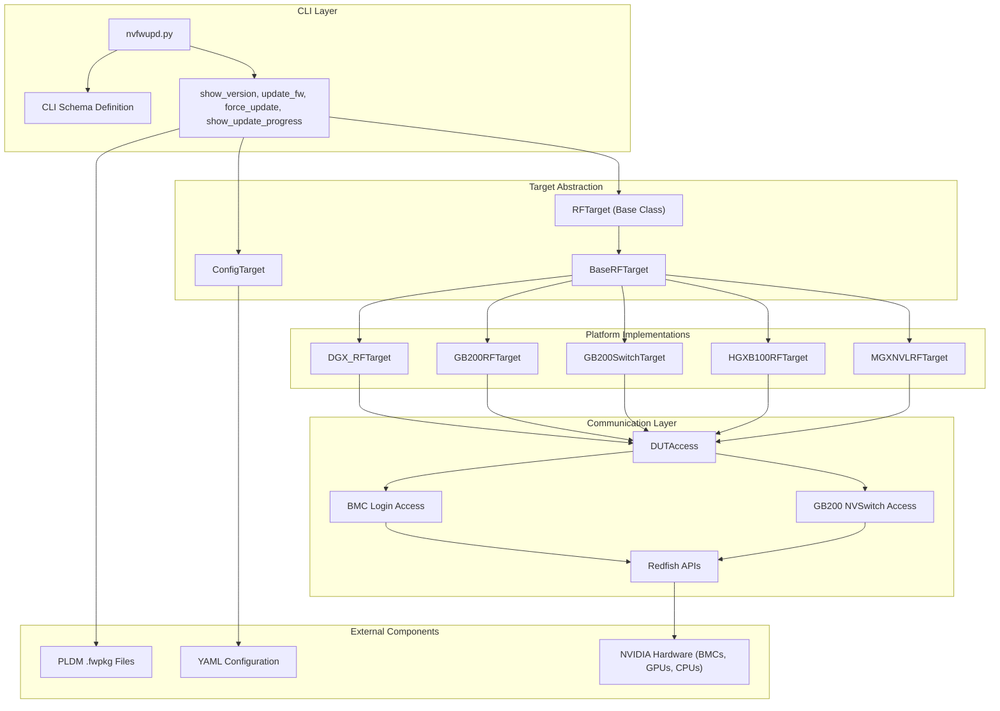
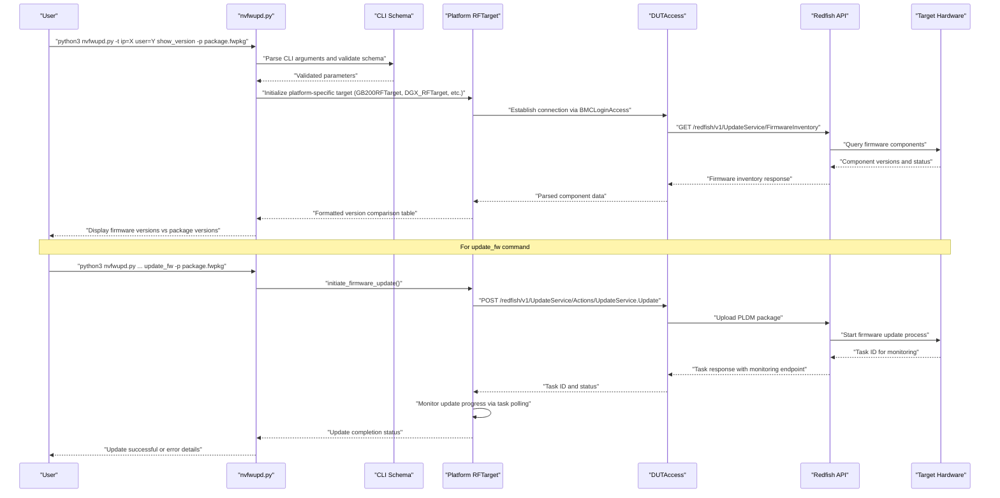

<!-- source: DeepWiki mcp.deepwiki.com · repo NVIDIA/open-nvfwupd · page 1 Overview · fetched 2026-10-26 -->

# Overview

Relevant source files

The following files were used as context for generating this wiki page:

- [README.md](README.md)
- [firmware_update_guide/docs/index.rst](firmware_update_guide/docs/index.rst)
- [firmware_update_guide/docs/introduction.rst](firmware_update_guide/docs/introduction.rst)

## Purpose and Scope

This document provides a comprehensive overview of the open-nvfwupd repository, an NVIDIA firmware update utility designed for updating firmware components on NVIDIA server platforms using out-of-band (OOB) methods. This page covers the system's purpose, architecture, and key capabilities. For detailed usage instructions, see [User Guide](#3). For platform-specific guidance, see [Platform Guides](#5).

## What is open-nvfwupd

open-nvfwupd is a Python-based command-line tool that enables firmware updates on NVIDIA server hardware through standardized Redfish APIs. The tool abstracts the complexity of different hardware platforms behind a unified interface while providing platform-specific optimizations for various NVIDIA systems including GB200 NVL, GB300 NVL, DGX, and HGX platforms.

The system operates entirely out-of-band through BMC (Baseboard Management Controller) interfaces, using PLDM (Platform Level Data Model) firmware packages to deliver updates to system components including BMCs, CPUs, GPUs, FPGAs, and other embedded controllers.

Sources: [README.md:7-8](), [firmware_update_guide/docs/introduction.rst:1-5]()

## Key Capabilities

### Firmware Version Management
- **Component Discovery**: Automatically identifies updatable firmware components on target systems
- **Version Comparison**: Compares running firmware versions against PLDM package versions
- **Update Status Tracking**: Monitors firmware update progress with real-time status reporting

### Platform Support
- **Multi-Platform**: Supports GB200/GB300 NVL, DGX, HGX, HGXB100, MGX-NVL, and GB200 Switch platforms
- **Platform-Agnostic Updates**: Handles updates across different hardware types with unified commands
- **Parallel Updates**: Enables simultaneous updates across multiple systems using YAML configuration

### Update Operations
- **Monitored Updates**: Default behavior tracks update tasks to completion
- **Background Updates**: Optional task launch with manual monitoring
- **Force Updates**: Override safety checks for critical update scenarios
- **Staged Updates**: SPI-based staged update support for specific components

Sources: [README.md:10-17](), [firmware_update_guide/docs/introduction.rst:37-43]()

## System Architecture Overview

The following diagram illustrates the main architectural components and their relationships using actual code entities from the system:

**Core System Architecture**

Sources: [README.md:33-36](), [firmware_update_guide/docs/introduction.rst:85-89]()

## Main Command Workflow

The following diagram shows the actual command execution flow using concrete code symbols:

**Command Execution Flow**

Sources: [README.md:109-133](), [firmware_update_guide/docs/introduction.rst:102-125]()

## Supported Hardware Platforms

The system supports multiple NVIDIA hardware families through platform-specific implementations:

| Platform Family | Target Class | Supported Models | Communication Method |
|-----------------|--------------|------------------|---------------------|
| GB200/GB300 NVL | `GB200RFTarget` | GB200 NVL, GB300 NVL | Redfish via BMC |
| GB200 Switch | `GB200SwitchTarget` | GB200 Switch | NVUE REST API |
| DGX Systems | `DGX_RFTarget` | DGX platforms | Redfish via BMC |
| HGX/HGXB100 | `HGXB100RFTarget` | HGX, HGXB100 | Redfish via BMC |
| MGX-NVL | `MGXNVLRFTarget` | MGX-NVL | Redfish via BMC |

Each platform implementation extends the `BaseRFTarget` class and provides platform-specific logic for component discovery, update procedures, and status monitoring.

Sources: [firmware_update_guide/docs/introduction.rst:88-89](), [README.md:14]()

## Key Technologies and Standards

### Communication Protocols
- **Redfish APIs**: Primary communication method for BMC interactions following DMTF standards
- **NVUE REST API**: Specialized protocol for NVIDIA switch management
- **SSH/SCP**: Secure shell protocols for certain platform-specific operations

### Firmware Packaging
- **PLDM (Platform Level Data Model)**: Industry-standard firmware packaging format (.fwpkg files)
- **NVIDIA Signed Packages**: Cryptographically signed firmware bundles for security

### Configuration Management
- **YAML Configuration**: Structured configuration files for complex deployment scenarios
- **JSON Special Update Files**: Platform-specific update targeting for complex systems like GB200

### Python Dependencies
The system requires Python 3.10+ with modules including `requests`, `PyYAML`, `paramiko`, `scp`, and `tabulate` for operation.

Sources: [firmware_update_guide/docs/introduction.rst:67-75](), [README.md:23-29]()

---

