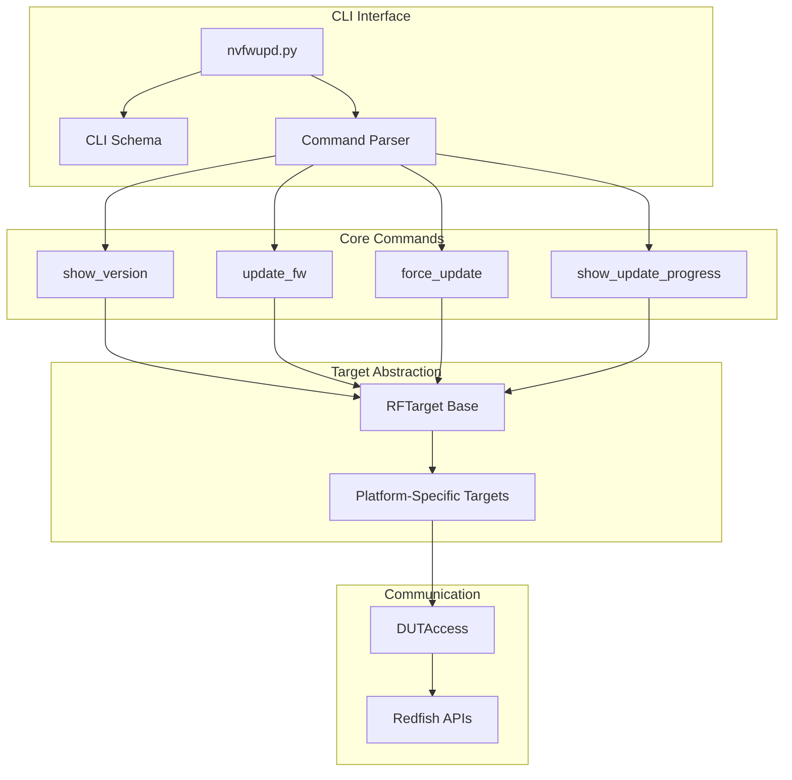
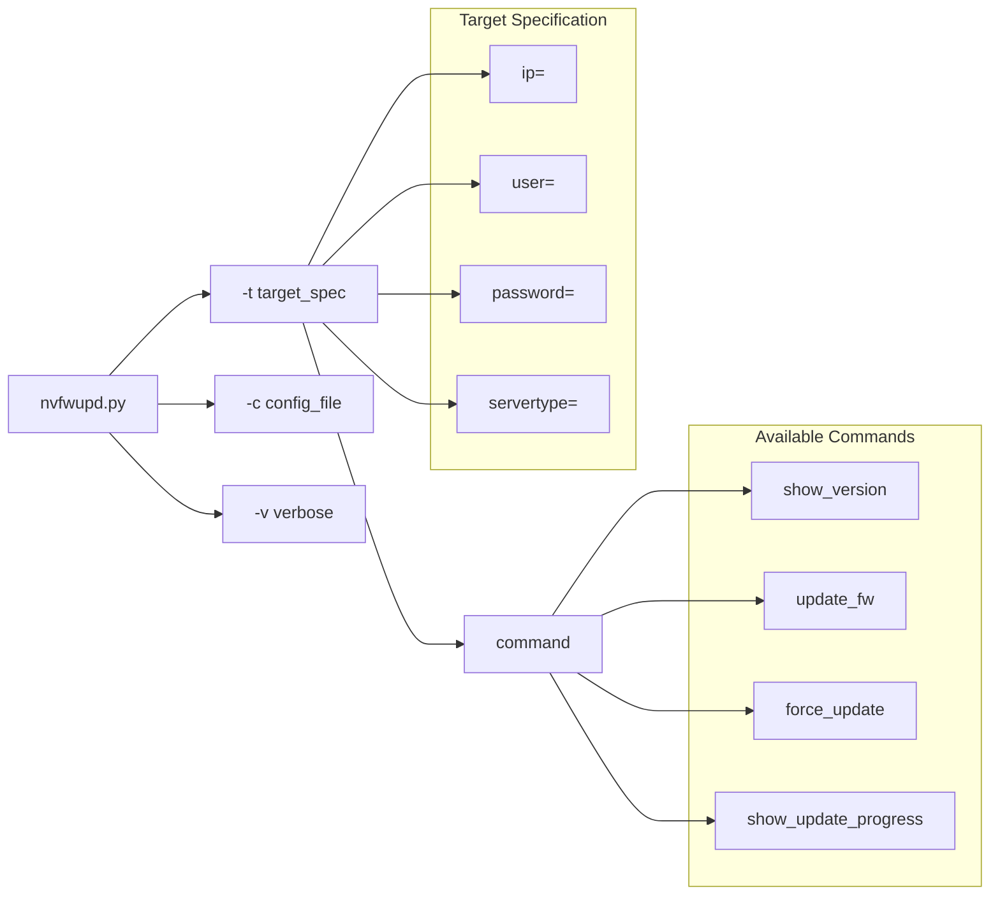
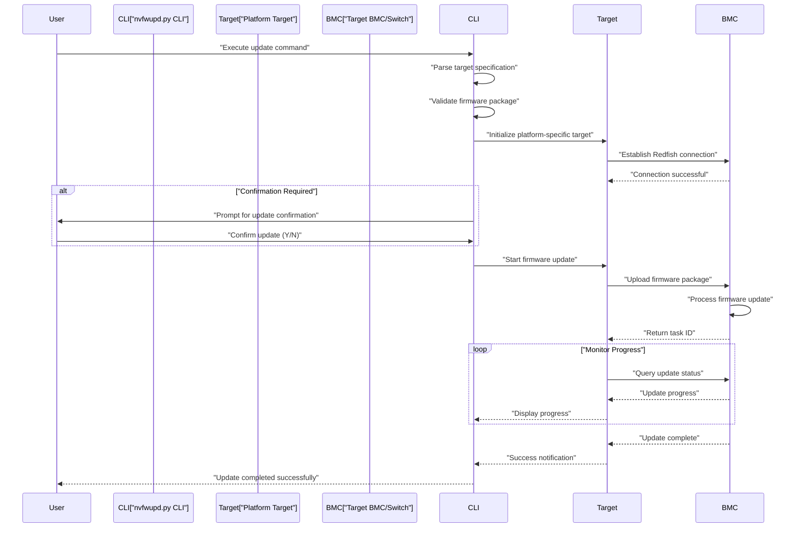

<!-- source: DeepWiki mcp.deepwiki.com · repo NVIDIA/open-nvfwupd · page 2 Getting Started · fetched 2026-10-26 -->

# Getting Started

<details>
<summary>Relevant source files</summary>

The following files were used as context for generating this wiki page:

- [README.md](README.md)
- [firmware_update_guide/docs/introduction.rst](firmware_update_guide/docs/introduction.rst)
- [nvfwupd_manpage.1](nvfwupd_manpage.1)

</details>


This page provides a quick start guide for installing and using the open-nvfwupd tool to perform out-of-band firmware updates on NVIDIA server platforms. It covers basic installation, initial setup, and your first firmware operations.

For comprehensive command documentation, see [Commands and Operations](#3.1). For platform-specific procedures, see [Platform Guides](#5). For advanced configuration options, see [Configuration](#3.2).

## Purpose and Scope

The open-nvfwupd tool enables out-of-band (OOB) firmware updates on NVIDIA server platforms using Redfish APIs. This Getting Started guide covers:

- Installing prerequisites and dependencies
- Basic tool usage and command syntax
- Performing your first firmware version check
- Executing your first firmware update
- Understanding the basic workflow

This guide focuses on the most common use cases. For detailed platform-specific procedures or advanced features, refer to the appropriate sections in the [User Guide](#3) and [Platform Guides](#5).

## Prerequisites

Before using open-nvfwupd, ensure your environment meets the following requirements:

### System Requirements

| Requirement | Specification |
|-------------|---------------|
| Python Version | 3.10 or higher |
| Operating System | Any Linux distribution supporting Python 3.10+ |
| Network Access | Direct connectivity to target BMC/switch management interfaces |

### Required Dependencies

**Git Large File System (LFS)**
```bash
sudo apt-get install git-lfs
git lfs install
```

**Python Modules** (from requirements.txt):
- requests
- PyYAML  
- paramiko
- scp
- tabulate

### Target System Requirements

- BMC or NVSwitch management interface accessible via network
- Valid administrative credentials for the target system
- Supported platform type (DGX, HGX, HGXB100, GB200, GB300, MGX-NVL, GB200Switch)

Sources: [README.md:19-30](), [firmware_update_guide/docs/introduction.rst:65-75]()

## Installation

### Clone the Repository

```bash
git clone https://github.com/NVIDIA/open-nvfwupd.git
cd open-nvfwupd
```

### Install Python Dependencies

```bash
pip install -r requirements.txt
```

### Verify Installation

Check that the tool is accessible and view basic help:

```bash
python3 nvfwupd.py help
```

Sources: [README.md:24-30]()

## Basic Tool Structure

### CLI Entry Point and Core Components



### Command Line Structure



Sources: [nvfwupd.py](), [firmware_update_guide/docs/introduction.rst:85-89]()

## First Steps

### Command Syntax Overview

All open-nvfwupd commands follow this basic pattern:

```bash
python3 nvfwupd.py -t <target_specification> <command> [command_options]
```

**Target Specification Format:**
```bash
-t ip=<BMC_IP> user=<username> password=<password> servertype=<platform_type>
```

**Supported Platform Types:**
- `DGX` - NVIDIA DGX systems
- `HGX` - HGX platforms  
- `HGXB100` - HGX B100 platforms
- `GB200` - GB200 NVL systems
- `GB300` - GB300 NVL systems
- `MGX-NVL` - MGX-NVL platforms
- `GB200Switch` - GB200 switch hardware

Sources: [firmware_update_guide/docs/introduction.rst:87-89](), [nvfwupd_manpage.1:18-29]()

### Your First Firmware Version Check

Before performing any updates, check the current firmware versions on your target system:

```bash
python3 nvfwupd.py -t ip=192.168.1.100 user=admin password=password123 servertype=GB200 show_version
```

**Sample Output:**
```
System Model: GB200 NVL
Part number: 699-24764-0001-TS3
Serial number: 1333124010099
Connection Status: Successful

Firmware Devices:
AP Name                   Sys Version               Up-To-Date
-------                   -----------               ----------
FW_BMC_0                  GB200Nvl-25.01-E        N/A
FW_CPLD_0                 0x00 0x0b 0x03 0x04     N/A
HGX_FW_GPU_0              97.00.82.00.18           N/A
```

### Compare Against Firmware Package

To compare current versions against a firmware package:

```bash
python3 nvfwupd.py -t ip=192.168.1.100 user=admin password=password123 servertype=GB200 show_version -p firmware_package.fwpkg
```

This adds a `Pkg Version` column showing the version in the package and updates the `Up-To-Date` status.

Sources: [README.md:31-84]()

## Basic Update Workflow

### Firmware Update Process Flow



### Performing Your First Update

**Step 1: Prepare Special Update File (GB200 platforms)**

For GB200 platforms, create a JSON file specifying the update target:

```json
{
    "Targets": []
}
```

Save as `update_targets.json`.

**Step 2: Execute Update Command**

```bash
python3 nvfwupd.py -t ip=192.168.1.100 user=admin password=password123 servertype=GB200 update_fw -p firmware_package.fwpkg -s update_targets.json
```

**Step 3: Confirm Update**

The tool will prompt for confirmation unless you use the `-y` flag:

```
Updating ip address: ip=192.168.1.100
FW package: ['firmware_package.fwpkg']
Ok to proceed with firmware update? <Y/N>
```

**Step 4: Monitor Progress**

The tool automatically monitors the update progress:

```
FW update started, Task Id: HGX_0
TaskState: Running
PercentComplete: 20
TaskStatus: OK
...
TaskState: Completed
PercentComplete: 100
TaskStatus: OK
Firmware update successful!
```

Sources: [README.md:87-135]()

## Common Usage Patterns

### Background Updates

For long-running updates, use background mode:

```bash
python3 nvfwupd.py -t ip=192.168.1.100 user=admin password=password123 servertype=GB200 update_fw -p firmware_package.fwpkg -s update_targets.json -b
```

### Monitor Existing Update

To check progress of a running update:

```bash
python3 nvfwupd.py -t ip=192.168.1.100 user=admin password=password123 servertype=GB200 show_update_progress -i TASK_ID
```

### Force Update (Downgrades)

Enable force update for downgrading firmware:

```bash
python3 nvfwupd.py -t ip=192.168.1.100 user=admin password=password123 servertype=GB200 force_update enable
```

### JSON Output

For automation and scripting, use JSON output:

```bash
python3 nvfwupd.py -t ip=192.168.1.100 user=admin password=password123 servertype=GB200 show_version -j
```

Sources: [firmware_update_guide/docs/introduction.rst:107-125](), [nvfwupd_manpage.1:52-74]()

## Configuration File Usage

### YAML Configuration

Instead of specifying targets on the command line, use a YAML configuration file for multiple systems:

```yaml
targets:
  - ip: 192.168.1.100
    user: admin
    password: password123
    servertype: GB200
  - ip: 192.168.1.101
    user: admin  
    password: password456
    servertype: DGX
```

**Using Configuration File:**

```bash
python3 nvfwupd.py -c config.yaml show_version -p firmware_package.fwpkg
```

This enables parallel operations across multiple systems.

Sources: [firmware_update_guide/docs/introduction.rst:91-92](), [nvfwupd_manpage.1:33-34]()

## Next Steps

After completing your first firmware operations:

1. **Learn Advanced Commands** - See [Commands and Operations](#3.1) for detailed command documentation
2. **Platform-Specific Procedures** - Review [Platform Guides](#5) for your specific hardware
3. **Configuration Options** - Explore [Configuration](#3.2) for advanced setup
4. **Automation** - See [Advanced Features](#3.4) for scripting and automation capabilities

### Important Post-Update Steps

After firmware updates:

1. **Power Cycle** - Complete an AC power cycle to activate new firmware
2. **Wait for BMC** - Allow up to 5 minutes for BMC and Redfish service to come up
3. **Verify Update** - Run `show_version` command to confirm new firmware versions

Sources: [README.md:135-136]()

---

