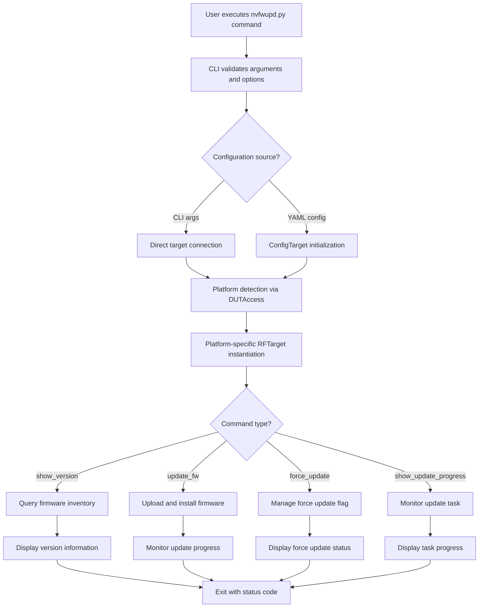
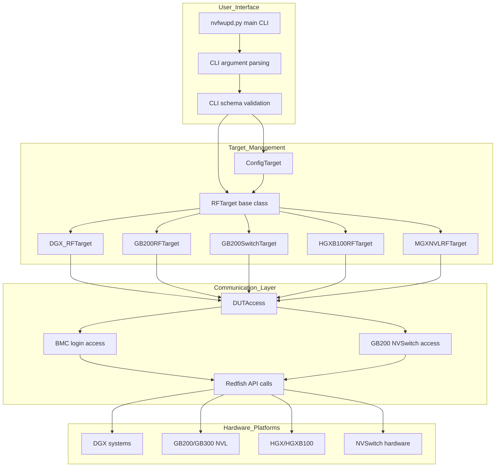

<!-- source: DeepWiki mcp.deepwiki.com · repo NVIDIA/open-nvfwupd · page 3 User Guide · fetched 2026-10-26 -->

# User Guide

<details>
<summary>Relevant source files</summary>

The following files were used as context for generating this wiki page:

- [firmware_update_guide/docs/appendix/output-formatting.rst](firmware_update_guide/docs/appendix/output-formatting.rst)
- [firmware_update_guide/docs/appendix/spi-staged.rst](firmware_update_guide/docs/appendix/spi-staged.rst)
- [firmware_update_guide/docs/examples/gb300NVL.rst](firmware_update_guide/docs/examples/gb300NVL.rst)
- [nvfwupd_manpage.1](nvfwupd_manpage.1)

</details>


This guide provides comprehensive documentation for end users on how to effectively use the `nvfwupd.py` tool for out-of-band firmware updates on NVIDIA hardware platforms. It covers basic operations, configuration options, and common usage patterns for updating firmware on DGX, HGX, GB200, GB300, and GB200 Switch systems.

For detailed command reference, see [CLI Reference](#7.1). For platform-specific procedures, see [Platform Guides](#5). For installation and setup instructions, see [Getting Started](#2).

## Overview

The `nvfwupd.py` tool is a command-line utility that performs out-of-band firmware updates on NVIDIA hardware platforms through BMC (Baseboard Management Controller) interfaces and NVSwitch management APIs. The tool supports both full system updates and individual component updates using PLDM firmware packages or tarball formats.

### Core Workflow

The typical firmware update workflow follows these stages:



Sources: [nvfwupd_manpage.1:1-108]()

### System Architecture Overview

The tool implements a layered architecture that abstracts platform differences while providing consistent user experience:



Sources: [nvfwupd_manpage.1:13-31](), [firmware_update_guide/docs/examples/gb300NVL.rst:1-283]()

## Key Concepts

### Target Specification

All operations require specifying a target system using the `-t/--target` option with key-value pairs:

| Parameter | Description | Required |
|-----------|-------------|----------|
| `ip` | IP address or FQDN of target BMC/NVSwitch | Yes |
| `user` | Username for authentication | Yes |
| `password` | Password for authentication | Yes |
| `port` | TCP port for connection (optional) | No |
| `servertype` | Platform type hint (DGX, HGX, GB200, etc.) | No |

### Firmware Packages

The tool accepts two types of firmware packages:
- **PLDM packages**: Binary firmware packages with `.fwpkg` extension
- **Tarball packages**: Compressed archive files containing firmware images

### Special Update Files

For selective component updates, JSON files specify which components to update:

```json
{
    "Targets": ["/redfish/v1/UpdateService/FirmwareInventory/ComponentName"],
    "ForceUpdate": false
}
```

Sources: [nvfwupd_manpage.1:13-37](), [firmware_update_guide/docs/examples/gb300NVL.rst:36-41]()

## Basic Operations

### Checking Firmware Versions

Display current firmware versions for all updatable components:

```bash
nvfwupd.py -t ip=192.168.1.100 user=admin password=secret show_version
```

Compare current versions with a firmware package:

```bash
nvfwupd.py -t ip=192.168.1.100 user=admin password=secret show_version -p firmware.fwpkg
```

### Updating Firmware

Perform a complete firmware update:

```bash
nvfwupd.py -t ip=192.168.1.100 user=admin password=secret update_fw -p firmware.fwpkg
```

Update specific components using a special update file:

```bash
nvfwupd.py -t ip=192.168.1.100 user=admin password=secret update_fw -p firmware.fwpkg -s components.json
```

### Monitoring Update Progress

Track the progress of a running firmware update:

```bash
nvfwupd.py -t ip=192.168.1.100 user=admin password=secret show_update_progress -i TASK_ID
```

Sources: [nvfwupd_manpage.1:40-101](), [firmware_update_guide/docs/examples/gb300NVL.rst:42-65]()

## Output Formats

### Standard Output

By default, the tool provides human-readable table output showing firmware components, versions, and update status.

### JSON Output

Most commands support JSON output using the `-j/--json` flag for programmatic processing:

```bash
nvfwupd.py -t ip=192.168.1.100 user=admin password=secret show_version -j
```

### Detailed Progress Output

The `-d/--details` flag with `update_fw` provides comprehensive progress information in tabular format, showing detailed task messages and completion status.

Sources: [firmware_update_guide/docs/appendix/output-formatting.rst:1-122]()

## Advanced Features

### Background Updates

Run firmware updates asynchronously without blocking the terminal:

```bash
nvfwupd.py -t ip=192.168.1.100 user=admin password=secret update_fw -p firmware.fwpkg -b
```

### SPI Staged Updates

For supported platforms (GB200/GB300 NVL), stage firmware images first to reduce activation downtime:

```bash
# Stage firmware images
nvfwupd.py -t ip=192.168.1.100 user=admin password=secret update_fw -p firmware.fwpkg -u

# Later, activate staged images
nvfwupd.py -t ip=192.168.1.100 user=admin password=secret update_fw -p firmware.fwpkg -a
```

### Force Updates

Enable force updates for firmware downgrades:

```bash
# Enable force update flag
nvfwupd.py -t ip=192.168.1.100 user=admin password=secret force_update enable

# Check force update status
nvfwupd.py -t ip=192.168.1.100 user=admin password=secret force_update status
```

Sources: [firmware_update_guide/docs/appendix/spi-staged.rst:1-100](), [nvfwupd_manpage.1:76-91]()

## Configuration Options

### YAML Configuration Files

Instead of command-line arguments, use YAML configuration files for complex setups:

```bash
nvfwupd.py -c config.yaml update_fw -p firmware.fwpkg
```

### Logging and Verbosity

Enable verbose logging with custom log file location:

```bash
nvfwupd.py -v /path/to/logfile.log -t ip=192.168.1.100 user=admin password=secret show_version
```

Sources: [nvfwupd_manpage.1:33-37]()

## Error Handling

The tool provides exit codes and error messages to indicate operation status:
- **Error Code 0**: Successful operation
- **Non-zero codes**: Various error conditions (authentication failures, network issues, etc.)

All operations include timeout handling and connection retry logic for reliable operation in network environments.

## Next Steps

For detailed information about specific topics:
- **Command details**: See [Commands and Operations](#3.1)
- **Configuration setup**: See [Configuration](#3.2)  
- **Platform-specific guidance**: See [Platform Support](#3.3)
- **Advanced functionality**: See [Advanced Features](#3.4)
- **Platform-specific procedures**: See [Platform Guides](#5)

Sources: [nvfwupd_manpage.1:1-108](), [firmware_update_guide/docs/examples/gb300NVL.rst:1-283](), [firmware_update_guide/docs/appendix/output-formatting.rst:1-122](), [firmware_update_guide/docs/appendix/spi-staged.rst:1-100]()

---

