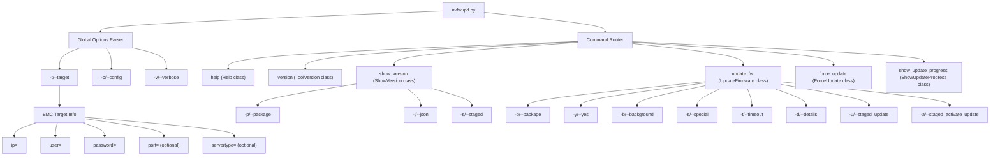
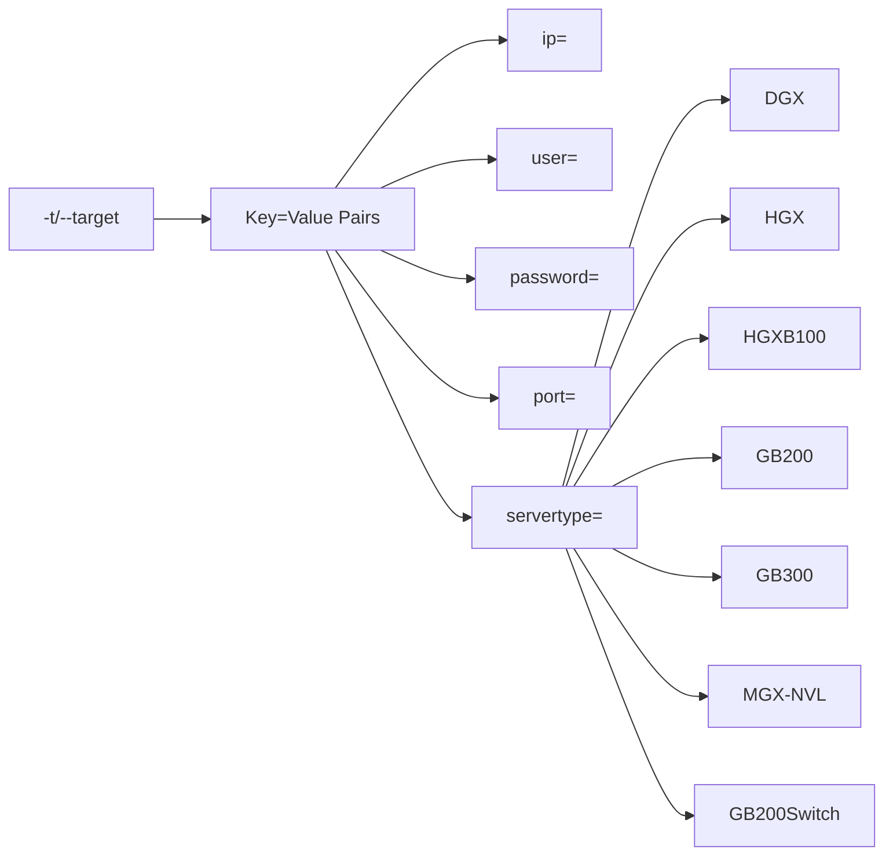
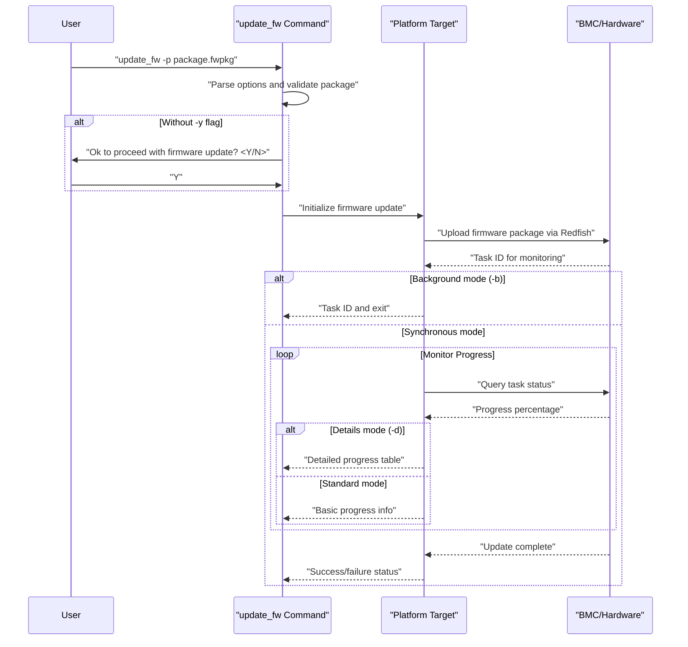
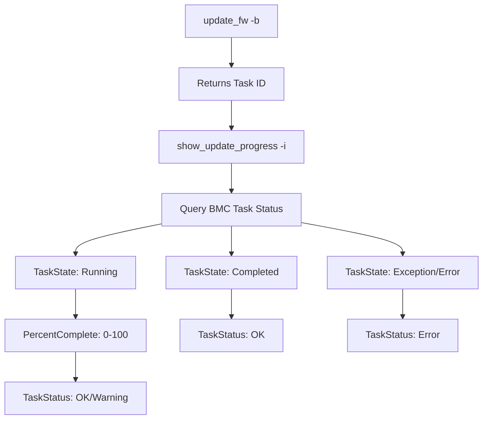
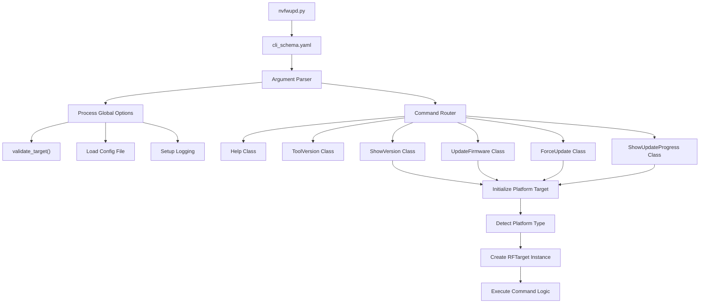

<!-- source: DeepWiki mcp.deepwiki.com · repo NVIDIA/open-nvfwupd · page 3.1 Commands and Operations · fetched 2026-10-26 -->

# Commands and Operations

<details>
<summary>Relevant source files</summary>

The following files were used as context for generating this wiki page:

- [cli_schema.yaml](cli_schema.yaml)
- [firmware_update_guide/docs/appendix/output-formatting.rst](firmware_update_guide/docs/appendix/output-formatting.rst)
- [firmware_update_guide/docs/appendix/spi-staged.rst](firmware_update_guide/docs/appendix/spi-staged.rst)
- [firmware_update_guide/docs/examples/gb300NVL.rst](firmware_update_guide/docs/examples/gb300NVL.rst)
- [nvfwupd_manpage.1](nvfwupd_manpage.1)

</details>


This document provides detailed documentation of all available CLI commands in the open-nvfwupd tool, including their options, usage patterns, and operational behavior. It covers the five primary commands (`show_version`, `update_fw`, `force_update`, `show_update_progress`) plus utility commands (`help`, `version`).

For information about configuration files and advanced configuration options, see [Configuration](#3.2). For platform-specific command considerations and examples, see [Platform Support](#3.3).

## Command Overview

The nvfwupd tool provides a command-based interface for firmware management operations. All firmware management commands require target specification via global options.

### Command Architecture



Sources: [cli_schema.yaml:16-158](), [nvfwupd_manpage.1:1-108]()

### Command Classification

| Command Type | Commands | Global Options Required | Purpose |
|--------------|----------|------------------------|---------|
| Utility | `help`, `version` | No | Tool information and assistance |
| Information | `show_version`, `show_update_progress` | Yes | Query firmware status and update progress |
| Management | `update_fw`, `force_update` | Yes | Perform firmware updates and configuration |

Sources: [cli_schema.yaml:48-157]()

## Global Options

All firmware management commands require global options to specify target systems and behavior.

### Target Specification (`-t/--target`)



**Required Parameters:**
- `ip`: BMC IP address or FQDN
- `user`: BMC login username  
- `password`: BMC login password

**Optional Parameters:**
- `port`: TCP port for port-forwarding connections
- `servertype`: Platform type hint for unknown platform errors

Sources: [cli_schema.yaml:22-29](), [nvfwupd_manpage.1:13-31]()

### Configuration (`-c/--config`)

Specifies path to YAML configuration file for tool behavior customization.

### Verbosity (`-v/--verbose`)

Enables verbose logging with optional logfile path specification. Default path is current working directory.

Sources: [cli_schema.yaml:30-47](), [nvfwupd_manpage.1:33-37]()

## Command Reference

### show_version

Displays firmware inventory and version information for AP components that can be updated out-of-band.

**Usage:**
```bash
nvfwupd.py -t <target_options> show_version [options]
```

**Options:**

| Option | Description | Required |
|--------|-------------|----------|
| `-p/--package` | PLDM firmware package(s) for version comparison | No |
| `-j/--json` | Output results in JSON format | No |
| `-s/--staged` | Show staged firmware versions | No |

**Behavior:**
- Without `-p`: Shows current running firmware versions only
- With `-p`: Compares current versions against package versions and indicates update status
- With `-s`: Displays staged firmware versions from previous staged updates

**Example Output:**
```
System Model: GB200 NVL
Part number: 699-24764-0001-TS3
Packages: ['GB200-P4972_0011_250404.1.0']

Firmware Devices:
AP Name                  Sys Version         Pkg Version   Up-To-Date
-------                  -----------         -----------   ----------
FW_BMC_0                 GB200Nvl-25.01     GB200Nvl-25.02 No       
FW_ERoT_BMC_0            01.04.0007_n04     01.04.0008_n04 No       
```

Sources: [cli_schema.yaml:58-79](), [nvfwupd_manpage.1:40-50](), [firmware_update_guide/docs/appendix/spi-staged.rst:34-71]()

### update_fw

Performs firmware update operations using PLDM packages or firmware tar files.

**Usage:**
```bash
nvfwupd.py -t <target_options> update_fw [options]
```

**Core Options:**

| Option | Description | Default |
|--------|-------------|---------|
| `-p/--package` | PLDM firmware package(s) or tar files | None |
| `-y/--yes` | Bypass confirmation prompt | Interactive |
| `-b/--background` | Run update asynchronously | Synchronous |
| `-s/--special` | Special update JSON file for selective updates | None |

**Advanced Options:**

| Option | Description | Use Case |
|--------|-------------|----------|
| `-t/--timeout` | API request timeout in seconds | Long-running operations |
| `-d/--details` | Show detailed progress in table format | Debugging/monitoring |
| `-j/--json` | JSON output (requires `-b`) | Automation |
| `-u/--staged_update` | Stage firmware without activation | Minimal downtime |
| `-a/--staged_activate_update` | Activate previously staged firmware | Quick activation |

**Update Flow:**



**Staged Update Operations:**

- **Stage Only (`-u`)**: Downloads firmware images without activation, reducing activation downtime
- **Stage and Activate (`-a`)**: Activates previously staged firmware for rapid deployment
- **View Staged (`show_version -s`)**: Displays staged firmware versions

Sources: [cli_schema.yaml:80-126](), [nvfwupd_manpage.1:52-74](), [firmware_update_guide/docs/appendix/spi-staged.rst:1-100](), [firmware_update_guide/docs/appendix/output-formatting.rst:1-122]()

### force_update

Manages the force update flag on target systems, primarily used for firmware downgrades.

**Usage:**
```bash
nvfwupd.py -t <target_options> force_update <action> [options]
```

**Actions:**

| Action | Description | Effect |
|--------|-------------|--------|
| `enable` | Enable force update flag | Allows downgrades and bypass version checks |
| `disable` | Disable force update flag | Restores normal version checking |
| `status` | Query current force update state | Read-only status check |

**Options:**
- `-j/--json`: Output results in JSON format

**Example:**
```bash
# Check current status
nvfwupd.py -t ip=1.1.1.1 user=admin password=pass force_update status

# Enable for downgrade
nvfwupd.py -t ip=1.1.1.1 user=admin password=pass force_update enable

# Disable after downgrade
nvfwupd.py -t ip=1.1.1.1 user=admin password=pass force_update disable
```

Sources: [cli_schema.yaml:127-141](), [nvfwupd_manpage.1:76-91]()

### show_update_progress

Monitors the status of running firmware update tasks using task IDs.

**Usage:**
```bash
nvfwupd.py -t <target_options> show_update_progress -i <task_id> [options]
```

**Options:**

| Option | Description | Required |
|--------|-------------|----------|
| `-i/--id` | Task ID(s) to monitor (space-delimited) | Yes |
| `-j/--json` | Output in JSON format | No |

**Task Monitoring:**



**Example:**
```bash
# Start background update
nvfwupd.py -t ip=1.1.1.1 user=admin password=pass update_fw -p package.fwpkg -b
# Returns: Task Id: HGX_9

# Monitor progress
nvfwupd.py -t ip=1.1.1.1 user=admin password=pass show_update_progress -i HGX_9
```

Sources: [cli_schema.yaml:142-157](), [nvfwupd_manpage.1:93-101]()

## Command Execution Flow

### CLI Processing Pipeline



### Command Validation Flow

| Validation Stage | Check | Failure Action |
|------------------|-------|----------------|
| Schema Validation | Argument syntax and types | Display usage and exit |
| Target Validation | BMC connectivity and credentials | Connection error |
| Package Validation | PLDM package format and integrity | Package error |
| Platform Detection | Supported platform identification | Platform error |
| Permission Check | BMC user permissions | Authentication error |

Sources: [cli_schema.yaml:29,38,69,75,117,157]()

## JSON Output Format

Commands supporting `-j/--json` flag provide structured output for automation and integration.

### Common JSON Structure

```json
{
  "command": "show_version|update_fw|force_update|show_update_progress",
  "status": "success|error",
  "data": {
    // Command-specific data structure
  },
  "error_code": 0,
  "timestamp": "ISO 8601 timestamp"
}
```

### Command-Specific JSON Examples

**show_version JSON:**
```json
{
  "system_model": "GB200 NVL",
  "part_number": "699-24764-0001-TS3", 
  "packages": ["GB200-P4972_0011_250404.1.0"],
  "firmware_devices": [
    {
      "name": "FW_BMC_0",
      "system_version": "GB200Nvl-25.01",
      "package_version": "GB200Nvl-25.02",
      "up_to_date": false
    }
  ]
}
```

**update_fw JSON (background mode):**
```json
{
  "task_id": "HGX_9",
  "task_state": "Running",
  "task_status": "OK",
  "odata_id": "/redfish/v1/TaskService/Tasks/HGX_9"
}
```

Sources: [cli_schema.yaml:70-75,113-117,137-140,153-157]()

---

