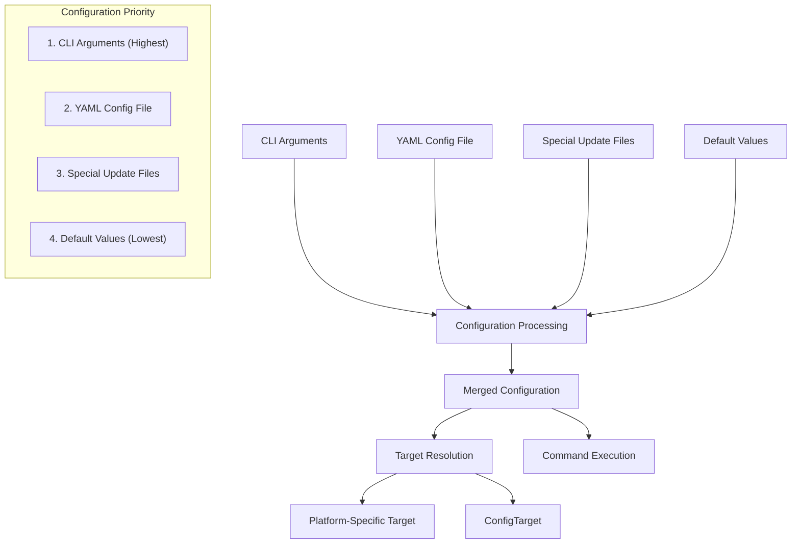
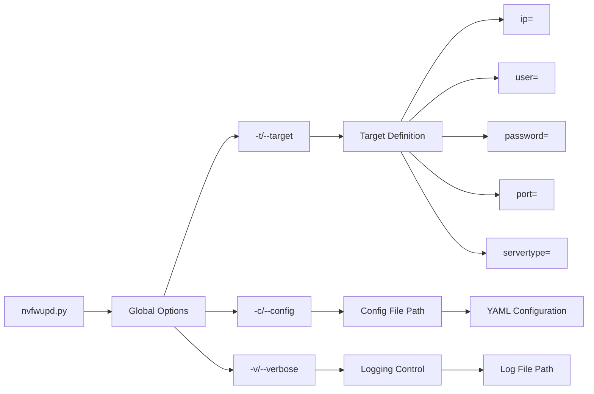
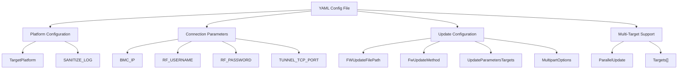
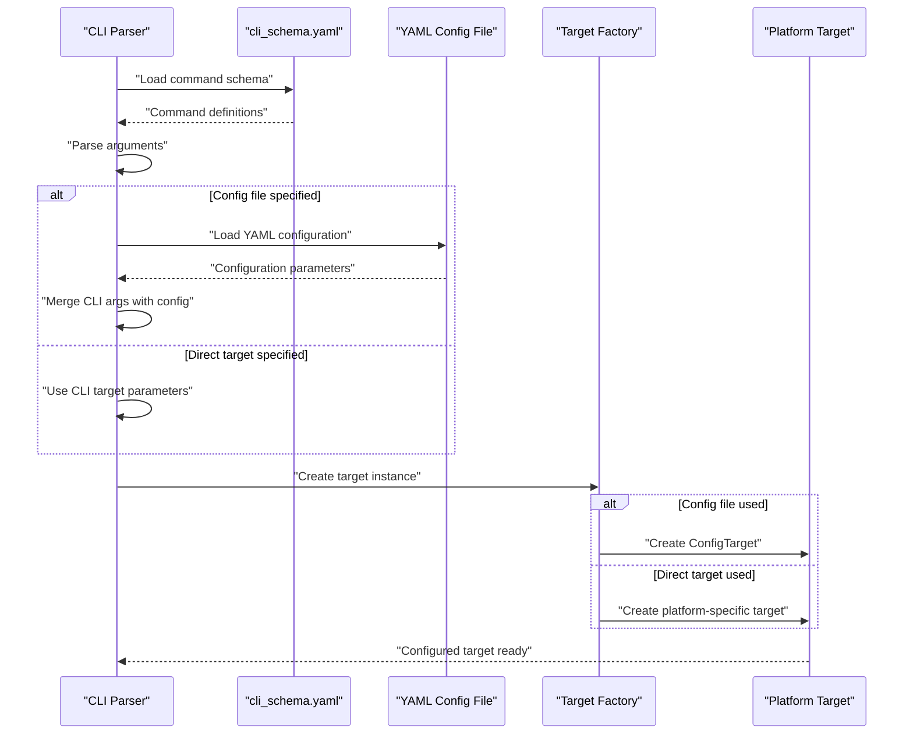

<!-- source: DeepWiki mcp.deepwiki.com · repo NVIDIA/open-nvfwupd · page 3.2 Configuration · fetched 2026-10-26 -->

# Configuration

<details>
<summary>Relevant source files</summary>

The following files were used as context for generating this wiki page:

- [cli_schema.yaml](cli_schema.yaml)
- [firmware_update_guide/docs/appendix/platform-agnostic-updates.rst](firmware_update_guide/docs/appendix/platform-agnostic-updates.rst)
- [nvfwupd/config.yaml](nvfwupd/config.yaml)

</details>


This document provides a comprehensive guide to configuration options for the open-nvfwupd tool, including CLI arguments, YAML configuration files, and special update files. Configuration controls target platform selection, firmware update methods, connection parameters, and update behavior.

For information about specific commands and their usage patterns, see [Commands and Operations](#3.1). For platform-specific configuration considerations, see [Platform Support](#3.3).

## Configuration Sources

The nvfwupd tool accepts configuration from multiple sources that are processed in a specific hierarchy:



**Configuration Sources Priority**

| Priority | Source | Description |
|----------|--------|-------------|
| 1 (Highest) | CLI Arguments | Command-line options and flags |
| 2 | YAML Config File | Configuration file specified with `-c/--config` |
| 3 | Special Update Files | JSON files specified with `-s/--special` |
| 4 (Lowest) | Default Values | Built-in defaults from schema |

Sources: [cli_schema.yaml:1-158]()

## CLI Arguments

### Global Options

The CLI provides global options that apply to all commands requiring target connectivity:



**Target Option Format**

The `-t/--target` option accepts multiple key-value pairs:

```bash
nvfwupd.py -t ip=192.168.1.100 user=admin password=secret servertype=GB200 port=443 <command>
```

| Parameter | Required | Description | Valid Values |
|-----------|----------|-------------|--------------|
| `ip` | Yes | BMC IP address or hostname | IPv4/IPv6 address or FQDN |
| `user` | Yes | BMC login username | String |
| `password` | Yes | BMC login password | String |
| `port` | No | Port for forwarding | Integer (default: 443) |
| `servertype` | No | Platform type hint | DGX, HGX, HGXB100, GB200, GB300, MGX-NVL, GB200Switch |

Sources: [cli_schema.yaml:22-29]()

### Command-Specific Options

Each command supports additional options:

**show_version Command**
```bash
nvfwupd.py -t <target> show_version [-p FWPKG ...] [-j] [-s]
```

| Option | Description |
|--------|-------------|
| `-p/--package` | PLDM firmware package files |
| `-j/--json` | Output in JSON format |
| `-s/--staged` | Show staged firmware versions |

**update_fw Command**
```bash
nvfwupd.py -t <target> update_fw [-p FWPKG ...] [-y] [-b] [-s FILE] [-t TIMEOUT] [-j] [-d] [-u] [-a]
```

| Option | Description |
|--------|-------------|
| `-p/--package` | PLDM firmware package files |
| `-y/--yes` | Bypass confirmation prompt |
| `-b/--background` | Exit without waiting for completion |
| `-s/--special` | Special update JSON file |
| `-t/--timeout` | API request timeout (seconds) |
| `-j/--json` | JSON output (requires `-b`) |
| `-d/--details` | Show update progress in table format |
| `-u/--staged_update` | SPI staged update |
| `-a/--staged_activate_update` | SPI and activate staged update |

Sources: [cli_schema.yaml:58-126]()

## YAML Configuration Files

### Configuration File Structure

YAML configuration files provide comprehensive control over tool behavior and support platform-agnostic updates:



### Core Configuration Parameters

**Platform and Logging**

| Parameter | Type | Required | Description |
|-----------|------|----------|-------------|
| `TargetPlatform` | String | Yes | One of: HGX, DGX, GB200, GB300, HGXB100, MGX-NVL, GB200Switch |
| `SANITIZE_LOG` | Boolean | No | Disable credential sanitization in logs (default: true) |

**Connection Configuration**

| Parameter | Type | Required | Description |
|-----------|------|----------|-------------|
| `BMC_IP` | String | Yes | Target IP address or hostname |
| `RF_USERNAME` | String | Yes | Redfish username |
| `RF_PASSWORD` | String | Yes | Redfish password |
| `TUNNEL_TCP_PORT` | String | No | Port for SSH tunneling |

**Firmware Update Configuration**

| Parameter | Type | Required | Description |
|-----------|------|----------|-------------|
| `FWUpdateFilePath` | List | No | List of firmware package file paths |
| `FwUpdateMethod` | String | No | Update method: "MultipartHttpPushUri" or "HttpPushUri" |
| `UpdateParametersTargets` | List/Dict | No | Target-specific update parameters |

Sources: [nvfwupd/config.yaml:1-69](), [firmware_update_guide/docs/appendix/platform-agnostic-updates.rst:8-75]()

### Advanced Configuration Options

**Redfish URI Overrides**

```yaml
# Optional Redfish URI overrides
MultipartHttpPushUri: '/redfish/v1/UpdateService/update-multipart'
HttpPushUri: '/redfish/v1/UpdateService'
TaskServiceUri: '/redfish/v1/TaskService/Tasks/'
```

**Multipart Update Options**

```yaml
MultipartOptions:
  ForceUpdate: true
```

**BMC Reset Configuration**

```yaml
# Platform-specific reset parameters
BMCResetParameters:
  ResetType: 'ResetAll'          # For DGX
  # OR
  ResetToDefaultsType: 'ResetAll'  # For HGX
```

Sources: [nvfwupd/config.yaml:7-37]()

### Multi-Target Configuration

The configuration file supports parallel updates across multiple targets:

```yaml
ParallelUpdate: true

Targets:
  - BMC_IP: "192.168.1.100"
    RF_USERNAME: "admin"
    RF_PASSWORD: "password"
    TARGET_PLATFORM: "DGX"
    PACKAGE: "../packages/dgx_firmware.fwpkg"
    UPDATE_PARAMETERS_TARGETS: {}
    SYSTEM_NAME: "DGX_LAB_1"
  
  - BMC_IP: "192.168.1.101"
    RF_USERNAME: "admin"
    RF_PASSWORD: "password"
    TARGET_PLATFORM: "GB200"
    PACKAGE: "../packages/gb200_firmware.fwpkg"
    UPDATE_PARAMETERS_TARGETS: 
      Targets: ["/redfish/v1/Chassis/HGX_Chassis_0"]
      ForceUpdate: true
    SYSTEM_NAME: "GB200_LAB_1"
```

**Multi-Target Parameters**

| Parameter | Type | Required | Description |
|-----------|------|----------|-------------|
| `ParallelUpdate` | Boolean | No | Enable parallel update mode |
| `Targets` | List | Yes* | List of target configurations |
| `TARGET_PLATFORM` | String | No | Override platform detection |
| `PACKAGE` | String | No | Target-specific firmware package |
| `UPDATE_PARAMETERS_TARGETS` | Dict | No | Target-specific update parameters |
| `SYSTEM_NAME` | String | No | User-defined system identifier |

*Required when `ParallelUpdate` is true

Sources: [nvfwupd/config.yaml:39-66]()

## Special Update Files

Special update files (specified with `-s/--special`) provide target-specific update parameters in JSON format. These files replace the `UpdateParametersTargets` configuration parameter and enable fine-grained control over update targets.

### Format and Usage

```json
{
  "Targets": [
    "/redfish/v1/UpdateService/FirmwareInventory/CPLDMB_0",
    "/redfish/v1/UpdateService/FirmwareInventory/Component_1"
  ],
  "ForceUpdate": true
}
```

**Platform-Specific Examples**

| Platform | Format | Description |
|----------|--------|-------------|
| DGX | `{}` | Empty object for full system update |
| GB200 NVL | `[]` | Empty array for BMC update |
| HGX | `{"Targets": ["URI1", "URI2"]}` | Specific component URIs |

Sources: [firmware_update_guide/docs/appendix/platform-agnostic-updates.rst:53-58]()

## Configuration Processing Flow



**Configuration Validation**

The tool validates configuration parameters at multiple stages:

1. **CLI Schema Validation** - Validates command syntax and required parameters
2. **Target Validation** - Validates connection parameters and platform compatibility  
3. **Package Validation** - Validates firmware package files and compatibility
4. **Platform Validation** - Validates platform-specific configuration requirements

Sources: [cli_schema.yaml:29](), [cli_schema.yaml:69](), [cli_schema.yaml:75]()

## Usage Examples

**Basic CLI Usage**
```bash
nvfwupd.py -t ip=192.168.1.100 user=admin password=secret servertype=GB200 show_version
```

**Config File Usage**
```bash
nvfwupd.py -c config.yaml update_fw
```

**Mixed Configuration**
```bash
nvfwupd.py -c config.yaml -t ip=192.168.1.200 update_fw -y
```

In the mixed configuration example, the CLI target parameter overrides the config file's BMC_IP setting, demonstrating the configuration hierarchy in action.

Sources: [firmware_update_guide/docs/appendix/platform-agnostic-updates.rst:111-144]()

---

