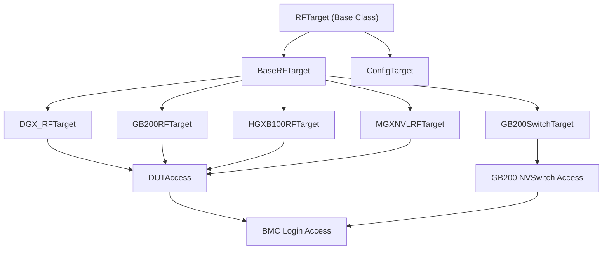
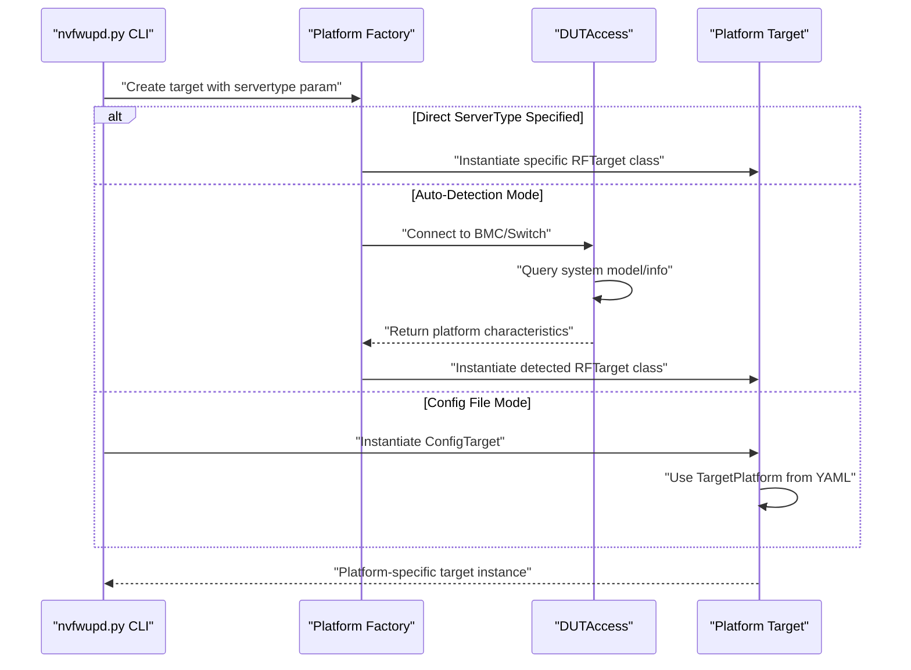
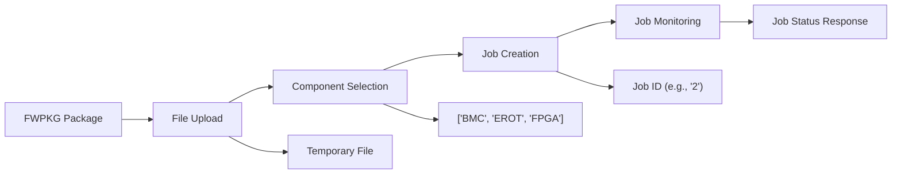

<!-- source: DeepWiki mcp.deepwiki.com · repo NVIDIA/open-nvfwupd · page 3.3 Platform Support · fetched 2026-10-26 -->

# Platform Support

<details>
<summary>Relevant source files</summary>

The following files were used as context for generating this wiki page:

- [README.md](README.md)
- [firmware_update_guide/docs/appendix/platform-agnostic-updates.rst](firmware_update_guide/docs/appendix/platform-agnostic-updates.rst)
- [firmware_update_guide/docs/examples/gb200NVL.rst](firmware_update_guide/docs/examples/gb200NVL.rst)

</details>


This document describes the hardware platforms supported by open-nvfwupd and the platform-specific considerations for firmware updates. It covers platform identification, supported hardware components, and platform-specific update procedures.

For detailed platform-specific guides and examples, see [GB200 and GB300 NVL Systems](#5.1), [GB200 Switch Systems](#5.2), [DGX Systems](#5.3), and [HGX and HGXB100 Systems](#5.4). For configuration options that apply across platforms, see [Configuration](#3.2).

## Supported Platforms

open-nvfwupd supports multiple NVIDIA server platform families through a platform abstraction layer that provides unified interfaces while accommodating platform-specific differences.

### Platform Matrix

| Platform Family | ServerType Value | Target Class | Communication Protocol |
|-----------------|------------------|--------------|----------------------|
| DGX Systems | `DGX` | `DGX_RFTarget` | Redfish API |
| HGX Platforms | `HGX` | `BaseRFTarget` | Redfish API |
| HGXB100 Systems | `HGXB100` | `HGXB100RFTarget` | Redfish API |
| MGX-NVL Systems | `MGX-NVL` | `MGXNVLRFTarget` | Redfish API |
| GB200 NVL | `GB200` | `GB200RFTarget` | Redfish API |
| GB300 NVL | `GB300` | `GB200RFTarget` | Redfish API |
| GB200 Switch | `GB200Switch` | `GB200SwitchTarget` | NVUE REST API |

Sources: [README.md:14](), [firmware_update_guide/docs/appendix/platform-agnostic-updates.rst:15]()

## Platform Architecture

The platform support system uses a hierarchical class structure to provide both common functionality and platform-specific implementations.

### Platform Class Hierarchy



Sources: Architecture diagrams from context

### Platform Detection Flow



Sources: [firmware_update_guide/docs/appendix/platform-agnostic-updates.rst:15-16]()

## Platform-Specific Features

### GB200 and GB300 NVL Systems

GB200 NVL systems have a unique multi-tray architecture requiring specific handling for different hardware components.

#### Component Packaging

| Package Type | Package ID Pattern | Target Components | Update Method |
|--------------|-------------------|-------------------|---------------|
| BMC Tray | `GB200-P4972` | BMC, CPLD, ERoT, NIC, UEFI | Redfish Multipart |
| Compute Tray | `GB200-P4975` | HGX components (GPU, CPU, FPGA) | Redfish Multipart |
| Switch Tray | `GB200-P4978` | Switch BMC, FPGA, ERoT, CPLD | NVUE REST API |

#### Update Target Specification

GB200 systems require special update target files to specify which tray components to update:

```json
// BMC Tray Full Update
{
    "Targets": []
}

// Compute Tray Full Update  
{
    "Targets": ["/redfish/v1/Chassis/HGX_Chassis_0"]
}

// Individual Component Update
{
    "Targets": ["/redfish/v1/UpdateService/FirmwareInventory/HGX_FW_CPU_0"]
}
```

Sources: [README.md:93-107](), [firmware_update_guide/docs/examples/gb200NVL.rst:21-40](), [firmware_update_guide/docs/examples/gb200NVL.rst:87-91]()

### GB200 Switch Systems

GB200 Switch systems use the NVUE REST API instead of Redfish for firmware updates.

#### Switch Component Updates

Switch systems support staged updates with multiple package files:

- **Package 0004**: BMC, ERoT, FPGA components
- **Package 0006**: BIOS, ERoT components  
- **Package 0007**: CPLD components

#### Switch Update Targeting

```json
// Individual Component Update
{
    "Targets": ["BMC"]
}

// CPLD Update
{
    "Targets": ["CPLD1"]
}
```

Sources: [firmware_update_guide/docs/examples/gb200NVL.rst:337-340](), [firmware_update_guide/docs/examples/gb200NVL.rst:766-767]()

### DGX Systems

DGX systems use standard Redfish multipart push for firmware updates.

#### Update Configuration

```yaml
TargetPlatform: 'DGX'
FwUpdateMethod: "MultipartHttpPushUri"
MultipartHttpPushUri: '/redfish/v1/UpdateService/update-multipart'
BMCResetParameters:
  ResetType: 'ResetAll'
```

Sources: [firmware_update_guide/docs/appendix/platform-agnostic-updates.rst:98-107]()

### HGX and HGXB100 Systems

HGX platforms support both individual component updates and full system updates.

#### Reset Configuration

```yaml
TargetPlatform: 'HGX'  # or 'HGXB100'
BMCResetParameters:
  ResetToDefaultsType: 'ResetAll'
```

Sources: [firmware_update_guide/docs/appendix/platform-agnostic-updates.rst:61-62]()

## Update Methods by Platform

### Redfish-Based Platforms

Most platforms use Redfish API endpoints for firmware updates:

| Update Method | Redfish Endpoint | Supported Platforms |
|---------------|------------------|-------------------|
| `MultipartHttpPushUri` | `/redfish/v1/UpdateService/update-multipart` | DGX, HGX, GB200, GB300 |
| `HttpPushUri` | `/redfish/v1/UpdateService` | DGX, HGX, HGXB100 |

### NVUE REST API Platforms

GB200 Switch systems use NVUE REST API with component-specific endpoints and job monitoring.



Sources: [firmware_update_guide/docs/examples/gb200NVL.rst:343-390]()

## Platform-Agnostic Configuration

For platforms not automatically detected or requiring custom configuration, the `ConfigTarget` class supports platform-agnostic updates through YAML configuration.

### Configuration Parameters

```yaml
# Platform specification
TargetPlatform: 'DGX'  # Required for proper component mapping

# Update method selection
FwUpdateMethod: "MultipartHttpPushUri"  # or "HttpPushUri"

# URI overrides (optional)
MultipartHttpPushUri: '/redfish/v1/UpdateService/update-multipart'
HttpPushUri: '/redfish/v1/UpdateService'
TaskServiceUri: '/redfish/v1/TaskService/Tasks/'

# Update targeting
UpdateParametersTargets:
  - "/redfish/v1/UpdateService/FirmwareInventory/CPLDMB_0"

# Force update options
MultipartOptions:
  - ForceUpdate: True
```

### Limitations

- Component version matching requires `TargetPlatform` specification
- Unknown platforms show `N/A` for package versions and up-to-date status
- Platform-specific features may not be available

Sources: [firmware_update_guide/docs/appendix/platform-agnostic-updates.rst:84-92]()

## Hardware Component Support

### Common Components Across Platforms

| Component Type | Identifier Pattern | Update Method |
|---------------|-------------------|---------------|
| BMC Firmware | `FW_BMC_*`, `HGX_FW_BMC_*` | OOB Redfish |
| GPU Firmware | `HGX_FW_GPU_*` | OOB Redfish |
| CPU Firmware | `HGX_FW_CPU_*` | OOB Redfish |
| FPGA Firmware | `HGX_FW_FPGA_*`, `FW_FPGA_*` | OOB Redfish |
| CPLD Firmware | `FW_CPLD_*`, `HGX_FW_CPLD_*` | OOB Redfish |
| ERoT Firmware | `FW_ERoT_*`, `HGX_FW_ERoT_*` | OOB Redfish |
| NIC Firmware | `NIC_*`, `CX7_*` | OOB Redfish |

### Platform-Specific Components

- **GB200 Switch**: `ASIC`, `BIOS`, `SSD`, `transceiver` (some inband-only)
- **DGX Systems**: Standard server components via BMC
- **HGX Systems**: High-performance computing components

Sources: [README.md:44-78](), [firmware_update_guide/docs/examples/gb200NVL.rst:194-225](), [firmware_update_guide/docs/examples/gb200NVL.rst:307-327]()

---

