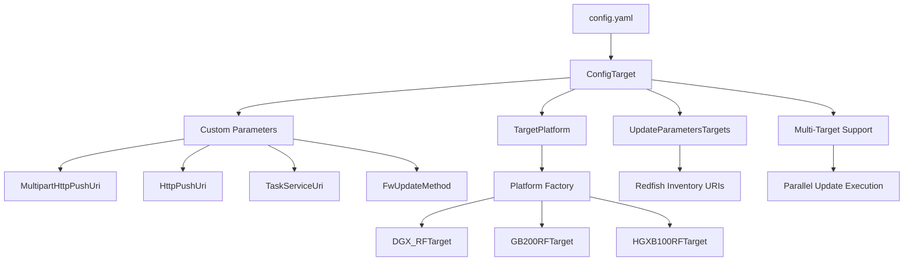
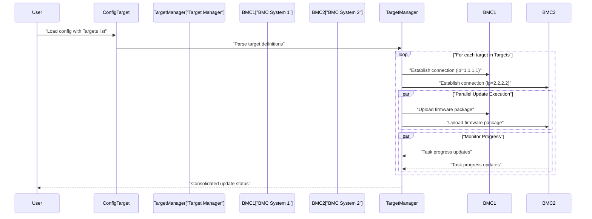
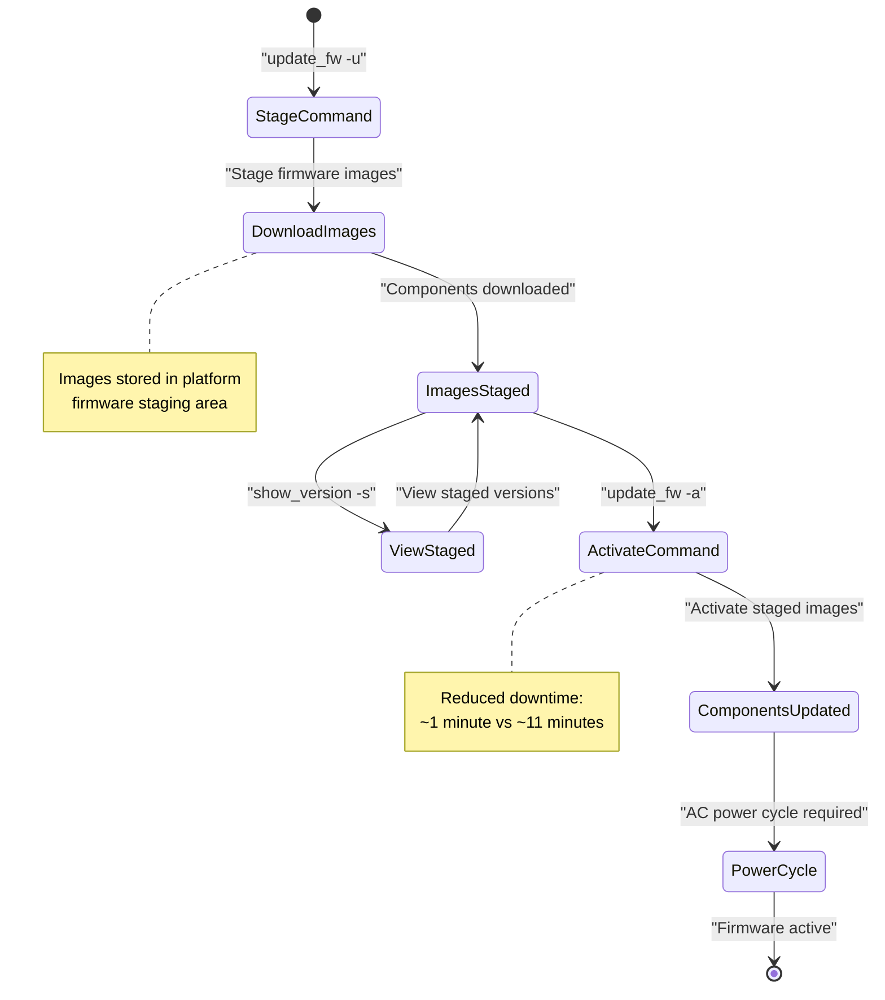
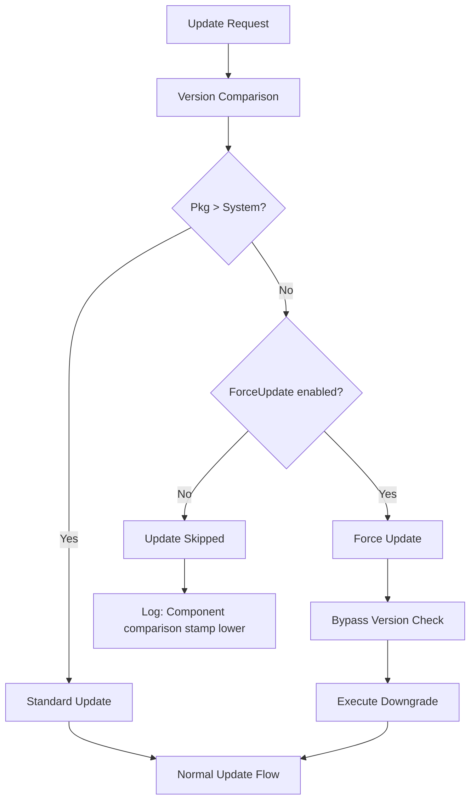
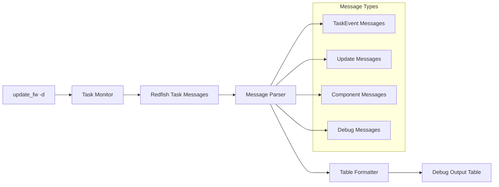
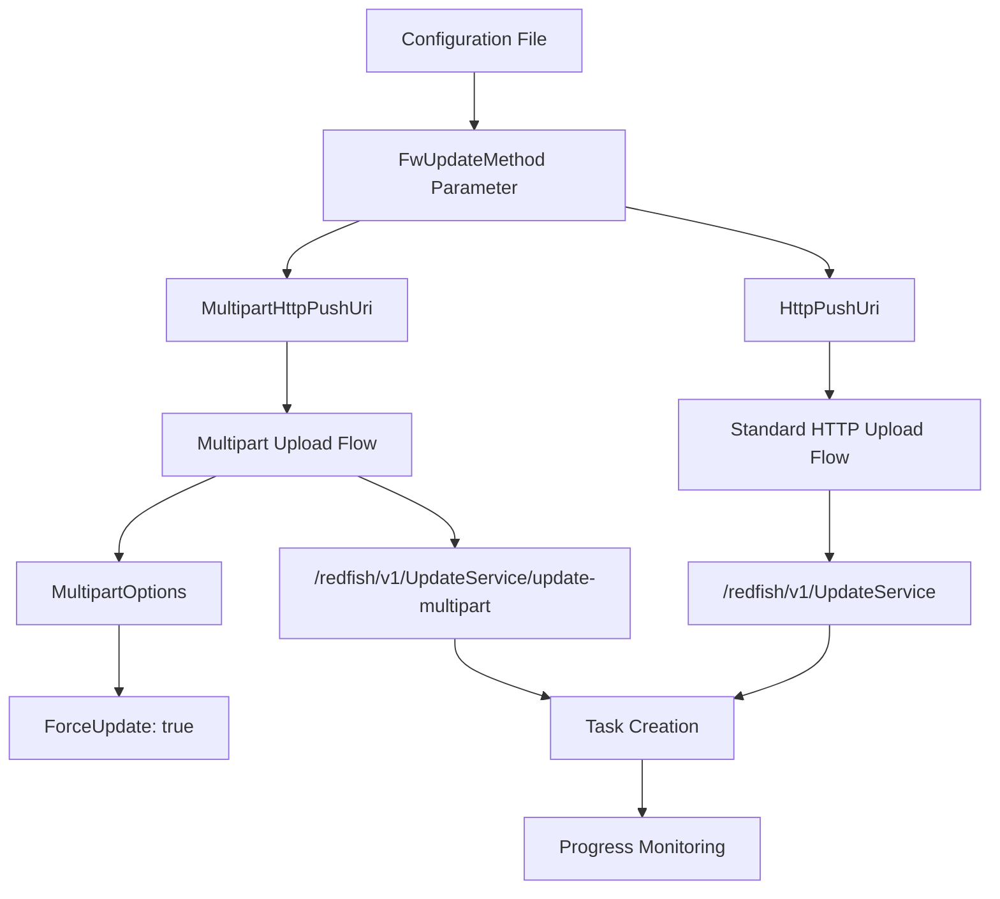
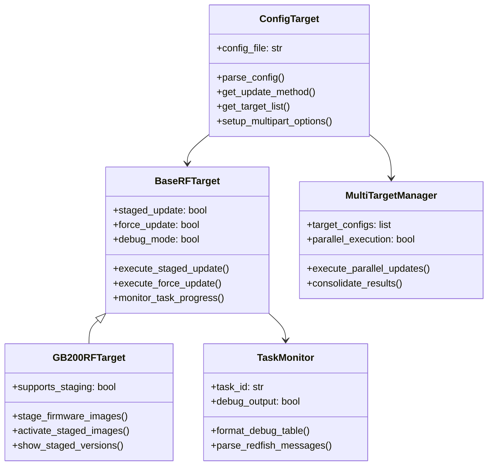

<!-- source: DeepWiki mcp.deepwiki.com · repo NVIDIA/open-nvfwupd · page 3.4 Advanced Features · fetched 2026-10-26 -->

# Advanced Features

<details>
<summary>Relevant source files</summary>

The following files were used as context for generating this wiki page:

- [firmware_update_guide/docs/appendix/output-formatting.rst](firmware_update_guide/docs/appendix/output-formatting.rst)
- [firmware_update_guide/docs/appendix/platform-agnostic-updates.rst](firmware_update_guide/docs/appendix/platform-agnostic-updates.rst)
- [firmware_update_guide/docs/appendix/spi-staged.rst](firmware_update_guide/docs/appendix/spi-staged.rst)
- [firmware_update_guide/docs/examples/gb300NVL.rst](firmware_update_guide/docs/examples/gb300NVL.rst)

</details>


This document covers advanced functionality in open-nvfwupd that extends beyond basic firmware update operations. These features enable customized update workflows, performance optimization, and support for complex deployment scenarios.

For basic command usage and platform-specific procedures, see [Commands and Operations](#3.1) and [Platform Guides](#5). For standard configuration options, see [Configuration](#3.2).

## Platform-Agnostic Updates

Platform-agnostic updates allow firmware updates on systems that are not automatically detected by open-nvfwupd or require custom update parameters. This is achieved through YAML configuration files that specify custom Redfish URIs and update methods.

### Configuration-Driven Update Architecture



**Sources:** [firmware_update_guide/docs/appendix/platform-agnostic-updates.rst:1-215]()

### Key Configuration Parameters

The `ConfigTarget` class processes the following advanced parameters:

| Parameter | Purpose | Default Value |
|-----------|---------|---------------|
| `MultipartHttpPushUri` | Override default multipart update endpoint | `/redfish/v1/UpdateService/update-multipart` |
| `HttpPushUri` | Override default PLDM update endpoint | `/redfish/v1/UpdateService` |
| `TaskServiceUri` | Custom task monitoring endpoint | `/redfish/v1/TaskService/Tasks/` |
| `FwUpdateMethod` | Update method selection | `MultipartHttpPushUri` or `HttpPushUri` |
| `UpdateParametersTargets` | Specific component targets | Platform-dependent |
| `BMCResetParameters` | Custom reset configuration | Platform-specific |

**Sources:** [firmware_update_guide/docs/appendix/platform-agnostic-updates.rst:8-76]()

### Multi-Target Update Support



**Sources:** [firmware_update_guide/docs/appendix/platform-agnostic-updates.rst:65-75]()

## SPI Staged Updates

SPI staged updates optimize firmware deployment by pre-downloading component images, significantly reducing activation downtime. This feature is supported on GB200 NVL and GB300 NVL platforms.

### Staged Update Lifecycle



**Sources:** [firmware_update_guide/docs/appendix/spi-staged.rst:1-100]()

### Staging Implementation Commands

The staging functionality is controlled through specific CLI flags:

| Flag | Long Form | Function | Platform Support |
|------|-----------|----------|------------------|
| `-u` | `--staged_update` | Stage firmware without activation | GB200/GB300 NVL |
| `-s` | `--staged` | View staged component versions | GB200/GB300 NVL |
| `-a` | `--staged_activate_update` | Activate previously staged images | GB200/GB300 NVL |

**Sources:** [firmware_update_guide/docs/appendix/spi-staged.rst:7-77]()

### Staged Version Display Format

When viewing staged versions with `show_version -s`, the output includes additional columns:

```
AP Name                  Sys Version         Staged Version  Pkg Version   Up-To-Date
-------                  -----------         --------------  -----------   ----------
FW_BMC_0                 GB200Nvl-25.01      GB200Nvl-25.02 GB200Nvl-25.02 No       
FW_ERoT_BMC_0            01.04.0007_n04      01.04.0008_n04 01.04.0008_n04 No
```

**Sources:** [firmware_update_guide/docs/appendix/spi-staged.rst:46-49]()

## Force Updates and Downgrades

Force updates bypass version comparison checks, enabling firmware downgrades and updates when components appear up-to-date but require reinstallation.

### Force Update Mechanisms



**Sources:** [firmware_update_guide/docs/examples/gb300NVL.rst:122-175]()

### Force Update Configuration

Force updates are enabled through JSON target files using the `ForceUpdate` parameter:

```json
{
    "ForceUpdate": true,
    "Targets": []
}
```

For component-specific force updates:

```json
{
    "ForceUpdate": true,
    "Targets": ["/redfish/v1/UpdateService/FirmwareInventory/HGX_FW_CPU_0"]
}
```

**Sources:** [firmware_update_guide/docs/examples/gb300NVL.rst:143-149](), [firmware_update_guide/docs/examples/gb300NVL.rst:242-250]()

## Advanced Output and Debugging

The debug output mode provides comprehensive firmware update progress tracking through detailed message tables and task monitoring.

### Debug Output Architecture



**Sources:** [firmware_update_guide/docs/appendix/output-formatting.rst:1-122]()

### Debug Output Message Categories

| MessageId Pattern | Purpose | Example |
|-------------------|---------|---------|
| `TaskEvent.1.0.3.*` | Task lifecycle events | `TaskStarted`, `TaskProgressChanged`, `TaskCompleted` |
| `Update.1.0.*` | Update operation status | `TargetDetermined`, `TransferringToComponent`, `UpdateSuccessful` |
| `NvidiaUpdate.1.0.*` | NVIDIA-specific events | `ComponentUpdateSkipped`, `DebugTokenEraseFailed` |

**Sources:** [firmware_update_guide/docs/appendix/output-formatting.rst:24-114]()

## Custom Update Methods

The platform supports multiple update methods through the `FwUpdateMethod` configuration parameter, enabling compatibility with different BMC implementations.

### Update Method Selection



**Sources:** [firmware_update_guide/docs/appendix/platform-agnostic-updates.rst:37-45]()

### Method-Specific Parameters

| Method | URI Override Parameter | Additional Options |
|--------|----------------------|-------------------|
| `MultipartHttpPushUri` | `MultipartHttpPushUri` | `MultipartOptions` with `ForceUpdate` |
| `HttpPushUri` | `HttpPushUri` | Standard PLDM package upload |

**Sources:** [firmware_update_guide/docs/appendix/platform-agnostic-updates.rst:24-45]()

## Advanced Feature Code Mapping



**Sources:** Architecture inferred from [firmware_update_guide/docs/appendix/platform-agnostic-updates.rst:1-215](), [firmware_update_guide/docs/appendix/spi-staged.rst:1-100](), [firmware_update_guide/docs/appendix/output-formatting.rst:1-122]()

---

