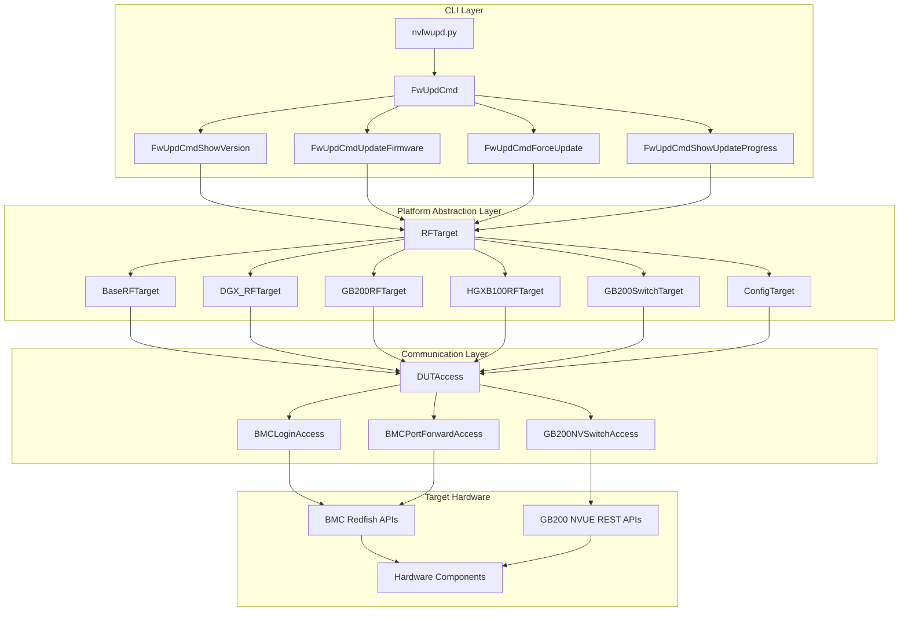
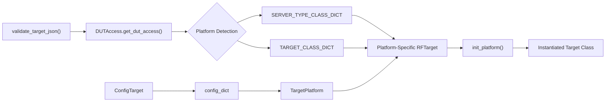
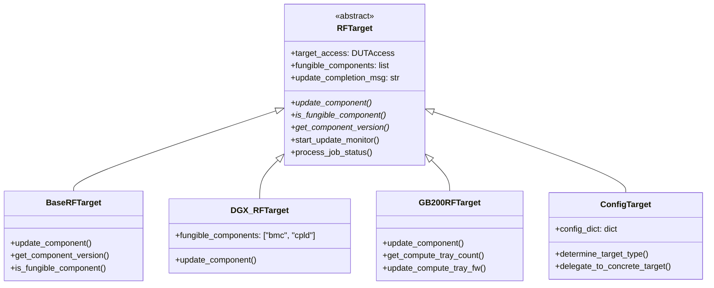
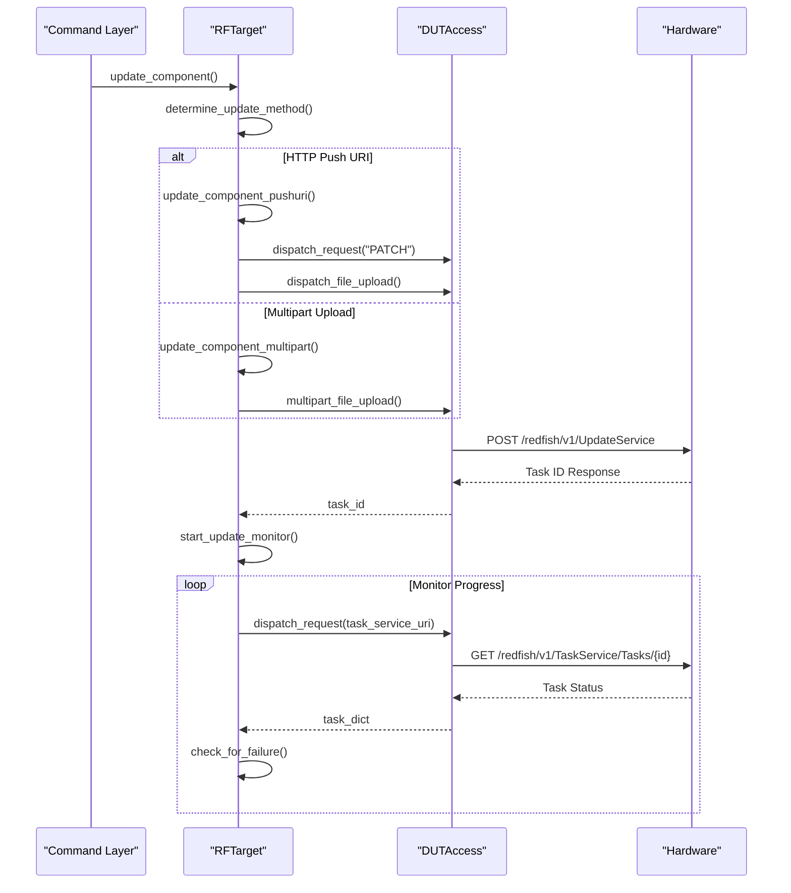
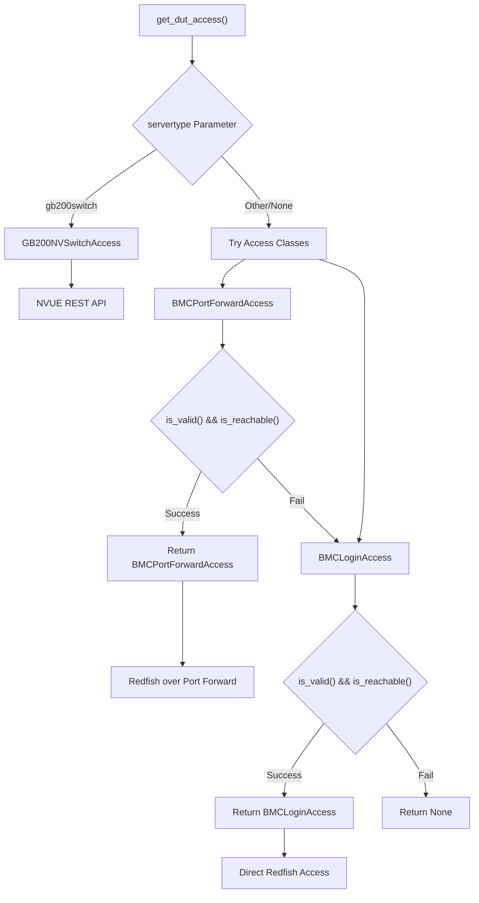
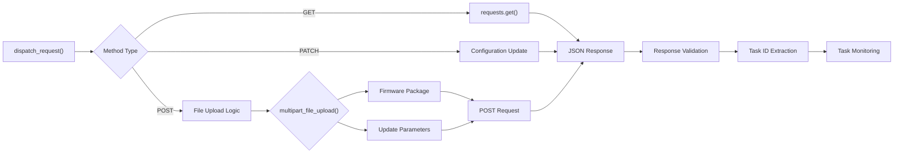
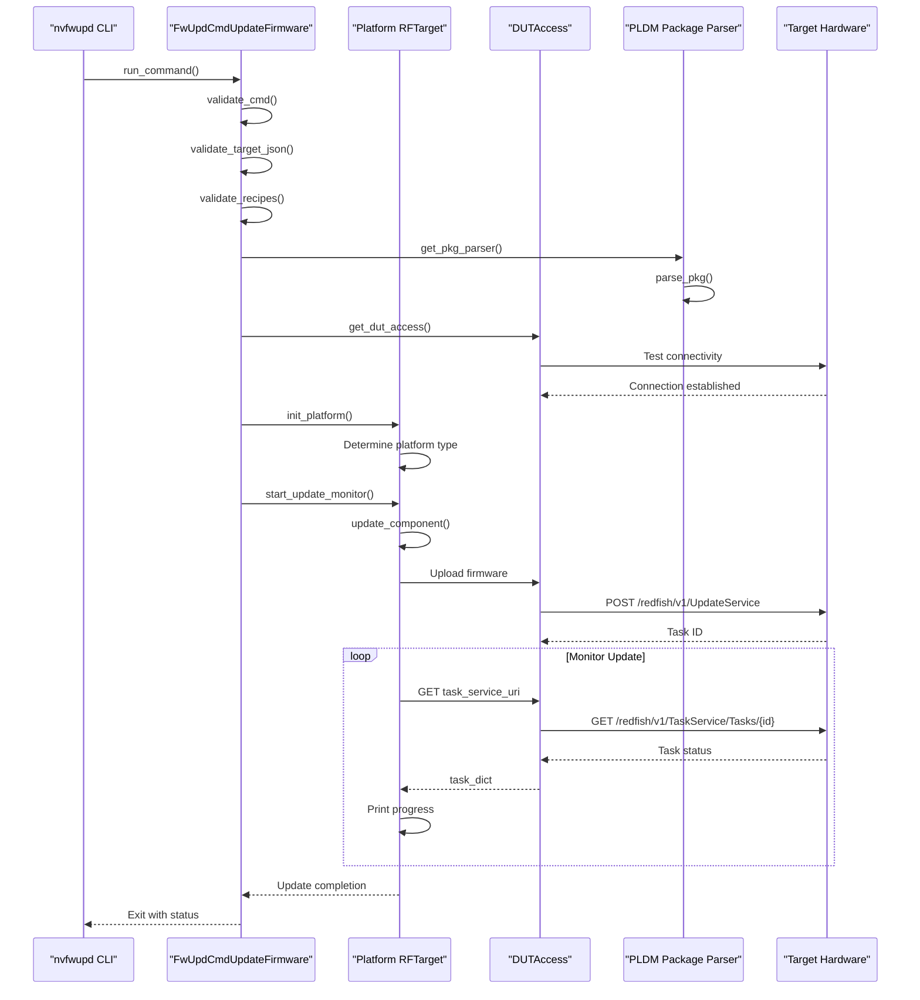
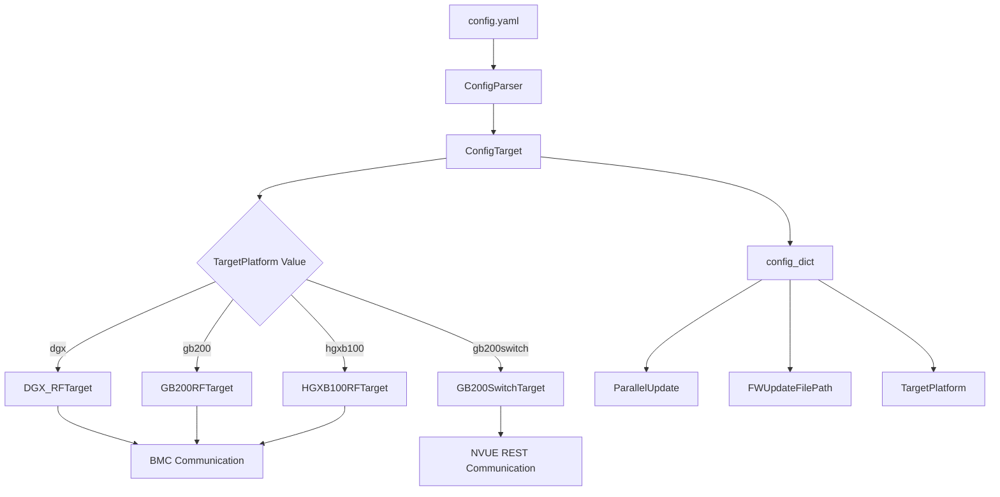

<!-- source: DeepWiki mcp.deepwiki.com · repo NVIDIA/open-nvfwupd · page 4 Architecture · fetched 2026-10-26 -->

# Architecture

Relevant source files

The following files were used as context for generating this wiki page:

- [nvfwupd/dut_access.py](nvfwupd/dut_access.py)
- [nvfwupd/rf_target.py](nvfwupd/rf_target.py)
- [nvfwupd/updcommand.py](nvfwupd/updcommand.py)

This document provides a technical overview of the open-nvfwupd system architecture, covering the core components, design patterns, and data flows that enable firmware updates across multiple NVIDIA hardware platforms. For platform-specific implementation details, see [Platform Abstraction Layer](#4.2). For detailed communication protocols, see [Communication Layer](#4.3).

## System Overview

The open-nvfwupd architecture follows a layered design that abstracts hardware platform differences behind a common interface while supporting multiple communication protocols (Redfish for BMCs, NVUE REST for switches). The system uses factory patterns and abstract base classes to enable extensible support for new hardware platforms.

### High-Level System Architecture

**Sources:** [nvfwupd/updcommand.py:52-99](), [nvfwupd/rf_target.py:30-109](), [nvfwupd/dut_access.py:39-67]()

## Core Components

The system consists of three primary layers that work together to provide platform-agnostic firmware update capabilities:

### Command Processing Layer

The `FwUpdCmd` base class in [nvfwupd/updcommand.py:52-99]() provides the foundation for all CLI operations. Each command inherits from this base and implements specific functionality:

| Command Class | Purpose | Key Methods |
|---------------|---------|-------------|
| `FwUpdCmdShowVersion` | Display firmware inventory | `get_output_json()`, `print_output_json()` |
| `FwUpdCmdUpdateFirmware` | Execute firmware updates | `update_target()`, `update_fw_parallel()` |
| `FwUpdCmdForceUpdate` | Enable/disable force update mode | `run_command()` |
| `FwUpdCmdShowUpdateProgress` | Monitor update task status | `run_command()` |

The command layer handles argument validation, target list processing, and orchestrates calls to the platform abstraction layer.

**Sources:** [nvfwupd/updcommand.py:861-896](), [nvfwupd/updcommand.py:1454-1492](), [nvfwupd/updcommand.py:1280-1307](), [nvfwupd/updcommand.py:1982-2009]()

### Platform Resolution and Factory Pattern

The system uses two key dictionaries for platform resolution:

- `SERVER_TYPE_CLASS_DICT` in [nvfwupd/rf_target.py:99-107]() - Maps server types to target classes
- `TARGET_CLASS_DICT` in [nvfwupd/rf_target.py:109-114]() - Maps detected platform names to target classes

**Sources:** [nvfwupd/rf_target.py:99-116](), [nvfwupd/updcommand.py:531-547](), [nvfwupd/updcommand.py:607-698]()

## Platform Abstraction Layer

### RFTarget Hierarchy

The `RFTarget` abstract base class defines the contract for all platform implementations:

Each platform implementation handles:
- Component version extraction from firmware inventory
- Platform-specific update procedures (HTTP Push URI vs Multipart uploads)
- Fungible component identification (components that can be different SKUs)

**Sources:** [nvfwupd/rf_target.py:30-97](), [nvfwupd/rf_target.py:183-194]()

### Update Method Abstraction

The system supports two primary update methods through abstract methods:

**Sources:** [nvfwupd/rf_target.py:528-692](), [nvfwupd/rf_target.py:694-1076]()

## Communication Layer

### DUTAccess Factory Pattern

The `DUTAccess.get_dut_access()` method implements a factory pattern to instantiate the appropriate communication class:

**Sources:** [nvfwupd/dut_access.py:72-181]()

### Protocol Implementations

| Access Class | Protocol | Target Hardware | Key Methods |
|--------------|----------|-----------------|-------------|
| `BMCLoginAccess` | Redfish HTTPS | BMC endpoints | `dispatch_request()`, `get_firmware_inventory()` |
| `BMCPortForwardAccess` | Redfish via SSH tunnel | Port-forwarded BMCs | `update_transport_type()` |
| `GB200NVSwitchAccess` | NVUE REST API | GB200 switches | `dispatch_rest_request_get()`, `get_job_status()` |

### Request Processing Pipeline

**Sources:** [nvfwupd/dut_access.py:857-1091](), [nvfwupd/dut_access.py:1180-1291]()

## Data Flow Architecture

### Firmware Update Flow

**Sources:** [nvfwupd/updcommand.py:1717-1979](), [nvfwupd/rf_target.py:694-1076]()

### Configuration-Based Target Resolution

For systems using configuration files, the `ConfigTarget` class provides an additional abstraction layer:

The `ConfigTarget` acts as a proxy that delegates to the appropriate concrete target implementation based on configuration parameters.

**Sources:** [nvfwupd/updcommand.py:642-680](), [nvfwupd/rf_target.py:116]()

This architecture enables the system to support diverse NVIDIA hardware platforms through a unified interface while maintaining extensibility for future platform additions.

---

