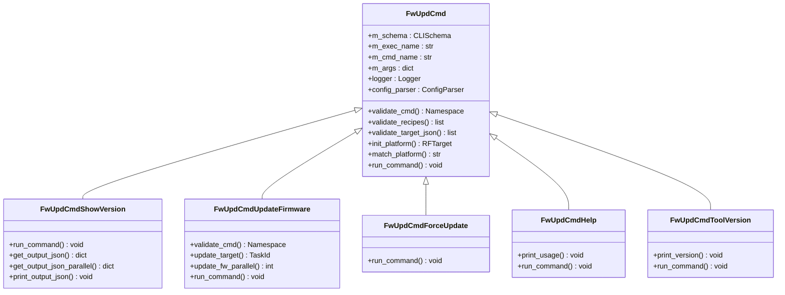
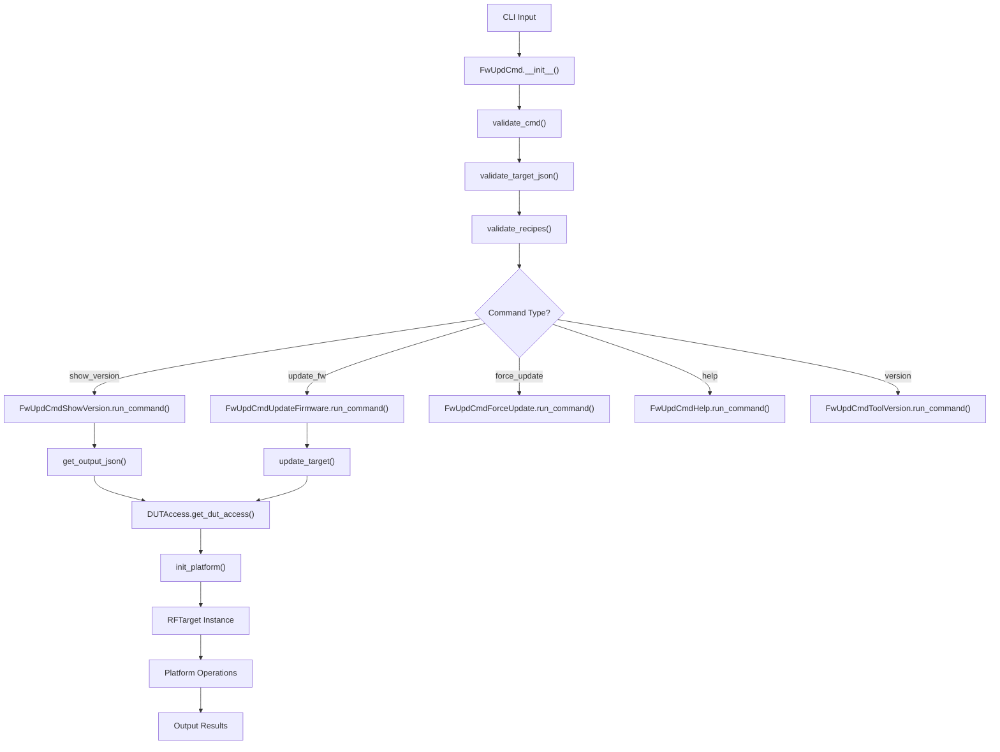
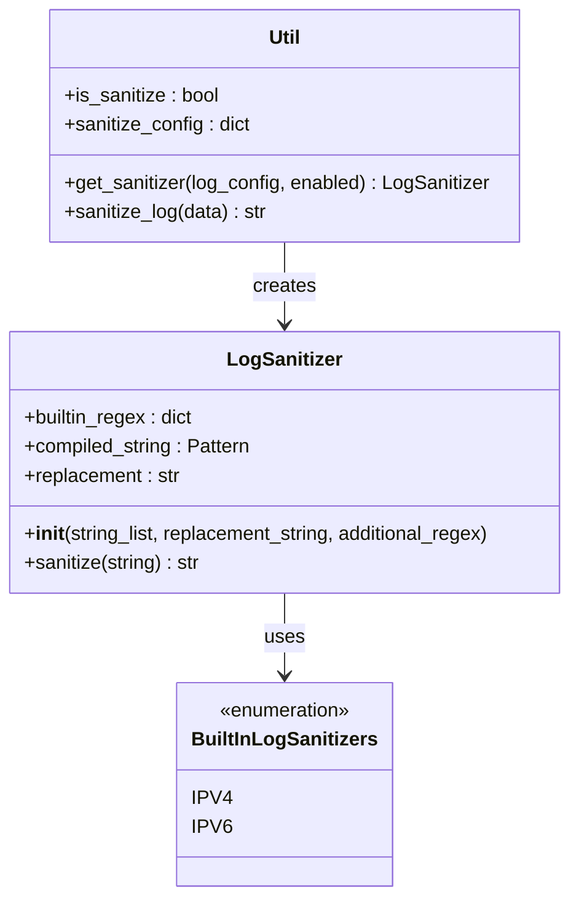
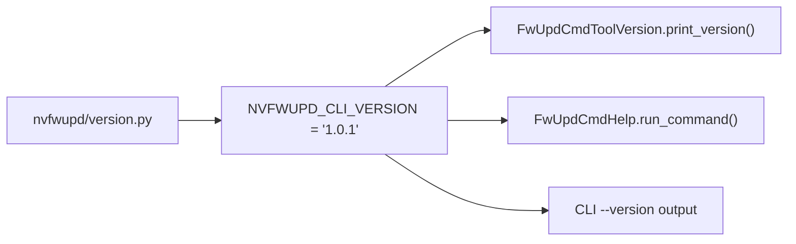

<!-- source: DeepWiki mcp.deepwiki.com · repo NVIDIA/open-nvfwupd · page 4.1 Core Components · fetched 2026-10-26 -->

# Core Components

Relevant source files

The following files were used as context for generating this wiki page:

- [nvfwupd/updcommand.py](nvfwupd/updcommand.py)
- [nvfwupd/utils.py](nvfwupd/utils.py)
- [nvfwupd/version.py](nvfwupd/version.py)

This page documents the fundamental components that form the foundation of the open-nvfwupd system, including CLI command processing, utility functions, and version management. These components provide the essential infrastructure for firmware update operations across all supported platforms.

For information about platform-specific implementations, see [Platform Abstraction Layer](#4.2). For details about device communication protocols, see [Communication Layer](#4.3).

## Overview

The core components consist of three main subsystems that work together to provide the command-line interface and basic infrastructure:

| Component | Primary Classes | Responsibility |
|-----------|----------------|----------------|
| CLI Command Processing | `FwUpdCmd`, `FwUpdCmdShowVersion`, `FwUpdCmdUpdateFirmware` | Command parsing, validation, and execution coordination |
| Utilities and Infrastructure | `Util`, `LogSanitizer` | Helper functions, error handling, log sanitization |
| Version Management | `NVFWUPD_CLI_VERSION` | Tool version tracking and display |

## CLI Command Processing Architecture

The command processing system is built around a base class hierarchy that handles different firmware update operations. Each command type has specialized logic while sharing common validation and platform initialization functionality.

Sources: [nvfwupd/updcommand.py:52-99](), [nvfwupd/updcommand.py:701-744](), [nvfwupd/updcommand.py:746-773](), [nvfwupd/updcommand.py:861-896](), [nvfwupd/updcommand.py:1280-1307](), [nvfwupd/updcommand.py:1454-1492]()

### Base Command Class (FwUpdCmd)

The `FwUpdCmd` class provides the foundation for all firmware update commands. It handles common operations including command validation, target management, and platform initialization.

**Key Responsibilities:**
- Command schema validation using CLI argument parsers [nvfwupd/updcommand.py:203-246]()
- Target list creation and validation from configuration files or CLI arguments [nvfwupd/updcommand.py:248-387]()
- Firmware package validation to ensure PLDM compatibility [nvfwupd/updcommand.py:173-201]()
- Platform type detection and RFTarget instance creation [nvfwupd/updcommand.py:607-698]()
- Parallel update support through input parameter management [nvfwupd/updcommand.py:549-604]()

**Critical Methods:**
- `validate_cmd()`: Processes global and command-specific arguments using argparse
- `init_platform()`: Factory method that returns appropriate RFTarget implementation based on detected or configured platform type
- `match_platform()`: Static method for platform string matching using `RFTarget.TARGET_CLASS_DICT`

Sources: [nvfwupd/updcommand.py:52-99](), [nvfwupd/updcommand.py:105-172](), [nvfwupd/updcommand.py:531-547]()

### Command-Specific Implementations

Each command type extends `FwUpdCmd` with specialized logic:

**FwUpdCmdShowVersion**
- Retrieves firmware inventory from target systems [nvfwupd/updcommand.py:1020-1151]()
- Compares installed versions with package versions when available
- Supports parallel inventory collection using `ThreadPoolExecutor` [nvfwupd/updcommand.py:947-965]()
- Outputs both JSON and tabular formats

**FwUpdCmdUpdateFirmware**
- Validates firmware packages before upload [nvfwupd/updcommand.py:1494-1516]()
- Handles both single and parallel firmware updates
- Supports staged updates and immediate activation modes [nvfwupd/updcommand.py:1595-1608]()
- Monitors update progress through task status polling

**FwUpdCmdForceUpdate**
- Manages the BMC `ForceUpdate` flag via Redfish PATCH operations [nvfwupd/updcommand.py:1427-1433]()
- Provides enable, disable, and status query functionality

Sources: [nvfwupd/updcommand.py:861-896](), [nvfwupd/updcommand.py:1454-1492](), [nvfwupd/updcommand.py:1280-1307]()

## Command Processing Flow

The following diagram illustrates how commands flow through the core processing pipeline:

Sources: [nvfwupd/updcommand.py:105-172](), [nvfwupd/updcommand.py:203-246](), [nvfwupd/updcommand.py:389-509](), [nvfwupd/updcommand.py:607-698]()

## Utilities and Infrastructure

The utility system provides essential support functions for logging, error handling, and data processing across the entire application.

### Util Class

The `Util` class contains static methods that provide core functionality:

**Error Handling and Program Control:**
- `bail_nvfwupd()`: Centralized error handling with exit codes and JSON support [nvfwupd/utils.py:340-372]()
- `bail_nvfwupd_threadsafe()`: Thread-safe error handling for parallel operations [nvfwupd/utils.py:373-401]()

**Configuration and Validation:**
- `get_log_sanitize_config()`: Converts target configuration lists to dictionaries [nvfwupd/utils.py:217-252]()
- `target_platform_supported()`: Validates platform type compatibility [nvfwupd/utils.py:309-338]()
- `ping_to_check_system()`: Network connectivity verification [nvfwupd/utils.py:201-215]()

**Data Processing:**
- `sanitize_log()`: Applies log sanitization rules [nvfwupd/utils.py:294-307]()
- `compare_dict()`: Dictionary comparison for task status tracking [nvfwupd/utils.py:416-441]()
- `wrap_text()`: Text formatting for console output [nvfwupd/utils.py:443-454]()

Sources: [nvfwupd/utils.py:108-151](), [nvfwupd/utils.py:152-164]()

### LogSanitizer Class

The `LogSanitizer` provides credential and sensitive information filtering for logs and console output:

**Key Features:**
- Built-in regex patterns for IPv4 and IPv6 address detection [nvfwupd/utils.py:55-58]()
- Custom string filtering with word boundary protection [nvfwupd/utils.py:84-85]()
- Integration with logging formatter for automatic sanitization [nvfwupd/utils.py:38-106]()

The sanitizer automatically filters credentials from configuration including usernames, passwords, and IP addresses based on field names like `BMC_IP`, `RF_USERNAME`, `RF_PASSWORD` [nvfwupd/utils.py:269-292]().

Sources: [nvfwupd/utils.py:29-106](), [nvfwupd/utils.py:254-292]()

## Version Management

Version tracking is handled through a simple module that defines the current tool version:

The version string is imported and used by command classes to display version information in help output and dedicated version commands [nvfwupd/updcommand.py:30](), [nvfwupd/updcommand.py:737](), [nvfwupd/updcommand.py:743](), [nvfwupd/updcommand.py:811]().

Sources: [nvfwupd/version.py:19](), [nvfwupd/updcommand.py:732-744]()

## Integration with Platform Layer

The core components interface with the platform abstraction layer through several key integration points:

| Integration Point | Core Component Method | Platform Layer Interface |
|------------------|----------------------|---------------------------|
| Platform Detection | `FwUpdCmd.match_platform()` | `RFTarget.TARGET_CLASS_DICT` |
| Platform Initialization | `FwUpdCmd.init_platform()` | `RFTarget` subclass constructors |
| Configuration Binding | `FwUpdCmd.validate_target_json()` | `ConfigTarget` initialization |

The `init_platform()` method serves as the primary factory function that bridges the core command processing with platform-specific implementations. It uses either explicit server type configuration or automatic platform detection through `DUTAccess.get_dut_access()` to instantiate the appropriate `RFTarget` subclass [nvfwupd/updcommand.py:607-698]().

Sources: [nvfwupd/updcommand.py:531-547](), [nvfwupd/updcommand.py:607-698](), [nvfwupd/updcommand.py:30-49]()

---

