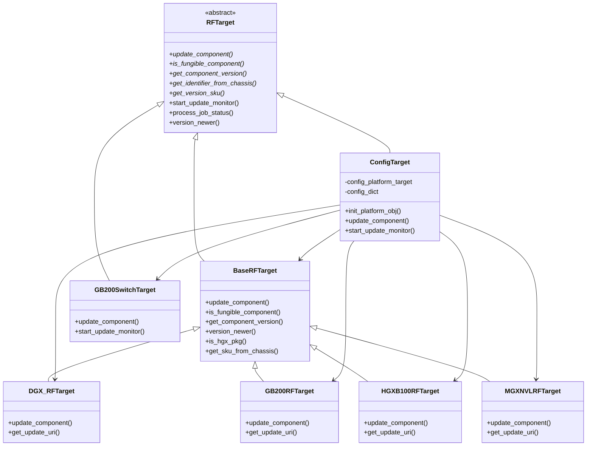
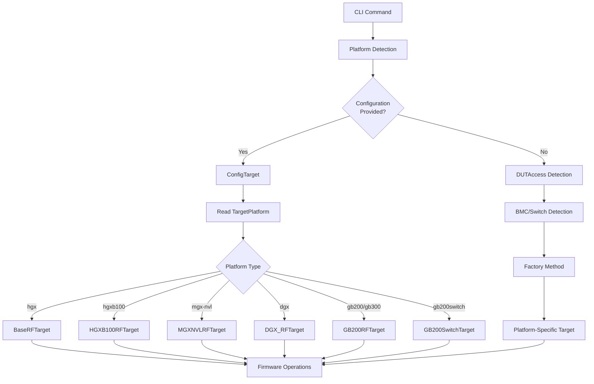
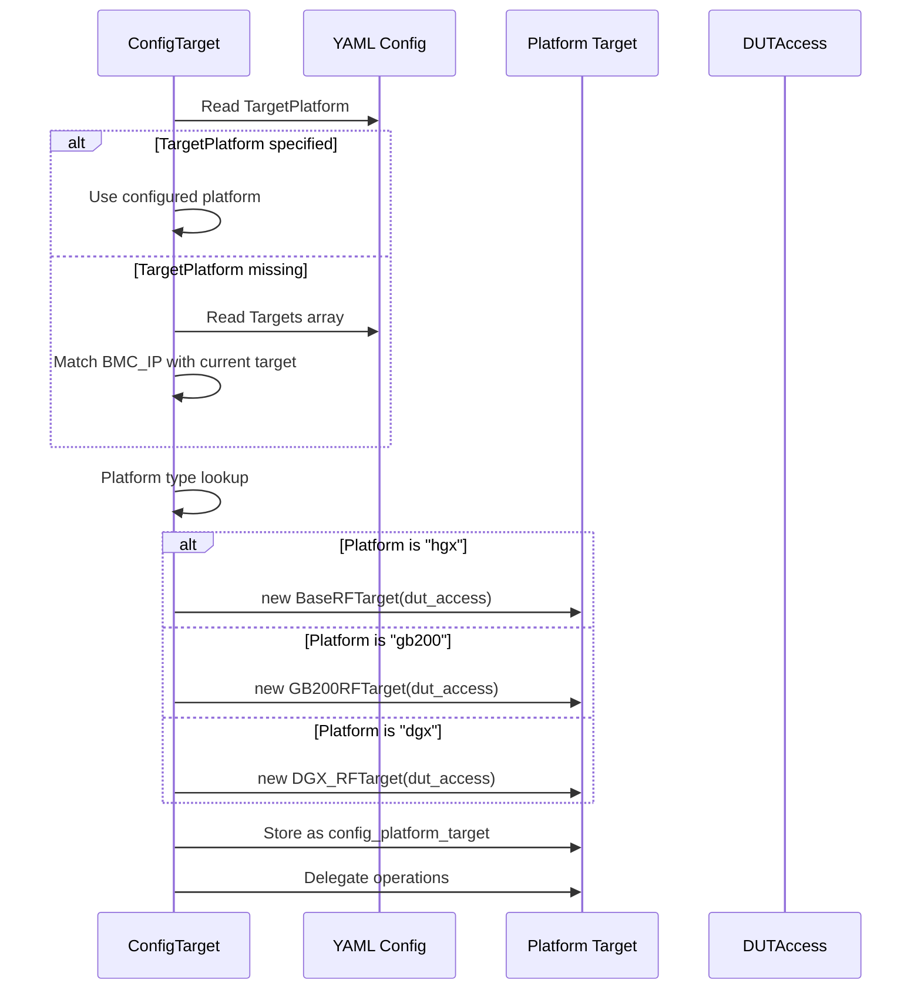

<!-- source: DeepWiki mcp.deepwiki.com · repo NVIDIA/open-nvfwupd · page 4.2 Platform Abstraction Layer · fetched 2026-10-26 -->

# Platform Abstraction Layer

<details>
<summary>Relevant source files</summary>

The following files were used as context for generating this wiki page:

- [nvfwupd/base_rftarget.py](nvfwupd/base_rftarget.py)
- [nvfwupd/config_target.py](nvfwupd/config_target.py)
- [nvfwupd/rf_target.py](nvfwupd/rf_target.py)

</details>


The Platform Abstraction Layer provides a unified interface for firmware update operations across different NVIDIA hardware platforms. This layer abstracts platform-specific implementation details while maintaining consistent APIs for firmware management operations.

For information about specific platform implementations and their usage, see [Platform Guides](#5). For details about the communication protocols used by these abstractions, see [Communication Layer](#4.3).

## Architecture Overview

The Platform Abstraction Layer uses an inheritance-based design with abstract base classes that define common interfaces. Platform-specific implementations inherit from these base classes and provide customized behavior for their respective hardware types.

### Class Hierarchy



Sources: [nvfwupd/rf_target.py:29-139](), [nvfwupd/base_rftarget.py:23-74](), [nvfwupd/config_target.py:28-94]()

### Platform Detection and Instantiation



Sources: [nvfwupd/config_target.py:95-136](), [nvfwupd/rf_target.py:99-117]()

## Base Abstraction - RFTarget

The `RFTarget` class serves as the abstract base class for all platform implementations. It defines the core interface that all platform-specific targets must implement.

### Abstract Methods

| Method | Purpose | Return Type |
|--------|---------|-------------|
| `update_component()` | Perform firmware update on target component | `str` (task ID) |
| `is_fungible_component()` | Check if component supports hot-swap | `bool` |
| `get_component_version()` | Extract component version from PLDM package | `str` |
| `get_identifier_from_chassis()` | Get component identifier from Redfish chassis | `str` |
| `get_version_sku()` | Get SKU-specific component version | `str` |

### Platform Mapping Constants

The `RFTarget` class maintains several dictionaries that map platform identifiers to their corresponding implementation classes:

```python
SERVER_TYPE_CLASS_DICT = {
    "dgx": "DGX_RFTarget",
    "hgx": "BaseRFTarget", 
    "hgxb100": "HGXB100RFTarget",
    "gb200": "GB200RFTarget",
    "gb300": "GB200RFTarget",
    "mgx-nvl": "MGXNVLRFTarget",
    "gb200switch": "GB200SwitchTarget"
}
```

### Task State Management

The base class defines constants for monitoring firmware update task states:

- `TASK_FAILURE_STATES`: States indicating update failure
- `TASK_PENDING_STATES`: States indicating update in progress

Sources: [nvfwupd/rf_target.py:29-139](), [nvfwupd/rf_target.py:99-129](), [nvfwupd/rf_target.py:183-210]()

## Concrete Base Implementation - BaseRFTarget

`BaseRFTarget` provides a concrete implementation of the `RFTarget` interface that serves as the foundation for most Redfish-based platforms. It implements common functionality for platforms that use standard Redfish APIs.

### Key Features

#### Component Version Management
- Parses PLDM package contents to extract component versions
- Handles HGX-specific package detection with `is_hgx_pkg()`
- Supports SKU-based component matching for GPU components

#### Firmware Update Operations
- Implements file upload using Redfish APIs via `update_component()`
- Supports special update parameters through JSON configuration
- Handles both direct file uploads and parameter-based updates

#### Component Classification
- Determines fungible components (components that support hot-swap)
- Currently supports GPU components as fungible when they meet specific criteria

### Version Comparison Logic

The `version_newer()` method includes special handling for BMC firmware versions:

```python
def version_newer(self, pkg_version, sys_version):
    if sys_version.find(".") == -1:
        pkg_version = pkg_version.replace(".", "")
    regex = re.compile("GraceBMC[_|-]", re.IGNORECASE)
    match = regex.match(sys_version)
    if match:
        sys_version = regex.sub("", sys_version, 1)
```

Sources: [nvfwupd/base_rftarget.py:23-94](), [nvfwupd/base_rftarget.py:75-94](), [nvfwupd/base_rftarget.py:98-176]()

## Configuration-Based Targeting - ConfigTarget

`ConfigTarget` acts as a factory and proxy that enables platform selection through YAML configuration files. It dynamically instantiates the appropriate platform-specific target based on configuration parameters.

### Platform Detection Flow



### Method Delegation

`ConfigTarget` implements the `RFTarget` interface by delegating calls to the underlying platform-specific target:

| ConfigTarget Method | Delegation Target |
|-------------------|------------------|
| `is_fungible_component()` | `config_platform_target.is_fungible_component()` |
| `get_component_version()` | `config_platform_target.get_component_version()` |
| `version_newer()` | `config_platform_target.version_newer()` |
| `update_component()` | Platform-specific or base implementation |

### Update Method Selection

`ConfigTarget` supports multiple update methods based on configuration:

- **HttpPushUri**: Uses `update_component_pushuri()` for standard HTTP uploads
- **MultipartHttpPushUri**: Uses `update_component_multipart()` for multipart uploads
- **Platform-specific**: Delegates to the underlying target's `update_component()`

Sources: [nvfwupd/config_target.py:95-136](), [nvfwupd/config_target.py:254-327](), [nvfwupd/config_target.py:137-196]()

## Platform-Specific Implementations

Each supported platform has its own target class that inherits from either `BaseRFTarget` or directly from `RFTarget`. These implementations provide platform-specific customizations for firmware update operations.

### Platform Target Classes

| Platform | Target Class | Base Class | Key Features |
|----------|-------------|------------|--------------|
| HGX | `BaseRFTarget` | `RFTarget` | Standard Redfish implementation |
| HGX B100 | `HGXB100RFTarget` | `BaseRFTarget` | Extended HGX functionality |
| MGX-NVL | `MGXNVLRFTarget` | `BaseRFTarget` | MGX-specific customizations |
| DGX | `DGX_RFTarget` | `BaseRFTarget` | DGX-specific Redfish extensions |
| GB200/GB300 | `GB200RFTarget` | `BaseRFTarget` | Grace Blackwell platform support |
| GB200 Switch | `GB200SwitchTarget` | `RFTarget` | Switch-specific implementation |

### Specialization Areas

Platform-specific implementations typically customize:

1. **Update URIs**: Different platforms may use different Redfish endpoints
2. **Component Detection**: Platform-specific component identification logic
3. **Version Parsing**: Custom version string handling for platform firmware
4. **Update Monitoring**: Platform-specific task monitoring and progress reporting

Sources: [nvfwupd/config_target.py:21-25](), [nvfwupd/rf_target.py:99-117]()

## Extension Points for New Platforms

Adding support for a new platform involves implementing the `RFTarget` interface and registering the platform in the mapping dictionaries.

### Required Implementation Steps

1. **Create Platform Target Class**: Inherit from `RFTarget` or `BaseRFTarget`
2. **Implement Abstract Methods**: Provide platform-specific implementations
3. **Register in Mappings**: Add entries to `SERVER_TYPE_CLASS_DICT` and related mappings
4. **Update ConfigTarget**: Add platform detection logic in `init_platform_obj()`

### Minimal Implementation Template

```python
class NewPlatformRFTarget(BaseRFTarget):
    def __init__(self, dut_access):
        super().__init__(dut_access)
        # Platform-specific initialization
    
    def update_component(self, cmd_args, update_uri, update_file, time_out, 
                        json_dict=None, parallel_update=False):
        # Platform-specific update logic
        return super().update_component(...)
    
    def get_update_uri(self, update_service_response):
        # Platform-specific URI handling
        return "/redfish/v1/UpdateService"
```

### Integration Points

New platforms must be registered in:
- `RFTarget.SERVER_TYPE_CLASS_DICT` for automatic detection
- `ConfigTarget.init_platform_obj()` for configuration-based selection
- Platform detection logic in the main CLI interface

Sources: [nvfwupd/rf_target.py:99-117](), [nvfwupd/config_target.py:95-136]()

---

