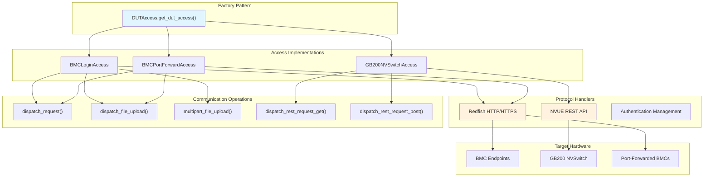
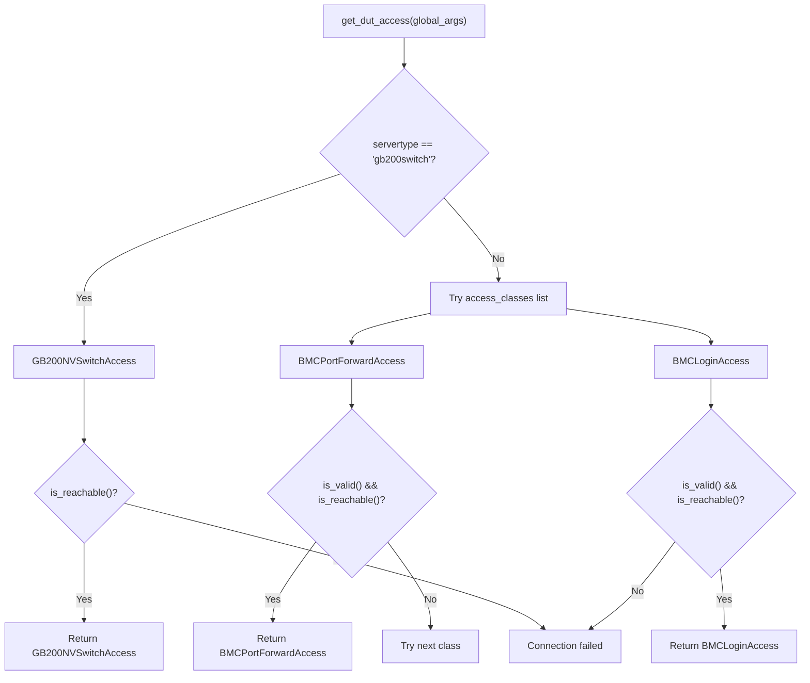
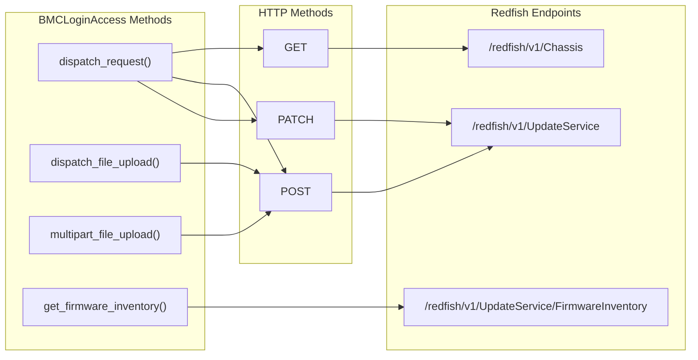
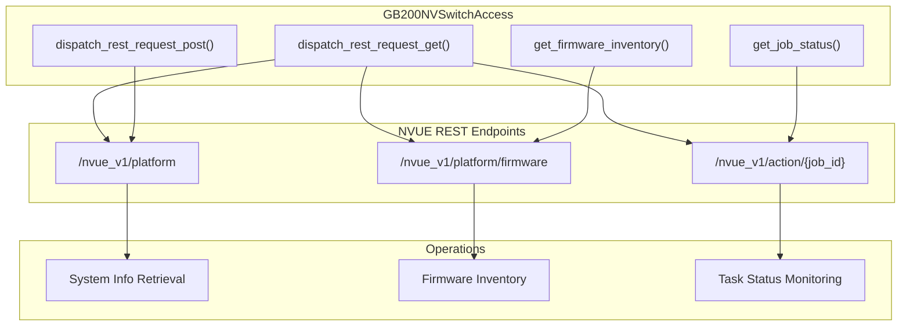
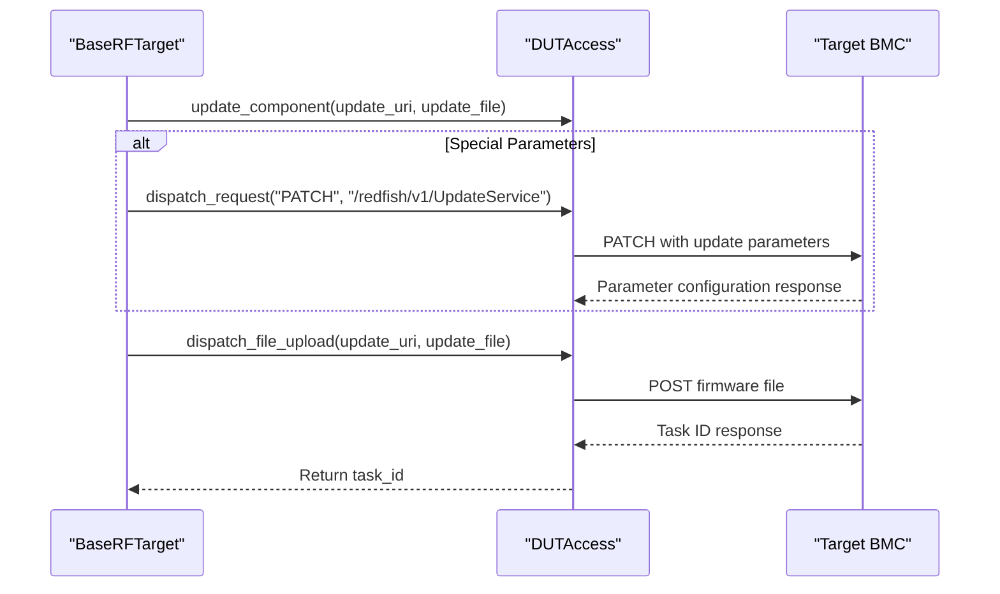
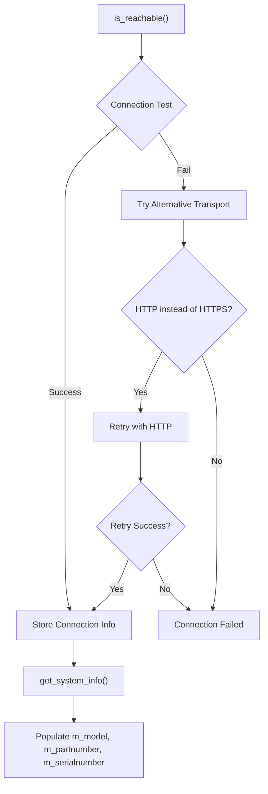

<!-- source: DeepWiki mcp.deepwiki.com · repo NVIDIA/open-nvfwupd · page 4.3 Communication Layer · fetched 2026-10-26 -->

# Communication Layer

Relevant source files

The following files were used as context for generating this wiki page:

- [nvfwupd/base_rftarget.py](nvfwupd/base_rftarget.py)
- [nvfwupd/dut_access.py](nvfwupd/dut_access.py)

The Communication Layer provides the interface for communicating with target hardware systems through various protocols and access methods. This layer abstracts the differences between BMC Redfish APIs, NVUE REST APIs for switches, and different authentication mechanisms, presenting a unified interface to the Platform Abstraction Layer.

For information about how this layer integrates with platform-specific implementations, see [Platform Abstraction Layer](#4.2). For details on the overall system architecture, see [Architecture](#4).

## Communication Architecture Overview

The Communication Layer implements a factory pattern to create appropriate access instances based on target system characteristics and connection parameters.

**Sources:** [nvfwupd/dut_access.py:72-181](), [nvfwupd/dut_access.py:209-576](), [nvfwupd/dut_access.py:578-1292]()

## Access Classes and Protocol Support

The Communication Layer supports multiple access patterns through a hierarchy of specialized classes:

| Access Class | Protocol | Authentication | Use Case |
|--------------|----------|----------------|----------|
| `BMCLoginAccess` | Redfish HTTP/HTTPS | Username/Password | Standard BMC access |
| `GB200NVSwitchAccess` | NVUE REST API | Username/Password | GB200 switch systems |
| `BMCPortForwardAccess` | Redfish HTTP/HTTPS | Username/Password | Port-forwarded BMC access |

### Device Access Factory

The `DUTAccess.get_dut_access()` method implements the factory pattern to determine the appropriate access class:

**Sources:** [nvfwupd/dut_access.py:72-181](), [nvfwupd/dut_access.py:123-159]()

## Redfish Communication Implementation

The `BMCLoginAccess` class provides the primary implementation for Redfish-based communication with BMCs:

### Core Communication Methods

**Sources:** [nvfwupd/dut_access.py:857-1091](), [nvfwupd/dut_access.py:796-853](), [nvfwupd/dut_access.py:1180-1291]()

### Connection Management

The system implements automatic transport protocol selection and error handling:

- **Transport Detection**: Attempts HTTPS first, falls back to HTTP if connection fails [nvfwupd/dut_access.py:685-695]()
- **Authentication**: Supports both basic auth and session token authentication [nvfwupd/dut_access.py:976-1005]()
- **IPv6 Support**: Automatically wraps IPv6 addresses in brackets [nvfwupd/dut_access.py:652-654]()

## NVUE REST API Implementation

The `GB200NVSwitchAccess` class implements communication with GB200 NVSwitch systems using the NVUE REST API:

### NVUE-Specific Communication

**Sources:** [nvfwupd/dut_access.py:340-400](), [nvfwupd/dut_access.py:402-455](), [nvfwupd/dut_access.py:506-527]()

### Switch-Specific Features

The NVUE implementation includes specialized functionality for switch management:

- **Job Status Monitoring**: Tracks firmware update progress through job IDs [nvfwupd/dut_access.py:458-472]()
- **Reboot Detection**: Monitors system availability after firmware updates [nvfwupd/dut_access.py:529-575]()
- **Platform Information**: Retrieves switch-specific hardware details [nvfwupd/dut_access.py:474-496]()

## File Upload and Update Operations

The Communication Layer implements multiple file upload mechanisms to support different firmware update methods:

### Upload Method Comparison

| Method | Class | Use Case | Implementation |
|--------|-------|----------|----------------|
| HTTP Push | `BMCLoginAccess.dispatch_file_upload()` | Single file uploads | Binary data POST |
| Multipart Upload | `BMCLoginAccess.multipart_file_upload()` | File + parameters | Multipart form data |
| JSON Update | `BaseRFTarget.update_component()` | Parameterized updates | PATCH with JSON |

### Upload Operation Flow

**Sources:** [nvfwupd/base_rftarget.py:98-176](), [nvfwupd/dut_access.py:796-853]()

## Error Handling and Connection Management

The Communication Layer implements comprehensive error handling and connection validation:

### Connection Validation

**Sources:** [nvfwupd/dut_access.py:676-695](), [nvfwupd/dut_access.py:1093-1177]()

### Error Recovery Mechanisms

- **Transport Fallback**: Automatic HTTP/HTTPS selection based on connection success
- **Timeout Handling**: Configurable timeouts for different operation types
- **Graceful Degradation**: Continues operation with limited functionality when possible
- **Detailed Logging**: Verbose error information for troubleshooting

The Communication Layer provides a robust foundation for firmware update operations across diverse NVIDIA hardware platforms while abstracting protocol complexities from higher-level components.

**Sources:** [nvfwupd/dut_access.py:1082-1091](), [nvfwupd/dut_access.py:835-837](), [nvfwupd/dut_access.py:323-327]()

---

