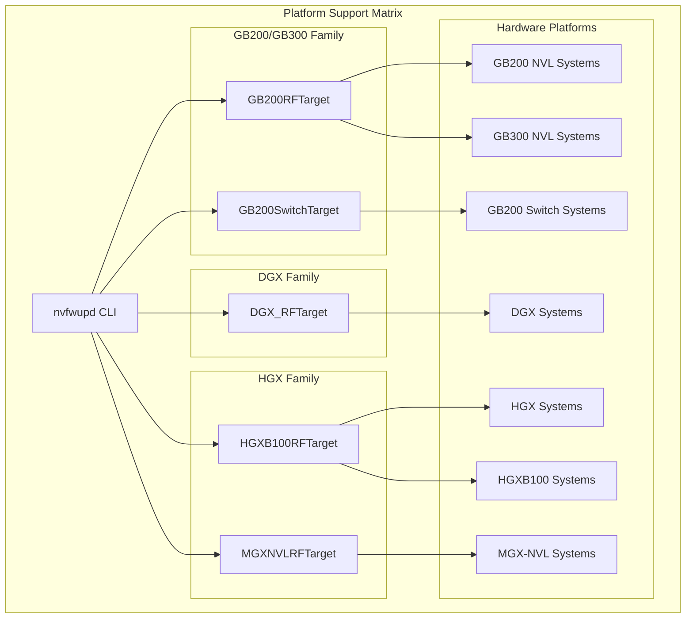
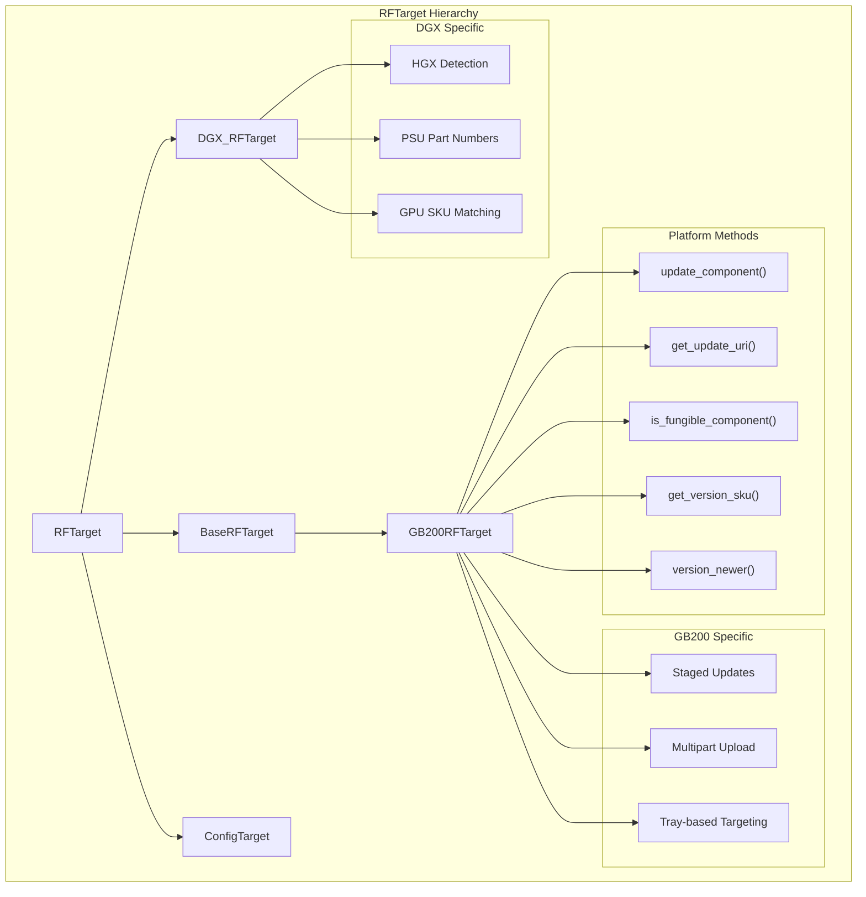
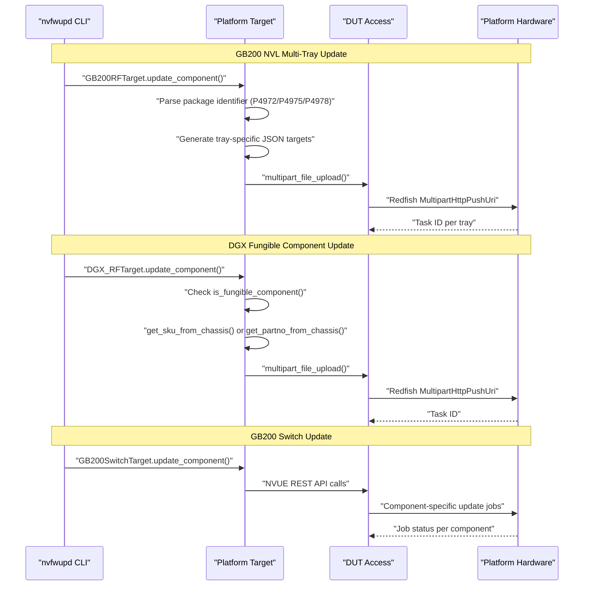

<!-- source: DeepWiki mcp.deepwiki.com · repo NVIDIA/open-nvfwupd · page 5 Platform Guides · fetched 2026-10-26 -->

# Platform Guides

Relevant source files

The following files were used as context for generating this wiki page:

- [firmware_update_guide/docs/examples/gb200NVL.rst](firmware_update_guide/docs/examples/gb200NVL.rst)
- [nvfwupd/dgx_rftarget.py](nvfwupd/dgx_rftarget.py)
- [nvfwupd/gb200_rftarget.py](nvfwupd/gb200_rftarget.py)

This section provides platform-specific guidance for firmware updates across different NVIDIA hardware families. Each platform has unique characteristics, firmware package types, update procedures, and special considerations that must be understood for successful firmware management.

The guides cover supported NVIDIA hardware platforms including GB200/GB300 NVL systems, GB200 switches, DGX systems, and HGX/HGXB100 platforms. For detailed command usage and configuration options, see [Commands and Operations](#3.1). For architecture details, see [Platform Abstraction Layer](#4.2).

## Platform Overview

The open-nvfwupd tool supports multiple NVIDIA hardware platforms, each with distinct firmware architectures and update mechanisms:

**Sources:** [nvfwupd/gb200_rftarget.py:23-58](), [nvfwupd/dgx_rftarget.py:24-61]()

## Platform Architecture and Package Types

Different platform families use distinct firmware package structures and update mechanisms:

| Platform Family | Target Class | Package Identifiers | Primary Components | Update Method |
|------------------|--------------|-------------------|-------------------|---------------|
| GB200 NVL | `GB200RFTarget` | P4972 (BMC), P4975 (Compute), P4978 (Switch) | BMC, GPU, CPU, ERoT, FPGA, CPLD | Redfish Multipart |
| GB200 Switch | `GB200SwitchTarget` | P4978 variants | BMC, BIOS, CPLD, ERoT, FPGA | NVUE REST API |
| DGX | `DGX_RFTarget` | DGX variants, HGX sub-packages | BMC, GPU, PSU, BIOS, NIC | Redfish Multipart |
| HGX/HGXB100 | `HGXB100RFTarget` | HGX variants | GPU, ERoT, CPLD, BMC | Redfish |
| MGX-NVL | `MGXNVLRFTarget` | MGX variants | NVLink, GPU, BMC | Redfish |

**Sources:** [firmware_update_guide/docs/examples/gb200NVL.rst:6-11](), [nvfwupd/gb200_rftarget.py:68-69](), [nvfwupd/dgx_rftarget.py:71]()

## Platform-Specific Implementation Architecture

The codebase uses a hierarchy of target classes to handle platform-specific firmware update logic:

**Sources:** [nvfwupd/gb200_rftarget.py:23-58](), [nvfwupd/dgx_rftarget.py:24-61](), [nvfwupd/base_rftarget.py]()

## Update Flow Variations by Platform

Different platforms implement distinct update flows based on their firmware architecture:

**Sources:** [nvfwupd/gb200_rftarget.py:88-174](), [nvfwupd/dgx_rftarget.py:95-191](), [firmware_update_guide/docs/examples/gb200NVL.rst:41-93]()

## Fungible Component Handling

Platform targets implement different strategies for handling fungible (replaceable) components:

| Platform | Fungible Components | Identification Method | Implementation |
|----------|-------------------|---------------------|----------------|
| GB200 | GPU, CPLD (BMC tray only) | SKU ID, Model matching | `get_identifier_from_chassis()` |
| DGX | GPU, PSU | SKU ID, Part Number | `get_sku_from_chassis()`, `get_partno_from_chassis()` |
| HGX/HGXB100 | GPU, ERoT, CPLD | SKU-based matching | Platform-specific logic |

**Sources:** [nvfwupd/gb200_rftarget.py:176-192](), [nvfwupd/dgx_rftarget.py:78-91](), [nvfwupd/dgx_rftarget.py:301-346]()

## Platform-Specific Guides

For detailed procedures and examples specific to each platform family:

- [GB200 and GB300 NVL Systems](#5.1) - Multi-tray updates, staged updates, compute and BMC tray procedures
- [GB200 Switch Systems](#5.2) - NVUE-based updates, component-specific procedures  
- [DGX Systems](#5.3) - DGX firmware update procedures and considerations
- [HGX and HGXB100 Systems](#5.4) - HGX platform updates including MGX-NVL variants

Each platform guide provides specific examples, package requirements, and activation procedures for that hardware family.

---

