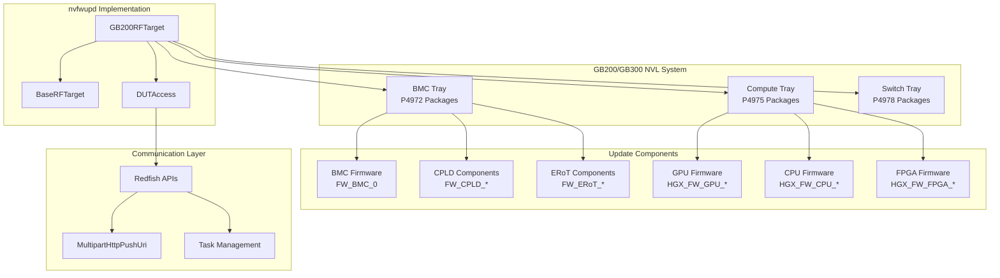
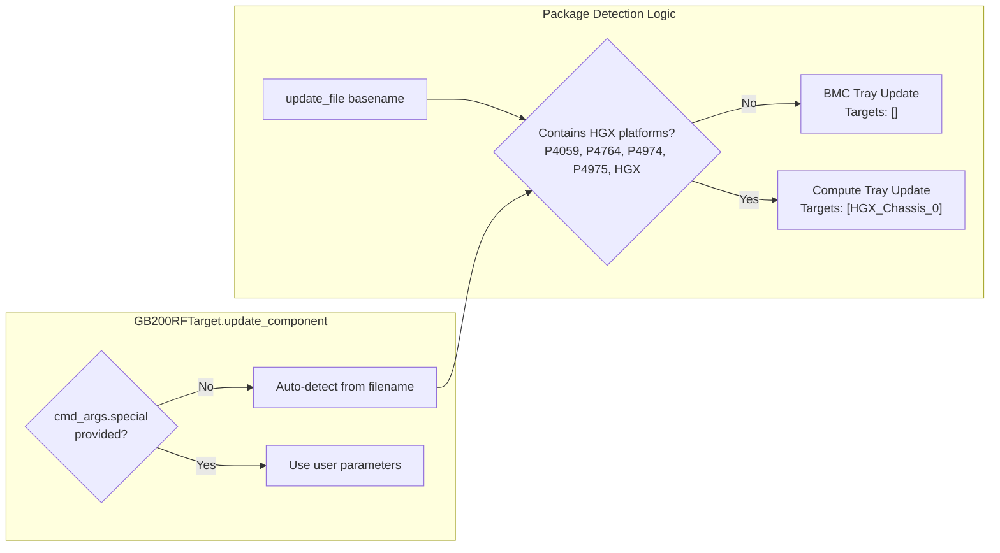
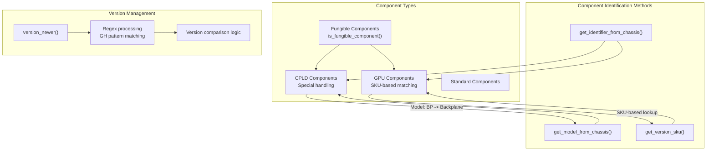
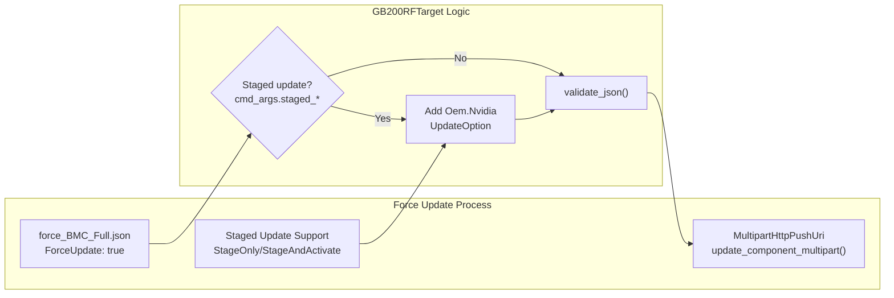
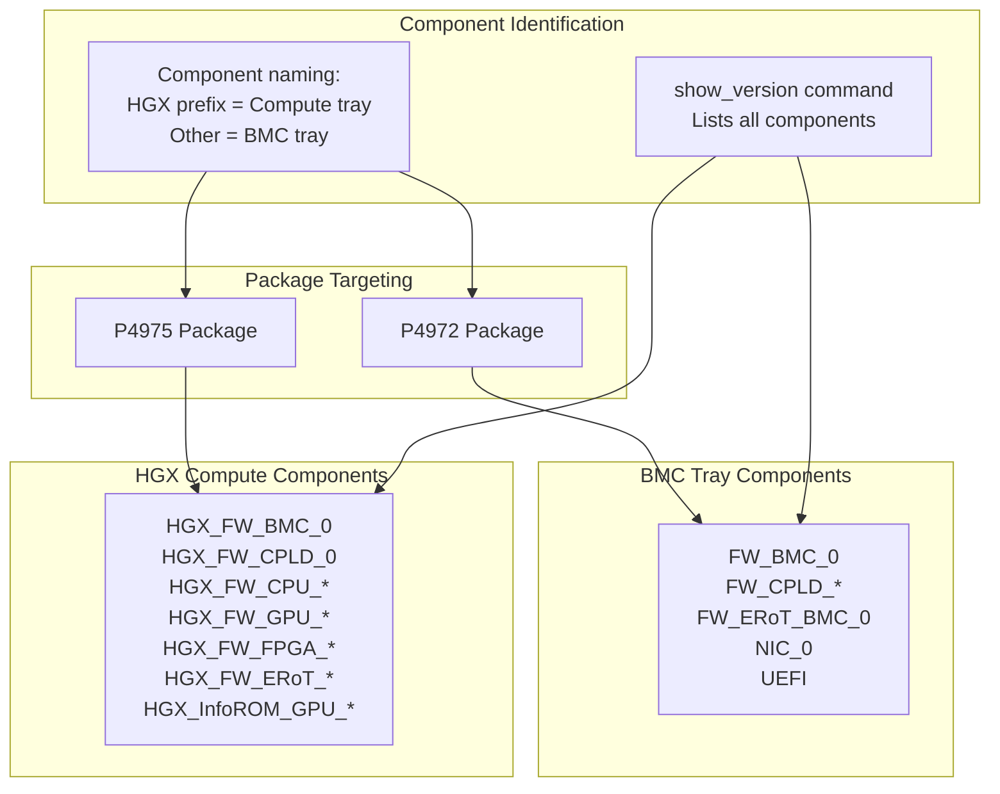

<!-- source: DeepWiki mcp.deepwiki.com · repo NVIDIA/open-nvfwupd · page 5.1 GB200 and GB300 NVL Systems · fetched 2026-10-26 -->

# GB200 and GB300 NVL Systems

<details>
<summary>Relevant source files</summary>

The following files were used as context for generating this wiki page:

- [firmware_update_guide/docs/examples/gb200NVL.rst](firmware_update_guide/docs/examples/gb200NVL.rst)
- [nvfwupd/gb200_rftarget.py](nvfwupd/gb200_rftarget.py)

</details>


This guide covers firmware update procedures and implementation details for NVIDIA GB200 and GB300 NVL (NVLink) systems using the open-nvfwupd utility. GB200 and GB300 NVL systems are multi-tray platforms that require specialized update procedures for their BMC, compute, and switch components.

For GB200 switch-specific procedures, see [GB200 Switch Systems](#5.2). For other NVIDIA platforms, see [DGX Systems](#5.3) and [HGX and HGXB100 Systems](#5.4).

## System Architecture Overview

GB200 and GB300 NVL systems are complex multi-tray platforms that require coordinated firmware updates across different hardware components. The system architecture includes distinct trays with specific firmware packages and update procedures.



**Sources:** [nvfwupd/gb200_rftarget.py:1-297](), [firmware_update_guide/docs/examples/gb200NVL.rst:1-824]()

## Firmware Package Structure

GB200 and GB300 NVL systems use three distinct firmware package types, each targeting specific hardware trays. The package identification is embedded in the filename and determines the update behavior.

| Package Type | Target Components | Target Specification |
|--------------|-------------------|---------------------|
| **P4972** | BMC Tray | `{"Targets": []}` (default) |
| **P4975** | Compute Tray | `{"Targets": ["/redfish/v1/Chassis/HGX_Chassis_0"]}` |
| **P4978** | Switch Tray | Uses different communication protocol |



**Sources:** [nvfwupd/gb200_rftarget.py:114-127](), [firmware_update_guide/docs/examples/gb200NVL.rst:6-11]()

## Component Identification and Management

The `GB200RFTarget` class implements specialized component identification logic for the diverse hardware components in GB200/GB300 systems. This includes fungible component detection and version comparison algorithms.



**Sources:** [nvfwupd/gb200_rftarget.py:176-297](), [nvfwupd/gb200_rftarget.py:246-274]()

## Update Procedures and Workflows

### BMC Tray Updates

BMC tray updates use P4972 packages and target the base system components. Starting with open-nvfwupd 1.0.1, the `-s` option is optional for full BMC tray updates.

```bash
# Full BMC tray update (1.0.1+)
nvfwupd.py -t ip=<BMC_IP> user=*** password=*** update_fw \
  -p nvfw_GB200-P4972_0004_240808.1.1_custom_prod-signed.fwpkg

# Legacy method with targets file
nvfwupd.py -t ip=<BMC_IP> user=*** password=*** update_fw \
  -s BMC_Full.json -p nvfw_GB200-P4972_0004_240808.1.1_custom_prod-signed.fwpkg
```

**Sources:** [firmware_update_guide/docs/examples/gb200NVL.rst:16-67]()

### Compute Tray Updates

Compute tray updates require explicit targeting to the HGX chassis and use P4975 packages. These updates target GPU, CPU, and FPGA components.

```bash
# Compute tray update
nvfwupd.py -t ip=<BMC_IP> user=*** password=*** servertype=GB200 update_fw \
  -s Compute_Full.json -p nvfw_GB200-P4975_0004_240808.1.0_custom_prod-signed.fwpkg
```

Where `Compute_Full.json` contains:
```json
{
    "Targets": ["/redfish/v1/Chassis/HGX_Chassis_0"]
}
```

**Sources:** [firmware_update_guide/docs/examples/gb200NVL.rst:68-116]()

### Force Updates and Downgrades

Force updates enable firmware downgrades by setting the `ForceUpdate` flag. This bypasses version comparison checks for scenarios requiring specific firmware versions.



**Sources:** [nvfwupd/gb200_rftarget.py:128-151](), [firmware_update_guide/docs/examples/gb200NVL.rst:117-169]()

## Component-Specific Updates

Individual components can be updated by specifying their Redfish inventory URIs. The system supports granular component targeting for precise firmware management.

### GPU Component Updates
```bash
nvfwupd.py --target ip=<BMC_IP> user=*** password=*** servertype=GB200 update_fw \
  -s CPU.json -p nvfw_GB200-P4975_0004_240717.1.0_custom_prod-signed.fwpkg
```

Where `CPU.json` targets a specific component:
```json
{
    "Targets": ["/redfish/v1/UpdateService/FirmwareInventory/HGX_FW_CPU_0"]
}
```

### Component Inventory



**Sources:** [firmware_update_guide/docs/examples/gb200NVL.rst:170-268](), [firmware_update_guide/docs/examples/gb200NVL.rst:187-225]()

## Implementation Details

### GB200RFTarget Class Structure

The `GB200RFTarget` class extends `BaseRFTarget` and implements platform-specific behavior for GB200/GB300 systems.

```mermaid
classDiagram
    class BaseRFTarget {
        +target_access: DUTAccess
        +update_component_multipart()
        +validate_json()
        +version_newer()
    }
    
    class GB200RFTarget {
        +fungible_components: ["gpu"]
        +update_completion_msg: str
        +get_update_uri(update_service_response)
        +update_component(cmd_args, update_uri, update_file, time_out, json_dict, parallel_update)
        +is_fungible_component(component_name)
        +version_newer(pkg_version, sys_version)
        +get_identifier_from_chassis(ap_inv_uri)
        +get_model_from_chassis(ap_name)
        +get_version_sku(identifier, pldm_version_dict, ap_name)
    }
    
    BaseRFTarget <|-- GB200RFTarget
    
    note for GB200RFTarget : "Supports MultipartHttpPushUri\nAutomatic package detection\nStaged update capabilities\nForce update support"
```

### Key Methods and Functionality

| Method | Purpose | Key Features |
|--------|---------|--------------|
| `get_update_uri()` | Acquire update endpoint | Returns `MultipartHttpPushUri` or fallback |
| `update_component()` | Main update orchestration | Auto-detection, staged updates, multipart handling |
| `is_fungible_component()` | Component classification | Special CPLD/GPU handling |
| `version_newer()` | Version comparison | Regex processing for GH patterns |
| `get_identifier_from_chassis()` | SKU/ID resolution | Redfish chassis traversal |

**Sources:** [nvfwupd/gb200_rftarget.py:23-58](), [nvfwupd/gb200_rftarget.py:74-297]()

## Activation and Power Management

After firmware updates complete, activation requires specific power cycling procedures based on the updated components:

- **BMC Tray Updates**: Power cycle required
- **Compute Tray Updates**: AC cycle required  
- **Component Updates**: AC power cycle required

The BMC and Redfish service typically require up to 5 minutes to become available after power cycling.

**Sources:** [firmware_update_guide/docs/examples/gb200NVL.rst:270-274]()

---

