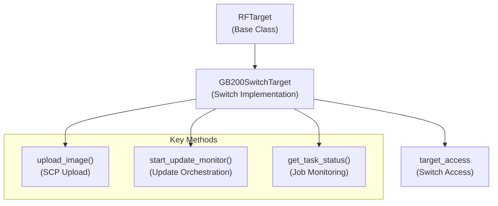
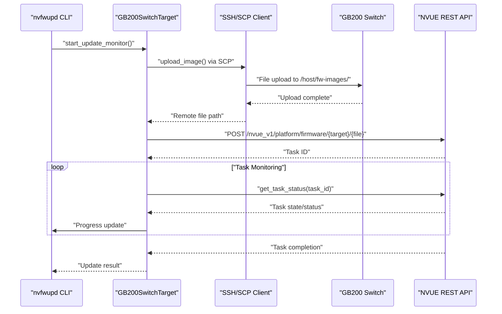
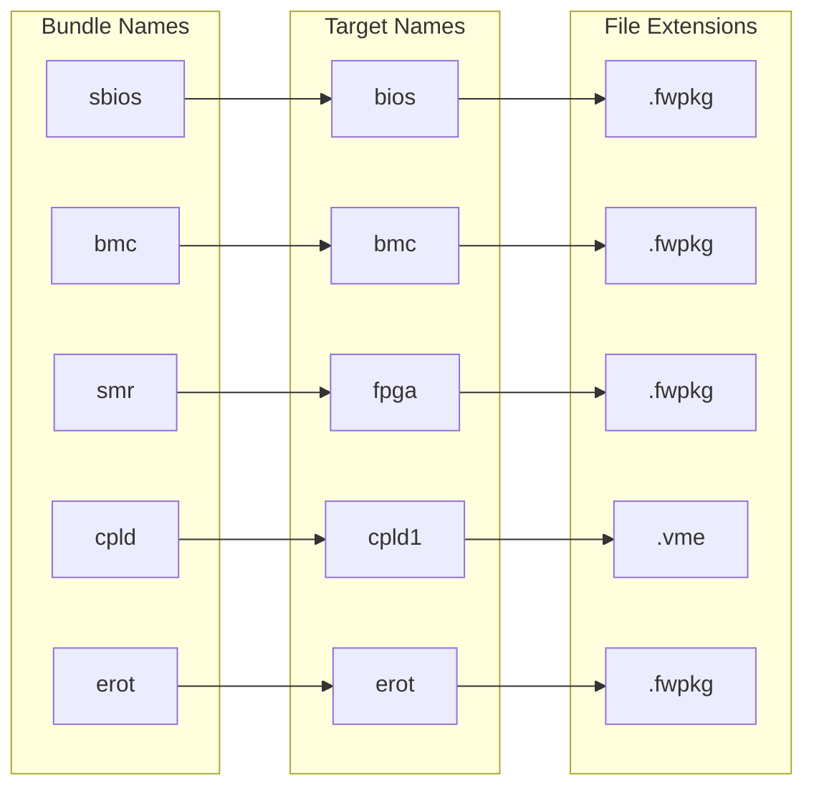
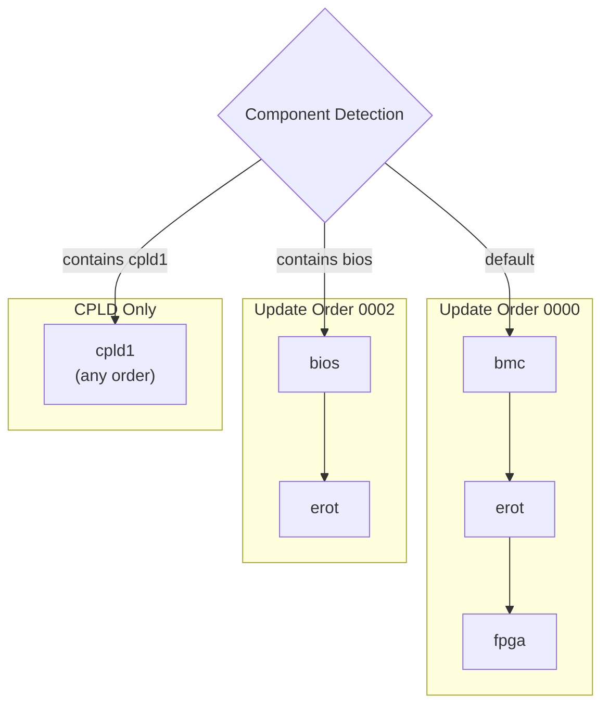
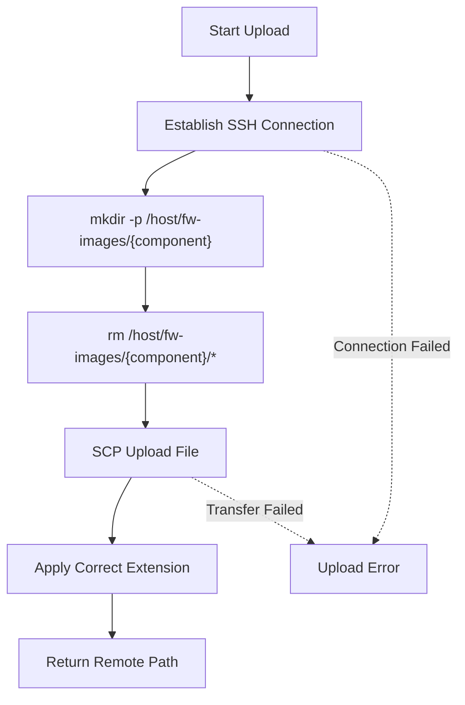
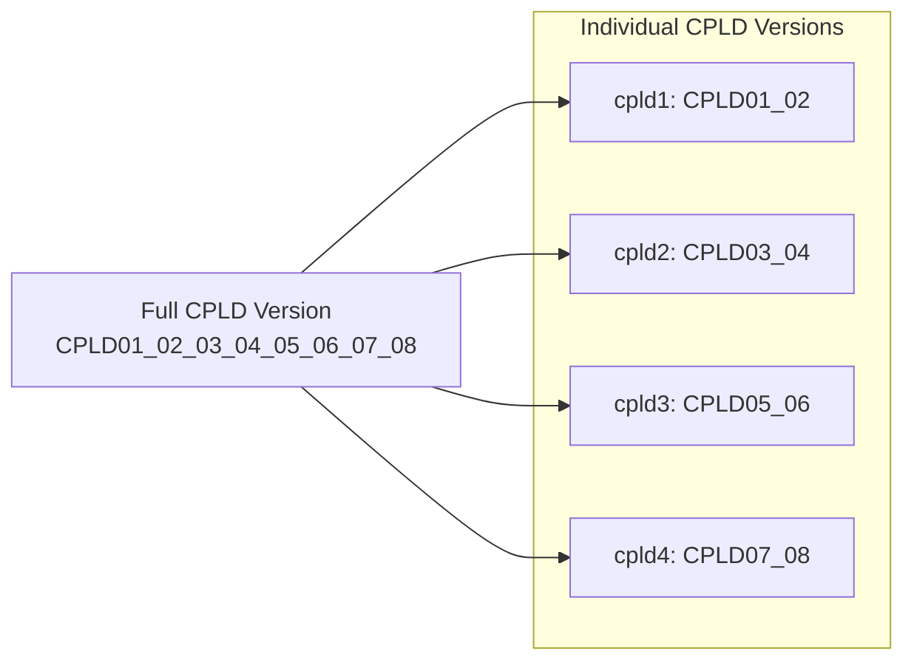

<!-- source: DeepWiki mcp.deepwiki.com · repo NVIDIA/open-nvfwupd · page 5.2 GB200 Switch Systems · fetched 2026-10-26 -->

# GB200 Switch Systems

<details>
<summary>Relevant source files</summary>

The following files were used as context for generating this wiki page:

- [nvfwupd/gb200_rftarget.py](nvfwupd/gb200_rftarget.py)
- [nvfwupd/gb200_switch_target.py](nvfwupd/gb200_switch_target.py)

</details>


This document covers firmware update procedures and architecture for GB200 switch hardware using the `nvfwupd` utility. GB200 switches use NVUE REST APIs and SSH/SCP protocols for firmware updates, which differs significantly from the Redfish-based approach used for GB200 NVL compute systems.

For information about GB200 and GB300 NVL compute systems, see [GB200 and GB300 NVL Systems](#5.1).

## Overview

GB200 switch systems are managed through the `GB200SwitchTarget` class, which implements a distinct firmware update workflow compared to other NVIDIA platforms. These switches run NVUE (NVIDIA User Experience) and require specialized handling for component updates, file uploads, and task monitoring.

The switch update process involves uploading firmware files via SCP, initiating updates through NVUE REST API endpoints, and monitoring task completion through job status queries.

**Sources:** [nvfwupd/gb200_switch_target.py:1-668]()

## Architecture

### Class Hierarchy



### Communication Flow



**Sources:** [nvfwupd/gb200_switch_target.py:133-189](), [nvfwupd/gb200_switch_target.py:238-456](), [nvfwupd/gb200_switch_target.py:488-528]()

## Component Support

### Supported Components

The `GB200SwitchTarget` supports the following firmware components:

| Component | File Extension | Bundle Name | Target Name |
|-----------|---------------|-------------|-------------|
| BIOS | `.fwpkg` | `sbios` | `bios` |
| BMC | `.fwpkg` | `bmc` | `bmc` |
| FPGA | `.fwpkg` | `smr` | `fpga` |
| CPLD | `.vme` | `cpld` | `cpld1` |
| eROT | `.fwpkg` | `erot` | `erot` |

### Component Mapping



**Sources:** [nvfwupd/gb200_switch_target.py:104-118](), [nvfwupd/gb200_switch_target.py:119-131]()

## Update Process

### Update Ordering

GB200 switches enforce specific update ordering based on the components being updated:



**Sources:** [nvfwupd/gb200_switch_target.py:92-94](), [nvfwupd/gb200_switch_target.py:333-346]()

### File Upload Process

The switch update process uses SSH/SCP for file uploads:

1. **Connection Setup**: Establish SSH connection using `paramiko.SSHClient`
2. **Directory Preparation**: Create component-specific directories under `/host/fw-images/`
3. **File Cleanup**: Remove existing files from upload directory
4. **File Upload**: Transfer firmware file via SCP
5. **File Renaming**: Apply correct file extension based on component type



**Sources:** [nvfwupd/gb200_switch_target.py:133-189]()

### Task Monitoring

Task monitoring uses NVUE REST API endpoints with retry logic:

| Task State | Description | Action |
|------------|-------------|--------|
| `running` | Update in progress | Continue polling |
| `start` | Update initiated | Continue polling |
| `action_error` | Update failed | Report error |
| `action_success` | Update completed | Success |

**Sources:** [nvfwupd/gb200_switch_target.py:90-91](), [nvfwupd/gb200_switch_target.py:458-486]()

## CPLD Version Handling

GB200 switches implement specialized CPLD version handling with 4-part versioning:

### Version Format



The `get_component_version()` method parses the full CPLD version string and extracts individual component versions based on position in the 8-segment format.

**Sources:** [nvfwupd/gb200_switch_target.py:610-649]()

## API Endpoints

### NVUE REST API

The switch uses NVUE-specific REST endpoints:

| Endpoint | Purpose | Method |
|----------|---------|---------|
| `/nvue_v1/platform/firmware/{target}/files/{file}` | Initiate firmware update | POST |
| Job status endpoints | Monitor update progress | GET |

### Request Format

Update requests use the following JSON structure:
```json
{
  "@install": {
    "state": "start",
    "parameters": {
      "force": false
    }
  }
}
```

**Sources:** [nvfwupd/gb200_switch_target.py:87](), [nvfwupd/gb200_switch_target.py:382]()

## Configuration

### Target Selection

GB200 switches support multiple target selection methods:

1. **Special Parameters**: JSON string or file with target list
2. **Config File**: `UpdateParametersTargets` configuration
3. **Automatic**: All components in firmware package

### Example Configuration

```yaml
UpdateParametersTargets:
  - "BMC"
  - "EROT" 
  - "FPGA"
```

**Sources:** [nvfwupd/gb200_switch_target.py:276-354]()

---

