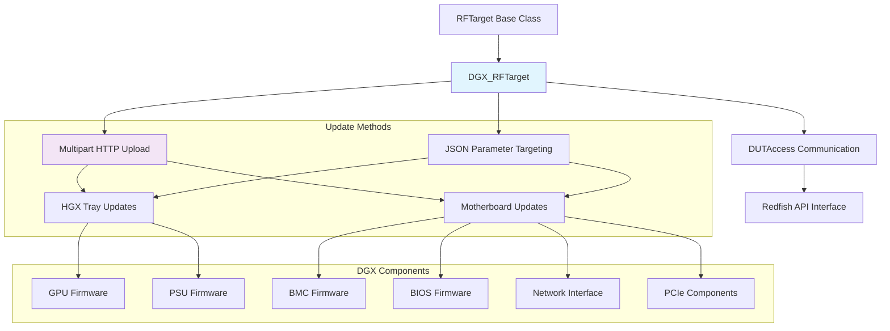
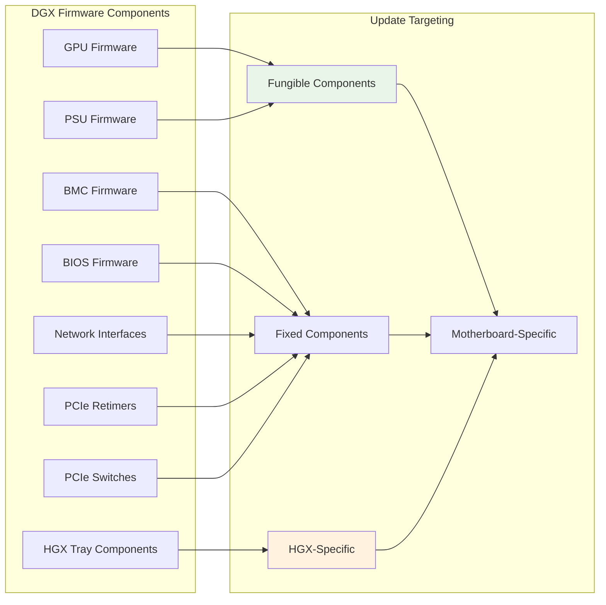
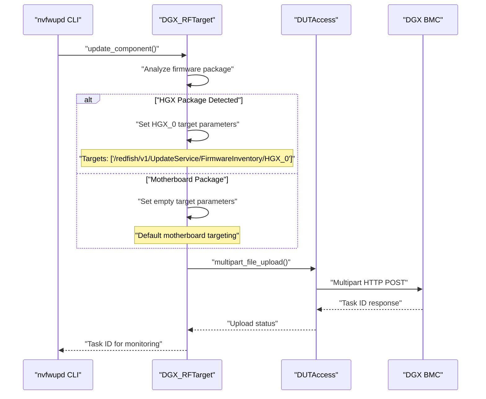
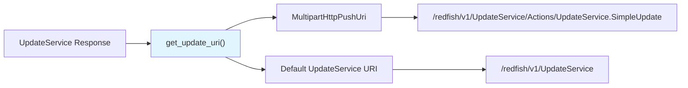
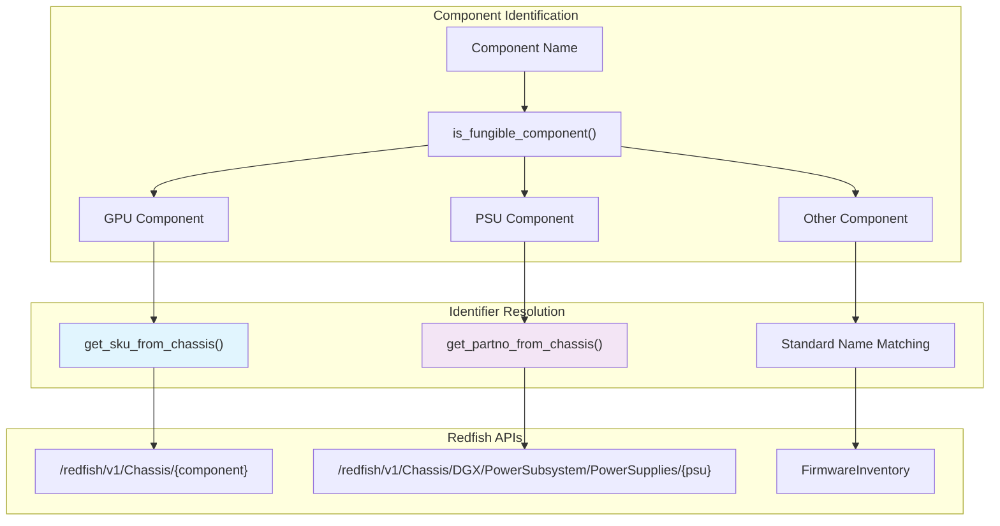

<!-- source: DeepWiki mcp.deepwiki.com · repo NVIDIA/open-nvfwupd · page 5.3 DGX Systems · fetched 2026-10-26 -->

# DGX Systems

<details>
<summary>Relevant source files</summary>

The following files were used as context for generating this wiki page:

- [nvfwupd/base_rftarget.py](nvfwupd/base_rftarget.py)
- [nvfwupd/dgx_rftarget.py](nvfwupd/dgx_rftarget.py)

</details>


This document covers firmware update procedures and implementation details for NVIDIA DGX platforms using the open-nvfwupd utility. It focuses on the DGX-specific implementation, supported components, and update workflows.

For information about other NVIDIA platforms, see [GB200 and GB300 NVL Systems](#5.1), [GB200 Switch Systems](#5.2), or [HGX and HGXB100 Systems](#5.4).

## Platform Overview

DGX systems are NVIDIA's AI workstation and datacenter platforms that combine multiple GPUs with high-performance computing infrastructure. The nvfwupd utility supports firmware updates for various DGX platform components through the `DGX_RFTarget` implementation.

### DGX Target Implementation



**Sources:** [nvfwupd/dgx_rftarget.py:24-76]()

## Supported Components

DGX systems support firmware updates for multiple component types, with special handling for fungible components that may have multiple instances.

### Fungible Components

| Component Type | Description | Special Handling |
|----------------|-------------|------------------|
| GPU | Graphics processing units | SKU-based version matching |
| PSU | Power supply units | Part number identification |

### Component Categories



**Sources:** [nvfwupd/dgx_rftarget.py:71-76](), [nvfwupd/dgx_rftarget.py:78-91]()

## Update Process Architecture

The DGX update process uses multipart HTTP uploads with JSON parameter targeting to specify which components should be updated.

### Update Flow



**Sources:** [nvfwupd/dgx_rftarget.py:95-191]()

### Update URI Resolution

The `get_update_uri()` method determines the appropriate Redfish endpoint for firmware updates:



**Sources:** [nvfwupd/dgx_rftarget.py:219-229]()

## Component Version Management

DGX systems require sophisticated version matching for fungible components like GPUs and PSUs.

### Version Resolution Methods

| Method | Purpose | Component Types |
|--------|---------|-----------------|
| `get_component_version()` | Match component names to package versions | All components |
| `get_version_sku()` | SKU-based matching for fungible components | GPU, PSU |
| `get_sku_from_chassis()` | Retrieve SKU from Redfish chassis | GPU |
| `get_partno_from_chassis()` | Retrieve part number from power subsystem | PSU |

### SKU and Part Number Resolution



**Sources:** [nvfwupd/dgx_rftarget.py:193-217](), [nvfwupd/dgx_rftarget.py:301-347]()

## Technical Implementation Details

### Package Type Detection

The DGX target automatically detects package types to determine appropriate update parameters:

```python
# HGX package detection logic
hgx_platforms = ["HGX"]
if next((platform for platform in hgx_platforms if platform in file_name), None):
    # GPU Tray Update (wrapper bundle)
    json_params = {"Targets": ["/redfish/v1/UpdateService/FirmwareInventory/HGX_0"]}
else:
    # MB Tray Update
    json_params = {}
```

**Sources:** [nvfwupd/dgx_rftarget.py:127-139]()

### Component Name Normalization

DGX platforms use specific component name mappings for version resolution:

| Original Name | Normalized Name | Component Type |
|---------------|-----------------|----------------|
| `hgx_fw_*` | Remove prefix | HGX components |
| `hgx_fw_bmc` | `hmc` | HGX BMC |
| `*bios*` | `sbios` | System BIOS |
| `*bmc*` | `bmc` | Baseboard BMC |
| `*nvlink*` | `cx7` | NVLink interface |
| `*cx7nic*` | `bluefield3` | ConnectX-7 NIC |

**Sources:** [nvfwupd/dgx_rftarget.py:244-262]()

### Error Handling and Logging

The DGX implementation includes comprehensive error handling for component identification failures:

- PSU part number retrieval failures are logged to file only
- Chassis access errors are suppressed for non-critical operations  
- Task ID extraction handles multiple response formats

**Sources:** [nvfwupd/dgx_rftarget.py:337-346](), [nvfwupd/dgx_rftarget.py:180-185]()

## Usage Considerations

### Update Completion Message

DGX systems display platform-specific completion messages directing users to the DGX Firmware Update Document for activation procedures.

### Parallel Update Support

The `update_component()` method supports parallel updates through the `parallel_update` parameter, enabling thread-safe error handling and JSON output formatting.

**Sources:** [nvfwupd/dgx_rftarget.py:72-76](), [nvfwupd/dgx_rftarget.py:102]()

---

