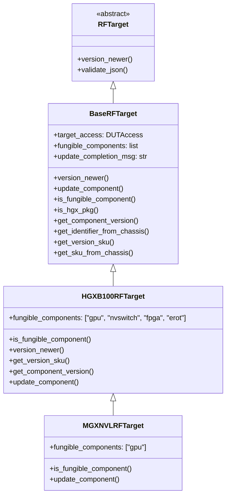
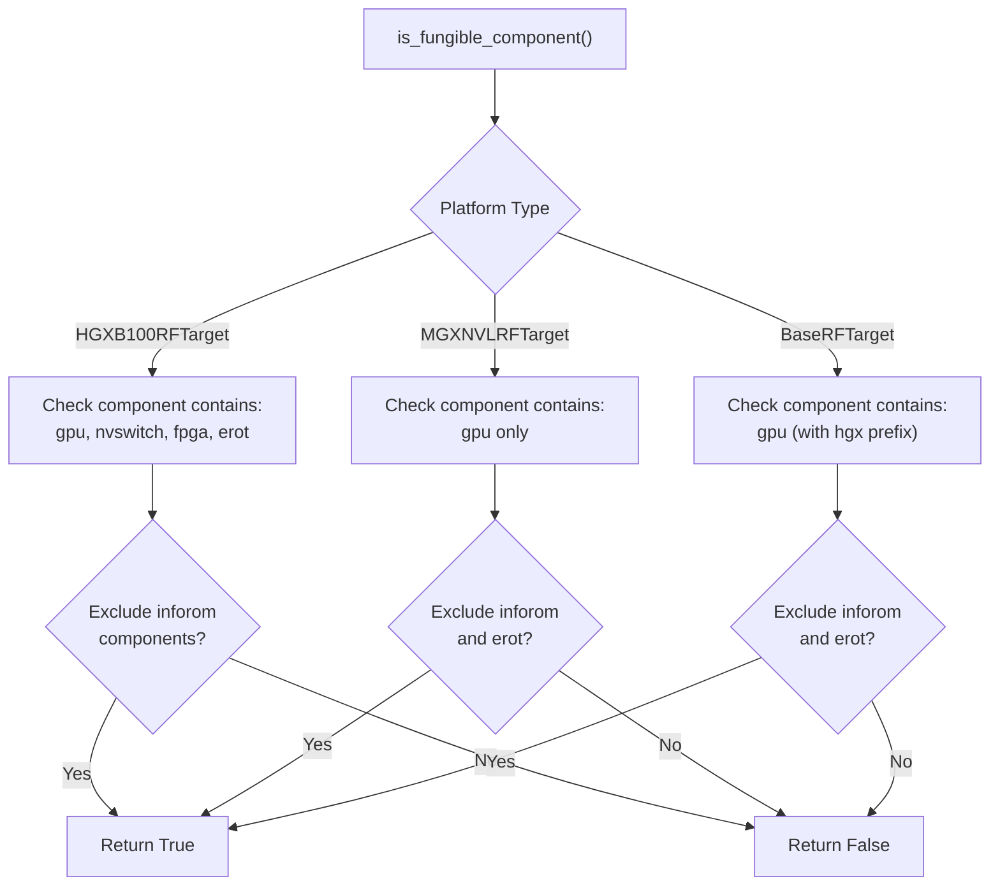
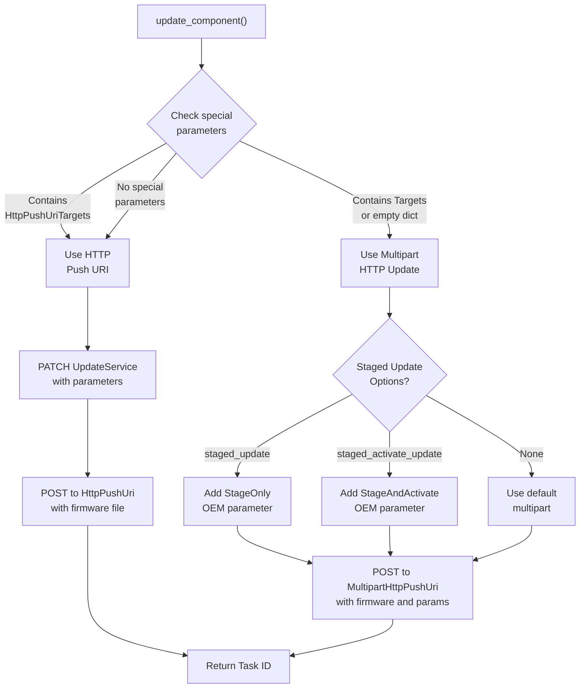
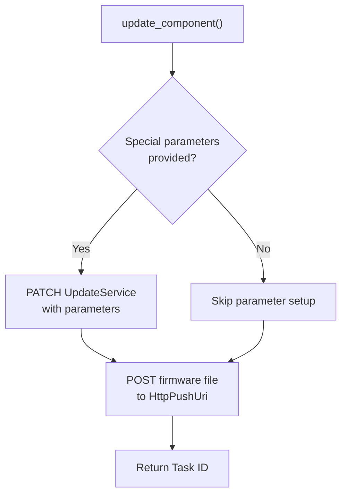
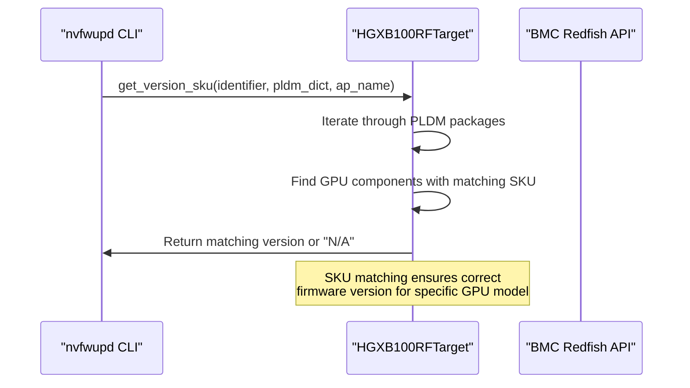

<!-- source: DeepWiki mcp.deepwiki.com · repo NVIDIA/open-nvfwupd · page 5.4 HGX and HGXB100 Systems · fetched 2026-10-26 -->

# HGX and HGXB100 Systems

<details>
<summary>Relevant source files</summary>

The following files were used as context for generating this wiki page:

- [nvfwupd/base_rftarget.py](nvfwupd/base_rftarget.py)
- [nvfwupd/hgxb100_rftarget.py](nvfwupd/hgxb100_rftarget.py)

</details>


This document covers firmware update support for NVIDIA HGX and HGXB100 platforms, including MGX-NVL variants. It details the platform-specific implementations, update methods, and configuration options available for these hardware families.

For GB200/GB300 NVL platform support, see [GB200 and GB300 NVL Systems](#5.1). For DGX platform support, see [DGX Systems](#5.3).

## Platform Support Overview

The nvfwupd tool supports three distinct platform families within the HGX ecosystem:

| Platform Family | Implementation Class | Supported Components | Update Methods |
|-----------------|---------------------|---------------------|----------------|
| HGX-B100 | `HGXB100RFTarget` | GPU, NVSwitch, FPGA, eRoT | HTTP Push URI, Multipart |
| MGX-NVL | `MGXNVLRFTarget` | GPU | HTTP Push URI |
| HGX (Legacy) | `BaseRFTarget` | GPU | HTTP Push URI |

These platforms utilize Redfish APIs for firmware management and support various update mechanisms depending on the specific hardware configuration.

## Class Hierarchy and Implementation



Sources: [nvfwupd/base_rftarget.py:23-321](), [nvfwupd/hgxb100_rftarget.py:23-502]()

## Platform-Specific Behaviors

### Fungible Component Detection

Each platform defines different sets of components that can be updated without requiring a system restart:



Sources: [nvfwupd/base_rftarget.py:178-190](), [nvfwupd/hgxb100_rftarget.py:72-85](), [nvfwupd/hgxb100_rftarget.py:408-421]()

### Version Comparison Logic

All HGX platforms implement custom version comparison logic to handle platform-specific version string formats:

| Platform | Version String Handling | Special Cases |
|----------|------------------------|---------------|
| `BaseRFTarget` | Removes dots if system version lacks them | Handles "GraceBMC" prefix removal |
| `HGXB100RFTarget` | Converts underscores to empty strings | Handles numeric_numeric_numeric format |
| `MGXNVLRFTarget` | Inherits from HGXB100RFTarget | Same as HGXB100 |

Sources: [nvfwupd/base_rftarget.py:75-94](), [nvfwupd/hgxb100_rftarget.py:87-110]()

## Update Methods and Capabilities

### HGXB100RFTarget Update Methods

The `HGXB100RFTarget` class supports multiple update mechanisms based on the provided parameters:



Sources: [nvfwupd/hgxb100_rftarget.py:186-364]()

### MGXNVLRFTarget Update Methods

The `MGXNVLRFTarget` implementation uses a simplified update approach:



Sources: [nvfwupd/hgxb100_rftarget.py:425-501]()

## Component Version Resolution

Both platform implementations provide sophisticated component version resolution from PLDM package dictionaries:

### Component Name Mapping

The `get_component_version()` method performs several transformations to match component names:

| Original Component Name | Transformed Name | Platform Scope |
|------------------------|------------------|----------------|
| `hgx_fw_bmc` | `hmc` | HGX packages only |
| `*_gpu_*` (non-inforom) | `gpu` | All platforms |
| `*_cpu_*` | `sbios` | All platforms |
| `*_erot_*` | `erot` | All platforms |
| `*_nvlink_*` | `cx7` | HGXB100 only |
| `*_pcie_*` | `pcieswitch` | Non-HGX packages |

### SKU-Based Version Resolution

For fungible components like GPUs, the system supports SKU-based version matching:



Sources: [nvfwupd/base_rftarget.py:285-302](), [nvfwupd/hgxb100_rftarget.py:112-128]()

## Configuration and Special Features

### Staged Update Support

HGXB100 platforms support staged firmware updates through OEM-specific parameters:

| Update Mode | OEM Parameter | Description |
|-------------|---------------|-------------|
| `staged_update` | `{"Oem": {"Nvidia": {"UpdateOption": "StageOnly"}}}` | Stage firmware without activation |
| `staged_activate_update` | `{"Oem": {"Nvidia": {"UpdateOption": "StageAndActivate"}}}` | Stage and automatically activate |

### Special Update Parameters

Both platforms support special update parameters through JSON configuration:

```json
{
  "HttpPushUriTargets": {
    "Component1": "target_value"
  },
  "Targets": {
    "Component2": "target_value"  
  },
  "Oem": {
    "Nvidia": {
      "UpdateOption": "StageOnly"
    }
  }
}
```

The presence of `Targets` or an empty dictionary forces multipart upload mode, while `HttpPushUriTargets` uses the simpler HTTP Push URI method.

Sources: [nvfwupd/hgxb100_rftarget.py:234-261](), [nvfwupd/hgxb100_rftarget.py:217-240]()

## Platform Detection

HGX platform packages are automatically detected using the `is_hgx_pkg()` method in the base class:

```python
hgx_platforms = ["HGX", "4059", "4764", "4974", "4975", "MGX-NVL16"]
```

This detection influences component version resolution and update behavior across all HGX-family platforms.

Sources: [nvfwupd/base_rftarget.py:192-204]()

---

