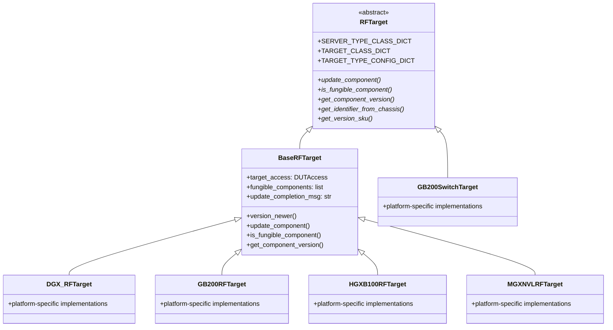
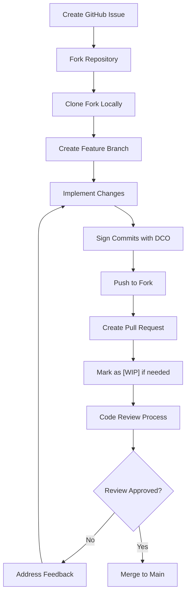
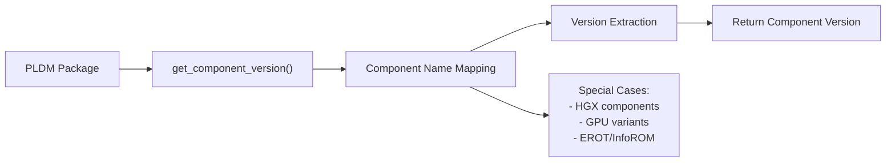
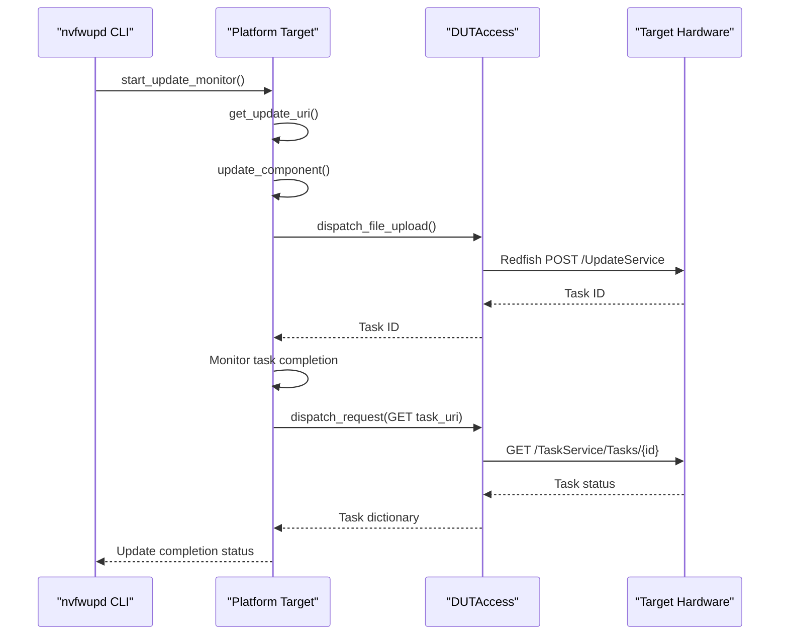

<!-- source: DeepWiki mcp.deepwiki.com · repo NVIDIA/open-nvfwupd · page 6 Developer Guide · fetched 2026-10-26 -->

# Developer Guide

<details>
<summary>Relevant source files</summary>

The following files were used as context for generating this wiki page:

- [CONTRIBUTING.md](CONTRIBUTING.md)
- [nvfwupd/base_rftarget.py](nvfwupd/base_rftarget.py)
- [nvfwupd/rf_target.py](nvfwupd/rf_target.py)

</details>


This document provides technical guidance for developers contributing to the open-nvfwupd project. It covers the codebase architecture, development workflow, and procedures for extending platform support.

For information about using the nvfwupd tool, see [User Guide](#3). For platform-specific implementation details, see [Platform Guides](#5).

## Codebase Architecture Overview

The open-nvfwupd codebase follows a layered architecture with clear separation between CLI handling, platform abstraction, and hardware communication. Understanding these layers is essential for effective development.

### Core Abstraction Hierarchy



**Sources:** [nvfwupd/rf_target.py:99-117](), [nvfwupd/base_rftarget.py:23-74]()

### Platform Factory Pattern

The codebase uses a factory pattern to instantiate platform-specific targets based on system detection or configuration. Three mapping dictionaries control this selection:

| Dictionary | Purpose | Example Mappings |
|------------|---------|------------------|
| `SERVER_TYPE_CLASS_DICT` | Maps detected server types to target classes | `"dgx": "DGX_RFTarget"` |
| `TARGET_CLASS_DICT` | Maps target names to target classes | `"gb200 nvl": "GB200RFTarget"` |
| `TARGET_TYPE_CONFIG_DICT` | Maps BMC types to target classes | `"ami": "DGX_RFTarget"` |

**Sources:** [nvfwupd/rf_target.py:99-117]()

## Development Workflow

### Contribution Process



**Sources:** [CONTRIBUTING.md:1-58]()

### Code Signing Requirements

All contributions must include Developer Certificate of Origin (DCO) sign-off:

```bash
git commit -s -m "Add cool feature."
```

This appends the required sign-off line to commit messages. Contributions without proper sign-off will not be accepted.

**Sources:** [CONTRIBUTING.md:17-31]()

## Adding Platform Support

### Required Implementation Steps

To add support for a new hardware platform, developers must:

1. **Create Platform Target Class**: Extend `RFTarget` or `BaseRFTarget`
2. **Implement Abstract Methods**: Provide platform-specific implementations
3. **Update Factory Mappings**: Add entries to the mapping dictionaries
4. **Test Integration**: Verify firmware update workflows

### Abstract Methods Implementation

```mermaid
classDiagram
    class RFTarget {
        <<abstract>>
        +update_component(cmd_args, update_uri, update_file, time_out, json_dict, parallel_update)*
        +is_fungible_component(component_name)*
        +get_component_version(pldm_version_dict, ap_name)*
        +get_identifier_from_chassis(ap_inv_uri)*
        +get_version_sku(identifier, pldm_version_dict, ap_name)*
    }
    
    class NewPlatformTarget {
        +update_component()
        +is_fungible_component()
        +get_component_version()
        +get_identifier_from_chassis()
        +get_version_sku()
    }
    
    RFTarget <|-- NewPlatformTarget
    
    note for NewPlatformTarget : "Must implement all abstract methods\nfrom RFTarget base class"
```

**Sources:** [nvfwupd/rf_target.py:183-210]()

### BaseRFTarget Extension Pattern

Most platforms should extend `BaseRFTarget` rather than `RFTarget` directly, as it provides common Redfish functionality:

| Method | Purpose | Default Implementation |
|--------|---------|----------------------|
| `version_newer()` | Compare firmware versions | Handles version string parsing and comparison |
| `update_component()` | Execute firmware updates | Implements Redfish file upload and task management |
| `is_fungible_component()` | Identify swappable components | Checks for GPU components excluding InfoROM/eROT |

**Sources:** [nvfwupd/base_rftarget.py:75-177]()

### Component Version Management

Platform implementations must handle component version extraction from PLDM firmware packages. The `get_component_version()` method maps component names to package versions:



**Sources:** [nvfwupd/base_rftarget.py:206-258]()

## Core Development Concepts

### Update Workflow Architecture

The firmware update process follows a consistent pattern across all platforms:



**Sources:** [nvfwupd/rf_target.py:694-1076]()

### Task Monitoring Implementation

The framework provides robust task monitoring with retry logic and failure detection:

| State Category | States | Handling |
|---------------|--------|----------|
| `TASK_PENDING_STATES` | `"new", "pending", "running", "service", "starting"` | Continue monitoring |
| `TASK_FAILURE_STATES` | `"cancelled", "exception", "interrupted", "killed"` | Report failure and exit |
| Completion | `"completed"` | Check TaskStatus for success/warning |

**Sources:** [nvfwupd/rf_target.py:118-129]()

### Extension Points for Developers

Key areas where developers can extend functionality:

1. **New Platform Support**: Add classes to the inheritance hierarchy
2. **Custom Update Methods**: Override `update_component()` for platform-specific protocols
3. **Component Detection**: Implement `is_fungible_component()` for hardware-specific logic
4. **Version Parsing**: Customize `version_newer()` for vendor-specific version formats

**Sources:** [nvfwupd/rf_target.py:30-97](), [nvfwupd/base_rftarget.py:23-74]()

---

