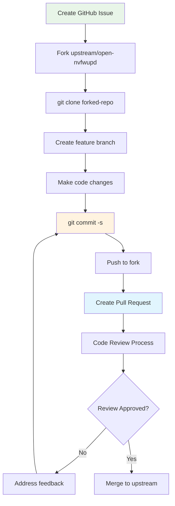
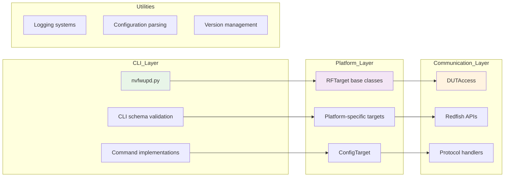

<!-- source: DeepWiki mcp.deepwiki.com · repo NVIDIA/open-nvfwupd · page 6.1 Contributing · fetched 2026-10-26 -->

# Contributing

<details>
<summary>Relevant source files</summary>

The following files were used as context for generating this wiki page:

- [CONTRIBUTING.md](CONTRIBUTING.md)

</details>


This document provides guidelines and procedures for contributing code to the open-nvfwupd project. It covers the development workflow, pull request process, and code signing requirements necessary for successful contributions.

For information about adding support for new hardware platforms, see [Adding Platform Support](#6.2). For technical architecture details that may inform your contributions, see [Architecture](#4).

## Development Workflow

The open-nvfwupd project follows a standard fork-and-pull-request workflow for code contributions. Contributors must follow specific procedures to ensure code quality and legal compliance.

### Getting Started

Before making any code contributions, you must first gain access to contribute:

1. **Request Access**: Create a GitHub issue explaining what you wish to contribute
2. **Fork Repository**: Fork the [upstream repository](https://github.com/nvidia/open-nvfwupd)
3. **Clone Locally**: Clone your forked repository to your development environment

### Contribution Process Flow



Sources: [CONTRIBUTING.md:1-58]()

## Pull Request Guidelines

### Creating Pull Requests

When creating pull requests, follow these guidelines:

| Requirement | Description |
|-------------|-------------|
| **Branch Selection** | Exercise caution when selecting source and target branches |
| **Work-in-Progress** | Prefix PR titles with `[WIP]` while under development |
| **Description** | Provide clear description of changes and their purpose |
| **Testing** | Ensure changes are tested against relevant platform targets |

### Code Review Process

The code review process begins automatically when a pull request is created. During review:

- Mark incomplete PRs as work-in-progress using `[WIP]` prefix
- Respond to reviewer feedback promptly
- Make necessary changes and push updates to the same branch
- Ensure all commits are properly signed off

Sources: [CONTRIBUTING.md:3-16]()

## Code Signing Requirements

All contributions must include properly signed commits using the Developer Certificate of Origin (DCO).

### Signing Commits

Every commit must be signed off using the `--signoff` or `-s` option:

```bash
git commit -s -m "Add cool feature."
```

This appends the following to your commit message:
```
Signed-off-by: Your Name <your@email.com>
```

### Sign-off Enforcement

| Policy | Details |
|--------|---------|
| **Mandatory** | All commits must be signed off |
| **Rejection** | Contributions with unsigned commits will not be accepted |
| **Certification** | Sign-off certifies you have rights to submit under project license |

### Developer Certificate of Origin

The DCO certification covers four key areas:

1. **Original Work**: Contribution created wholly or partially by you
2. **Previous Work**: Based on appropriately licensed previous work 
3. **Third Party**: Received from certified third party
4. **Public Record**: Understanding that contribution becomes part of public record

Sources: [CONTRIBUTING.md:17-58]()

## Technical Contribution Areas

### Core System Components

Contributors may work on various system components, each requiring different expertise:



### Common Contribution Types

| Component | File Locations | Typical Changes |
|-----------|----------------|-----------------|
| **Platform Support** | `src/nvfwupd/platforms/` | New `RFTarget` implementations |
| **CLI Features** | `src/nvfwupd/nvfwupd.py` | Command processing logic |
| **Communication** | `src/nvfwupd/dut_access/` | Protocol implementations |
| **Configuration** | `src/nvfwupd/` | YAML schema and parsing |
| **Testing** | `tests/` | Unit and integration tests |

Sources: [CONTRIBUTING.md:1-58]()

## Best Practices for Contributors

### Code Organization

When contributing new features or platform support:

- Follow existing code patterns in the target area
- Maintain consistency with current abstractions
- Add appropriate logging using existing patterns
- Include comprehensive error handling

### Testing Considerations

- Test changes against multiple platform types when possible
- Verify backwards compatibility with existing configurations
- Include both positive and negative test cases
- Document any platform-specific testing requirements

### Documentation Updates

Contributions should include:

- Updates to relevant wiki sections
- Code comments for complex logic
- Configuration examples for new features
- Platform-specific usage notes

Sources: [CONTRIBUTING.md:1-58]()

---

