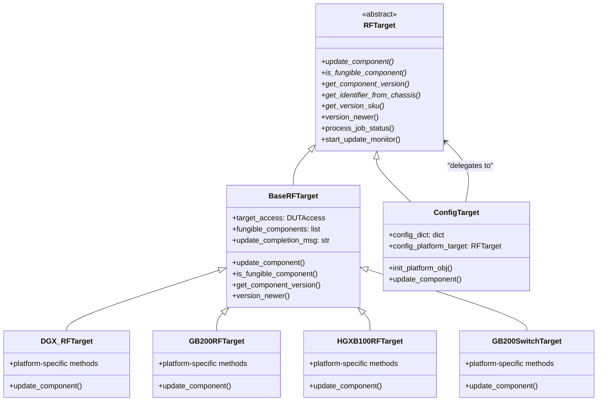
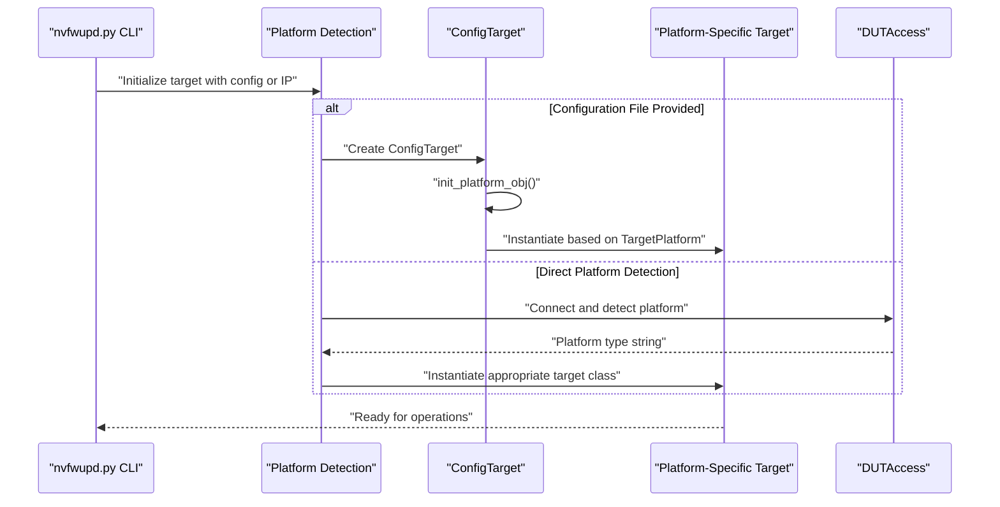
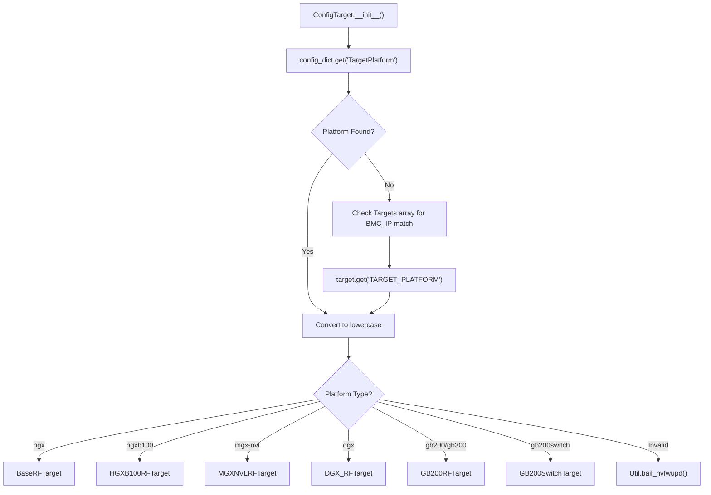

<!-- source: DeepWiki mcp.deepwiki.com · repo NVIDIA/open-nvfwupd · page 6.2 Adding Platform Support · fetched 2026-10-26 -->

# Adding Platform Support

<details>
<summary>Relevant source files</summary>

The following files were used as context for generating this wiki page:

- [nvfwupd/base_rftarget.py](nvfwupd/base_rftarget.py)
- [nvfwupd/config_target.py](nvfwupd/config_target.py)
- [nvfwupd/rf_target.py](nvfwupd/rf_target.py)

</details>


This document provides a comprehensive guide for developers on how to add support for new hardware platforms to the open-nvfwupd firmware update utility. It covers the platform abstraction architecture, required interface implementations, and the step-by-step process for integrating new platform support.

For information about using existing platform support, see [Platform Support](#3.3). For platform-specific usage guides, see [Platform Guides](#5).

## Platform Architecture Overview

The open-nvfwupd system uses a layered architecture with platform abstraction to support multiple NVIDIA hardware families. The core abstraction is built around the `RFTarget` hierarchy, which provides a common interface for firmware update operations while allowing platform-specific implementations.

### Platform Abstraction Hierarchy



**Sources:** [nvfwupd/rf_target.py:30-139](), [nvfwupd/base_rftarget.py:23-74](), [nvfwupd/config_target.py:28-93]()

### Platform Detection and Factory Pattern



**Sources:** [nvfwupd/config_target.py:95-136](), [nvfwupd/rf_target.py:99-117]()

## RFTarget Abstract Interface

The `RFTarget` class defines the core interface that all platform implementations must provide. New platform support requires implementing several abstract methods and optionally overriding default behaviors.

### Required Abstract Methods

| Method | Purpose | Return Type |
|--------|---------|-------------|
| `update_component()` | Execute firmware update for the platform | `str` (Task ID) |
| `is_fungible_component()` | Determine if component supports multiple SKUs | `bool` |
| `get_component_version()` | Extract version from PLDM package data | `str` |
| `get_identifier_from_chassis()` | Get component identifier from Redfish | `str` |
| `get_version_sku()` | Get SKU-specific version from package | `str` |

**Sources:** [nvfwupd/rf_target.py:183-209]()

### Key Attributes and Properties

Platform implementations typically initialize these core attributes:

```python
# Required in constructor
self.target_access = dut_access  # DUTAccess instance
self.fungible_components = []    # List of fungible component types
self.update_completion_msg = ""  # Platform-specific completion message
```

**Sources:** [nvfwupd/base_rftarget.py:61-73]()

### Platform Mapping Dictionaries

The system uses several mapping dictionaries to associate platform identifiers with implementation classes:

```python
SERVER_TYPE_CLASS_DICT = {
    "dgx": "DGX_RFTarget",
    "hgx": "BaseRFTarget", 
    "hgxb100": "HGXB100RFTarget",
    "gb200": "GB200RFTarget",
    "gb300": "GB200RFTarget",
    "mgx-nvl": "MGXNVLRFTarget",
    "gb200switch": "GB200SwitchTarget",
}
```

**Sources:** [nvfwupd/rf_target.py:99-107]()

## Platform Detection Flow

The system supports two primary methods for platform identification:

### Configuration-Based Detection

When using YAML configuration files, platform type is explicitly specified:



**Sources:** [nvfwupd/config_target.py:95-136]()

### Runtime Platform Detection

For direct IP connections, the system queries the target to determine platform type using the `TARGET_CLASS_DICT` and `TARGET_TYPE_CONFIG_DICT` mappings.

**Sources:** [nvfwupd/rf_target.py:109-116]()

## Adding a New Platform

### Step 1: Create Platform-Specific Target Class

Create a new file `nvfwupd/yourplatform_rftarget.py`:

```python
from nvfwupd.base_rftarget import BaseRFTarget

class YourPlatformRFTarget(BaseRFTarget):
    def __init__(self, dut_access):
        super().__init__(dut_access)
        self.fungible_components = ["component1", "component2"]
        self.update_completion_msg = "Platform-specific completion message"
    
    def update_component(self, cmd_args, update_uri, update_file, 
                        time_out, json_dict=None, parallel_update=False):
        # Implement platform-specific update logic
        # Return task_id or None on failure
        pass
    
    def is_fungible_component(self, component_name):
        # Implement platform-specific fungible component logic
        return component_name in self.fungible_components
```

### Step 2: Update Platform Mapping Dictionaries

Add your platform to the mapping dictionaries in `rf_target.py`:

**Sources:** [nvfwupd/rf_target.py:99-116]()

### Step 3: Update ConfigTarget Factory

Add platform detection logic to `ConfigTarget.init_platform_obj()`:

**Sources:** [nvfwupd/config_target.py:115-136]()

### Step 4: Import the New Target Class

Add the import statement to `config_target.py`:

**Sources:** [nvfwupd/config_target.py:19-25]()

## Implementation Patterns

### Common Update Methods

Most platforms use one of these update approaches:

1. **HTTP Push URI**: Direct file upload to UpdateService endpoint
2. **Multipart HTTP Push**: Multipart form upload with parameters
3. **Custom Protocol**: Platform-specific communication (e.g., GB200 Switch uses NVUE REST API)

**Sources:** [nvfwupd/rf_target.py:529-692](), [nvfwupd/config_target.py:254-327]()

### Version Comparison Logic

Platforms typically inherit base version comparison but may override for specific needs:

```python
def version_newer(self, pkg_version, sys_version):
    # Platform-specific version parsing if needed
    return super().version_newer(pkg_version, sys_version)
```

**Sources:** [nvfwupd/base_rftarget.py:75-94]()

### Component Management

Define fungible components and version extraction logic:

```python
def get_component_version(self, pldm_version_dict, ap_name):
    # Platform-specific component name mapping
    # Extract version from PLDM package data
    return "component_version"
```

**Sources:** [nvfwupd/base_rftarget.py:206-258]()

## Testing and Integration

### Unit Testing

Create test cases covering:
- Platform detection logic
- Update component functionality
- Error handling scenarios
- Version comparison edge cases

### Integration Testing

Verify:
- Compatibility with existing CLI commands
- Proper task monitoring and status reporting
- Configuration file integration
- Parallel update support

**Sources:** [nvfwupd/rf_target.py:694-1076]()

## Platform-Specific Considerations

### Communication Protocols

Different platforms may require different communication methods:
- BMC-based platforms typically use Redfish APIs
- Switch platforms may use custom REST APIs
- Some platforms require SSH/SCP for file transfers

### Task Monitoring

Platforms must properly implement task status monitoring:
- Return valid task IDs from update operations
- Support standard Redfish task states
- Handle platform-specific error conditions

**Sources:** [nvfwupd/rf_target.py:256-454]()

### Update Parameters

Consider platform-specific update parameters:
- Staged vs immediate updates
- Component targeting
- Update options and flags

**Sources:** [nvfwupd/config_target.py:277-327]()

---

