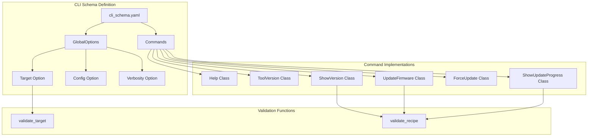
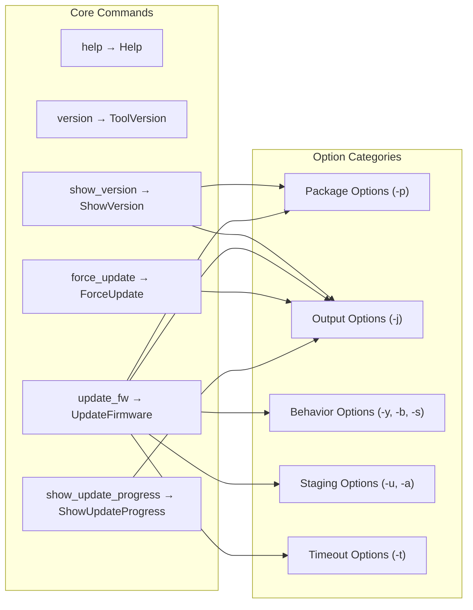
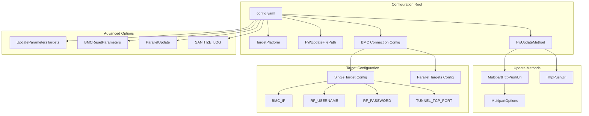
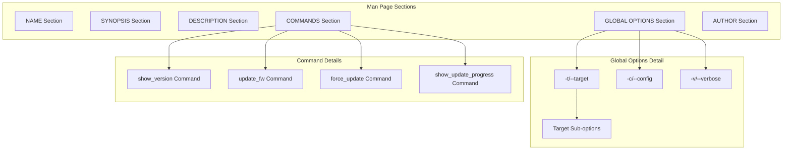
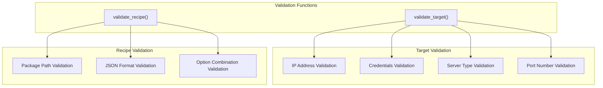

<!-- source: DeepWiki mcp.deepwiki.com · repo NVIDIA/open-nvfwupd · page 7 Reference · fetched 2026-10-26 -->

# Reference

Relevant source files

The following files were used as context for generating this wiki page:

- [cli_schema.yaml](cli_schema.yaml)
- [nvfwupd/config.yaml](nvfwupd/config.yaml)
- [nvfwupd_manpage.1](nvfwupd_manpage.1)

This page provides technical reference documentation for the open-nvfwupd tool, including CLI command specifications, configuration parameters, and implementation details. The reference material covers the complete interface specification for both command-line usage and YAML configuration files.

For detailed CLI command usage examples, see [CLI Reference](#7.1). For comprehensive configuration file documentation, see [Configuration Reference](#7.2). For general usage guidance, see [User Guide](#3).

## CLI Command Architecture

The nvfwupd tool implements a schema-driven CLI architecture where commands are defined declaratively and mapped to implementation classes. The following diagram shows the relationship between CLI schema definitions and their corresponding implementation classes:

### CLI Schema to Implementation Mapping

Sources: [cli_schema.yaml:1-158]()

### Global Options Structure

The CLI defines three main global option groups that apply across all commands:

| Option | Short | Long | Description | Validator |
|--------|-------|------|-------------|-----------|
| Target | `-t` | `--target` | BMC target specification with IP, credentials, and server type | `validate_target` |
| Config | `-c` | `--config` | Path to YAML configuration file | None |
| Verbosity | `-v` | `--verbose` | Logging verbosity and log file path | None |

The target option accepts multiple key-value pairs including `ip`, `user`, `password`, `port`, and `servertype`. Valid server types are: `DGX`, `HGX`, `HGXB100`, `GB200`, `GB300`, `MGX-NVL`, and `GB200Switch`.

Sources: [cli_schema.yaml:16-47]()

### Command Implementation Classes

Each CLI command maps to a specific implementation class with defined options and validators:

Sources: [cli_schema.yaml:48-158]()

## Configuration File Architecture

The YAML configuration system provides an alternative to CLI arguments for complex deployment scenarios. The configuration structure supports both single-target and parallel multi-target operations:

### Configuration Schema Structure

Sources: [nvfwupd/config.yaml:1-69]()

### Configuration Parameters Reference

| Parameter | Type | Description | Valid Values |
|-----------|------|-------------|--------------|
| `TargetPlatform` | String | Target hardware platform | `DGX`, `HGX`, `HGXB100`, `GB200`, `GB300`, `MGX-NVL`, `GB200Switch` |
| `FWUpdateFilePath` | List | Firmware package file paths | File paths to `.fwpkg` files |
| `FwUpdateMethod` | String | Update method selection | `MultipartHttpPushUri`, `HttpPushUri` |
| `MultipartHttpPushUri` | String | Multipart update endpoint | Default: `/redfish/v1/UpdateService/update-multipart` |
| `HttpPushUri` | String | HTTP push update endpoint | Default: `/redfish/v1/UpdateService` |
| `TaskServiceUri` | String | Task monitoring endpoint | Default: `/redfish/v1/TaskService/Tasks/` |
| `ParallelUpdate` | Boolean | Enable parallel target updates | `true`, `false` |
| `SANITIZE_LOG` | Boolean | Enable credential sanitization | `true`, `false` |

Sources: [nvfwupd/config.yaml:1-69]()

## Man Page Documentation Structure

The tool provides comprehensive man page documentation following standard Unix conventions:

### Man Page Section Mapping

Sources: [nvfwupd_manpage.1:1-107]()

### Command Option Categories

The man page organizes command options into logical categories for each command:

| Command | Required Options | Optional Options | Output Options |
|---------|------------------|------------------|----------------|
| `show_version` | None | `-p/--package`, `-s/--staged` | `-j/--json` |
| `update_fw` | `-p/--package` | `-y/--yes`, `-b/--background`, `-s/--special`, `-t/--timeout`, `-d/--details`, `-u/--staged_update`, `-a/--staged_activate_update` | `-j/--json` |
| `force_update` | `enable\|disable\|status` | None | `-j/--json` |
| `show_update_progress` | `-i/--id` | None | `-j/--json` |

Sources: [nvfwupd_manpage.1:38-101]()

## Validation and Schema Enforcement

The CLI system implements validation functions that ensure parameter correctness and consistency:

### Validation Function Architecture

Sources: [cli_schema.yaml:29-117]()

The validation system ensures that:
- Target specifications include required IP and credential information
- Server types match supported platform values
- Package files exist and are accessible
- JSON output options are compatible with other command flags
- Background operations properly bypass confirmation prompts

This reference architecture provides the foundation for both interactive CLI usage and automated deployment scenarios through configuration files.

---

