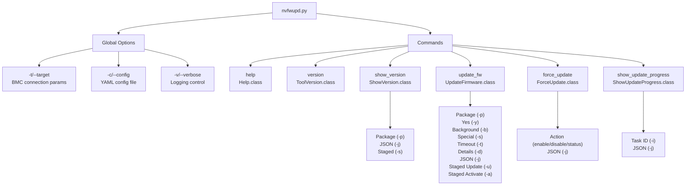
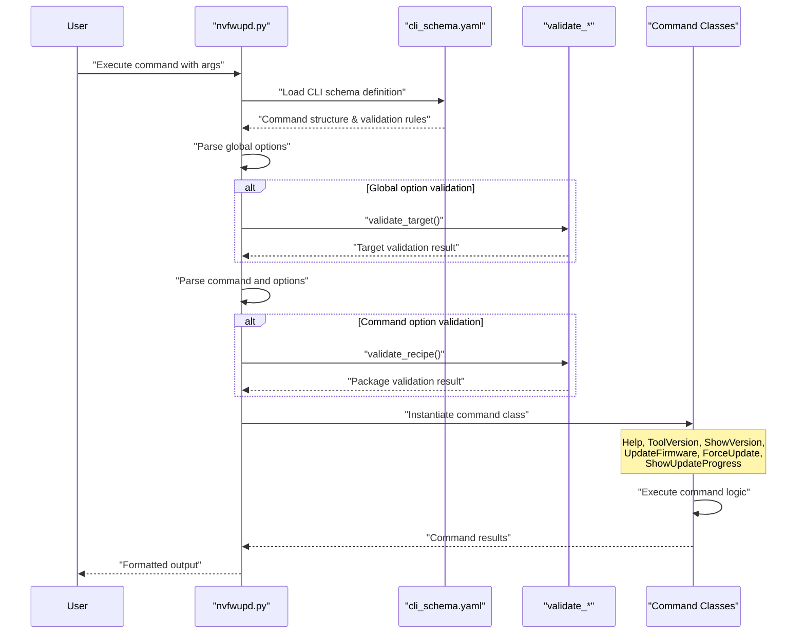
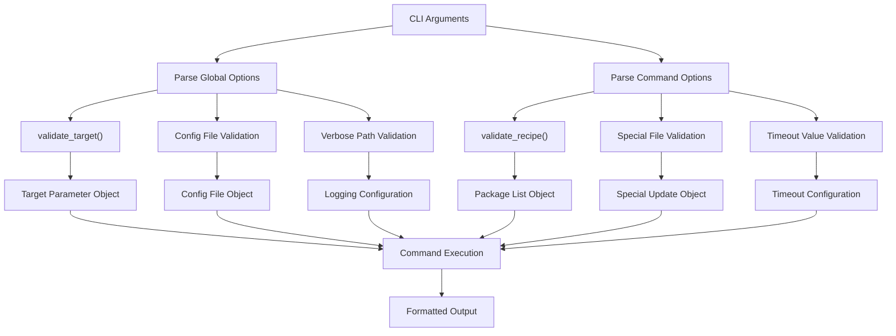

<!-- source: DeepWiki mcp.deepwiki.com · repo NVIDIA/open-nvfwupd · page 7.1 CLI Reference · fetched 2026-10-26 -->

# CLI Reference

<details>
<summary>Relevant source files</summary>

The following files were used as context for generating this wiki page:

- [cli_schema.yaml](cli_schema.yaml)
- [nvfwupd_manpage.1](nvfwupd_manpage.1)

</details>


This page provides a complete reference for the `nvfwupd.py` command-line interface, including all commands, options, arguments, and usage patterns. For configuration file options and YAML syntax, see [Configuration Reference](#7.2). For platform-specific usage examples, see [Platform Guides](#5).

## Global Options

All commands (except `help` and `version`) require global options to specify the target system and optional configuration parameters.

### Target Specification (`-t/--target`)

Specifies the target BMC or switch system for firmware operations. Required for all update and query operations.

**Format:** `ip=<IP> user=<username> password=<password> [port=<port>] [servertype=<type>]`

| Parameter | Description | Required | Example |
|-----------|-------------|----------|---------|
| `ip` | BMC IP address or FQDN | Yes | `ip=192.168.1.100` |
| `user` | BMC login username | Yes | `user=admin` |
| `password` | BMC login password | Yes | `password=secret123` |
| `port` | Port for port forwarding | No | `port=8443` |
| `servertype` | Platform type hint | No | `servertype=GB200` |

**Valid servertype values:** `DGX`, `HGX`, `HGXB100`, `GB200`, `GB300`, `MGX-NVL`, `GB200Switch`

### Configuration File (`-c/--config`)

Specifies path to YAML configuration file for batch operations and complex configurations.

**Format:** `-c <config_file_path>`

### Verbosity (`-v/--verbose`)

Enables verbose logging with optional custom log file path.

**Format:** `-v [logfile_path]`

Sources: [cli_schema.yaml:16-47]()

## Command Structure



Sources: [cli_schema.yaml:48-158]()

## Commands

### help

Shows tool help information. Does not require global options.

**Usage:** `nvfwupd.py help`

**Implementation:** `Help` class

### version

Shows tool version information. Does not require global options.

**Usage:** `nvfwupd.py version`

**Implementation:** `ToolVersion` class

### show_version

Displays current firmware versions of target system components and compares with package versions if specified.

**Usage:** `nvfwupd.py -t <target_params> show_version [-p PACKAGE ...] [-j] [-s]`

**Options:**

| Option | Description | Format | Required |
|--------|-------------|--------|----------|
| `-p/--package` | PLDM firmware package(s) | Multiple files | No |
| `-j/--json` | Output in JSON format | Flag | No |
| `-s/--staged` | Show staged firmware versions | Flag | No |

**Implementation:** `ShowVersion` class

**Examples:**
```bash
# Show current versions
nvfwupd.py -t ip=192.168.1.100 user=admin password=secret show_version

# Compare with package versions
nvfwupd.py -t ip=192.168.1.100 user=admin password=secret show_version -p firmware.pldm

# JSON output with staged versions
nvfwupd.py -t ip=192.168.1.100 user=admin password=secret show_version -j -s
```

### update_fw

Performs firmware update operations on target system components.

**Usage:** `nvfwupd.py -t <target_params> update_fw [-p PACKAGE ...] [-y] [-b] [-s SPECIAL ...] [-t TIMEOUT] [-j] [-d] [-u] [-a]`

**Options:**

| Option | Description | Format | Required |
|--------|-------------|--------|----------|
| `-p/--package` | PLDM firmware package(s) | Multiple files | No* |
| `-y/--yes` | Bypass confirmation prompt | Flag | No |
| `-b/--background` | Run update in background | Flag | No |
| `-s/--special` | Special update JSON file(s) | Multiple files | No |
| `-t/--timeout` | API timeout in seconds | Integer | No |
| `-d/--details` | Show progress in table format | Flag | No |
| `-j/--json` | Output in JSON format | Flag | No |
| `-u/--staged_update` | SPI staged update | Flag | No |
| `-a/--staged_activate_update` | SPI staged and activate update | Flag | No |

*Either `-p` or `-s` must be specified.

**Implementation:** `UpdateFirmware` class

**Examples:**
```bash
# Standard firmware update
nvfwupd.py -t ip=192.168.1.100 user=admin password=secret update_fw -p firmware.pldm -y

# Background update with JSON output
nvfwupd.py -t ip=192.168.1.100 user=admin password=secret update_fw -p firmware.pldm -b -j

# Staged update
nvfwupd.py -t ip=192.168.1.100 user=admin password=secret update_fw -p firmware.pldm -u

# Special component update
nvfwupd.py -t ip=192.168.1.100 user=admin password=secret update_fw -s special_update.json
```

### force_update

Manages force update flag on target system, enabling firmware downgrades.

**Usage:** `nvfwupd.py -t <target_params> force_update <action> [-j]`

**Actions:**
- `enable`: Enable force update capability
- `disable`: Disable force update capability  
- `status`: Show current force update status

**Options:**

| Option | Description | Format | Required |
|--------|-------------|--------|----------|
| `action` | Force update action | enable/disable/status | Yes |
| `-j/--json` | Output in JSON format | Flag | No |

**Implementation:** `ForceUpdate` class

**Examples:**
```bash
# Enable force update
nvfwupd.py -t ip=192.168.1.100 user=admin password=secret force_update enable

# Check status
nvfwupd.py -t ip=192.168.1.100 user=admin password=secret force_update status -j
```

### show_update_progress

Monitors progress of running firmware update tasks.

**Usage:** `nvfwupd.py -t <target_params> show_update_progress -i TASK_ID [TASK_ID ...] [-j]`

**Options:**

| Option | Description | Format | Required |
|--------|-------------|--------|----------|
| `-i/--id` | Task ID(s) to monitor | Multiple IDs | Yes |
| `-j/--json` | Output in JSON format | Flag | No |

**Implementation:** `ShowUpdateProgress` class

**Examples:**
```bash
# Monitor single task
nvfwupd.py -t ip=192.168.1.100 user=admin password=secret show_update_progress -i task123

# Monitor multiple tasks with JSON output
nvfwupd.py -t ip=192.168.1.100 user=admin password=secret show_update_progress -i task123 task456 -j
```

Sources: [cli_schema.yaml:48-158](), [nvfwupd_manpage.1:38-101]()

## CLI Command Processing Flow



Sources: [cli_schema.yaml:16-158]()

## Option Validation and Processing



Sources: [cli_schema.yaml:29](), [cli_schema.yaml:69](), [cli_schema.yaml:75](), [cli_schema.yaml:90](), [cli_schema.yaml:117](), [cli_schema.yaml:157]()

---

