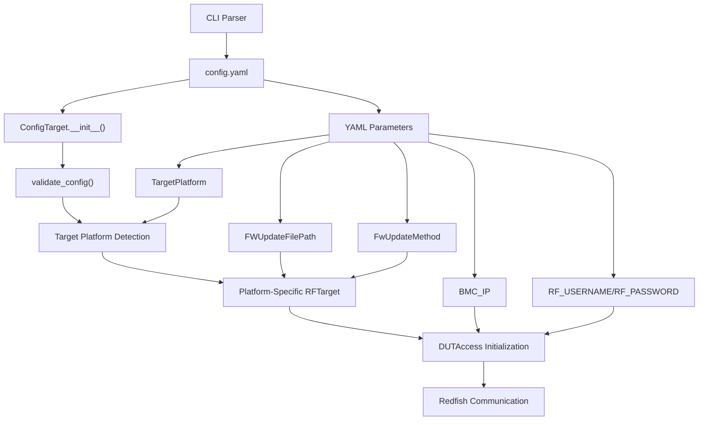
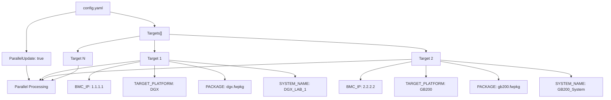
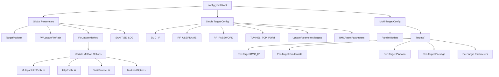

<!-- source: DeepWiki mcp.deepwiki.com · repo NVIDIA/open-nvfwupd · page 7.2 Configuration Reference · fetched 2026-10-26 -->

# Configuration Reference

<details>
<summary>Relevant source files</summary>

The following files were used as context for generating this wiki page:

- [firmware_update_guide/docs/appendix/platform-agnostic-updates.rst](firmware_update_guide/docs/appendix/platform-agnostic-updates.rst)
- [nvfwupd/config.yaml](nvfwupd/config.yaml)

</details>


This document provides a comprehensive reference for YAML configuration files used with the nvfwupd utility. Configuration files enable platform-agnostic firmware updates, multi-target operations, and customization of update methods and Redfish URIs.

For information about CLI command usage and options, see [CLI Reference](#7.1). For platform-specific setup guides, see [Platform Guides](#5).

## Overview

The nvfwupd tool supports two primary configuration methods:
- Command-line arguments for direct operation
- YAML configuration files for complex scenarios and automation

Configuration files are particularly useful for:
- Updating platforms not automatically detected by the tool
- Customizing Redfish URIs and update methods
- Managing multi-target parallel updates
- Automating firmware updates in CI/CD environments

## Configuration File Structure

### File Location and Usage

Configuration files are passed to nvfwupd using the `-c` or `--config` option:

```bash
nvfwupd.py -c config.yaml update_fw
```

Configuration File Processing Flow



Sources: [nvfwupd/config.yaml:1-69](), [firmware_update_guide/docs/appendix/platform-agnostic-updates.rst:8-50]()

## Core Configuration Parameters

### Required Parameters

These parameters must be present in every configuration file:

| Parameter | Type | Description |
|-----------|------|-------------|
| `BMC_IP` | string | Target IP address (BMC/NVOS/localhost for port forwarding) |
| `RF_USERNAME` | string | Redfish authentication username |
| `RF_PASSWORD` | string | Redfish authentication password |

### Platform Identification

| Parameter | Type | Description | Valid Values |
|-----------|------|-------------|--------------|
| `TargetPlatform` | string | Target hardware platform | `HGX`, `DGX`, `GB200`, `GB300`, `HGXB100`, `MGX-NVL`, `GB200Switch` |

### Firmware Package Configuration

| Parameter | Type | Description |
|-----------|------|-------------|
| `FWUpdateFilePath` | list | Full paths to firmware package files (.fwpkg) |

Example:
```yaml
TargetPlatform: 'DGX'
BMC_IP: "192.168.1.100"
RF_USERNAME: "admin"
RF_PASSWORD: "password123"
FWUpdateFilePath:
  - "../packages/nvfw_DGX-H100_0005_231206.1.0_nightly.fwpkg"
```

Sources: [nvfwupd/config.yaml:1-24](), [firmware_update_guide/docs/appendix/platform-agnostic-updates.rst:15-49]()

## Update Method Configuration

### Firmware Update Methods

| Parameter | Type | Description | Valid Values |
|-----------|------|-------------|--------------|
| `FwUpdateMethod` | string | Update method to use | `MultipartHttpPushUri`, `HttpPushUri` |

### Redfish URI Configuration

These parameters allow customization of Redfish endpoints:

| Parameter | Type | Default | Description |
|-----------|------|---------|-------------|
| `MultipartHttpPushUri` | string | `/redfish/v1/UpdateService/update-multipart` | URI for multipart HTTP push updates |
| `HttpPushUri` | string | `/redfish/v1/UpdateService` | URI for PLDM firmware updates |
| `TaskServiceUri` | string | `/redfish/v1/TaskService/Tasks/` | Base URI for task monitoring |

### Update Options

| Parameter | Type | Description |
|-----------|------|-------------|
| `MultipartOptions` | dict | Parameters for multipart firmware updates |

Example:
```yaml
FwUpdateMethod: "MultipartHttpPushUri"
MultipartHttpPushUri: '/redfish/v1/UpdateService/update-multipart'
MultipartOptions:
  ForceUpdate: True
```

Sources: [nvfwupd/config.yaml:7-19](), [firmware_update_guide/docs/appendix/platform-agnostic-updates.rst:24-44]()

## Target-Specific Configuration

### Update Target Selection

| Parameter | Type | Description |
|-----------|------|-------------|
| `UpdateParametersTargets` | list/dict | Specific firmware components to update |

Platform-specific target formats:
- **DGX**: Empty dict `{}` for full system update
- **GB200 NVL**: Empty list `[]` for BMC update
- **Specific components**: List of Redfish URIs

Example:
```yaml
# For specific component updates
UpdateParametersTargets:
  - "/redfish/v1/UpdateService/FirmwareInventory/CPLDMB_0"

# For full DGX update
UpdateParametersTargets: {}
```

### BMC Reset Configuration

| Parameter | Type | Description |
|-----------|------|-------------|
| `BMCResetParameters` | dict | BMC reset configuration after update |

Platform-specific reset parameters:
- **DGX**: `ResetType: 'ResetAll'`
- **HGX**: `ResetToDefaultsType: 'ResetAll'`

Sources: [nvfwupd/config.yaml:29-37](), [firmware_update_guide/docs/appendix/platform-agnostic-updates.rst:54-63]()

## Multi-Target Configuration

### Parallel Updates

| Parameter | Type | Description |
|-----------|------|-------------|
| `ParallelUpdate` | boolean | Enable parallel processing of multiple targets |
| `Targets` | list | List of target system configurations |

### Target List Structure

Each target in the `Targets` list can specify:

| Parameter | Type | Description |
|-----------|------|-------------|
| `BMC_IP` | string | Target-specific IP address |
| `RF_USERNAME` | string | Target-specific username |
| `RF_PASSWORD` | string | Target-specific password |
| `TUNNEL_TCP_PORT` | string | Target-specific port for tunneling |
| `TARGET_PLATFORM` | string | Target-specific platform override |
| `PACKAGE` | string | Target-specific firmware package |
| `UPDATE_PARAMETERS_TARGETS` | dict/list | Target-specific update parameters |
| `SYSTEM_NAME` | string | User-defined system identifier for logging |

Multi-Target Configuration Mapping



Example multi-target configuration:
```yaml
ParallelUpdate: True
Targets:
  - BMC_IP: "192.168.1.100"
    RF_USERNAME: "admin"
    RF_PASSWORD: "pass1"
    TARGET_PLATFORM: "DGX"
    PACKAGE: "../packages/dgx_firmware.fwpkg"
    SYSTEM_NAME: "DGX_LAB_1"
  - BMC_IP: "192.168.1.101"
    RF_USERNAME: "admin"
    RF_PASSWORD: "pass2"
    TARGET_PLATFORM: "GB200"
    PACKAGE: "../packages/gb200_firmware.fwpkg"
    SYSTEM_NAME: "GB200_Production"
```

Sources: [nvfwupd/config.yaml:39-65](), [firmware_update_guide/docs/appendix/platform-agnostic-updates.rst:65-74]()

## Connectivity Configuration

### Network and Authentication

| Parameter | Type | Description |
|-----------|------|-------------|
| `TUNNEL_TCP_PORT` | string | TCP port for port forwarding scenarios |

### SSH Tunneling Support

For environments requiring SSH tunneling:
```yaml
BMC_IP: "localhost"
TUNNEL_TCP_PORT: "14443"
```

This configuration supports port forwarding setups where the BMC is accessed through an SSH tunnel.

Sources: [nvfwupd/config.yaml:26-27](), [firmware_update_guide/docs/appendix/platform-agnostic-updates.rst:50-51]()

## Logging and Debugging Configuration

### Log Sanitization

| Parameter | Type | Default | Description |
|-----------|------|---------|-------------|
| `SANITIZE_LOG` | boolean | `True` | Controls whether sensitive information is masked in logs |

**Important Security Note**: Setting `SANITIZE_LOG: False` will expose system IP addresses and user credentials in logs and console output. Only disable for debugging purposes in secure environments.

```yaml
# For debugging (NOT recommended for production)
SANITIZE_LOG: False
```

Sources: [nvfwupd/config.yaml:67-68](), [firmware_update_guide/docs/appendix/platform-agnostic-updates.rst:17-18]()

## Configuration Parameter Hierarchy



Sources: [nvfwupd/config.yaml:1-69]()

## Example Configurations

### Basic Single Target Update

```yaml
TargetPlatform: 'DGX'
BMC_IP: "192.168.1.100"
RF_USERNAME: "admin"
RF_PASSWORD: "password"
FWUpdateFilePath:
  - "../packages/nvfw_DGX-H100_0005_231206.1.0_nightly.fwpkg"
FwUpdateMethod: "MultipartHttpPushUri"
BMCResetParameters:
  ResetType: 'ResetAll'
```

### Custom Redfish URIs

```yaml
TargetPlatform: 'GB200'
BMC_IP: "10.0.1.50"
RF_USERNAME: "operator"
RF_PASSWORD: "secret"
FWUpdateFilePath:
  - "../packages/gb200_firmware.fwpkg"
FwUpdateMethod: "HttpPushUri"
HttpPushUri: '/redfish/v1/CustomUpdateService'
TaskServiceUri: '/redfish/v1/CustomTaskService/Tasks/'
```

### Platform-Agnostic Configuration

```yaml
# No TargetPlatform specified - platform agnostic mode
BMC_IP: "192.168.1.200"
RF_USERNAME: "user"
RF_PASSWORD: "pass"
FWUpdateFilePath:
  - "../packages/custom_firmware.fwpkg"
FwUpdateMethod: "MultipartHttpPushUri"
MultipartHttpPushUri: '/custom/update/endpoint'
UpdateParametersTargets:
  - "/redfish/v1/UpdateService/FirmwareInventory/CustomComponent"
```

Sources: [firmware_update_guide/docs/appendix/platform-agnostic-updates.rst:96-108](), [nvfwupd/config.yaml:1-69]()

## Configuration Validation and Error Handling

### Validation Rules

The configuration system enforces these validation rules:

1. **Required Parameters**: `BMC_IP`, `RF_USERNAME`, and `RF_PASSWORD` must be present
2. **Platform Validation**: `TargetPlatform` must be one of the supported values
3. **File Path Validation**: Firmware packages in `FWUpdateFilePath` must exist and be accessible
4. **Method Validation**: `FwUpdateMethod` must be a supported update method
5. **Multi-Target Validation**: When `ParallelUpdate` is enabled, `Targets` list must be valid

### Error Scenarios

Common configuration errors and their resolutions:

| Error | Cause | Resolution |
|-------|-------|------------|
| Missing required parameters | `BMC_IP`, `RF_USERNAME`, or `RF_PASSWORD` not specified | Add all required authentication parameters |
| Invalid platform | `TargetPlatform` not in supported list | Use valid platform identifier |
| File not found | Firmware package path incorrect | Verify `FWUpdateFilePath` points to existing files |
| Invalid update method | Unsupported `FwUpdateMethod` | Use `MultipartHttpPushUri` or `HttpPushUri` |

Sources: [firmware_update_guide/docs/appendix/platform-agnostic-updates.rst:83-92]()

---

