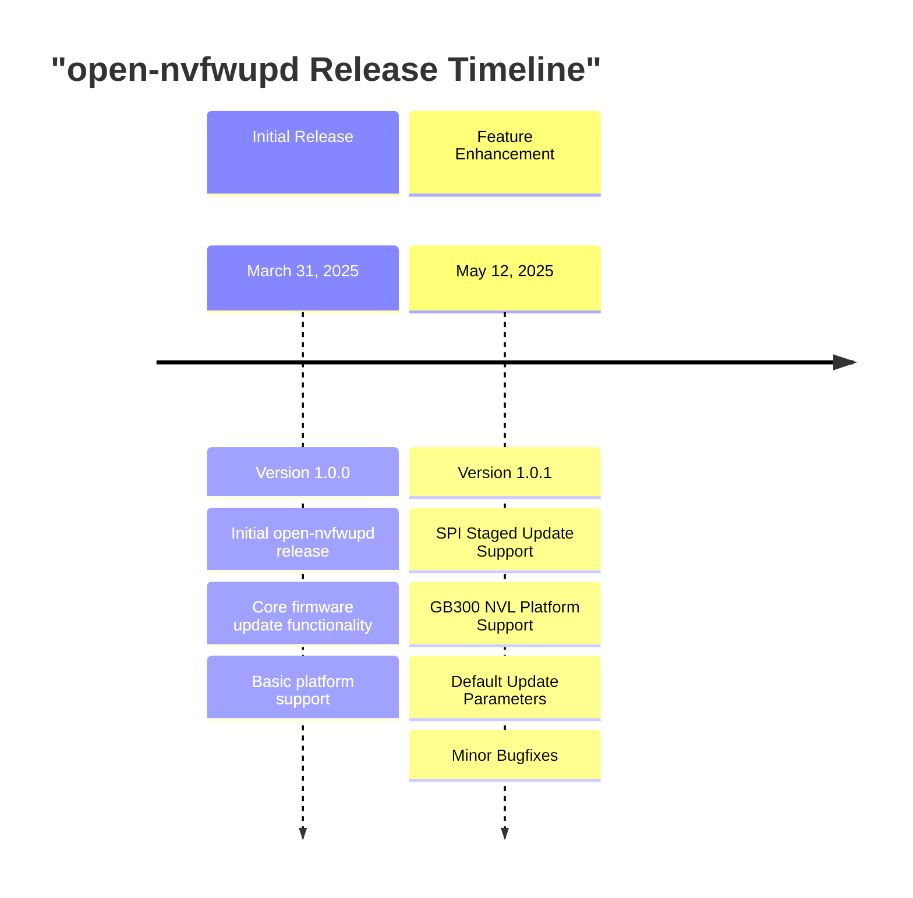
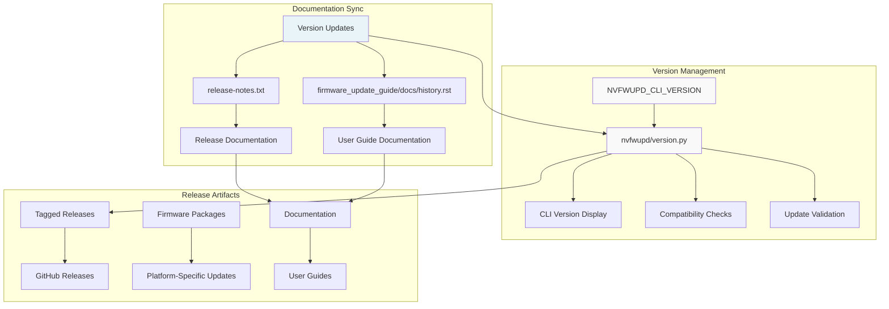
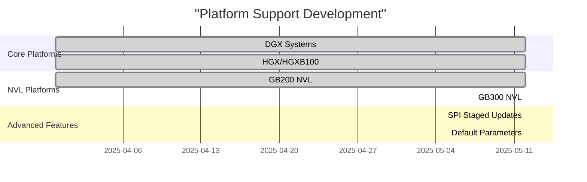

<!-- source: DeepWiki mcp.deepwiki.com · repo NVIDIA/open-nvfwupd · page 8 Release Information · fetched 2026-10-26 -->

# Release Information

<details>
<summary>Relevant source files</summary>

The following files were used as context for generating this wiki page:

- [firmware_update_guide/docs/history.rst](firmware_update_guide/docs/history.rst)
- [nvfwupd/version.py](nvfwupd/version.py)
- [release-notes.txt](release-notes.txt)

</details>


This page provides comprehensive information about releases of the open-nvfwupd utility, including version history, changelogs, and release management processes. It covers the current version status, historical releases, and the version tracking system implemented in the codebase.

For technical details about using specific features mentioned in releases, see [User Guide](#3). For platform-specific release considerations, see [Platform Guides](#5).

## Current Version

The open-nvfwupd utility is currently at version **1.0.1** as defined in [nvfwupd/version.py:19](). This version was released on May 12, 2025, and includes significant enhancements over the initial release.

### Version Declaration

The version is centrally managed through the `NVFWUPD_CLI_VERSION` constant:

```python
NVFWUPD_CLI_VERSION = "1.0.1"
```

This version string is used throughout the application for version reporting and compatibility checks.

**Sources:** [nvfwupd/version.py:19]()

## Release History

### Version Management Timeline



**Sources:** [release-notes.txt:1-15](), [firmware_update_guide/docs/history.rst:5-13]()

### Detailed Changelog

#### Version 1.0.1 (May 12, 2025)

| Feature Category | Description |
|------------------|-------------|
| **Platform Support** | Added support for GB300 NVL server type |
| **Update Methods** | Implemented SPI staged update functionality |
| **Configuration** | Added default update parameters for DGX and GB200 NVL when no special update file is provided |
| **Bug Fixes** | Various minor bugfixes and stability improvements |

#### Version 1.0.0 (March 31, 2025)

| Feature Category | Description |
|------------------|-------------|
| **Initial Release** | First public release of open-nvfwupd |
| **Core Functionality** | Basic firmware update capabilities |
| **Platform Support** | Initial support for DGX, HGX, and GB200 platforms |
| **CLI Interface** | Complete command-line interface implementation |

**Sources:** [release-notes.txt:1-15](), [firmware_update_guide/docs/history.rst:5-13]()

## Version Management System

### Code-Level Version Tracking



**Sources:** [nvfwupd/version.py:19](), [release-notes.txt:1-15](), [firmware_update_guide/docs/history.rst:1-14]()

## Release Feature Matrix

### Feature Evolution Across Versions

| Feature | Version 1.0.0 | Version 1.0.1 |
|---------|----------------|----------------|
| **Core CLI** | ✅ | ✅ |
| **DGX Platform** | ✅ | ✅ |
| **GB200 NVL** | ✅ | ✅ |
| **GB300 NVL** | ❌ | ✅ |
| **HGX/HGXB100** | ✅ | ✅ |
| **Basic Updates** | ✅ | ✅ |
| **SPI Staged Updates** | ❌ | ✅ |
| **Default Update Parameters** | ❌ | ✅ |
| **Configuration Files** | ✅ | ✅ |

### Platform Support Timeline



**Sources:** [release-notes.txt:5-8](), [firmware_update_guide/docs/history.rst:7-9]()

## Release Documentation Structure

### Documentation Versioning

The release information is maintained across multiple documentation sources:

- **Primary Version File**: [nvfwupd/version.py:19]() - Contains the authoritative version string
- **Release Notes**: [release-notes.txt:1-15]() - Detailed feature and bugfix information
- **Document History**: [firmware_update_guide/docs/history.rst:1-14]() - Formatted documentation changelog

### Version Update Process

When releasing a new version, the following files must be updated in coordination:

1. Update `NVFWUPD_CLI_VERSION` in [nvfwupd/version.py:19]()
2. Add release entry to [release-notes.txt]()
3. Update document history in [firmware_update_guide/docs/history.rst]()
4. Tag the release in version control

**Sources:** [nvfwupd/version.py:1-20](), [release-notes.txt:1-15](), [firmware_update_guide/docs/history.rst:1-14]()

## Future Release Planning

### Anticipated Features

Based on the current architecture and platform support matrix, future releases may include:

- Additional platform support for emerging NVIDIA hardware
- Enhanced update methods and protocols
- Improved error handling and recovery mechanisms
- Extended configuration options
- Performance optimizations for large-scale deployments

For the most current development information and planned features, consult the project's issue tracker and development branches.

**Sources:** [release-notes.txt:1-15](), [firmware_update_guide/docs/history.rst:1-14]()