# Page: Overview

# Overview

<details>
<summary>Relevant source files</summary>

The following files were used as context for generating this wiki page:

- [README.md](README.md)
- [firmware_update_guide/docs/index.rst](firmware_update_guide/docs/index.rst)
- [firmware_update_guide/docs/introduction.rst](firmware_update_guide/docs/introduction.rst)

</details>


## Purpose and Scope

This document provides a comprehensive overview of the open-nvfwupd repository, an NVIDIA firmware update utility designed for updating firmware components on NVIDIA server platforms using out-of-band (OOB) methods. This page covers the system's purpose, architecture, and key capabilities. For detailed usage instructions, see [User Guide](#3). For platform-specific guidance, see [Platform Guides](#5).

## What is open-nvfwupd

open-nvfwupd is a Python-based command-line tool that enables firmware updates on NVIDIA server hardware through standardized Redfish APIs. The tool abstracts the complexity of different hardware platforms behind a unified interface while providing platform-specific optimizations for various NVIDIA systems including GB200 NVL, GB300 NVL, DGX, and HGX platforms.

The system operates entirely out-of-band through BMC (Baseboard Management Controller) interfaces, using PLDM (Platform Level Data Model) firmware packages to deliver updates to system components including BMCs, CPUs, GPUs, FPGAs, and other embedded controllers.

Sources: [README.md:7-8](), [firmware_update_guide/docs/introduction.rst:1-5]()

## Key Capabilities

### Firmware Version Management
- **Component Discovery**: Automatically identifies updatable firmware components on target systems
- **Version Comparison**: Compares running firmware versions against PLDM package versions
- **Update Status Tracking**: Monitors firmware update progress with real-time status reporting

### Platform Support
- **Multi-Platform**: Supports GB200/GB300 NVL, DGX, HGX, HGXB100, MGX-NVL, and GB200 Switch platforms
- **Platform-Agnostic Updates**: Handles updates across different hardware types with unified commands
- **Parallel Updates**: Enables simultaneous updates across multiple systems using YAML configuration

### Update Operations
- **Monitored Updates**: Default behavior tracks update tasks to completion
- **Background Updates**: Optional task launch with manual monitoring
- **Force Updates**: Override safety checks for critical update scenarios
- **Staged Updates**: SPI-based staged update support for specific components

Sources: [README.md:10-17](), [firmware_update_guide/docs/introduction.rst:37-43]()

## System Architecture Overview

The following diagram illustrates the main architectural components and their relationships using actual code entities from the system:

**Core System Architecture**
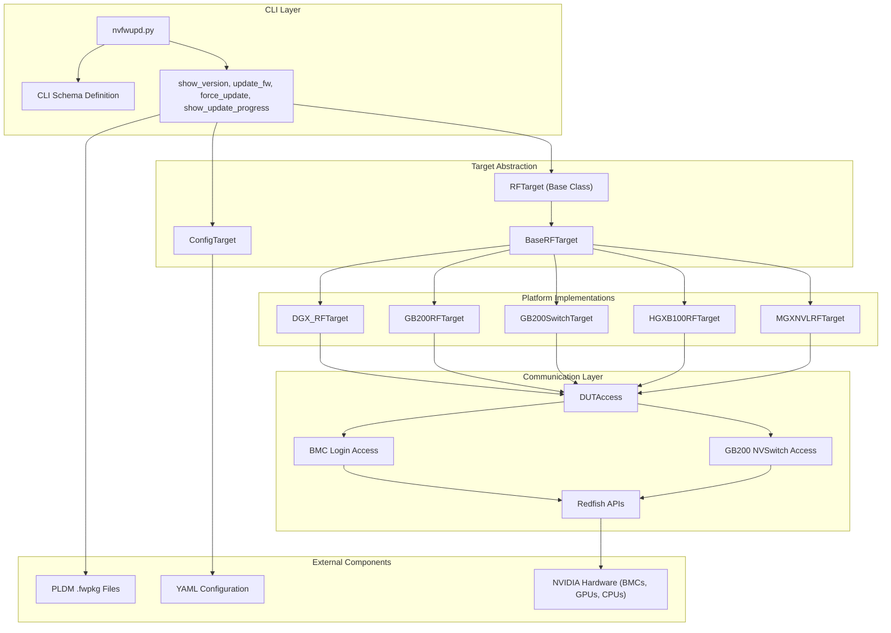

Sources: [README.md:33-36](), [firmware_update_guide/docs/introduction.rst:85-89]()

## Main Command Workflow

The following diagram shows the actual command execution flow using concrete code symbols:

**Command Execution Flow**
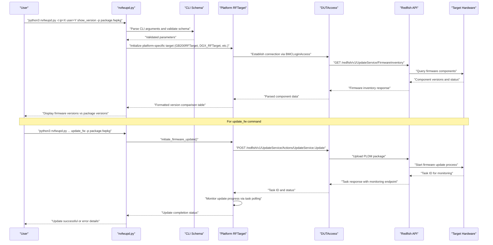

Sources: [README.md:109-133](), [firmware_update_guide/docs/introduction.rst:102-125]()

## Supported Hardware Platforms

The system supports multiple NVIDIA hardware families through platform-specific implementations:

| Platform Family | Target Class | Supported Models | Communication Method |
|-----------------|--------------|------------------|---------------------|
| GB200/GB300 NVL | `GB200RFTarget` | GB200 NVL, GB300 NVL | Redfish via BMC |
| GB200 Switch | `GB200SwitchTarget` | GB200 Switch | NVUE REST API |
| DGX Systems | `DGX_RFTarget` | DGX platforms | Redfish via BMC |
| HGX/HGXB100 | `HGXB100RFTarget` | HGX, HGXB100 | Redfish via BMC |
| MGX-NVL | `MGXNVLRFTarget` | MGX-NVL | Redfish via BMC |

Each platform implementation extends the `BaseRFTarget` class and provides platform-specific logic for component discovery, update procedures, and status monitoring.

Sources: [firmware_update_guide/docs/introduction.rst:88-89](), [README.md:14]()

## Key Technologies and Standards

### Communication Protocols
- **Redfish APIs**: Primary communication method for BMC interactions following DMTF standards
- **NVUE REST API**: Specialized protocol for NVIDIA switch management
- **SSH/SCP**: Secure shell protocols for certain platform-specific operations

### Firmware Packaging
- **PLDM (Platform Level Data Model)**: Industry-standard firmware packaging format (.fwpkg files)
- **NVIDIA Signed Packages**: Cryptographically signed firmware bundles for security

### Configuration Management
- **YAML Configuration**: Structured configuration files for complex deployment scenarios
- **JSON Special Update Files**: Platform-specific update targeting for complex systems like GB200

### Python Dependencies
The system requires Python 3.10+ with modules including `requests`, `PyYAML`, `paramiko`, `scp`, and `tabulate` for operation.

Sources: [firmware_update_guide/docs/introduction.rst:67-75](), [README.md:23-29]()

---

# Page: Getting Started

# Getting Started

<details>
<summary>Relevant source files</summary>

The following files were used as context for generating this wiki page:

- [README.md](README.md)
- [firmware_update_guide/docs/introduction.rst](firmware_update_guide/docs/introduction.rst)
- [nvfwupd_manpage.1](nvfwupd_manpage.1)

</details>


This page provides a quick start guide for installing and using the open-nvfwupd tool to perform out-of-band firmware updates on NVIDIA server platforms. It covers basic installation, initial setup, and your first firmware operations.

For comprehensive command documentation, see [Commands and Operations](#3.1). For platform-specific procedures, see [Platform Guides](#5). For advanced configuration options, see [Configuration](#3.2).

## Purpose and Scope

The open-nvfwupd tool enables out-of-band (OOB) firmware updates on NVIDIA server platforms using Redfish APIs. This Getting Started guide covers:

- Installing prerequisites and dependencies
- Basic tool usage and command syntax
- Performing your first firmware version check
- Executing your first firmware update
- Understanding the basic workflow

This guide focuses on the most common use cases. For detailed platform-specific procedures or advanced features, refer to the appropriate sections in the [User Guide](#3) and [Platform Guides](#5).

## Prerequisites

Before using open-nvfwupd, ensure your environment meets the following requirements:

### System Requirements

| Requirement | Specification |
|-------------|---------------|
| Python Version | 3.10 or higher |
| Operating System | Any Linux distribution supporting Python 3.10+ |
| Network Access | Direct connectivity to target BMC/switch management interfaces |

### Required Dependencies

**Git Large File System (LFS)**
```bash
sudo apt-get install git-lfs
git lfs install
```

**Python Modules** (from requirements.txt):
- requests
- PyYAML  
- paramiko
- scp
- tabulate

### Target System Requirements

- BMC or NVSwitch management interface accessible via network
- Valid administrative credentials for the target system
- Supported platform type (DGX, HGX, HGXB100, GB200, GB300, MGX-NVL, GB200Switch)

Sources: [README.md:19-30](), [firmware_update_guide/docs/introduction.rst:65-75]()

## Installation

### Clone the Repository

```bash
git clone https://github.com/NVIDIA/open-nvfwupd.git
cd open-nvfwupd
```

### Install Python Dependencies

```bash
pip install -r requirements.txt
```

### Verify Installation

Check that the tool is accessible and view basic help:

```bash
python3 nvfwupd.py help
```

Sources: [README.md:24-30]()

## Basic Tool Structure

### CLI Entry Point and Core Components

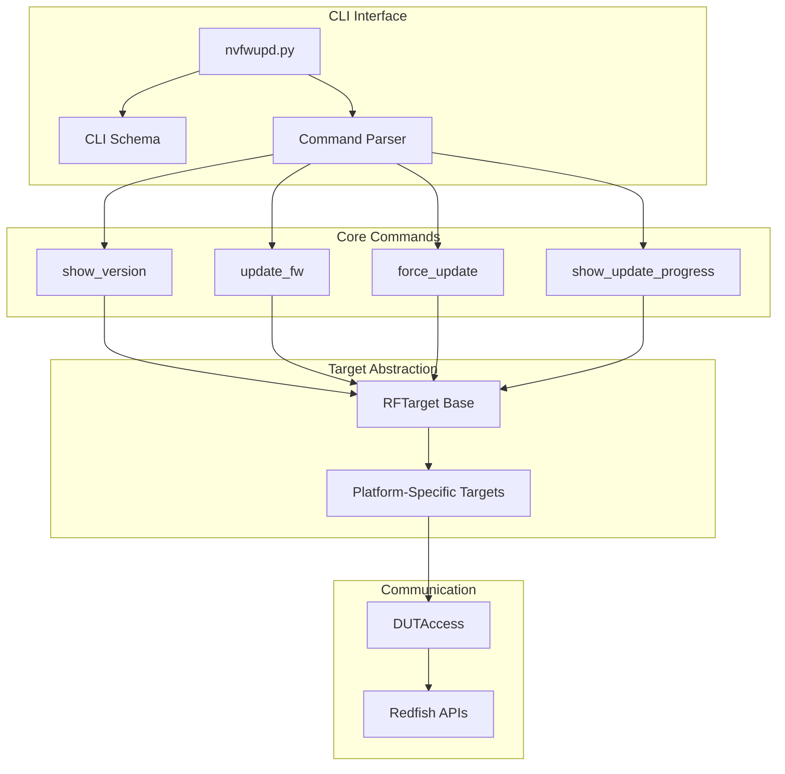

### Command Line Structure

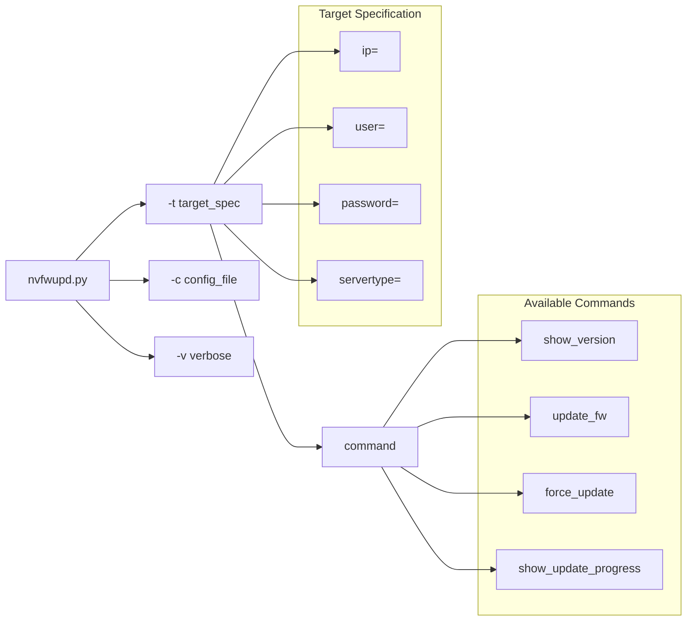

Sources: [nvfwupd.py](), [firmware_update_guide/docs/introduction.rst:85-89]()

## First Steps

### Command Syntax Overview

All open-nvfwupd commands follow this basic pattern:

```bash
python3 nvfwupd.py -t <target_specification> <command> [command_options]
```

**Target Specification Format:**
```bash
-t ip=<BMC_IP> user=<username> password=<password> servertype=<platform_type>
```

**Supported Platform Types:**
- `DGX` - NVIDIA DGX systems
- `HGX` - HGX platforms  
- `HGXB100` - HGX B100 platforms
- `GB200` - GB200 NVL systems
- `GB300` - GB300 NVL systems
- `MGX-NVL` - MGX-NVL platforms
- `GB200Switch` - GB200 switch hardware

Sources: [firmware_update_guide/docs/introduction.rst:87-89](), [nvfwupd_manpage.1:18-29]()

### Your First Firmware Version Check

Before performing any updates, check the current firmware versions on your target system:

```bash
python3 nvfwupd.py -t ip=192.168.1.100 user=admin password=password123 servertype=GB200 show_version
```

**Sample Output:**
```
System Model: GB200 NVL
Part number: 699-24764-0001-TS3
Serial number: 1333124010099
Connection Status: Successful

Firmware Devices:
AP Name                   Sys Version               Up-To-Date
-------                   -----------               ----------
FW_BMC_0                  GB200Nvl-25.01-E        N/A
FW_CPLD_0                 0x00 0x0b 0x03 0x04     N/A
HGX_FW_GPU_0              97.00.82.00.18           N/A
```

### Compare Against Firmware Package

To compare current versions against a firmware package:

```bash
python3 nvfwupd.py -t ip=192.168.1.100 user=admin password=password123 servertype=GB200 show_version -p firmware_package.fwpkg
```

This adds a `Pkg Version` column showing the version in the package and updates the `Up-To-Date` status.

Sources: [README.md:31-84]()

## Basic Update Workflow

### Firmware Update Process Flow

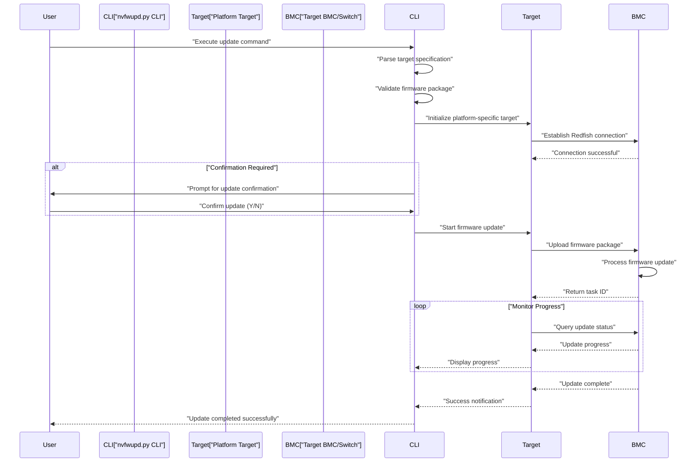

### Performing Your First Update

**Step 1: Prepare Special Update File (GB200 platforms)**

For GB200 platforms, create a JSON file specifying the update target:

```json
{
    "Targets": []
}
```

Save as `update_targets.json`.

**Step 2: Execute Update Command**

```bash
python3 nvfwupd.py -t ip=192.168.1.100 user=admin password=password123 servertype=GB200 update_fw -p firmware_package.fwpkg -s update_targets.json
```

**Step 3: Confirm Update**

The tool will prompt for confirmation unless you use the `-y` flag:

```
Updating ip address: ip=192.168.1.100
FW package: ['firmware_package.fwpkg']
Ok to proceed with firmware update? <Y/N>
```

**Step 4: Monitor Progress**

The tool automatically monitors the update progress:

```
FW update started, Task Id: HGX_0
TaskState: Running
PercentComplete: 20
TaskStatus: OK
...
TaskState: Completed
PercentComplete: 100
TaskStatus: OK
Firmware update successful!
```

Sources: [README.md:87-135]()

## Common Usage Patterns

### Background Updates

For long-running updates, use background mode:

```bash
python3 nvfwupd.py -t ip=192.168.1.100 user=admin password=password123 servertype=GB200 update_fw -p firmware_package.fwpkg -s update_targets.json -b
```

### Monitor Existing Update

To check progress of a running update:

```bash
python3 nvfwupd.py -t ip=192.168.1.100 user=admin password=password123 servertype=GB200 show_update_progress -i TASK_ID
```

### Force Update (Downgrades)

Enable force update for downgrading firmware:

```bash
python3 nvfwupd.py -t ip=192.168.1.100 user=admin password=password123 servertype=GB200 force_update enable
```

### JSON Output

For automation and scripting, use JSON output:

```bash
python3 nvfwupd.py -t ip=192.168.1.100 user=admin password=password123 servertype=GB200 show_version -j
```

Sources: [firmware_update_guide/docs/introduction.rst:107-125](), [nvfwupd_manpage.1:52-74]()

## Configuration File Usage

### YAML Configuration

Instead of specifying targets on the command line, use a YAML configuration file for multiple systems:

```yaml
targets:
  - ip: 192.168.1.100
    user: admin
    password: password123
    servertype: GB200
  - ip: 192.168.1.101
    user: admin  
    password: password456
    servertype: DGX
```

**Using Configuration File:**

```bash
python3 nvfwupd.py -c config.yaml show_version -p firmware_package.fwpkg
```

This enables parallel operations across multiple systems.

Sources: [firmware_update_guide/docs/introduction.rst:91-92](), [nvfwupd_manpage.1:33-34]()

## Next Steps

After completing your first firmware operations:

1. **Learn Advanced Commands** - See [Commands and Operations](#3.1) for detailed command documentation
2. **Platform-Specific Procedures** - Review [Platform Guides](#5) for your specific hardware
3. **Configuration Options** - Explore [Configuration](#3.2) for advanced setup
4. **Automation** - See [Advanced Features](#3.4) for scripting and automation capabilities

### Important Post-Update Steps

After firmware updates:

1. **Power Cycle** - Complete an AC power cycle to activate new firmware
2. **Wait for BMC** - Allow up to 5 minutes for BMC and Redfish service to come up
3. **Verify Update** - Run `show_version` command to confirm new firmware versions

Sources: [README.md:135-136]()

---

# Page: User Guide

# User Guide

<details>
<summary>Relevant source files</summary>

The following files were used as context for generating this wiki page:

- [firmware_update_guide/docs/appendix/output-formatting.rst](firmware_update_guide/docs/appendix/output-formatting.rst)
- [firmware_update_guide/docs/appendix/spi-staged.rst](firmware_update_guide/docs/appendix/spi-staged.rst)
- [firmware_update_guide/docs/examples/gb300NVL.rst](firmware_update_guide/docs/examples/gb300NVL.rst)
- [nvfwupd_manpage.1](nvfwupd_manpage.1)

</details>


This guide provides comprehensive documentation for end users on how to effectively use the `nvfwupd.py` tool for out-of-band firmware updates on NVIDIA hardware platforms. It covers basic operations, configuration options, and common usage patterns for updating firmware on DGX, HGX, GB200, GB300, and GB200 Switch systems.

For detailed command reference, see [CLI Reference](#7.1). For platform-specific procedures, see [Platform Guides](#5). For installation and setup instructions, see [Getting Started](#2).

## Overview

The `nvfwupd.py` tool is a command-line utility that performs out-of-band firmware updates on NVIDIA hardware platforms through BMC (Baseboard Management Controller) interfaces and NVSwitch management APIs. The tool supports both full system updates and individual component updates using PLDM firmware packages or tarball formats.

### Core Workflow

The typical firmware update workflow follows these stages:

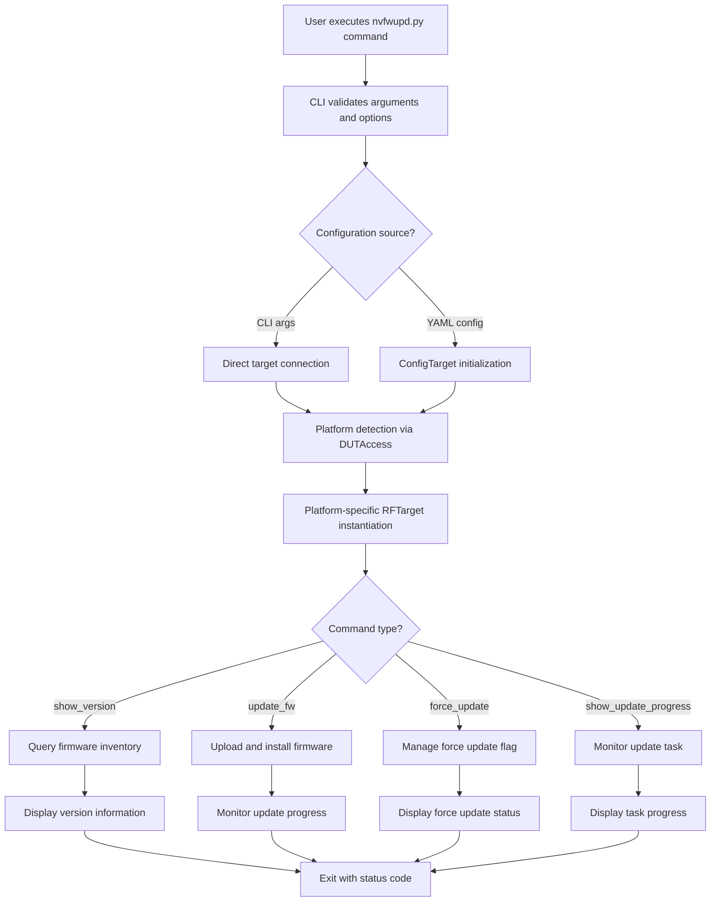

Sources: [nvfwupd_manpage.1:1-108]()

### System Architecture Overview

The tool implements a layered architecture that abstracts platform differences while providing consistent user experience:

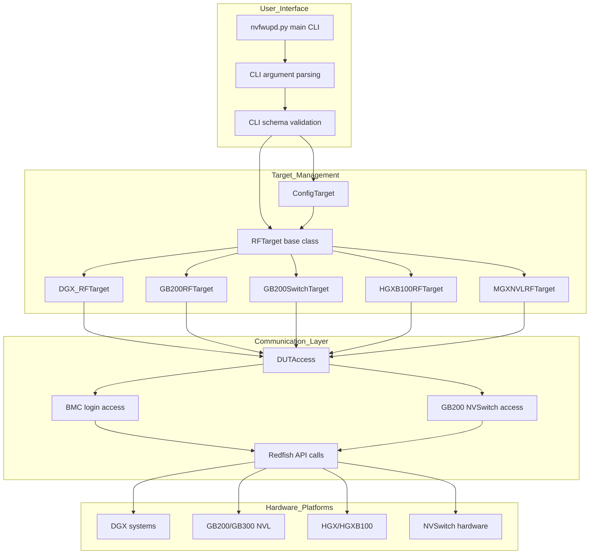

Sources: [nvfwupd_manpage.1:13-31](), [firmware_update_guide/docs/examples/gb300NVL.rst:1-283]()

## Key Concepts

### Target Specification

All operations require specifying a target system using the `-t/--target` option with key-value pairs:

| Parameter | Description | Required |
|-----------|-------------|----------|
| `ip` | IP address or FQDN of target BMC/NVSwitch | Yes |
| `user` | Username for authentication | Yes |
| `password` | Password for authentication | Yes |
| `port` | TCP port for connection (optional) | No |
| `servertype` | Platform type hint (DGX, HGX, GB200, etc.) | No |

### Firmware Packages

The tool accepts two types of firmware packages:
- **PLDM packages**: Binary firmware packages with `.fwpkg` extension
- **Tarball packages**: Compressed archive files containing firmware images

### Special Update Files

For selective component updates, JSON files specify which components to update:

```json
{
    "Targets": ["/redfish/v1/UpdateService/FirmwareInventory/ComponentName"],
    "ForceUpdate": false
}
```

Sources: [nvfwupd_manpage.1:13-37](), [firmware_update_guide/docs/examples/gb300NVL.rst:36-41]()

## Basic Operations

### Checking Firmware Versions

Display current firmware versions for all updatable components:

```bash
nvfwupd.py -t ip=192.168.1.100 user=admin password=secret show_version
```

Compare current versions with a firmware package:

```bash
nvfwupd.py -t ip=192.168.1.100 user=admin password=secret show_version -p firmware.fwpkg
```

### Updating Firmware

Perform a complete firmware update:

```bash
nvfwupd.py -t ip=192.168.1.100 user=admin password=secret update_fw -p firmware.fwpkg
```

Update specific components using a special update file:

```bash
nvfwupd.py -t ip=192.168.1.100 user=admin password=secret update_fw -p firmware.fwpkg -s components.json
```

### Monitoring Update Progress

Track the progress of a running firmware update:

```bash
nvfwupd.py -t ip=192.168.1.100 user=admin password=secret show_update_progress -i TASK_ID
```

Sources: [nvfwupd_manpage.1:40-101](), [firmware_update_guide/docs/examples/gb300NVL.rst:42-65]()

## Output Formats

### Standard Output

By default, the tool provides human-readable table output showing firmware components, versions, and update status.

### JSON Output

Most commands support JSON output using the `-j/--json` flag for programmatic processing:

```bash
nvfwupd.py -t ip=192.168.1.100 user=admin password=secret show_version -j
```

### Detailed Progress Output

The `-d/--details` flag with `update_fw` provides comprehensive progress information in tabular format, showing detailed task messages and completion status.

Sources: [firmware_update_guide/docs/appendix/output-formatting.rst:1-122]()

## Advanced Features

### Background Updates

Run firmware updates asynchronously without blocking the terminal:

```bash
nvfwupd.py -t ip=192.168.1.100 user=admin password=secret update_fw -p firmware.fwpkg -b
```

### SPI Staged Updates

For supported platforms (GB200/GB300 NVL), stage firmware images first to reduce activation downtime:

```bash
# Stage firmware images
nvfwupd.py -t ip=192.168.1.100 user=admin password=secret update_fw -p firmware.fwpkg -u

# Later, activate staged images
nvfwupd.py -t ip=192.168.1.100 user=admin password=secret update_fw -p firmware.fwpkg -a
```

### Force Updates

Enable force updates for firmware downgrades:

```bash
# Enable force update flag
nvfwupd.py -t ip=192.168.1.100 user=admin password=secret force_update enable

# Check force update status
nvfwupd.py -t ip=192.168.1.100 user=admin password=secret force_update status
```

Sources: [firmware_update_guide/docs/appendix/spi-staged.rst:1-100](), [nvfwupd_manpage.1:76-91]()

## Configuration Options

### YAML Configuration Files

Instead of command-line arguments, use YAML configuration files for complex setups:

```bash
nvfwupd.py -c config.yaml update_fw -p firmware.fwpkg
```

### Logging and Verbosity

Enable verbose logging with custom log file location:

```bash
nvfwupd.py -v /path/to/logfile.log -t ip=192.168.1.100 user=admin password=secret show_version
```

Sources: [nvfwupd_manpage.1:33-37]()

## Error Handling

The tool provides exit codes and error messages to indicate operation status:
- **Error Code 0**: Successful operation
- **Non-zero codes**: Various error conditions (authentication failures, network issues, etc.)

All operations include timeout handling and connection retry logic for reliable operation in network environments.

## Next Steps

For detailed information about specific topics:
- **Command details**: See [Commands and Operations](#3.1)
- **Configuration setup**: See [Configuration](#3.2)  
- **Platform-specific guidance**: See [Platform Support](#3.3)
- **Advanced functionality**: See [Advanced Features](#3.4)
- **Platform-specific procedures**: See [Platform Guides](#5)

Sources: [nvfwupd_manpage.1:1-108](), [firmware_update_guide/docs/examples/gb300NVL.rst:1-283](), [firmware_update_guide/docs/appendix/output-formatting.rst:1-122](), [firmware_update_guide/docs/appendix/spi-staged.rst:1-100]()

---

# Page: Commands and Operations

# Commands and Operations

<details>
<summary>Relevant source files</summary>

The following files were used as context for generating this wiki page:

- [cli_schema.yaml](cli_schema.yaml)
- [firmware_update_guide/docs/appendix/output-formatting.rst](firmware_update_guide/docs/appendix/output-formatting.rst)
- [firmware_update_guide/docs/appendix/spi-staged.rst](firmware_update_guide/docs/appendix/spi-staged.rst)
- [firmware_update_guide/docs/examples/gb300NVL.rst](firmware_update_guide/docs/examples/gb300NVL.rst)
- [nvfwupd_manpage.1](nvfwupd_manpage.1)

</details>


This document provides detailed documentation of all available CLI commands in the open-nvfwupd tool, including their options, usage patterns, and operational behavior. It covers the five primary commands (`show_version`, `update_fw`, `force_update`, `show_update_progress`) plus utility commands (`help`, `version`).

For information about configuration files and advanced configuration options, see [Configuration](#3.2). For platform-specific command considerations and examples, see [Platform Support](#3.3).

## Command Overview

The nvfwupd tool provides a command-based interface for firmware management operations. All firmware management commands require target specification via global options.

### Command Architecture

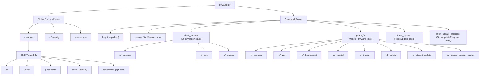

Sources: [cli_schema.yaml:16-158](), [nvfwupd_manpage.1:1-108]()

### Command Classification

| Command Type | Commands | Global Options Required | Purpose |
|--------------|----------|------------------------|---------|
| Utility | `help`, `version` | No | Tool information and assistance |
| Information | `show_version`, `show_update_progress` | Yes | Query firmware status and update progress |
| Management | `update_fw`, `force_update` | Yes | Perform firmware updates and configuration |

Sources: [cli_schema.yaml:48-157]()

## Global Options

All firmware management commands require global options to specify target systems and behavior.

### Target Specification (`-t/--target`)

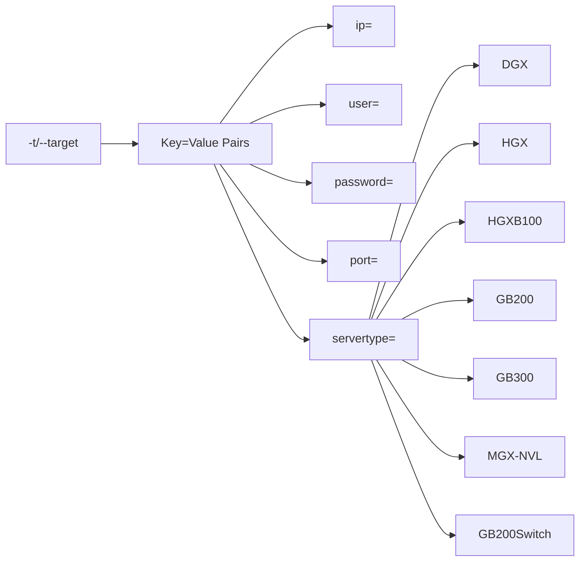

**Required Parameters:**
- `ip`: BMC IP address or FQDN
- `user`: BMC login username  
- `password`: BMC login password

**Optional Parameters:**
- `port`: TCP port for port-forwarding connections
- `servertype`: Platform type hint for unknown platform errors

Sources: [cli_schema.yaml:22-29](), [nvfwupd_manpage.1:13-31]()

### Configuration (`-c/--config`)

Specifies path to YAML configuration file for tool behavior customization.

### Verbosity (`-v/--verbose`)

Enables verbose logging with optional logfile path specification. Default path is current working directory.

Sources: [cli_schema.yaml:30-47](), [nvfwupd_manpage.1:33-37]()

## Command Reference

### show_version

Displays firmware inventory and version information for AP components that can be updated out-of-band.

**Usage:**
```bash
nvfwupd.py -t <target_options> show_version [options]
```

**Options:**

| Option | Description | Required |
|--------|-------------|----------|
| `-p/--package` | PLDM firmware package(s) for version comparison | No |
| `-j/--json` | Output results in JSON format | No |
| `-s/--staged` | Show staged firmware versions | No |

**Behavior:**
- Without `-p`: Shows current running firmware versions only
- With `-p`: Compares current versions against package versions and indicates update status
- With `-s`: Displays staged firmware versions from previous staged updates

**Example Output:**
```
System Model: GB200 NVL
Part number: 699-24764-0001-TS3
Packages: ['GB200-P4972_0011_250404.1.0']

Firmware Devices:
AP Name                  Sys Version         Pkg Version   Up-To-Date
-------                  -----------         -----------   ----------
FW_BMC_0                 GB200Nvl-25.01     GB200Nvl-25.02 No       
FW_ERoT_BMC_0            01.04.0007_n04     01.04.0008_n04 No       
```

Sources: [cli_schema.yaml:58-79](), [nvfwupd_manpage.1:40-50](), [firmware_update_guide/docs/appendix/spi-staged.rst:34-71]()

### update_fw

Performs firmware update operations using PLDM packages or firmware tar files.

**Usage:**
```bash
nvfwupd.py -t <target_options> update_fw [options]
```

**Core Options:**

| Option | Description | Default |
|--------|-------------|---------|
| `-p/--package` | PLDM firmware package(s) or tar files | None |
| `-y/--yes` | Bypass confirmation prompt | Interactive |
| `-b/--background` | Run update asynchronously | Synchronous |
| `-s/--special` | Special update JSON file for selective updates | None |

**Advanced Options:**

| Option | Description | Use Case |
|--------|-------------|----------|
| `-t/--timeout` | API request timeout in seconds | Long-running operations |
| `-d/--details` | Show detailed progress in table format | Debugging/monitoring |
| `-j/--json` | JSON output (requires `-b`) | Automation |
| `-u/--staged_update` | Stage firmware without activation | Minimal downtime |
| `-a/--staged_activate_update` | Activate previously staged firmware | Quick activation |

**Update Flow:**

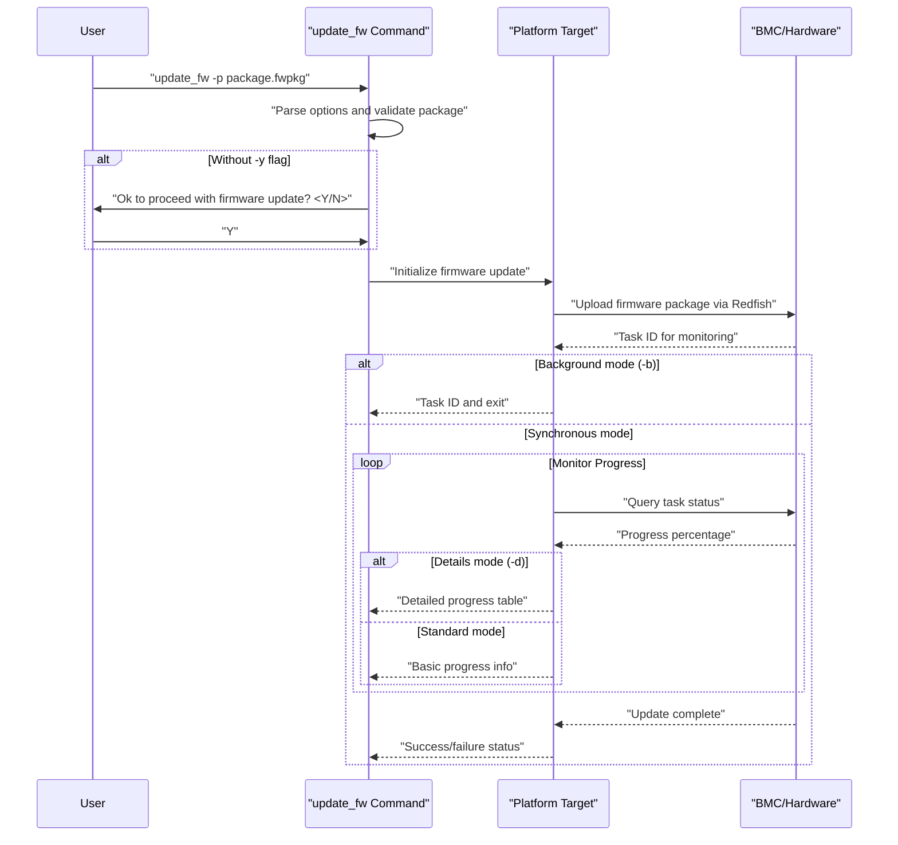

**Staged Update Operations:**

- **Stage Only (`-u`)**: Downloads firmware images without activation, reducing activation downtime
- **Stage and Activate (`-a`)**: Activates previously staged firmware for rapid deployment
- **View Staged (`show_version -s`)**: Displays staged firmware versions

Sources: [cli_schema.yaml:80-126](), [nvfwupd_manpage.1:52-74](), [firmware_update_guide/docs/appendix/spi-staged.rst:1-100](), [firmware_update_guide/docs/appendix/output-formatting.rst:1-122]()

### force_update

Manages the force update flag on target systems, primarily used for firmware downgrades.

**Usage:**
```bash
nvfwupd.py -t <target_options> force_update <action> [options]
```

**Actions:**

| Action | Description | Effect |
|--------|-------------|--------|
| `enable` | Enable force update flag | Allows downgrades and bypass version checks |
| `disable` | Disable force update flag | Restores normal version checking |
| `status` | Query current force update state | Read-only status check |

**Options:**
- `-j/--json`: Output results in JSON format

**Example:**
```bash
# Check current status
nvfwupd.py -t ip=1.1.1.1 user=admin password=pass force_update status

# Enable for downgrade
nvfwupd.py -t ip=1.1.1.1 user=admin password=pass force_update enable

# Disable after downgrade
nvfwupd.py -t ip=1.1.1.1 user=admin password=pass force_update disable
```

Sources: [cli_schema.yaml:127-141](), [nvfwupd_manpage.1:76-91]()

### show_update_progress

Monitors the status of running firmware update tasks using task IDs.

**Usage:**
```bash
nvfwupd.py -t <target_options> show_update_progress -i <task_id> [options]
```

**Options:**

| Option | Description | Required |
|--------|-------------|----------|
| `-i/--id` | Task ID(s) to monitor (space-delimited) | Yes |
| `-j/--json` | Output in JSON format | No |

**Task Monitoring:**

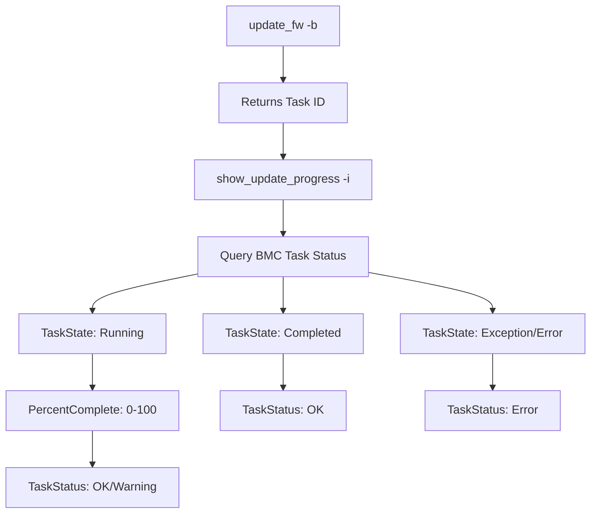

**Example:**
```bash
# Start background update
nvfwupd.py -t ip=1.1.1.1 user=admin password=pass update_fw -p package.fwpkg -b
# Returns: Task Id: HGX_9

# Monitor progress
nvfwupd.py -t ip=1.1.1.1 user=admin password=pass show_update_progress -i HGX_9
```

Sources: [cli_schema.yaml:142-157](), [nvfwupd_manpage.1:93-101]()

## Command Execution Flow

### CLI Processing Pipeline

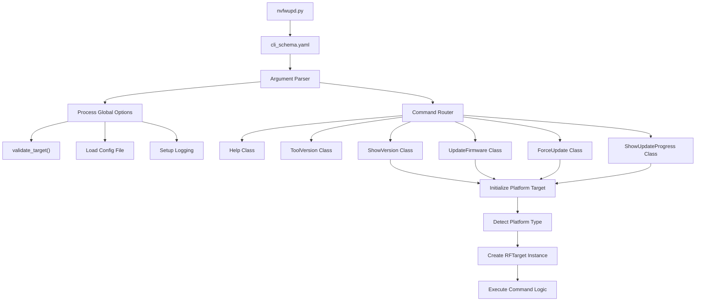

### Command Validation Flow

| Validation Stage | Check | Failure Action |
|------------------|-------|----------------|
| Schema Validation | Argument syntax and types | Display usage and exit |
| Target Validation | BMC connectivity and credentials | Connection error |
| Package Validation | PLDM package format and integrity | Package error |
| Platform Detection | Supported platform identification | Platform error |
| Permission Check | BMC user permissions | Authentication error |

Sources: [cli_schema.yaml:29,38,69,75,117,157]()

## JSON Output Format

Commands supporting `-j/--json` flag provide structured output for automation and integration.

### Common JSON Structure

```json
{
  "command": "show_version|update_fw|force_update|show_update_progress",
  "status": "success|error",
  "data": {
    // Command-specific data structure
  },
  "error_code": 0,
  "timestamp": "ISO 8601 timestamp"
}
```

### Command-Specific JSON Examples

**show_version JSON:**
```json
{
  "system_model": "GB200 NVL",
  "part_number": "699-24764-0001-TS3", 
  "packages": ["GB200-P4972_0011_250404.1.0"],
  "firmware_devices": [
    {
      "name": "FW_BMC_0",
      "system_version": "GB200Nvl-25.01",
      "package_version": "GB200Nvl-25.02",
      "up_to_date": false
    }
  ]
}
```

**update_fw JSON (background mode):**
```json
{
  "task_id": "HGX_9",
  "task_state": "Running",
  "task_status": "OK",
  "odata_id": "/redfish/v1/TaskService/Tasks/HGX_9"
}
```

Sources: [cli_schema.yaml:70-75,113-117,137-140,153-157]()

---

# Page: Configuration

# Configuration

<details>
<summary>Relevant source files</summary>

The following files were used as context for generating this wiki page:

- [cli_schema.yaml](cli_schema.yaml)
- [firmware_update_guide/docs/appendix/platform-agnostic-updates.rst](firmware_update_guide/docs/appendix/platform-agnostic-updates.rst)
- [nvfwupd/config.yaml](nvfwupd/config.yaml)

</details>


This document provides a comprehensive guide to configuration options for the open-nvfwupd tool, including CLI arguments, YAML configuration files, and special update files. Configuration controls target platform selection, firmware update methods, connection parameters, and update behavior.

For information about specific commands and their usage patterns, see [Commands and Operations](#3.1). For platform-specific configuration considerations, see [Platform Support](#3.3).

## Configuration Sources

The nvfwupd tool accepts configuration from multiple sources that are processed in a specific hierarchy:

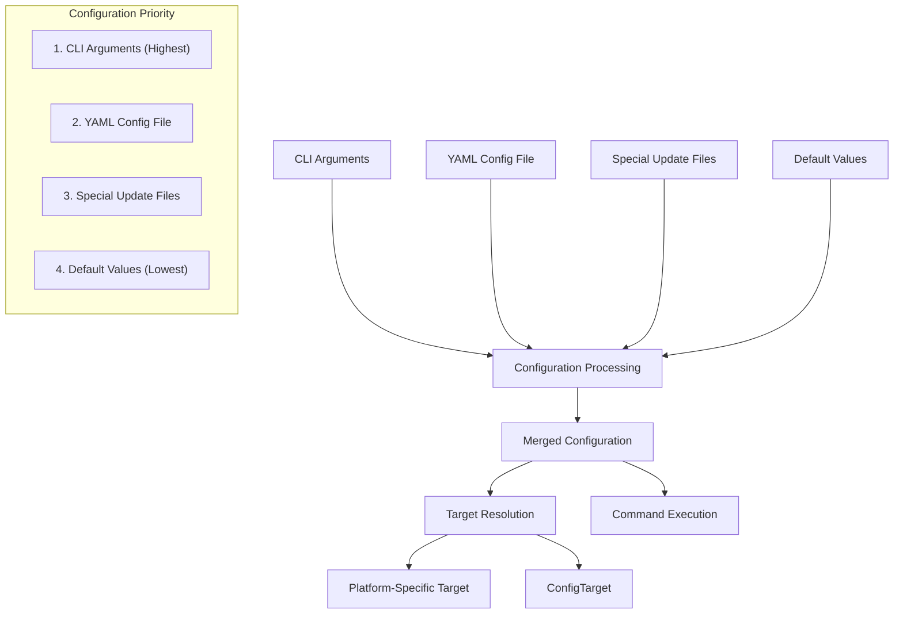

**Configuration Sources Priority**

| Priority | Source | Description |
|----------|--------|-------------|
| 1 (Highest) | CLI Arguments | Command-line options and flags |
| 2 | YAML Config File | Configuration file specified with `-c/--config` |
| 3 | Special Update Files | JSON files specified with `-s/--special` |
| 4 (Lowest) | Default Values | Built-in defaults from schema |

Sources: [cli_schema.yaml:1-158]()

## CLI Arguments

### Global Options

The CLI provides global options that apply to all commands requiring target connectivity:

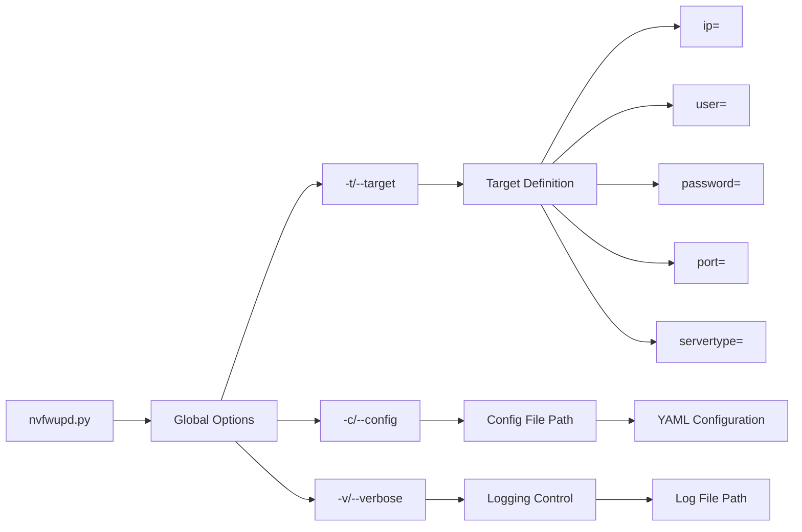

**Target Option Format**

The `-t/--target` option accepts multiple key-value pairs:

```bash
nvfwupd.py -t ip=192.168.1.100 user=admin password=secret servertype=GB200 port=443 <command>
```

| Parameter | Required | Description | Valid Values |
|-----------|----------|-------------|--------------|
| `ip` | Yes | BMC IP address or hostname | IPv4/IPv6 address or FQDN |
| `user` | Yes | BMC login username | String |
| `password` | Yes | BMC login password | String |
| `port` | No | Port for forwarding | Integer (default: 443) |
| `servertype` | No | Platform type hint | DGX, HGX, HGXB100, GB200, GB300, MGX-NVL, GB200Switch |

Sources: [cli_schema.yaml:22-29]()

### Command-Specific Options

Each command supports additional options:

**show_version Command**
```bash
nvfwupd.py -t <target> show_version [-p FWPKG ...] [-j] [-s]
```

| Option | Description |
|--------|-------------|
| `-p/--package` | PLDM firmware package files |
| `-j/--json` | Output in JSON format |
| `-s/--staged` | Show staged firmware versions |

**update_fw Command**
```bash
nvfwupd.py -t <target> update_fw [-p FWPKG ...] [-y] [-b] [-s FILE] [-t TIMEOUT] [-j] [-d] [-u] [-a]
```

| Option | Description |
|--------|-------------|
| `-p/--package` | PLDM firmware package files |
| `-y/--yes` | Bypass confirmation prompt |
| `-b/--background` | Exit without waiting for completion |
| `-s/--special` | Special update JSON file |
| `-t/--timeout` | API request timeout (seconds) |
| `-j/--json` | JSON output (requires `-b`) |
| `-d/--details` | Show update progress in table format |
| `-u/--staged_update` | SPI staged update |
| `-a/--staged_activate_update` | SPI and activate staged update |

Sources: [cli_schema.yaml:58-126]()

## YAML Configuration Files

### Configuration File Structure

YAML configuration files provide comprehensive control over tool behavior and support platform-agnostic updates:

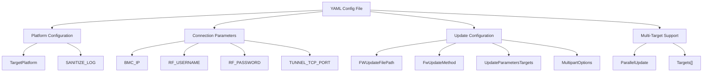

### Core Configuration Parameters

**Platform and Logging**

| Parameter | Type | Required | Description |
|-----------|------|----------|-------------|
| `TargetPlatform` | String | Yes | One of: HGX, DGX, GB200, GB300, HGXB100, MGX-NVL, GB200Switch |
| `SANITIZE_LOG` | Boolean | No | Disable credential sanitization in logs (default: true) |

**Connection Configuration**

| Parameter | Type | Required | Description |
|-----------|------|----------|-------------|
| `BMC_IP` | String | Yes | Target IP address or hostname |
| `RF_USERNAME` | String | Yes | Redfish username |
| `RF_PASSWORD` | String | Yes | Redfish password |
| `TUNNEL_TCP_PORT` | String | No | Port for SSH tunneling |

**Firmware Update Configuration**

| Parameter | Type | Required | Description |
|-----------|------|----------|-------------|
| `FWUpdateFilePath` | List | No | List of firmware package file paths |
| `FwUpdateMethod` | String | No | Update method: "MultipartHttpPushUri" or "HttpPushUri" |
| `UpdateParametersTargets` | List/Dict | No | Target-specific update parameters |

Sources: [nvfwupd/config.yaml:1-69](), [firmware_update_guide/docs/appendix/platform-agnostic-updates.rst:8-75]()

### Advanced Configuration Options

**Redfish URI Overrides**

```yaml
# Optional Redfish URI overrides
MultipartHttpPushUri: '/redfish/v1/UpdateService/update-multipart'
HttpPushUri: '/redfish/v1/UpdateService'
TaskServiceUri: '/redfish/v1/TaskService/Tasks/'
```

**Multipart Update Options**

```yaml
MultipartOptions:
  ForceUpdate: true
```

**BMC Reset Configuration**

```yaml
# Platform-specific reset parameters
BMCResetParameters:
  ResetType: 'ResetAll'          # For DGX
  # OR
  ResetToDefaultsType: 'ResetAll'  # For HGX
```

Sources: [nvfwupd/config.yaml:7-37]()

### Multi-Target Configuration

The configuration file supports parallel updates across multiple targets:

```yaml
ParallelUpdate: true

Targets:
  - BMC_IP: "192.168.1.100"
    RF_USERNAME: "admin"
    RF_PASSWORD: "password"
    TARGET_PLATFORM: "DGX"
    PACKAGE: "../packages/dgx_firmware.fwpkg"
    UPDATE_PARAMETERS_TARGETS: {}
    SYSTEM_NAME: "DGX_LAB_1"
  
  - BMC_IP: "192.168.1.101"
    RF_USERNAME: "admin"
    RF_PASSWORD: "password"
    TARGET_PLATFORM: "GB200"
    PACKAGE: "../packages/gb200_firmware.fwpkg"
    UPDATE_PARAMETERS_TARGETS: 
      Targets: ["/redfish/v1/Chassis/HGX_Chassis_0"]
      ForceUpdate: true
    SYSTEM_NAME: "GB200_LAB_1"
```

**Multi-Target Parameters**

| Parameter | Type | Required | Description |
|-----------|------|----------|-------------|
| `ParallelUpdate` | Boolean | No | Enable parallel update mode |
| `Targets` | List | Yes* | List of target configurations |
| `TARGET_PLATFORM` | String | No | Override platform detection |
| `PACKAGE` | String | No | Target-specific firmware package |
| `UPDATE_PARAMETERS_TARGETS` | Dict | No | Target-specific update parameters |
| `SYSTEM_NAME` | String | No | User-defined system identifier |

*Required when `ParallelUpdate` is true

Sources: [nvfwupd/config.yaml:39-66]()

## Special Update Files

Special update files (specified with `-s/--special`) provide target-specific update parameters in JSON format. These files replace the `UpdateParametersTargets` configuration parameter and enable fine-grained control over update targets.

### Format and Usage

```json
{
  "Targets": [
    "/redfish/v1/UpdateService/FirmwareInventory/CPLDMB_0",
    "/redfish/v1/UpdateService/FirmwareInventory/Component_1"
  ],
  "ForceUpdate": true
}
```

**Platform-Specific Examples**

| Platform | Format | Description |
|----------|--------|-------------|
| DGX | `{}` | Empty object for full system update |
| GB200 NVL | `[]` | Empty array for BMC update |
| HGX | `{"Targets": ["URI1", "URI2"]}` | Specific component URIs |

Sources: [firmware_update_guide/docs/appendix/platform-agnostic-updates.rst:53-58]()

## Configuration Processing Flow

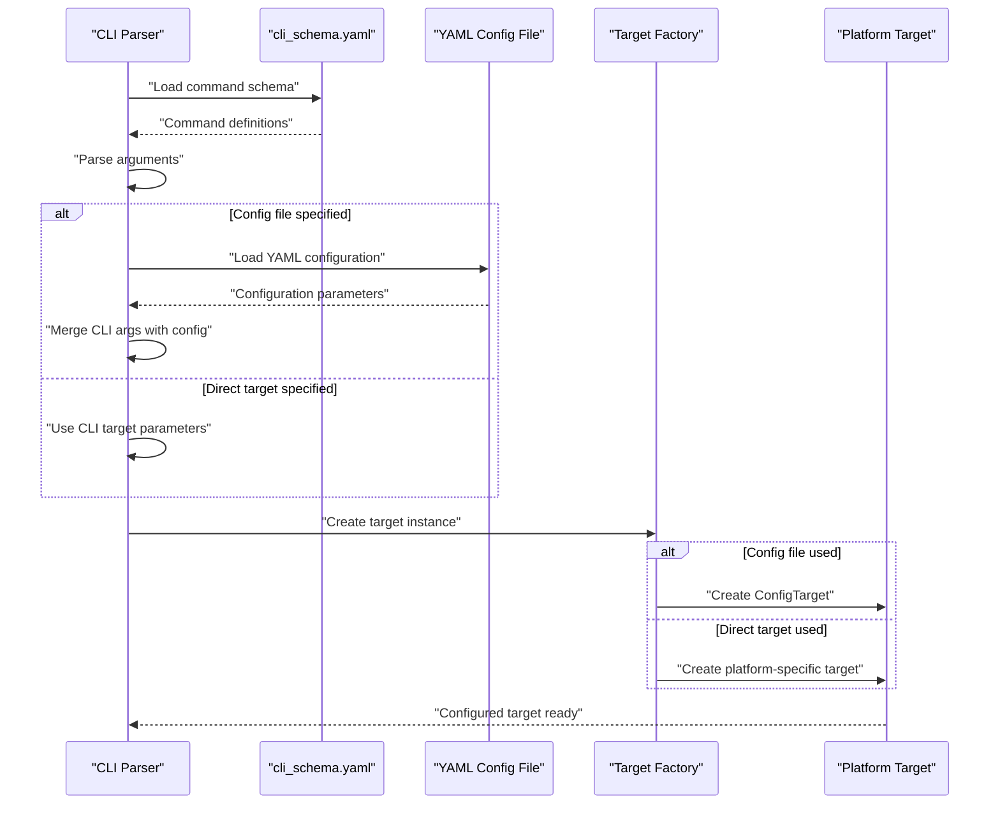

**Configuration Validation**

The tool validates configuration parameters at multiple stages:

1. **CLI Schema Validation** - Validates command syntax and required parameters
2. **Target Validation** - Validates connection parameters and platform compatibility  
3. **Package Validation** - Validates firmware package files and compatibility
4. **Platform Validation** - Validates platform-specific configuration requirements

Sources: [cli_schema.yaml:29](), [cli_schema.yaml:69](), [cli_schema.yaml:75]()

## Usage Examples

**Basic CLI Usage**
```bash
nvfwupd.py -t ip=192.168.1.100 user=admin password=secret servertype=GB200 show_version
```

**Config File Usage**
```bash
nvfwupd.py -c config.yaml update_fw
```

**Mixed Configuration**
```bash
nvfwupd.py -c config.yaml -t ip=192.168.1.200 update_fw -y
```

In the mixed configuration example, the CLI target parameter overrides the config file's BMC_IP setting, demonstrating the configuration hierarchy in action.

Sources: [firmware_update_guide/docs/appendix/platform-agnostic-updates.rst:111-144]()

---

# Page: Platform Support

# Platform Support

<details>
<summary>Relevant source files</summary>

The following files were used as context for generating this wiki page:

- [README.md](README.md)
- [firmware_update_guide/docs/appendix/platform-agnostic-updates.rst](firmware_update_guide/docs/appendix/platform-agnostic-updates.rst)
- [firmware_update_guide/docs/examples/gb200NVL.rst](firmware_update_guide/docs/examples/gb200NVL.rst)

</details>


This document describes the hardware platforms supported by open-nvfwupd and the platform-specific considerations for firmware updates. It covers platform identification, supported hardware components, and platform-specific update procedures.

For detailed platform-specific guides and examples, see [GB200 and GB300 NVL Systems](#5.1), [GB200 Switch Systems](#5.2), [DGX Systems](#5.3), and [HGX and HGXB100 Systems](#5.4). For configuration options that apply across platforms, see [Configuration](#3.2).

## Supported Platforms

open-nvfwupd supports multiple NVIDIA server platform families through a platform abstraction layer that provides unified interfaces while accommodating platform-specific differences.

### Platform Matrix

| Platform Family | ServerType Value | Target Class | Communication Protocol |
|-----------------|------------------|--------------|----------------------|
| DGX Systems | `DGX` | `DGX_RFTarget` | Redfish API |
| HGX Platforms | `HGX` | `BaseRFTarget` | Redfish API |
| HGXB100 Systems | `HGXB100` | `HGXB100RFTarget` | Redfish API |
| MGX-NVL Systems | `MGX-NVL` | `MGXNVLRFTarget` | Redfish API |
| GB200 NVL | `GB200` | `GB200RFTarget` | Redfish API |
| GB300 NVL | `GB300` | `GB200RFTarget` | Redfish API |
| GB200 Switch | `GB200Switch` | `GB200SwitchTarget` | NVUE REST API |

Sources: [README.md:14](), [firmware_update_guide/docs/appendix/platform-agnostic-updates.rst:15]()

## Platform Architecture

The platform support system uses a hierarchical class structure to provide both common functionality and platform-specific implementations.

### Platform Class Hierarchy

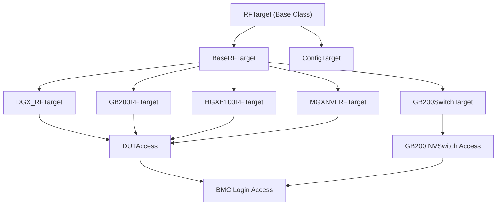

Sources: Architecture diagrams from context

### Platform Detection Flow

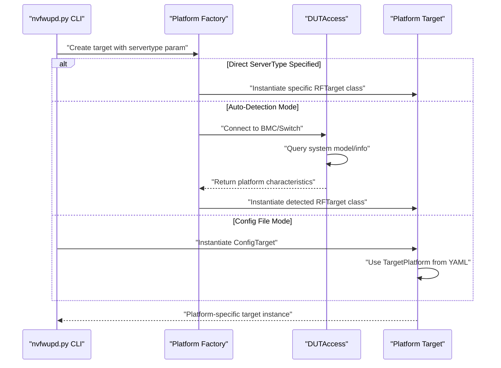

Sources: [firmware_update_guide/docs/appendix/platform-agnostic-updates.rst:15-16]()

## Platform-Specific Features

### GB200 and GB300 NVL Systems

GB200 NVL systems have a unique multi-tray architecture requiring specific handling for different hardware components.

#### Component Packaging

| Package Type | Package ID Pattern | Target Components | Update Method |
|--------------|-------------------|-------------------|---------------|
| BMC Tray | `GB200-P4972` | BMC, CPLD, ERoT, NIC, UEFI | Redfish Multipart |
| Compute Tray | `GB200-P4975` | HGX components (GPU, CPU, FPGA) | Redfish Multipart |
| Switch Tray | `GB200-P4978` | Switch BMC, FPGA, ERoT, CPLD | NVUE REST API |

#### Update Target Specification

GB200 systems require special update target files to specify which tray components to update:

```json
// BMC Tray Full Update
{
    "Targets": []
}

// Compute Tray Full Update  
{
    "Targets": ["/redfish/v1/Chassis/HGX_Chassis_0"]
}

// Individual Component Update
{
    "Targets": ["/redfish/v1/UpdateService/FirmwareInventory/HGX_FW_CPU_0"]
}
```

Sources: [README.md:93-107](), [firmware_update_guide/docs/examples/gb200NVL.rst:21-40](), [firmware_update_guide/docs/examples/gb200NVL.rst:87-91]()

### GB200 Switch Systems

GB200 Switch systems use the NVUE REST API instead of Redfish for firmware updates.

#### Switch Component Updates

Switch systems support staged updates with multiple package files:

- **Package 0004**: BMC, ERoT, FPGA components
- **Package 0006**: BIOS, ERoT components  
- **Package 0007**: CPLD components

#### Switch Update Targeting

```json
// Individual Component Update
{
    "Targets": ["BMC"]
}

// CPLD Update
{
    "Targets": ["CPLD1"]
}
```

Sources: [firmware_update_guide/docs/examples/gb200NVL.rst:337-340](), [firmware_update_guide/docs/examples/gb200NVL.rst:766-767]()

### DGX Systems

DGX systems use standard Redfish multipart push for firmware updates.

#### Update Configuration

```yaml
TargetPlatform: 'DGX'
FwUpdateMethod: "MultipartHttpPushUri"
MultipartHttpPushUri: '/redfish/v1/UpdateService/update-multipart'
BMCResetParameters:
  ResetType: 'ResetAll'
```

Sources: [firmware_update_guide/docs/appendix/platform-agnostic-updates.rst:98-107]()

### HGX and HGXB100 Systems

HGX platforms support both individual component updates and full system updates.

#### Reset Configuration

```yaml
TargetPlatform: 'HGX'  # or 'HGXB100'
BMCResetParameters:
  ResetToDefaultsType: 'ResetAll'
```

Sources: [firmware_update_guide/docs/appendix/platform-agnostic-updates.rst:61-62]()

## Update Methods by Platform

### Redfish-Based Platforms

Most platforms use Redfish API endpoints for firmware updates:

| Update Method | Redfish Endpoint | Supported Platforms |
|---------------|------------------|-------------------|
| `MultipartHttpPushUri` | `/redfish/v1/UpdateService/update-multipart` | DGX, HGX, GB200, GB300 |
| `HttpPushUri` | `/redfish/v1/UpdateService` | DGX, HGX, HGXB100 |

### NVUE REST API Platforms

GB200 Switch systems use NVUE REST API with component-specific endpoints and job monitoring.

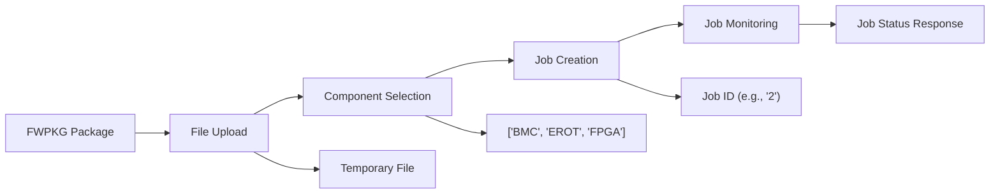

Sources: [firmware_update_guide/docs/examples/gb200NVL.rst:343-390]()

## Platform-Agnostic Configuration

For platforms not automatically detected or requiring custom configuration, the `ConfigTarget` class supports platform-agnostic updates through YAML configuration.

### Configuration Parameters

```yaml
# Platform specification
TargetPlatform: 'DGX'  # Required for proper component mapping

# Update method selection
FwUpdateMethod: "MultipartHttpPushUri"  # or "HttpPushUri"

# URI overrides (optional)
MultipartHttpPushUri: '/redfish/v1/UpdateService/update-multipart'
HttpPushUri: '/redfish/v1/UpdateService'
TaskServiceUri: '/redfish/v1/TaskService/Tasks/'

# Update targeting
UpdateParametersTargets:
  - "/redfish/v1/UpdateService/FirmwareInventory/CPLDMB_0"

# Force update options
MultipartOptions:
  - ForceUpdate: True
```

### Limitations

- Component version matching requires `TargetPlatform` specification
- Unknown platforms show `N/A` for package versions and up-to-date status
- Platform-specific features may not be available

Sources: [firmware_update_guide/docs/appendix/platform-agnostic-updates.rst:84-92]()

## Hardware Component Support

### Common Components Across Platforms

| Component Type | Identifier Pattern | Update Method |
|---------------|-------------------|---------------|
| BMC Firmware | `FW_BMC_*`, `HGX_FW_BMC_*` | OOB Redfish |
| GPU Firmware | `HGX_FW_GPU_*` | OOB Redfish |
| CPU Firmware | `HGX_FW_CPU_*` | OOB Redfish |
| FPGA Firmware | `HGX_FW_FPGA_*`, `FW_FPGA_*` | OOB Redfish |
| CPLD Firmware | `FW_CPLD_*`, `HGX_FW_CPLD_*` | OOB Redfish |
| ERoT Firmware | `FW_ERoT_*`, `HGX_FW_ERoT_*` | OOB Redfish |
| NIC Firmware | `NIC_*`, `CX7_*` | OOB Redfish |

### Platform-Specific Components

- **GB200 Switch**: `ASIC`, `BIOS`, `SSD`, `transceiver` (some inband-only)
- **DGX Systems**: Standard server components via BMC
- **HGX Systems**: High-performance computing components

Sources: [README.md:44-78](), [firmware_update_guide/docs/examples/gb200NVL.rst:194-225](), [firmware_update_guide/docs/examples/gb200NVL.rst:307-327]()

---

# Page: Advanced Features

# Advanced Features

<details>
<summary>Relevant source files</summary>

The following files were used as context for generating this wiki page:

- [firmware_update_guide/docs/appendix/output-formatting.rst](firmware_update_guide/docs/appendix/output-formatting.rst)
- [firmware_update_guide/docs/appendix/platform-agnostic-updates.rst](firmware_update_guide/docs/appendix/platform-agnostic-updates.rst)
- [firmware_update_guide/docs/appendix/spi-staged.rst](firmware_update_guide/docs/appendix/spi-staged.rst)
- [firmware_update_guide/docs/examples/gb300NVL.rst](firmware_update_guide/docs/examples/gb300NVL.rst)

</details>


This document covers advanced functionality in open-nvfwupd that extends beyond basic firmware update operations. These features enable customized update workflows, performance optimization, and support for complex deployment scenarios.

For basic command usage and platform-specific procedures, see [Commands and Operations](#3.1) and [Platform Guides](#5). For standard configuration options, see [Configuration](#3.2).

## Platform-Agnostic Updates

Platform-agnostic updates allow firmware updates on systems that are not automatically detected by open-nvfwupd or require custom update parameters. This is achieved through YAML configuration files that specify custom Redfish URIs and update methods.

### Configuration-Driven Update Architecture

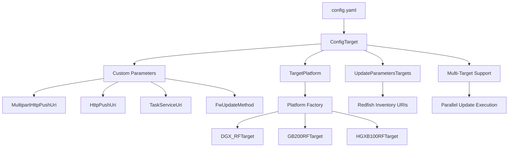

**Sources:** [firmware_update_guide/docs/appendix/platform-agnostic-updates.rst:1-215]()

### Key Configuration Parameters

The `ConfigTarget` class processes the following advanced parameters:

| Parameter | Purpose | Default Value |
|-----------|---------|---------------|
| `MultipartHttpPushUri` | Override default multipart update endpoint | `/redfish/v1/UpdateService/update-multipart` |
| `HttpPushUri` | Override default PLDM update endpoint | `/redfish/v1/UpdateService` |
| `TaskServiceUri` | Custom task monitoring endpoint | `/redfish/v1/TaskService/Tasks/` |
| `FwUpdateMethod` | Update method selection | `MultipartHttpPushUri` or `HttpPushUri` |
| `UpdateParametersTargets` | Specific component targets | Platform-dependent |
| `BMCResetParameters` | Custom reset configuration | Platform-specific |

**Sources:** [firmware_update_guide/docs/appendix/platform-agnostic-updates.rst:8-76]()

### Multi-Target Update Support

```mermaid
sequenceDiagram
    participant User
    participant ConfigTarget
    participant TargetManager["Target Manager"]
    participant BMC1["BMC System 1"]
    participant BMC2["BMC System 2"]
    
    User->>ConfigTarget: "Load config with Targets list"
    ConfigTarget->>TargetManager: "Parse target definitions"
    
    loop "For each target in Targets"
        TargetManager->>BMC1: "Establish connection (ip=1.1.1.1)"
        TargetManager->>BMC2: "Establish connection (ip=2.2.2.2)"
        
        par "Parallel Update Execution"
            TargetManager->>BMC1: "Upload firmware package"
            TargetManager->>BMC2: "Upload firmware package"
        end
        
        par "Monitor Progress"
            BMC1-->>TargetManager: "Task progress updates"
            BMC2-->>TargetManager: "Task progress updates"
        end
    end
    
    TargetManager-->>User: "Consolidated update status"
```

**Sources:** [firmware_update_guide/docs/appendix/platform-agnostic-updates.rst:65-75]()

## SPI Staged Updates

SPI staged updates optimize firmware deployment by pre-downloading component images, significantly reducing activation downtime. This feature is supported on GB200 NVL and GB300 NVL platforms.

### Staged Update Lifecycle

```mermaid
stateDiagram-v2
    [*] --> StageCommand: "update_fw -u"
    
    StageCommand --> DownloadImages: "Stage firmware images"
    DownloadImages --> ImagesStaged: "Components downloaded"
    
    ImagesStaged --> ViewStaged: "show_version -s"
    ViewStaged --> ImagesStaged: "View staged versions"
    
    ImagesStaged --> ActivateCommand: "update_fw -a"
    ActivateCommand --> ComponentsUpdated: "Activate staged images"
    
    ComponentsUpdated --> PowerCycle: "AC power cycle required"
    PowerCycle --> [*]: "Firmware active"
    
    note right of DownloadImages
        Images stored in platform
        firmware staging area
    end note
    
    note right of ActivateCommand
        Reduced downtime:
        ~1 minute vs ~11 minutes
    end note
```

**Sources:** [firmware_update_guide/docs/appendix/spi-staged.rst:1-100]()

### Staging Implementation Commands

The staging functionality is controlled through specific CLI flags:

| Flag | Long Form | Function | Platform Support |
|------|-----------|----------|------------------|
| `-u` | `--staged_update` | Stage firmware without activation | GB200/GB300 NVL |
| `-s` | `--staged` | View staged component versions | GB200/GB300 NVL |
| `-a` | `--staged_activate_update` | Activate previously staged images | GB200/GB300 NVL |

**Sources:** [firmware_update_guide/docs/appendix/spi-staged.rst:7-77]()

### Staged Version Display Format

When viewing staged versions with `show_version -s`, the output includes additional columns:

```
AP Name                  Sys Version         Staged Version  Pkg Version   Up-To-Date
-------                  -----------         --------------  -----------   ----------
FW_BMC_0                 GB200Nvl-25.01      GB200Nvl-25.02 GB200Nvl-25.02 No       
FW_ERoT_BMC_0            01.04.0007_n04      01.04.0008_n04 01.04.0008_n04 No
```

**Sources:** [firmware_update_guide/docs/appendix/spi-staged.rst:46-49]()

## Force Updates and Downgrades

Force updates bypass version comparison checks, enabling firmware downgrades and updates when components appear up-to-date but require reinstallation.

### Force Update Mechanisms

```mermaid
flowchart TD
    UpdateRequest["Update Request"] --> VersionCheck["Version Comparison"]
    VersionCheck --> IsNewer{"Pkg > System?"}
    
    IsNewer -->|"Yes"| StandardUpdate["Standard Update"]
    IsNewer -->|"No"| CheckForce{"ForceUpdate enabled?"}
    
    CheckForce -->|"No"| UpdateSkipped["Update Skipped"]
    CheckForce -->|"Yes"| ForceUpdate["Force Update"]
    
    ForceUpdate --> BypassCheck["Bypass Version Check"]
    BypassCheck --> DowngradeUpdate["Execute Downgrade"]
    
    StandardUpdate --> NormalFlow["Normal Update Flow"]
    DowngradeUpdate --> NormalFlow
    
    UpdateSkipped --> LogMessage["Log: Component comparison stamp lower"]
```

**Sources:** [firmware_update_guide/docs/examples/gb300NVL.rst:122-175]()

### Force Update Configuration

Force updates are enabled through JSON target files using the `ForceUpdate` parameter:

```json
{
    "ForceUpdate": true,
    "Targets": []
}
```

For component-specific force updates:

```json
{
    "ForceUpdate": true,
    "Targets": ["/redfish/v1/UpdateService/FirmwareInventory/HGX_FW_CPU_0"]
}
```

**Sources:** [firmware_update_guide/docs/examples/gb300NVL.rst:143-149](), [firmware_update_guide/docs/examples/gb300NVL.rst:242-250]()

## Advanced Output and Debugging

The debug output mode provides comprehensive firmware update progress tracking through detailed message tables and task monitoring.

### Debug Output Architecture

```mermaid
flowchart LR
    UpdateCommand["update_fw -d"] --> TaskMonitor["Task Monitor"]
    TaskMonitor --> RedfishMessages["Redfish Task Messages"]
    
    RedfishMessages --> MessageParser["Message Parser"]
    MessageParser --> TableFormatter["Table Formatter"]
    
    TableFormatter --> DebugTable["Debug Output Table"]
    
    subgraph "Message Types"
        TaskEvents["TaskEvent Messages"]
        UpdateEvents["Update Messages"] 
        ComponentEvents["Component Messages"]
        DebugEvents["Debug Messages"]
    end
    
    MessageParser --> TaskEvents
    MessageParser --> UpdateEvents
    MessageParser --> ComponentEvents
    MessageParser --> DebugEvents
```

**Sources:** [firmware_update_guide/docs/appendix/output-formatting.rst:1-122]()

### Debug Output Message Categories

| MessageId Pattern | Purpose | Example |
|-------------------|---------|---------|
| `TaskEvent.1.0.3.*` | Task lifecycle events | `TaskStarted`, `TaskProgressChanged`, `TaskCompleted` |
| `Update.1.0.*` | Update operation status | `TargetDetermined`, `TransferringToComponent`, `UpdateSuccessful` |
| `NvidiaUpdate.1.0.*` | NVIDIA-specific events | `ComponentUpdateSkipped`, `DebugTokenEraseFailed` |

**Sources:** [firmware_update_guide/docs/appendix/output-formatting.rst:24-114]()

## Custom Update Methods

The platform supports multiple update methods through the `FwUpdateMethod` configuration parameter, enabling compatibility with different BMC implementations.

### Update Method Selection

```mermaid
flowchart TD
    ConfigFile["Configuration File"] --> FwUpdateMethod["FwUpdateMethod Parameter"]
    
    FwUpdateMethod --> MultipartMethod["MultipartHttpPushUri"]
    FwUpdateMethod --> HttpMethod["HttpPushUri"]
    
    MultipartMethod --> MultipartFlow["Multipart Upload Flow"]
    HttpMethod --> HttpFlow["Standard HTTP Upload Flow"]
    
    MultipartFlow --> MultipartOptions["MultipartOptions"]
    MultipartOptions --> ForceOption["ForceUpdate: true"]
    
    MultipartFlow --> RedfishMultipart["/redfish/v1/UpdateService/update-multipart"]
    HttpFlow --> RedfishStandard["/redfish/v1/UpdateService"]
    
    RedfishMultipart --> TaskCreation["Task Creation"]
    RedfishStandard --> TaskCreation
    
    TaskCreation --> ProgressMonitoring["Progress Monitoring"]
```

**Sources:** [firmware_update_guide/docs/appendix/platform-agnostic-updates.rst:37-45]()

### Method-Specific Parameters

| Method | URI Override Parameter | Additional Options |
|--------|----------------------|-------------------|
| `MultipartHttpPushUri` | `MultipartHttpPushUri` | `MultipartOptions` with `ForceUpdate` |
| `HttpPushUri` | `HttpPushUri` | Standard PLDM package upload |

**Sources:** [firmware_update_guide/docs/appendix/platform-agnostic-updates.rst:24-45]()

## Advanced Feature Code Mapping

```mermaid
classDiagram
    class ConfigTarget {
        +config_file: str
        +parse_config()
        +get_update_method()
        +get_target_list()
        +setup_multipart_options()
    }
    
    class BaseRFTarget {
        +staged_update: bool
        +force_update: bool
        +debug_mode: bool
        +execute_staged_update()
        +execute_force_update()
        +monitor_task_progress()
    }
    
    class GB200RFTarget {
        +supports_staging: bool
        +stage_firmware_images()
        +activate_staged_images()
        +show_staged_versions()
    }
    
    class TaskMonitor {
        +task_id: str
        +debug_output: bool
        +format_debug_table()
        +parse_redfish_messages()
    }
    
    class MultiTargetManager {
        +target_configs: list
        +parallel_execution: bool
        +execute_parallel_updates()
        +consolidate_results()
    }
    
    ConfigTarget --> BaseRFTarget
    BaseRFTarget <|-- GB200RFTarget
    BaseRFTarget --> TaskMonitor
    ConfigTarget --> MultiTargetManager
```

**Sources:** Architecture inferred from [firmware_update_guide/docs/appendix/platform-agnostic-updates.rst:1-215](), [firmware_update_guide/docs/appendix/spi-staged.rst:1-100](), [firmware_update_guide/docs/appendix/output-formatting.rst:1-122]()

---

# Page: Architecture

# Architecture

<details>
<summary>Relevant source files</summary>

The following files were used as context for generating this wiki page:

- [nvfwupd/dut_access.py](nvfwupd/dut_access.py)
- [nvfwupd/rf_target.py](nvfwupd/rf_target.py)
- [nvfwupd/updcommand.py](nvfwupd/updcommand.py)

</details>


This document provides a technical overview of the open-nvfwupd system architecture, covering the core components, design patterns, and data flows that enable firmware updates across multiple NVIDIA hardware platforms. For platform-specific implementation details, see [Platform Abstraction Layer](#4.2). For detailed communication protocols, see [Communication Layer](#4.3).

## System Overview

The open-nvfwupd architecture follows a layered design that abstracts hardware platform differences behind a common interface while supporting multiple communication protocols (Redfish for BMCs, NVUE REST for switches). The system uses factory patterns and abstract base classes to enable extensible support for new hardware platforms.

### High-Level System Architecture

```mermaid
graph TB
    subgraph "CLI Layer"
        A["nvfwupd.py"] --> B["FwUpdCmd"]
        B --> C["FwUpdCmdShowVersion"]
        B --> D["FwUpdCmdUpdateFirmware"] 
        B --> E["FwUpdCmdForceUpdate"]
        B --> F["FwUpdCmdShowUpdateProgress"]
    end
    
    subgraph "Platform Abstraction Layer"
        G["RFTarget"] --> H["BaseRFTarget"]
        G --> I["DGX_RFTarget"]
        G --> J["GB200RFTarget"]
        G --> K["HGXB100RFTarget"]
        G --> L["GB200SwitchTarget"]
        G --> M["ConfigTarget"]
    end
    
    subgraph "Communication Layer"
        N["DUTAccess"] --> O["BMCLoginAccess"]
        N --> P["BMCPortForwardAccess"]
        N --> Q["GB200NVSwitchAccess"]
    end
    
    subgraph "Target Hardware"
        R["BMC Redfish APIs"]
        S["GB200 NVUE REST APIs"]
        T["Hardware Components"]
    end
    
    C --> G
    D --> G
    E --> G
    F --> G
    
    H --> N
    I --> N
    J --> N
    K --> N
    L --> N
    M --> N
    
    O --> R
    P --> R
    Q --> S
    
    R --> T
    S --> T
```

**Sources:** [nvfwupd/updcommand.py:52-99](), [nvfwupd/rf_target.py:30-109](), [nvfwupd/dut_access.py:39-67]()

## Core Components

The system consists of three primary layers that work together to provide platform-agnostic firmware update capabilities:

### Command Processing Layer

The `FwUpdCmd` base class in [nvfwupd/updcommand.py:52-99]() provides the foundation for all CLI operations. Each command inherits from this base and implements specific functionality:

| Command Class | Purpose | Key Methods |
|---------------|---------|-------------|
| `FwUpdCmdShowVersion` | Display firmware inventory | `get_output_json()`, `print_output_json()` |
| `FwUpdCmdUpdateFirmware` | Execute firmware updates | `update_target()`, `update_fw_parallel()` |
| `FwUpdCmdForceUpdate` | Enable/disable force update mode | `run_command()` |
| `FwUpdCmdShowUpdateProgress` | Monitor update task status | `run_command()` |

The command layer handles argument validation, target list processing, and orchestrates calls to the platform abstraction layer.

**Sources:** [nvfwupd/updcommand.py:861-896](), [nvfwupd/updcommand.py:1454-1492](), [nvfwupd/updcommand.py:1280-1307](), [nvfwupd/updcommand.py:1982-2009]()

### Platform Resolution and Factory Pattern

```mermaid
graph LR
    A["validate_target_json()"] --> B["DUTAccess.get_dut_access()"]
    B --> C{"Platform Detection"}
    C --> D["SERVER_TYPE_CLASS_DICT"]
    C --> E["TARGET_CLASS_DICT"]
    D --> F["Platform-Specific RFTarget"]
    E --> F
    F --> G["init_platform()"]
    G --> H["Instantiated Target Class"]
    
    I["ConfigTarget"] --> J["config_dict"]
    J --> K["TargetPlatform"]
    K --> F
```

The system uses two key dictionaries for platform resolution:

- `SERVER_TYPE_CLASS_DICT` in [nvfwupd/rf_target.py:99-107]() - Maps server types to target classes
- `TARGET_CLASS_DICT` in [nvfwupd/rf_target.py:109-114]() - Maps detected platform names to target classes

**Sources:** [nvfwupd/rf_target.py:99-116](), [nvfwupd/updcommand.py:531-547](), [nvfwupd/updcommand.py:607-698]()

## Platform Abstraction Layer

### RFTarget Hierarchy

The `RFTarget` abstract base class defines the contract for all platform implementations:

```mermaid
classDiagram
    class RFTarget {
        <<abstract>>
        +target_access: DUTAccess
        +fungible_components: list
        +update_completion_msg: str
        +update_component()* 
        +is_fungible_component()*
        +get_component_version()*
        +start_update_monitor()
        +process_job_status()
    }
    
    class BaseRFTarget {
        +update_component()
        +get_component_version()
        +is_fungible_component()
    }
    
    class DGX_RFTarget {
        +update_component()
        +fungible_components: ["bmc", "cpld"]
    }
    
    class GB200RFTarget {
        +update_component()
        +get_compute_tray_count()
        +update_compute_tray_fw()
    }
    
    class ConfigTarget {
        +config_dict: dict
        +determine_target_type()
        +delegate_to_concrete_target()
    }
    
    RFTarget <|-- BaseRFTarget
    RFTarget <|-- DGX_RFTarget  
    RFTarget <|-- GB200RFTarget
    RFTarget <|-- ConfigTarget
```

Each platform implementation handles:
- Component version extraction from firmware inventory
- Platform-specific update procedures (HTTP Push URI vs Multipart uploads)
- Fungible component identification (components that can be different SKUs)

**Sources:** [nvfwupd/rf_target.py:30-97](), [nvfwupd/rf_target.py:183-194]()

### Update Method Abstraction

The system supports two primary update methods through abstract methods:

```mermaid
sequenceDiagram
    participant C as "Command Layer"
    participant R as "RFTarget"
    participant D as "DUTAccess"
    participant H as "Hardware"
    
    C->>R: update_component()
    R->>R: determine_update_method()
    
    alt HTTP Push URI
        R->>R: update_component_pushuri()
        R->>D: dispatch_request("PATCH")
        R->>D: dispatch_file_upload()
    else Multipart Upload
        R->>R: update_component_multipart()
        R->>D: multipart_file_upload()
    end
    
    D->>H: POST /redfish/v1/UpdateService
    H-->>D: Task ID Response
    D-->>R: task_id
    R->>R: start_update_monitor()
    
    loop Monitor Progress
        R->>D: dispatch_request(task_service_uri)
        D->>H: GET /redfish/v1/TaskService/Tasks/{id}
        H-->>D: Task Status
        D-->>R: task_dict
        R->>R: check_for_failure()
    end
```

**Sources:** [nvfwupd/rf_target.py:528-692](), [nvfwupd/rf_target.py:694-1076]()

## Communication Layer

### DUTAccess Factory Pattern

The `DUTAccess.get_dut_access()` method implements a factory pattern to instantiate the appropriate communication class:

```mermaid
graph TD
    A["get_dut_access()"] --> B{"servertype Parameter"}
    B -->|"gb200switch"| C["GB200NVSwitchAccess"]
    B -->|"Other/None"| D["Try Access Classes"]
    
    D --> E["BMCPortForwardAccess"]
    D --> F["BMCLoginAccess"]
    
    E --> G{"is_valid() && is_reachable()"}
    F --> H{"is_valid() && is_reachable()"}
    
    G -->|"Success"| I["Return BMCPortForwardAccess"]
    G -->|"Fail"| F
    H -->|"Success"| J["Return BMCLoginAccess"]
    H -->|"Fail"| K["Return None"]
    
    C --> L["NVUE REST API"]
    I --> M["Redfish over Port Forward"]
    J --> N["Direct Redfish Access"]
```

**Sources:** [nvfwupd/dut_access.py:72-181]()

### Protocol Implementations

| Access Class | Protocol | Target Hardware | Key Methods |
|--------------|----------|-----------------|-------------|
| `BMCLoginAccess` | Redfish HTTPS | BMC endpoints | `dispatch_request()`, `get_firmware_inventory()` |
| `BMCPortForwardAccess` | Redfish via SSH tunnel | Port-forwarded BMCs | `update_transport_type()` |
| `GB200NVSwitchAccess` | NVUE REST API | GB200 switches | `dispatch_rest_request_get()`, `get_job_status()` |

### Request Processing Pipeline

```mermaid
graph LR
    A["dispatch_request()"] --> B{"Method Type"}
    B -->|"GET"| C["requests.get()"]
    B -->|"POST"| D["File Upload Logic"]
    B -->|"PATCH"| E["Configuration Update"]
    
    D --> F{"multipart_file_upload()"}
    F --> G["Firmware Package"]
    F --> H["Update Parameters"]
    G --> I["POST Request"]
    H --> I
    
    C --> J["JSON Response"]
    E --> J
    I --> J
    
    J --> K["Response Validation"]
    K --> L["Task ID Extraction"]
    L --> M["Task Monitoring"]
```

**Sources:** [nvfwupd/dut_access.py:857-1091](), [nvfwupd/dut_access.py:1180-1291]()

## Data Flow Architecture

### Firmware Update Flow

```mermaid
sequenceDiagram
    participant CLI as "nvfwupd CLI"
    participant CMD as "FwUpdCmdUpdateFirmware" 
    participant TGT as "Platform RFTarget"
    participant DUT as "DUTAccess"
    participant PKG as "PLDM Package Parser"
    participant HW as "Target Hardware"
    
    CLI->>CMD: run_command()
    CMD->>CMD: validate_cmd()
    CMD->>CMD: validate_target_json()
    CMD->>CMD: validate_recipes()
    
    CMD->>PKG: get_pkg_parser()
    PKG->>PKG: parse_pkg()
    
    CMD->>DUT: get_dut_access()
    DUT->>HW: Test connectivity
    HW-->>DUT: Connection established
    
    CMD->>TGT: init_platform()
    TGT->>TGT: Determine platform type
    
    CMD->>TGT: start_update_monitor()
    TGT->>TGT: update_component()
    TGT->>DUT: Upload firmware
    DUT->>HW: POST /redfish/v1/UpdateService
    HW-->>DUT: Task ID
    
    loop Monitor Update
        TGT->>DUT: GET task_service_uri
        DUT->>HW: GET /redfish/v1/TaskService/Tasks/{id}
        HW-->>DUT: Task status
        DUT-->>TGT: task_dict
        TGT->>TGT: Print progress
    end
    
    TGT-->>CMD: Update completion
    CMD-->>CLI: Exit with status
```

**Sources:** [nvfwupd/updcommand.py:1717-1979](), [nvfwupd/rf_target.py:694-1076]()

### Configuration-Based Target Resolution

For systems using configuration files, the `ConfigTarget` class provides an additional abstraction layer:

```mermaid
graph TB
    A["config.yaml"] --> B["ConfigParser"]
    B --> C["ConfigTarget"]
    C --> D{"TargetPlatform Value"}
    
    D -->|"dgx"| E["DGX_RFTarget"]
    D -->|"gb200"| F["GB200RFTarget"]
    D -->|"hgxb100"| G["HGXB100RFTarget"]
    D -->|"gb200switch"| H["GB200SwitchTarget"]
    
    E --> I["BMC Communication"]
    F --> I
    G --> I
    H --> J["NVUE REST Communication"]
    
    C --> K["config_dict"]
    K --> L["ParallelUpdate"]
    K --> M["FWUpdateFilePath"]
    K --> N["TargetPlatform"]
```

The `ConfigTarget` acts as a proxy that delegates to the appropriate concrete target implementation based on configuration parameters.

**Sources:** [nvfwupd/updcommand.py:642-680](), [nvfwupd/rf_target.py:116]()

This architecture enables the system to support diverse NVIDIA hardware platforms through a unified interface while maintaining extensibility for future platform additions.

---

# Page: Core Components

# Core Components

<details>
<summary>Relevant source files</summary>

The following files were used as context for generating this wiki page:

- [nvfwupd/updcommand.py](nvfwupd/updcommand.py)
- [nvfwupd/utils.py](nvfwupd/utils.py)
- [nvfwupd/version.py](nvfwupd/version.py)

</details>


This page documents the fundamental components that form the foundation of the open-nvfwupd system, including CLI command processing, utility functions, and version management. These components provide the essential infrastructure for firmware update operations across all supported platforms.

For information about platform-specific implementations, see [Platform Abstraction Layer](#4.2). For details about device communication protocols, see [Communication Layer](#4.3).

## Overview

The core components consist of three main subsystems that work together to provide the command-line interface and basic infrastructure:

| Component | Primary Classes | Responsibility |
|-----------|----------------|----------------|
| CLI Command Processing | `FwUpdCmd`, `FwUpdCmdShowVersion`, `FwUpdCmdUpdateFirmware` | Command parsing, validation, and execution coordination |
| Utilities and Infrastructure | `Util`, `LogSanitizer` | Helper functions, error handling, log sanitization |
| Version Management | `NVFWUPD_CLI_VERSION` | Tool version tracking and display |

## CLI Command Processing Architecture

The command processing system is built around a base class hierarchy that handles different firmware update operations. Each command type has specialized logic while sharing common validation and platform initialization functionality.

```mermaid
classDiagram
    class FwUpdCmd {
        +m_schema : CLISchema
        +m_exec_name : str
        +m_cmd_name : str
        +m_args : dict
        +logger : Logger
        +config_parser : ConfigParser
        +validate_cmd() Namespace
        +validate_recipes() list
        +validate_target_json() list
        +init_platform() RFTarget
        +match_platform() str
        +run_command() void
    }
    
    class FwUpdCmdShowVersion {
        +run_command() void
        +get_output_json() dict
        +get_output_json_parallel() dict
        +print_output_json() void
    }
    
    class FwUpdCmdUpdateFirmware {
        +validate_cmd() Namespace
        +update_target() TaskId
        +update_fw_parallel() int
        +run_command() void
    }
    
    class FwUpdCmdForceUpdate {
        +run_command() void
    }
    
    class FwUpdCmdHelp {
        +print_usage() void
        +run_command() void
    }
    
    class FwUpdCmdToolVersion {
        +print_version() void
        +run_command() void
    }
    
    FwUpdCmd <|-- FwUpdCmdShowVersion
    FwUpdCmd <|-- FwUpdCmdUpdateFirmware
    FwUpdCmd <|-- FwUpdCmdForceUpdate
    FwUpdCmd <|-- FwUpdCmdHelp
    FwUpdCmd <|-- FwUpdCmdToolVersion
```

Sources: [nvfwupd/updcommand.py:52-99](), [nvfwupd/updcommand.py:701-744](), [nvfwupd/updcommand.py:746-773](), [nvfwupd/updcommand.py:861-896](), [nvfwupd/updcommand.py:1280-1307](), [nvfwupd/updcommand.py:1454-1492]()

### Base Command Class (FwUpdCmd)

The `FwUpdCmd` class provides the foundation for all firmware update commands. It handles common operations including command validation, target management, and platform initialization.

**Key Responsibilities:**
- Command schema validation using CLI argument parsers [nvfwupd/updcommand.py:203-246]()
- Target list creation and validation from configuration files or CLI arguments [nvfwupd/updcommand.py:248-387]()
- Firmware package validation to ensure PLDM compatibility [nvfwupd/updcommand.py:173-201]()
- Platform type detection and RFTarget instance creation [nvfwupd/updcommand.py:607-698]()
- Parallel update support through input parameter management [nvfwupd/updcommand.py:549-604]()

**Critical Methods:**
- `validate_cmd()`: Processes global and command-specific arguments using argparse
- `init_platform()`: Factory method that returns appropriate RFTarget implementation based on detected or configured platform type
- `match_platform()`: Static method for platform string matching using `RFTarget.TARGET_CLASS_DICT`

Sources: [nvfwupd/updcommand.py:52-99](), [nvfwupd/updcommand.py:105-172](), [nvfwupd/updcommand.py:531-547]()

### Command-Specific Implementations

Each command type extends `FwUpdCmd` with specialized logic:

**FwUpdCmdShowVersion**
- Retrieves firmware inventory from target systems [nvfwupd/updcommand.py:1020-1151]()
- Compares installed versions with package versions when available
- Supports parallel inventory collection using `ThreadPoolExecutor` [nvfwupd/updcommand.py:947-965]()
- Outputs both JSON and tabular formats

**FwUpdCmdUpdateFirmware**
- Validates firmware packages before upload [nvfwupd/updcommand.py:1494-1516]()
- Handles both single and parallel firmware updates
- Supports staged updates and immediate activation modes [nvfwupd/updcommand.py:1595-1608]()
- Monitors update progress through task status polling

**FwUpdCmdForceUpdate**
- Manages the BMC `ForceUpdate` flag via Redfish PATCH operations [nvfwupd/updcommand.py:1427-1433]()
- Provides enable, disable, and status query functionality

Sources: [nvfwupd/updcommand.py:861-896](), [nvfwupd/updcommand.py:1454-1492](), [nvfwupd/updcommand.py:1280-1307]()

## Command Processing Flow

The following diagram illustrates how commands flow through the core processing pipeline:

```mermaid
flowchart TD
    A["CLI Input"] --> B["FwUpdCmd.__init__()"]
    B --> C["validate_cmd()"]
    C --> D["validate_target_json()"]
    D --> E["validate_recipes()"]
    E --> F{"Command Type?"}
    
    F -->|"show_version"| G["FwUpdCmdShowVersion.run_command()"]
    F -->|"update_fw"| H["FwUpdCmdUpdateFirmware.run_command()"]
    F -->|"force_update"| I["FwUpdCmdForceUpdate.run_command()"]
    F -->|"help"| J["FwUpdCmdHelp.run_command()"]
    F -->|"version"| K["FwUpdCmdToolVersion.run_command()"]
    
    G --> L["get_output_json()"]
    H --> M["update_target()"]
    L --> N["DUTAccess.get_dut_access()"]
    M --> N
    N --> O["init_platform()"]
    O --> P["RFTarget Instance"]
    
    P --> Q["Platform Operations"]
    Q --> R["Output Results"]
```

Sources: [nvfwupd/updcommand.py:105-172](), [nvfwupd/updcommand.py:203-246](), [nvfwupd/updcommand.py:389-509](), [nvfwupd/updcommand.py:607-698]()

## Utilities and Infrastructure

The utility system provides essential support functions for logging, error handling, and data processing across the entire application.

### Util Class

The `Util` class contains static methods that provide core functionality:

**Error Handling and Program Control:**
- `bail_nvfwupd()`: Centralized error handling with exit codes and JSON support [nvfwupd/utils.py:340-372]()
- `bail_nvfwupd_threadsafe()`: Thread-safe error handling for parallel operations [nvfwupd/utils.py:373-401]()

**Configuration and Validation:**
- `get_log_sanitize_config()`: Converts target configuration lists to dictionaries [nvfwupd/utils.py:217-252]()
- `target_platform_supported()`: Validates platform type compatibility [nvfwupd/utils.py:309-338]()
- `ping_to_check_system()`: Network connectivity verification [nvfwupd/utils.py:201-215]()

**Data Processing:**
- `sanitize_log()`: Applies log sanitization rules [nvfwupd/utils.py:294-307]()
- `compare_dict()`: Dictionary comparison for task status tracking [nvfwupd/utils.py:416-441]()
- `wrap_text()`: Text formatting for console output [nvfwupd/utils.py:443-454]()

Sources: [nvfwupd/utils.py:108-151](), [nvfwupd/utils.py:152-164]()

### LogSanitizer Class

The `LogSanitizer` provides credential and sensitive information filtering for logs and console output:

```mermaid
classDiagram
    class LogSanitizer {
        +builtin_regex : dict
        +compiled_string : Pattern
        +replacement : str
        +__init__(string_list, replacement_string, additional_regex)
        +sanitize(string) str
    }
    
    class BuiltInLogSanitizers {
        <<enumeration>>
        IPV4
        IPV6
    }
    
    class Util {
        +is_sanitize : bool
        +sanitize_config : dict
        +get_sanitizer(log_config, enabled) LogSanitizer
        +sanitize_log(data) str
    }
    
    LogSanitizer --> BuiltInLogSanitizers : uses
    Util --> LogSanitizer : creates
```

**Key Features:**
- Built-in regex patterns for IPv4 and IPv6 address detection [nvfwupd/utils.py:55-58]()
- Custom string filtering with word boundary protection [nvfwupd/utils.py:84-85]()
- Integration with logging formatter for automatic sanitization [nvfwupd/utils.py:38-106]()

The sanitizer automatically filters credentials from configuration including usernames, passwords, and IP addresses based on field names like `BMC_IP`, `RF_USERNAME`, `RF_PASSWORD` [nvfwupd/utils.py:269-292]().

Sources: [nvfwupd/utils.py:29-106](), [nvfwupd/utils.py:254-292]()

## Version Management

Version tracking is handled through a simple module that defines the current tool version:

```mermaid
graph LR
    A["nvfwupd/version.py"] --> B["NVFWUPD_CLI_VERSION = '1.0.1'"]
    B --> C["FwUpdCmdToolVersion.print_version()"]
    B --> D["FwUpdCmdHelp.run_command()"]
    B --> E["CLI --version output"]
```

The version string is imported and used by command classes to display version information in help output and dedicated version commands [nvfwupd/updcommand.py:30](), [nvfwupd/updcommand.py:737](), [nvfwupd/updcommand.py:743](), [nvfwupd/updcommand.py:811]().

Sources: [nvfwupd/version.py:19](), [nvfwupd/updcommand.py:732-744]()

## Integration with Platform Layer

The core components interface with the platform abstraction layer through several key integration points:

| Integration Point | Core Component Method | Platform Layer Interface |
|------------------|----------------------|---------------------------|
| Platform Detection | `FwUpdCmd.match_platform()` | `RFTarget.TARGET_CLASS_DICT` |
| Platform Initialization | `FwUpdCmd.init_platform()` | `RFTarget` subclass constructors |
| Configuration Binding | `FwUpdCmd.validate_target_json()` | `ConfigTarget` initialization |

The `init_platform()` method serves as the primary factory function that bridges the core command processing with platform-specific implementations. It uses either explicit server type configuration or automatic platform detection through `DUTAccess.get_dut_access()` to instantiate the appropriate `RFTarget` subclass [nvfwupd/updcommand.py:607-698]().

Sources: [nvfwupd/updcommand.py:531-547](), [nvfwupd/updcommand.py:607-698](), [nvfwupd/updcommand.py:30-49]()

---

# Page: Platform Abstraction Layer

# Platform Abstraction Layer

<details>
<summary>Relevant source files</summary>

The following files were used as context for generating this wiki page:

- [nvfwupd/base_rftarget.py](nvfwupd/base_rftarget.py)
- [nvfwupd/config_target.py](nvfwupd/config_target.py)
- [nvfwupd/rf_target.py](nvfwupd/rf_target.py)

</details>


The Platform Abstraction Layer provides a unified interface for firmware update operations across different NVIDIA hardware platforms. This layer abstracts platform-specific implementation details while maintaining consistent APIs for firmware management operations.

For information about specific platform implementations and their usage, see [Platform Guides](#5). For details about the communication protocols used by these abstractions, see [Communication Layer](#4.3).

## Architecture Overview

The Platform Abstraction Layer uses an inheritance-based design with abstract base classes that define common interfaces. Platform-specific implementations inherit from these base classes and provide customized behavior for their respective hardware types.

### Class Hierarchy

```mermaid
classDiagram
    class RFTarget {
        <<abstract>>
        +update_component()*
        +is_fungible_component()*
        +get_component_version()*
        +get_identifier_from_chassis()*
        +get_version_sku()*
        +start_update_monitor()
        +process_job_status()
        +version_newer()
    }
    
    class BaseRFTarget {
        +update_component()
        +is_fungible_component()
        +get_component_version()
        +version_newer()
        +is_hgx_pkg()
        +get_sku_from_chassis()
    }
    
    class ConfigTarget {
        +init_platform_obj()
        +update_component()
        +start_update_monitor()
        -config_platform_target
        -config_dict
    }
    
    class DGX_RFTarget {
        +update_component()
        +get_update_uri()
    }
    
    class GB200RFTarget {
        +update_component()
        +get_update_uri()
    }
    
    class GB200SwitchTarget {
        +update_component()
        +start_update_monitor()
    }
    
    class HGXB100RFTarget {
        +update_component()
        +get_update_uri()
    }
    
    class MGXNVLRFTarget {
        +update_component()
        +get_update_uri()
    }
    
    RFTarget <|-- BaseRFTarget
    RFTarget <|-- ConfigTarget
    BaseRFTarget <|-- DGX_RFTarget
    BaseRFTarget <|-- GB200RFTarget
    BaseRFTarget <|-- HGXB100RFTarget
    BaseRFTarget <|-- MGXNVLRFTarget
    RFTarget <|-- GB200SwitchTarget
    ConfigTarget --> DGX_RFTarget
    ConfigTarget --> GB200RFTarget
    ConfigTarget --> GB200SwitchTarget
    ConfigTarget --> HGXB100RFTarget
    ConfigTarget --> MGXNVLRFTarget
    ConfigTarget --> BaseRFTarget
```

Sources: [nvfwupd/rf_target.py:29-139](), [nvfwupd/base_rftarget.py:23-74](), [nvfwupd/config_target.py:28-94]()

### Platform Detection and Instantiation

```mermaid
flowchart TD
    A["CLI Command"] --> B["Platform Detection"]
    B --> C{"Configuration\nProvided?"}
    C -->|Yes| D["ConfigTarget"]
    C -->|No| E["DUTAccess Detection"]
    
    D --> F["Read TargetPlatform"]
    F --> G{"Platform Type"}
    
    G -->|"hgx"| H["BaseRFTarget"]
    G -->|"hgxb100"| I["HGXB100RFTarget"]
    G -->|"mgx-nvl"| J["MGXNVLRFTarget"]
    G -->|"dgx"| K["DGX_RFTarget"]
    G -->|"gb200/gb300"| L["GB200RFTarget"]
    G -->|"gb200switch"| M["GB200SwitchTarget"]
    
    E --> N["BMC/Switch Detection"]
    N --> O["Factory Method"]
    O --> P["Platform-Specific Target"]
    
    H --> Q["Firmware Operations"]
    I --> Q
    J --> Q
    K --> Q
    L --> Q
    M --> Q
    P --> Q
```

Sources: [nvfwupd/config_target.py:95-136](), [nvfwupd/rf_target.py:99-117]()

## Base Abstraction - RFTarget

The `RFTarget` class serves as the abstract base class for all platform implementations. It defines the core interface that all platform-specific targets must implement.

### Abstract Methods

| Method | Purpose | Return Type |
|--------|---------|-------------|
| `update_component()` | Perform firmware update on target component | `str` (task ID) |
| `is_fungible_component()` | Check if component supports hot-swap | `bool` |
| `get_component_version()` | Extract component version from PLDM package | `str` |
| `get_identifier_from_chassis()` | Get component identifier from Redfish chassis | `str` |
| `get_version_sku()` | Get SKU-specific component version | `str` |

### Platform Mapping Constants

The `RFTarget` class maintains several dictionaries that map platform identifiers to their corresponding implementation classes:

```python
SERVER_TYPE_CLASS_DICT = {
    "dgx": "DGX_RFTarget",
    "hgx": "BaseRFTarget", 
    "hgxb100": "HGXB100RFTarget",
    "gb200": "GB200RFTarget",
    "gb300": "GB200RFTarget",
    "mgx-nvl": "MGXNVLRFTarget",
    "gb200switch": "GB200SwitchTarget"
}
```

### Task State Management

The base class defines constants for monitoring firmware update task states:

- `TASK_FAILURE_STATES`: States indicating update failure
- `TASK_PENDING_STATES`: States indicating update in progress

Sources: [nvfwupd/rf_target.py:29-139](), [nvfwupd/rf_target.py:99-129](), [nvfwupd/rf_target.py:183-210]()

## Concrete Base Implementation - BaseRFTarget

`BaseRFTarget` provides a concrete implementation of the `RFTarget` interface that serves as the foundation for most Redfish-based platforms. It implements common functionality for platforms that use standard Redfish APIs.

### Key Features

#### Component Version Management
- Parses PLDM package contents to extract component versions
- Handles HGX-specific package detection with `is_hgx_pkg()`
- Supports SKU-based component matching for GPU components

#### Firmware Update Operations
- Implements file upload using Redfish APIs via `update_component()`
- Supports special update parameters through JSON configuration
- Handles both direct file uploads and parameter-based updates

#### Component Classification
- Determines fungible components (components that support hot-swap)
- Currently supports GPU components as fungible when they meet specific criteria

### Version Comparison Logic

The `version_newer()` method includes special handling for BMC firmware versions:

```python
def version_newer(self, pkg_version, sys_version):
    if sys_version.find(".") == -1:
        pkg_version = pkg_version.replace(".", "")
    regex = re.compile("GraceBMC[_|-]", re.IGNORECASE)
    match = regex.match(sys_version)
    if match:
        sys_version = regex.sub("", sys_version, 1)
```

Sources: [nvfwupd/base_rftarget.py:23-94](), [nvfwupd/base_rftarget.py:75-94](), [nvfwupd/base_rftarget.py:98-176]()

## Configuration-Based Targeting - ConfigTarget

`ConfigTarget` acts as a factory and proxy that enables platform selection through YAML configuration files. It dynamically instantiates the appropriate platform-specific target based on configuration parameters.

### Platform Detection Flow

```mermaid
sequenceDiagram
    participant C as ConfigTarget
    participant Y as YAML Config
    participant T as Platform Target
    participant D as DUTAccess
    
    C->>Y: Read TargetPlatform
    alt TargetPlatform specified
        C->>C: Use configured platform
    else TargetPlatform missing
        C->>Y: Read Targets array
        C->>C: Match BMC_IP with current target
    end
    
    C->>C: Platform type lookup
    
    alt Platform is "hgx"
        C->>T: new BaseRFTarget(dut_access)
    else Platform is "gb200"
        C->>T: new GB200RFTarget(dut_access)
    else Platform is "dgx"
        C->>T: new DGX_RFTarget(dut_access)
    end
    
    C->>T: Store as config_platform_target
    C->>T: Delegate operations
```

### Method Delegation

`ConfigTarget` implements the `RFTarget` interface by delegating calls to the underlying platform-specific target:

| ConfigTarget Method | Delegation Target |
|-------------------|------------------|
| `is_fungible_component()` | `config_platform_target.is_fungible_component()` |
| `get_component_version()` | `config_platform_target.get_component_version()` |
| `version_newer()` | `config_platform_target.version_newer()` |
| `update_component()` | Platform-specific or base implementation |

### Update Method Selection

`ConfigTarget` supports multiple update methods based on configuration:

- **HttpPushUri**: Uses `update_component_pushuri()` for standard HTTP uploads
- **MultipartHttpPushUri**: Uses `update_component_multipart()` for multipart uploads
- **Platform-specific**: Delegates to the underlying target's `update_component()`

Sources: [nvfwupd/config_target.py:95-136](), [nvfwupd/config_target.py:254-327](), [nvfwupd/config_target.py:137-196]()

## Platform-Specific Implementations

Each supported platform has its own target class that inherits from either `BaseRFTarget` or directly from `RFTarget`. These implementations provide platform-specific customizations for firmware update operations.

### Platform Target Classes

| Platform | Target Class | Base Class | Key Features |
|----------|-------------|------------|--------------|
| HGX | `BaseRFTarget` | `RFTarget` | Standard Redfish implementation |
| HGX B100 | `HGXB100RFTarget` | `BaseRFTarget` | Extended HGX functionality |
| MGX-NVL | `MGXNVLRFTarget` | `BaseRFTarget` | MGX-specific customizations |
| DGX | `DGX_RFTarget` | `BaseRFTarget` | DGX-specific Redfish extensions |
| GB200/GB300 | `GB200RFTarget` | `BaseRFTarget` | Grace Blackwell platform support |
| GB200 Switch | `GB200SwitchTarget` | `RFTarget` | Switch-specific implementation |

### Specialization Areas

Platform-specific implementations typically customize:

1. **Update URIs**: Different platforms may use different Redfish endpoints
2. **Component Detection**: Platform-specific component identification logic
3. **Version Parsing**: Custom version string handling for platform firmware
4. **Update Monitoring**: Platform-specific task monitoring and progress reporting

Sources: [nvfwupd/config_target.py:21-25](), [nvfwupd/rf_target.py:99-117]()

## Extension Points for New Platforms

Adding support for a new platform involves implementing the `RFTarget` interface and registering the platform in the mapping dictionaries.

### Required Implementation Steps

1. **Create Platform Target Class**: Inherit from `RFTarget` or `BaseRFTarget`
2. **Implement Abstract Methods**: Provide platform-specific implementations
3. **Register in Mappings**: Add entries to `SERVER_TYPE_CLASS_DICT` and related mappings
4. **Update ConfigTarget**: Add platform detection logic in `init_platform_obj()`

### Minimal Implementation Template

```python
class NewPlatformRFTarget(BaseRFTarget):
    def __init__(self, dut_access):
        super().__init__(dut_access)
        # Platform-specific initialization
    
    def update_component(self, cmd_args, update_uri, update_file, time_out, 
                        json_dict=None, parallel_update=False):
        # Platform-specific update logic
        return super().update_component(...)
    
    def get_update_uri(self, update_service_response):
        # Platform-specific URI handling
        return "/redfish/v1/UpdateService"
```

### Integration Points

New platforms must be registered in:
- `RFTarget.SERVER_TYPE_CLASS_DICT` for automatic detection
- `ConfigTarget.init_platform_obj()` for configuration-based selection
- Platform detection logic in the main CLI interface

Sources: [nvfwupd/rf_target.py:99-117](), [nvfwupd/config_target.py:95-136]()

---

# Page: Communication Layer

# Communication Layer

<details>
<summary>Relevant source files</summary>

The following files were used as context for generating this wiki page:

- [nvfwupd/base_rftarget.py](nvfwupd/base_rftarget.py)
- [nvfwupd/dut_access.py](nvfwupd/dut_access.py)

</details>


The Communication Layer provides the interface for communicating with target hardware systems through various protocols and access methods. This layer abstracts the differences between BMC Redfish APIs, NVUE REST APIs for switches, and different authentication mechanisms, presenting a unified interface to the Platform Abstraction Layer.

For information about how this layer integrates with platform-specific implementations, see [Platform Abstraction Layer](#4.2). For details on the overall system architecture, see [Architecture](#4).

## Communication Architecture Overview

The Communication Layer implements a factory pattern to create appropriate access instances based on target system characteristics and connection parameters.

```mermaid
graph TB
    subgraph "Factory Pattern"
        A["DUTAccess.get_dut_access()"]
    end
    
    subgraph "Access Implementations"
        B["BMCLoginAccess"]
        C["GB200NVSwitchAccess"] 
        D["BMCPortForwardAccess"]
    end
    
    subgraph "Protocol Handlers"
        E["Redfish HTTP/HTTPS"]
        F["NVUE REST API"]
        G["Authentication Management"]
    end
    
    subgraph "Communication Operations"
        H["dispatch_request()"]
        I["dispatch_file_upload()"]
        J["multipart_file_upload()"]
        K["dispatch_rest_request_get()"]
        L["dispatch_rest_request_post()"]
    end
    
    subgraph "Target Hardware"
        M["BMC Endpoints"]
        N["GB200 NVSwitch"]
        O["Port-Forwarded BMCs"]
    end
    
    A --> B
    A --> C
    A --> D
    
    B --> E
    C --> F
    D --> E
    
    B --> H
    B --> I
    B --> J
    C --> K
    C --> L
    D --> H
    D --> I
    
    E --> M
    F --> N
    E --> O
    
    style A fill:#e1f5fe
    style E fill:#fff3e0
    style F fill:#fff3e0
```

**Sources:** [nvfwupd/dut_access.py:72-181](), [nvfwupd/dut_access.py:209-576](), [nvfwupd/dut_access.py:578-1292]()

## Access Classes and Protocol Support

The Communication Layer supports multiple access patterns through a hierarchy of specialized classes:

| Access Class | Protocol | Authentication | Use Case |
|--------------|----------|----------------|----------|
| `BMCLoginAccess` | Redfish HTTP/HTTPS | Username/Password | Standard BMC access |
| `GB200NVSwitchAccess` | NVUE REST API | Username/Password | GB200 switch systems |
| `BMCPortForwardAccess` | Redfish HTTP/HTTPS | Username/Password | Port-forwarded BMC access |

### Device Access Factory

The `DUTAccess.get_dut_access()` method implements the factory pattern to determine the appropriate access class:

```mermaid
flowchart TD
    A["get_dut_access(global_args)"] --> B{"servertype == 'gb200switch'?"}
    B -->|Yes| C["GB200NVSwitchAccess"]
    B -->|No| D["Try access_classes list"]
    D --> E["BMCPortForwardAccess"]
    D --> F["BMCLoginAccess"]
    E --> G{"is_valid() && is_reachable()?"}
    F --> H{"is_valid() && is_reachable()?"}
    G -->|Yes| I["Return BMCPortForwardAccess"]
    H -->|Yes| J["Return BMCLoginAccess"]
    G -->|No| K["Try next class"]
    H -->|No| L["Connection failed"]
    C --> M{"is_reachable()?"}
    M -->|Yes| N["Return GB200NVSwitchAccess"]
    M -->|No| L
```

**Sources:** [nvfwupd/dut_access.py:72-181](), [nvfwupd/dut_access.py:123-159]()

## Redfish Communication Implementation

The `BMCLoginAccess` class provides the primary implementation for Redfish-based communication with BMCs:

### Core Communication Methods

```mermaid
graph LR
    subgraph "BMCLoginAccess Methods"
        A["dispatch_request()"]
        B["dispatch_file_upload()"]
        C["multipart_file_upload()"]
        D["get_firmware_inventory()"]
    end
    
    subgraph "HTTP Methods"
        E["GET"]
        F["POST"]
        G["PATCH"]
    end
    
    subgraph "Redfish Endpoints"
        H["/redfish/v1/Chassis"]
        I["/redfish/v1/UpdateService"]
        J["/redfish/v1/UpdateService/FirmwareInventory"]
    end
    
    A --> E
    A --> F
    A --> G
    B --> F
    C --> F
    
    E --> H
    F --> I
    G --> I
    D --> J
```

**Sources:** [nvfwupd/dut_access.py:857-1091](), [nvfwupd/dut_access.py:796-853](), [nvfwupd/dut_access.py:1180-1291]()

### Connection Management

The system implements automatic transport protocol selection and error handling:

- **Transport Detection**: Attempts HTTPS first, falls back to HTTP if connection fails [nvfwupd/dut_access.py:685-695]()
- **Authentication**: Supports both basic auth and session token authentication [nvfwupd/dut_access.py:976-1005]()
- **IPv6 Support**: Automatically wraps IPv6 addresses in brackets [nvfwupd/dut_access.py:652-654]()

## NVUE REST API Implementation

The `GB200NVSwitchAccess` class implements communication with GB200 NVSwitch systems using the NVUE REST API:

### NVUE-Specific Communication

```mermaid
graph TB
    subgraph "GB200NVSwitchAccess"
        A["dispatch_rest_request_get()"]
        B["dispatch_rest_request_post()"]
        C["get_job_status()"]
        D["get_firmware_inventory()"]
    end
    
    subgraph "NVUE REST Endpoints"
        E["/nvue_v1/platform"]
        F["/nvue_v1/platform/firmware"]
        G["/nvue_v1/action/{job_id}"]
    end
    
    subgraph "Operations"
        H["System Info Retrieval"]
        I["Firmware Inventory"]
        J["Task Status Monitoring"]
    end
    
    A --> E
    A --> F
    A --> G
    B --> E
    C --> G
    D --> F
    
    E --> H
    F --> I
    G --> J
```

**Sources:** [nvfwupd/dut_access.py:340-400](), [nvfwupd/dut_access.py:402-455](), [nvfwupd/dut_access.py:506-527]()

### Switch-Specific Features

The NVUE implementation includes specialized functionality for switch management:

- **Job Status Monitoring**: Tracks firmware update progress through job IDs [nvfwupd/dut_access.py:458-472]()
- **Reboot Detection**: Monitors system availability after firmware updates [nvfwupd/dut_access.py:529-575]()
- **Platform Information**: Retrieves switch-specific hardware details [nvfwupd/dut_access.py:474-496]()

## File Upload and Update Operations

The Communication Layer implements multiple file upload mechanisms to support different firmware update methods:

### Upload Method Comparison

| Method | Class | Use Case | Implementation |
|--------|-------|----------|----------------|
| HTTP Push | `BMCLoginAccess.dispatch_file_upload()` | Single file uploads | Binary data POST |
| Multipart Upload | `BMCLoginAccess.multipart_file_upload()` | File + parameters | Multipart form data |
| JSON Update | `BaseRFTarget.update_component()` | Parameterized updates | PATCH with JSON |

### Upload Operation Flow

```mermaid
sequenceDiagram
    participant BRT as "BaseRFTarget"
    participant DUT as "DUTAccess"
    participant BMC as "Target BMC"
    
    BRT->>DUT: update_component(update_uri, update_file)
    
    alt Special Parameters
        BRT->>DUT: dispatch_request("PATCH", "/redfish/v1/UpdateService")
        DUT->>BMC: PATCH with update parameters
        BMC-->>DUT: Parameter configuration response
    end
    
    BRT->>DUT: dispatch_file_upload(update_uri, update_file)
    DUT->>BMC: POST firmware file
    BMC-->>DUT: Task ID response
    DUT-->>BRT: Return task_id
```

**Sources:** [nvfwupd/base_rftarget.py:98-176](), [nvfwupd/dut_access.py:796-853]()

## Error Handling and Connection Management

The Communication Layer implements comprehensive error handling and connection validation:

### Connection Validation

```mermaid
graph TD
    A["is_reachable()"] --> B{"Connection Test"}
    B -->|Success| C["Store Connection Info"]
    B -->|Fail| D["Try Alternative Transport"]
    D --> E{"HTTP instead of HTTPS?"}
    E -->|Yes| F["Retry with HTTP"]
    E -->|No| G["Connection Failed"]
    F --> H{"Retry Success?"}
    H -->|Yes| C
    H -->|No| G
    
    C --> I["get_system_info()"]
    I --> J["Populate m_model, m_partnumber, m_serialnumber"]
```

**Sources:** [nvfwupd/dut_access.py:676-695](), [nvfwupd/dut_access.py:1093-1177]()

### Error Recovery Mechanisms

- **Transport Fallback**: Automatic HTTP/HTTPS selection based on connection success
- **Timeout Handling**: Configurable timeouts for different operation types
- **Graceful Degradation**: Continues operation with limited functionality when possible
- **Detailed Logging**: Verbose error information for troubleshooting

The Communication Layer provides a robust foundation for firmware update operations across diverse NVIDIA hardware platforms while abstracting protocol complexities from higher-level components.

**Sources:** [nvfwupd/dut_access.py:1082-1091](), [nvfwupd/dut_access.py:835-837](), [nvfwupd/dut_access.py:323-327]()

---

# Page: Platform Guides

# Platform Guides

<details>
<summary>Relevant source files</summary>

The following files were used as context for generating this wiki page:

- [firmware_update_guide/docs/examples/gb200NVL.rst](firmware_update_guide/docs/examples/gb200NVL.rst)
- [nvfwupd/dgx_rftarget.py](nvfwupd/dgx_rftarget.py)
- [nvfwupd/gb200_rftarget.py](nvfwupd/gb200_rftarget.py)

</details>


This section provides platform-specific guidance for firmware updates across different NVIDIA hardware families. Each platform has unique characteristics, firmware package types, update procedures, and special considerations that must be understood for successful firmware management.

The guides cover supported NVIDIA hardware platforms including GB200/GB300 NVL systems, GB200 switches, DGX systems, and HGX/HGXB100 platforms. For detailed command usage and configuration options, see [Commands and Operations](#3.1). For architecture details, see [Platform Abstraction Layer](#4.2).

## Platform Overview

The open-nvfwupd tool supports multiple NVIDIA hardware platforms, each with distinct firmware architectures and update mechanisms:

```mermaid
graph TD
    subgraph "Platform Support Matrix"
        A["nvfwupd CLI"]
        
        subgraph "GB200/GB300 Family"
            B["GB200RFTarget"]
            C["GB200SwitchTarget"]
        end
        
        subgraph "DGX Family"  
            D["DGX_RFTarget"]
        end
        
        subgraph "HGX Family"
            E["HGXB100RFTarget"] 
            F["MGXNVLRFTarget"]
        end
        
        subgraph "Hardware Platforms"
            G["GB200 NVL Systems"]
            H["GB300 NVL Systems"] 
            I["GB200 Switch Systems"]
            J["DGX Systems"]
            K["HGX Systems"]
            L["HGXB100 Systems"]
            M["MGX-NVL Systems"]
        end
    end
    
    A --> B
    A --> C  
    A --> D
    A --> E
    A --> F
    
    B --> G
    B --> H
    C --> I
    D --> J
    E --> K
    E --> L
    F --> M
```

**Sources:** [nvfwupd/gb200_rftarget.py:23-58](), [nvfwupd/dgx_rftarget.py:24-61]()

## Platform Architecture and Package Types

Different platform families use distinct firmware package structures and update mechanisms:

| Platform Family | Target Class | Package Identifiers | Primary Components | Update Method |
|------------------|--------------|-------------------|-------------------|---------------|
| GB200 NVL | `GB200RFTarget` | P4972 (BMC), P4975 (Compute), P4978 (Switch) | BMC, GPU, CPU, ERoT, FPGA, CPLD | Redfish Multipart |
| GB200 Switch | `GB200SwitchTarget` | P4978 variants | BMC, BIOS, CPLD, ERoT, FPGA | NVUE REST API |
| DGX | `DGX_RFTarget` | DGX variants, HGX sub-packages | BMC, GPU, PSU, BIOS, NIC | Redfish Multipart |
| HGX/HGXB100 | `HGXB100RFTarget` | HGX variants | GPU, ERoT, CPLD, BMC | Redfish |
| MGX-NVL | `MGXNVLRFTarget` | MGX variants | NVLink, GPU, BMC | Redfish |

**Sources:** [firmware_update_guide/docs/examples/gb200NVL.rst:6-11](), [nvfwupd/gb200_rftarget.py:68-69](), [nvfwupd/dgx_rftarget.py:71]()

## Platform-Specific Implementation Architecture

The codebase uses a hierarchy of target classes to handle platform-specific firmware update logic:

```mermaid
graph TD
    subgraph "RFTarget Hierarchy"
        A["RFTarget"]
        B["BaseRFTarget"] 
        C["GB200RFTarget"]
        D["DGX_RFTarget"]
        E["ConfigTarget"]
        
        subgraph "Platform Methods"
            F["update_component()"]
            G["get_update_uri()"]
            H["is_fungible_component()"]
            I["get_version_sku()"]
            J["version_newer()"]
        end
        
        subgraph "GB200 Specific"
            K["Staged Updates"]
            L["Multipart Upload"]
            M["Tray-based Targeting"]
        end
        
        subgraph "DGX Specific"  
            N["HGX Detection"]
            O["PSU Part Numbers"]
            P["GPU SKU Matching"]
        end
    end
    
    A --> B
    B --> C
    A --> D
    A --> E
    
    C --> F
    C --> G
    C --> H
    C --> I
    C --> J
    
    C --> K
    C --> L  
    C --> M
    
    D --> N
    D --> O
    D --> P
```

**Sources:** [nvfwupd/gb200_rftarget.py:23-58](), [nvfwupd/dgx_rftarget.py:24-61](), [nvfwupd/base_rftarget.py]()

## Update Flow Variations by Platform

Different platforms implement distinct update flows based on their firmware architecture:

```mermaid
sequenceDiagram
    participant CLI as "nvfwupd CLI"
    participant Target as "Platform Target"
    participant DUT as "DUT Access"
    participant Hardware as "Platform Hardware"
    
    Note over CLI,Hardware: GB200 NVL Multi-Tray Update
    CLI->>Target: "GB200RFTarget.update_component()"
    Target->>Target: "Parse package identifier (P4972/P4975/P4978)"
    Target->>Target: "Generate tray-specific JSON targets"
    Target->>DUT: "multipart_file_upload()"
    DUT->>Hardware: "Redfish MultipartHttpPushUri"
    Hardware-->>DUT: "Task ID per tray"
    
    Note over CLI,Hardware: DGX Fungible Component Update  
    CLI->>Target: "DGX_RFTarget.update_component()"
    Target->>Target: "Check is_fungible_component()"
    Target->>Target: "get_sku_from_chassis() or get_partno_from_chassis()"
    Target->>DUT: "multipart_file_upload()"
    DUT->>Hardware: "Redfish MultipartHttpPushUri"
    Hardware-->>DUT: "Task ID"
    
    Note over CLI,Hardware: GB200 Switch Update
    CLI->>Target: "GB200SwitchTarget.update_component()"  
    Target->>DUT: "NVUE REST API calls"
    DUT->>Hardware: "Component-specific update jobs"
    Hardware-->>DUT: "Job status per component"
```

**Sources:** [nvfwupd/gb200_rftarget.py:88-174](), [nvfwupd/dgx_rftarget.py:95-191](), [firmware_update_guide/docs/examples/gb200NVL.rst:41-93]()

## Fungible Component Handling

Platform targets implement different strategies for handling fungible (replaceable) components:

| Platform | Fungible Components | Identification Method | Implementation |
|----------|-------------------|---------------------|----------------|
| GB200 | GPU, CPLD (BMC tray only) | SKU ID, Model matching | `get_identifier_from_chassis()` |
| DGX | GPU, PSU | SKU ID, Part Number | `get_sku_from_chassis()`, `get_partno_from_chassis()` |
| HGX/HGXB100 | GPU, ERoT, CPLD | SKU-based matching | Platform-specific logic |

**Sources:** [nvfwupd/gb200_rftarget.py:176-192](), [nvfwupd/dgx_rftarget.py:78-91](), [nvfwupd/dgx_rftarget.py:301-346]()

## Platform-Specific Guides

For detailed procedures and examples specific to each platform family:

- [GB200 and GB300 NVL Systems](#5.1) - Multi-tray updates, staged updates, compute and BMC tray procedures
- [GB200 Switch Systems](#5.2) - NVUE-based updates, component-specific procedures  
- [DGX Systems](#5.3) - DGX firmware update procedures and considerations
- [HGX and HGXB100 Systems](#5.4) - HGX platform updates including MGX-NVL variants

Each platform guide provides specific examples, package requirements, and activation procedures for that hardware family.

---

# Page: GB200 and GB300 NVL Systems

# GB200 and GB300 NVL Systems

<details>
<summary>Relevant source files</summary>

The following files were used as context for generating this wiki page:

- [firmware_update_guide/docs/examples/gb200NVL.rst](firmware_update_guide/docs/examples/gb200NVL.rst)
- [nvfwupd/gb200_rftarget.py](nvfwupd/gb200_rftarget.py)

</details>


This guide covers firmware update procedures and implementation details for NVIDIA GB200 and GB300 NVL (NVLink) systems using the open-nvfwupd utility. GB200 and GB300 NVL systems are multi-tray platforms that require specialized update procedures for their BMC, compute, and switch components.

For GB200 switch-specific procedures, see [GB200 Switch Systems](#5.2). For other NVIDIA platforms, see [DGX Systems](#5.3) and [HGX and HGXB100 Systems](#5.4).

## System Architecture Overview

GB200 and GB300 NVL systems are complex multi-tray platforms that require coordinated firmware updates across different hardware components. The system architecture includes distinct trays with specific firmware packages and update procedures.

```mermaid
graph TB
    subgraph "GB200/GB300 NVL System"
        BMC["BMC Tray<br/>P4972 Packages"]
        COMPUTE["Compute Tray<br/>P4975 Packages"] 
        SWITCH["Switch Tray<br/>P4978 Packages"]
    end
    
    subgraph "nvfwupd Implementation"
        GB200TARGET["GB200RFTarget"]
        BASETARGET["BaseRFTarget"]
        DUTACCESS["DUTAccess"]
    end
    
    subgraph "Update Components"
        BMCFW["BMC Firmware<br/>FW_BMC_0"]
        CPLD["CPLD Components<br/>FW_CPLD_*"]
        EROT["ERoT Components<br/>FW_ERoT_*"]
        GPU["GPU Firmware<br/>HGX_FW_GPU_*"]
        CPU["CPU Firmware<br/>HGX_FW_CPU_*"]
        FPGA["FPGA Firmware<br/>HGX_FW_FPGA_*"]
    end
    
    subgraph "Communication Layer"
        REDFISH["Redfish APIs"]
        MULTIPART["MultipartHttpPushUri"]
        TASKS["Task Management"]
    end
    
    GB200TARGET --> BASETARGET
    GB200TARGET --> DUTACCESS
    DUTACCESS --> REDFISH
    
    BMC --> BMCFW
    BMC --> CPLD
    BMC --> EROT
    
    COMPUTE --> GPU
    COMPUTE --> CPU
    COMPUTE --> FPGA
    
    REDFISH --> MULTIPART
    REDFISH --> TASKS
    
    GB200TARGET --> BMC
    GB200TARGET --> COMPUTE
    GB200TARGET --> SWITCH
```

**Sources:** [nvfwupd/gb200_rftarget.py:1-297](), [firmware_update_guide/docs/examples/gb200NVL.rst:1-824]()

## Firmware Package Structure

GB200 and GB300 NVL systems use three distinct firmware package types, each targeting specific hardware trays. The package identification is embedded in the filename and determines the update behavior.

| Package Type | Target Components | Target Specification |
|--------------|-------------------|---------------------|
| **P4972** | BMC Tray | `{"Targets": []}` (default) |
| **P4975** | Compute Tray | `{"Targets": ["/redfish/v1/Chassis/HGX_Chassis_0"]}` |
| **P4978** | Switch Tray | Uses different communication protocol |

```mermaid
graph LR
    subgraph "Package Detection Logic"
        FILENAME["update_file basename"]
        HGXCHECK{"Contains HGX platforms?<br/>P4059, P4764, P4974, P4975, HGX"}
        BMCTARGET["BMC Tray Update<br/>Targets: []"]
        COMPUTETARGET["Compute Tray Update<br/>Targets: [HGX_Chassis_0]"]
    end
    
    subgraph "GB200RFTarget.update_component"
        SPECIALCHECK{"cmd_args.special<br/>provided?"}
        AUTODETECT["Auto-detect from filename"]
        USERPARAMS["Use user parameters"]
    end
    
    FILENAME --> HGXCHECK
    HGXCHECK -->|Yes| COMPUTETARGET
    HGXCHECK -->|No| BMCTARGET
    
    SPECIALCHECK -->|No| AUTODETECT
    SPECIALCHECK -->|Yes| USERPARAMS
    AUTODETECT --> HGXCHECK
```

**Sources:** [nvfwupd/gb200_rftarget.py:114-127](), [firmware_update_guide/docs/examples/gb200NVL.rst:6-11]()

## Component Identification and Management

The `GB200RFTarget` class implements specialized component identification logic for the diverse hardware components in GB200/GB300 systems. This includes fungible component detection and version comparison algorithms.

```mermaid
graph TD
    subgraph "Component Identification Methods"
        GETIDENTIFIER["get_identifier_from_chassis()"]
        GETMODEL["get_model_from_chassis()"]
        GETVERSIONSKU["get_version_sku()"]
    end
    
    subgraph "Component Types"
        FUNGIBLE["Fungible Components<br/>is_fungible_component()"]
        CPLD_TYPE["CPLD Components<br/>Special handling"]
        GPU_TYPE["GPU Components<br/>SKU-based matching"]
        STANDARD["Standard Components"]
    end
    
    subgraph "Version Management"
        VIEWNEWER["version_newer()"]
        REGEX["Regex processing<br/>GH pattern matching"]
        COMPARISON["Version comparison logic"]
    end
    
    GETIDENTIFIER --> CPLD_TYPE
    GETIDENTIFIER --> GPU_TYPE
    GETMODEL --> CPLD_TYPE
    GETVERSIONSKU --> GPU_TYPE
    
    FUNGIBLE --> CPLD_TYPE
    FUNGIBLE --> GPU_TYPE
    
    VIEWNEWER --> REGEX
    REGEX --> COMPARISON
    
    CPLD_TYPE -->|"Model: BP -> Backplane"| GETMODEL
    GPU_TYPE -->|"SKU-based lookup"| GETVERSIONSKU
```

**Sources:** [nvfwupd/gb200_rftarget.py:176-297](), [nvfwupd/gb200_rftarget.py:246-274]()

## Update Procedures and Workflows

### BMC Tray Updates

BMC tray updates use P4972 packages and target the base system components. Starting with open-nvfwupd 1.0.1, the `-s` option is optional for full BMC tray updates.

```bash
# Full BMC tray update (1.0.1+)
nvfwupd.py -t ip=<BMC_IP> user=*** password=*** update_fw \
  -p nvfw_GB200-P4972_0004_240808.1.1_custom_prod-signed.fwpkg

# Legacy method with targets file
nvfwupd.py -t ip=<BMC_IP> user=*** password=*** update_fw \
  -s BMC_Full.json -p nvfw_GB200-P4972_0004_240808.1.1_custom_prod-signed.fwpkg
```

**Sources:** [firmware_update_guide/docs/examples/gb200NVL.rst:16-67]()

### Compute Tray Updates

Compute tray updates require explicit targeting to the HGX chassis and use P4975 packages. These updates target GPU, CPU, and FPGA components.

```bash
# Compute tray update
nvfwupd.py -t ip=<BMC_IP> user=*** password=*** servertype=GB200 update_fw \
  -s Compute_Full.json -p nvfw_GB200-P4975_0004_240808.1.0_custom_prod-signed.fwpkg
```

Where `Compute_Full.json` contains:
```json
{
    "Targets": ["/redfish/v1/Chassis/HGX_Chassis_0"]
}
```

**Sources:** [firmware_update_guide/docs/examples/gb200NVL.rst:68-116]()

### Force Updates and Downgrades

Force updates enable firmware downgrades by setting the `ForceUpdate` flag. This bypasses version comparison checks for scenarios requiring specific firmware versions.

```mermaid
graph LR
    subgraph "Force Update Process"
        FORCEJSON["force_BMC_Full.json<br/>ForceUpdate: true"]
        STAGED["Staged Update Support<br/>StageOnly/StageAndActivate"]
        MULTIPART["MultipartHttpPushUri<br/>update_component_multipart()"]
    end
    
    subgraph "GB200RFTarget Logic"
        STAGECHECK{"Staged update?<br/>cmd_args.staged_*"}
        OEMPARAMS["Add Oem.Nvidia<br/>UpdateOption"]
        JSONVALIDATE["validate_json()"]
    end
    
    FORCEJSON --> STAGECHECK
    STAGECHECK -->|Yes| OEMPARAMS
    STAGECHECK -->|No| JSONVALIDATE
    OEMPARAMS --> JSONVALIDATE
    JSONVALIDATE --> MULTIPART
    
    STAGED --> OEMPARAMS
```

**Sources:** [nvfwupd/gb200_rftarget.py:128-151](), [firmware_update_guide/docs/examples/gb200NVL.rst:117-169]()

## Component-Specific Updates

Individual components can be updated by specifying their Redfish inventory URIs. The system supports granular component targeting for precise firmware management.

### GPU Component Updates
```bash
nvfwupd.py --target ip=<BMC_IP> user=*** password=*** servertype=GB200 update_fw \
  -s CPU.json -p nvfw_GB200-P4975_0004_240717.1.0_custom_prod-signed.fwpkg
```

Where `CPU.json` targets a specific component:
```json
{
    "Targets": ["/redfish/v1/UpdateService/FirmwareInventory/HGX_FW_CPU_0"]
}
```

### Component Inventory

```mermaid
graph TB
    subgraph "BMC Tray Components"
        BMC_COMP["FW_BMC_0<br/>FW_CPLD_*<br/>FW_ERoT_BMC_0<br/>NIC_0<br/>UEFI"]
    end
    
    subgraph "HGX Compute Components"
        HGX_COMP["HGX_FW_BMC_0<br/>HGX_FW_CPLD_0<br/>HGX_FW_CPU_*<br/>HGX_FW_GPU_*<br/>HGX_FW_FPGA_*<br/>HGX_FW_ERoT_*<br/>HGX_InfoROM_GPU_*"]
    end
    
    subgraph "Package Targeting"
        P4972_PKG["P4972 Package"] --> BMC_COMP
        P4975_PKG["P4975 Package"] --> HGX_COMP
    end
    
    subgraph "Component Identification"
        SHOWINV["show_version command<br/>Lists all components"]
        NAMING["Component naming:<br/>HGX prefix = Compute tray<br/>Other = BMC tray"]
    end
    
    SHOWINV --> BMC_COMP
    SHOWINV --> HGX_COMP
    NAMING --> P4972_PKG
    NAMING --> P4975_PKG
```

**Sources:** [firmware_update_guide/docs/examples/gb200NVL.rst:170-268](), [firmware_update_guide/docs/examples/gb200NVL.rst:187-225]()

## Implementation Details

### GB200RFTarget Class Structure

The `GB200RFTarget` class extends `BaseRFTarget` and implements platform-specific behavior for GB200/GB300 systems.

```mermaid
classDiagram
    class BaseRFTarget {
        +target_access: DUTAccess
        +update_component_multipart()
        +validate_json()
        +version_newer()
    }
    
    class GB200RFTarget {
        +fungible_components: ["gpu"]
        +update_completion_msg: str
        +get_update_uri(update_service_response)
        +update_component(cmd_args, update_uri, update_file, time_out, json_dict, parallel_update)
        +is_fungible_component(component_name)
        +version_newer(pkg_version, sys_version)
        +get_identifier_from_chassis(ap_inv_uri)
        +get_model_from_chassis(ap_name)
        +get_version_sku(identifier, pldm_version_dict, ap_name)
    }
    
    BaseRFTarget <|-- GB200RFTarget
    
    note for GB200RFTarget : "Supports MultipartHttpPushUri\nAutomatic package detection\nStaged update capabilities\nForce update support"
```

### Key Methods and Functionality

| Method | Purpose | Key Features |
|--------|---------|--------------|
| `get_update_uri()` | Acquire update endpoint | Returns `MultipartHttpPushUri` or fallback |
| `update_component()` | Main update orchestration | Auto-detection, staged updates, multipart handling |
| `is_fungible_component()` | Component classification | Special CPLD/GPU handling |
| `version_newer()` | Version comparison | Regex processing for GH patterns |
| `get_identifier_from_chassis()` | SKU/ID resolution | Redfish chassis traversal |

**Sources:** [nvfwupd/gb200_rftarget.py:23-58](), [nvfwupd/gb200_rftarget.py:74-297]()

## Activation and Power Management

After firmware updates complete, activation requires specific power cycling procedures based on the updated components:

- **BMC Tray Updates**: Power cycle required
- **Compute Tray Updates**: AC cycle required  
- **Component Updates**: AC power cycle required

The BMC and Redfish service typically require up to 5 minutes to become available after power cycling.

**Sources:** [firmware_update_guide/docs/examples/gb200NVL.rst:270-274]()

---

# Page: GB200 Switch Systems

# GB200 Switch Systems

<details>
<summary>Relevant source files</summary>

The following files were used as context for generating this wiki page:

- [nvfwupd/gb200_rftarget.py](nvfwupd/gb200_rftarget.py)
- [nvfwupd/gb200_switch_target.py](nvfwupd/gb200_switch_target.py)

</details>


This document covers firmware update procedures and architecture for GB200 switch hardware using the `nvfwupd` utility. GB200 switches use NVUE REST APIs and SSH/SCP protocols for firmware updates, which differs significantly from the Redfish-based approach used for GB200 NVL compute systems.

For information about GB200 and GB300 NVL compute systems, see [GB200 and GB300 NVL Systems](#5.1).

## Overview

GB200 switch systems are managed through the `GB200SwitchTarget` class, which implements a distinct firmware update workflow compared to other NVIDIA platforms. These switches run NVUE (NVIDIA User Experience) and require specialized handling for component updates, file uploads, and task monitoring.

The switch update process involves uploading firmware files via SCP, initiating updates through NVUE REST API endpoints, and monitoring task completion through job status queries.

**Sources:** [nvfwupd/gb200_switch_target.py:1-668]()

## Architecture

### Class Hierarchy

```mermaid
graph TB
    RFTarget["RFTarget<br/>(Base Class)"]
    GB200SwitchTarget["GB200SwitchTarget<br/>(Switch Implementation)"]
    DUTAccess["target_access<br/>(Switch Access)"]
    
    RFTarget --> GB200SwitchTarget
    GB200SwitchTarget --> DUTAccess
    
    subgraph "Key Methods"
        upload_image["upload_image()<br/>(SCP Upload)"]
        start_update_monitor["start_update_monitor()<br/>(Update Orchestration)"]
        get_task_status["get_task_status()<br/>(Job Monitoring)"]
    end
    
    GB200SwitchTarget --> upload_image
    GB200SwitchTarget --> start_update_monitor
    GB200SwitchTarget --> get_task_status
```

### Communication Flow

```mermaid
sequenceDiagram
    participant CLI as "nvfwupd CLI"
    participant Target as "GB200SwitchTarget"
    participant SSH as "SSH/SCP Client"
    participant Switch as "GB200 Switch"
    participant NVUE as "NVUE REST API"
    
    CLI->>Target: "start_update_monitor()"
    Target->>SSH: "upload_image() via SCP"
    SSH->>Switch: "File upload to /host/fw-images/"
    Switch-->>SSH: "Upload complete"
    SSH-->>Target: "Remote file path"
    
    Target->>NVUE: "POST /nvue_v1/platform/firmware/{target}/{file}"
    NVUE-->>Target: "Task ID"
    
    loop "Task Monitoring"
        Target->>NVUE: "get_task_status(task_id)"
        NVUE-->>Target: "Task state/status"
        Target->>CLI: "Progress update"
    end
    
    NVUE-->>Target: "Task completion"
    Target-->>CLI: "Update result"
```

**Sources:** [nvfwupd/gb200_switch_target.py:133-189](), [nvfwupd/gb200_switch_target.py:238-456](), [nvfwupd/gb200_switch_target.py:488-528]()

## Component Support

### Supported Components

The `GB200SwitchTarget` supports the following firmware components:

| Component | File Extension | Bundle Name | Target Name |
|-----------|---------------|-------------|-------------|
| BIOS | `.fwpkg` | `sbios` | `bios` |
| BMC | `.fwpkg` | `bmc` | `bmc` |
| FPGA | `.fwpkg` | `smr` | `fpga` |
| CPLD | `.vme` | `cpld` | `cpld1` |
| eROT | `.fwpkg` | `erot` | `erot` |

### Component Mapping

```mermaid
graph LR
    subgraph "Bundle Names"
        sbios["sbios"]
        bmc["bmc"] 
        smr["smr"]
        cpld["cpld"]
        erot["erot"]
    end
    
    subgraph "Target Names"
        bios["bios"]
        bmc_target["bmc"]
        fpga["fpga"]
        cpld1["cpld1"]
        erot_target["erot"]
    end
    
    subgraph "File Extensions"
        fwpkg1[".fwpkg"]
        fwpkg2[".fwpkg"]
        fwpkg3[".fwpkg"]
        vme[".vme"]
        fwpkg4[".fwpkg"]
    end
    
    sbios --> bios
    bmc --> bmc_target
    smr --> fpga
    cpld --> cpld1
    erot --> erot_target
    
    bios --> fwpkg1
    bmc_target --> fwpkg2
    fpga --> fwpkg3
    cpld1 --> vme
    erot_target --> fwpkg4
```

**Sources:** [nvfwupd/gb200_switch_target.py:104-118](), [nvfwupd/gb200_switch_target.py:119-131]()

## Update Process

### Update Ordering

GB200 switches enforce specific update ordering based on the components being updated:

```mermaid
graph TD
    subgraph "Update Order 0000"
        UO0_BMC["bmc"]
        UO0_EROT["erot"] 
        UO0_FPGA["fpga"]
        
        UO0_BMC --> UO0_EROT
        UO0_EROT --> UO0_FPGA
    end
    
    subgraph "Update Order 0002"
        UO2_BIOS["bios"]
        UO2_EROT["erot"]
        
        UO2_BIOS --> UO2_EROT
    end
    
    subgraph "CPLD Only"
        CPLD_ONLY["cpld1<br/>(any order)"]
    end
    
    Detection{"Component Detection"}
    Detection -->|"contains bios"| UO2_BIOS
    Detection -->|"contains cpld1"| CPLD_ONLY
    Detection -->|"default"| UO0_BMC
```

**Sources:** [nvfwupd/gb200_switch_target.py:92-94](), [nvfwupd/gb200_switch_target.py:333-346]()

### File Upload Process

The switch update process uses SSH/SCP for file uploads:

1. **Connection Setup**: Establish SSH connection using `paramiko.SSHClient`
2. **Directory Preparation**: Create component-specific directories under `/host/fw-images/`
3. **File Cleanup**: Remove existing files from upload directory
4. **File Upload**: Transfer firmware file via SCP
5. **File Renaming**: Apply correct file extension based on component type

```mermaid
graph TD
    Start["Start Upload"]
    SSH["Establish SSH Connection"]
    CreateDir["mkdir -p /host/fw-images/{component}"]
    Cleanup["rm /host/fw-images/{component}/*"]
    Upload["SCP Upload File"]
    Rename["Apply Correct Extension"]
    Complete["Return Remote Path"]
    
    Start --> SSH
    SSH --> CreateDir
    CreateDir --> Cleanup
    Cleanup --> Upload
    Upload --> Rename
    Rename --> Complete
    
    Error["Upload Error"]
    SSH -.->|"Connection Failed"| Error
    Upload -.->|"Transfer Failed"| Error
```

**Sources:** [nvfwupd/gb200_switch_target.py:133-189]()

### Task Monitoring

Task monitoring uses NVUE REST API endpoints with retry logic:

| Task State | Description | Action |
|------------|-------------|--------|
| `running` | Update in progress | Continue polling |
| `start` | Update initiated | Continue polling |
| `action_error` | Update failed | Report error |
| `action_success` | Update completed | Success |

**Sources:** [nvfwupd/gb200_switch_target.py:90-91](), [nvfwupd/gb200_switch_target.py:458-486]()

## CPLD Version Handling

GB200 switches implement specialized CPLD version handling with 4-part versioning:

### Version Format

```mermaid
graph LR
    FullVersion["Full CPLD Version<br/>CPLD01_02_03_04_05_06_07_08"]
    
    subgraph "Individual CPLD Versions"
        CPLD1["cpld1: CPLD01_02"]
        CPLD2["cpld2: CPLD03_04"] 
        CPLD3["cpld3: CPLD05_06"]
        CPLD4["cpld4: CPLD07_08"]
    end
    
    FullVersion --> CPLD1
    FullVersion --> CPLD2
    FullVersion --> CPLD3
    FullVersion --> CPLD4
```

The `get_component_version()` method parses the full CPLD version string and extracts individual component versions based on position in the 8-segment format.

**Sources:** [nvfwupd/gb200_switch_target.py:610-649]()

## API Endpoints

### NVUE REST API

The switch uses NVUE-specific REST endpoints:

| Endpoint | Purpose | Method |
|----------|---------|---------|
| `/nvue_v1/platform/firmware/{target}/files/{file}` | Initiate firmware update | POST |
| Job status endpoints | Monitor update progress | GET |

### Request Format

Update requests use the following JSON structure:
```json
{
  "@install": {
    "state": "start",
    "parameters": {
      "force": false
    }
  }
}
```

**Sources:** [nvfwupd/gb200_switch_target.py:87](), [nvfwupd/gb200_switch_target.py:382]()

## Configuration

### Target Selection

GB200 switches support multiple target selection methods:

1. **Special Parameters**: JSON string or file with target list
2. **Config File**: `UpdateParametersTargets` configuration
3. **Automatic**: All components in firmware package

### Example Configuration

```yaml
UpdateParametersTargets:
  - "BMC"
  - "EROT" 
  - "FPGA"
```

**Sources:** [nvfwupd/gb200_switch_target.py:276-354]()

---

# Page: DGX Systems

# DGX Systems

<details>
<summary>Relevant source files</summary>

The following files were used as context for generating this wiki page:

- [nvfwupd/base_rftarget.py](nvfwupd/base_rftarget.py)
- [nvfwupd/dgx_rftarget.py](nvfwupd/dgx_rftarget.py)

</details>


This document covers firmware update procedures and implementation details for NVIDIA DGX platforms using the open-nvfwupd utility. It focuses on the DGX-specific implementation, supported components, and update workflows.

For information about other NVIDIA platforms, see [GB200 and GB300 NVL Systems](#5.1), [GB200 Switch Systems](#5.2), or [HGX and HGXB100 Systems](#5.4).

## Platform Overview

DGX systems are NVIDIA's AI workstation and datacenter platforms that combine multiple GPUs with high-performance computing infrastructure. The nvfwupd utility supports firmware updates for various DGX platform components through the `DGX_RFTarget` implementation.

### DGX Target Implementation

```mermaid
graph TB
    A["RFTarget Base Class"]
    B["DGX_RFTarget"]
    C["DUTAccess Communication"]
    D["Redfish API Interface"]
    
    subgraph "DGX Components"
        E["GPU Firmware"]
        F["PSU Firmware"]
        G["BMC Firmware"]
        H["BIOS Firmware"]
        I["Network Interface"]
        J["PCIe Components"]
    end
    
    subgraph "Update Methods"
        K["Multipart HTTP Upload"]
        L["JSON Parameter Targeting"]
        M["HGX Tray Updates"]
        N["Motherboard Updates"]
    end
    
    A --> B
    B --> C
    C --> D
    B --> K
    B --> L
    
    K --> M
    K --> N
    L --> M
    L --> N
    
    M --> E
    M --> F
    N --> G
    N --> H
    N --> I
    N --> J
    
    style B fill:#e1f5fe
    style K fill:#f3e5f5
```

**Sources:** [nvfwupd/dgx_rftarget.py:24-76]()

## Supported Components

DGX systems support firmware updates for multiple component types, with special handling for fungible components that may have multiple instances.

### Fungible Components

| Component Type | Description | Special Handling |
|----------------|-------------|------------------|
| GPU | Graphics processing units | SKU-based version matching |
| PSU | Power supply units | Part number identification |

### Component Categories

```mermaid
graph LR
    subgraph "DGX Firmware Components"
        A["GPU Firmware"]
        B["PSU Firmware"]
        C["BMC Firmware"]
        D["BIOS Firmware"]
        E["Network Interfaces"]
        F["PCIe Retimers"]
        G["PCIe Switches"]
        H["HGX Tray Components"]
    end
    
    subgraph "Update Targeting"
        I["Fungible Components"]
        J["Fixed Components"]
        K["HGX-Specific"]
        L["Motherboard-Specific"]
    end
    
    A --> I
    B --> I
    C --> J
    D --> J
    E --> J
    F --> J
    G --> J
    H --> K
    
    I --> L
    J --> L
    K --> L
    
    style I fill:#e8f5e8
    style K fill:#fff3e0
```

**Sources:** [nvfwupd/dgx_rftarget.py:71-76](), [nvfwupd/dgx_rftarget.py:78-91]()

## Update Process Architecture

The DGX update process uses multipart HTTP uploads with JSON parameter targeting to specify which components should be updated.

### Update Flow

```mermaid
sequenceDiagram
    participant CLI as "nvfwupd CLI"
    participant Target as "DGX_RFTarget"
    participant Access as "DUTAccess"
    participant BMC as "DGX BMC"
    
    CLI->>Target: "update_component()"
    Target->>Target: "Analyze firmware package"
    
    alt "HGX Package Detected"
        Target->>Target: "Set HGX_0 target parameters"
        Note over Target: "Targets: ['/redfish/v1/UpdateService/FirmwareInventory/HGX_0']"
    else "Motherboard Package"
        Target->>Target: "Set empty target parameters"
        Note over Target: "Default motherboard targeting"
    end
    
    Target->>Access: "multipart_file_upload()"
    Access->>BMC: "Multipart HTTP POST"
    BMC-->>Access: "Task ID response"
    Access-->>Target: "Upload status"
    Target-->>CLI: "Task ID for monitoring"
```

**Sources:** [nvfwupd/dgx_rftarget.py:95-191]()

### Update URI Resolution

The `get_update_uri()` method determines the appropriate Redfish endpoint for firmware updates:

```mermaid
graph LR
    A["UpdateService Response"]
    B["get_update_uri()"]
    C["MultipartHttpPushUri"]
    D["Default UpdateService URI"]
    
    A --> B
    B --> C
    B --> D
    C --> E["/redfish/v1/UpdateService/Actions/UpdateService.SimpleUpdate"]
    D --> F["/redfish/v1/UpdateService"]
    
    style B fill:#e1f5fe
```

**Sources:** [nvfwupd/dgx_rftarget.py:219-229]()

## Component Version Management

DGX systems require sophisticated version matching for fungible components like GPUs and PSUs.

### Version Resolution Methods

| Method | Purpose | Component Types |
|--------|---------|-----------------|
| `get_component_version()` | Match component names to package versions | All components |
| `get_version_sku()` | SKU-based matching for fungible components | GPU, PSU |
| `get_sku_from_chassis()` | Retrieve SKU from Redfish chassis | GPU |
| `get_partno_from_chassis()` | Retrieve part number from power subsystem | PSU |

### SKU and Part Number Resolution

```mermaid
graph TB
    subgraph "Component Identification"
        A["Component Name"]
        B["is_fungible_component()"]
        C["GPU Component"]
        D["PSU Component"]
        E["Other Component"]
    end
    
    subgraph "Identifier Resolution"
        F["get_sku_from_chassis()"]
        G["get_partno_from_chassis()"]
        H["Standard Name Matching"]
    end
    
    subgraph "Redfish APIs"
        I["/redfish/v1/Chassis/{component}"]
        J["/redfish/v1/Chassis/DGX/PowerSubsystem/PowerSupplies/{psu}"]
        K["FirmwareInventory"]
    end
    
    A --> B
    B --> C
    B --> D
    B --> E
    
    C --> F
    D --> G
    E --> H
    
    F --> I
    G --> J
    H --> K
    
    style F fill:#e1f5fe
    style G fill:#f3e5f5
```

**Sources:** [nvfwupd/dgx_rftarget.py:193-217](), [nvfwupd/dgx_rftarget.py:301-347]()

## Technical Implementation Details

### Package Type Detection

The DGX target automatically detects package types to determine appropriate update parameters:

```python
# HGX package detection logic
hgx_platforms = ["HGX"]
if next((platform for platform in hgx_platforms if platform in file_name), None):
    # GPU Tray Update (wrapper bundle)
    json_params = {"Targets": ["/redfish/v1/UpdateService/FirmwareInventory/HGX_0"]}
else:
    # MB Tray Update
    json_params = {}
```

**Sources:** [nvfwupd/dgx_rftarget.py:127-139]()

### Component Name Normalization

DGX platforms use specific component name mappings for version resolution:

| Original Name | Normalized Name | Component Type |
|---------------|-----------------|----------------|
| `hgx_fw_*` | Remove prefix | HGX components |
| `hgx_fw_bmc` | `hmc` | HGX BMC |
| `*bios*` | `sbios` | System BIOS |
| `*bmc*` | `bmc` | Baseboard BMC |
| `*nvlink*` | `cx7` | NVLink interface |
| `*cx7nic*` | `bluefield3` | ConnectX-7 NIC |

**Sources:** [nvfwupd/dgx_rftarget.py:244-262]()

### Error Handling and Logging

The DGX implementation includes comprehensive error handling for component identification failures:

- PSU part number retrieval failures are logged to file only
- Chassis access errors are suppressed for non-critical operations  
- Task ID extraction handles multiple response formats

**Sources:** [nvfwupd/dgx_rftarget.py:337-346](), [nvfwupd/dgx_rftarget.py:180-185]()

## Usage Considerations

### Update Completion Message

DGX systems display platform-specific completion messages directing users to the DGX Firmware Update Document for activation procedures.

### Parallel Update Support

The `update_component()` method supports parallel updates through the `parallel_update` parameter, enabling thread-safe error handling and JSON output formatting.

**Sources:** [nvfwupd/dgx_rftarget.py:72-76](), [nvfwupd/dgx_rftarget.py:102]()

---

# Page: HGX and HGXB100 Systems

# HGX and HGXB100 Systems

<details>
<summary>Relevant source files</summary>

The following files were used as context for generating this wiki page:

- [nvfwupd/base_rftarget.py](nvfwupd/base_rftarget.py)
- [nvfwupd/hgxb100_rftarget.py](nvfwupd/hgxb100_rftarget.py)

</details>


This document covers firmware update support for NVIDIA HGX and HGXB100 platforms, including MGX-NVL variants. It details the platform-specific implementations, update methods, and configuration options available for these hardware families.

For GB200/GB300 NVL platform support, see [GB200 and GB300 NVL Systems](#5.1). For DGX platform support, see [DGX Systems](#5.3).

## Platform Support Overview

The nvfwupd tool supports three distinct platform families within the HGX ecosystem:

| Platform Family | Implementation Class | Supported Components | Update Methods |
|-----------------|---------------------|---------------------|----------------|
| HGX-B100 | `HGXB100RFTarget` | GPU, NVSwitch, FPGA, eRoT | HTTP Push URI, Multipart |
| MGX-NVL | `MGXNVLRFTarget` | GPU | HTTP Push URI |
| HGX (Legacy) | `BaseRFTarget` | GPU | HTTP Push URI |

These platforms utilize Redfish APIs for firmware management and support various update mechanisms depending on the specific hardware configuration.

## Class Hierarchy and Implementation

```mermaid
classDiagram
    class RFTarget {
        <<abstract>>
        +version_newer()
        +validate_json()
    }
    
    class BaseRFTarget {
        +target_access: DUTAccess
        +fungible_components: list
        +update_completion_msg: str
        +version_newer()
        +update_component()
        +is_fungible_component()
        +is_hgx_pkg()
        +get_component_version()
        +get_identifier_from_chassis()
        +get_version_sku()
        +get_sku_from_chassis()
    }
    
    class HGXB100RFTarget {
        +fungible_components: ["gpu", "nvswitch", "fpga", "erot"]
        +is_fungible_component()
        +version_newer()
        +get_version_sku()
        +get_component_version()
        +update_component()
    }
    
    class MGXNVLRFTarget {
        +fungible_components: ["gpu"]
        +is_fungible_component()
        +update_component()
    }
    
    RFTarget <|-- BaseRFTarget
    BaseRFTarget <|-- HGXB100RFTarget
    HGXB100RFTarget <|-- MGXNVLRFTarget
```

Sources: [nvfwupd/base_rftarget.py:23-321](), [nvfwupd/hgxb100_rftarget.py:23-502]()

## Platform-Specific Behaviors

### Fungible Component Detection

Each platform defines different sets of components that can be updated without requiring a system restart:

```mermaid
flowchart TD
    A["is_fungible_component()"] --> B{"Platform Type"}
    
    B -->|"HGXB100RFTarget"| C["Check component contains:<br/>gpu, nvswitch, fpga, erot"]
    B -->|"MGXNVLRFTarget"| D["Check component contains:<br/>gpu only"]
    B -->|"BaseRFTarget"| E["Check component contains:<br/>gpu (with hgx prefix)"]
    
    C --> F{"Exclude inforom<br/>components?"}
    D --> G{"Exclude inforom<br/>and erot?"}
    E --> H{"Exclude inforom<br/>and erot?"}
    
    F -->|"Yes"| I["Return True"]
    F -->|"No"| J["Return False"]
    G -->|"Yes"| I
    G -->|"No"| J
    H -->|"Yes"| I
    H -->|"No"| J
```

Sources: [nvfwupd/base_rftarget.py:178-190](), [nvfwupd/hgxb100_rftarget.py:72-85](), [nvfwupd/hgxb100_rftarget.py:408-421]()

### Version Comparison Logic

All HGX platforms implement custom version comparison logic to handle platform-specific version string formats:

| Platform | Version String Handling | Special Cases |
|----------|------------------------|---------------|
| `BaseRFTarget` | Removes dots if system version lacks them | Handles "GraceBMC" prefix removal |
| `HGXB100RFTarget` | Converts underscores to empty strings | Handles numeric_numeric_numeric format |
| `MGXNVLRFTarget` | Inherits from HGXB100RFTarget | Same as HGXB100 |

Sources: [nvfwupd/base_rftarget.py:75-94](), [nvfwupd/hgxb100_rftarget.py:87-110]()

## Update Methods and Capabilities

### HGXB100RFTarget Update Methods

The `HGXB100RFTarget` class supports multiple update mechanisms based on the provided parameters:

```mermaid
flowchart TD
    A["update_component()"] --> B{"Check special<br/>parameters"}
    
    B -->|"Contains Targets<br/>or empty dict"| C["Use Multipart<br/>HTTP Update"]
    B -->|"Contains<br/>HttpPushUriTargets"| D["Use HTTP<br/>Push URI"]
    B -->|"No special<br/>parameters"| D
    
    C --> E{"Staged Update<br/>Options?"}
    D --> F["PATCH UpdateService<br/>with parameters"]
    
    E -->|"staged_update"| G["Add StageOnly<br/>OEM parameter"]
    E -->|"staged_activate_update"| H["Add StageAndActivate<br/>OEM parameter"]
    E -->|"None"| I["Use default<br/>multipart"]
    
    F --> J["POST to HttpPushUri<br/>with firmware file"]
    G --> K["POST to MultipartHttpPushUri<br/>with firmware and params"]
    H --> K
    I --> K
    
    J --> L["Return Task ID"]
    K --> L
```

Sources: [nvfwupd/hgxb100_rftarget.py:186-364]()

### MGXNVLRFTarget Update Methods

The `MGXNVLRFTarget` implementation uses a simplified update approach:

```mermaid
flowchart TD
    A["update_component()"] --> B{"Special parameters<br/>provided?"}
    
    B -->|"Yes"| C["PATCH UpdateService<br/>with parameters"]
    B -->|"No"| D["Skip parameter setup"]
    
    C --> E["POST firmware file<br/>to HttpPushUri"]
    D --> E
    
    E --> F["Return Task ID"]
```

Sources: [nvfwupd/hgxb100_rftarget.py:425-501]()

## Component Version Resolution

Both platform implementations provide sophisticated component version resolution from PLDM package dictionaries:

### Component Name Mapping

The `get_component_version()` method performs several transformations to match component names:

| Original Component Name | Transformed Name | Platform Scope |
|------------------------|------------------|----------------|
| `hgx_fw_bmc` | `hmc` | HGX packages only |
| `*_gpu_*` (non-inforom) | `gpu` | All platforms |
| `*_cpu_*` | `sbios` | All platforms |
| `*_erot_*` | `erot` | All platforms |
| `*_nvlink_*` | `cx7` | HGXB100 only |
| `*_pcie_*` | `pcieswitch` | Non-HGX packages |

### SKU-Based Version Resolution

For fungible components like GPUs, the system supports SKU-based version matching:

```mermaid
sequenceDiagram
    participant Client as "nvfwupd CLI"
    participant Target as "HGXB100RFTarget"
    participant Redfish as "BMC Redfish API"
    
    Client->>Target: get_version_sku(identifier, pldm_dict, ap_name)
    Target->>Target: Iterate through PLDM packages
    Target->>Target: Find GPU components with matching SKU
    Target->>Client: Return matching version or "N/A"
    
    Note over Target: SKU matching ensures correct<br/>firmware version for specific GPU model
```

Sources: [nvfwupd/base_rftarget.py:285-302](), [nvfwupd/hgxb100_rftarget.py:112-128]()

## Configuration and Special Features

### Staged Update Support

HGXB100 platforms support staged firmware updates through OEM-specific parameters:

| Update Mode | OEM Parameter | Description |
|-------------|---------------|-------------|
| `staged_update` | `{"Oem": {"Nvidia": {"UpdateOption": "StageOnly"}}}` | Stage firmware without activation |
| `staged_activate_update` | `{"Oem": {"Nvidia": {"UpdateOption": "StageAndActivate"}}}` | Stage and automatically activate |

### Special Update Parameters

Both platforms support special update parameters through JSON configuration:

```json
{
  "HttpPushUriTargets": {
    "Component1": "target_value"
  },
  "Targets": {
    "Component2": "target_value"  
  },
  "Oem": {
    "Nvidia": {
      "UpdateOption": "StageOnly"
    }
  }
}
```

The presence of `Targets` or an empty dictionary forces multipart upload mode, while `HttpPushUriTargets` uses the simpler HTTP Push URI method.

Sources: [nvfwupd/hgxb100_rftarget.py:234-261](), [nvfwupd/hgxb100_rftarget.py:217-240]()

## Platform Detection

HGX platform packages are automatically detected using the `is_hgx_pkg()` method in the base class:

```python
hgx_platforms = ["HGX", "4059", "4764", "4974", "4975", "MGX-NVL16"]
```

This detection influences component version resolution and update behavior across all HGX-family platforms.

Sources: [nvfwupd/base_rftarget.py:192-204]()

---

# Page: Developer Guide

# Developer Guide

<details>
<summary>Relevant source files</summary>

The following files were used as context for generating this wiki page:

- [CONTRIBUTING.md](CONTRIBUTING.md)
- [nvfwupd/base_rftarget.py](nvfwupd/base_rftarget.py)
- [nvfwupd/rf_target.py](nvfwupd/rf_target.py)

</details>


This document provides technical guidance for developers contributing to the open-nvfwupd project. It covers the codebase architecture, development workflow, and procedures for extending platform support.

For information about using the nvfwupd tool, see [User Guide](#3). For platform-specific implementation details, see [Platform Guides](#5).

## Codebase Architecture Overview

The open-nvfwupd codebase follows a layered architecture with clear separation between CLI handling, platform abstraction, and hardware communication. Understanding these layers is essential for effective development.

### Core Abstraction Hierarchy

```mermaid
classDiagram
    class RFTarget {
        <<abstract>>
        +update_component()*
        +is_fungible_component()*
        +get_component_version()*
        +get_identifier_from_chassis()*
        +get_version_sku()*
        +SERVER_TYPE_CLASS_DICT
        +TARGET_CLASS_DICT
        +TARGET_TYPE_CONFIG_DICT
    }
    
    class BaseRFTarget {
        +target_access: DUTAccess
        +fungible_components: list
        +update_completion_msg: str
        +version_newer()
        +update_component()
        +is_fungible_component()
        +get_component_version()
    }
    
    class DGX_RFTarget {
        +platform-specific implementations
    }
    
    class GB200RFTarget {
        +platform-specific implementations
    }
    
    class HGXB100RFTarget {
        +platform-specific implementations
    }
    
    class MGXNVLRFTarget {
        +platform-specific implementations
    }
    
    class GB200SwitchTarget {
        +platform-specific implementations
    }
    
    RFTarget <|-- BaseRFTarget
    BaseRFTarget <|-- DGX_RFTarget
    BaseRFTarget <|-- GB200RFTarget
    BaseRFTarget <|-- HGXB100RFTarget
    BaseRFTarget <|-- MGXNVLRFTarget
    RFTarget <|-- GB200SwitchTarget
```

**Sources:** [nvfwupd/rf_target.py:99-117](), [nvfwupd/base_rftarget.py:23-74]()

### Platform Factory Pattern

The codebase uses a factory pattern to instantiate platform-specific targets based on system detection or configuration. Three mapping dictionaries control this selection:

| Dictionary | Purpose | Example Mappings |
|------------|---------|------------------|
| `SERVER_TYPE_CLASS_DICT` | Maps detected server types to target classes | `"dgx": "DGX_RFTarget"` |
| `TARGET_CLASS_DICT` | Maps target names to target classes | `"gb200 nvl": "GB200RFTarget"` |
| `TARGET_TYPE_CONFIG_DICT` | Maps BMC types to target classes | `"ami": "DGX_RFTarget"` |

**Sources:** [nvfwupd/rf_target.py:99-117]()

## Development Workflow

### Contribution Process

```mermaid
flowchart TD
    A["Create GitHub Issue"] --> B["Fork Repository"]
    B --> C["Clone Fork Locally"]
    C --> D["Create Feature Branch"]
    D --> E["Implement Changes"]
    E --> F["Sign Commits with DCO"]
    F --> G["Push to Fork"]
    G --> H["Create Pull Request"]
    H --> I["Mark as [WIP] if needed"]
    I --> J["Code Review Process"]
    J --> K{"Review Approved?"}
    K -->|No| L["Address Feedback"]
    L --> E
    K -->|Yes| M["Merge to Main"]
```

**Sources:** [CONTRIBUTING.md:1-58]()

### Code Signing Requirements

All contributions must include Developer Certificate of Origin (DCO) sign-off:

```bash
git commit -s -m "Add cool feature."
```

This appends the required sign-off line to commit messages. Contributions without proper sign-off will not be accepted.

**Sources:** [CONTRIBUTING.md:17-31]()

## Adding Platform Support

### Required Implementation Steps

To add support for a new hardware platform, developers must:

1. **Create Platform Target Class**: Extend `RFTarget` or `BaseRFTarget`
2. **Implement Abstract Methods**: Provide platform-specific implementations
3. **Update Factory Mappings**: Add entries to the mapping dictionaries
4. **Test Integration**: Verify firmware update workflows

### Abstract Methods Implementation

```mermaid
classDiagram
    class RFTarget {
        <<abstract>>
        +update_component(cmd_args, update_uri, update_file, time_out, json_dict, parallel_update)*
        +is_fungible_component(component_name)*
        +get_component_version(pldm_version_dict, ap_name)*
        +get_identifier_from_chassis(ap_inv_uri)*
        +get_version_sku(identifier, pldm_version_dict, ap_name)*
    }
    
    class NewPlatformTarget {
        +update_component()
        +is_fungible_component()
        +get_component_version()
        +get_identifier_from_chassis()
        +get_version_sku()
    }
    
    RFTarget <|-- NewPlatformTarget
    
    note for NewPlatformTarget : "Must implement all abstract methods\nfrom RFTarget base class"
```

**Sources:** [nvfwupd/rf_target.py:183-210]()

### BaseRFTarget Extension Pattern

Most platforms should extend `BaseRFTarget` rather than `RFTarget` directly, as it provides common Redfish functionality:

| Method | Purpose | Default Implementation |
|--------|---------|----------------------|
| `version_newer()` | Compare firmware versions | Handles version string parsing and comparison |
| `update_component()` | Execute firmware updates | Implements Redfish file upload and task management |
| `is_fungible_component()` | Identify swappable components | Checks for GPU components excluding InfoROM/eROT |

**Sources:** [nvfwupd/base_rftarget.py:75-177]()

### Component Version Management

Platform implementations must handle component version extraction from PLDM firmware packages. The `get_component_version()` method maps component names to package versions:

```mermaid
flowchart LR
    A["PLDM Package"] --> B["get_component_version()"]
    B --> C["Component Name Mapping"]
    C --> D["Version Extraction"]
    D --> E["Return Component Version"]
    
    F["Special Cases:<br/>- HGX components<br/>- GPU variants<br/>- EROT/InfoROM"]
    C --> F
```

**Sources:** [nvfwupd/base_rftarget.py:206-258]()

## Core Development Concepts

### Update Workflow Architecture

The firmware update process follows a consistent pattern across all platforms:

```mermaid
sequenceDiagram
    participant CLI as "nvfwupd CLI"
    participant Target as "Platform Target"
    participant Access as "DUTAccess"
    participant Hardware as "Target Hardware"
    
    CLI->>Target: start_update_monitor()
    Target->>Target: get_update_uri()
    Target->>Target: update_component()
    Target->>Access: dispatch_file_upload()
    Access->>Hardware: Redfish POST /UpdateService
    Hardware-->>Access: Task ID
    Access-->>Target: Task ID
    Target->>Target: Monitor task completion
    Target->>Access: dispatch_request(GET task_uri)
    Access->>Hardware: GET /TaskService/Tasks/{id}
    Hardware-->>Access: Task status
    Access-->>Target: Task dictionary
    Target-->>CLI: Update completion status
```

**Sources:** [nvfwupd/rf_target.py:694-1076]()

### Task Monitoring Implementation

The framework provides robust task monitoring with retry logic and failure detection:

| State Category | States | Handling |
|---------------|--------|----------|
| `TASK_PENDING_STATES` | `"new", "pending", "running", "service", "starting"` | Continue monitoring |
| `TASK_FAILURE_STATES` | `"cancelled", "exception", "interrupted", "killed"` | Report failure and exit |
| Completion | `"completed"` | Check TaskStatus for success/warning |

**Sources:** [nvfwupd/rf_target.py:118-129]()

### Extension Points for Developers

Key areas where developers can extend functionality:

1. **New Platform Support**: Add classes to the inheritance hierarchy
2. **Custom Update Methods**: Override `update_component()` for platform-specific protocols
3. **Component Detection**: Implement `is_fungible_component()` for hardware-specific logic
4. **Version Parsing**: Customize `version_newer()` for vendor-specific version formats

**Sources:** [nvfwupd/rf_target.py:30-97](), [nvfwupd/base_rftarget.py:23-74]()

---

# Page: Contributing

# Contributing

<details>
<summary>Relevant source files</summary>

The following files were used as context for generating this wiki page:

- [CONTRIBUTING.md](CONTRIBUTING.md)

</details>


This document provides guidelines and procedures for contributing code to the open-nvfwupd project. It covers the development workflow, pull request process, and code signing requirements necessary for successful contributions.

For information about adding support for new hardware platforms, see [Adding Platform Support](#6.2). For technical architecture details that may inform your contributions, see [Architecture](#4).

## Development Workflow

The open-nvfwupd project follows a standard fork-and-pull-request workflow for code contributions. Contributors must follow specific procedures to ensure code quality and legal compliance.

### Getting Started

Before making any code contributions, you must first gain access to contribute:

1. **Request Access**: Create a GitHub issue explaining what you wish to contribute
2. **Fork Repository**: Fork the [upstream repository](https://github.com/nvidia/open-nvfwupd)
3. **Clone Locally**: Clone your forked repository to your development environment

### Contribution Process Flow

```mermaid
graph TD
    A["Create GitHub Issue"] --> B["Fork upstream/open-nvfwupd"]
    B --> C["git clone forked-repo"]
    C --> D["Create feature branch"]
    D --> E["Make code changes"]
    E --> F["git commit -s"]
    F --> G["Push to fork"]
    G --> H["Create Pull Request"]
    H --> I["Code Review Process"]
    I --> J{"Review Approved?"}
    J -->|No| K["Address feedback"]
    K --> F
    J -->|Yes| L["Merge to upstream"]
    
    style A fill:#e8f5e8
    style F fill:#fff3e0
    style H fill:#e1f5fe
```

Sources: [CONTRIBUTING.md:1-58]()

## Pull Request Guidelines

### Creating Pull Requests

When creating pull requests, follow these guidelines:

| Requirement | Description |
|-------------|-------------|
| **Branch Selection** | Exercise caution when selecting source and target branches |
| **Work-in-Progress** | Prefix PR titles with `[WIP]` while under development |
| **Description** | Provide clear description of changes and their purpose |
| **Testing** | Ensure changes are tested against relevant platform targets |

### Code Review Process

The code review process begins automatically when a pull request is created. During review:

- Mark incomplete PRs as work-in-progress using `[WIP]` prefix
- Respond to reviewer feedback promptly
- Make necessary changes and push updates to the same branch
- Ensure all commits are properly signed off

Sources: [CONTRIBUTING.md:3-16]()

## Code Signing Requirements

All contributions must include properly signed commits using the Developer Certificate of Origin (DCO).

### Signing Commits

Every commit must be signed off using the `--signoff` or `-s` option:

```bash
git commit -s -m "Add cool feature."
```

This appends the following to your commit message:
```
Signed-off-by: Your Name <your@email.com>
```

### Sign-off Enforcement

| Policy | Details |
|--------|---------|
| **Mandatory** | All commits must be signed off |
| **Rejection** | Contributions with unsigned commits will not be accepted |
| **Certification** | Sign-off certifies you have rights to submit under project license |

### Developer Certificate of Origin

The DCO certification covers four key areas:

1. **Original Work**: Contribution created wholly or partially by you
2. **Previous Work**: Based on appropriately licensed previous work 
3. **Third Party**: Received from certified third party
4. **Public Record**: Understanding that contribution becomes part of public record

Sources: [CONTRIBUTING.md:17-58]()

## Technical Contribution Areas

### Core System Components

Contributors may work on various system components, each requiring different expertise:

```mermaid
graph LR
    subgraph "CLI_Layer"
        A["nvfwupd.py"]
        B["CLI schema validation"]
        C["Command implementations"]
    end
    
    subgraph "Platform_Layer"
        D["RFTarget base classes"]
        E["Platform-specific targets"]
        F["ConfigTarget"]
    end
    
    subgraph "Communication_Layer"
        G["DUTAccess"]
        H["Redfish APIs"]
        I["Protocol handlers"]
    end
    
    subgraph "Utilities"
        J["Logging systems"]
        K["Configuration parsing"]
        L["Version management"]
    end
    
    A --> D
    B --> E
    C --> F
    D --> G
    E --> H
    F --> I
    
    style A fill:#e8f5e8
    style D fill:#f3e5f5
    style G fill:#fff3e0
```

### Common Contribution Types

| Component | File Locations | Typical Changes |
|-----------|----------------|-----------------|
| **Platform Support** | `src/nvfwupd/platforms/` | New `RFTarget` implementations |
| **CLI Features** | `src/nvfwupd/nvfwupd.py` | Command processing logic |
| **Communication** | `src/nvfwupd/dut_access/` | Protocol implementations |
| **Configuration** | `src/nvfwupd/` | YAML schema and parsing |
| **Testing** | `tests/` | Unit and integration tests |

Sources: [CONTRIBUTING.md:1-58]()

## Best Practices for Contributors

### Code Organization

When contributing new features or platform support:

- Follow existing code patterns in the target area
- Maintain consistency with current abstractions
- Add appropriate logging using existing patterns
- Include comprehensive error handling

### Testing Considerations

- Test changes against multiple platform types when possible
- Verify backwards compatibility with existing configurations
- Include both positive and negative test cases
- Document any platform-specific testing requirements

### Documentation Updates

Contributions should include:

- Updates to relevant wiki sections
- Code comments for complex logic
- Configuration examples for new features
- Platform-specific usage notes

Sources: [CONTRIBUTING.md:1-58]()

---

# Page: Adding Platform Support

# Adding Platform Support

<details>
<summary>Relevant source files</summary>

The following files were used as context for generating this wiki page:

- [nvfwupd/base_rftarget.py](nvfwupd/base_rftarget.py)
- [nvfwupd/config_target.py](nvfwupd/config_target.py)
- [nvfwupd/rf_target.py](nvfwupd/rf_target.py)

</details>


This document provides a comprehensive guide for developers on how to add support for new hardware platforms to the open-nvfwupd firmware update utility. It covers the platform abstraction architecture, required interface implementations, and the step-by-step process for integrating new platform support.

For information about using existing platform support, see [Platform Support](#3.3). For platform-specific usage guides, see [Platform Guides](#5).

## Platform Architecture Overview

The open-nvfwupd system uses a layered architecture with platform abstraction to support multiple NVIDIA hardware families. The core abstraction is built around the `RFTarget` hierarchy, which provides a common interface for firmware update operations while allowing platform-specific implementations.

### Platform Abstraction Hierarchy

```mermaid
classDiagram
    class RFTarget {
        <<abstract>>
        +update_component()*
        +is_fungible_component()*
        +get_component_version()*
        +get_identifier_from_chassis()*
        +get_version_sku()*
        +version_newer()
        +process_job_status()
        +start_update_monitor()
    }
    
    class BaseRFTarget {
        +target_access: DUTAccess
        +fungible_components: list
        +update_completion_msg: str
        +update_component()
        +is_fungible_component()
        +get_component_version()
        +version_newer()
    }
    
    class ConfigTarget {
        +config_dict: dict
        +config_platform_target: RFTarget
        +init_platform_obj()
        +update_component()
    }
    
    class DGX_RFTarget {
        +update_component()
        +platform-specific methods
    }
    
    class GB200RFTarget {
        +update_component()
        +platform-specific methods
    }
    
    class HGXB100RFTarget {
        +update_component()
        +platform-specific methods
    }
    
    class GB200SwitchTarget {
        +update_component()
        +platform-specific methods
    }
    
    RFTarget <|-- BaseRFTarget
    RFTarget <|-- ConfigTarget
    BaseRFTarget <|-- DGX_RFTarget
    BaseRFTarget <|-- GB200RFTarget
    BaseRFTarget <|-- HGXB100RFTarget
    BaseRFTarget <|-- GB200SwitchTarget
    
    ConfigTarget --> RFTarget : "delegates to"
```

**Sources:** [nvfwupd/rf_target.py:30-139](), [nvfwupd/base_rftarget.py:23-74](), [nvfwupd/config_target.py:28-93]()

### Platform Detection and Factory Pattern

```mermaid
sequenceDiagram
    participant CLI as "nvfwupd.py CLI"
    participant Factory as "Platform Detection"
    participant ConfigTarget as "ConfigTarget"
    participant PlatformTarget as "Platform-Specific Target"
    participant DUTAccess as "DUTAccess"
    
    CLI->>Factory: "Initialize target with config or IP"
    
    alt Configuration File Provided
        Factory->>ConfigTarget: "Create ConfigTarget"
        ConfigTarget->>ConfigTarget: "init_platform_obj()"
        ConfigTarget->>PlatformTarget: "Instantiate based on TargetPlatform"
    else Direct Platform Detection
        Factory->>DUTAccess: "Connect and detect platform"
        DUTAccess-->>Factory: "Platform type string"
        Factory->>PlatformTarget: "Instantiate appropriate target class"
    end
    
    PlatformTarget-->>CLI: "Ready for operations"
```

**Sources:** [nvfwupd/config_target.py:95-136](), [nvfwupd/rf_target.py:99-117]()

## RFTarget Abstract Interface

The `RFTarget` class defines the core interface that all platform implementations must provide. New platform support requires implementing several abstract methods and optionally overriding default behaviors.

### Required Abstract Methods

| Method | Purpose | Return Type |
|--------|---------|-------------|
| `update_component()` | Execute firmware update for the platform | `str` (Task ID) |
| `is_fungible_component()` | Determine if component supports multiple SKUs | `bool` |
| `get_component_version()` | Extract version from PLDM package data | `str` |
| `get_identifier_from_chassis()` | Get component identifier from Redfish | `str` |
| `get_version_sku()` | Get SKU-specific version from package | `str` |

**Sources:** [nvfwupd/rf_target.py:183-209]()

### Key Attributes and Properties

Platform implementations typically initialize these core attributes:

```python
# Required in constructor
self.target_access = dut_access  # DUTAccess instance
self.fungible_components = []    # List of fungible component types
self.update_completion_msg = ""  # Platform-specific completion message
```

**Sources:** [nvfwupd/base_rftarget.py:61-73]()

### Platform Mapping Dictionaries

The system uses several mapping dictionaries to associate platform identifiers with implementation classes:

```python
SERVER_TYPE_CLASS_DICT = {
    "dgx": "DGX_RFTarget",
    "hgx": "BaseRFTarget", 
    "hgxb100": "HGXB100RFTarget",
    "gb200": "GB200RFTarget",
    "gb300": "GB200RFTarget",
    "mgx-nvl": "MGXNVLRFTarget",
    "gb200switch": "GB200SwitchTarget",
}
```

**Sources:** [nvfwupd/rf_target.py:99-107]()

## Platform Detection Flow

The system supports two primary methods for platform identification:

### Configuration-Based Detection

When using YAML configuration files, platform type is explicitly specified:

```mermaid
flowchart TD
    A["ConfigTarget.__init__()"] --> B["config_dict.get('TargetPlatform')"]
    B --> C{Platform Found?}
    C -->|No| D["Check Targets array for BMC_IP match"]
    D --> E["target.get('TARGET_PLATFORM')"]
    C -->|Yes| F["Convert to lowercase"]
    E --> F
    F --> G{Platform Type?}
    G -->|"hgx"| H["BaseRFTarget"]
    G -->|"hgxb100"| I["HGXB100RFTarget"]
    G -->|"mgx-nvl"| J["MGXNVLRFTarget"]
    G -->|"dgx"| K["DGX_RFTarget"]
    G -->|"gb200/gb300"| L["GB200RFTarget"]
    G -->|"gb200switch"| M["GB200SwitchTarget"]
    G -->|Invalid| N["Util.bail_nvfwupd()"]
```

**Sources:** [nvfwupd/config_target.py:95-136]()

### Runtime Platform Detection

For direct IP connections, the system queries the target to determine platform type using the `TARGET_CLASS_DICT` and `TARGET_TYPE_CONFIG_DICT` mappings.

**Sources:** [nvfwupd/rf_target.py:109-116]()

## Adding a New Platform

### Step 1: Create Platform-Specific Target Class

Create a new file `nvfwupd/yourplatform_rftarget.py`:

```python
from nvfwupd.base_rftarget import BaseRFTarget

class YourPlatformRFTarget(BaseRFTarget):
    def __init__(self, dut_access):
        super().__init__(dut_access)
        self.fungible_components = ["component1", "component2"]
        self.update_completion_msg = "Platform-specific completion message"
    
    def update_component(self, cmd_args, update_uri, update_file, 
                        time_out, json_dict=None, parallel_update=False):
        # Implement platform-specific update logic
        # Return task_id or None on failure
        pass
    
    def is_fungible_component(self, component_name):
        # Implement platform-specific fungible component logic
        return component_name in self.fungible_components
```

### Step 2: Update Platform Mapping Dictionaries

Add your platform to the mapping dictionaries in `rf_target.py`:

**Sources:** [nvfwupd/rf_target.py:99-116]()

### Step 3: Update ConfigTarget Factory

Add platform detection logic to `ConfigTarget.init_platform_obj()`:

**Sources:** [nvfwupd/config_target.py:115-136]()

### Step 4: Import the New Target Class

Add the import statement to `config_target.py`:

**Sources:** [nvfwupd/config_target.py:19-25]()

## Implementation Patterns

### Common Update Methods

Most platforms use one of these update approaches:

1. **HTTP Push URI**: Direct file upload to UpdateService endpoint
2. **Multipart HTTP Push**: Multipart form upload with parameters
3. **Custom Protocol**: Platform-specific communication (e.g., GB200 Switch uses NVUE REST API)

**Sources:** [nvfwupd/rf_target.py:529-692](), [nvfwupd/config_target.py:254-327]()

### Version Comparison Logic

Platforms typically inherit base version comparison but may override for specific needs:

```python
def version_newer(self, pkg_version, sys_version):
    # Platform-specific version parsing if needed
    return super().version_newer(pkg_version, sys_version)
```

**Sources:** [nvfwupd/base_rftarget.py:75-94]()

### Component Management

Define fungible components and version extraction logic:

```python
def get_component_version(self, pldm_version_dict, ap_name):
    # Platform-specific component name mapping
    # Extract version from PLDM package data
    return "component_version"
```

**Sources:** [nvfwupd/base_rftarget.py:206-258]()

## Testing and Integration

### Unit Testing

Create test cases covering:
- Platform detection logic
- Update component functionality
- Error handling scenarios
- Version comparison edge cases

### Integration Testing

Verify:
- Compatibility with existing CLI commands
- Proper task monitoring and status reporting
- Configuration file integration
- Parallel update support

**Sources:** [nvfwupd/rf_target.py:694-1076]()

## Platform-Specific Considerations

### Communication Protocols

Different platforms may require different communication methods:
- BMC-based platforms typically use Redfish APIs
- Switch platforms may use custom REST APIs
- Some platforms require SSH/SCP for file transfers

### Task Monitoring

Platforms must properly implement task status monitoring:
- Return valid task IDs from update operations
- Support standard Redfish task states
- Handle platform-specific error conditions

**Sources:** [nvfwupd/rf_target.py:256-454]()

### Update Parameters

Consider platform-specific update parameters:
- Staged vs immediate updates
- Component targeting
- Update options and flags

**Sources:** [nvfwupd/config_target.py:277-327]()

---

# Page: Reference

# Reference

<details>
<summary>Relevant source files</summary>

The following files were used as context for generating this wiki page:

- [cli_schema.yaml](cli_schema.yaml)
- [nvfwupd/config.yaml](nvfwupd/config.yaml)
- [nvfwupd_manpage.1](nvfwupd_manpage.1)

</details>


This page provides technical reference documentation for the open-nvfwupd tool, including CLI command specifications, configuration parameters, and implementation details. The reference material covers the complete interface specification for both command-line usage and YAML configuration files.

For detailed CLI command usage examples, see [CLI Reference](#7.1). For comprehensive configuration file documentation, see [Configuration Reference](#7.2). For general usage guidance, see [User Guide](#3).

## CLI Command Architecture

The nvfwupd tool implements a schema-driven CLI architecture where commands are defined declaratively and mapped to implementation classes. The following diagram shows the relationship between CLI schema definitions and their corresponding implementation classes:

### CLI Schema to Implementation Mapping

```mermaid
graph TD
    subgraph "CLI Schema Definition"
        schema["cli_schema.yaml"]
        global_opts["GlobalOptions"]
        commands["Commands"]
        target_opt["Target Option"]
        config_opt["Config Option"]
        verbose_opt["Verbosity Option"]
    end
    
    subgraph "Command Implementations"
        help_cmd["Help Class"]
        version_cmd["ToolVersion Class"]
        show_version_cmd["ShowVersion Class"]
        update_fw_cmd["UpdateFirmware Class"]
        force_update_cmd["ForceUpdate Class"]
        show_progress_cmd["ShowUpdateProgress Class"]
    end
    
    subgraph "Validation Functions"
        validate_target["validate_target"]
        validate_recipe["validate_recipe"]
    end
    
    schema --> global_opts
    schema --> commands
    global_opts --> target_opt
    global_opts --> config_opt
    global_opts --> verbose_opt
    
    commands --> help_cmd
    commands --> version_cmd
    commands --> show_version_cmd
    commands --> update_fw_cmd
    commands --> force_update_cmd
    commands --> show_progress_cmd
    
    target_opt --> validate_target
    show_version_cmd --> validate_recipe
    update_fw_cmd --> validate_recipe
    show_progress_cmd --> validate_recipe
```

Sources: [cli_schema.yaml:1-158]()

### Global Options Structure

The CLI defines three main global option groups that apply across all commands:

| Option | Short | Long | Description | Validator |
|--------|-------|------|-------------|-----------|
| Target | `-t` | `--target` | BMC target specification with IP, credentials, and server type | `validate_target` |
| Config | `-c` | `--config` | Path to YAML configuration file | None |
| Verbosity | `-v` | `--verbose` | Logging verbosity and log file path | None |

The target option accepts multiple key-value pairs including `ip`, `user`, `password`, `port`, and `servertype`. Valid server types are: `DGX`, `HGX`, `HGXB100`, `GB200`, `GB300`, `MGX-NVL`, and `GB200Switch`.

Sources: [cli_schema.yaml:16-47]()

### Command Implementation Classes

Each CLI command maps to a specific implementation class with defined options and validators:

```mermaid
graph LR
    subgraph "Core Commands"
        help["help → Help"]
        version["version → ToolVersion"]
        show_version["show_version → ShowVersion"]
        update_fw["update_fw → UpdateFirmware"]
        force_update["force_update → ForceUpdate"]
        show_progress["show_update_progress → ShowUpdateProgress"]
    end
    
    subgraph "Option Categories"
        package_opts["Package Options (-p)"]
        output_opts["Output Options (-j)"]
        behavior_opts["Behavior Options (-y, -b, -s)"]
        staging_opts["Staging Options (-u, -a)"]
        timeout_opts["Timeout Options (-t)"]
    end
    
    show_version --> package_opts
    show_version --> output_opts
    
    update_fw --> package_opts
    update_fw --> output_opts
    update_fw --> behavior_opts
    update_fw --> staging_opts
    update_fw --> timeout_opts
    
    force_update --> output_opts
    show_progress --> output_opts
```

Sources: [cli_schema.yaml:48-158]()

## Configuration File Architecture

The YAML configuration system provides an alternative to CLI arguments for complex deployment scenarios. The configuration structure supports both single-target and parallel multi-target operations:

### Configuration Schema Structure

```mermaid
graph TD
    subgraph "Configuration Root"
        config_yaml["config.yaml"]
        target_platform["TargetPlatform"]
        fw_update_files["FWUpdateFilePath"]
        bmc_config["BMC Connection Config"]
        update_method["FwUpdateMethod"]
    end
    
    subgraph "Update Methods"
        multipart_method["MultipartHttpPushUri"]
        http_method["HttpPushUri"]
        multipart_opts["MultipartOptions"]
    end
    
    subgraph "Target Configuration"
        single_target["Single Target Config"]
        parallel_targets["Parallel Targets Config"]
        bmc_ip["BMC_IP"]
        rf_username["RF_USERNAME"]
        rf_password["RF_PASSWORD"]
        tunnel_port["TUNNEL_TCP_PORT"]
    end
    
    subgraph "Advanced Options"
        update_targets["UpdateParametersTargets"]
        reset_params["BMCResetParameters"]
        parallel_update["ParallelUpdate"]
        sanitize_log["SANITIZE_LOG"]
    end
    
    config_yaml --> target_platform
    config_yaml --> fw_update_files
    config_yaml --> bmc_config
    config_yaml --> update_method
    
    update_method --> multipart_method
    update_method --> http_method
    multipart_method --> multipart_opts
    
    bmc_config --> single_target
    bmc_config --> parallel_targets
    single_target --> bmc_ip
    single_target --> rf_username
    single_target --> rf_password
    single_target --> tunnel_port
    
    config_yaml --> update_targets
    config_yaml --> reset_params
    config_yaml --> parallel_update
    config_yaml --> sanitize_log
```

Sources: [nvfwupd/config.yaml:1-69]()

### Configuration Parameters Reference

| Parameter | Type | Description | Valid Values |
|-----------|------|-------------|--------------|
| `TargetPlatform` | String | Target hardware platform | `DGX`, `HGX`, `HGXB100`, `GB200`, `GB300`, `MGX-NVL`, `GB200Switch` |
| `FWUpdateFilePath` | List | Firmware package file paths | File paths to `.fwpkg` files |
| `FwUpdateMethod` | String | Update method selection | `MultipartHttpPushUri`, `HttpPushUri` |
| `MultipartHttpPushUri` | String | Multipart update endpoint | Default: `/redfish/v1/UpdateService/update-multipart` |
| `HttpPushUri` | String | HTTP push update endpoint | Default: `/redfish/v1/UpdateService` |
| `TaskServiceUri` | String | Task monitoring endpoint | Default: `/redfish/v1/TaskService/Tasks/` |
| `ParallelUpdate` | Boolean | Enable parallel target updates | `true`, `false` |
| `SANITIZE_LOG` | Boolean | Enable credential sanitization | `true`, `false` |

Sources: [nvfwupd/config.yaml:1-69]()

## Man Page Documentation Structure

The tool provides comprehensive man page documentation following standard Unix conventions:

### Man Page Section Mapping

```mermaid
graph TD
    subgraph "Man Page Sections"
        name_section["NAME Section"]
        synopsis_section["SYNOPSIS Section"]
        description_section["DESCRIPTION Section"]
        global_options_section["GLOBAL OPTIONS Section"]
        commands_section["COMMANDS Section"]
        author_section["AUTHOR Section"]
    end
    
    subgraph "Global Options Detail"
        target_option["-t/--target"]
        config_option["-c/--config"]
        verbose_option["-v/--verbose"]
        target_subopts["Target Sub-options"]
    end
    
    subgraph "Command Details"
        show_version_detail["show_version Command"]
        update_fw_detail["update_fw Command"]
        force_update_detail["force_update Command"]
        show_progress_detail["show_update_progress Command"]
    end
    
    global_options_section --> target_option
    global_options_section --> config_option
    global_options_section --> verbose_option
    target_option --> target_subopts
    
    commands_section --> show_version_detail
    commands_section --> update_fw_detail
    commands_section --> force_update_detail
    commands_section --> show_progress_detail
```

Sources: [nvfwupd_manpage.1:1-107]()

### Command Option Categories

The man page organizes command options into logical categories for each command:

| Command | Required Options | Optional Options | Output Options |
|---------|------------------|------------------|----------------|
| `show_version` | None | `-p/--package`, `-s/--staged` | `-j/--json` |
| `update_fw` | `-p/--package` | `-y/--yes`, `-b/--background`, `-s/--special`, `-t/--timeout`, `-d/--details`, `-u/--staged_update`, `-a/--staged_activate_update` | `-j/--json` |
| `force_update` | `enable\|disable\|status` | None | `-j/--json` |
| `show_update_progress` | `-i/--id` | None | `-j/--json` |

Sources: [nvfwupd_manpage.1:38-101]()

## Validation and Schema Enforcement

The CLI system implements validation functions that ensure parameter correctness and consistency:

### Validation Function Architecture

```mermaid
graph TD
    subgraph "Validation Functions"
        validate_target_func["validate_target()"]
        validate_recipe_func["validate_recipe()"]
    end
    
    subgraph "Target Validation"
        ip_validation["IP Address Validation"]
        credentials_validation["Credentials Validation"]
        servertype_validation["Server Type Validation"]
        port_validation["Port Number Validation"]
    end
    
    subgraph "Recipe Validation"
        package_path_validation["Package Path Validation"]
        json_format_validation["JSON Format Validation"]
        option_combination_validation["Option Combination Validation"]
    end
    
    validate_target_func --> ip_validation
    validate_target_func --> credentials_validation
    validate_target_func --> servertype_validation
    validate_target_func --> port_validation
    
    validate_recipe_func --> package_path_validation
    validate_recipe_func --> json_format_validation
    validate_recipe_func --> option_combination_validation
```

Sources: [cli_schema.yaml:29-117]()

The validation system ensures that:
- Target specifications include required IP and credential information
- Server types match supported platform values
- Package files exist and are accessible
- JSON output options are compatible with other command flags
- Background operations properly bypass confirmation prompts

This reference architecture provides the foundation for both interactive CLI usage and automated deployment scenarios through configuration files.

---

# Page: CLI Reference

# CLI Reference

<details>
<summary>Relevant source files</summary>

The following files were used as context for generating this wiki page:

- [cli_schema.yaml](cli_schema.yaml)
- [nvfwupd_manpage.1](nvfwupd_manpage.1)

</details>


This page provides a complete reference for the `nvfwupd.py` command-line interface, including all commands, options, arguments, and usage patterns. For configuration file options and YAML syntax, see [Configuration Reference](#7.2). For platform-specific usage examples, see [Platform Guides](#5).

## Global Options

All commands (except `help` and `version`) require global options to specify the target system and optional configuration parameters.

### Target Specification (`-t/--target`)

Specifies the target BMC or switch system for firmware operations. Required for all update and query operations.

**Format:** `ip=<IP> user=<username> password=<password> [port=<port>] [servertype=<type>]`

| Parameter | Description | Required | Example |
|-----------|-------------|----------|---------|
| `ip` | BMC IP address or FQDN | Yes | `ip=192.168.1.100` |
| `user` | BMC login username | Yes | `user=admin` |
| `password` | BMC login password | Yes | `password=secret123` |
| `port` | Port for port forwarding | No | `port=8443` |
| `servertype` | Platform type hint | No | `servertype=GB200` |

**Valid servertype values:** `DGX`, `HGX`, `HGXB100`, `GB200`, `GB300`, `MGX-NVL`, `GB200Switch`

### Configuration File (`-c/--config`)

Specifies path to YAML configuration file for batch operations and complex configurations.

**Format:** `-c <config_file_path>`

### Verbosity (`-v/--verbose`)

Enables verbose logging with optional custom log file path.

**Format:** `-v [logfile_path]`

Sources: [cli_schema.yaml:16-47]()

## Command Structure

```mermaid
graph TD
    CLI["nvfwupd.py"] --> GlobalOpts["Global Options"]
    CLI --> Commands["Commands"]
    
    GlobalOpts --> Target["-t/--target<br/>BMC connection params"]
    GlobalOpts --> Config["-c/--config<br/>YAML config file"]
    GlobalOpts --> Verbose["-v/--verbose<br/>Logging control"]
    
    Commands --> Help["help<br/>Help.class"]
    Commands --> Version["version<br/>ToolVersion.class"]
    Commands --> ShowVersion["show_version<br/>ShowVersion.class"]
    Commands --> UpdateFW["update_fw<br/>UpdateFirmware.class"]
    Commands --> ForceUpdate["force_update<br/>ForceUpdate.class"]
    Commands --> ShowProgress["show_update_progress<br/>ShowUpdateProgress.class"]
    
    ShowVersion --> SVOpts["Package (-p)<br/>JSON (-j)<br/>Staged (-s)"]
    UpdateFW --> UFOpts["Package (-p)<br/>Yes (-y)<br/>Background (-b)<br/>Special (-s)<br/>Timeout (-t)<br/>Details (-d)<br/>JSON (-j)<br/>Staged Update (-u)<br/>Staged Activate (-a)"]
    ForceUpdate --> FUOpts["Action (enable/disable/status)<br/>JSON (-j)"]
    ShowProgress --> SPOpts["Task ID (-i)<br/>JSON (-j)"]
```

Sources: [cli_schema.yaml:48-158]()

## Commands

### help

Shows tool help information. Does not require global options.

**Usage:** `nvfwupd.py help`

**Implementation:** `Help` class

### version

Shows tool version information. Does not require global options.

**Usage:** `nvfwupd.py version`

**Implementation:** `ToolVersion` class

### show_version

Displays current firmware versions of target system components and compares with package versions if specified.

**Usage:** `nvfwupd.py -t <target_params> show_version [-p PACKAGE ...] [-j] [-s]`

**Options:**

| Option | Description | Format | Required |
|--------|-------------|--------|----------|
| `-p/--package` | PLDM firmware package(s) | Multiple files | No |
| `-j/--json` | Output in JSON format | Flag | No |
| `-s/--staged` | Show staged firmware versions | Flag | No |

**Implementation:** `ShowVersion` class

**Examples:**
```bash
# Show current versions
nvfwupd.py -t ip=192.168.1.100 user=admin password=secret show_version

# Compare with package versions
nvfwupd.py -t ip=192.168.1.100 user=admin password=secret show_version -p firmware.pldm

# JSON output with staged versions
nvfwupd.py -t ip=192.168.1.100 user=admin password=secret show_version -j -s
```

### update_fw

Performs firmware update operations on target system components.

**Usage:** `nvfwupd.py -t <target_params> update_fw [-p PACKAGE ...] [-y] [-b] [-s SPECIAL ...] [-t TIMEOUT] [-j] [-d] [-u] [-a]`

**Options:**

| Option | Description | Format | Required |
|--------|-------------|--------|----------|
| `-p/--package` | PLDM firmware package(s) | Multiple files | No* |
| `-y/--yes` | Bypass confirmation prompt | Flag | No |
| `-b/--background` | Run update in background | Flag | No |
| `-s/--special` | Special update JSON file(s) | Multiple files | No |
| `-t/--timeout` | API timeout in seconds | Integer | No |
| `-d/--details` | Show progress in table format | Flag | No |
| `-j/--json` | Output in JSON format | Flag | No |
| `-u/--staged_update` | SPI staged update | Flag | No |
| `-a/--staged_activate_update` | SPI staged and activate update | Flag | No |

*Either `-p` or `-s` must be specified.

**Implementation:** `UpdateFirmware` class

**Examples:**
```bash
# Standard firmware update
nvfwupd.py -t ip=192.168.1.100 user=admin password=secret update_fw -p firmware.pldm -y

# Background update with JSON output
nvfwupd.py -t ip=192.168.1.100 user=admin password=secret update_fw -p firmware.pldm -b -j

# Staged update
nvfwupd.py -t ip=192.168.1.100 user=admin password=secret update_fw -p firmware.pldm -u

# Special component update
nvfwupd.py -t ip=192.168.1.100 user=admin password=secret update_fw -s special_update.json
```

### force_update

Manages force update flag on target system, enabling firmware downgrades.

**Usage:** `nvfwupd.py -t <target_params> force_update <action> [-j]`

**Actions:**
- `enable`: Enable force update capability
- `disable`: Disable force update capability  
- `status`: Show current force update status

**Options:**

| Option | Description | Format | Required |
|--------|-------------|--------|----------|
| `action` | Force update action | enable/disable/status | Yes |
| `-j/--json` | Output in JSON format | Flag | No |

**Implementation:** `ForceUpdate` class

**Examples:**
```bash
# Enable force update
nvfwupd.py -t ip=192.168.1.100 user=admin password=secret force_update enable

# Check status
nvfwupd.py -t ip=192.168.1.100 user=admin password=secret force_update status -j
```

### show_update_progress

Monitors progress of running firmware update tasks.

**Usage:** `nvfwupd.py -t <target_params> show_update_progress -i TASK_ID [TASK_ID ...] [-j]`

**Options:**

| Option | Description | Format | Required |
|--------|-------------|--------|----------|
| `-i/--id` | Task ID(s) to monitor | Multiple IDs | Yes |
| `-j/--json` | Output in JSON format | Flag | No |

**Implementation:** `ShowUpdateProgress` class

**Examples:**
```bash
# Monitor single task
nvfwupd.py -t ip=192.168.1.100 user=admin password=secret show_update_progress -i task123

# Monitor multiple tasks with JSON output
nvfwupd.py -t ip=192.168.1.100 user=admin password=secret show_update_progress -i task123 task456 -j
```

Sources: [cli_schema.yaml:48-158](), [nvfwupd_manpage.1:38-101]()

## CLI Command Processing Flow

```mermaid
sequenceDiagram
    participant User
    participant CLI as "nvfwupd.py"
    participant Schema as "cli_schema.yaml"
    participant Validator as "validate_*"
    participant CommandClass as "Command Classes"
    
    User->>CLI: "Execute command with args"
    CLI->>Schema: "Load CLI schema definition"
    Schema-->>CLI: "Command structure & validation rules"
    
    CLI->>CLI: "Parse global options"
    alt Global option validation
        CLI->>Validator: "validate_target()"
        Validator-->>CLI: "Target validation result"
    end
    
    CLI->>CLI: "Parse command and options"
    alt Command option validation
        CLI->>Validator: "validate_recipe()"
        Validator-->>CLI: "Package validation result"
    end
    
    CLI->>CommandClass: "Instantiate command class"
    Note over CommandClass: Help, ToolVersion, ShowVersion,<br/>UpdateFirmware, ForceUpdate,<br/>ShowUpdateProgress
    
    CommandClass->>CommandClass: "Execute command logic"
    CommandClass-->>CLI: "Command results"
    CLI-->>User: "Formatted output"
```

Sources: [cli_schema.yaml:16-158]()

## Option Validation and Processing

```mermaid
graph TD
    Input["CLI Arguments"] --> GlobalParse["Parse Global Options"]
    GlobalParse --> TargetVal["validate_target()"]
    GlobalParse --> ConfigVal["Config File Validation"]
    GlobalParse --> VerboseVal["Verbose Path Validation"]
    
    Input --> CmdParse["Parse Command Options"]
    CmdParse --> RecipeVal["validate_recipe()"]
    CmdParse --> SpecialVal["Special File Validation"]
    CmdParse --> TimeoutVal["Timeout Value Validation"]
    
    TargetVal --> TargetObj["Target Parameter Object"]
    ConfigVal --> ConfigObj["Config File Object"]
    VerboseVal --> LogConfig["Logging Configuration"]
    
    RecipeVal --> PackageObj["Package List Object"]
    SpecialVal --> SpecialObj["Special Update Object"]
    TimeoutVal --> TimeoutObj["Timeout Configuration"]
    
    TargetObj --> CommandExec["Command Execution"]
    ConfigObj --> CommandExec
    LogConfig --> CommandExec
    PackageObj --> CommandExec
    SpecialObj --> CommandExec
    TimeoutObj --> CommandExec
    
    CommandExec --> Output["Formatted Output"]
```

Sources: [cli_schema.yaml:29](), [cli_schema.yaml:69](), [cli_schema.yaml:75](), [cli_schema.yaml:90](), [cli_schema.yaml:117](), [cli_schema.yaml:157]()

---

# Page: Configuration Reference

# Configuration Reference

<details>
<summary>Relevant source files</summary>

The following files were used as context for generating this wiki page:

- [firmware_update_guide/docs/appendix/platform-agnostic-updates.rst](firmware_update_guide/docs/appendix/platform-agnostic-updates.rst)
- [nvfwupd/config.yaml](nvfwupd/config.yaml)

</details>


This document provides a comprehensive reference for YAML configuration files used with the nvfwupd utility. Configuration files enable platform-agnostic firmware updates, multi-target operations, and customization of update methods and Redfish URIs.

For information about CLI command usage and options, see [CLI Reference](#7.1). For platform-specific setup guides, see [Platform Guides](#5).

## Overview

The nvfwupd tool supports two primary configuration methods:
- Command-line arguments for direct operation
- YAML configuration files for complex scenarios and automation

Configuration files are particularly useful for:
- Updating platforms not automatically detected by the tool
- Customizing Redfish URIs and update methods
- Managing multi-target parallel updates
- Automating firmware updates in CI/CD environments

## Configuration File Structure

### File Location and Usage

Configuration files are passed to nvfwupd using the `-c` or `--config` option:

```bash
nvfwupd.py -c config.yaml update_fw
```

Configuration File Processing Flow

```mermaid
graph TD
    A["CLI Parser"] --> B["config.yaml"]
    B --> C["ConfigTarget.__init__()"]
    C --> D["validate_config()"]
    D --> E["Target Platform Detection"]
    E --> F["Platform-Specific RFTarget"]
    F --> G["DUTAccess Initialization"]
    G --> H["Redfish Communication"]
    
    B --> I["YAML Parameters"]
    I --> J["BMC_IP"]
    I --> K["RF_USERNAME/RF_PASSWORD"]
    I --> L["TargetPlatform"]
    I --> M["FWUpdateFilePath"]
    I --> N["FwUpdateMethod"]
    
    J --> G
    K --> G
    L --> E
    M --> F
    N --> F
```

Sources: [nvfwupd/config.yaml:1-69](), [firmware_update_guide/docs/appendix/platform-agnostic-updates.rst:8-50]()

## Core Configuration Parameters

### Required Parameters

These parameters must be present in every configuration file:

| Parameter | Type | Description |
|-----------|------|-------------|
| `BMC_IP` | string | Target IP address (BMC/NVOS/localhost for port forwarding) |
| `RF_USERNAME` | string | Redfish authentication username |
| `RF_PASSWORD` | string | Redfish authentication password |

### Platform Identification

| Parameter | Type | Description | Valid Values |
|-----------|------|-------------|--------------|
| `TargetPlatform` | string | Target hardware platform | `HGX`, `DGX`, `GB200`, `GB300`, `HGXB100`, `MGX-NVL`, `GB200Switch` |

### Firmware Package Configuration

| Parameter | Type | Description |
|-----------|------|-------------|
| `FWUpdateFilePath` | list | Full paths to firmware package files (.fwpkg) |

Example:
```yaml
TargetPlatform: 'DGX'
BMC_IP: "192.168.1.100"
RF_USERNAME: "admin"
RF_PASSWORD: "password123"
FWUpdateFilePath:
  - "../packages/nvfw_DGX-H100_0005_231206.1.0_nightly.fwpkg"
```

Sources: [nvfwupd/config.yaml:1-24](), [firmware_update_guide/docs/appendix/platform-agnostic-updates.rst:15-49]()

## Update Method Configuration

### Firmware Update Methods

| Parameter | Type | Description | Valid Values |
|-----------|------|-------------|--------------|
| `FwUpdateMethod` | string | Update method to use | `MultipartHttpPushUri`, `HttpPushUri` |

### Redfish URI Configuration

These parameters allow customization of Redfish endpoints:

| Parameter | Type | Default | Description |
|-----------|------|---------|-------------|
| `MultipartHttpPushUri` | string | `/redfish/v1/UpdateService/update-multipart` | URI for multipart HTTP push updates |
| `HttpPushUri` | string | `/redfish/v1/UpdateService` | URI for PLDM firmware updates |
| `TaskServiceUri` | string | `/redfish/v1/TaskService/Tasks/` | Base URI for task monitoring |

### Update Options

| Parameter | Type | Description |
|-----------|------|-------------|
| `MultipartOptions` | dict | Parameters for multipart firmware updates |

Example:
```yaml
FwUpdateMethod: "MultipartHttpPushUri"
MultipartHttpPushUri: '/redfish/v1/UpdateService/update-multipart'
MultipartOptions:
  ForceUpdate: True
```

Sources: [nvfwupd/config.yaml:7-19](), [firmware_update_guide/docs/appendix/platform-agnostic-updates.rst:24-44]()

## Target-Specific Configuration

### Update Target Selection

| Parameter | Type | Description |
|-----------|------|-------------|
| `UpdateParametersTargets` | list/dict | Specific firmware components to update |

Platform-specific target formats:
- **DGX**: Empty dict `{}` for full system update
- **GB200 NVL**: Empty list `[]` for BMC update
- **Specific components**: List of Redfish URIs

Example:
```yaml
# For specific component updates
UpdateParametersTargets:
  - "/redfish/v1/UpdateService/FirmwareInventory/CPLDMB_0"

# For full DGX update
UpdateParametersTargets: {}
```

### BMC Reset Configuration

| Parameter | Type | Description |
|-----------|------|-------------|
| `BMCResetParameters` | dict | BMC reset configuration after update |

Platform-specific reset parameters:
- **DGX**: `ResetType: 'ResetAll'`
- **HGX**: `ResetToDefaultsType: 'ResetAll'`

Sources: [nvfwupd/config.yaml:29-37](), [firmware_update_guide/docs/appendix/platform-agnostic-updates.rst:54-63]()

## Multi-Target Configuration

### Parallel Updates

| Parameter | Type | Description |
|-----------|------|-------------|
| `ParallelUpdate` | boolean | Enable parallel processing of multiple targets |
| `Targets` | list | List of target system configurations |

### Target List Structure

Each target in the `Targets` list can specify:

| Parameter | Type | Description |
|-----------|------|-------------|
| `BMC_IP` | string | Target-specific IP address |
| `RF_USERNAME` | string | Target-specific username |
| `RF_PASSWORD` | string | Target-specific password |
| `TUNNEL_TCP_PORT` | string | Target-specific port for tunneling |
| `TARGET_PLATFORM` | string | Target-specific platform override |
| `PACKAGE` | string | Target-specific firmware package |
| `UPDATE_PARAMETERS_TARGETS` | dict/list | Target-specific update parameters |
| `SYSTEM_NAME` | string | User-defined system identifier for logging |

Multi-Target Configuration Mapping

```mermaid
graph TD
    A["config.yaml"] --> B["ParallelUpdate: true"]
    A --> C["Targets[]"]
    
    C --> D["Target 1"]
    C --> E["Target 2"]
    C --> F["Target N"]
    
    D --> G["BMC_IP: 1.1.1.1"]
    D --> H["TARGET_PLATFORM: DGX"]
    D --> I["PACKAGE: dgx.fwpkg"]
    D --> J["SYSTEM_NAME: DGX_LAB_1"]
    
    E --> K["BMC_IP: 2.2.2.2"]
    E --> L["TARGET_PLATFORM: GB200"]
    E --> M["PACKAGE: gb200.fwpkg"]
    E --> N["SYSTEM_NAME: GB200_System"]
    
    B --> O["Parallel Processing"]
    D --> O
    E --> O
    F --> O
```

Example multi-target configuration:
```yaml
ParallelUpdate: True
Targets:
  - BMC_IP: "192.168.1.100"
    RF_USERNAME: "admin"
    RF_PASSWORD: "pass1"
    TARGET_PLATFORM: "DGX"
    PACKAGE: "../packages/dgx_firmware.fwpkg"
    SYSTEM_NAME: "DGX_LAB_1"
  - BMC_IP: "192.168.1.101"
    RF_USERNAME: "admin"
    RF_PASSWORD: "pass2"
    TARGET_PLATFORM: "GB200"
    PACKAGE: "../packages/gb200_firmware.fwpkg"
    SYSTEM_NAME: "GB200_Production"
```

Sources: [nvfwupd/config.yaml:39-65](), [firmware_update_guide/docs/appendix/platform-agnostic-updates.rst:65-74]()

## Connectivity Configuration

### Network and Authentication

| Parameter | Type | Description |
|-----------|------|-------------|
| `TUNNEL_TCP_PORT` | string | TCP port for port forwarding scenarios |

### SSH Tunneling Support

For environments requiring SSH tunneling:
```yaml
BMC_IP: "localhost"
TUNNEL_TCP_PORT: "14443"
```

This configuration supports port forwarding setups where the BMC is accessed through an SSH tunnel.

Sources: [nvfwupd/config.yaml:26-27](), [firmware_update_guide/docs/appendix/platform-agnostic-updates.rst:50-51]()

## Logging and Debugging Configuration

### Log Sanitization

| Parameter | Type | Default | Description |
|-----------|------|---------|-------------|
| `SANITIZE_LOG` | boolean | `True` | Controls whether sensitive information is masked in logs |

**Important Security Note**: Setting `SANITIZE_LOG: False` will expose system IP addresses and user credentials in logs and console output. Only disable for debugging purposes in secure environments.

```yaml
# For debugging (NOT recommended for production)
SANITIZE_LOG: False
```

Sources: [nvfwupd/config.yaml:67-68](), [firmware_update_guide/docs/appendix/platform-agnostic-updates.rst:17-18]()

## Configuration Parameter Hierarchy

```mermaid
graph TD
    A["config.yaml Root"] --> B["Global Parameters"]
    A --> C["Single Target Config"]
    A --> D["Multi-Target Config"]
    
    B --> B1["TargetPlatform"]
    B --> B2["FWUpdateFilePath"]
    B --> B3["FwUpdateMethod"]
    B --> B4["SANITIZE_LOG"]
    
    C --> C1["BMC_IP"]
    C --> C2["RF_USERNAME"]
    C --> C3["RF_PASSWORD"]
    C --> C4["TUNNEL_TCP_PORT"]
    C --> C5["UpdateParametersTargets"]
    C --> C6["BMCResetParameters"]
    
    D --> D1["ParallelUpdate"]
    D --> D2["Targets[]"]
    
    D2 --> D3["Per-Target BMC_IP"]
    D2 --> D4["Per-Target Credentials"]
    D2 --> D5["Per-Target Platform"]
    D2 --> D6["Per-Target Package"]
    D2 --> D7["Per-Target Parameters"]
    
    B3 --> E["Update Method Options"]
    E --> E1["MultipartHttpPushUri"]
    E --> E2["HttpPushUri"]
    E --> E3["TaskServiceUri"]
    E --> E4["MultipartOptions"]
```

Sources: [nvfwupd/config.yaml:1-69]()

## Example Configurations

### Basic Single Target Update

```yaml
TargetPlatform: 'DGX'
BMC_IP: "192.168.1.100"
RF_USERNAME: "admin"
RF_PASSWORD: "password"
FWUpdateFilePath:
  - "../packages/nvfw_DGX-H100_0005_231206.1.0_nightly.fwpkg"
FwUpdateMethod: "MultipartHttpPushUri"
BMCResetParameters:
  ResetType: 'ResetAll'
```

### Custom Redfish URIs

```yaml
TargetPlatform: 'GB200'
BMC_IP: "10.0.1.50"
RF_USERNAME: "operator"
RF_PASSWORD: "secret"
FWUpdateFilePath:
  - "../packages/gb200_firmware.fwpkg"
FwUpdateMethod: "HttpPushUri"
HttpPushUri: '/redfish/v1/CustomUpdateService'
TaskServiceUri: '/redfish/v1/CustomTaskService/Tasks/'
```

### Platform-Agnostic Configuration

```yaml
# No TargetPlatform specified - platform agnostic mode
BMC_IP: "192.168.1.200"
RF_USERNAME: "user"
RF_PASSWORD: "pass"
FWUpdateFilePath:
  - "../packages/custom_firmware.fwpkg"
FwUpdateMethod: "MultipartHttpPushUri"
MultipartHttpPushUri: '/custom/update/endpoint'
UpdateParametersTargets:
  - "/redfish/v1/UpdateService/FirmwareInventory/CustomComponent"
```

Sources: [firmware_update_guide/docs/appendix/platform-agnostic-updates.rst:96-108](), [nvfwupd/config.yaml:1-69]()

## Configuration Validation and Error Handling

### Validation Rules

The configuration system enforces these validation rules:

1. **Required Parameters**: `BMC_IP`, `RF_USERNAME`, and `RF_PASSWORD` must be present
2. **Platform Validation**: `TargetPlatform` must be one of the supported values
3. **File Path Validation**: Firmware packages in `FWUpdateFilePath` must exist and be accessible
4. **Method Validation**: `FwUpdateMethod` must be a supported update method
5. **Multi-Target Validation**: When `ParallelUpdate` is enabled, `Targets` list must be valid

### Error Scenarios

Common configuration errors and their resolutions:

| Error | Cause | Resolution |
|-------|-------|------------|
| Missing required parameters | `BMC_IP`, `RF_USERNAME`, or `RF_PASSWORD` not specified | Add all required authentication parameters |
| Invalid platform | `TargetPlatform` not in supported list | Use valid platform identifier |
| File not found | Firmware package path incorrect | Verify `FWUpdateFilePath` points to existing files |
| Invalid update method | Unsupported `FwUpdateMethod` | Use `MultipartHttpPushUri` or `HttpPushUri` |

Sources: [firmware_update_guide/docs/appendix/platform-agnostic-updates.rst:83-92]()

---

# Page: Release Information

# Release Information

<details>
<summary>Relevant source files</summary>

The following files were used as context for generating this wiki page:

- [firmware_update_guide/docs/history.rst](firmware_update_guide/docs/history.rst)
- [nvfwupd/version.py](nvfwupd/version.py)
- [release-notes.txt](release-notes.txt)

</details>


This page provides comprehensive information about releases of the open-nvfwupd utility, including version history, changelogs, and release management processes. It covers the current version status, historical releases, and the version tracking system implemented in the codebase.

For technical details about using specific features mentioned in releases, see [User Guide](#3). For platform-specific release considerations, see [Platform Guides](#5).

## Current Version

The open-nvfwupd utility is currently at version **1.0.1** as defined in [nvfwupd/version.py:19](). This version was released on May 12, 2025, and includes significant enhancements over the initial release.

### Version Declaration

The version is centrally managed through the `NVFWUPD_CLI_VERSION` constant:

```python
NVFWUPD_CLI_VERSION = "1.0.1"
```

This version string is used throughout the application for version reporting and compatibility checks.

**Sources:** [nvfwupd/version.py:19]()

## Release History

### Version Management Timeline

```mermaid
timeline
    title "open-nvfwupd Release Timeline"
    
    section Initial Release
        March 31, 2025 : Version 1.0.0
                      : Initial open-nvfwupd release
                      : Core firmware update functionality
                      : Basic platform support
    
    section Feature Enhancement
        May 12, 2025   : Version 1.0.1
                      : SPI Staged Update Support
                      : GB300 NVL Platform Support
                      : Default Update Parameters
                      : Minor Bugfixes
```

**Sources:** [release-notes.txt:1-15](), [firmware_update_guide/docs/history.rst:5-13]()

### Detailed Changelog

#### Version 1.0.1 (May 12, 2025)

| Feature Category | Description |
|------------------|-------------|
| **Platform Support** | Added support for GB300 NVL server type |
| **Update Methods** | Implemented SPI staged update functionality |
| **Configuration** | Added default update parameters for DGX and GB200 NVL when no special update file is provided |
| **Bug Fixes** | Various minor bugfixes and stability improvements |

#### Version 1.0.0 (March 31, 2025)

| Feature Category | Description |
|------------------|-------------|
| **Initial Release** | First public release of open-nvfwupd |
| **Core Functionality** | Basic firmware update capabilities |
| **Platform Support** | Initial support for DGX, HGX, and GB200 platforms |
| **CLI Interface** | Complete command-line interface implementation |

**Sources:** [release-notes.txt:1-15](), [firmware_update_guide/docs/history.rst:5-13]()

## Version Management System

### Code-Level Version Tracking

```mermaid
graph TD
    subgraph "Version Management"
        A["NVFWUPD_CLI_VERSION"] --> B["nvfwupd/version.py"]
        B --> C["CLI Version Display"]
        B --> D["Compatibility Checks"]
        B --> E["Update Validation"]
    end
    
    subgraph "Documentation Sync"
        F["release-notes.txt"] --> G["Release Documentation"]
        H["firmware_update_guide/docs/history.rst"] --> I["User Guide Documentation"]
        J["Version Updates"] --> F
        J --> H
        J --> B
    end
    
    subgraph "Release Artifacts"
        K["Tagged Releases"] --> L["GitHub Releases"]
        M["Firmware Packages"] --> N["Platform-Specific Updates"]
        O["Documentation"] --> P["User Guides"]
    end
    
    B --> K
    G --> O
    I --> O
    
    style A fill:#f9f9f9
    style B fill:#f9f9f9
    style J fill:#e8f4f8
```

**Sources:** [nvfwupd/version.py:19](), [release-notes.txt:1-15](), [firmware_update_guide/docs/history.rst:1-14]()

## Release Feature Matrix

### Feature Evolution Across Versions

| Feature | Version 1.0.0 | Version 1.0.1 |
|---------|----------------|----------------|
| **Core CLI** | ✅ | ✅ |
| **DGX Platform** | ✅ | ✅ |
| **GB200 NVL** | ✅ | ✅ |
| **GB300 NVL** | ❌ | ✅ |
| **HGX/HGXB100** | ✅ | ✅ |
| **Basic Updates** | ✅ | ✅ |
| **SPI Staged Updates** | ❌ | ✅ |
| **Default Update Parameters** | ❌ | ✅ |
| **Configuration Files** | ✅ | ✅ |

### Platform Support Timeline

```mermaid
gantt
    title "Platform Support Development"
    dateFormat  YYYY-MM-DD
    
    section Core Platforms
    DGX Systems          :done, dgx, 2025-03-31, 2025-05-12
    HGX/HGXB100         :done, hgx, 2025-03-31, 2025-05-12
    
    section NVL Platforms  
    GB200 NVL           :done, gb200, 2025-03-31, 2025-05-12
    GB300 NVL           :done, gb300, 2025-05-12, 2025-05-12
    
    section Advanced Features
    SPI Staged Updates  :done, spi, 2025-05-12, 2025-05-12
    Default Parameters  :done, defaults, 2025-05-12, 2025-05-12
```

**Sources:** [release-notes.txt:5-8](), [firmware_update_guide/docs/history.rst:7-9]()

## Release Documentation Structure

### Documentation Versioning

The release information is maintained across multiple documentation sources:

- **Primary Version File**: [nvfwupd/version.py:19]() - Contains the authoritative version string
- **Release Notes**: [release-notes.txt:1-15]() - Detailed feature and bugfix information
- **Document History**: [firmware_update_guide/docs/history.rst:1-14]() - Formatted documentation changelog

### Version Update Process

When releasing a new version, the following files must be updated in coordination:

1. Update `NVFWUPD_CLI_VERSION` in [nvfwupd/version.py:19]()
2. Add release entry to [release-notes.txt]()
3. Update document history in [firmware_update_guide/docs/history.rst]()
4. Tag the release in version control

**Sources:** [nvfwupd/version.py:1-20](), [release-notes.txt:1-15](), [firmware_update_guide/docs/history.rst:1-14]()

## Future Release Planning

### Anticipated Features

Based on the current architecture and platform support matrix, future releases may include:

- Additional platform support for emerging NVIDIA hardware
- Enhanced update methods and protocols
- Improved error handling and recovery mechanisms
- Extended configuration options
- Performance optimizations for large-scale deployments

For the most current development information and planned features, consult the project's issue tracker and development branches.

**Sources:** [release-notes.txt:1-15](), [firmware_update_guide/docs/history.rst:1-14]()