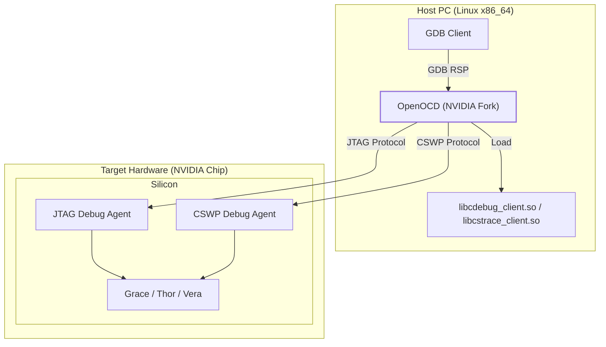
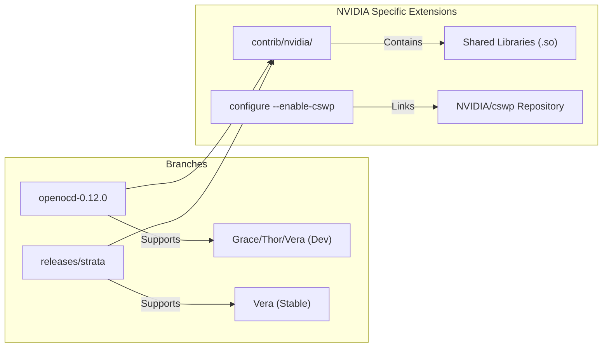

<!-- source: DeepWiki mcp.deepwiki.com · repo NVIDIA/openocd · page 1 Overview · fetched 2026-10-26 -->

# Overview

Relevant source files

The following files were used as context for generating this wiki page:

- [LICENSE.md](LICENSE.md)
- [README.md](README.md)

NVIDIA's fork of OpenOCD is a specialized derivative of the upstream [OpenOCD](https://openocd.org/) project, modified to support the unique debugging requirements of NVIDIA silicon [README.md:4-6](). It functions primarily as a GDB server, translating high-level debugger commands into low-level hardware requests targeting on-chip debug agents [README.md:14-16]().

The repository is organized into specific branches tailored to different chip generations and development cycles. It supports a variety of communication protocols, including standard JTAG and NVIDIA's CoreSight Wire Protocol (CSWP) [README.md:14-16]().

### NVIDIA Hardware Support & Branching
This repository targets several major NVIDIA chip architectures. Support is distributed across different branches depending on the stability and generation of the hardware:

*   **Grace**: Supported on the `openocd-0.12.0` branch [README.md:11-11]().
*   **Thor**: Supported on the `openocd-0.12.0` branch [README.md:12-12]().
*   **Vera**: Supported on both `releases/strata` (stable) and `openocd-0.12.0` (development) [README.md:13-13]().

For a detailed breakdown of which branch to use for your specific hardware and the lifecycle of these branches, see [Supported Hardware and Branch Structure](#1.1).

### The Debug Pipeline
OpenOCD acts as the bridge between the developer's GDB client and the target hardware. It handles the conversion of the GDB Remote Serial Protocol (RSP) into the specific signals required by NVIDIA's internal debug agents [README.md:14-16]().

#### System Translation Flow
The following diagram illustrates how OpenOCD interfaces with external libraries and hardware protocols.

**Figure 1: Debug Translation Pipeline**

**Sources:** [README.md:9-16](), [README.md:44-46]()

### Build and Deployment
The project is supported on `x86_64` Linux hosts, specifically targeting distributions like Ubuntu 18.04+, CentOS 7+, and Rocky Linux 8+ [README.md:48-51](). While a standard Autotools build process is used, specific configurations are required to enable advanced features like CoreSight Wire Protocol (CSWP) support [README.md:25-46]().

Key build artifacts for NVIDIA-specific features include:
*   `libcdebug_client.so`: Core debug client library [README.md:45-45]().
*   `libcstrace_client.so`: Core trace client library [README.md:45-45]().

For step-by-step instructions on environment setup and compilation, see [Getting Started: Build and Installation](#1.2).

### Repository Structure Mapping
The following diagram maps the repository's logical functions to its physical branch and file structure.

**Figure 2: Codebase Organization**

**Sources:** [README.md:11-13](), [README.md:34-46]()

### Licensing
While the work is based on the Open Source OpenOCD project, it is released under the **GPLv2 License** with specific exceptions [README.md:59-60](). Users should consult the `LICENSE.md` file in the root and the specific `LICENSES` files within each branch for full details [LICENSE.md:4-7]().

**Sources:**
- [README.md:4-16]() (Hardware support and purpose)
- [README.md:25-46]() (Build process and CSWP)
- [README.md:48-51]() (OS Requirements)
- [README.md:59-60]() (Licensing)
- [LICENSE.md:1-11]() (Derivative work statement)

---

