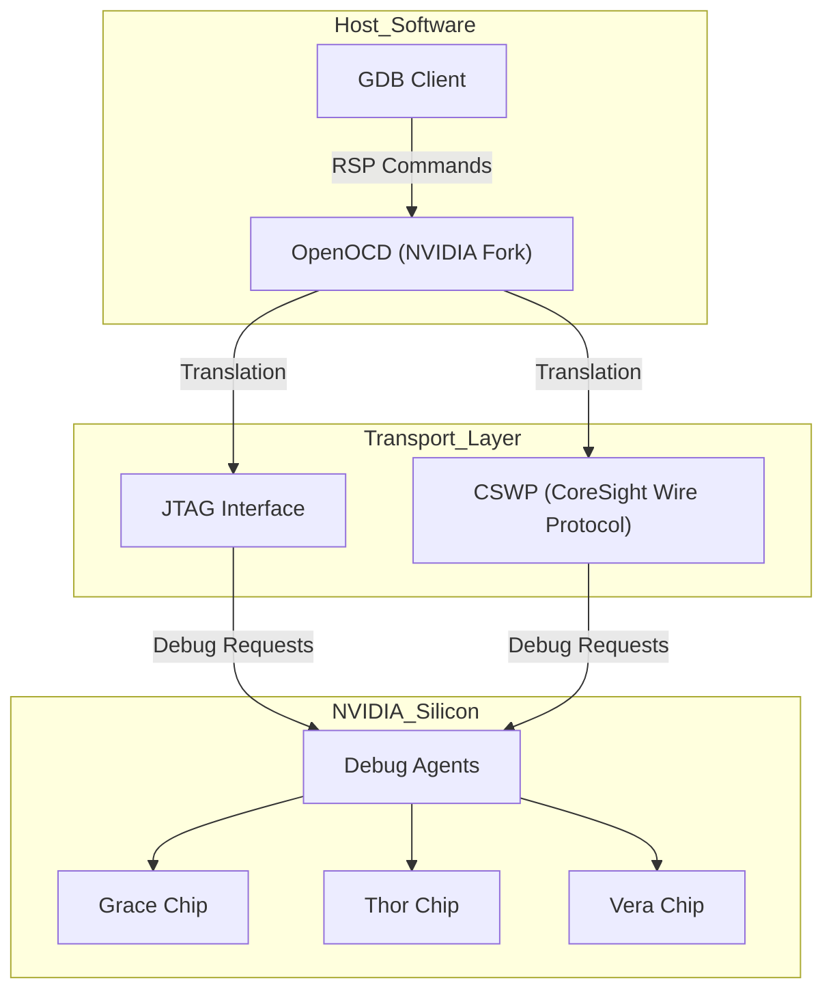
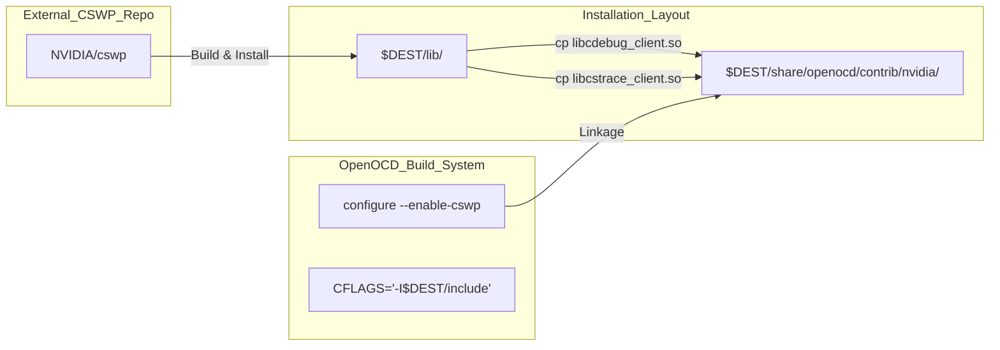

<!-- source: DeepWiki mcp.deepwiki.com · repo NVIDIA/openocd · page 1.1 Supported Hardware and Branch Structure · fetched 2026-10-26 -->

# Supported Hardware and Branch Structure

Relevant source files

The following files were used as context for generating this wiki page:

- [README.md](README.md)

This page provides a detailed breakdown of the NVIDIA hardware supported by this OpenOCD fork and the organizational structure of the Git repository. NVIDIA utilizes OpenOCD as a GDB server to translate high-level debug commands into hardware-level requests for integrated debug agents.

## Supported Hardware Platforms

NVIDIA's fork of OpenOCD is specifically modified to interface with the internal debug architecture of several NVIDIA chips. These chips utilize either standard JTAG or the CoreSight Wire Protocol (CSWP) for transport [README.md:14-16]().

### Hardware Matrix
The following table maps NVIDIA silicon to the supporting branches within this repository:

| Chip Name | Target Architecture | Primary Branch | Status |
| :--- | :--- | :--- | :--- |
| **Grace** | ARM Neoverse | `openocd-0.12.0` | Active [README.md:11-11]() |
| **Thor** | Tegra Next | `openocd-0.12.0` | Active [README.md:12-12]() |
| **Vera** | Data Center / Automotive | `releases/strata` | Stable [README.md:13-13]() |
| **Vera** | Data Center / Automotive | `openocd-0.12.0` | Development [README.md:13-13]() |

**Sources:**
- [README.md:10-13]()

---

## Branching Strategy and Infrastructure

The repository is organized to separate stable releases from ongoing development and specific platform features. 

### Branch Definitions
1.  **`openocd-0.12.0`**: This is the main development branch. It serves as the primary integration point for Grace and Thor support, as well as the active development branch for Vera [README.md:11-13]().
2.  **`releases/strata`**: This branch contains the stable production code specifically validated for Vera platforms [README.md:13-13]().

### Data Flow: GDB to Hardware
OpenOCD acts as an intermediary layer. It receives GDB Remote Serial Protocol (RSP) packets and translates them into sequences of JTAG or CSWP operations that the on-chip debug agents understand.

#### Debug Request Pipeline
The following diagram illustrates the relationship between the OpenOCD software layers and the NVIDIA hardware components.

**Figure 1: Debug Translation Architecture**

**Sources:**
- [README.md:14-16]()

---

## CSWP and External Dependencies

For modern NVIDIA chips, standard JTAG is often augmented or replaced by the CoreSight Wire Protocol (CSWP). Support for this is not built-in by default and requires linking against external NVIDIA libraries.

### Library Dependencies
When building with `--enable-cswp`, OpenOCD interacts with two critical shared objects:
*   `libcdebug_client.so`: Handles the client-side debug logic for CSWP [README.md:45-45]().
*   `libcstrace_client.so`: Manages trace data acquisition over the CSWP transport [README.md:45-45]().

These libraries must be placed in the `contrib/nvidia` directory within the installation prefix for the runtime to locate them correctly [README.md:44-46]().

**Figure 2: CSWP Integration Logic**

**Sources:**
- [README.md:34-46]()

---

## Host and OS Compatibility

NVIDIA's OpenOCD modifications are targeted primarily at Linux environments used in data center and automotive development.

*   **Host Architecture:** x86_64 Linux only [README.md:49-49]().
*   **Tested Distributions:** 
    *   Ubuntu 18.04+ [README.md:49-51]()
    *   CentOS 7+ [README.md:49-51]()
    *   Rocky Linux 8+ [README.md:49-51]()
    *   OpenBMC (Targeted for server management controllers) [README.md:51-51]()

**Sources:**
- [README.md:48-51]()

---

