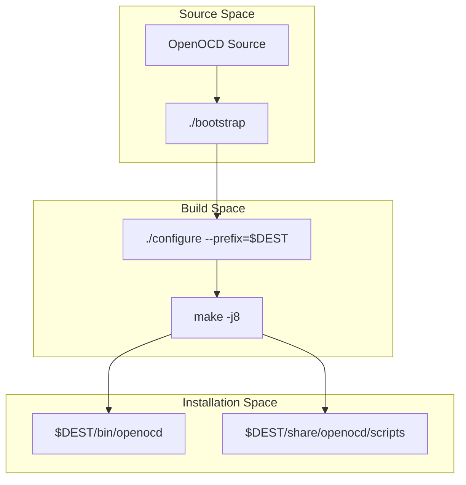
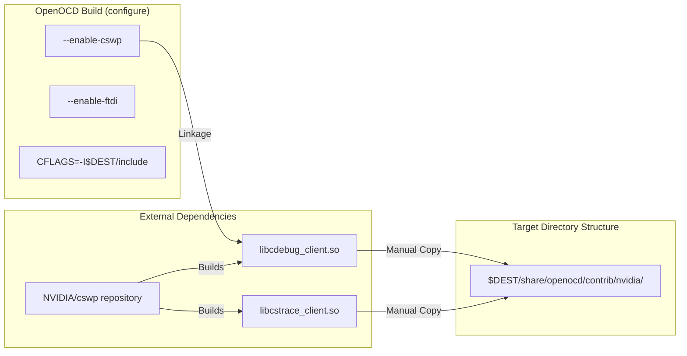

<!-- source: DeepWiki mcp.deepwiki.com · repo NVIDIA/openocd · page 1.2 Getting Started: Build and Installation · fetched 2026-10-26 -->

# Getting Started: Build and Installation

<details>
<summary>Relevant source files</summary>

The following files were used as context for generating this wiki page:

- [README.md](README.md)
- [print_env.sh](print_env.sh)

</details>


This page provides a technical guide for building and installing NVIDIA's fork of OpenOCD. It covers the standard Autotools-based build process, the specialized CoreSight Wire Protocol (CSWP) integration, and the environment configuration required for successful deployment on supported Linux hosts.

## Host Requirements and Environment

Building and running NVIDIA's OpenOCD fork is strictly supported on **x86_64 Linux** hosts [README.md:49-50](). The build system relies on standard GNU Autotools and requires specific environment variables to be set for both compilation and runtime library discovery.

### Supported Operating Systems
*   **Ubuntu:** 18.04+ [README.md:49-51]()
*   **CentOS:** 7+ [README.md:49-51]()
*   **Rocky Linux:** 8+ [README.md:49-51]()
*   **OpenBMC:** Supported for execution [README.md:51-51]()

### Critical Environment Variables
The following variables are used during the build process and should be tracked for diagnostic purposes using the `print_env.sh` utility [print_env.sh:45-53]().

| Variable | Role |
| :--- | :--- |
| `DEST` | The installation prefix directory (used in `--prefix`). |
| `PATH` | Must include the path to `gcc`, `g++`, and `bootstrap` dependencies. |
| `LD_LIBRARY_PATH` | Required for locating shared objects like `libcdebug_client.so`. |
| `CFLAGS` | Used to point to CSWP headers: `-I$DEST/include`. |

**Sources:** [README.md:48-52](), [print_env.sh:45-53]()

---

## Standard Build Process

The standard build uses the `bootstrap` script to generate the configuration files, followed by a standard `configure` and `make` cycle.

### Implementation Flow: Standard Autotools
The following diagram illustrates the data flow from the source repository to the installed binaries.

**Standard Build Pipeline**


**Steps:**
1.  **Bootstrap:** Run `./bootstrap` to generate the `configure` script [README.md:28-28]().
2.  **Configure:** Initialize the build directory and set the installation prefix [README.md:29-31]().
3.  **Compile & Install:** Execute `make install` to build the binary and deploy it to the `$DEST` path [README.md:32-32]().

**Sources:** [README.md:27-33]()

---

## CSWP-Enabled Build

For hardware targeting Grace, Thor, or Vera chips via the CoreSight Wire Protocol, OpenOCD must be linked against NVIDIA's CSWP libraries. This requires a two-stage build process: first building the CSWP client libraries, then building OpenOCD with those libraries enabled.

### CSWP Integration Logic
The CSWP integration relies on `libcdebug_client.so` and `libcstrace_client.so`. These must be manually placed in a specific subdirectory within the OpenOCD installation tree to be correctly utilized by NVIDIA-specific scripts.

**CSWP Component Mapping**


### Build Instructions
To enable CSWP support, follow these steps [README.md:34-46]():

1.  **Build CSWP:** Clone the [CSWP repository](https://github.com/NVIDIA/cswp) and install it to `$DEST` [README.md:35-36]().
2.  **Configure OpenOCD:** Run configure with the `--enable-cswp` flag and point to the CSWP include directory [README.md:42-42]().
    ```bash
    ../configure --prefix=$DEST --enable-cswp --enable-ftdi CFLAGS="-I$DEST/include"
    ```
3.  **Post-Install Library Setup:** OpenOCD expects the NVIDIA-specific libraries in the `contrib/nvidia` subdirectory [README.md:44-45]().
    ```bash
    mkdir -p $DEST/share/openocd/contrib/nvidia
    cp $DEST/lib/libcdebug_client.so $DEST/lib/libcstrace_client.so $DEST/share/openocd/contrib/nvidia/
    ```

**Sources:** [README.md:34-46]()

---

## Diagnostics and Environment Verification

The repository includes a utility script, `print_env.sh`, to help diagnose build failures or runtime issues by capturing the state of the host system.

### `print_env.sh` Functions
This script gathers the following technical metadata:
*   **Git State:** Current branch, commit hash, and recursive submodule status [print_env.sh:10-14]().
*   **Toolchain Versions:** Versions for `cmake`, `gcc`, `g++`, and `python` [print_env.sh:29-43]().
*   **OS/Hardware:** Detailed `/etc/*-release` info, kernel version (`uname -a`), and CPU architecture (`lscpu`) [print_env.sh:20-27]().
*   **Python Environment:** Lists all installed `pip` packages [print_env.sh:57-63]().

The output is formatted in HTML `<details>` tags for easy inclusion in GitHub issues [print_env.sh:66-71]().

**Sources:** [print_env.sh:1-72]()

---

