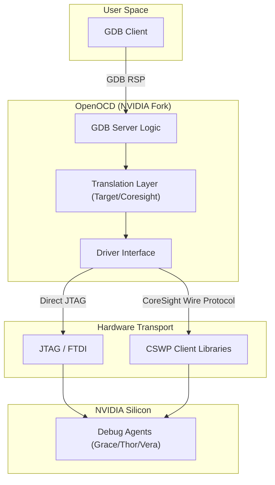
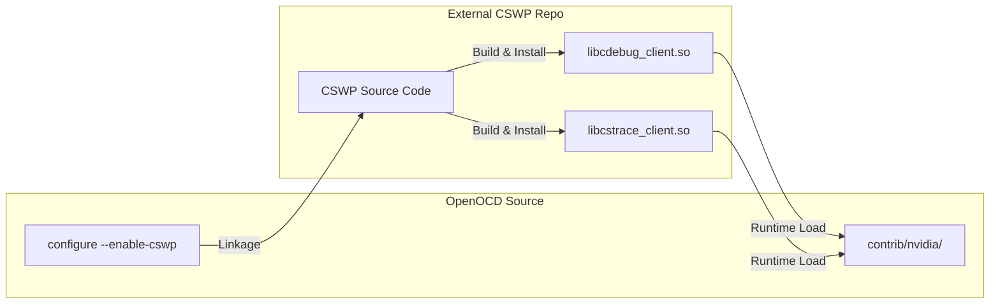

<!-- source: DeepWiki mcp.deepwiki.com · repo NVIDIA/openocd · page 2 Architecture and Key Concepts · fetched 2026-10-26 -->

# Architecture and Key Concepts

Relevant source files

The following files were used as context for generating this wiki page:

- [README.md](README.md)

This page provides a high-level overview of the system architecture for NVIDIA's fork of OpenOCD. It describes how the software functions as a bridge between standard debuggers (like GDB) and NVIDIA-specific hardware targets such as Grace, Thor, and Vera.

## System Role and GDB Server

NVIDIA's OpenOCD fork primarily functions as a **GDB Server**. It abstracts the complexities of hardware-level debug protocols, allowing developers to use standard GNU Debugger (GDB) commands to inspect and control NVIDIA chips [README.md:14-16]().

The system operates by:
1.  Listening for GDB Remote Serial Protocol (RSP) commands.
2.  Translating these commands into hardware-specific debug requests.
3.  Routing these requests through a selected transport layer (JTAG or CSWP).
4.  Interacting with on-chip debug agents built into NVIDIA silicon [README.md:14-16]().

### High-Level Component Interaction

The following diagram illustrates the flow from the user's debug client through the OpenOCD translation layers to the hardware.

**Diagram: Debug Command Flow**

**Sources:** [README.md:9-16]()

## Debug Translation Pipeline

The translation pipeline is responsible for converting high-level debug operations (like "read memory" or "halt processor") into the specific sequences required by NVIDIA's on-chip debug architecture. Depending on the branch used (e.g., `openocd-0.12.0` for Grace/Thor or `releases/strata` for Vera), OpenOCD utilizes different target configurations to communicate with these agents [README.md:11-13]().

Key aspects of the pipeline include:
*   **Target Abstraction:** Mapping GDB register sets to hardware-specific registers.
*   **Protocol Conversion:** Converting software breakpoints into hardware watchpoints or instruction breaks.
*   **Transport Selection:** Determining whether to use traditional JTAG or the NVIDIA CoreSight Wire Protocol (CSWP).

For a detailed breakdown of how data moves through these layers, see [Debug Communication Pipeline](#2.1).

**Sources:** [README.md:11-16]()

## CSWP Integration and External Libraries

A significant feature of this fork is the integration of the **CoreSight Wire Protocol (CSWP)**. This allows for high-performance debugging and tracing over specialized NVIDIA interfaces. Unlike standard OpenOCD, which often relies solely on JTAG, this version can link against external NVIDIA libraries to handle complex wire protocols [README.md:34-46]().

### Integration Components
When built with CSWP support (`--enable-cswp`), OpenOCD interacts with external shared objects located in the `contrib/nvidia` directory:
*   `libcdebug_client.so`: Handles debug control operations [README.md:45-46]().
*   `libcstrace_client.so`: Manages trace data acquisition [README.md:45-46]().

The following diagram shows the relationship between the OpenOCD build process and these external dependencies.

**Diagram: CSWP Dependency Mapping**

For instructions on building and linking these libraries, see [CSWP Integration and External Libraries](#2.2).

**Sources:** [README.md:34-46]()

---

