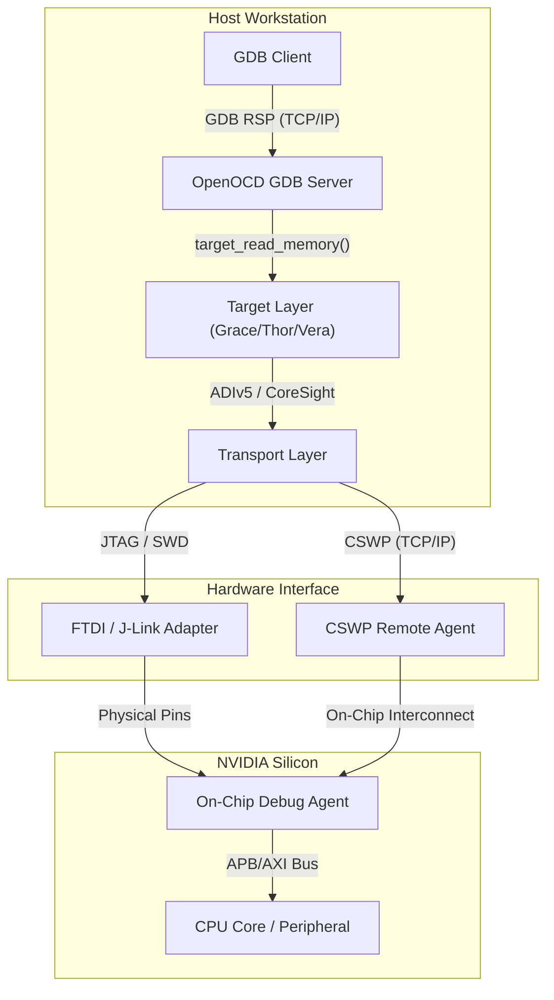
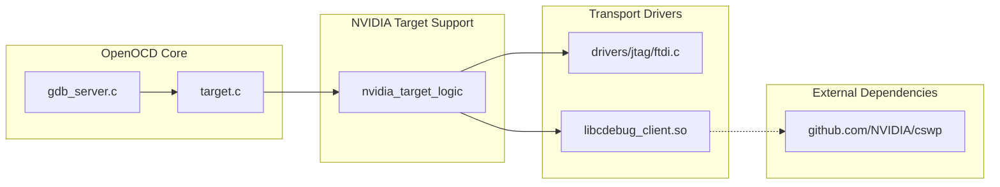

<!-- source: DeepWiki mcp.deepwiki.com · repo NVIDIA/openocd · page 2.1 Debug Communication Pipeline · fetched 2026-10-26 -->

# Debug Communication Pipeline

Relevant source files

The following files were used as context for generating this wiki page:

- [README.md](README.md)

The Debug Communication Pipeline in NVIDIA's fork of OpenOCD facilitates the end-to-end flow of debug information from a high-level debugger (like GDB) to the physical silicon. This pipeline transforms abstract debugging operations (such as "read memory" or "set breakpoint") into protocol-specific packets that navigate through OpenOCD's internal layers and eventually reach on-chip debug agents via JTAG or the CoreSight Wire Protocol (CSWP) [README.md:14-16]().

## Pipeline Overview

The pipeline operates as a translation stack. At the top, the GDB Server module listens for incoming Remote Serial Protocol (RSP) packets. These packets are parsed and translated into target-agnostic debug commands. These commands are then routed through a target-specific layer (e.g., for Grace, Thor, or Vera chips) which ultimately dispatches them to the hardware interface [README.md:9-16]().

### Data Flow Architecture

The following diagram illustrates the path a debug request takes from the developer's workstation to the NVIDIA hardware.

**Figure 1: End-to-End Debug Request Flow**

**Sources:** [README.md:9-16](), [README.md:34-46]()

## Protocol Translation Layers

### 1. GDB RSP to OpenOCD Command
The pipeline begins when a GDB client connects to OpenOCD. OpenOCD acts as a GDB server, interpreting the GDB Remote Serial Protocol (RSP) [README.md:14-15](). For example, a GDB `$m` packet (memory read) is received by the server and converted into a call to the internal OpenOCD function `target_read_memory()`.

### 2. Target-Specific Translation
NVIDIA chips like Grace, Thor, and Vera utilize specific debug architectures. Depending on the branch used (`openocd-0.12.0` or `releases/strata`), the target layer handles the specific register maps and power-up sequences required for these chips [README.md:11-13]().

### 3. Transport Selection (JTAG vs. CSWP)
OpenOCD selects the transport mechanism based on the configuration:
*   **JTAG Transport:** Standard bit-banging or high-speed USB-to-JTAG adapters (like FTDI) communicate directly with the chip's TAP controller [README.md:16]().
*   **CSWP Transport:** When `--enable-cswp` is used, the pipeline integrates with `libcdebug_client.so` [README.md:34-45](). This allows debug commands to be encapsulated in the CoreSight Wire Protocol, which can be sent over Ethernet to a remote debug agent on the target system (e.g., an OpenBMC controller) [README.md:44-51]().

## Code Entity Mapping

The following diagram maps the logical pipeline stages to specific code entities and libraries within the NVIDIA OpenOCD ecosystem.

**Figure 2: Pipeline Entity Mapping**

**Sources:** [README.md:11-16](), [README.md:34-46]()

## Hardware Reachability

The final stage of the pipeline involves the on-chip debug agents. These agents are hardware blocks within the NVIDIA silicon that have master access to the internal buses (like APB or AXI).

| Component | Role in Pipeline | Hardware Interface |
| :--- | :--- | :--- |
| **GDB Server** | Protocol Entry Point | TCP Port 3333 |
| **Target Layer** | NVIDIA-specific logic | Software Abstraction |
| **FTDI Driver** | Physical Transport (JTAG) | USB to JTAG Pins [README.md:42]() |
| **CSWP Client** | Remote Transport (Network) | `libcdebug_client.so` [README.md:45]() |
| **Debug Agent** | On-chip Execution | Silicon Interconnect [README.md:15]() |

### CSWP Pipeline Specifics
When utilizing the CSWP-enabled pipeline, the data flow includes an additional library hop. The OpenOCD binary links against NVIDIA's `libcdebug_client.so` and `libcstrace_client.so`, which are typically installed in `contrib/nvidia` within the OpenOCD prefix [README.md:44-46](). This allows the pipeline to bypass physical JTAG pins and use a network-based debug path, which is critical for debugging systems where physical JTAG access is restricted or unavailable [README.md:49-51]().

**Sources:**
* [README.md:9-16]() (Overview of chips and GDB server role)
* [README.md:34-46]() (CSWP build and library integration)
* [README.md:49-51]() (Host and OS requirements)

---

