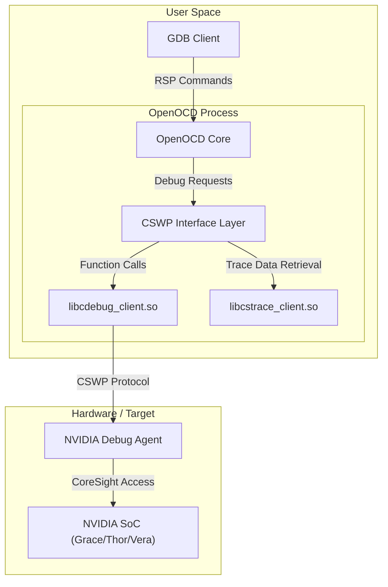
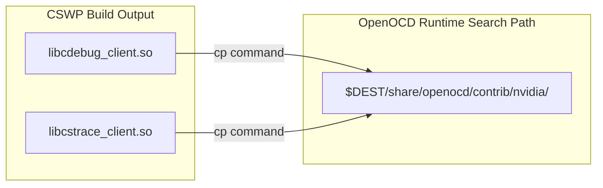

<!-- source: DeepWiki mcp.deepwiki.com · repo NVIDIA/openocd · page 2.2 CSWP Integration and External Libraries · fetched 2026-10-26 -->

# CSWP Integration and External Libraries

Relevant source files

The following files were used as context for generating this wiki page:

- [README.md](README.md)

The CoreSight Wire Protocol (CSWP) subsystem allows OpenOCD to communicate with NVIDIA debug agents via a specialized protocol rather than traditional JTAG. This integration relies on external libraries provided by the NVIDIA CSWP project, which are loaded by OpenOCD at runtime to facilitate debug and trace operations on chips like Grace, Thor, and Vera.

## CSWP Architecture Overview

The CSWP integration functions as a transport layer between OpenOCD's core and the hardware debug agents. Instead of direct bit-banging or JTAG controller manipulation, OpenOCD interfaces with a client library that abstracts the wire protocol.

### Data Flow and Component Interaction

The following diagram illustrates how OpenOCD utilizes external CSWP libraries to bridge GDB commands to NVIDIA hardware.

**Diagram: CSWP Debug Pipeline**

**Sources:** [README.md:8-16](), [README.md:34-46]()

## Building with CSWP Support

To enable CSWP functionality, OpenOCD must be configured with specific flags and linked against the CSWP headers. This process requires a pre-built installation of the CSWP repository.

### Build Requirements
1.  **CSWP Repository:** Must be cloned from `https://github.com/NVIDIA/cswp`.
2.  **Installation Prefix:** A shared `$DEST` directory where both CSWP and OpenOCD will reside.
3.  **Compiler Flags:** The build system must be pointed to the CSWP include directory via `CFLAGS`.

### Build Sequence
The build process follows these steps to ensure the CSWP headers are available during the OpenOCD compilation phase:

| Step | Command | Purpose |
| :--- | :--- | :--- |
| 1 | `../configure --prefix=$DEST --enable-cswp ...` | Enables CSWP feature macros in the source [README.md:42-42]() |
| 2 | `CFLAGS="-I$DEST/include"` | Provides paths to CSWP client headers [README.md:42-42]() |
| 3 | `make install` | Compiles OpenOCD and installs binaries [README.md:43-43]() |

**Sources:** [README.md:34-43]()

## External Libraries: libcdebug_client and libcstrace_client

The CSWP integration relies on two primary shared objects that act as the protocol drivers.

### libcdebug_client.so
This library is responsible for the standard debug operations. It translates OpenOCD's internal debug requests (such as memory reads/writes or register access) into CSWP packets compatible with NVIDIA debug agents [README.md:14-16]().

### libcstrace_client.so
This library handles the streaming and decoding of CoreSight trace data. It allows OpenOCD to interface with the hardware trace buffers and export trace streams for analysis [README.md:45-45]().

### Runtime Loading and Contrib Directory
OpenOCD expects these libraries to be located in a specific directory relative to its installation prefix to ensure they can be found at runtime. The standard NVIDIA deployment requires copying these files into the `contrib/nvidia` subdirectory of the OpenOCD share folder.

**Diagram: Library Distribution Path**

**Sources:** [README.md:44-46]()

## Implementation Details

The integration is toggled via the `--enable-cswp` configure flag. When enabled, OpenOCD incorporates logic to communicate with the CSWP backend.

### Key Integration Points
*   **Transport Selection:** Users can select CSWP as the transport method in their configuration files, which directs OpenOCD to use the CSWP client libraries instead of JTAG drivers [README.md:14-16]().
*   **Hardware Targeting:** This integration is specifically utilized for NVIDIA's Grace, Thor, and Vera chips, where the debug agents are designed to communicate over the CoreSight Wire Protocol [README.md:9-13]().

**Sources:** [README.md:9-16](), [README.md:42-42]()

---

