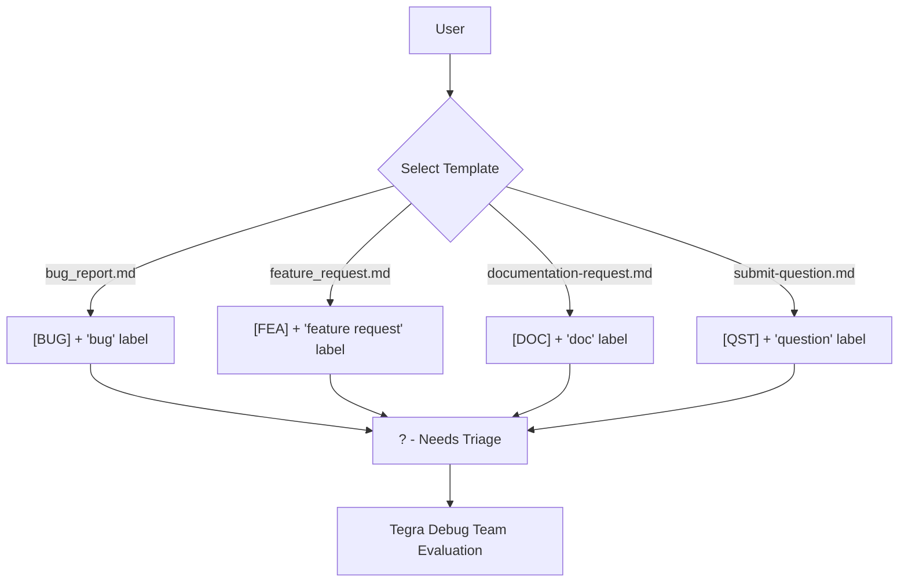
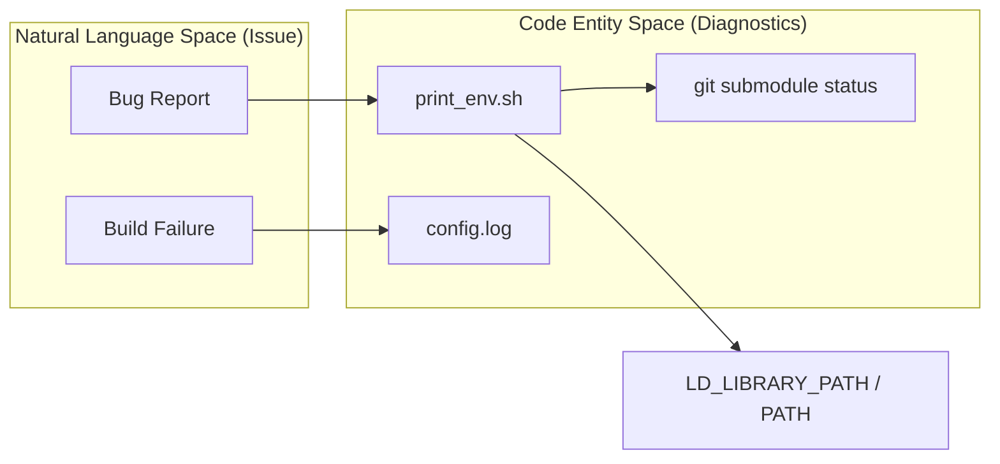

<!-- source: DeepWiki mcp.deepwiki.com · repo NVIDIA/openocd · page 3.1 Issue Reporting Workflow · fetched 2026-10-26 -->

# Issue Reporting Workflow

Relevant source files

The following files were used as context for generating this wiki page:

- [.github/ISSUE_TEMPLATE/bug_report.md](.github/ISSUE_TEMPLATE/bug_report.md)
- [.github/ISSUE_TEMPLATE/documentation-request.md](.github/ISSUE_TEMPLATE/documentation-request.md)
- [.github/ISSUE_TEMPLATE/feature_request.md](.github/ISSUE_TEMPLATE/feature_request.md)
- [.github/ISSUE_TEMPLATE/submit-question.md](.github/ISSUE_TEMPLATE/submit-question.md)
- [CONTRIBUTING.md](CONTRIBUTING.md)
- [print_env.sh](print_env.sh)

The NVIDIA OpenOCD repository utilizes a structured issue reporting workflow to manage bugs, feature requests, and documentation improvements. This process ensures that the Tegra Debug team has the necessary diagnostic information to reproduce issues and schedule them for release.

## Issue Templates and Label Taxonomy

All new issues are initiated via the GitHub issue chooser `[CONTRIBUTING.md:3-4]()`. The repository defines four specific templates, each associated with a unique title prefix and a set of initial labels.

### 1. Bug Report
*   **Title Prefix:** `[BUG]` `[.github/ISSUE_TEMPLATE/bug_report.md:4-4]()`
*   **Initial Labels:** `? - Needs Triage`, `bug` `[.github/ISSUE_TEMPLATE/bug_report.md:5-5]()`
*   **Requirement:** Requires a minimal reproduction case and the output of `print_env.sh` `[.github/ISSUE_TEMPLATE/bug_report.md:13-21]()`.

### 2. Feature Request
*   **Title Prefix:** `[FEA]` `[.github/ISSUE_TEMPLATE/feature_request.md:4-4]()`
*   **Initial Labels:** `? - Needs Triage`, `feature request` `[.github/ISSUE_TEMPLATE/feature_request.md:5-5]()`
*   **Requirement:** Must describe the problem being solved and any alternative solutions considered `[.github/ISSUE_TEMPLATE/feature_request.md:10-17]()`.

### 3. Documentation Request
*   **Title Prefix:** `[DOC]` `[.github/ISSUE_TEMPLATE/documentation-request.md:4-4]()`
*   **Initial Labels:** `? - Needs Triage`, `doc` `[.github/ISSUE_TEMPLATE/documentation-request.md:5-5]()`
*   **Requirement:** Covers both incorrect documentation (requiring links and line numbers) and needed documentation (requiring a description of the missing content) `[.github/ISSUE_TEMPLATE/documentation-request.md:13-36]()`.

### 4. Submit Question
*   **Title Prefix:** `[QST]` `[.github/ISSUE_TEMPLATE/submit-question.md:4-4]()`
*   **Initial Labels:** `? - Needs Triage`, `question` `[.github/ISSUE_TEMPLATE/submit-question.md:5-5]()`

### Data Flow: From Template to Triage
The following diagram illustrates how user input is transformed into a structured GitHub issue.

**Issue Initialization Pipeline**

**Sources:** `[.github/ISSUE_TEMPLATE/bug_report.md:1-8]()`, `[.github/ISSUE_TEMPLATE/feature_request.md:1-8]()`, `[.github/ISSUE_TEMPLATE/documentation-request.md:1-8]()`, `[.github/ISSUE_TEMPLATE/submit-question.md:1-8]()`, `[CONTRIBUTING.md:7-9]()`

---

## Diagnostic Tools

For technical issues, particularly bugs and build failures, specific diagnostic data is required.

### print_env.sh
The `print_env.sh` script is a bash utility located in the project root `[print_env.sh:1-1]()`. It aggregates environment metadata into a format suitable for pasting directly into a GitHub issue using `
` and `<pre>` tags `[print_env.sh:66-71]()`.

Key data points collected by `print_env()` `[print_env.sh:9-64]()`:
*   **Git State:** Current commit (`git log`) and submodule status `[print_env.sh:10-14]()`.
*   **OS/Kernel:** Distribution info from `/etc/*-release` and `uname -a` `[print_env.sh:20-22]()`.
*   **Toolchain Versions:** `cmake`, `g++`, `gcc`, and `python` `[print_env.sh:29-42]()`.
*   **Environment Variables:** `PATH`, `LD_LIBRARY_PATH`, and `PYTHON_PATH` `[print_env.sh:47-51]()`.
*   **Python Packages:** A full list of installed `pip` packages `[print_env.sh:57-63]()`.

### Build Diagnostics
If the issue is related to the build process, users must provide:
1.  `config.log`: Generated by the Autotools `configure` script `[.github/ISSUE_TEMPLATE/bug_report.md:21-21]()`.
2.  Build logs: The stdout/stderr output from the `make` or `ninja` execution `[.github/ISSUE_TEMPLATE/bug_report.md:21-21]()`.

---

## Triage Lifecycle

The "Tegra Debug team" is responsible for the lifecycle of an issue from submission to resolution `[CONTRIBUTING.md:7-9]()`.

| State | Action |
| :--- | :--- |
| **New** | Issue is created with the `? - Needs Triage` label. |
| **Evaluation** | Team reviews the `print_env.sh` output and reproduction steps. |
| **Prioritization** | Team may move the issue to a release schedule. Users can request priority by commenting on the issue `[CONTRIBUTING.md:8-9]()`. |
| **Resolution** | The issue is linked to a Pull Request or closed as "Fixed" or "Won't Fix". |

### Relationship Between Issues and Code Entities
This diagram maps the diagnostic requirements to the system components they investigate.

**Diagnostic Mapping**

**Sources:** `[print_env.sh:9-64]()`, `[.github/ISSUE_TEMPLATE/bug_report.md:19-21]()`, `[CONTRIBUTING.md:5-6]()`

---

## Legal and Conduct Compliance
By submitting any issue (Bug, Feature, Doc, or Question), the reporter agrees to:
1.  **Code of Conduct:** Located at `CODE_OF_CONDUCT.md` `[.github/ISSUE_TEMPLATE/bug_report.md:27-27]()`.
2.  **Contributing Guidelines:** Located at `CONTRIBUTING.md` `[.github/ISSUE_TEMPLATE/bug_report.md:27-27]()`.

**Sources:**
*   `[.github/ISSUE_TEMPLATE/bug_report.md:1-28]()`
*   `[.github/ISSUE_TEMPLATE/feature_request.md:1-24]()`
*   `[.github/ISSUE_TEMPLATE/documentation-request.md:1-43]()`
*   `[.github/ISSUE_TEMPLATE/submit-question.md:1-15]()`
*   `[CONTRIBUTING.md:1-11]()`
*   `[print_env.sh:1-72]()`

---

