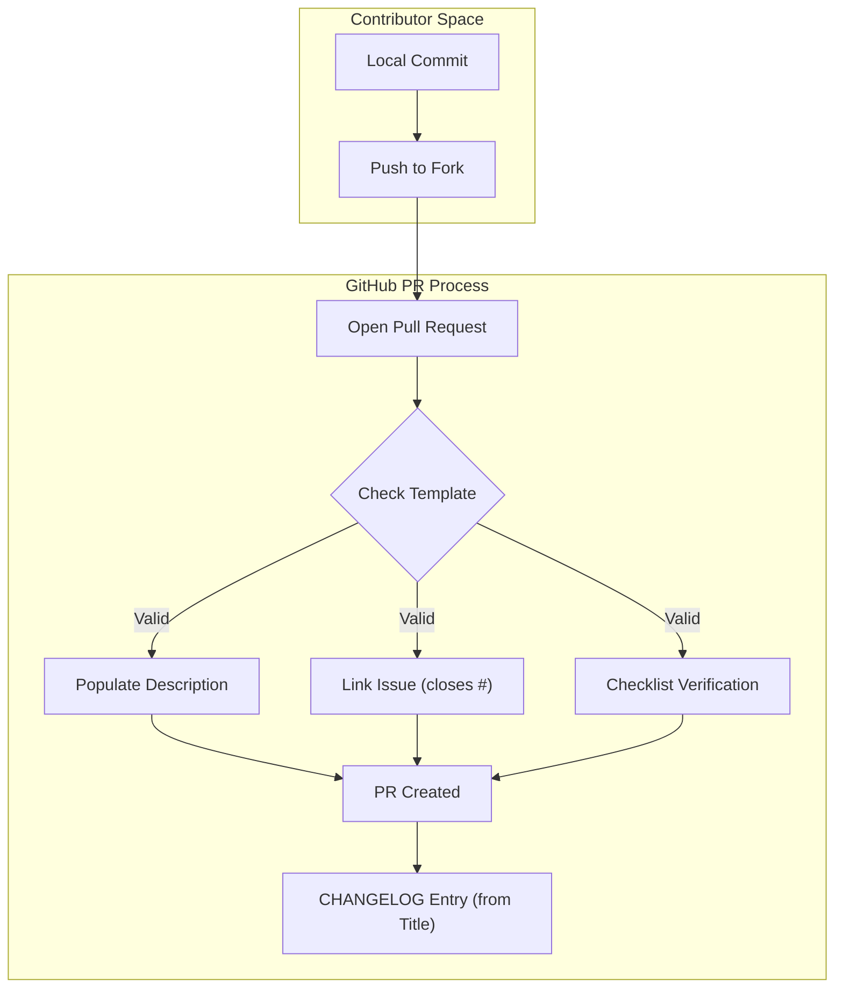
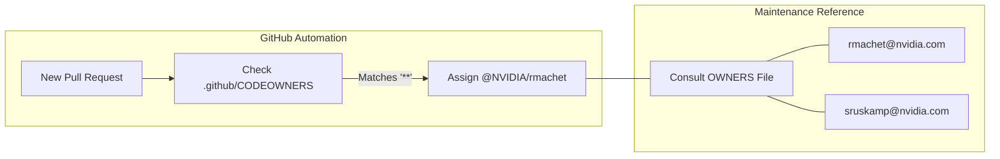

<!-- source: DeepWiki mcp.deepwiki.com · repo NVIDIA/openocd · page 3.2 Pull Request Process and Contribution License Agreement · fetched 2026-10-26 -->

# Pull Request Process and Contribution License Agreement

Relevant source files

The following files were used as context for generating this wiki page:

- [.github/CODEOWNERS](.github/CODEOWNERS)
- [.github/PULL_REQUEST_TEMPLATE.md](.github/PULL_REQUEST_TEMPLATE.md)
- [CLA.md](CLA.md)
- [OWNERS](OWNERS)

This page documents the formal procedures for contributing code to the NVIDIA OpenOCD fork. It covers the requirements for pull request (PR) construction, the legal framework of the Contribution License Agreement (CLA), and the automated review routing mechanisms defined in the repository.

## Pull Request Requirements

To maintain a clean and traceable history, all pull requests must adhere to a specific format defined in the pull request template. This ensures that every change is documented, linked to an issue, and properly attributed in the project's changelog.

### Template Components
The pull request process is governed by the template found in `.github/PULL_REQUEST_TEMPLATE.md` [1-10]().

*   **Standalone Description**: Contributors must provide a clear, independent summary of the changes [1-2]().
*   **Issue Linking**: PRs should reference any issues they resolve using the "closes #1234" syntax [3]().
*   **Changelog Integration**: The title of the pull request is significant because it is automatically included in the `CHANGELOG` [4]().
*   **Mandatory Checklist**: Before submission, contributors must confirm they have reviewed the contributing guidelines, verified test coverage, and updated documentation [6-10]().

### Pull Request Lifecycle Flow

The following diagram illustrates the flow from a contributor's local environment through the GitHub submission process.

**PR Submission and Metadata Flow**

**Sources:**
*   [.github/PULL_REQUEST_TEMPLATE.md:1-10]()

## Contribution License Agreement (CLA)

All contributors must agree to the NVIDIA Contribution License Agreement (CLA) before their submissions can be accepted into any NVIDIA open source project [28-30](). This agreement establishes the legal rights and licenses necessary for NVIDIA to distribute the contributed code.

### Key Legal Provisions
The CLA covers several critical areas:
*   **Definitions**: Defines "Code", "Project", and "Submission" (which includes code, comments, and documentation) [9-26]().
*   **Originality**: The contributor represents that the submission is their original work [32-34](). If third-party materials are included, they must be explicitly identified [35-39]().
*   **Employer Rights**: If the work was performed for an employer, the contributor must secure permission before signing [41-49]().
*   **License Grants**:
    *   **Copyright**: A perpetual, worldwide, non-exclusive, royalty-free, irrevocable license to reproduce and distribute the work [54-58]().
    *   **Patent**: A similar license under the contributor's patent claims that are necessarily infringed by the submission [60-64]().

### Submission Types
The CLA provides two signing options based on the contributor's status:
1.  **Individual**: For those with sole ownership of intellectual property rights [108-116]().
2.  **Corporate/Employer**: For those making submissions in the course of their employment [118]().

**Sources:**
*   [CLA.md:1-118]()

## Review Routing and Ownership

The repository uses automated mechanisms to ensure that pull requests are routed to the appropriate maintainers for review. This is handled through two primary files: `OWNERS` and `.github/CODEOWNERS`.

### CODEOWNERS Mechanism
The GitHub `CODEOWNERS` file is used to automatically assign reviewers based on the file paths modified in a pull request.

*   **Global Ownership**: Currently, the repository defines a global owner for all files (`**`) [1]().
*   **Assigned Reviewer**: `@NVIDIA/rmachet` is designated as the primary owner for the entire codebase [1]().

### OWNERS Directory Management
The `OWNERS` file in the root directory provides a human-readable list of top-level directory owners and additional metadata.

| Role | Entity | Source |
| :--- | :--- | :--- |
| **Primary Owner** | rmachet@nvidia.com | [OWNERS:2]() |
| **Secondary Owner** | sruskamp@nvidia.com | [OWNERS:3]() |

### Code Review Assignment Flow

The following diagram bridges the "Natural Language" requirement of code review to the "Code Entity" implementation of ownership.

**Review Assignment Logic**

**Sources:**
*   [.github/CODEOWNERS:1-2]()
*   [OWNERS:1-8]()

---

